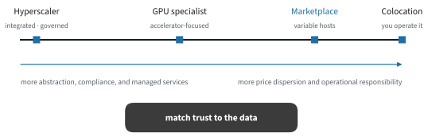
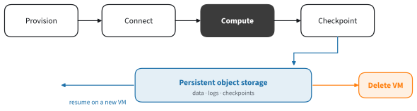

# Cloud Computing
:label:`sec_cloud_instances`

A workload may exceed the hosted-notebook limits described in
:numref:`sec_hosted_notebooks` because preprocessing takes
many hours, the model requires 80 GB of accelerator memory, or an experiment
needs several GPUs. Renting provides access to larger configurations without
purchasing them. The dated mid-2026 examples below show substantial price
variation across providers; current prices must be checked before use. The
book's notebooks stay below 8 GB of GPU memory, so a 16 GB rentable GPU has
adequate capacity. Full fine-tuning, long-context serving, and pretraining
increase both memory requirements and cost.

Effective cloud use requires matching a machine to the workload and treating
the instance as disposable. Results must be copied to durable storage before
the instance is deleted.

## The Rental Market

### Three Tiers of Provider


:label:`fig_tools_cloud_spectrum`

* **Hyperscalers** — AWS, Google Cloud, Microsoft Azure — sell GPUs
  embedded in a full cloud: identity management, virtual networks, managed
  storage, and every adjacent service. You pay for that integration; their
  on-demand GPU prices are consistently the highest, and the largest
  instances often require quota requests or sales contact. They are often
  appropriate when data already resides in that cloud, when
  compliance requirements apply, or when training is part of a larger
  managed system. Google
  additionally rents TPUs (a v5e chip for about \$1.20 per hour in this
  snapshot), which can run the JAX code in this book.
* **GPU specialists** — Lambda, CoreWeave, Crusoe, Nebius, Voltage Park,
  Together, and others — do one thing: accelerators with fast interconnect
  and ML-ready images. Self-serve H100s run \$2–4.30 per hour (July 2026);
  Lambda and Nebius are fully self-serve, while CoreWeave publishes prices
  but onboards through sales. This tier suits substantial training runs that do not require a
  hyperscaler's surrounding services.
* **Marketplaces** — Vast.ai, RunPod, TensorDock, Prime Intellect, and the
  auction-style SF Compute — aggregate machines from many independent
  operators, including consumer GPUs that the large clouds do not carry.
  These marketplaces often list the lowest hourly prices: an RTX 4090 for
  \$0.30–0.60 per hour, an
  H100 from about \$1.50. The catch is variance: host reliability, disk
  speed, and network quality differ per listing, and your code runs on a
  stranger's machine — fine for coursework and public data, inappropriate
  for anything sensitive unless the platform's vetted tier is used.

### A Dated Price Snapshot

Prices change quickly and vary by region, availability, commitment, and host.
Treat the following July 2026 snapshot as an illustration rather than a
catalog, and obtain current quotes before making a purchasing decision:

:GPU rental snapshot, on-demand (July 2026)
:label:`tab_cloud_prices`

| Provider (tier) | Cheap GPU option | ≈ \$/hr | 1× H100 80 GB ≈ \$/hr |
|---|---|---|---|
| Vast.ai (marketplace) | RTX 4090 24 GB | 0.35 | 1.50–1.90 |
| RunPod (marketplace) | RTX 4090 24 GB | 0.35–0.70 | 2.90 (vetted hosts) |
| Prime Intellect (marketplace) | RTX 4090 24 GB | 0.32 | 1.49 |
| Lambda (specialist) | A100 40 GB | 1.99 | 3.99–4.29 |
| Nebius (specialist) | RTX PRO 6000 48 GB | 1.80 | 3.85 |
| Voltage Park (specialist) | H100 (only SKU) | 1.99 | 1.99 |
| AWS (hyperscaler) | L4 24 GB (g6) | 0.80 | 6.88 (p5) |
| Azure (hyperscaler) | A10 24 GB | 1.43 | 6.98 |
| Google Cloud (hyperscaler) | L4 24 GB | 0.70 | ≈ 11 (A3) |

Three qualifications matter. First, providers may offer account-, student-,
or startup-specific credits. Eligibility and amounts change, so verify them
on the provider's official program page rather than budgeting from this
snapshot. Second, multi-GPU nodes price linearly per GPU
on most providers, but the interconnect does not: an 8×H100 machine with
NVLink is a qualitatively different tool from eight PCIe cards, and
communication-heavy training (:numref:`sec_training_systems`) will feel the
difference. Third, newer is not always cheaper per unit of work: B200-class
instances (\$6–14 per GPU-hour) only pay off when you exploit their memory
and FP8/FP4 throughput.

### Cost per Result, Not per Hour

The hourly price is the most visible term of a larger sum: setup time,
idle time while you debug, storage that keeps billing after the run, data
egress, and engineering time. A faster, more expensive GPU can reduce the
cost per *completed* experiment.
The model below compares an inexpensive marketplace card with two datacenter
GPUs for the same eight-hour job on the slowest card. Rerun it with
workload-specific assumptions:

```{.python .input #cloud-instances-cost-model}
import numpy as np

gpu = ["RTX 4090", "A100 80GB", "H100"]
gpu_per_hour = np.array([0.40, 1.50, 2.50])   # marketplace, July 2026
relative_speed = np.array([1.0, 1.6, 3.0])    # measure for your workload!
setup_hours = np.array([0.5, 0.5, 0.5])
storage_and_egress = np.array([2.0, 2.0, 2.0])
engineer_per_hour = 60.0

wall_hours = 8.0 / relative_speed
invoice = (wall_hours + setup_hours) * gpu_per_hour + storage_and_egress
complete = invoice + setup_hours * engineer_per_hour
for row in zip(gpu, np.round(wall_hours, 1), np.round(invoice, 2),
               np.round(complete, 2)):
    print(row)
```

The hourly invoice favors the inexpensive card, but including engineering
time makes the totals similar without changing their order. If slower
iteration adds another debugging round, the faster card can cost less
overall. Reliability therefore belongs
in the cost model. As an order-of-magnitude example, a LoRA fine-tune of a 7B model may take
hours on one consumer GPU, whereas pretraining a small language model can
require thousands of GPU-hours. Estimate the workload before comparing small
differences in hourly price.

Two cost traps deserve their own warnings:

* **Spot and interruptible capacity** may be substantially discounted and can
  suit jobs that checkpoint and resume cleanly
  (:numref:`sec_training_systems`). It is the wrong discount for an
  interactive session or an uncheckpointed run — eviction notice can be as
  short as a few seconds on marketplace spot tiers. Test recovery *before*
  the long run, not during it.
* **Egress fees.** Hyperscalers charge roughly \$0.09–0.12 per GB to move
  data out. Re-downloading a 140 GB checkpoint daily costs more per month
  than many GPUs. Keep data and compute in the same region, and prefer
  providers with free egress (most marketplaces) when your workflow moves
  big artifacts around.

## Working on a Rented Machine

### Boot, Connect, Verify

Start from the provider's current deep-learning image, with drivers, CUDA,
and the container runtime preinstalled. A bare OS image requires additional
setup that must also be reproduced later.
Connect with the SSH-tunnel pattern of :numref:`sec_interactive_development`
(the same two commands work on every provider), or use VS Code Remote SSH.
Run long jobs under `tmux` so an SSH disconnect does not kill training, and
verify the machine before trusting it with a long run:

```bash
nvidia-smi                 # driver ok? expected GPU? memory free?
df -h                      # scratch disk has room for data + checkpoints?
python -c "import torch; print(torch.cuda.get_device_name(0))"
```

A short smoke test—one batch through the model and one checkpoint written
and read back—can detect problems that instance-health indicators omit:
broken drivers, full disks, read-only mounts, and datasets that
stream too slowly to keep the GPU busy.

### Compute Is Disposable, Results Are Not


:label:`fig_tools_cloud_lifecycle`

The workflow in :numref:`fig_tools_cloud_lifecycle` separates the lifetime
of the machine from the lifetime of your work. Code is stored in Git and
cloned onto the instance; data and checkpoints sync to durable object
storage (S3, GCS, or the provider's volume product) on a schedule the job
controls; the instance itself can then be preempted, crashed, or deleted
without losing more than the last checkpoint interval. This is not merely a
safety practice — it enables recovery from preemption or host failure.

When the experiment ends, tear down *everything that bills*: the instance,
its disks and snapshots, reserved IP addresses, and stale buckets. Set a
billing alert on day one; a forgotten idle GPU costs the same as a busy
one, and quota limits are the only thing standing between a leaked
credential and a very large invoice.

## Summary

* Every notebook in this book fits in 8 GB of GPU memory, so the cheapest
  rentable GPUs suffice; LLM-scale work is what climbs the price ladder.
* The market has three tiers — hyperscalers, GPU specialists, and
  marketplaces — with a substantial price spread for the same GPU and different levels of
  integration, reliability, and operational trust.
* Compare cost per completed result, not per hour: include setup, idle
  time, storage, egress, and your own time.
* Spot capacity can reduce the cost of checkpointed, restartable jobs but is
  unsuitable for some interactive or uncheckpointed work; egress fees can
  make repeated artifact transfers expensive.
* Treat instances as disposable: provider image, SSH tunnel, `tmux`,
  checkpoints to durable storage, then delete every billable resource.

## Exercises

1. [code] **Peak memory and batch size.** The book's notebooks stay below
   8 GB of GPU memory, so the smallest card in :numref:`tab_cloud_prices`,
   with 24 GB, leaves room for a larger batch. Run
   :numref:`sec_bert-pretraining` on a GPU, for example in a hosted notebook
   (:numref:`sec_hosted_notebooks`), once with `batch_size = 512` and once
   with `batch_size = 256`. Record the peak of each of the three views of
   GPU memory in :numref:`fig_bg_allocator` for both runs.
    1. Which of the three views decides whether a run fits on a card, and
       why?
    1. Fit the peak of that view as a linear function of the batch size, and
       predict the largest batch that fits on a 24 GB card and on an 80 GB
       card. Which part of the memory does the intercept represent?
    1. Run a batch size between your two runs, or the 24 GB prediction if
       such a card is available, and compare the measured peak with the
       linear prediction.
   :exlabel:`ex_cloud-instances-peak-memory`

1. **Trust boundary.** A fine-tuning job reads its training data from
   object storage with an access key stored on the instance, and writes
   checkpoints to the instance's local disk.
    1. The data is a public dataset, and the job runs on a marketplace host.
       Besides the dataset, what can the host operator read or change while
       the job runs? Which of these items matters although the data is
       public? Why does encrypting the instance's disk not protect them from
       the host operator?
    1. The data is a hospital's medical records, and the job moves to a
       hyperscaler. Which parties can still read the data and the
       checkpoints while the job runs? Besides technical controls, what has
       to be in place before the records may be uploaded?

1. **Price per unit of work.** B200-class instances cost \$6–14 per
   GPU-hour, against \$2.50 for the H100 in `#cloud-instances-cost-model`.
   Take the dense throughput, the memory and the memory bandwidth of both
   GPUs from the columns H100 SXM and B200 SXM of :numref:`tab_gpu_specs`.
   The H100 has no FP4 tensor cores.
    1. At \$6 per hour, compute the price of one PFLOP-hour of dense BF16
       compute on each GPU, and the price of one TB/s-hour of memory
       bandwidth, the resource that bounds decoding. Below which hourly price
       does the B200 become cheaper than the H100 on each of the two
       resources? Do these prices lie inside the range of \$6–14?
    1. Repeat the compute comparison with FP8 on the H100 and FP4 on the
       B200, and find the hourly B200 price up to which FP4 stays cheaper.
       What must hold for the model before this comparison is the relevant
       one?
    1. Serving a model with 70 billion parameters in BF16 takes 140 GB for
       the weights alone. Compare one B200 with two H100s in price per hour
       and in the memory left for the KV cache (:numref:`sec_kv-cache`). What
       does splitting the model across two GPUs cost beyond the hourly price?

1. [code] **Engineering time in the cost model.** In
   `#cloud-instances-cost-model`, the column `complete` adds
   `setup_hours * engineer_per_hour` to the invoice.
    1. Explain why this term cannot change which GPU is cheapest, whatever
       the value of `engineer_per_hour`, as long as `setup_hours` is the same
       for all three GPUs.
    1. An engineer who waits for results or checks on the run spends a
       fraction $f$ of `wall_hours` on it. Add this time at
       `engineer_per_hour` to `complete`, and find the value of $f$ at which
       the H100 and the RTX 4090 cost the same. How many minutes of attention
       during the 8-hour run on the RTX 4090 does this value correspond to?
    1. Leave out both engineering terms. Which `relative_speed` would the H100
       need to match the RTX 4090 on the invoice alone?
    1. Obtain today's on-demand prices for the three GPUs from one
       marketplace of :numref:`tab_cloud_prices`, note the date, and compute
       the break-even fraction $f$ again. Does it move by more than a factor
       of two?
   :exlabel:`ex_cloud-instances-engineering-time`

1. **GPU-hours before dollars.** The training cost :eqref:`eq_six_nd`
   becomes a time once the sustained throughput is known. The model FLOPs
   utilization (MFU) is the fraction of a GPU's peak throughput that a
   training run achieves. Take an MFU of 40% of the H100's 989 TFLOPS of
   dense BF16 compute.
    1. Estimate the H100-hours needed to pretrain a model with $N = 10^9$
       parameters on $D = 10^{12}$ tokens. What does the run cost at the
       cheapest and at the most expensive H100 price of
       :numref:`tab_cloud_prices`?
    1. LoRA :cite:`Hu.Shen.Wallis.ea.2021` freezes the base weights and
       trains only a small low-rank adapter. Which part of the $4ND$ backward
       cost in :eqref:`eq_six_nd` largely disappears? Why does the backward
       pass still traverse every layer?
    1. Estimate the H100-hours of a LoRA fine-tune of a model with $7 \times
       10^9$ parameters on $5 \times 10^7$ tokens, and its price range across
       the same two providers. For which of the two jobs does the choice of
       provider matter more than the engineering time of exercise
       :exref:`ex_cloud-instances-engineering-time`?
   :exlabel:`ex_cloud-instances-gpu-hours`

1. **Egress and checkpoint size.** Hyperscalers charge about \$0.09–0.12 per
   GB of egress.
    1. Compute the monthly egress bill for downloading a 140 GB checkpoint
       every day. Compare it with a month (730 hours) of the RTX 4090 at
       Vast.ai and of the L4 at AWS in :numref:`tab_cloud_prices`.
    1. In :numref:`sec_training_systems`, a model with 7 billion parameters
       trained in BF16 with Adam holds 14 GB of BF16 parameters, 14 GB of
       gradients, 56 GB of Adam moments, and 28 GB of FP32 master
       parameters. Which of the four does a checkpoint for resuming
       training need, and which does a model for serving need? Compute both
       sizes. Why do the gradients belong in neither?
    1. A collaborator evaluates the model once a day on a machine in another
       cloud. Which of the two artifacts should cross the boundary? What
       does each of them cost per month in egress at \$0.09 per GB?

1. [code] **Smoke test script.** Write a script that a rented machine must
   pass before a long run. It trains a small model of your choice on
   `d2l.FashionMNIST` and exits with a clear message at the first failed
   check.
    1. Implement four checks: the accelerator named on the command line is
       visible; the checkpoint directory has a given number of free bytes;
       one training step runs on the accelerator; and a checkpoint written
       with `d2l.save_checkpoint` and read back with `d2l.load_checkpoint`
       reproduces every parameter and optimizer tensor exactly.
    1. Add a fifth check that compares the batches per second the data
       iterator delivers with the training steps per second the model
       sustains on a batch that is already on the device. Why must the two
       rates be measured separately?
    1. Provoke each failure on your own machine. Request more free space than
       the disk has, make the checkpoint directory read-only, and slow the
       iterator with a `time.sleep` per batch. Run the read-only test as a
       non-root user, because root ignores directory permissions. Without
       the script, when would each failure have surfaced in an 8-hour run
       that writes a checkpoint every hour? Which of them would never stop
       the run?
   :exlabel:`ex_cloud-instances-smoke-test`

1. **Billing alert or quota.** A leaked credential lets an attacker launch
   GPU instances up to the account's quota. Billing alerts lag behind usage:
   AWS Budgets, for example, updates its cost data up to three times a day.
    1. Suppose that 60 hours pass between the start of an attack and your
       response, for example over a weekend. Compute the bill for a quota of
       8 H100s and for a quota of 64 H100s at the AWS price of
       :numref:`tab_cloud_prices`.
    1. A lab runs one 8-GPU job at a time and accepts a worst-case loss of
       \$5,000 from a leaked credential. Which H100 quota meets this limit
       for a response time of 60 hours, and which for a response time of 8
       hours? Which of the two quantities does a billing alert shorten?
       Which bounds the loss when nobody reads the alert?
    1. A budget action that blocks new instances once the alert fires still
       leaves part of the bill. Which part, and why?

1. **NVLink or PCIe.** ● Two providers offer eight H100s at the same price
   per GPU-hour. One node connects the GPUs with NVLink, the other only over
   PCIe 5.0. A data-parallel job trains a transformer with $P$ parameters
   and BF16 gradients, so that $N = 2P$ bytes enter the communication time
   of :eqref:`eq_dp_cost`. Each GPU processes $b$ tokens per step, which
   costs $6Pb$ FLOPs by :eqref:`eq_six_nd`. Take the all-reduce bandwidth
   $\beta$ as the nominal per-direction rate, 450 GB/s for NVLink and
   64 GB/s for PCIe, and let both nodes compute at the MFU of exercise
   :exref:`ex_cloud-instances-gpu-hours`. Assume that communication does not
   overlap with computation.
    1. For $P = 1.3 \times 10^9$, compute the step time on each node at
       $b = 16{,}384$ and at $b = 4{,}096$. By what fraction must the PCIe
       price drop to match the NVLink node in cost per token?
    1. The ratio of communication time to compute time does not depend on
       $P$, because both times grow in proportion to it
       (:numref:`sec_hardware`). On each node, find the number of tokens per
       GPU and step at which communication takes as long as computation.
    1. Gradient accumulation (:numref:`subsec_mp-accumulation`) communicates
       once every $N_{\textrm{accumulation}}$ microbatches. How does it
       change the threshold you found, and what does it change about
       training?

1. **Restarts on spot capacity.** ● A job needs $T$ hours of compute. On
   spot capacity, interruptions arrive as a Poisson process with mean time
   $M$ between them. After each interruption, a replacement instance takes
   $R$ hours to start, and the job begins again from scratch. Spot capacity
   costs a fraction $q$ of the on-demand price, and the restart time is
   billed too. Interruptions do not strike while a replacement starts, and
   the expected wall-clock time to finish is

   $$\mathbb{E}[T_{\textrm{wall}}] = \left(e^{T/M} - 1\right)(M + R).$$

   Problem :exref:`ex_hosted-notebooks-checkpoint-interval`b of
   :numref:`sec_hosted_notebooks` derives the corresponding formula for a
   restore that interruptions can also strike. There the factor $M + R$
   becomes $M e^{R/M}$.
    1. For $T = 8$ h, $R = 0.25$ h and $q = 0.5$, compute the expected spot
       cost as a fraction of the on-demand cost for $M = 24$, $8$ and $4$ h.
    1. Let $R \ll M$ and $q = 0.5$. Show that spot capacity is cheaper in
       expectation exactly when $T$ is below a fixed multiple of $M$, and
       compute the multiple.
    1. Now let the job write a checkpoint after every $\tau = \sqrt{2 \delta
       M}$ hours of compute, the interval of :citet:`Young.1974` from
       problem :exref:`ex_hosted-notebooks-checkpoint-interval`a, where each
       write takes $\delta$ hours. An interruption loses only the work since
       the last checkpoint. Apply the formula for
       $\mathbb{E}[T_{\textrm{wall}}]$ to one segment of length
       $\tau + \delta$, and find the largest $q$ at which
       spot capacity is cheaper in expectation for $\delta = 2$ min,
       $R = 0.25$ h and $M = 24$, $8$, $4$, $2$ and $1$ h.
   :exlabel:`ex_cloud-instances-spot-restart`

1. [extended] **Rented-machine drill.** ● Carry one training notebook of
   this book through the lifecycle of :numref:`fig_tools_cloud_lifecycle` on
   a rented GPU, and keep a log with timestamps.
    1. Measure the notebook's peak memory as in exercise
       :exref:`ex_cloud-instances-peak-memory`, and rent the cheapest
       marketplace or specialist listing whose memory fits it. Boot
       the provider's deep-learning image, and run the script of exercise
       :exref:`ex_cloud-instances-smoke-test`. Does the assigned GPU match the
       listing?
    1. Train with checkpoints written by `d2l.save_checkpoint` and copied to
       object storage every ten minutes. Terminate the instance in the middle
       of an epoch, start a fresh one, and resume from object storage. How
       long does recovery take? Do the loss curve and the step count continue
       as if nothing had happened, and which state did you not save?
    1. Delete every billable resource. Once the provider's bill shows the
       session, compare each line item with the prediction of
       `#cloud-instances-cost-model`, extended by the attended time of
       exercise :exref:`ex_cloud-instances-engineering-time`. Which input was
       furthest off?

   *Adapted from Nicki Skafte Detlefsen, [DTU-MLOps](https://skaftenicki.github.io/dtu_mlops/latest/s6_the_cloud/using_the_cloud/), module M21 "Using the Cloud", Compute exercises.*

1. [code] **Spot capacity under a deadline.** ●● A job needs $W = 48$ hours
   of compute and must finish within a deadline of $D$ hours.
   :citet:`Wu.Chiang.Mao.ea.2024` study when to fall back from spot to
   on-demand capacity in this setting. Simulate their policies under a
   simple availability model. Spot capacity costs $q = 0.4$ of the
   on-demand price. Spot instances are available for periods of mean length
   $M = 4$ h and unavailable for periods of mean length $U = 1$ h, both
   exponentially distributed. On-demand capacity is always available. Every
   move to a new instance costs a changeover of $R = 0.25$ h, billed at the
   new instance's price. On spot capacity, the job writes a checkpoint
   after every $\tau$ hours of compute, with $\tau$ and the write time
   $\delta = 2$ min as in exercise :exref:`ex_cloud-instances-spot-restart`c,
   and a preemption loses the work since the last checkpoint.
    1. The policies move to on-demand capacity once the time left before the
       deadline drops below the remaining compute plus $2d$, where $d$ bounds
       the time lost per changeover. Explain why $d = R + \tau + \delta$
       rather than $d = R$ is needed in this model.
    1. Simulate the greedy policy: use spot capacity whenever it is
       available, wait while it is not, and apply this safety net, checked
       both while waiting and while running on spot. For
       $D = 52$, $56$, $64$ and $72$ h, report the mean cost relative to
       running entirely on demand and the fraction of runs that miss the
       deadline.
    1. Implement Uniform Progress, the policy that the paper proposes. Its
       expected progress is $e(t) = W t / D$. When the job waits and its
       progress is below $e(t)$, it moves to on-demand capacity and stays
       there until its progress reaches $e(t + 2d)$. Otherwise it takes spot
       capacity whenever available, and the safety net still applies.
       Compare its mean cost with that of the greedy policy at each deadline.
    1. The paper finds that Uniform Progress beats greedy on spot
       availability traces measured in real clouds. Does the comparison come
       out the same in this model at every deadline? Relate any difference to
       the availability model, and change $U$ or the distribution of the
       unavailable periods to test your explanation.
