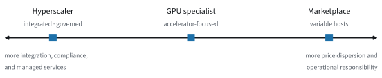
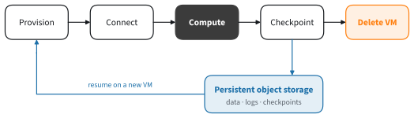

# Cloud Computing
:label:`sec_cloud_instances`

Most readers run the notebooks of this book on a laptop, a desktop GPU, or
a hosted service such as Colab (:numref:`sec_hosted_notebooks`). Sooner or
later a project outgrows all three: preprocessing runs longer than a hosted session lasts, a model
needs 80 GB of accelerator memory, or an experiment needs several GPUs at
once. The usual answer is to rent a machine by the hour, which raises two
questions. Which machine should we rent, and what will a finished result cost?
And how do we work on a machine that can disappear at any moment?

Prices change monthly, so the numbers below are dated examples, not a
catalog. Two ideas outlast them. A machine is chosen by its cost per
completed result rather than its hourly price, and a rented instance is
treated as disposable, with everything that matters copied to durable
storage before the instance is deleted. The book's own notebooks need modest
hardware: they are executed on 24 GB RTX 4090 cards and most use less than
8 GB, so a 24 GB rental runs every single-GPU notebook. Only the multi-GPU
sections of :numref:`chap_performance` need more than one card.

## The Rental Market

### Three Tiers of Provider

GPU rental is sold by three kinds of company, which differ less in the
hardware than in what surrounds it and who operates it
(:numref:`fig_tools_cloud_spectrum`).


:label:`fig_tools_cloud_spectrum`

* **Hyperscalers** such as AWS, Google Cloud and Microsoft Azure sell GPUs
  inside a full cloud: identity management, virtual networks, managed
  storage, and every adjacent service. Their on-demand GPU prices are the
  highest, and the largest instances often require a quota request or sales
  contact. They suit work whose data already lives in that cloud, work under
  compliance requirements, and training that is part of a larger managed
  system. Google also rents TPUs, which run the JAX code of this book; a v5e
  chip costs \$1.20 per hour as of November 2026.
* **GPU specialists** such as Lambda, Nebius, Voltage Park and CoreWeave rent
  accelerators with fast interconnect and machine-learning images, and little
  else. As of November 2026 an H100 costs about \$2–6 per GPU-hour in this
  tier, and Lambda, Nebius and Voltage Park let a new account launch one
  without contacting sales. This tier suits substantial training runs that
  do not need a hyperscaler's other services.
* **Marketplaces** such as Vast.ai and RunPod aggregate machines from many
  independent operators, including consumer GPUs that the large clouds do not
  carry. They list the lowest hourly prices: as of November 2026 an RTX 4090
  for \$0.30–0.50 per hour and an H100 from about \$1.80. Quality varies
  with the listing. Host reliability, disk speed and network quality differ
  from host to host, and the code runs on a stranger's machine. That is fine for
  coursework and public data, and inappropriate for anything sensitive unless
  the job runs on a vetted datacenter tier such as RunPod's Secure Cloud.

### A Dated Price Snapshot

Prices vary by region, availability, commitment and host.
:numref:`tab_cloud_prices` illustrates the spread between tiers; check
current quotes before buying.

:GPU rental snapshot, on-demand, per GPU (November 2026)
:label:`tab_cloud_prices`

| Provider (tier) | Cheap GPU option | ≈ \$/hr | 1× H100 80 GB ≈ \$/hr |
|---|---|---|---|
| Vast.ai (marketplace) | RTX 4090 24 GB | 0.30–0.50 | 1.80–2.40 |
| RunPod (marketplace) | RTX 4090 24 GB | 0.34–0.89 | 1.99–3.99 |
| Lambda (specialist) | A100 40 GB | 1.99 | 3.29–4.29 |
| Nebius (specialist) | RTX PRO 6000 96 GB | 1.80 | 4.50 |
| Voltage Park (specialist) | H100 80 GB (only listed price) | 1.99 | 1.99 |
| AWS (hyperscaler) | L4 24 GB (g6.xlarge) | 0.80 | 6.88 (p5) |
| Azure (hyperscaler) | T4 16 GB (NC4as T4 v3) | 0.53 | 6.98 (NC40ads H100 v5, 94 GB) |
| Google Cloud (hyperscaler) | L4 24 GB (g2-standard-4) | 0.71 | ≈ 11 (8-GPU A3) |

RunPod's ranges run from community hosts to its datacenter tier. Azure's
single-GPU H100 instance carries the 94 GB H100 NVL. Google Cloud sells the
H100 on demand only as an 8-GPU machine, quoted per GPU.

Two qualifications matter. First, multi-GPU nodes are priced roughly
linearly per GPU, but the interconnect is not: an 8×H100 machine with NVLink is a different tool from
eight PCIe cards, and communication-heavy training
(:numref:`sec_training_systems`) shows the difference. Second, newer is not
always cheaper per unit of work. B200 instances cost about \$7–14 per
GPU-hour as of November 2026, and they pay off only when a job uses their
larger memory and FP8/FP4 throughput.

### Cost per Completed Result

The hourly price is the most visible term of a larger sum that also includes
setup time, idle time while you debug, storage that keeps billing after the
run, data egress, and engineering time. A faster, more expensive GPU can
therefore reduce the cost of a *completed* experiment. The model below asks
which of three marketplace GPUs completes a job most cheaply when the job
takes eight hours on the slowest. Rerun it with your own assumptions:

```{.python .input #cloud-instances-cost-model}
import numpy as np

gpu = ["RTX 4090", "A100 80GB", "H100"]
gpu_per_hour = np.array([0.40, 1.20, 2.50])   # marketplace, November 2026
relative_speed = np.array([1.0, 1.6, 3.0])    # measure for your workload!
setup_hours = np.array([0.5, 0.5, 0.5])
storage_and_egress = np.array([2.0, 2.0, 2.0])
engineer_per_hour = 60.0

wall_hours = 8.0 / relative_speed
invoice = (wall_hours + setup_hours) * gpu_per_hour + storage_and_egress
complete = invoice + setup_hours * engineer_per_hour
for row in zip(gpu, np.round(wall_hours, 1), np.round(invoice, 2),
               np.round(complete, 2)):
    print(row)
```

The invoices come to \$5.40, \$8.60 and \$9.92, so the invoice favors the
inexpensive card. Half an hour of the engineer's time brings the totals to
\$35.40, \$38.60 and \$39.92, much closer but in the same order. If the
slow card needs one more half-hour debugging round than the fast one, its
total rises above \$65 and the order reverses, so the number of rounds
belongs in the cost model as much as the hourly price. The size of the
workload matters more still: a LoRA fine-tune of a 7B model may take hours on one
consumer GPU, whereas pretraining a small language model can take thousands
of GPU-hours. Estimate the workload before comparing small differences in
hourly price.

Two costs are easy to overlook:

* **Spot and interruptible capacity** is often discounted by half or more
  and suits jobs that checkpoint and resume cleanly
  (:numref:`sec_training_systems`), not interactive sessions or
  uncheckpointed runs. AWS warns two minutes ahead, Google Cloud by
  default allows a shutdown period of at most 30 seconds, and a Vast.ai
  interruptible instance stops, killing its processes, as soon as it is
  outbid. Test recovery before the long run, not during it.
* **Egress fees.** As of November 2026 AWS and Azure charge about \$0.09 per
  GB for data sent to the internet beyond the first 100 GB a month.
  Downloading a 140 GB checkpoint daily for a month costs about \$370, more
  than running a marketplace RTX 4090 around the clock (720 hours at \$0.44,
  about \$320). Keep data and compute in the same region, and prefer
  providers that do not charge for egress, RunPod among them, when a
  workflow moves large artifacts around.

## Working on a Rented Machine

### Instance Setup and Checks

A new instance is an unknown machine, and the first minutes on it decide
whether a long run can be trusted. Start from the provider's current
deep-learning image, with drivers, CUDA and the container runtime
preinstalled; a bare OS image needs setup that must also be reproduced
later. Connect with the SSH tunnel of :numref:`sec_interactive_development`,
which works the same way on every provider, or with VS Code Remote SSH. Run
long jobs under `tmux` so that an SSH disconnect does not kill training, and
check the machine first:

```bash
nvidia-smi                 # driver ok? expected GPU? memory free?
df -h                      # scratch disk has room for data + checkpoints?
python -c "import torch; print(torch.cuda.get_device_name(0))"
```

A short smoke test, one batch through the model and one checkpoint written
and read back, detects problems that the provider's health indicators miss:
broken drivers, full disks, read-only mounts, and datasets that stream too
slowly to keep the GPU busy.

### Disposable Instances, Durable Results

A rented instance can be preempted, crash, or be deleted by mistake, and the
work on it must survive all three.


:label:`fig_tools_cloud_lifecycle`

The workflow in :numref:`fig_tools_cloud_lifecycle` separates the lifetime
of the machine from the lifetime of the work. Code is stored in Git and
cloned onto the instance. Data and checkpoints are copied to durable object
storage (S3, GCS, or the provider's volume product) on a schedule the job
controls. Losing the instance then costs at most the work since the last
checkpoint, and a replacement machine resumes from storage.

When the experiment ends, delete everything that bills: the instance, its
disks and snapshots, reserved IP addresses, and stale buckets. Set a billing
alert on the first day. An idle GPU bills at the same rate as a busy one.
Alerts lag behind usage, so the account's GPU quota is what bounds the loss
from a leaked credential.

We can now choose a rented machine by the cost of a completed result and
keep the work safe when the machine fails. A GPU that is busy on most days
of the year eventually costs more to rent than to buy, and
:numref:`sec_hardware_buyers` asks which hardware to buy.

## Summary

* Most of the book's notebooks need less than 8 GB of GPU memory and a 24 GB
  card runs every single-GPU notebook; LLM-scale work is what raises cost.
* The market has three tiers, hyperscalers, GPU specialists and
  marketplaces, with a several-fold price spread for the same GPU and
  different levels of integration, reliability, and operational trust.
* Compare cost per completed result, not per hour: include setup, idle
  time, storage, egress, and your own time.
* Spot capacity reduces the cost of checkpointed, restartable jobs but is
  unsuitable for interactive or uncheckpointed work; egress fees make
  repeated transfers of large artifacts expensive.
* Treat instances as disposable: provider image, SSH tunnel, `tmux`,
  checkpoints to durable storage, then delete every billable resource.

## Exercises

1. [code] **Peak memory and batch size.** Most of the book's notebooks stay
   below 8 GB of GPU memory, so a 24 GB card in :numref:`tab_cloud_prices`
   leaves room for a larger batch. Run the encoder fine-tuning of
   :numref:`sec_lm_bert` on a GPU, for example in a hosted
   notebook (:numref:`sec_hosted_notebooks`), once with its batch size and
   once with half of it. Record the peak of
   each of the three views of GPU memory in :numref:`fig_bg_allocator` for
   both runs.
    1. Which of the three views decides whether a run fits on a card, and
       why?
    1. Fit the peak of that view as a linear function of the batch size, and
       predict the largest batch that fits on a 24 GB card and on an 80 GB
       card. Which part of the memory does the intercept represent?
    1. Run a batch size between your two runs, or the 24 GB prediction if
       such a card is available, and compare the measured peak with the
       linear prediction.
   :exlabel:`ex_cloud-instances-peak-memory`

1. **Trust boundary.** A fine-tuning job reads its training data from
   object storage with an access key stored on the instance, and writes
   checkpoints to the instance's local disk.
    1. The data is a public dataset, and the job runs on a marketplace host.
       Besides the dataset, what can the host operator read or change while
       the job runs? Which of these items matters although the data is
       public? Why does encrypting the instance's disk not protect them from
       the host operator?
    1. The data is a hospital's medical records, and the job moves to a
       hyperscaler. Which parties can still read the data and the
       checkpoints while the job runs? Besides technical controls, what has
       to be in place before the records may be uploaded?

1. [code] **Engineering time in the cost model.** In
   `#cloud-instances-cost-model`, the column `complete` adds
   `setup_hours * engineer_per_hour` to the invoice.
    1. Explain why this term cannot change which GPU is cheapest, whatever
       the value of `engineer_per_hour`, as long as `setup_hours` is the same
       for all three GPUs.
    1. An engineer who waits for results or checks on the run spends a
       fraction $f$ of `wall_hours` on it. Add this time at
       `engineer_per_hour` to `complete`, and find the value of $f$ at which
       the H100 and the RTX 4090 cost the same. How many minutes of attention
       during the 8-hour run on the RTX 4090 does this value correspond to?
    1. Leave out both engineering terms. Which `relative_speed` would the H100
       need to match the RTX 4090 on the invoice alone?
    1. Obtain today's on-demand prices for the three GPUs from one
       marketplace of :numref:`tab_cloud_prices`, note the date, and compute
       the break-even fraction $f$ again. Does it move by more than a factor
       of two?
   :exlabel:`ex_cloud-instances-engineering-time`

1. [code] **Smoke test script.** Write a script that a rented machine must
   pass before a long run. It trains a small model of your choice on
   `d2l.FashionMNIST` and exits with a clear message at the first failed
   check.
    1. Implement four checks: the accelerator named on the command line is
       visible; the checkpoint directory has a given number of free bytes;
       one training step runs on the accelerator; and a checkpoint written
       with `d2l.save_checkpoint` and read back with `d2l.load_checkpoint`
       reproduces every parameter and optimizer tensor exactly.
    1. Add a fifth check that compares the batches per second the data
       iterator delivers with the training steps per second the model
       sustains on a batch that is already on the device. Why must the two
       rates be measured separately?
    1. Provoke each failure on your own machine. Request more free space than
       the disk has, make the checkpoint directory read-only, and slow the
       iterator with a `time.sleep` per batch. Run the read-only test as a
       non-root user, because root ignores directory permissions. Without
       the script, when would each failure have surfaced in an 8-hour run
       that writes a checkpoint every hour? Which of them would never stop
       the run?
   :exlabel:`ex_cloud-instances-smoke-test`

1. **Billing alert or quota.** A leaked credential lets an attacker launch
   GPU instances up to the account's quota. Billing alerts lag behind usage:
   AWS Budgets, for example, updates its cost data up to three times a day.
    1. Suppose that 60 hours pass between the start of an attack and your
       response, for example over a weekend. Compute the bill for a quota of
       8 H100s and for a quota of 64 H100s at the AWS price
       of :numref:`tab_cloud_prices`.
    1. A lab runs one 8-GPU job at a time and accepts a worst-case loss of
       \$5,000 from a leaked credential. Which H100 quota meets this limit
       for a response time of 60 hours, and which for a response time of 8
       hours? Which of the two quantities does a billing alert shorten?
       Which bounds the loss when nobody reads the alert?
    1. A budget action that blocks new instances once the alert fires still
       leaves part of the bill. Which part, and why?

1. **NVLink or PCIe.** ● Two providers offer eight H100s at the same price
   per GPU-hour. One node connects the GPUs with NVLink, the other only over
   PCIe 5.0. A data-parallel job trains a transformer with $P$ parameters
   and BF16 gradients, so that $N = 2P$ bytes enter the communication time
   of :eqref:`eq_dp_cost`. Each GPU processes $b$ tokens per step, which
   costs $6Pb$ FLOPs by :eqref:`eq_six_nd`. Take the all-reduce bandwidth
   $\beta$ as the nominal per-direction rate, 450 GB/s for NVLink and
   64 GB/s for PCIe, and let both nodes sustain 40% of the H100's 989
   TFLOPS of dense BF16 compute. Assume that communication does not overlap
   with computation.
    1. For $P = 1.3 \times 10^9$, compute the step time on each node at
       $b = 16{,}384$ and at $b = 4{,}096$. By what fraction must the PCIe
       price drop to match the NVLink node in cost per token?
    1. The ratio of communication time to compute time does not depend on
       $P$, because both times grow in proportion to
       it (:numref:`sec_hardware`). On each node, find the number of tokens per
       GPU and step at which communication takes as long as computation.
    1. Gradient accumulation (:numref:`subsec_mp-accumulation`) communicates
       once every $N_{\textrm{accumulation}}$ microbatches. How does it
       change the threshold you found, and what does it change about
       training?

1. **Restarts on spot capacity.** ● A job needs $T$ hours of compute. On
   spot capacity, interruptions arrive as a Poisson process with mean time
   $M$ between them. After each interruption, a replacement instance takes
   $R$ hours to start, and the job begins again from scratch. Spot capacity
   costs a fraction $q$ of the on-demand price, and the restart time is
   billed too. Interruptions do not strike while a replacement starts, and
   the expected wall-clock time to finish is

   $$\mathbb{E}[T_{\textrm{wall}}] = \left(e^{T/M} - 1\right)(M + R).$$

   Problem :exref:`ex_hosted-notebooks-checkpoint-interval`b of
   :numref:`sec_hosted_notebooks` derives the corresponding formula for a
   restore that interruptions can also strike. There the factor $M + R$
   becomes $M e^{R/M}$.
    1. For $T = 8$ h, $R = 0.25$ h and $q = 0.5$, compute the expected spot
       cost as a fraction of the on-demand cost for $M = 24$, $8$ and $4$ h.
    1. Let $R \ll M$ and $q = 0.5$. Show that spot capacity is cheaper in
       expectation exactly when $T$ is below a fixed multiple of $M$, and
       compute the multiple.
    1. Now let the job write a checkpoint after every $\tau = \sqrt{2 \delta
       M}$ hours of compute, the interval of :citet:`Young.1974` from
       problem :exref:`ex_hosted-notebooks-checkpoint-interval`a, where each
       write takes $\delta$ hours. An interruption loses only the work since
       the last checkpoint. Apply the formula for
       $\mathbb{E}[T_{\textrm{wall}}]$ to one segment of length
       $\tau + \delta$, and find the largest $q$ at which
       spot capacity is cheaper in expectation for $\delta = 2$ min,
       $R = 0.25$ h and $M = 24$, $8$, $4$, $2$ and $1$ h.
   :exlabel:`ex_cloud-instances-spot-restart`

1. [extended] **Rented-machine drill.** ● Carry one training notebook of
   this book through the lifecycle of :numref:`fig_tools_cloud_lifecycle` on
   a rented GPU, and keep a log with timestamps.
    1. Measure the notebook's peak memory as in exercise
       :exref:`ex_cloud-instances-peak-memory`, and rent the cheapest
       marketplace or specialist listing whose memory fits it. Boot
       the provider's deep-learning image, and run the script of
       exercise :exref:`ex_cloud-instances-smoke-test`. Does the assigned
       GPU match the listing?
    1. Train with checkpoints written by `d2l.save_checkpoint` and copied to
       object storage every ten minutes. Terminate the instance in the middle
       of an epoch, start a fresh one, and resume from object storage. How
       long does recovery take? Do the loss curve and the step count continue
       as if nothing had happened, and which state did you not save?
    1. Delete every billable resource. Once the provider's bill shows the
       session, compare each line item with the prediction of
       `#cloud-instances-cost-model`, extended by the attended time of
       exercise :exref:`ex_cloud-instances-engineering-time`. Which input was
       furthest off?

   *Adapted from Nicki Skafte Detlefsen, [DTU-MLOps](https://skaftenicki.github.io/dtu_mlops/latest/s6_the_cloud/using_the_cloud/), module M21 "Using the Cloud", Compute exercises.*

[Discussions](https://d2l.discourse.group/t/36843)
