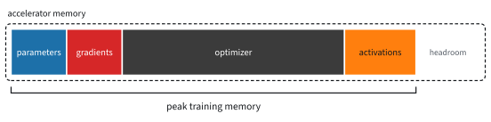
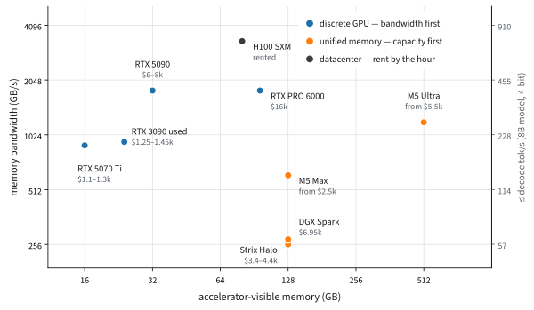
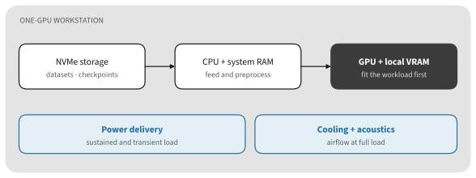
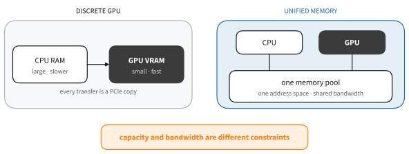

# Hardware
:label:`sec_hardware_buyers`

Most readers run the notebooks of this book on whatever GPU is at hand: a
laptop, a hosted notebook, a rented card. Sooner or later they ask whether
to buy a machine, and which one. Suppose you want to fine-tune an
8-billion-parameter language model on your own documents. A spec sheet lists
dozens of numbers, and the card that looks fastest is not always one that
can run your model at all.

Three quantities decide almost every such choice: memory capacity, memory
bandwidth, and compute throughput. :numref:`sec_hardware` explained how they
shape the behavior of a machine; this section asks what to buy. The method
is to find the quantity that limits your workload and to buy more of it. The
machines and prices below are a snapshot as of November 2026 and will
change; the method will not.

**Capacity decides what runs at all.** Training keeps the weights, their
gradients, and the optimizer state in memory, several times the size of the
model (:numref:`sec_training_systems`). A model that does not fit cannot
run, however fast the card. **Bandwidth decides how fast a model generates
text.** Each new token requires reading every weight that the token uses,
plus the KV cache, the keys and values that attention keeps for all earlier
tokens (:numref:`sec_kv-cache`). Hence

$$
\textrm{decode tokens/s} \lesssim
\frac{\textrm{memory bandwidth}}{\textrm{bytes of active weights and KV cache}}.
$$
:eqlabel:`eq_hardware-buyers-decode`

Once the 8B model is fine-tuned and its weights are quantized to 4 bits,
it reads about 4.5 GB per token at a short context, so a card that streams
900 GB/s generates at most about 200 tokens per second. Processing the
prompt (*prefill*) and training work on many tokens at once and reuse each
weight they read, so compute limits them instead. Machines differ by an order of magnitude on each axis, often in
opposite directions, so the best machine depends on the workload.

## Workload Requirements

A purchase starts from the workload rather than from the card. For training,
the question is whether peak memory (:numref:`fig_tools_memory_fit`) fits:


:label:`fig_tools_memory_fit`

```{.python .input #hardware-memory-estimate}
def training_memory_gib(parameters_billion, weight_bytes=2,
                        gradient_bytes=2, optimizer_bytes=8,
                        activation_gib=6, workspace_gib=2):
    parameters = parameters_billion * 1e9
    state = parameters * (weight_bytes + gradient_bytes + optimizer_bytes)
    return state / 2**30 + activation_gib + workspace_gib

for b in [0.1, 1, 7]:
    print(f"{b:>4}B params: {training_memory_gib(b):6.1f} GiB")
```

A full fine-tune of a 7B model needs about 86 GiB, more than any consumer
card holds. QLoRA :cite:`Dettmers.Pagnoni.Holtzman.ea.2023` freezes the
weights, stores them in 4 bits, and trains small adapter matrices beside
them. It reduces the training state of the same job from 78 GiB to about
4 GiB, so some 7B adapter fine-tunes fit on a 16 GB card. For inference, we
apply the decode bound to each machine of this section:

```{.python .input #hardware-decode-bound}
bandwidth_gbs = {"RTX 5070 Ti": 896, "RTX 3090 (used)": 936,
                 "RTX 5090": 1792, "RTX PRO 6000": 1792,
                 "DGX Spark": 273, "Strix Halo": 256,
                 "M5 Max": 614, "M5 Ultra": 1200, "H100 SXM": 3350}
active_gb = 4.5   # 8B model at 4-bit, including cache traffic
for device, bw in sorted(bandwidth_gbs.items(), key=lambda kv: -kv[1]):
    print(f"{device:>16s}: <= {bw / active_gb:5.0f} tok/s")
```

Realized speed depends on kernels, but the bound often predicts the
ordering. The DGX Spark and a Strix Halo box have nearly the same bandwidth
and decode at similar rates (:numref:`subsec_hardware-buyers-unified`),
although the Spark costs about twice as much and has far more compute.


:label:`fig_tools_hardware_menu`

:numref:`fig_tools_hardware_menu` places representative machines on these
two axes. They form two families: discrete GPUs, fast but small, and
unified-memory systems, large but slow. The workstation-class RTX PRO 6000
bridges the two at a high price.

## Discrete GPUs for Training
:label:`subsec_hardware-buyers-training`

For many training and fine-tuning workloads, a discrete NVIDIA GPU offers
high memory bandwidth and broad software support, including the frameworks
in this book, FlashAttention, quantization kernels, and the CUDA stack common
on rented machines.

### The RTX 5070 Ti and the Used RTX 3090

For a first training machine, memory capacity sets the floor. The RTX 5070 Ti
(16 GB GDDR7 at 896 GB/s, 300 W) listed at \$749 at launch and sold for
about \$1,100–1,300 as of November 2026. Sixteen gigabytes runs every
single-GPU notebook in this book, the largest of which peak near 13 GiB, and
holds QLoRA fine-tunes of 7–8B models; a 12 GB card excludes many more
configurations. Memory prices shape the rest of the desktop: 64 GB of DDR5
cost about \$1,000–1,200, about as much as the card. The used RTX 3090
(24 GB at 936 GB/s, about \$1,250–1,450) has more memory and similar
bandwidth, but it draws 350 W, lacks FP8 and FP4 tensor cores, comes without
a warranty, and its used price rose through 2026.

### The RTX 5090 Workstation

When 16 or 24 GB is too little, the next step on a desktop is 32 GB. The
RTX 5090 (32 GB GDDR7 at 1.79 TB/s, 575 W) listed at \$1,999 but sold for
about \$6,000–8,000 new as of November 2026, when supply was scarce. It is the
fastest consumer card: about half the bandwidth of an H100, FP8 and FP4
tensor cores, and enough memory for full fine-tunes up to about 2B
parameters and QLoRA fine-tunes up to about 30B. NVIDIA specifies 1000 W of
system power for it, the chassis must remove 575 W of heat, and the circuit
must carry the whole system. A balanced build (:numref:`fig_tools_workstation`)
adds a 16-core CPU, 64–128 GB of RAM, and fast NVMe storage, for roughly
\$8,500–12,500 in all.


:label:`fig_tools_workstation`

Multi-GPU consumer systems, often built from two to four used 3090s, add up
memory capacity. Data parallelism works over PCIe, but consumer boards offer
one full-bandwidth slot, so builders use Threadripper or EPYC platforms for
their PCIe lanes, and dual power supplies are common. No consumer card since
the 3090 has NVLink, so communication-heavy tensor parallelism scales poorly.
A short rental of a multi-GPU node (:numref:`sec_cloud_instances`) shows
whether interconnect bandwidth limits the workload before you buy.

## Unified-Memory Machines for Inference
:label:`subsec_hardware-buyers-unified`


:label:`fig_tools_memory_path`

A second family of machines answers a different question: not how fast you
can train, but how large a model you can *run* at home. These systems give
the GPU direct access to a large pool of LPDDR5X, the memory of laptops and
phones, which offers capacity at a fraction of the bandwidth of GDDR7 or HBM
(:numref:`fig_tools_memory_path`). The decode bound predicts the trade-off:
large models fit but decode slowly. A mixture-of-experts (MoE) model runs
only a few of its expert networks for each token, so it reads only its
active parameters and decodes faster than a dense model of similar total
size.

:Unified-memory machines for local inference (as of November 2026)
:label:`tab_unified_memory`

| Machine | Memory | Bandwidth | ≈ Price | Notes |
|---|---|---|---|---|
| AMD Strix Halo mini-PC (Ryzen AI Max+ 395) | 128 GB | 256 GB/s | \$3,400–4,400 | Framework, GMKtec, Minisforum, Beelink, and others; ROCm or Vulkan on Linux |
| NVIDIA DGX Spark (GB10) | 64 or 128 GB | 273 GB/s | \$5,000 (64 GB, from OEM partners), \$6,950 (128 GB) | CUDA-native Blackwell; strong prefill; up to four units cluster over ConnectX-7 |
| Mac Studio M5 Max | up to 128 GB | 614 GB/s | from \$2,500 | MLX ecosystem; base model has 36 GB at 460 GB/s |
| Mac Studio M5 Ultra | 96–512 GB | 1.2 TB/s | from \$5,500 | the most memory and bandwidth in this class |
| MacBook Pro M5 Max | up to 128 GB | 614 GB/s | from \$3,600 | the M5 Max in a laptop; base model has 36 GB at 460 GB/s |

Community measurements roughly follow the bandwidth ordering. The MoE model
gpt-oss-120b has 117B parameters but uses about 5B of them per token. In llama.cpp
benchmarks it generates about 60 tokens/s on a DGX Spark and about 50 on
Strix Halo, and reviewers of the M5 Ultra report about 115–120 with Ollama
and MLX. A dense
70B model at 4 bits reads about 40 GB per token, so the bound alone keeps it
below 7 tokens/s on the Spark and Strix Halo and below 30 on the M5 Ultra.
The machines differ more in prefill: in the same llama.cpp benchmarks the
Spark's tensor cores process a 2,048-token prompt about two and a half times
faster than Strix Halo. The software stack matters too (CUDA on the Spark,
ROCm or Vulkan on Strix Halo, MLX on Apple machines), so measure the models
you care about.

## Workstation GPUs
:label:`subsec_hardware-buyers-top-end`

A buyer who needs both capacity and bandwidth, for example to fine-tune a 70B
model at home, reaches the workstation class. The RTX PRO 6000 Blackwell
packs 96 GB of GDDR7 at the 5090's 1.79 TB/s. It launched in 2025 at
\$8,565, and NVIDIA's store listed it at \$16,000 as of November 2026. A
300 W Max-Q variant with the same memory lets four cards share one chassis.
Two cards hold 192 GB, enough for unquantized 70B inference and 70B LoRA
fine-tunes; four hold 384 GB, enough for MoE models of several hundred
billion parameters at 4 bits. Workstation cards lost NVLink after the Ampere
generation, so traffic between cards travels over PCIe 5.0 at about 64 GB/s
per direction, nearly thirty times slower than each card's own memory.
Data-parallel and pipeline-parallel workloads tolerate this; tensor
parallelism slows down.

Against such a budget, price the alternative. The \$64,000 of four cards
rents about 32,000 H100-hours at a marketplace rate of \$2 per hour
(:numref:`tab_cloud_prices`). A purchase breaks even after the number of
productive hours whose rental would cost the purchase price:

```{.python .input #hardware-break-even}
purchase = 10500.0                  # an RTX 5090 workstation, Nov. 2026
rental_per_productive_hour = 2.00   # H100 marketplace rate
print(f"{purchase / rental_per_productive_hour:.0f} "
      "productive hours to break even")
```

At eight productive hours a day, 5,250 hours take about 1.8 years,
and a machine at home idles more than its owner expects. Electricity, resale
value, and the speed difference between the machines change the count
(:exref:`ex_hardware-break-even`). On the other side are privacy, no queue,
and the value of hardware you can take apart.

## Sources for Current Numbers
:label:`subsec_hardware-buyers-current`

The prices above will change, and newer measurements still need
cross-checking. For build advice and street prices, see
[r/LocalLLaMA](https://www.reddit.com/r/LocalLLaMA/) (hardware megathreads)
and the [Level1Techs forum](https://forum.level1techs.com/) (multi-GPU build
logs, Strix Halo notes); for reviews of Strix Halo boxes, the DGX Spark, and
used servers, [ServeTheHome](https://www.servethehome.com/); for comparable
numbers, the benchmark threads in the
[llama.cpp discussions](https://github.com/ggml-org/llama.cpp/discussions),
which run `llama-bench` on the same model files across many machines. Tim
Dettmers' [guide](https://timdettmers.com/2023/01/30/which-gpu-for-deep-learning/),
last updated in 2023, offers a workload-based method rather
than current part recommendations. Many search results for GPU questions are
machine-generated pages that quote estimated or invented benchmarks. Trust
datasheets, named reviewers, and numbers that pass the decode-bound check.

## Summary

* Buy the binding constraint: capacity decides what runs, bandwidth decides
  decode speed, and compute decides training and prefill speed. The decode
  bound, bandwidth divided by the bytes read per token, predicts generation
  speed to within a factor of two.
* As of November 2026, a 16 GB RTX 5070 Ti (about \$1,100–1,300) is a
  reference point for a lower-capacity training machine, and a 32 GB
  RTX 5090 (about \$6,000–8,000) for a high-end desktop with substantial
  power and cooling requirements. Used 3090s trade warranty and efficiency
  for memory capacity.
* Unified-memory machines (Strix Halo, DGX Spark, Apple silicon) trade
  bandwidth for capacity. Large MoE models fit and decode faster than dense
  models of similar total size, and prefill speed separates machines with
  similar bandwidth.
* The RTX PRO 6000 class (96 GB at full bandwidth, no NVLink) bridges the
  two families at five figures per card. Before spending that, price the
  rented equivalent in productive hours.
* Date every price you rely on, and take current numbers from the community
  sources above rather than from machine-generated search results.

## Exercises

1. [code] **Training memory.** `training_memory_gib` charges every
   parameter 2 bytes of weights, 2 bytes of gradients, and 8 bytes of
   optimizer state, and it adds fixed amounts for activations and
   workspace.
    1. Mixed-precision training with Adam, as counted by
       :citet:`Rajbhandari.Rasley.Ruwase.ea.2020`, keeps 16 bytes per
       parameter. Which tensor do the defaults of `training_memory_gib`
       leave out, and how does adding it change the estimate for the 7B
       model? Under both counts, find the largest model whose full
       fine-tune fits on cards with 16, 24, 32, and 96 GB, treating a
       card's GB as GiB.
    1. LoRA :cite:`Hu.Shen.Wallis.ea.2021` freezes the pretrained weights
       and trains small adapter matrices beside them. QLoRA
       :cite:`Dettmers.Pagnoni.Holtzman.ea.2023` also stores the frozen
       weights in 4 bits, plus 0.127 bits per parameter of quantization
       constants. Give `training_memory_gib` an argument for the trainable
       fraction of the parameters: a frozen parameter costs only its
       stored bytes, and a trainable one costs weights, gradients, and
       optimizer state as before. Evaluate the function for an 8B model
       with 1% trainable parameters and the default activation and
       workspace terms, once for LoRA with frozen bf16 weights and once for
       QLoRA. Which of the two fine-tunes fits on a 16 GB card? Which term
       is the largest in the one that fits?
    1. The activation term is not a constant: it grows with the number of
       tokens per step. With per-block activation
       checkpointing (:numref:`subsec_mp-checkpointing`), a model keeps
       only the input of each block, $d$ bf16 values per token, plus the
       activations of one
       block during its recomputation, which this sub-problem ignores. Give
       the QLoRA fine-tune of the second sub-problem the shape of Llama 3.1
       8B :cite:`Grattafiori.Dubey.Jauhri.ea.2024`: 32 blocks of width
       $d = 4096$ and a vocabulary of 128,256 tokens. How many tokens per
       step fit into the memory that the 16 GB card leaves for activations?
    1. The output layer also keeps one bf16 logit per vocabulary entry and
       token for the loss. How many tokens per step fit once the logits
       count as well? Compare the logit bytes per token with the bytes of
       the block inputs per token.
   :exlabel:`ex_hardware-training-memory`

1. **Context length and decode.** Every decode step reads the KV cache of
   all earlier tokens as well as the weights, which is why the code that
   defines `bandwidth_gbs` charges an 8B model at 4 bits
   `active_gb = 4.5` GB per token. A model with $L$ layers and
   $H_\textrm{kv}$ key-value heads of dimension $d_h$ stores
   $2 L H_\textrm{kv} d_h$ values per token of context, one key and one
   value per head and layer (:numref:`sec_kv-cache`). Llama 3.1 8B
   :cite:`Grattafiori.Dubey.Jauhri.ea.2024` has 32 layers and 8
   key-value heads of dimension 128, and it keeps its cache in bf16.
    1. Compute the cache bytes per token. Which context length does the
       0.5 GB of cache traffic in `active_gb` correspond to?
    1. Bound the decode rate on the RTX 5070 Ti and on the M5 Ultra at
       contexts of 4K, 32K, and 128K tokens, and give the share of the
       cache in the bytes read per token. At which of these contexts do
       the weights and the cache still fit on the 16 GB card?
    1. Quantizing the weights from bf16 to 4 bits divides their bytes
       by 4. By what factor does it raise the decode bound at 4K tokens, and
       by what factor at 128K tokens? What does this imply for a buyer
       whose workload uses long contexts?
   :exlabel:`ex_hardware-context-decode`

1. **Power budget.** :numref:`subsec_hardware-buyers-training` notes that
   NVIDIA specifies 1000 W of system power for a 5090 build, and that the
   circuit must sustain the load of the whole system, not only of the
   card. Consider a box with
   four used RTX 3090 cards at 350 W each on a Threadripper-class platform
   that draws 350 W, with another 100 W for drives and fans, fed by power
   supplies that are 90% efficient. The box is plugged into a North
   American 120 V, 15 A circuit, whose continuous load should stay below
   80% of its 1,800 W rating.
    1. Compute the draw at the wall under full load. To which power limit
       per card must the cards be capped to stay on one such circuit? Does
       a 230 V, 16 A circuit under the same 80% rule carry the box without
       a cap?
    1. Capping the power of a GPU lowers its clock and hence its peak
       arithmetic rate, while its memory bandwidth changes little. Which
       workloads of this section lose much throughput under the cap of the
       first sub-problem, and which lose little?

1. **Mixture-of-experts decode.** A mixture-of-experts (MoE) model stores
   many expert networks but runs only a few of them for each token, so a
   decode step reads only the *active* parameters. Take a 30B-A3B model,
   with 30 billion parameters of which 3 billion are active per token, and
   a dense 30B model, both with 4-bit weights. Ignore the KV cache.
    1. Use :eqref:`eq_hardware-buyers-decode` to bound the decode rate of
       both models on every machine in :numref:`tab_unified_memory`. Which
       machines decode each model faster than 20 tokens/s, a common
       threshold for interactive use?
    1. A dense 3B model at 4 bits reads as many bytes per token as the
       MoE. What does the MoE cost a buyer that the dense 3B model does
       not? Which cards in `bandwidth_gbs` can run the MoE?
    1. The model card of gpt-oss-120b :cite:`OpenAI.2025` counts 114.71B
       parameters in the experts of its 36 MoE layers, 0.96B attention
       parameters, and 1.16B parameters in its untied embedding and output
       matrices, which have equal size. Each layer has 128 experts, of which
       a token uses 4. The experts are stored in MXFP4 at 4.25 bits per
       parameter, and all other weights in bf16. Compute the bytes that a
       decode step reads, given that the embedding lookup reads a single
       row. Bound the decode rate on the DGX Spark and on Strix Halo, and
       compare the bounds with the llama.cpp rates that
       :numref:`subsec_hardware-buyers-unified` reports.
    1. The measured rate on the DGX Spark exceeds your bound. The llama.cpp
       model file behind it takes 59.02 GiB for 116.83B parameters. What
       does its size imply about the format of the weights outside the
       experts? Recompute the bytes per decode step and the fraction of
       each bound that the measured rates achieve. What does the comparison
       between the DGX Spark and Strix Halo say about bandwidth as a
       predictor of decode speed?
   :exlabel:`ex_hardware-moe-decode`

1. **Partial offload.** A model that does not fit into the memory of a
   discrete card can still run if some of its layers stay in system
   memory, where the CPU computes them (:numref:`fig_tools_memory_path`).
   Consider a desktop with a used RTX 3090 (24 GB at 936 GB/s),
   dual-channel DDR5-5600 system memory (89.6 GB/s), and a PCIe 4.0 ×16
   link (32 GB/s per direction). A dense 70B model at 4 bits takes about
   40 GB.
    1. Keep 22 GB of layers on the GPU and run the other 18 GB on the CPU.
       Bound the decode rate, and compare it with the bound for the whole
       model on Strix Halo. Above which fraction of offloaded bytes does
       the system memory take more than half of the time per token?
    1. Instead, copy the 18 GB of offloaded weights over PCIe to the GPU
       for every token. What does this do to the bound?
    1. Run gpt-oss-120b on the same desktop, with its attention, embedding,
       and output weights on the GPU and all of its experts in system
       memory. Use the accounting of problem
       :exref:`ex_hardware-moe-decode`c to bound the decode rate, and find
       how much system memory the experts need. Why does this split suit an
       MoE model better than a dense one?

1. [code] **Break-even with operating costs.** The code that computes the
   break-even divides `purchase` by
   `rental_per_productive_hour`, the rental price of the work that the
   owned machine does in one productive hour.
    1. An owned machine also draws electricity in every productive hour,
       and it can be resold afterwards. Write the break-even condition for
       a purchase price $C$, a resale value $R$, a wall power $p$ under
       load, an electricity price $e$ per kWh, and a rental price $r$ per
       productive hour, and solve it for the number of productive hours
       $H$.
    1. Evaluate $H$ for the RTX 5070 Ti desktop of
       :numref:`subsec_hardware-buyers-training` at \$3,000, with a resale
       value of \$800 after three years and 450 W at the wall, against a
       marketplace RTX 4090 of :numref:`tab_cloud_prices` at \$0.35 per
       hour, with electricity at \$0.20 per kWh. Assume that the 5070 Ti
       completes 70% of the work of a 4090 per hour. How many years of
       eight productive hours per day does $H$ take?
    1. The code compares a 5090 box with an H100-class rental price, which
       counts an hour on either machine as the same amount of work. Use
       :numref:`tab_gpu_specs` to estimate how much more work an H100 does
       per hour in compute-bound training and in bandwidth-bound decode.
       Recompute $H$ for both workloads with the 5090 build of
       :numref:`subsec_hardware-buyers-training` at the midpoint of its
       price range, without resale, and with 900 W at the wall.
   :exlabel:`ex_hardware-break-even`

1. **Prefill versus decode.** ● A request first processes its prompt
   (prefill) and then generates its answer token by token (decode).
   :numref:`subsec_hardware-buyers-unified` reports that gpt-oss-120b
   decodes at about 60 tokens/s on the DGX Spark and at about 50 tokens/s
   on Strix Halo. Assume that prefill runs at 2,400 prompt tokens/s on the
   DGX Spark and at 1,000 prompt tokens/s on Strix Halo, and that every
   answer has 500 tokens.
    1. Compute the time to the first token and the total time of a chat
       request with a 500-token prompt and of a coding-agent request with a
       30,000-token prompt on both machines. By what factor is the DGX
       Spark faster for each request? The 128 GB Spark costs about twice as
       much as a Strix Halo box (:numref:`tab_unified_memory`). For which
       workload is the higher price easier to justify?
    1. Count 2 FLOPs per active parameter and token, for the 5.13B active
       parameters of gpt-oss-120b :cite:`OpenAI.2025`, and ignore the
       FLOPs of the attention scores. Convert both prefill rates into
       sustained FLOP/s.
    1. A prefill that processes its prompt in chunks of 512 tokens reads
       every weight that some token of the chunk uses, once per chunk.
       Assume that every token picks its 4 experts of a layer uniformly at
       random from the 128, independently of the other tokens. How many
       distinct experts of a layer does a chunk read on average? Use the
       accounting of problem :exref:`ex_hardware-moe-decode`c to compute
       the bytes that one chunk reads, and bound the prefill rate of each
       machine by its bandwidth. Which machine could reach its assumed
       prefill rate with chunks of 512 tokens? What does this imply about
       the chunk size of the DGX Spark measurement?
    1. How does the bandwidth bound on prefill of the DGX Spark change with
       chunks of 2,048 tokens? Why does an MoE model need longer chunks
       than a dense model with the same active parameters before its
       prefill becomes compute-bound?

1. [extended] **Calibrating the decode bound.** ●● The summary states that
   :eqref:`eq_hardware-buyers-decode` predicts generation speed to within
   a factor of two. Test this claim on hardware that you can access, and
   replace the bound by a calibrated model. A laptop CPU suffices, because
   llama.cpp runs on CPUs.
    1. Measure the bandwidth that your machine sustains on a large
       streaming copy, and compare it with the bandwidth of its datasheet.
    1. Use `llama-bench` from llama.cpp to measure the decode rate of at
       least six configurations that span model size and weight format,
       for example dense models with 1B, 3B, and 8B parameters at 4 and
       8 bits, and one MoE model. Compute the bytes that each
       configuration reads per token from its parameter counts and format,
       and plot the measured rates against the bound.
    1. Fit the model
       $1/\textrm{rate} = t_0 + \textrm{bytes}/(\eta \beta)$, with $\beta$
       the bandwidth of the first sub-problem, to estimate the fraction
       $\eta$ of the bandwidth that decoding achieves and a fixed time
       $t_0$ per token. Which configurations deviate most from the fit,
       and why?
    1. Predict the decode rate of one configuration that the fit did not
       use, and of one configuration at a context of 16K tokens, adding
       the cache bytes of problem :exref:`ex_hardware-context-decode`. Measure both, and
       compare your prediction errors with the factor of two of the
       summary and with a published number for your hardware from the
       sources of :numref:`subsec_hardware-buyers-current`.

[Discussions](https://d2l.discourse.group/t/36844)
