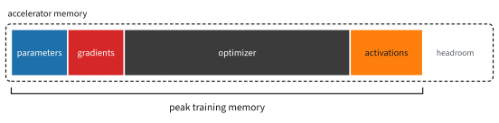
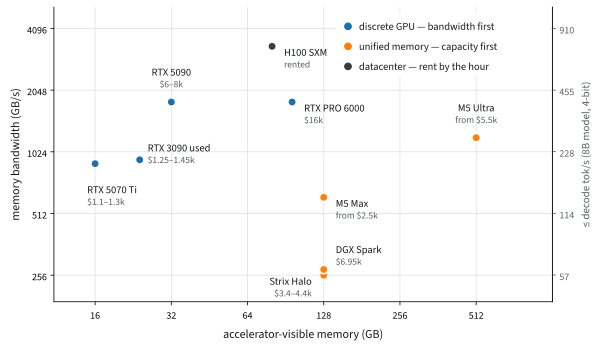
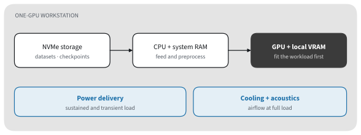
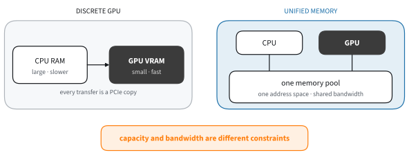

# Hardware
:label:`sec_hardware_buyers`

Most readers run the notebooks of this book on whatever GPU is at hand: a
laptop, a hosted notebook, a rented card. Sooner or later they ask whether
to buy a machine, and which one. Suppose you want to fine-tune an
8-billion-parameter language model on your own documents. A spec sheet lists
dozens of numbers, and the card that looks fastest is not always one that
can run your model at all.

Three quantities decide almost every such choice: memory capacity, memory
bandwidth, and compute throughput. :numref:`sec_hardware` explained how they
shape the behavior of a machine; this section asks what to buy. The method
is to find the quantity that limits your workload and to buy more of it. The
machines and prices below are a snapshot as of November 2026 and will
change; the method will not.

**Capacity decides what runs at all.** Training keeps the weights, their
gradients, and the optimizer state in memory, several times the size of the
model (:numref:`sec_training_systems`). A model that does not fit cannot
run, however fast the card. **Bandwidth decides how fast a model generates
text.** Each new token requires reading every weight that the token uses,
plus the KV cache, the keys and values that attention keeps for all earlier
tokens (:numref:`sec_kv-cache`). Hence

$$
\textrm{decode tokens/s} \lesssim
\frac{\textrm{memory bandwidth}}{\textrm{bytes of active weights and KV cache}}.
$$
:eqlabel:`eq_hardware-buyers-decode`

Once the 8B model is fine-tuned and its weights are quantized to 4 bits,
it reads about 4.5 GB per token at a short context, so a card that streams
900 GB/s generates at most about 200 tokens per second. Processing the
prompt (*prefill*) and training work on many tokens at once and reuse each
weight they read, so compute limits them instead. Machines differ by an order of magnitude on each axis, often in
opposite directions, so the best machine depends on the workload.

## Workload Requirements

A purchase starts from the workload rather than from the card. For training,
the question is whether peak memory (:numref:`fig_tools_memory_fit`) fits:


:label:`fig_tools_memory_fit`

```{.python .input #hardware-memory-estimate}
def training_memory_gib(parameters_billion, weight_bytes=2,
                        gradient_bytes=2, optimizer_bytes=8,
                        activation_gib=6, workspace_gib=2):
    parameters = parameters_billion * 1e9
    state = parameters * (weight_bytes + gradient_bytes + optimizer_bytes)
    return state / 2**30 + activation_gib + workspace_gib

for b in [0.1, 1, 7]:
    print(f"{b:>4}B params: {training_memory_gib(b):6.1f} GiB")
```

A full fine-tune of a 7B model needs about 86 GiB, more than any consumer
card holds. QLoRA :cite:`Dettmers.Pagnoni.Holtzman.ea.2023` freezes the
weights, stores them in 4 bits, and trains small adapter matrices beside
them. It reduces the training state of the same job from 78 GiB to about
4 GiB, so some 7B adapter fine-tunes fit on a 16 GB card. For inference, we
apply the decode bound to each machine of this section:

```{.python .input #hardware-decode-bound}
bandwidth_gbs = {"RTX 5070 Ti": 896, "RTX 3090 (used)": 936,
                 "RTX 5090": 1792, "RTX PRO 6000": 1792,
                 "DGX Spark": 273, "Strix Halo": 256,
                 "M5 Max": 614, "M5 Ultra": 1200, "H100 SXM": 3350}
active_gb = 4.5   # 8B model at 4-bit, including cache traffic
for device, bw in sorted(bandwidth_gbs.items(), key=lambda kv: -kv[1]):
    print(f"{device:>16s}: <= {bw / active_gb:5.0f} tok/s")
```

Realized speed depends on kernels, but the bound often predicts the
ordering. The DGX Spark and a Strix Halo box have nearly the same bandwidth
and decode at similar rates (:numref:`subsec_hardware-buyers-unified`),
although the Spark costs about twice as much and has far more compute.


:label:`fig_tools_hardware_menu`

:numref:`fig_tools_hardware_menu` places representative machines on these
two axes. They form two families: discrete GPUs, fast but small, and
unified-memory systems, large but slow. The workstation-class RTX PRO 6000
bridges the two at a high price.

## Discrete GPUs for Training
:label:`subsec_hardware-buyers-training`

For many training and fine-tuning workloads, a discrete NVIDIA GPU offers
high memory bandwidth and broad software support, including the frameworks
in this book, FlashAttention, quantization kernels, and the CUDA stack common
on rented machines.

### The RTX 5070 Ti and the Used RTX 3090

For a first training machine, memory capacity sets the floor. The RTX 5070 Ti
(16 GB GDDR7 at 896 GB/s, 300 W) listed at \$749 at launch and sold for
about \$1,100–1,300 as of November 2026. Sixteen gigabytes runs every
single-GPU notebook in this book, the largest of which peak near 13 GiB, and
holds QLoRA fine-tunes of 7–8B models; a 12 GB card excludes many more
configurations. Memory prices shape the rest of the desktop: 64 GB of DDR5
cost about \$1,000–1,200, about as much as the card. The used RTX 3090
(24 GB at 936 GB/s, about \$1,250–1,450) has more memory and similar
bandwidth, but it draws 350 W, lacks FP8 and FP4 tensor cores, comes without
a warranty, and its used price rose through 2026.

### The RTX 5090 Workstation

When 16 or 24 GB is too little, the next step on a desktop is 32 GB. The
RTX 5090 (32 GB GDDR7 at 1.79 TB/s, 575 W) listed at \$1,999 but sold for
about \$6,000–8,000 new as of November 2026, when supply was scarce. It is the
fastest consumer card: about half the bandwidth of an H100, FP8 and FP4
tensor cores, and enough memory for full fine-tunes up to about 2B
parameters and QLoRA fine-tunes up to about 30B. NVIDIA specifies 1000 W of
system power for it, the chassis must remove 575 W of heat, and the circuit
must carry the whole system. A balanced build (:numref:`fig_tools_workstation`)
adds a 16-core CPU, 64–128 GB of RAM, and fast NVMe storage, for roughly
\$8,500–12,500 in all.


:label:`fig_tools_workstation`

Multi-GPU consumer systems, often built from two to four used 3090s, add up
memory capacity. Data parallelism works over PCIe, but consumer boards offer
one full-bandwidth slot, so builders use Threadripper or EPYC platforms for
their PCIe lanes, and dual power supplies are common. No consumer card since
the 3090 has NVLink, so communication-heavy tensor parallelism scales poorly.
A short rental of a multi-GPU node (:numref:`sec_cloud_instances`) shows
whether interconnect bandwidth limits the workload before you buy.

## Unified-Memory Machines for Inference
:label:`subsec_hardware-buyers-unified`


:label:`fig_tools_memory_path`

A second family of machines answers a different question: not how fast you
can train, but how large a model you can *run* at home. These systems give
the GPU direct access to a large pool of LPDDR5X, the memory of laptops and
phones, which offers capacity at a fraction of the bandwidth of GDDR7 or HBM
(:numref:`fig_tools_memory_path`). The decode bound predicts the trade-off:
large models fit but decode slowly. A mixture-of-experts (MoE) model runs
only a few of its expert networks for each token, so it reads only its
active parameters and decodes faster than a dense model of similar total
size.

:Unified-memory machines for local inference (as of November 2026)
:label:`tab_unified_memory`

| Machine | Memory | Bandwidth | ≈ Price | Notes |
|---|---|---|---|---|
| AMD Strix Halo mini-PC (Ryzen AI Max+ 395) | 128 GB | 256 GB/s | \$3,400–4,400 | Framework, GMKtec, Minisforum, Beelink, and others; ROCm or Vulkan on Linux |
| NVIDIA DGX Spark (GB10) | 64 or 128 GB | 273 GB/s | \$5,000 (64 GB, from OEM partners), \$6,950 (128 GB) | CUDA-native Blackwell; strong prefill; up to four units cluster over ConnectX-7 |
| Mac Studio M5 Max | up to 128 GB | 614 GB/s | from \$2,500 | MLX ecosystem; base model has 36 GB at 460 GB/s |
| Mac Studio M5 Ultra | 96–512 GB | 1.2 TB/s | from \$5,500 | the most memory and bandwidth in this class |
| MacBook Pro M5 Max | up to 128 GB | 614 GB/s | from \$3,600 | the M5 Max in a laptop; base model has 36 GB at 460 GB/s |

Community measurements roughly follow the bandwidth ordering. The MoE model
gpt-oss-120b has 117B parameters but uses about 5B of them per token. In llama.cpp
benchmarks it generates about 60 tokens/s on a DGX Spark and about 50 on
Strix Halo, and reviewers of the M5 Ultra report about 115–120 with Ollama
and MLX. A dense
70B model at 4 bits reads about 40 GB per token, so the bound alone keeps it
below 7 tokens/s on the Spark and Strix Halo and below 30 on the M5 Ultra.
The machines differ more in prefill: in the same llama.cpp benchmarks the
Spark's tensor cores process a 2,048-token prompt about two and a half times
faster than Strix Halo. The software stack matters too (CUDA on the Spark,
ROCm or Vulkan on Strix Halo, MLX on Apple machines), so measure the models
you care about.

## Workstation GPUs
:label:`subsec_hardware-buyers-top-end`

A buyer who needs both capacity and bandwidth, for example to fine-tune a 70B
model at home, reaches the workstation class. The RTX PRO 6000 Blackwell
packs 96 GB of GDDR7 at the 5090's 1.79 TB/s. It launched in 2025 at
\$8,565, and NVIDIA's store listed it at \$16,000 as of November 2026. A
300 W Max-Q variant with the same memory lets four cards share one chassis.
Two cards hold 192 GB, enough for unquantized 70B inference and 70B LoRA
fine-tunes; four hold 384 GB, enough for MoE models of several hundred
billion parameters at 4 bits. Workstation cards lost NVLink after the Ampere
generation, so traffic between cards travels over PCIe 5.0 at about 64 GB/s
per direction, nearly thirty times slower than each card's own memory.
Data-parallel and pipeline-parallel workloads tolerate this; tensor
parallelism slows down.

Against such a budget, price the alternative. The \$64,000 of four cards
rents about 32,000 H100-hours at a marketplace rate of \$2 per hour
(:numref:`tab_cloud_prices`). A purchase breaks even after the number of
productive hours whose rental would cost the purchase price:

```{.python .input #hardware-break-even}
purchase = 10500.0                  # an RTX 5090 workstation, Nov. 2026
rental_per_productive_hour = 2.00   # H100 marketplace rate
print(f"{purchase / rental_per_productive_hour:.0f} "
      "productive hours to break even")
```

At eight productive hours a day, 5,250 hours take about 1.8 years,
and a machine at home idles more than its owner expects. Electricity, resale
value, and the speed difference between the machines change the count
(:exref:`ex_hardware-break-even`). On the other side are privacy, no queue,
and the value of hardware you can take apart.

## Sources for Current Numbers
:label:`subsec_hardware-buyers-current`

The prices above will change, and newer measurements still need
cross-checking. For build advice and street prices, see
[r/LocalLLaMA](https://www.reddit.com/r/LocalLLaMA/) (hardware megathreads)
and the [Level1Techs forum](https://forum.level1techs.com/) (multi-GPU build
logs, Strix Halo notes); for reviews of Strix Halo boxes, the DGX Spark, and
used servers, [ServeTheHome](https://www.servethehome.com/); for comparable
numbers, the benchmark threads in the
[llama.cpp discussions](https://github.com/ggml-org/llama.cpp/discussions),
which run `llama-bench` on the same model files across many machines. Tim
Dettmers' [guide](https://timdettmers.com/2023/01/30/which-gpu-for-deep-learning/),
last updated in 2023, offers a workload-based method rather
than current part recommendations. Many search results for GPU questions are
machine-generated pages that quote estimated or invented benchmarks. Trust
datasheets, named reviewers, and numbers that pass the decode-bound check.

## Summary

* Buy the binding constraint: capacity decides what runs, bandwidth decides
  decode speed, and compute decides training and prefill speed. The decode
  bound, bandwidth divided by the bytes read per token, predicts generation
  speed to within a factor of two.
* As of November 2026, a 16 GB RTX 5070 Ti (about \$1,100–1,300) is a
  reference point for a lower-capacity training machine, and a 32 GB
  RTX 5090 (about \$6,000–8,000) for a high-end desktop with substantial
  power and cooling requirements. Used 3090s trade warranty and efficiency
  for memory capacity.
* Unified-memory machines (Strix Halo, DGX Spark, Apple silicon) trade
  bandwidth for capacity. Large MoE models fit and decode faster than dense
  models of similar total size, and prefill speed separates machines with
  similar bandwidth.
* The RTX PRO 6000 class (96 GB at full bandwidth, no NVLink) bridges the
  two families at five figures per card. Before spending that, price the
  rented equivalent in productive hours.
* Date every price you rely on, and take current numbers from the community
  sources above rather than from machine-generated search results.

## Exercises

1. [code] **Training memory.** `training_memory_gib` charges every
   parameter 2 bytes of weights, 2 bytes of gradients, and 8 bytes of
   optimizer state, and it adds fixed amounts for activations and
   workspace.
    1. Mixed-precision training with Adam, as counted by
       :citet:`Rajbhandari.Rasley.Ruwase.ea.2020`, keeps 16 bytes per
       parameter. Which tensor do the defaults of `training_memory_gib`
       leave out, and how does adding it change the estimate for the 7B
       model? Under both counts, find the largest model whose full
       fine-tune fits on cards with 16, 24, 32, and 96 GB, treating a
       card's GB as GiB.
    1. LoRA :cite:`Hu.Shen.Wallis.ea.2021` freezes the pretrained weights
       and trains small adapter matrices beside them. QLoRA
       :cite:`Dettmers.Pagnoni.Holtzman.ea.2023` also stores the frozen
       weights in 4 bits, plus 0.127 bits per parameter of quantization
       constants. Give `training_memory_gib` an argument for the trainable
       fraction of the parameters: a frozen parameter costs only its
       stored bytes, and a trainable one costs weights, gradients, and
       optimizer state as before. Evaluate the function for an 8B model
       with 1% trainable parameters and the default activation and
       workspace terms, once for LoRA with frozen bf16 weights and once for
       QLoRA. Which of the two fine-tunes fits on a 16 GB card? Which term
       is the largest in the one that fits?
    1. The activation term is not a constant: it grows with the number of
       tokens per step. With per-block activation
       checkpointing (:numref:`subsec_mp-checkpointing`), a model keeps
       only the input of each block, $d$ bf16 values per token, plus the
       activations of one
       block during its recomputation, which this sub-problem ignores. Give
       the QLoRA fine-tune of the second sub-problem the shape of Llama 3.1
       8B :cite:`Grattafiori.Dubey.Jauhri.ea.2024`: 32 blocks of width
       $d = 4096$ and a vocabulary of 128,256 tokens. How many tokens per
       step fit into the memory that the 16 GB card leaves for activations?
    1. The output layer also keeps one bf16 logit per vocabulary entry and
       token for the loss. How many tokens per step fit once the logits
       count as well? Compare the logit bytes per token with the bytes of
       the block inputs per token.
   :exlabel:`ex_hardware-training-memory`

1. **Context length and decode.** Every decode step reads the KV cache of
   all earlier tokens as well as the weights, which is why the code that
   defines `bandwidth_gbs` charges an 8B model at 4 bits
   `active_gb = 4.5` GB per token. A model with $L$ layers and
   $H_\textrm{kv}$ key-value heads of dimension $d_h$ stores
   $2 L H_\textrm{kv} d_h$ values per token of context, one key and one
   value per head and layer (:numref:`sec_kv-cache`). Llama 3.1 8B
   :cite:`Grattafiori.Dubey.Jauhri.ea.2024` has 32 layers and 8
   key-value heads of dimension 128, and it keeps its cache in bf16.
    1. Compute the cache bytes per token. Which context length does the
       0.5 GB of cache traffic in `active_gb` correspond to?
    1. Bound the decode rate on the RTX 5070 Ti and on the M5 Ultra at
       contexts of 4K, 32K, and 128K tokens, and give the share of the
       cache in the bytes read per token. At which of these contexts do
       the weights and the cache still fit on the 16 GB card?
    1. Quantizing the weights from bf16 to 4 bits divides their bytes
       by 4. By what factor does it raise the decode bound at 4K tokens, and
       by what factor at 128K tokens? What does this imply for a buyer
       whose workload uses long contexts?
   :exlabel:`ex_hardware-context-decode`

1. **Mixture-of-experts decode.** A mixture-of-experts (MoE) model stores
   many expert networks but runs only a few of them for each token, so a
   decode step reads only the *active* parameters. Take a 30B-A3B model,
   with 30 billion parameters of which 3 billion are active per token, and
   a dense 30B model, both with 4-bit weights. Ignore the KV cache.
    1. Use :eqref:`eq_hardware-buyers-decode` to bound the decode rate of
       both models on every machine in :numref:`tab_unified_memory`. Which
       machines decode each model faster than 20 tokens/s, a common
       threshold for interactive use?
    1. A dense 3B model at 4 bits reads as many bytes per token as the
       MoE. What does the MoE cost a buyer that the dense 3B model does
       not? Which cards in `bandwidth_gbs` can run the MoE?
    1. The model card of gpt-oss-120b :cite:`OpenAI.2025` counts 114.71B
       parameters in the experts of its 36 MoE layers, 0.96B attention
       parameters, and 1.16B parameters in its untied embedding and output
       matrices, which have equal size. Each layer has 128 experts, of which
       a token uses 4. The experts are stored in MXFP4 at 4.25 bits per
       parameter, and all other weights in bf16. Compute the bytes that a
       decode step reads, given that the embedding lookup reads a single
       row. Bound the decode rate on the DGX Spark and on Strix Halo, and
       compare the bounds with the llama.cpp rates that
       :numref:`subsec_hardware-buyers-unified` reports.
    1. The measured rate on the DGX Spark exceeds your bound. The llama.cpp
       model file behind it takes 59.02 GiB for 116.83B parameters. What
       does its size imply about the format of the weights outside the
       experts? Recompute the bytes per decode step and the fraction of
       each bound that the measured rates achieve. What does the comparison
       between the DGX Spark and Strix Halo say about bandwidth as a
       predictor of decode speed?
   :exlabel:`ex_hardware-moe-decode`

1. [code] **Break-even with operating costs.** The code that computes the
   break-even divides `purchase` by
   `rental_per_productive_hour`, the rental price of the work that the
   owned machine does in one productive hour.
    1. An owned machine also draws electricity in every productive hour,
       and it can be resold afterwards. Write the break-even condition for
       a purchase price $C$, a resale value $R$, a wall power $p$ under
       load, an electricity price $e$ per kWh, and a rental price $r$ per
       productive hour, and solve it for the number of productive hours
       $H$.
    1. Evaluate $H$ for the RTX 5070 Ti desktop of
       :numref:`subsec_hardware-buyers-training` at \$3,000, with a resale
       value of \$800 after three years and 450 W at the wall, against a
       marketplace RTX 4090 of :numref:`tab_cloud_prices` at \$0.35 per
       hour, with electricity at \$0.20 per kWh. Assume that the 5070 Ti
       completes 70% of the work of a 4090 per hour. How many years of
       eight productive hours per day does $H$ take?
    1. The code compares a 5090 box with an H100-class rental price, which
       counts an hour on either machine as the same amount of work. Use
       :numref:`tab_gpu_specs` to estimate how much more work an H100 does
       per hour in compute-bound training and in bandwidth-bound decode.
       Recompute $H$ for both workloads with the 5090 build of
       :numref:`subsec_hardware-buyers-training` at the midpoint of its
       price range, without resale, and with 900 W at the wall.
   :exlabel:`ex_hardware-break-even`

1. **Prefill versus decode.** ● A request first processes its prompt
   (prefill) and then generates its answer token by token (decode).
   :numref:`subsec_hardware-buyers-unified` reports that gpt-oss-120b
   decodes at about 60 tokens/s on the DGX Spark and at about 50 tokens/s
   on Strix Halo. Assume that prefill runs at 2,400 prompt tokens/s on the
   DGX Spark and at 1,000 prompt tokens/s on Strix Halo, and that every
   answer has 500 tokens.
    1. Compute the time to the first token and the total time of a chat
       request with a 500-token prompt and of a coding-agent request with a
       30,000-token prompt on both machines. By what factor is the DGX
       Spark faster for each request? The 128 GB Spark costs about twice as
       much as a Strix Halo box (:numref:`tab_unified_memory`). For which
       workload is the higher price easier to justify?
    1. Count 2 FLOPs per active parameter and token, for the 5.13B active
       parameters of gpt-oss-120b :cite:`OpenAI.2025`, and ignore the
       FLOPs of the attention scores. Convert both prefill rates into
       sustained FLOP/s.
    1. A prefill that processes its prompt in chunks of 512 tokens reads
       every weight that some token of the chunk uses, once per chunk.
       Assume that every token picks its 4 experts of a layer uniformly at
       random from the 128, independently of the other tokens. How many
       distinct experts of a layer does a chunk read on average? Use the
       accounting of problem :exref:`ex_hardware-moe-decode`c to compute
       the bytes that one chunk reads, and bound the prefill rate of each
       machine by its bandwidth. Which machine could reach its assumed
       prefill rate with chunks of 512 tokens? What does this imply about
       the chunk size of the DGX Spark measurement?
    1. How does the bandwidth bound on prefill of the DGX Spark change with
       chunks of 2,048 tokens? Why does an MoE model need longer chunks
       than a dense model with the same active parameters before its
       prefill becomes compute-bound?

1. [extended] **Calibrating the decode bound.** ●● The summary states that
   :eqref:`eq_hardware-buyers-decode` predicts generation speed to within
   a factor of two. Test this claim on hardware that you can access, and
   replace the bound by a calibrated model. A laptop CPU suffices, because
   llama.cpp runs on CPUs.
    1. Measure the bandwidth that your machine sustains on a large
       streaming copy, and compare it with the bandwidth of its datasheet.
    1. Use `llama-bench` from llama.cpp to measure the decode rate of at
       least six configurations that span model size and weight format,
       for example dense models with 1B, 3B, and 8B parameters at 4 and
       8 bits, and one MoE model. Compute the bytes that each
       configuration reads per token from its parameter counts and format,
       and plot the measured rates against the bound.
    1. Fit the model
       $1/\textrm{rate} = t_0 + \textrm{bytes}/(\eta \beta)$, with $\beta$
       the bandwidth of the first sub-problem, to estimate the fraction
       $\eta$ of the bandwidth that decoding achieves and a fixed time
       $t_0$ per token. Which configurations deviate most from the fit,
       and why?
    1. Predict the decode rate of one configuration that the fit did not
       use, and of one configuration at a context of 16K tokens, adding
       the cache bytes of problem :exref:`ex_hardware-context-decode`. Measure both, and
       compare your prediction errors with the factor of two of the
       summary and with a published number for your hardware from the
       sources of :numref:`subsec_hardware-buyers-current`.

[Discussions](https://d2l.discourse.group/t/36844)

<!-- slides -->

::: {.slide}
::: {.cover}
[Dive into Deep Learning · §39.4]{.kicker}

Hardware: Memory Capacity, Bandwidth Bounds, Unified Memory, and TCO<br>**training memory budget · decode bandwidth bound · discrete GDDR7 GPUs · unified LPDDR5X · MoE arithmetic · rent-vs.-buy break-even**
:::
:::

::: {.slide title="Three Quantities Decide Every Hardware Purchase"}
[Motivation]{.kicker}

A hardware datasheet lists dozens of clock speeds, core counts, and marketing metrics, but three physical quantities govern deep learning workloads:

::: {.cols}
::: {.col}
- **1. Memory Capacity (GB / GiB):** Decides **what can run at all**. If parameters, gradients, optimizer states, and activations exceed device memory, peak FLOP/s is irrelevant.
- **2. Memory Bandwidth (GB/s or TB/s):** Decides **how fast a model generates tokens**. Autoregressive decoding reads every active weight and KV-cache entry from memory once per output token.
:::

::: {.col}
- **3. Compute Throughput (TFLOP/s):** Decides **training and prompt-prefill speed**. Processing hundreds or thousands of tokens in parallel reuses each weight across the batch, making the workload compute-bound.
:::
:::

::: {.d2l-note .rule}
**Hardware selection method:** Identify which of the three quantities binds your target workload, then buy the machine that maximizes that binding constraint per dollar.
:::
:::

::: {.slide title="The Memory Capacity Constraint in Training"}
[Capacity Budget]{.kicker}

Why does training or full fine-tuning require $4\times\text{--}8\times$ more memory than loading the same model for inference?

::: {.cols .vc}
::: {.col}
- **Mixed-precision Adam state ($16\text{ B/param}$):**
  - BF16 parameters ($2\text{ B}$) + BF16 gradients ($2\text{ B}$).
  - FP32 master weights ($4\text{ B}$) + two FP32 Adam moments $m, v$ ($8\text{ B}$).
  - Without a separate master copy ($12\text{ B/param}$), state alone is already $6\times$ the BF16 model size.
- **Activations and workspace:** Forward activations saved for backpropagation (scaling with batch $\times$ sequence length) plus cuBLAS/cuDNN scratch workspace add several GiB on top.
:::

::: {.col .fig}
{.nostretch width=100%}
:::
:::
:::

::: {.slide title="Estimating Peak Training Memory by Model Scale"}
[Full Fine-Tune vs. QLoRA]{.kicker}

Our sizing function sums parameter state ($12\text{ B/param}$ without master weights, or $16\text{ B/param}$ with them) plus activation and workspace overhead:

::: {.cols .vc}
::: {.col}
- **Full 7B fine-tune ($\approx 86\text{--}112\text{ GiB}$):** Exceeds every consumer desktop GPU ($16\text{--}32\text{ GB}$).
- **How QLoRA fits 7B–8B on a 16 GB card:**
  - Freezes the base weights in 4-bit NormalFloat ($\sim 0.52\text{ B/param} \approx 4\text{ GiB}$ for 8B).
  - Trains low-rank adapters on $\sim 1\%$ of parameters ($\approx 0.08\text{B} \times 12\text{ B} \approx 1\text{ GiB}$), leaving $\sim 11\text{ GiB}$ for activations and logits!
:::

::: {.col .fig}
@hardware-memory-estimate
:::
:::
:::

::: {.slide title="The Autoregressive Decode Bandwidth Bound"}
[Inference Roofline]{.kicker}

During batch-1 text generation, producing each new token requires streaming every active weight byte $B_w$ and the stored key–value cache $B_{\text{kv}}(n)$ across the memory bus:

$$\text{decode tokens/s} \lesssim \frac{\text{memory bandwidth } \beta}{B_w + B_{\text{kv}}(n)}$$

::: {.cols}
::: {.col}
- **Worked example (8B dense model at 4 bits):**
  - Weight bytes: $8 \times 10^9 \times 0.5\text{ B} = 4.0\text{ GB}$.
  - Short-context KV cache ($\sim 4\text{K}$ tokens in BF16): $\approx 0.5\text{ GB}$.
  - Total memory traffic per token: $B_{\text{active}} \approx 4.5\text{ GB/token}$.
:::

::: {.col}
- **Why compute is idle during batch-1 decode:**
  - An 8B token step does $2 \times 8 \times 10^9 = 16\text{ GFLOPs}$ while reading $4.5\text{ GB}$—an arithmetic intensity of just **$3.5\text{ FLOPs/byte}$**, roughly $50\times\text{--}100\times$ below a modern GPU's compute ridge point!
:::
:::
:::

::: {.slide title="Ranking Hardware by the Decode Bandwidth Bound"}
[Bandwidth Ordering]{.kicker}

Applying $\beta / (4.5\text{ GB})$ across consumer discrete cards, unified-memory boxes, and a datacenter H100 predicts generation speed to within a factor of two:

::: {.cols .vc}
::: {.col}
- **Bandwidth sets the ceiling:**
  - An H100 SXM ($3{,}350\text{ GB/s}$) bounds decode at $\le 744\text{ tok/s}$.
  - An RTX 5090 or PRO 6000 ($1{,}792\text{ GB/s}$) reaches $\le 398\text{ tok/s}$.
  - A DGX Spark ($273\text{ GB/s}$) and Strix Halo ($256\text{ GB/s}$) both cap near $\le 57\text{--}61\text{ tok/s}$, even though the Spark costs twice as much and has far more compute!
:::

::: {.col .fig}
@hardware-decode-bound
:::
:::
:::

::: {.slide title="How Long Contexts Shift the Bottleneck to KV Cache"}
[Long-Context Arithmetic]{.kicker}

A transformer with $L$ layers and $H_{\text{kv}}$ key–value heads of dimension $d_h$ stored in BF16 ($2\text{ B}$) reads and grows its KV cache at every token:

$$B_{\text{kv}}(n) = 2 \cdot L \cdot H_{\text{kv}} \cdot d_h \cdot 2\text{ B} \cdot n$$

::: {.cols}
::: {.col}
- **Concrete numbers for Llama 3.1 8B ($L = 32$, $H_{\text{kv}} = 8$, $d_h = 128$):**
  - Per-token KV cache: $2 \times 32 \times 8 \times 128 \times 2 = 131{,}072\text{ B}$ ($128\text{ KiB/token}$).
  - At **$4\text{K}$ tokens:** $B_{\text{kv}} \approx 0.5\text{ GB}$ ($11\%$ of the $4.5\text{ GB}$ traffic).
  - At **$32\text{K}$ tokens:** $B_{\text{kv}} \approx 4.0\text{ GB}$ (**$50\%$** of traffic—equals the 4-bit weights!).
  - At **$128\text{K}$ tokens:** $B_{\text{kv}} \approx 16.0\text{ GB}$ (**$80\%$** of traffic—no longer fits on a 16 GB card!).
:::

::: {.col}
- **Hardware consequence for long-context buyers:**
  - Quantizing weights from BF16 ($16\text{ GB}$) to 4-bit ($4\text{ GB}$) speeds up decode by **$3.6\times$ at 4K context** ($16.5 / 4.5$), but only **$1.6\times$ at 128K context** ($32 / 20$) unless the KV cache itself is also quantized or compressed.
:::
:::
:::

::: {.slide title="Two Families of Local Hardware"}
[The Hardware Landscape]{.kicker}

Plotting machines on **memory capacity** (vertical) versus **memory bandwidth** (horizontal) reveals a sharp architectural split:

::: {.cols .vc}
::: {.col}
- **Discrete consumer GPUs (bottom right):** Pair ultra-fast GDDR6X/GDDR7 ($896\text{--}1792\text{ GB/s}$) with modest capacity ($16\text{--}32\text{ GB}$). Fast for training and small/medium models.
- **Unified-memory systems (top left):** Pair massive LPDDR5X capacity ($64\text{--}512\text{ GB}$) with lower bandwidth ($256\text{--}1200\text{ GB/s}$). Run huge models locally at lower token rates.
- **Workstation & datacenter cards (upper right):** RTX PRO 6000 ($96\text{ GB}$, $1.79\text{ TB/s}$) and H100 ($80\text{ GB}$, $3.35\text{ TB/s}$) deliver both at five-figure prices.
:::

::: {.col .fig}
{.nostretch width=100%}
:::
:::
:::

::: {.slide title="Entry Discrete Training GPUs: 5070 Ti vs. Used 3090"}
[16 GB to 24 GB Desktop Cards]{.kicker}

For a first local training and fine-tuning build, $16\text{ GB}$ of VRAM sets the practical floor (every single-GPU notebook in this book peaks below $13\text{ GiB}$):

| Attribute (Nov 2026 Snapshot) | NVIDIA RTX 5070 Ti (New) | NVIDIA RTX 3090 (Used) |
| :--- | :--- | :--- |
| **VRAM Capacity & Bandwidth** | **16 GB GDDR7** at **$896\text{ GB/s}$** | **24 GB GDDR6X** at **$936\text{ GB/s}$** |
| **Typical Street Price** | $\approx \$1{,}100\text{--}1{,}300$ (MSRP $\$749$) | $\approx \$1{,}250\text{--}1{,}450$ (used market) |
| **Tensor Core Formats** | BF16, FP16, **FP8, FP4** (Blackwell) | BF16, FP16 (Ampere; **no FP8/FP4**) |
| **Board Power & Warranty** | **300 W**, full retail warranty | **350 W**, no manufacturer warranty |
| **Sweet Spot Workload** | All D2L notebooks, 7B–8B QLoRA, FP8/FP4 inference | Workloads requiring the extra $8\text{ GB}$ of VRAM on a budget |
:::

::: {.slide title="High-End Desktop Training: The RTX 5090 Workstation"}
[Balanced System Design]{.kicker}

Stepping up to **32 GB GDDR7 at $1.79\text{ TB/s}$** (RTX 5090, street price $\approx \$6{,}000\text{--}8{,}000$ in Nov 2026) supports full fine-tunes up to $\sim 2\text{B}$ parameters and QLoRA up to $\sim 30\text{B}$:

::: {.cols .vc}
::: {.col}
- **Thermal & electrical envelope:** The GPU alone dissipates **$575\text{ W}$**; NVIDIA specifies a **$1000\text{ W}$** PSU, high-airflow chassis, and a dedicated wall circuit capacity.
- **Feeding the GPU ($\approx \$8{,}500\text{--}12{,}500$ total build):** Pair with a 16-core CPU, $64\text{--}128\text{ GB}$ DDR5 RAM, and fast PCIe Gen4/5 NVMe SSDs so data loading and checkpointing never bottleneck compute.
- **Multi-GPU consumer limits:** No consumer card since the 3090 has NVLink, and desktop motherboards rarely offer multiple full x16 PCIe lanes without Threadripper/EPYC platforms.
:::

::: {.col .fig}
{.nostretch width=100%}
:::
:::
:::

::: {.slide title="Unified-Memory Architecture: Capacity Over Bandwidth"}
[Local Large-Model Inference]{.kicker}

How can a mini-PC or Mac Studio run a 70B or 120B language model that does not fit on an RTX 5090?

::: {.cols .vc}
::: {.col}
- **Eliminating the PCIe copy bottleneck:** Discrete GPUs copy tensors across PCIe between host DDR5 and a small pool of soldered GDDR7 VRAM.
- **Shared LPDDR5X memory pool:** Unified-memory systems attach both CPU and GPU cores directly to a single large pool of wide-bus LPDDR5X ($64\text{--}512\text{ GB}$).
- **The physical trade-off:** You gain $4\times\text{--}16\times$ more memory capacity than a desktop GPU, at $15\%\text{--}65\%$ of an RTX 5090's memory bandwidth.
:::

::: {.col .fig}
{.nostretch width=100%}
:::
:::
:::

::: {.slide title="Comparing Unified-Memory Systems (Nov 2026)"}
[Unified-Memory Menu]{.kicker}

Five representative unified-memory systems illustrate the progression in capacity, bandwidth, and software ecosystem:

| System | Unified Memory | Bandwidth | $\approx\text{ Price (Nov 2026)}$ | Software Stack & Distinguishing Trait |
| :--- | :--- | :--- | :--- | :--- |
| **AMD Strix Halo** (Ryzen AI Max+ 395) | 128 GB | $256\text{ GB/s}$ | $\$3{,}400\text{--}4{,}400$ | Linux ROCm / Vulkan; lowest-cost 128 GB box |
| **NVIDIA DGX Spark** (GB10 Blackwell) | 64 or 128 GB | $273\text{ GB/s}$ | $\$5{,}000\text{ / }\$6{,}950$ | Native CUDA stack; $2.5\times$ faster prompt prefill |
| **Mac Studio M5 Max** | Up to 128 GB | $614\text{ GB/s}$ | From $\$2{,}500$ | Apple MLX / `llama.cpp`; $2.3\times$ Spark bandwidth |
| **MacBook Pro M5 Max** | Up to 128 GB | $614\text{ GB/s}$ | From $\$3{,}600$ | Mobile workstation with full 128 GB M5 Max |
| **Mac Studio M5 Ultra** | 96–512 GB | $1{,}200\text{ GB/s}$ | From $\$5{,}500$ | Highest capacity ($512\text{ GB}$) & bandwidth ($1.2\text{ TB/s}$) |
:::

::: {.slide title="Why Mixture-of-Experts (MoE) Shines on Unified Memory"}
[Dense vs. Sparse Decode]{.kicker}

Unified memory's combination of high capacity and moderate bandwidth is tailor-made for **Mixture-of-Experts (MoE)** models:

::: {.cols}
::: {.col}
- **Dense 70B at 4 bits ($\sim 40\text{ GB}$ read per token):**
  - Fits easily in 64–128 GB, but reading $40\text{ GB}$ every token limits decode to **$< 7\text{ tok/s}$** on Strix Halo / DGX Spark ($256\text{--}273\text{ GB/s}$) and **$< 30\text{ tok/s}$** on M5 Ultra ($1{,}200\text{ GB/s}$).
- **MoE `gpt-oss-120b` (117B total, $\sim 5.1\text{B}$ active per token):**
  - Requires **$\sim 59\text{ GiB}$ of capacity** to hold all 128 experts per layer in memory (excluding 16–32 GB discrete cards!).
:::

::: {.col}
- **MoE decode speed matches a 5B dense model:**
  - Because each token routes to only 4 of 128 experts per layer, a decode step reads only **$\sim 3\text{--}3.5\text{ GB}$ of active weights**!
  - Measured `llama.cpp` / MLX decode rates on `gpt-oss-120b`:
    - **Strix Halo ($256\text{ GB/s}$):** $\approx 50\text{ tok/s}$
    - **DGX Spark ($273\text{ GB/s}$):** $\approx 60\text{ tok/s}$
    - **M5 Ultra ($1{,}200\text{ GB/s}$):** $\approx 115\text{--}120\text{ tok/s}$
:::
:::
:::

::: {.slide title="Prefill Compute Separates Equal-Bandwidth Machines"}
[Prompt Processing vs. Decode]{.kicker}

Why does the DGX Spark cost nearly twice as much as a Strix Halo mini-PC when both have $\sim 260\text{--}273\text{ GB/s}$ bandwidth and similar decode speeds?

::: {.cols}
::: {.col}
- **Prefill is compute-bound:** Processing a prompt in chunks reuses expert weights across hundreds of tokens, shifting the bottleneck from LPDDR5X bandwidth to tensor-core TFLOP/s (where DGX Spark's Blackwell GPU prefills at $\sim 2{,}400\text{ tok/s}$ vs. Strix Halo's $\sim 1{,}000\text{ tok/s}$ on `gpt-oss-120b`).
- **Short chat request (500-token prompt + 500-token reply):**
  - Prefill takes $0.21\text{ s}$ (Spark) vs. $0.50\text{ s}$ (Strix Halo); decode takes $8.3\text{ s}$ vs. $10.0\text{ s}$—total time differs by only **$1.2\times$** ($8.5\text{ s}$ vs. $10.5\text{ s}$).
:::

::: {.col}
- **Coding-agent request (30,000-token repository prompt + 500-token reply):**
  - Time to first token (TTFT): **$12.5\text{ s}$ on DGX Spark vs. $30.0\text{ s}$ on Strix Halo** ($2.4\times$ faster!).
  - Total request time: **$20.8\text{ s}$ vs. $40.0\text{ s}$** ($1.9\times$ faster).
- **Takeaway:** Bandwidth predicts interactive chat generation, whereas prefill compute and CUDA software maturity justify their premium on long-context agent and RAG workloads.
:::
:::
:::

::: {.slide title="Workstation GPUs and the Rent-vs.-Buy Break-Even"}
[Total Cost of Ownership]{.kicker}

The **RTX PRO 6000 Blackwell** packs **96 GB GDDR7 at $1.79\text{ TB/s}$** (listed at $\$16{,}000$ in Nov 2026; four 300 W Max-Q cards put $384\text{ GB}$ in one chassis for $\$64{,}000$, communicating over PCIe 5.0 at $64\text{ GB/s}$). When does buying beat renting?

::: {.cols .vc}
::: {.col}
- **Simple break-even:** Dividing a $\$10{,}500$ RTX 5090 workstation by a $\$2.00/\text{hr}$ marketplace H100 rate gives **$5{,}250$ productive hours** ($\approx 1.8\text{ years}$ at $8\text{ hr/day}$, every day).
- **Full TCO break-even with power, resale, and relative speed $s$:**
  $$H = \frac{C_{\text{buy}} - R_{\text{resale}}}{s \cdot r_{\text{cloud}} - p_{\text{kW}} \cdot e_{\text{kWh}}}$$
  Accounting for the H100's $\sim 2\times\text{--}3\times$ higher throughput $s$ and $0.9\text{ kW} \times \$0.20/\text{kWh}$ electricity pushes break-even to **3–5+ years** of heavy utilization. Buy for privacy, instant access, and hardware tinkering; rent for bursty scale.
:::

::: {.col .fig}
@hardware-break-even
:::
:::
:::

::: {.slide title="Verifying Benchmarks and Filtering Out Synthetic Noise"}
[Evidence Discipline]{.kicker}

Search results for GPU comparisons are flooded with machine-generated pages quoting fabricated token-per-second tables:

::: {.cols}
::: {.col}
- **Sanity-check every number with the decode bound:**
  - If a blog claims a card with $900\text{ GB/s}$ bandwidth decodes a dense 70B 4-bit model ($35\text{ GB}$ of weights) at $45\text{ tok/s}$ ($45 \times 35 = 1{,}575\text{ GB/s} > 900\text{ GB/s}$), the claim violates physics (unless speculative decoding or sparsity is active).
- **Calibrated empirical model:** Real decode time per token follows an affine roofline:
  $$\frac{1}{\text{rate}} = t_0 + \frac{\text{bytes read}}{\eta \cdot \beta}$$
  where $\eta \in [0.6, 0.85]$ is achieved bandwidth efficiency and $t_0$ is per-token kernel dispatch overhead.
:::

::: {.col}
- **High-signal primary hardware sources:**
  - **`llama.cpp` GitHub Discussions:** Standardized `llama-bench` runs on identical GGUF files across CPUs, Apple silicon, CUDA, and ROCm.
  - **ServeTheHome & Level1Techs:** Independent power, thermal, PCIe topology, and multi-GPU workstation reviews.
  - **`r/LocalLLaMA` hardware megathreads:** Community street prices, quantization benchmarks, and build logs.
:::
:::
:::

::: {.slide title="Concept Check: Hardware Sizing and Roofline Bounds"}
[Check Your Understanding]{.kicker}

Work out these three hardware sizing calculations:

1. You want to fine-tune Llama 3.1 8B using LoRA ($1\%$ trainable parameters, $6\text{ GiB}$ activations, $2\text{ GiB}$ workspace) on a **16 GB RTX 5070 Ti**. Does standard LoRA (frozen BF16 base weights) fit, or do you need QLoRA (frozen 4-bit base weights)?
2. Compare a dense 30B model and a **30B-A3B MoE** model ($30\text{B}$ total parameters, $3\text{B}$ active per token), both quantized to 4 bits ($0.5\text{ B/param}$). Ignoring KV cache, what is the decode bandwidth bound on a Mac Studio M5 Max ($614\text{ GB/s}$)?
3. Why does the 30B-A3B MoE model fail to run on a 16 GB RTX 5070 Ti even though it only reads $1.5\text{ GB}$ of weights per token?

::: {.d2l-note .fragment .fade-up}
**Answers:**

1. **Standard BF16 LoRA does not fit:** Frozen BF16 weights alone take $8\text{B} \times 2\text{ B} \approx 14.9\text{ GiB}$, plus $1\text{ GiB}$ adapter state $+ 8\text{ GiB}$ activations/workspace $\approx 23.9\text{ GiB} > 16\text{ GB}$. **QLoRA fits easily:** 4-bit base weights take $\approx 3.9\text{ GiB} + 0.9\text{ GiB}$ adapters $+ 8\text{ GiB} \approx 12.8\text{ GiB} < 16\text{ GB}$.
2. **Dense 30B** reads $15\text{ GB/tok}$ $\implies$ $614 / 15 \approx \mathbf{41\text{ tok/s}}$. **30B-A3B MoE** reads $1.5\text{ GB/tok}$ $\implies$ $614 / 1.5 \approx \mathbf{409\text{ tok/s}}$ ($10\times$ faster!).
3. **Capacity vs. bandwidth:** All $30\text{B}$ parameters ($\approx 15\text{ GB}$ plus KV cache and runtime buffers $> 16\text{ GB}$) must stay resident in memory because any expert can be routed on the next token!
:::
:::

::: {.slide title="Summary: Workload-Driven Hardware Selection"}
[Key Takeaways]{.kicker}

| Workload Profile | Binding Physical Constraint | Recommended Hardware Class (Nov 2026) |
| :--- | :--- | :--- |
| **D2L notebooks & 7B–8B QLoRA** | $\ge 16\text{ GB}$ VRAM + CUDA software stack | **RTX 5070 Ti (16 GB)** or **Used RTX 3090 (24 GB)** |
| **Desktop training & 30B QLoRA** | $32\text{ GB}$ VRAM + high GDDR7 bandwidth ($1.79\text{ TB/s}$) | **RTX 5090 Workstation** ($1000\text{ W}$ PSU, 64–128 GB RAM) |
| **Local 70B–120B MoE inference (chat)** | $64\text{--}128\text{ GB}$ capacity at low purchase price | **AMD Strix Halo (128 GB)** or **Mac Studio M5 Max** |
| **Local 70B–120B MoE + long-prompt agents** | $128\text{ GB+}$ capacity + fast prefill / higher bandwidth | **NVIDIA DGX Spark (128 GB)** or **Mac Studio M5 Ultra (up to 512 GB)** |
| **Local 70B LoRA / unquantized 70B** | $96\text{--}384\text{ GB}$ at full $1.79\text{ TB/s}$ bandwidth | **1–4$\times$ RTX PRO 6000 (96 GB)** (price against rented H100 hours first!) |
| **Multi-GPU tensor-parallel training** | High-speed GPU-to-GPU interconnect ($450+\text{ GB/s}$) | **Rent NVLink cloud nodes** (consumer/workstation cards use $64\text{ GB/s}$ PCIe) |
:::
