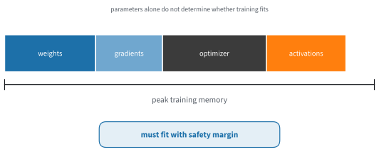
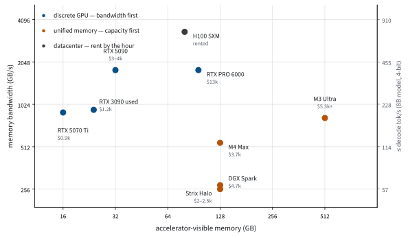
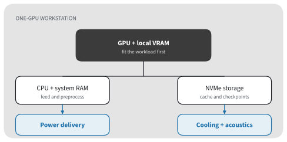
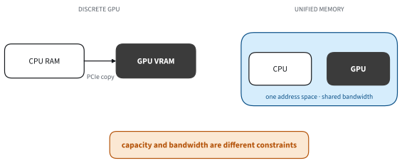

# Hardware
:label:`sec_hardware_buyers`

This section explains how to evaluate a hardware purchase. Concrete advice
ages quickly: the prices below are a July 2026 snapshot, not current
quotations, and require verification before purchase. What does not age is the
reasoning: figure out whether your workload is bound by memory capacity,
memory bandwidth, or compute, and prioritize the binding constraint. The specific
machines below are reference points for that reasoning as much as
recommendations. Where :numref:`sec_hardware` explains *why* the machine
behaves the way it does — the roofline, the memory hierarchy, the format
ladder — this section is the complementary question of *what to
purchase*.

Two physical facts organize everything that follows. First, **capacity
gates what runs at all**: training state is several times model size
(:numref:`sec_training_systems`), and an LLM that does not fit in memory
does not run slowly — it does not run. Second, **bandwidth gates
generation speed**: producing one token requires streaming essentially all
active weights, and the KV cache of the context (:numref:`sec_kv-cache`),
through the compute units, so

$$
\textrm{decode tokens/s} \lesssim
\frac{\textrm{memory bandwidth}}{\textrm{bytes of active weights and KV cache}},
$$
:eqlabel:`eq_hardware-buyers-decode`

while *prompt processing* (prefill) and *training* are parallel across
tokens and lean on compute instead. Machines differ by an order of
magnitude on each axis, in different directions. Hardware selection therefore
depends on the workload, although the same capacity, bandwidth, and compute
analysis applies.

## What Are You Buying For?

Before comparing cards, estimate both sides of the constraint. For
training, peak memory (:numref:`fig_tools_memory_fit`):


:label:`fig_tools_memory_fit`

```{.python .input #hardware-memory-estimate}
def training_memory_gib(parameters_billion, weight_bytes=2,
                        gradient_bytes=2, optimizer_bytes=8,
                        activation_gib=6, workspace_gib=2):
    parameters = parameters_billion * 1e9
    state = parameters * (weight_bytes + gradient_bytes + optimizer_bytes)
    return state / 2**30 + activation_gib + workspace_gib

for b in [0.1, 1, 7]:
    print(f"{b:>4}B params: {training_memory_gib(b):6.1f} GiB")
```

A 7B full fine-tune wants ~90 GiB — no consumer card holds it — while
QLoRA :cite:`Dettmers.Pagnoni.Holtzman.ea.2023` (freeze the weights, train
small adapters, quantize the base to 4 bits) reduces the training state
of the same job from 78 GiB to about 4 GiB. This allows
some 7B adapter fine-tuning workloads to fit on a 16 GB card. For inference,
apply the decode bound:

```{.python .input #hardware-decode-bound}
bandwidth_gbs = {"RTX 5070 Ti": 896, "RTX 3090 (used)": 936,
                 "RTX 5090": 1792, "RTX PRO 6000": 1792,
                 "DGX Spark": 273, "Strix Halo": 256,
                 "M4 Max": 546, "M3 Ultra": 819, "H100 SXM": 3350}
active_gb = 4.5   # 8B model at 4-bit, including cache traffic
for device, bw in sorted(bandwidth_gbs.items(), key=lambda kv: -kv[1]):
    print(f"{device:>16s}: <= {bw / active_gb:5.0f} tok/s")
```

Realized speed depends on kernels and workload, but the bound often predicts
the ordering of bandwidth-limited systems. For example, systems with similar
memory bandwidth can have similar decode rates despite large differences in
compute throughput and price.


:label:`fig_tools_hardware_menu`

:numref:`fig_tools_hardware_menu` plots the July 2026 menu on those two
axes. The machines split into two families — discrete GPUs (fast, small)
and unified-memory systems (capacious, slow) — with the workstation-class
RTX PRO 6000 bridging them at a price. Everything below walks this figure.

## Training Boxes: Discrete NVIDIA GPUs
:label:`subsec_hardware-buyers-training`

For many training and fine-tuning workloads, a discrete NVIDIA GPU offers
high memory bandwidth and broad software support, including the frameworks
in this book, FlashAttention, quantization kernels, and the CUDA stack common
on rented machines.

### RTX 5070 Ti: A 16 GB Training Reference

The RTX 5070 Ti (16 GB GDDR7 at 896 GB/s, 300 W, ~\$900 in July 2026
against a \$749 list) provides a useful lower-capacity reference for local
training. Sixteen gigabytes runs every notebook in this book and supports
some QLoRA fine-tunes of
7–8B models comfortably, and diffusion fine-tuning at 1024² — while a
12 GB card excludes more model, sequence-length, and batch-size
configurations. A complete quiet desktop around it (any 8-core CPU, 64 GB RAM, 1 TB
NVMe, 850 W supply) cost about \$2,000–2,500 in this snapshot. A comparable
alternative is
the used RTX 3090 (24 GB at 936 GB/s, ~\$1,000–1,400 used in July 2026):
more memory and similar bandwidth, but 350 W, no FP8/FP4 tensor cores, no
warranty, and — a 2026 curiosity — a price that has been rising.

### RTX 5090: A High-End Desktop Reference

The RTX 5090 (32 GB GDDR7 at 1.79 TB/s, 575 W, \$3,000–4,300 street in
July 2026 against a \$1,999 list) is the fastest thing you can put in a
desktop: datacenter-class bandwidth, Blackwell FP8/FP4 tensor cores, and
enough memory for full fine-tunes of small models and LoRA on anything up
to ~30B. The card also imposes system-level requirements: a 1200 W power supply with
a native 16-pin connector, a chassis with sufficient airflow, and a circuit
that can sustain the system's load. Reported transient power can approach
660 W. A balanced build
(:numref:`fig_tools_workstation`) pairs it with a current 16-core CPU,
64–128 GB of RAM, and fast NVMe scratch for datasets; in the 2026 memory
market that totals \$6,500–10,000 depending mostly on the RAM.


:label:`fig_tools_workstation`

Multi-GPU consumer systems, often built from two to four used 3090s, can
aggregate memory capacity. Data parallelism can operate over PCIe, but the
platform must satisfy several constraints:
consumer boards offer one full-bandwidth slot, so you want used
Threadripper/EPYC platforms for lanes; power adds up (dual supplies are
common); and no consumer card since the 3090 has NVLink, so
communication-heavy tensor parallelism scales poorly. A short rental of an
8×GPU node (:numref:`sec_cloud_instances`) can measure
whether interconnect bandwidth limits the workload before purchasing a
multi-GPU system.

## Local Inference: the Unified-Memory Class
:label:`subsec_hardware-buyers-unified`


:label:`fig_tools_memory_path`

A second family of machines answers a different question: not "how fast
can I train?" but "how large a model can I *run* at home?" These systems
give the GPU direct access to a large pool of ordinary (LPDDR5X) memory —
lots of capacity at a fraction of GDDR7/HBM bandwidth
(:numref:`fig_tools_memory_path`). The decode bound predicts the main
trade-off: large models may fit but decode
slowly, while mixture-of-experts models read only their active parameters for
each token and can therefore decode faster than dense models of similar total
size. The July 2026 menu:

:Unified-memory machines for local inference (July 2026)
:label:`tab_unified_memory`

| Machine | Memory | Bandwidth | ≈ Price | Notes |
|---|---|---|---|---|
| AMD Strix Halo mini-PC | 128 GB | 256 GB/s | \$2,000–2,500 | Framework, Beelink, HP et al.; ROCm still maturing, Vulkan works |
| NVIDIA DGX Spark (GB10) | 128 GB | 273 GB/s | \$3,500–4,700 | CUDA-native Blackwell; strong prefill; two units pair to 256 GB |
| Mac Studio M4 Max | up to 128 GB | 546 GB/s | from \$2,500 | MLX ecosystem; quiet, efficient |
| Mac Studio M3 Ultra | up to 96 GB new | 819 GB/s | from \$5,300 | 256/512 GB configs discontinued 2026; used units carry a premium |
| MacBook Pro M5 Max | up to 128 GB | 614 GB/s | from ~\$3,500 | the same class, portable |

Measured reality (community `llama-bench` figures, mid-2026) roughly matches
the bandwidth ordering: the 120B-parameter MoE `gpt-oss` (~5B active per
token) generates ~71 tok/s on an M3 Ultra, ~35 on a DGX Spark, ~40 on
Strix Halo; a *dense* 70B at 4-bit limps at 5–12 tok/s on all of them.
Where they differ sharply is prefill: the Spark's Blackwell tensor cores
chew through long prompts several times faster than Strix Halo or Apple's
GPU at the same decode speed — the compute-versus-bandwidth split of our
opening formula in retail products. The software stack also matters: DGX
Spark provides CUDA, Strix Halo supports
Linux with a developing ROCm ecosystem, and Apple systems use MLX. Measure
the relevant models because framework and kernel support can change the
hardware-level ordering.

## The Top End: Workstation Blackwell
:label:`subsec_hardware-buyers-top-end`

The RTX PRO 6000 Blackwell packs 96 GB of GDDR7 at the 5090's 1.79 TB/s —
the upper-right bridge in :numref:`fig_tools_hardware_menu` — for about
\$13,000 list in July 2026 (it launched at \$8,565; the memory crisis did
the rest). A 300 W Max-Q variant with identical memory exists precisely so
that four of them fit in one chassis: a 2× build (~\$30–35k) runs
unquantized 70B inference and 70B LoRA fine-tunes; a 4× Threadripper PRO
workstation (~\$60k turnkey) holds 384 GB — DeepSeek-class MoE territory
at 4-bit. One caveat defines the class: no NVLink (dropped from
workstation cards after Ampere), so inter-card traffic rides PCIe 5.0 at
~64 GB/s per direction — nearly thirty times slower than each card's local
memory. Data- and pipeline-parallel workloads shrug; tensor parallelism
pays. Against this budget, always price the alternative: \$60k rents
roughly 20,000 H100-hours (:numref:`tab_cloud_prices`), and the break-even
needs sustained, private, or interactive use to clear:

```{.python .input #hardware-break-even}
purchase_and_operation = 4200.0     # e.g. a 5090 box + 3y power
rental_per_productive_hour = 2.50   # H100-class marketplace rate
print(f"{purchase_and_operation / rental_per_productive_hour:.0f} "
      "productive hours to break even")
```

The relevant inputs are *productive* hours (a home box idles more than you
think) — against which weigh privacy, zero queue time, and the real
pedagogical value of hardware you can take apart.

## Keeping Current
:label:`subsec_hardware-buyers-current`

The specifications and prices above will change. The following sources can
supply newer measurements, but their claims still require cross-checking. For build
advice and street prices, [r/LocalLLaMA](https://www.reddit.com/r/LocalLLaMA/)
(hardware megathreads) and the
[Level1Techs forum](https://forum.level1techs.com/) (multi-GPU build
logs); for reviews of exactly this niche — Strix Halo boxes, DGX Spark,
used servers — [ServeTheHome](https://www.servethehome.com/); for
apples-to-apples numbers, the community benchmark threads in
[llama.cpp discussions](https://github.com/ggml-org/llama.cpp/discussions)
and [llm-tracker.info](https://llm-tracker.info/); and for the durable
*reasoning* about GPU choice, Tim Dettmers' guide, last updated in 2023, for a workload-based method rather
than current part recommendations. One warning: GPU
search results are now thick with machine-generated pages quoting invented
benchmarks — trust datasheets, named reviewers, and numbers that pass the
decode-bound sanity check above.

## Summary

* Buy the binding constraint: capacity gates what runs, bandwidth gates
  decode speed, compute gates training and prefill — and the decode bound
  (bandwidth ÷ active bytes) predicts generation speed to within a factor
  of two.
* Reference points, July 2026: an RTX 5070 Ti (~\$900, 16 GB) represents a
  lower-capacity training system;
  an RTX 5090 (~\$3–4k, 32 GB) represents a high-end desktop with substantial
  power and cooling requirements; used 3090s trade warranty and efficiency
  for memory capacity.
* Unified-memory machines (Strix Halo, DGX Spark, Apple silicon) trade
  bandwidth for capacity: large MoE models can fit and decode faster than
  dense models of similar total size, while prefill speed can distinguish
  systems with similar bandwidth.
* The RTX PRO 6000 class (96 GB at full bandwidth, no NVLink) bridges the
  two families for five figures; before spending it, price the rented
  equivalent.
* Date-stamp every price you rely on, and get current numbers from the
  community sources above rather than from search-engine filler.

## Exercises

1. [code] **Training memory.** `training_memory_gib` charges every
   parameter 2 bytes of weights, 2 bytes of gradients, and 8 bytes of
   optimizer state, and it adds fixed amounts for activations and
   workspace.
    1. Mixed-precision training with Adam, as counted by
       :citet:`Rajbhandari.Rasley.Ruwase.ea.2020`, keeps 16 bytes per
       parameter. Which tensor do the defaults of `training_memory_gib`
       leave out, and how does adding it change the estimate for the 7B
       model? Under both counts, find the largest model whose full
       fine-tune fits on cards with 16, 24, 32, and 96 GB, treating a
       card's GB as GiB.
    1. LoRA :cite:`Hu.Shen.Wallis.ea.2021` freezes the pretrained weights
       and trains small adapter matrices beside them. QLoRA
       :cite:`Dettmers.Pagnoni.Holtzman.ea.2023` also stores the frozen
       weights in 4 bits, plus 0.127 bits per parameter of quantization
       constants. Give `training_memory_gib` an argument for the trainable
       fraction of the parameters: a frozen parameter costs only its
       stored bytes, and a trainable one costs weights, gradients, and
       optimizer state as before. Evaluate the function for an 8B model
       with 1% trainable parameters and the default activation and
       workspace terms, once for LoRA with frozen bf16 weights and once for
       QLoRA. Which of the two fine-tunes fits on a 16 GB card? Which term
       is the largest in the one that fits?
    1. The activation term is not a constant: it grows with the number of
       tokens per step. With per-block activation
       checkpointing (:numref:`subsec_mp-checkpointing`), a model keeps
       only the input of each block, $d$ bf16 values per token, plus the
       activations of one
       block during its recomputation, which this sub-problem ignores. Give
       the QLoRA fine-tune of the second sub-problem the shape of Llama 3.1
       8B :cite:`Grattafiori.Dubey.Jauhri.ea.2024`: 32 blocks of width
       $d = 4096$ and a vocabulary of 128,256 tokens. How many tokens per
       step fit into the memory that the 16 GB card leaves for activations?
    1. The output layer also keeps one bf16 logit per vocabulary entry and
       token for the loss. How many tokens per step fit once the logits
       count as well? Compare the logit bytes per token with the bytes of
       the block inputs per token.
   :exlabel:`ex_hardware-training-memory`

1. **Context length and decode.** Every decode step reads the KV cache of
   all earlier tokens as well as the weights, which is why the code that
   defines `bandwidth_gbs` charges an 8B model at 4 bits
   `active_gb = 4.5` GB per token. Llama 3.1 8B
   :cite:`Grattafiori.Dubey.Jauhri.ea.2024` has 32 layers and 8
   key-value heads of dimension 128, and it keeps its cache in bf16.
    1. Compute the cache bytes per token with :eqref:`eq_kv-cache-bytes`.
       Which context length does the 0.5 GB of cache traffic in
       `active_gb` correspond to?
    1. Bound the decode rate on the RTX 5070 Ti and on the M3 Ultra at
       contexts of 4K, 32K, and 128K tokens, and give the share of the
       cache in the bytes read per token. At which of these contexts do
       the weights and the cache still fit on the 16 GB card?
    1. Quantizing the weights from bf16 to 4 bits divides their bytes by
       4. By what factor does it raise the decode bound at 4K tokens, and
       by what factor at 128K tokens? What does this imply for a buyer
       whose workload uses long contexts?

1. **Power budget.** :numref:`subsec_hardware-buyers-training` notes that
   a 5090 build needs a 1200 W power supply and a circuit that can sustain
   the load of the whole system, not only of the card. Consider a box with
   four used RTX 3090 cards at 350 W each on a Threadripper-class platform
   that draws 350 W, with another 100 W for drives and fans, fed by power
   supplies that are 90% efficient. The box is plugged into a North
   American 120 V, 15 A circuit, whose continuous load should stay below
   80% of its 1,800 W rating.
    1. Compute the draw at the wall under full load. To which power limit
       per card must the cards be capped to stay on one such circuit? Does
       a 230 V, 16 A circuit under the same 80% rule carry the box without
       a cap?
    1. Capping the power of a GPU lowers its clock and hence its peak
       arithmetic rate, while its memory bandwidth changes little. Which
       workloads of this section lose much throughput under the cap of the
       first sub-problem, and which lose little?

1. **Mixture-of-experts decode.** A mixture-of-experts (MoE) model stores
   many expert networks but runs only a few of them for each token, so a
   decode step reads only the *active* parameters. Take a 30B-A3B model,
   with 30 billion parameters of which 3 billion are active per token, and
   a dense 30B model, both with 4-bit weights. Ignore the KV cache.
    1. Use :eqref:`eq_hardware-buyers-decode` to bound the decode rate of
       both models on every machine in :numref:`tab_unified_memory`. Which
       machines decode each model faster than 20 tokens/s, a common
       threshold for interactive use?
    1. A dense 3B model at 4 bits reads as many bytes per token as the
       MoE. What does the MoE cost a buyer that the dense 3B model does
       not? Which cards in `bandwidth_gbs` can run the MoE?
    1. The model card of gpt-oss-120b :cite:`OpenAI.2025` counts 114.71B
       parameters in the experts of its 36 MoE layers, 0.96B attention
       parameters, and 1.16B parameters in its untied embedding and output
       matrices, which have equal size. Each layer has 128 experts, of which
       a token uses 4. The experts are stored in MXFP4 at 4.25 bits per
       parameter, and all other weights in bf16. Compute the bytes that a
       decode step reads, given that the embedding lookup reads a single
       row. Bound the decode rate on the M3 Ultra, the DGX Spark, and Strix
       Halo, and compute the fraction of each bound that the measured rates
       of :numref:`subsec_hardware-buyers-unified` achieve. What does the
       comparison between the DGX Spark and Strix Halo say about bandwidth
       as a predictor of decode speed?
   :exlabel:`ex_hardware-moe-decode`

1. **Partial offload.** A model that does not fit into the memory of a
   discrete card can still run if some of its layers stay in system
   memory, where the CPU computes them (:numref:`fig_tools_memory_path`).
   Consider a desktop with a used RTX 3090 (24 GB at 936 GB/s),
   dual-channel DDR5-5600 system memory (89.6 GB/s), and a PCIe 4.0 ×16
   link (32 GB/s per direction). A dense 70B model at 4 bits takes about
   40 GB.
    1. Keep 22 GB of layers on the GPU and run the other 18 GB on the CPU.
       Bound the decode rate, and compare it with the bound for the whole
       model on Strix Halo. Above which fraction of offloaded bytes does
       the system memory take more than half of the time per token?
    1. Instead, copy the 18 GB of offloaded weights over PCIe to the GPU
       for every token. What does this do to the bound?
    1. Run gpt-oss-120b on the same desktop, with its attention, embedding,
       and output weights on the GPU and all of its experts in system
       memory. Use the accounting of problem
       :exref:`ex_hardware-moe-decode`c to bound the decode rate, and find
       how much system memory the experts need. Why does this split suit an
       MoE model better than a dense one?

1. [code] **Break-even with operating costs.** The code that computes the
   break-even divides `purchase_and_operation` by
   `rental_per_productive_hour`, the rental price of the work that the
   owned machine does in one productive hour.
    1. An owned machine also draws electricity in every productive hour,
       and it can be resold afterwards. Write the break-even condition for
       a purchase price $C$, a resale value $R$, a wall power $p$ under
       load, an electricity price $e$ per kWh, and a rental price $r$ per
       productive hour, and solve it for the number of productive hours
       $H$.
    1. Evaluate $H$ for the RTX 5070 Ti desktop of
       :numref:`subsec_hardware-buyers-training` at \$2,250, with a resale
       value of \$600 after three years and 450 W at the wall, against a
       marketplace RTX 4090 of :numref:`tab_cloud_prices` at \$0.35 per
       hour, with electricity at \$0.20 per kWh. Assume that the 5070 Ti
       completes 70% of the work of a 4090 per hour. How many years of
       eight productive hours per day does $H$ take?
    1. The code compares a 5090 box with an H100-class rental price, which
       counts an hour on either machine as the same amount of work. Use
       :numref:`tab_gpu_specs` to estimate how much more work an H100 does
       per hour in compute-bound training and in bandwidth-bound decode.
       Recompute $H$ for both workloads with the 5090 build of
       :numref:`subsec_hardware-buyers-training` at the midpoint of its
       price range, without resale, and with 900 W at the wall.
   :exlabel:`ex_hardware-break-even`

1. **Prefill versus decode.** ● A request first processes its prompt
   (prefill) and then generates its answer token by token (decode).
   :numref:`subsec_hardware-buyers-unified` reports that gpt-oss-120b
   decodes at about 35 tokens/s on the DGX Spark and at about 40 tokens/s
   on Strix Halo. Assume that prefill runs at 2,000 prompt tokens/s on the
   DGX Spark and at 500 prompt tokens/s on Strix Halo, and that every
   answer has 500 tokens.
    1. Compute the time to the first token and the total time of a chat
       request with a 500-token prompt and of a coding-agent request with a
       30,000-token prompt on both machines. At which prompt length do the
       two machines take equally long?
    1. Count 2 FLOPs per active parameter and token, for the 5.13B active
       parameters of gpt-oss-120b :cite:`OpenAI.2025`, and ignore the
       FLOPs of the attention scores. Convert both prefill rates into
       sustained FLOP/s.
    1. A prefill that processes its prompt in chunks of 512 tokens reads
       every weight that some token of the chunk uses, once per chunk.
       Assume that every token picks its 4 experts of a layer uniformly at
       random from the 128, independently of the other tokens. How many
       distinct experts of a layer does a chunk read on average? Use the
       accounting of problem :exref:`ex_hardware-moe-decode`c to compute
       the bytes that one chunk reads. Which resource limits the prefill
       rate on the DGX Spark, and which on Strix Halo?
    1. How does the bandwidth bound on prefill of the DGX Spark change with
       chunks of 2,048 tokens? Why does an MoE model need longer chunks
       than a dense model with the same active parameters before its
       prefill becomes compute-bound?

1. [extended] **Calibrating the decode bound.** ●● The summary states that
   :eqref:`eq_hardware-buyers-decode` predicts generation speed to within
   a factor of two. Test this claim on hardware that you can access, and
   replace the bound by a calibrated model. A laptop CPU suffices, because
   llama.cpp runs on CPUs.
    1. Measure the bandwidth that your machine sustains on a large
       streaming copy, and compare it with the bandwidth of its datasheet.
    1. Use `llama-bench` from llama.cpp to measure the decode rate of at
       least six configurations that span model size and weight format,
       for example dense models with 1B, 3B, and 8B parameters at 4 and
       8 bits, and one MoE model. Compute the bytes that each
       configuration reads per token from its parameter counts and format,
       and plot the measured rates against the bound.
    1. Fit the model
       $1/\textrm{rate} = t_0 + \textrm{bytes}/(\eta \beta)$, with $\beta$
       the bandwidth of the first sub-problem, to estimate the fraction
       $\eta$ of the bandwidth that decoding achieves and a fixed time
       $t_0$ per token. Which configurations deviate most from the fit,
       and why?
    1. Predict the decode rate of one configuration that the fit did not
       use, and of one configuration at a context of 16K tokens, adding
       the cache bytes of :eqref:`eq_kv-cache-bytes`. Measure both, and
       compare your prediction errors with the factor of two of the
       summary and with a published number for your hardware from the
       sources of :numref:`subsec_hardware-buyers-current`.
