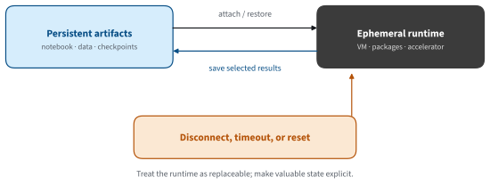
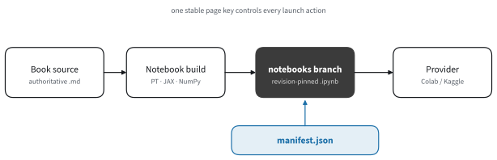

# Colab and Kaggle
:label:`sec_hosted_notebooks`

[Google Colab](https://colab.research.google.com/) and
[Kaggle](https://www.kaggle.com/code) provide browser-based notebooks on
temporary virtual machines, with limited free access to accelerators when
available. They allow readers to run the book without a local installation,
including from devices on which installing development software is
impractical. Availability and usage limits vary, so resource requirements
must still be checked for each notebook.

The provider controls the runtime. It creates a temporary machine with a
browser editor, a Python environment, and possibly an accelerator. When the
session ends because of an idle or usage limit, the machine and files written
only to its local disk disappear. Your notebook and any
artifacts you explicitly saved survive; nothing else does.


:label:`fig_tools_hosted_lifecycle`

The lifecycle in :numref:`fig_tools_hosted_lifecycle` explains the principal
failure modes of hosted notebooks. A runtime may stop after inactivity, hit a session
limit, or come back with a different software image. Conversely, rerunning a
setup cell has little overhead when the notebook records everything needed to
reconstruct the runtime — which is exactly how the notebooks in this book
are written.

## Launching a Book Notebook

Every code-bearing page of the book has a **Run notebook** control that
follows the active framework tab: framework-specific pages offer PyTorch,
TensorFlow, or JAX; framework-independent pages use a single NumPy notebook.
The generated notebooks live at a stable path on a public GitHub branch and
record the exact source revision they were built from. A PyTorch,
TensorFlow, or JAX notebook whose code imports `d2l` starts with a generated
setup cell that installs missing or mismatched packages and downloads the
`d2l` helper modules of that revision from GitHub.


:label:`fig_tools_notebook_pipeline`

The launch buttons use different persistence models:

* **Colab opens a pointer to GitHub.** The URL has the form
  `colab.research.google.com/github/<org>/<repo>/blob/<branch>/<path>.ipynb`,
  and Colab fetches the notebook from GitHub each time it is opened. You
  see the current published version — but your edits are
  *not* written back. To keep changes, use **File → Save a copy in Drive**
  (or download the `.ipynb`).
* **Kaggle imports a copy.** The book passes the notebook's raw URL to
  Kaggle's importer (`kaggle.com/kernels/welcome?src=...`), which creates a
  new private scratchpad *in your Kaggle account* containing that notebook.
  You can inspect it without signing in; editing and running require an
  account. Your copy is now independent of the book — it will not update
  when the book does, and keeping your changes means saving a version on
  Kaggle.

In short: Colab launches a live view of the repository, Kaggle clones a
snapshot into your workspace. Either way, the launch button never uploads an
arbitrary local file — it refers to a readable notebook at a stable public
path, which you can and should inspect before running. Treat that as a habit
for *any* "open in Colab" badge on the internet: check the repository origin
and the setup cell before executing someone else's code on your account.

## Colab

### Free-Tier Resources

Colab's free tier provides access to GPUs and TPUs, but its
[official FAQ](https://research.google.com/colaboratory/faq.html) does not
guarantee particular hardware, memory, or session duration. These
limits vary with demand, usage history, and product policy; a T4 with 16 GB
has been a common allocation, but it is not a service guarantee. Verify the
assigned hardware at runtime. Colab also integrates an assistant for writing
and debugging notebook code.

Do not infer the hardware from the menu — verify it in code:

```{.python .input #hosted-notebooks-resource-check}
import os

resource = {
    "cpu_count_visible": os.cpu_count(),
    "colab": "COLAB_RELEASE_TAG" in os.environ,
    "kaggle": "KAGGLE_KERNEL_RUN_TYPE" in os.environ,
}
resource
```

The cell detects Colab through `COLAB_RELEASE_TAG`, which holds a dated tag
of the Colab runtime release, such as `release-colab-20230216-060056-RC01`.

For PyTorch, check `torch.cuda.is_available()` and
`torch.cuda.get_device_properties(0)`; for TensorFlow,
`tf.config.list_physical_devices("GPU")`; for JAX, `jax.devices()`. A
reported accelerator is still not a guarantee that your workload fits its
memory.

When the free tier is insufficient, Colab offers paid plans and
pay-as-you-go *compute units*. Unit prices, accelerator consumption rates,
and plan features change, so consult the purchase dialog and current FAQ
before estimating cost. A compute-unit balance increases access but does not
guarantee a particular accelerator.

Two additional features affect reproducibility and automation. *Pinned runtime versions* let a
notebook request a dated environment image, taming the "worked yesterday,
broke today" package drift that plagues hosted runtimes. And the *Colab
CLI* (`colab exec`, `colab repl`) drives the same runtimes from a terminal
or a coding agent, which makes Colab usable as a scriptable free GPU rather
than only an interactive page.

### Saving Work

Colab is Drive-centric: **Save a copy in Drive** is the persistence story,
and Google Drive mounts (`drive.mount`) are the common way to keep datasets
and checkpoints across sessions. A notebook opened from GitHub is never
saved back automatically. Colab can also attach to a *local runtime* — the
browser UI controlling a Jupyter server on your own machine — which changes
the security boundary completely: the notebook then executes with the
permissions of your local Jupyter process. Connect only notebooks you trust.

## Kaggle

### A Data-Centric Model

Where Colab orbits Drive, Kaggle orbits *datasets and competitions*, and its
notebook product reflects that. Three directories define the mental model:

* `/kaggle/input/` holds attached datasets, models, and output files of
  notebooks, mounted **read-only** and versioned. Attaching an existing
  dataset is instant and costs no download time or quota.
* `/kaggle/working/` is your writable output directory (about 20 GB); its
  contents persist only into *saved versions* of the notebook.
* everything else is scratch that disappears with the session.

The second defining feature is versioning. **Save & Run All** executes the
whole notebook top to bottom in a fresh session and stores the result as an
immutable, named version — inputs, code, outputs, and logs. This is restart
and run all (:numref:`sec_interactive_development`) elevated to a platform
primitive, and it is why Kaggle notebooks attached to competitions are
reproducible in a way ad-hoc notebooks rarely are.

### Quotas and Hardware

Kaggle displays accelerator quotas and session limits in the notebook
interface. In the mid-2026 snapshot used for this chapter, accounts received
roughly **30 GPU-hours per week** on a P100 or a 2×T4 machine, about 20
TPU-hours per week, sessions of up to 12 hours, and around 30 GB of RAM.
These values are account- and policy-dependent and must be checked before
planning a run. Phone verification may be required to enable accelerators or
internet access.
Internet access is a per-notebook setting and is disabled in some
competitions, so a well-behaved notebook attaches data as inputs rather
than downloading it mid-run. The
[Kaggle CLI](https://github.com/Kaggle/kaggle-cli) can push, run, and pull
notebooks and datasets from your terminal; keep its token in the provider's
secret store, never in a cell.

## Choosing and Working Portably

### Colab or Kaggle?

:Hosted notebook trade-offs (mid-2026)
:label:`tab_hosted_notebook_tradeoffs`

| Need | Colab | Kaggle |
|---|---|---|
| Open a GitHub notebook directly | Yes — live fetch per open | Import creates your own copy |
| Free GPU | T4; limits opaque, demand-driven | P100 or 2×T4; ~30 h/week published |
| Predictable quota | No | Yes |
| Persistent files | Google Drive | Versioned datasets and outputs |
| Reproducible runs | Manual restart-and-run-all | Save & Run All versions |
| Competition workflow | External | Native |
| Paid upgrade path | Compute units, Pro/Pro+ | None needed — quota is fixed |

Data location is an important selection criterion. For running a
book section, Colab's direct GitHub opening is the shortest path. For a
dataset-centered experiment you want to share or rerun reproducibly,
Kaggle's versioned inputs and outputs are more natural. For long training
runs, private data, or guaranteed hardware, use a machine you control — the
subject of :numref:`sec_cloud_instances`.

### Setup Cells That Survive

Because the runtime is replaceable, the notebook must carry its own setup.
A good setup cell is short, idempotent, and explicit: it pins revisions,
installs only what is missing, and contains no secrets.

```{.python .input #hosted-notebooks-portable-setup}
import importlib.util
import platform

required = ["numpy", "matplotlib"]
missing = [name for name in required
           if importlib.util.find_spec(name) is None]
{
    "python": platform.python_version(),
    "missing": missing,
    "reconstructible": not missing,
}
```

Avoid an unconditional `pip install --upgrade ...` at the top of a notebook:
it discards a tested provider environment, slows every start, and makes
yesterday's notebook resolve different packages today. Install the specific
missing package at a pinned version instead. Since a provider image can
change under an unmodified notebook, printing a small environment
fingerprint makes results interpretable and bug reports useful:

```{.python .input #hosted-notebooks-environment-fingerprint}
import json
import numpy as np

fingerprint = {
    "python": platform.python_version(),
    "numpy": np.__version__,
    "machine": platform.machine(),
}
print(json.dumps(fingerprint, indent=2))
```

Portable notebooks also avoid hard-coding provider paths. Isolate
provider-specific paths in a small adapter and use `pathlib` for the
remaining file operations:

```{.python .input #hosted-notebooks-work-directory}
from pathlib import Path

if Path("/kaggle/working").exists():
    work = Path("/kaggle/working")
elif Path("/content").exists():
    work = Path("/content")
else:
    work = Path.cwd()
work
```

Finally, secrets: both providers offer a secret manager for API tokens. Use
it. Never print a token, store it in an output, or commit it in a saved
copy — a public notebook is an executable publication, and its outputs are
part of what you publish.

## Summary

* Colab and Kaggle provide limited free notebook runtimes; accelerator
  availability is not guaranteed, so inspect the assigned runtime before use.
* The launch buttons differ: Colab opens a live pointer to the notebook on
  GitHub (edits are not saved back); Kaggle imports a snapshot into your
  own account.
* Colab's limits are dynamic and demand-driven, with paid compute units for
  additional access; Kaggle displays a weekly quota and
  makes reproducible versioned runs a platform primitive.
* A hosted runtime is replaceable: idempotent setup cells, explicit saving
  of artifacts, and secrets kept in the secret manager make notebooks
  portable across providers and time.

## Exercises

1. **Setup cell audit.** A notebook reached through an "Open in Colab"
   badge starts with a setup cell of four lines. It runs
   `!pip install git+https://github.com/someone/helpers`, then
   `!curl -fsSL https://example.org/setup.sh | bash`, then
   `from google.colab import drive`, and finally
   `drive.mount("/content/drive")`.
    1. For each line, state what code it runs or which of your data it
       makes readable to the notebook. Which of that code is open to
       inspection before the cell runs?
    1. Rewrite the first two lines so that the code they run is fixed at
       the moment you read it.
    1. You now connect the same notebook to a local runtime, so that the
       browser controls a Jupyter server on your own machine. Which line
       changes its consequences most, and why?

1. [code] **Restart after install.** Run the following experiment in a
   hosted notebook or in a Jupyter kernel of a fresh local virtual
   environment. Check first that `"tabulate" in sys.modules` is `False`.
   Install version 0.8.10 of the small package `tabulate` and import it.
   In a later cell of the same kernel session, install version 0.9.0
   without restarting.
    1. Print `tabulate.__version__` and
       `importlib.metadata.version("tabulate")` after the second install.
       Why do the two values differ? Which of them describes the code that
       runs?
    1. The cell of this section that computes `missing` relies on
       `importlib.util.find_spec`. Why does this check miss the mismatch
       that you just observed?
    1. Write a function `ensure(dist, module, version)` that installs
       `dist==version` only when the installed distribution has a
       different version, and that returns whether the kernel must
       restart because `module` was imported before the install. Call it
       twice in a row from a setup cell and confirm that the second call
       installs nothing.
   :exlabel:`ex_hosted-notebooks-restart-after-install`

1. [code] **Fingerprint extension.** The cell that builds `fingerprint`
   records the Python version, the NumPy version, and the machine
   architecture.
    1. The cell should also record the version of every installed deep
       learning framework that this book uses. Why is importing every
       framework a poor way to learn its version in this cell?
    1. Extend the cell with these framework versions, the name and memory
       of each visible NVIDIA GPU as reported by `nvidia-smi`, and the
       value of `COLAB_RELEASE_TAG` when it is set. The cell must run on a
       CPU-only runtime and must read the framework versions from the
       package metadata. When a framework is already imported, also record
       its `__version__`; exercise
       :exref:`ex_hosted-notebooks-restart-after-install` shows why the
       two values can differ.
    1. A notebook whose first cell runs
       `pip install --upgrade transformers` worked on Monday and fails
       on Friday with an import error inside `transformers`. In a first
       hypothetical case, Friday's fingerprint shows the same
       `COLAB_RELEASE_TAG` and NumPy version as Monday's, and
       `transformers` moved from 4.56.1 to 4.57.0. In a second case, the release tag changed, NumPy moved
       from 2.0.2 to 2.3.1, and `transformers` stayed at 4.56.1. Which
       change caused the failure in each case? Which edit to the notebook
       prevents a recurrence in each case?
   :exlabel:`ex_hosted-notebooks-fingerprint-extension`

1. [code] **Durable and scratch paths.** The cell that sets `work`
   chooses `/kaggle/working` on Kaggle, `/content` on Colab, and the
   current directory elsewhere.
    1. On which of the three runtimes does a checkpoint written to `work`
       survive the end of the session, and in what form?
    1. Replace the cell with a function `locations(root)` that returns a
       dictionary with three entries: `inputs`, the read-only input
       directory; `durable`, a directory for checkpoints that outlives the
       session; and `scratch`, space that may disappear with it. The
       argument `root` stands for the root of the file system: a hosted
       notebook calls `locations(Path("/"))`, and the function tests
       `root / "kaggle" / "working"` rather than `/kaggle/working`. Return
       `None` for every location that the runtime does not have, such as
       the inputs on Colab. On Colab, a durable directory exists only when
       Google Drive is mounted at `/content/drive`, and returning `None`
       otherwise lets a checkpoint writer refuse to save into a directory
       that disappears with the session.
    1. Test the function on your own machine with four temporary
       directories as `root`: one that contains `kaggle/input` and
       `kaggle/working`, one that contains `content` alone, one that
       contains `content/drive`, and an empty one.
   :exlabel:`ex_hosted-notebooks-durable-paths`

1. **Token in a traceback.** A cell reads an API token from the secret
   manager into `token` and calls
   `requests.get(f"https://api.example.com/v1/data?key={token}")`,
   followed by `raise_for_status()`. The server answers with status 404,
   and the error message of `raise_for_status` contains the full request
   URL. The author saves a version of the notebook with **Save & Run
   All**, then fixes the URL, saves a second version, and makes the
   notebook public.
    1. Where does the token appear in what the author published?
    1. The author clears all outputs and saves a third version. Is the
       token private again? What must the author do with the token
       itself?
    1. Rewrite the request so that an HTTP error cannot reveal the token.

1. **Pretraining on a free quota.** ● BERT-base has about 110 million
   parameters. :citet:`Devlin.Chang.Lee.ea.2018` pretrained it for
   1,000,000 steps on batches of 256 sequences, with sequences of 128
   tokens for 90% of the steps and of 512 tokens for the rest. NVIDIA
   lists a peak of 65 TFLOP/s in FP16 for the T4. Assume that training
   sustains 30% of this peak on one T4.
    1. Estimate the training cost with :eqref:`eq_six_nd`. How many T4
       hours does it take? How many 12-hour sessions and how many weeks
       of a 30-hour weekly quota does that amount to?
    1. Which costs of BERT pretraining does $6ND$ leave out, and which
       does it overcount? Consider the attention scores at both sequence
       lengths (:numref:`sec_scaling-laws` gives the correction), the
       masked language model head, which predicts only 15% of the
       positions, and the embedding table. For each, does correcting it
       raise or lower the estimate, and by roughly how much?
    1. :citet:`hoffmann2022training` found a compute-optimal allocation of
       about twenty training tokens per parameter. Which model size and
       token count would a single 12-hour T4 session train under this
       allocation? Compare the tokens per parameter of BERT-base with it.

1. [extended] **Portable training notebook.** ● Turn the notebook of
   :numref:`sec_softmax_concise` into one that runs unmodified on Colab,
   on Kaggle with internet access disabled, and on a local Jupyter
   kernel.
    1. Build its setup from your solutions to exercises
       :exref:`ex_hosted-notebooks-restart-after-install`,
       :exref:`ex_hosted-notebooks-fingerprint-extension`,
       and :exref:`ex_hosted-notebooks-durable-paths`. Make the training loop
       save a checkpoint to the durable directory after every epoch and
       resume from the newest checkpoint it finds.
    1. On Kaggle with internet access disabled, every network access of
       the notebook fails. `d2l.FashionMNIST` downloads its data, and the
       setup cell at the top of the generated notebook downloads the `d2l`
       helper modules from GitHub and installs missing packages. Change the
       notebook so that on Kaggle it reads all of these from attached
       inputs instead.
    1. On each runtime, interrupt training after two epochs, resume in a
       fresh session, and check that training continues with the third
       epoch. On Kaggle, where `/kaggle/working` persists only into saved
       versions and attached inputs are read-only, decide how the checkpoint
       reaches the fresh session. Tabulate the three fingerprints. Which
       lines of the finished notebook still depend on the provider?

1. [code] **Checkpoint interval.** ●● Model the interruptions of a hosted
   session, such as idle disconnects and reclaimed machines, as a Poisson
   process with mean time $M$ between interruptions. Training writes a
   checkpoint after every $\tau$ seconds of computation, and writing it
   takes $\delta$ seconds. After an interruption, reconnecting and
   restoring the newest checkpoint takes $R$ seconds, and the computation
   since that checkpoint is lost. Interruptions can also strike during a
   restore.
    1. Assume $\delta \ll \tau \ll M$. Show that, to first order, the
       expected share of wall time spent on checkpoints and lost
       computation is smallest at

       $$\tau^* = \sqrt{2 \delta M},$$

       the interval of :citet:`Young.1974`.
    1. Show that the expected wall time to complete one segment, $\tau$
       seconds of computation followed by its checkpoint, is

       $$\mathbb{E}[T] = M e^{R/M} \left(e^{(\tau + \delta)/M} - 1\right).$$

       Minimize $\mathbb{E}[T]/\tau$ numerically for
       $\delta/M \in \{0.01, 0.05, 0.1, 0.25, 0.5\}$. By how much does
       $\tau^*$ miss the exact optimum? By how much does the expected wall
       time at $\tau^*$ exceed the minimum? Explain why the two
       discrepancies differ so much in size.
    1. Write a Monte Carlo simulation of the process and check the
       formula for $\mathbb{E}[T]$ at one setting of $\delta/M$ and $R/M$.
    1. A Kaggle session ends at a fixed 12-hour limit rather than at a
       random time. How should the checkpoint schedule change when the
       time of an interruption is known in advance? Which part of the
       analysis still applies when random idle disconnects occur as well?
   :exlabel:`ex_hosted-notebooks-checkpoint-interval`
