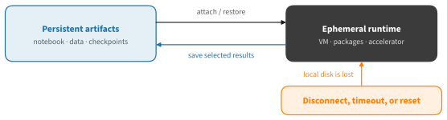
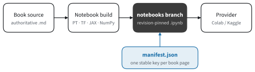

# Colab and Kaggle
:label:`sec_hosted_notebooks`

The previous section set up the book's notebooks on your own machine. Many
readers do not have a suitable one at hand: a laptop without a GPU, a school
computer that forbids installations, or a tablet.
[Google Colab](https://colab.research.google.com/) and
[Kaggle](https://www.kaggle.com/code) serve these readers. Each opens a
notebook in the browser on a virtual machine lent for the session, with
Python and the main frameworks preinstalled and, within usage limits, a free
GPU when one is available.

A borrowed machine raises a question that a local one does not: what is still
there tomorrow? Suppose that you install a package, download Fashion-MNIST,
and train a classifier for an hour. The provider created the machine when you
connected, and it deletes the machine when the session ends, after an idle
period or at a usage limit. The next morning the notebook is still there,
together with any file you saved to durable storage. The package, the
dataset, and the checkpoints written to the local disk are gone.

The remedy is to treat the runtime as replaceable. A notebook that records how
to rebuild its environment, and that saves what it must keep, runs on Colab,
on Kaggle, and on a local kernel alike, even after the provider updates its
software image. Below we see how the book's launch buttons reach the two
providers, how the providers differ, and how to write setup cells that
survive a new machine.


:label:`fig_tools_hosted_lifecycle`

:numref:`fig_tools_hosted_lifecycle` shows the lifecycle. A runtime may stop
after inactivity, hit a session limit, or come back with a different software
image. Rerunning a setup cell costs little when the notebook records
everything needed to reconstruct the runtime, and the book's notebooks are
written that way.

## Launching a Book Notebook

Every page of the book that contains code shows a **Run notebook** control
with three actions: **Colab**, **Kaggle**, and **Download**. The control
follows the active framework tab and offers that tab's PyTorch, TensorFlow, or
JAX notebook. When the tab has no hosted notebook, as for MXNet, the control
reads *Notebook unavailable*. Pages whose code uses no framework offer a
single NumPy notebook instead. The notebooks live at stable paths on a
public GitHub branch and record the source revision they were built from. A
notebook that imports `d2l` starts with a generated setup cell. It keeps the
provider's preinstalled packages where they are compatible, installs the
versions the book was tested with where they are not, and downloads the
`d2l` helper modules of that revision from GitHub.


:label:`fig_tools_notebook_pipeline`

The two launch actions keep your work in different places:

* **Colab opens a pointer to GitHub.** The URL has the form
  `colab.research.google.com/github/<org>/<repo>/blob/<branch>/<path>.ipynb`,
  and Colab fetches the notebook from GitHub each time it is opened. You
  always see the current published version, but your edits are not written
  back. To keep changes, use **File → Save a copy in Drive**, or download the
  `.ipynb`.
* **Kaggle imports a copy.** The book passes the notebook's raw URL to
  Kaggle's importer (`kaggle.com/kernels/welcome?src=...`), which creates a
  new private notebook in your Kaggle account, so you need an account to use
  it. Your copy is independent of the book: it does not update when the
  book does, and you keep your changes by saving a version on Kaggle.

In both cases the launch refers to a readable notebook at a public path,
which you can inspect before running it. Do the same for any "Open in Colab"
badge on the internet: check the repository it comes from and read the setup
cell before executing someone else's code with your account's permissions.

## Colab

### Free-Tier Resources

Colab's free tier provides GPUs and TPUs, but its
[FAQ](https://research.google.com/colaboratory/faq.html) guarantees neither
the hardware nor the limits: as of November 2026 it states that the types of
accelerators vary over time and that usage limits fluctuate. A notebook runs
for at most 12 hours, depending on availability and on your usage, and an idle
runtime times out. A T4 with
16 GB of memory is the GPU that free users commonly receive, but this is not a
service guarantee.

The menu shows what you asked for, not what you received, so we check the
runtime in code:

```{.python .input #hosted-notebooks-resource-check}
import os
import sys
from pathlib import Path

resource = {
    "cpu_count_visible": os.cpu_count(),
    "colab": "google.colab" in sys.modules,
    "kaggle": Path("/kaggle/working").exists(),
}
resource
```

The cell recognizes Colab by its `google.colab` module, which Colab loads at startup, and
Kaggle by its working directory. For the accelerator, PyTorch reports
`torch.cuda.is_available()` and `torch.cuda.get_device_properties(0)`,
TensorFlow `tf.config.list_physical_devices("GPU")`, and JAX `jax.devices()`.
A reported accelerator is still no guarantee that your workload fits in its
memory.

Beyond the free tier, Colab sells *compute units* through Pay As You Go and
the Pro and Pro+ subscriptions. A balance increases access to accelerators
but guarantees none in particular. Unit prices and consumption rates change,
so read the purchase page before estimating a cost.

### Runtime Versions and the Command Line

Colab updates its software image regularly, which can break a notebook that
worked last month. Since September 2025 a notebook can pin a dated *runtime
version* in **Runtime → Change runtime type**. As of November 2026 past
versions remain available for one year after their release, and connecting to
one takes two to three minutes. Google recommends the
latest runtime with pinned library versions for most work, and a pinned
runtime for notebooks shared with many people, such as the material of a
course.

The [Colab CLI](https://github.com/googlecolab/google-colab-cli), released in
June 2026 for Linux and macOS, drives the same runtimes from a terminal or a
coding agent: `colab new` allocates a runtime, `colab exec` runs a script or
notebook on it, and `colab stop` releases it.

### Saving Work

Colab keeps work in Google Drive. **Save a copy in Drive** stores the
notebook, and mounting Drive (`drive.mount`) is the usual way to keep
datasets and checkpoints across sessions. A notebook opened from GitHub is
never saved back automatically. Colab can also attach to a *local runtime*,
in which the browser page controls a Jupyter server on your own machine.
This moves the security boundary: the notebook then executes with the
permissions of your local Jupyter process, and Drive mounting no longer
works. Connect only notebooks you trust.

## Kaggle

### Inputs, Outputs, and Versions

Kaggle is built around datasets and competitions, and its notebooks follow
from that. Three kinds of directory define how a Kaggle notebook handles
files:

* `/kaggle/input/` holds attached datasets, models, and the outputs of other
  notebooks, mounted **read-only** and versioned. An attached dataset needs no
  download inside the notebook.
* `/kaggle/working/` is your writable output directory, with 20 GB of space
  as of November 2026. Its contents persist only into *saved versions* of the
  notebook.
* Everything else is scratch space that disappears with the session.

The second defining feature is versioning. **Save & Run All** executes the
whole notebook from top to bottom in a fresh session and stores the result as
an immutable version with its inputs, code, outputs, and logs. This is the
habit of restarting and running all cells
(:numref:`sec_interactive_development`) built into the platform.

### Quotas and Hardware

As of November 2026 an account receives a weekly GPU quota of 30
hours, sometimes more when demand allows, on either one P100 or two T4 GPUs,
and a separate weekly TPU quota. A session runs for at most 12 hours on CPU or
GPU and 9 hours on TPU. The notebook interface shows the current values for
your account; check them before planning a run. Kaggle may require phone
verification before it enables accelerators or internet access.

Internet access is a per-notebook setting and is disabled in some
competitions, so a well-behaved notebook attaches its data as inputs rather
than downloading it mid-run. The
[Kaggle CLI](https://github.com/Kaggle/kaggle-cli) can push, run, and pull
notebooks and datasets from your terminal. Keep its token in the provider's
secret store, never in a cell.

## Portable Notebooks

### Choosing a Provider

Either provider runs the book's notebooks. They differ in where your files
and results live, and in how predictable their limits are, as
:numref:`tab_hosted_notebook_tradeoffs` summarizes.

:Hosted notebook trade-offs (as of November 2026)
:label:`tab_hosted_notebook_tradeoffs`

| Need | Colab | Kaggle |
|---|---|---|
| Open a GitHub notebook directly | Yes, fetched on each open | Import creates your own copy |
| Free GPU | Usually a T4; limits unpublished | P100 or 2×T4; 30 h/week published |
| Predictable quota | No | Yes |
| Persistent files | Google Drive | Versioned datasets and outputs |
| Reproducible runs | Manual restart and run all; pinned runtime versions | Save & Run All versions |
| Competition workflow | External | Native |
| Paid upgrade | Compute units (Pay As You Go, Pro, Pro+) | Not needed for the published quota |

For running a section of the book, Colab's direct opening from GitHub is the
shortest path. For an experiment built around a dataset that you want to share or rerun, Kaggle's
versioned inputs and outputs fit better.

### Setup Cells

Because the runtime is replaceable, the notebook must carry its own setup.
A good setup cell is short, idempotent, and explicit: it pins versions,
installs only what is missing, and contains no secrets.

```{.python .input #hosted-notebooks-portable-setup}
import importlib.util
import platform

required = ["numpy", "matplotlib"]
missing = [name for name in required
           if importlib.util.find_spec(name) is None]
{
    "python": platform.python_version(),
    "missing": missing,
    "reconstructible": not missing,
}
```

Avoid an unconditional `pip install --upgrade ...` at the top of a notebook.
It discards a tested provider environment, slows every start, and makes
yesterday's notebook resolve different packages today. Install the specific
missing package at a pinned version instead. Since a provider image can
change under an unmodified notebook, printing a small environment
fingerprint makes results interpretable and bug reports useful:

```{.python .input #hosted-notebooks-environment-fingerprint}
import json
import numpy as np

fingerprint = {
    "python": platform.python_version(),
    "numpy": np.__version__,
    "machine": platform.machine(),
}
print(json.dumps(fingerprint, indent=2))
```

### Paths and Secrets

Portable notebooks also avoid hard-coding provider paths. A small adapter
chooses the working directory, and `pathlib` handles the remaining file
operations:

```{.python .input #hosted-notebooks-work-directory}
from pathlib import Path

if Path("/kaggle/working").exists():
    work = Path("/kaggle/working")
elif Path("/content").exists():
    work = Path("/content")
else:
    work = Path.cwd()
work
```

Both providers offer a secret manager for API tokens, and a notebook should
read its tokens from there. Never print a token, store it in an output, or
commit it in a saved copy. A public notebook is an executable publication,
and its outputs are part of what you publish.

These habits make a notebook independent of the machine it runs on. They do
not lengthen a session or guarantee an accelerator. For long runs and
guaranteed hardware, :numref:`sec_cloud_instances` rents a machine you
control.

## Summary

* Colab and Kaggle lend free, temporary notebook runtimes with limited
  access to accelerators. Availability is not guaranteed, so inspect the
  assigned runtime before relying on it.
* The book's launch buttons differ: Colab opens a live pointer to the
  notebook on GitHub and does not save edits back, while Kaggle imports a
  snapshot into your own account.
* Colab's limits change with demand and are not published; paid compute
  units add access, and pinned runtime versions hold the software image
  fixed. Kaggle publishes a weekly quota and stores every Save & Run All as a
  reproducible version.
* A hosted runtime is replaceable. Idempotent setup cells, explicit saving of
  artifacts, and secrets kept in the secret manager make a notebook portable
  across providers and over time.

## Exercises

1. **Setup cell audit.** A notebook reached through an "Open in Colab"
   badge starts with a setup cell of four lines. It runs
   `!pip install git+https://github.com/someone/helpers`, then
   `!curl -fsSL https://example.org/setup.sh | bash`, then
   `from google.colab import drive`, and finally
   `drive.mount("/content/drive")`.
    1. For each line, state what code it runs or which of your data it
       makes readable to the notebook. Which of that code is open to
       inspection before the cell runs?
    1. Rewrite the first two lines so that the code they run is fixed at
       the moment you read it.
    1. You now connect the same notebook to a local runtime, so that the
       browser controls a Jupyter server on your own machine. Which line
       changes its consequences most, and why?

1. [code] **Restart after install.** Run the following experiment in a
   hosted notebook or in a Jupyter kernel of a fresh local virtual
   environment. Check first that `"tabulate" in sys.modules` is `False`.
   Install version 0.8.10 of the small package `tabulate` and import it.
   In a later cell of the same kernel session, install version 0.9.0
   without restarting.
    1. Print `tabulate.__version__` and
       `importlib.metadata.version("tabulate")` after the second install.
       Why do the two values differ? Which of them describes the code that
       runs?
    1. The cell of this section that computes `missing` relies on
       `importlib.util.find_spec`. Why does this check miss the mismatch
       that you just observed?
    1. Write a function `ensure(dist, module, version)` that installs
       `dist==version` only when the installed distribution has a
       different version, and that returns whether the kernel must
       restart because `module` was imported before the install. Call it
       twice in a row from a setup cell and confirm that the second call
       installs nothing.
   :exlabel:`ex_hosted-notebooks-restart-after-install`

1. [code] **Fingerprint extension.** The cell that builds `fingerprint`
   records the Python version, the NumPy version, and the machine
   architecture.
    1. The cell should also record the version of every installed deep
       learning framework that this book uses. Why is importing every
       framework a poor way to learn its version in this cell?
    1. Extend the cell with these framework versions, the name and memory
       of each visible NVIDIA GPU as reported by `nvidia-smi`, and the
       provider's own environment variables, those whose names begin with
       `COLAB_` or `KAGGLE_`. The cell must run on a CPU-only runtime and
       must read the framework versions from the package metadata. When a
       framework is already imported, also record its `__version__`;
       exercise :exref:`ex_hosted-notebooks-restart-after-install` shows
       why the two values can differ. Run the cell on one provider. Which of
       the recorded variables would reveal that the provider changed its
       software image?
    1. A notebook whose first cell runs
       `pip install --upgrade transformers` worked on Monday and fails
       on Friday with an import error inside `transformers`. In a first
       hypothetical case, Friday's fingerprint shows the same provider
       image and NumPy version as Monday's, and `transformers` moved from
       4.56.1 to 4.57.0. In a second case, the provider image changed,
       NumPy moved from 2.0.2 to 2.3.1, and `transformers` stayed at
       4.56.1. Which change caused the failure in each case? Which edit to
       the notebook prevents a recurrence in each case?
   :exlabel:`ex_hosted-notebooks-fingerprint-extension`

1. [code] **Durable and scratch paths.** The cell that sets `work`
   chooses `/kaggle/working` on Kaggle, `/content` on Colab, and the
   current directory elsewhere.
    1. On which of the three runtimes does a checkpoint written to `work`
       survive the end of the session, and in what form?
    1. Replace the cell with a function `locations(root)` that returns a
       dictionary with three entries: `inputs`, the read-only input
       directory; `durable`, a directory for checkpoints that outlives the
       session; and `scratch`, space that may disappear with it. The
       argument `root` stands for the root of the file system: a hosted
       notebook calls `locations(Path("/"))`, and the function tests
       `root / "kaggle" / "working"` rather than `/kaggle/working`. Return
       `None` for every location that the runtime does not have, such as
       the inputs on Colab. On Colab, a durable directory exists only when
       Google Drive is mounted at `/content/drive`, and returning `None`
       otherwise lets a checkpoint writer refuse to save into a directory
       that disappears with the session.
    1. Test the function on your own machine with four temporary
       directories as `root`: one that contains `kaggle/input` and
       `kaggle/working`, one that contains `content` alone, one that
       contains `content/drive`, and an empty one.
   :exlabel:`ex_hosted-notebooks-durable-paths`

1. **Pretraining on a free quota.** ● BERT-base has about 110 million
   parameters. :citet:`Devlin.Chang.Lee.ea.2018` pretrained it for
   1,000,000 steps on batches of 256 sequences, with sequences of 128
   tokens for 90% of the steps and of 512 tokens for the rest. NVIDIA
   lists a peak of 65 TFLOP/s in FP16 for the T4. Assume that training
   sustains 30% of this peak on one T4.
    1. Training a model with $N$ parameters on $D$ tokens costs about
       $C \approx 6ND$ floating-point operations: two per parameter and
       token in the forward pass and four in the backward pass
       (:numref:`sec_scaling-laws`). Estimate the training cost of
       BERT-base this way. How many T4 hours does it take? How many
       12-hour sessions and how many weeks of a 30-hour weekly quota does
       that amount to?
    1. Which costs of BERT pretraining does $6ND$ leave out, and which
       does it overcount? Consider the attention scores at both sequence
       lengths (:numref:`sec_scaling-laws` gives the correction), the
       masked language model head, which predicts only 15% of the
       positions, and the embedding table. For each, does correcting it
       raise or lower the estimate, and by roughly how much?
    1. :citet:`hoffmann2022training` found a compute-optimal allocation of
       about twenty training tokens per parameter. Which model size and
       token count would a single 12-hour T4 session train under this
       allocation? Compare the tokens per parameter of BERT-base with it.

1. [code] **Checkpoint interval.** ●● Model the interruptions of a hosted
   session, such as idle disconnects and reclaimed machines, as a Poisson
   process with mean time $M$ between interruptions. Training writes a
   checkpoint after every $\tau$ seconds of computation, and writing it
   takes $\delta$ seconds. After an interruption, reconnecting and
   restoring the newest checkpoint takes $R$ seconds, and the computation
   since that checkpoint is lost. Interruptions can also strike during a
   restore.
    1. Assume $\delta \ll \tau \ll M$. Show that, to first order, the
       expected share of wall time spent on checkpoints and lost
       computation is smallest at

       $$\tau^* = \sqrt{2 \delta M},$$

       the interval of :citet:`Young.1974`.
    1. Show that the expected wall time to complete one segment, $\tau$
       seconds of computation followed by its checkpoint, is

       $$\mathbb{E}[T] = M e^{R/M} \left(e^{(\tau + \delta)/M} - 1\right).$$

       Minimize $\mathbb{E}[T]/\tau$ numerically for
       $\delta/M \in \{0.01, 0.05, 0.1, 0.25, 0.5\}$. By how much does
       $\tau^*$ miss the exact optimum? By how much does the expected wall
       time at $\tau^*$ exceed the minimum? Explain why the two
       discrepancies differ so much in size.
    1. Write a Monte Carlo simulation of the process and check the
       formula for $\mathbb{E}[T]$ at one setting of $\delta/M$ and $R/M$.
    1. A Kaggle session ends at a fixed 12-hour limit rather than at a
       random time. How should the checkpoint schedule change when the
       time of an interruption is known in advance? Which part of the
       analysis still applies when random idle disconnects occur as well?
   :exlabel:`ex_hosted-notebooks-checkpoint-interval`

[Discussions](https://d2l.discourse.group/t/36842)

<!-- slides -->

::: {.slide}
::: {.cover}
[Dive into Deep Learning · §39.2]{.kicker}

Colab and Kaggle: Ephemeral Hosted Runtimes, Quotas, and Portable Setup<br>**ephemeral VMs · GitHub launch pipeline · Colab compute units · Kaggle versioned I/O · idempotent setup · Young's checkpoint law**
:::
:::

::: {.slide title="Borrowed Machines and the Ephemeral Runtime Problem"}
[Motivation]{.kicker}

::: {.cols .vc}
::: {.col}
- **Zero-install browser GPUs:** Colab and Kaggle lend preconfigured containers with free GPUs, ideal for running notebooks from any laptop.
- **What vanishes on timeout:** Idle timeouts or 12-hour session limits **destroy the VM** and wipe local scratch disks (`/content`), installed packages, and kernel RAM.
- **Engineering remedy:** Treat every hosted VM as disposable—reconstruct setup in cell 1 and write checkpoints directly to durable storage.
:::

::: {.col .fig .big}
@fig:ch39-tools-ephemeral-vm
:::
:::
:::

::: {.slide title="The Hosted Runtime Lifecycle"}
[Mental Model]{.kicker}

A portable hosted workflow separates ephemeral execution state from durable storage at every stage of the session:

::: {.cols .vc}
::: {.col}
- **1. Allocate & reconstruct:** A new VM boots from the provider's current container image; an idempotent setup cell pins and installs only missing packages.
- **2. Compute on scratch disk:** Fast local SSD space (`/content` or scratch) holds temporary intermediate files during training.
- **3. Persist explicitly:** Checkpoints, metrics, and edited notebooks must be synced to durable storage *before* idle timeout or preemption reclaims the VM.
:::

::: {.col .fig}
{.nostretch width=100%}
:::
:::
:::

::: {.slide title="How D2L's 'Run Notebook' Launch Pipeline Works"}
[Book Infrastructure]{.kicker}

Every code-bearing page in D2L provides a **Run notebook** menu (**Colab**, **Kaggle**, **Download**) synchronized with the active framework tab:

::: {.cols .vc}
::: {.col}
- **Generated `notebooks` branch:** The build publishes self-contained `.ipynb` files with a generated setup cell that verifies framework versions and downloads matching `d2l` helpers.
- **Colab opens a live GitHub pointer:** Fetches the current published notebook from GitHub on each open—edits are **not** saved back unless you choose **File $\to$ Save a copy in Drive**.
- **Kaggle imports an independent copy:** Creates a private snapshot inside your Kaggle account that persists across your saved versions.
:::

::: {.col .fig}
{.nostretch width=100%}
:::
:::
:::

::: {.slide title="Security Audit Before Running Any Hosted Badge"}
[Supply-Chain Safety]{.kicker}

::: {.cols .vc}
::: {.col}
- **Audit setup cells before pressing Run:** Unpinned `pip install git+https://...` or `curl ... | bash` executes arbitrary remote code, and `drive.mount` grants full read/write access to your Google Drive.
- **Pin immutable commit SHAs:** Replace floating branch URLs with 40-character Git commit hashes and inspect scripts before executing.
- **Never attach untrusted notebooks to a local runtime:** Local runtime mode executes with your personal machine's full user permissions.
:::

::: {.col .fig .big}
@fig:ch39-tools-badge-security
:::
:::
:::

::: {.slide title="Google Colab: Variable Quotas and Compute Units"}
[Colab Platform]{.kicker}

::: {.cols .vc}
::: {.col}
- **Free tier (Nov 2026):** Typically allocates an NVIDIA **T4 (16 GB VRAM)** with a 12-hour max session and aggressive idle disconnects; exact availability fluctuates with demand.
- **Paid tiers (Pay As You Go, Pro, Pro+):** Sell **compute units** for priority access to L4 or A100 GPUs and background execution, though allocations remain best-effort.
:::

::: {.col .fig .big}
@fig:ch39-tools-colab-tiers
:::
:::
:::

::: {.slide title="Verifying Assigned Runtime Resources in Code"}
[Runtime Inspection]{.kicker}

Because a notebook menu shows the accelerator you *requested* rather than what the scheduler *allocated*, always verify the environment programmatically:

::: {.cols .vc}
::: {.col}
- **Detecting the host platform:**
  - Colab preloads `"google.colab" in sys.modules` at kernel startup.
  - Kaggle mounts `/kaggle/working` as the writable output directory.
- **Checking the accelerator:** Query `torch.cuda.get_device_properties(0)`, `tf.config.list_physical_devices("GPU")`, or `jax.devices()` to confirm device model and total VRAM before starting a run.
:::

::: {.col .fig}
@hosted-notebooks-resource-check
:::
:::
:::

::: {.slide title="Pinning Colab Runtime Versions and the Colab CLI"}
[Image Stability & Automation]{.kicker}

::: {.cols .vc}
::: {.col}
- **Dated runtime versions:** Pinning a dated container image in **Runtime $\to$ Change runtime type** freezes Python/CUDA/library versions for one year—ideal for course assignments.
- **Terminal automation (Colab CLI):** `colab new`, `colab exec`, and `colab stop` let local scripts and coding agents drive hosted GPUs without leaving a browser tab open.
:::

::: {.col .fig .big}
@fig:ch39-tools-colab-version-cli
:::
:::
:::

::: {.slide title="Kaggle Notebooks: Directory Semantics and Versioning"}
[Kaggle Platform]{.kicker}

::: {.cols .vc}
::: {.col}
- **Three filesystem zones:** Read-only `/kaggle/input/` mounts datasets/models instantly; `/kaggle/working/` (20 GB) persists into saved versions; all other paths are ephemeral scratch.
- **Immutable batch runs (`Save & Run All`):** Replays the entire notebook top-to-bottom in a fresh background container and snapshots code, logs, and `/kaggle/working/` outputs.
:::

::: {.col .fig .big}
@fig:ch39-tools-kaggle-fs-zones
:::
:::
:::

::: {.slide title="Kaggle Quotas and Free-Tier Pretraining Arithmetic"}
[Quota Sizing]{.kicker}

::: {.cols .vc}
::: {.col}
$$C \approx 6 N D \approx 2.8 \times 10^{19}\text{ FLOPs (BERT-base)}$$

- **Why full pretraining outgrows free tiers:** At $30\%$ of a T4's $65\text{ TFLOP/s}$ peak ($19.5\text{ TFLOP/s}$), BERT-base takes $\sim 400\text{ T4 hours}$—over **33 twelve-hour sessions** or 13+ weeks of Kaggle's 30 h/week quota!
- **What fits in one 12-hour T4 session ($8.4 \times 10^{17}\text{ FLOPs}$):** All D2L chapter notebooks, 7B–8B LoRA fine-tuning, or training an $\sim 85\text{M}$ model.
:::

::: {.col .fig}
@fig:ch39-tools-bert-t4-budget
:::
:::
:::

::: {.slide title="Colab vs. Kaggle: Side-by-Side Trade-Offs"}
[Choosing a Provider]{.kicker}

::: {.cols .vc}
::: {.col}
- **Google Colab:** Opens live pointers from GitHub (must **Save a copy in Drive** to keep edits), persists files via `drive.mount`, and sells compute units for L4/A100 access.
- **Kaggle Notebooks:** Imports an independent copy, publishes a **30 h/week** quota ($1\times\text{P100}$ or $2\times\text{T4}$), mounts versioned datasets at `/kaggle/input`, and captures immutable **Save & Run All** versions.
:::

::: {.col .fig .big}
@fig:ch39-tools-colab-vs-kaggle
:::
:::
:::

::: {.slide title="Writing Idempotent Setup Cells"}
[Portable Notebooks]{.kicker}

Because a hosted VM is replaceable, the notebook must carry its own setup without breaking the provider's pretested environment:

::: {.cols .vc}
::: {.col}
- **Check before installing:** Use `importlib.util.find_spec` (or `importlib.metadata.version`) to install only what is missing at a **pinned version**.
- **Never run unconditional `pip install --upgrade`:** It overwrites tested provider wheels, slows startup, and causes Friday's run to resolve different dependencies than Monday's.
- **Restart after upgrading an imported package:** If a module is already in `sys.modules`, `pip install` updates disk metadata (`importlib.metadata.version`) while the live kernel keeps running the old code in RAM (`module.__version__`) until a kernel restart!
:::

::: {.col .fig}
@hosted-notebooks-portable-setup
:::
:::
:::

::: {.slide title="Recording an Environment Fingerprint"}
[Diagnosing Image Drift]{.kicker}

When a notebook that worked last week suddenly fails on a hosted runtime, a logged environment fingerprint distinguishes code bugs from provider image updates:

::: {.cols .vc}
::: {.col}
- **What to record in the output log:**
  - Python version, CPU/machine architecture, and core library versions (`numpy`, framework metadata versions).
  - Assigned GPU model and VRAM (`nvidia-smi`) plus provider image variables (`COLAB_*`, `KAGGLE_*`).
- **Query metadata without importing:** Reading `importlib.metadata.version("torch")` records installed frameworks without paying the multi-second overhead or GPU initialization side effects of importing unused backends.
:::

::: {.col .fig}
@hosted-notebooks-environment-fingerprint
:::
:::
:::

::: {.slide title="Portable Paths, Secrets, and Optimal Checkpointing"}
[Durability & Security]{.kicker}

::: {.cols .vc}
::: {.col}
- **Path adapter & secrets:** Route outputs to `/kaggle/working`, `/content/drive`, or `Path.cwd()` automatically, and keep API tokens in the provider secret store.
- **Young's checkpoint law ($\tau^* = \sqrt{2\delta M}$):** If saving takes $\delta = 30\text{ s}$ and disconnects arrive every $M = 3\text{ h}$, checkpoint every $\tau^* \approx 13.4\text{ min}$.
:::

::: {.col .narrow}
@fig:ch39-tools-young-checkpoint

@hosted-notebooks-work-directory
:::
:::
:::

::: {.slide title="Concept Check: Ephemeral Runtimes and Portability"}
[Check Your Understanding]{.kicker}

Test your intuition on three practical hosted-notebook scenarios:

1. You open a D2L notebook in Colab via the book's launch button, spend two hours solving the exercises, and close the browser tab. Where are your edits?
2. On Colab, you save model checkpoints to `/content/checkpoints/` every 15 minutes without mounting Google Drive. The session hits the 12-hour limit. Which checkpoints survive?
3. In a kernel where `import transformers` already ran, a cell executes `!pip install transformers==4.57.0`. Why does `transformers.__version__` still print `4.56.1`?

::: {.d2l-note .fragment .fade-up}
**Answers:**

1. **Nowhere—they are lost!** Colab opens a read-only pointer to GitHub. To keep edits, you must explicitly run **File $\to$ Save a copy in Drive** or download the `.ipynb` before the session expires.
2. **None!** `/content` is ephemeral VM scratch disk that is deleted with the container. On Colab, a checkpoint writer should verify `/content/drive` is mounted (or sync to external storage) before starting a long run.
3. Python caches imported modules in `sys.modules`; modifying files in `site-packages` on disk does not reload objects already resident in kernel RAM. The kernel must be restarted after package changes.
:::
:::

::: {.slide title="Summary: Portable Hosted Notebook Engineering"}
[Key Takeaways]{.kicker}

::: {.cols .vc}
::: {.col}
- **Save Edits & Verify Hardware:** Copy GitHub-opened Colab notebooks to Drive immediately, and verify assigned GPU properties in code.
- **Idempotent Setup & Drift Logs:** Check `find_spec` before installing pinned packages (restarting if already imported) and log a JSON environment fingerprint.
- **Durable Checkpoints & Secrets:** Write checkpoints to mounted Drive or `/kaggle/working` at interval $\tau^* = \sqrt{2\delta M}$, and keep API keys in the provider secret store.
:::

::: {.col .fig .big}
@fig:ch39-tools-portable-summary
:::
:::
:::
