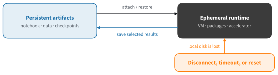
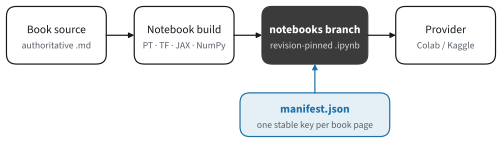

# Colab and Kaggle
:label:`sec_hosted_notebooks`

The previous section set up the book's notebooks on your own machine. Many
readers do not have a suitable one at hand: a laptop without a GPU, a school
computer that forbids installations, or a tablet.
[Google Colab](https://colab.research.google.com/) and
[Kaggle](https://www.kaggle.com/code) serve these readers. Each opens a
notebook in the browser on a virtual machine lent for the session, with
Python and the main frameworks preinstalled and, within usage limits, a free
GPU when one is available.

A borrowed machine raises a question that a local one does not: what is still
there tomorrow? Suppose that you install a package, download Fashion-MNIST,
and train a classifier for an hour. The provider created the machine when you
connected, and it deletes the machine when the session ends, after an idle
period or at a usage limit. The next morning the notebook is still there,
together with any file you saved to durable storage. The package, the
dataset, and the checkpoints written to the local disk are gone.

The remedy is to treat the runtime as replaceable. A notebook that records how
to rebuild its environment, and that saves what it must keep, runs on Colab,
on Kaggle, and on a local kernel alike, even after the provider updates its
software image. Below we see how the book's launch buttons reach the two
providers, how the providers differ, and how to write setup cells that
survive a new machine.


:label:`fig_tools_hosted_lifecycle`

:numref:`fig_tools_hosted_lifecycle` shows the lifecycle. A runtime may stop
after inactivity, hit a session limit, or come back with a different software
image. Rerunning a setup cell costs little when the notebook records
everything needed to reconstruct the runtime, and the book's notebooks are
written that way.

## Launching a Book Notebook

Every page of the book that contains code shows a **Run notebook** control
with three actions: **Colab**, **Kaggle**, and **Download**. The control
follows the active framework tab and offers that tab's PyTorch, TensorFlow, or
JAX notebook. When the tab has no hosted notebook, as for MXNet, the control
reads *Notebook unavailable*. Pages whose code uses no framework offer a
single NumPy notebook instead. The notebooks live at stable paths on a
public GitHub branch and record the source revision they were built from. A
notebook that imports `d2l` starts with a generated setup cell. It keeps the
provider's preinstalled packages where they are compatible, installs the
versions the book was tested with where they are not, and downloads the
`d2l` helper modules of that revision from GitHub.


:label:`fig_tools_notebook_pipeline`

The two launch actions keep your work in different places:

* **Colab opens a pointer to GitHub.** The URL has the form
  `colab.research.google.com/github/<org>/<repo>/blob/<branch>/<path>.ipynb`,
  and Colab fetches the notebook from GitHub each time it is opened. You
  always see the current published version, but your edits are not written
  back. To keep changes, use **File → Save a copy in Drive**, or download the
  `.ipynb`.
* **Kaggle imports a copy.** The book passes the notebook's raw URL to
  Kaggle's importer (`kaggle.com/kernels/welcome?src=...`), which creates a
  new private notebook in your Kaggle account, so you need an account to use
  it. Your copy is independent of the book: it does not update when the
  book does, and you keep your changes by saving a version on Kaggle.

In both cases the launch refers to a readable notebook at a public path,
which you can inspect before running it. Do the same for any "Open in Colab"
badge on the internet: check the repository it comes from and read the setup
cell before executing someone else's code with your account's permissions.

## Colab

### Free-Tier Resources

Colab's free tier provides GPUs and TPUs, but its
[FAQ](https://research.google.com/colaboratory/faq.html) guarantees neither
the hardware nor the limits: as of November 2026 it states that the types of
accelerators vary over time and that usage limits fluctuate. A notebook runs
for at most 12 hours, depending on availability and on your usage, and an idle
runtime times out. A T4 with
16 GB of memory is the GPU that free users commonly receive, but this is not a
service guarantee.

The menu shows what you asked for, not what you received, so we check the
runtime in code:

```{.python .input #hosted-notebooks-resource-check}
import os
import sys
from pathlib import Path

resource = {
    "cpu_count_visible": os.cpu_count(),
    "colab": "google.colab" in sys.modules,
    "kaggle": Path("/kaggle/working").exists(),
}
resource
```

The cell recognizes Colab by its `google.colab` module, which Colab loads at startup, and
Kaggle by its working directory. For the accelerator, PyTorch reports
`torch.cuda.is_available()` and `torch.cuda.get_device_properties(0)`,
TensorFlow `tf.config.list_physical_devices("GPU")`, and JAX `jax.devices()`.
A reported accelerator is still no guarantee that your workload fits in its
memory.

Beyond the free tier, Colab sells *compute units* through Pay As You Go and
the Pro and Pro+ subscriptions. A balance increases access to accelerators
but guarantees none in particular. Unit prices and consumption rates change,
so read the purchase page before estimating a cost.

### Runtime Versions and the Command Line

Colab updates its software image regularly, which can break a notebook that
worked last month. Since September 2025 a notebook can pin a dated *runtime
version* in **Runtime → Change runtime type**. As of November 2026 past
versions remain available for one year after their release, and connecting to
one takes two to three minutes. Google recommends the
latest runtime with pinned library versions for most work, and a pinned
runtime for notebooks shared with many people, such as the material of a
course.

The [Colab CLI](https://github.com/googlecolab/google-colab-cli), released in
June 2026 for Linux and macOS, drives the same runtimes from a terminal or a
coding agent: `colab new` allocates a runtime, `colab exec` runs a script or
notebook on it, and `colab stop` releases it.

### Saving Work

Colab keeps work in Google Drive. **Save a copy in Drive** stores the
notebook, and mounting Drive (`drive.mount`) is the usual way to keep
datasets and checkpoints across sessions. A notebook opened from GitHub is
never saved back automatically. Colab can also attach to a *local runtime*,
in which the browser page controls a Jupyter server on your own machine.
This moves the security boundary: the notebook then executes with the
permissions of your local Jupyter process, and Drive mounting no longer
works. Connect only notebooks you trust.

## Kaggle

### Inputs, Outputs, and Versions

Kaggle is built around datasets and competitions, and its notebooks follow
from that. Three kinds of directory define how a Kaggle notebook handles
files:

* `/kaggle/input/` holds attached datasets, models, and the outputs of other
  notebooks, mounted **read-only** and versioned. An attached dataset needs no
  download inside the notebook.
* `/kaggle/working/` is your writable output directory, with 20 GB of space
  as of November 2026. Its contents persist only into *saved versions* of the
  notebook.
* Everything else is scratch space that disappears with the session.

The second defining feature is versioning. **Save & Run All** executes the
whole notebook from top to bottom in a fresh session and stores the result as
an immutable version with its inputs, code, outputs, and logs. This is the
habit of restarting and running all cells
(:numref:`sec_interactive_development`) built into the platform.

### Quotas and Hardware

As of November 2026 an account receives a weekly GPU quota of 30
hours, sometimes more when demand allows, on either one P100 or two T4 GPUs,
and a separate weekly TPU quota. A session runs for at most 12 hours on CPU or
GPU and 9 hours on TPU. The notebook interface shows the current values for
your account; check them before planning a run. Kaggle may require phone
verification before it enables accelerators or internet access.

Internet access is a per-notebook setting and is disabled in some
competitions, so a well-behaved notebook attaches its data as inputs rather
than downloading it mid-run. The
[Kaggle CLI](https://github.com/Kaggle/kaggle-cli) can push, run, and pull
notebooks and datasets from your terminal. Keep its token in the provider's
secret store, never in a cell.

## Portable Notebooks

### Choosing a Provider

Either provider runs the book's notebooks. They differ in where your files
and results live, and in how predictable their limits are, as
:numref:`tab_hosted_notebook_tradeoffs` summarizes.

:Hosted notebook trade-offs (as of November 2026)
:label:`tab_hosted_notebook_tradeoffs`

| Need | Colab | Kaggle |
|---|---|---|
| Open a GitHub notebook directly | Yes, fetched on each open | Import creates your own copy |
| Free GPU | Usually a T4; limits unpublished | P100 or 2×T4; 30 h/week published |
| Predictable quota | No | Yes |
| Persistent files | Google Drive | Versioned datasets and outputs |
| Reproducible runs | Manual restart and run all; pinned runtime versions | Save & Run All versions |
| Competition workflow | External | Native |
| Paid upgrade | Compute units (Pay As You Go, Pro, Pro+) | Not needed for the published quota |

For running a section of the book, Colab's direct opening from GitHub is the
shortest path. For an experiment built around a dataset that you want to share or rerun, Kaggle's
versioned inputs and outputs fit better.

### Setup Cells

Because the runtime is replaceable, the notebook must carry its own setup.
A good setup cell is short, idempotent, and explicit: it pins versions,
installs only what is missing, and contains no secrets.

```{.python .input #hosted-notebooks-portable-setup}
import importlib.util
import platform

required = ["numpy", "matplotlib"]
missing = [name for name in required
           if importlib.util.find_spec(name) is None]
{
    "python": platform.python_version(),
    "missing": missing,
    "reconstructible": not missing,
}
```

Avoid an unconditional `pip install --upgrade ...` at the top of a notebook.
It discards a tested provider environment, slows every start, and makes
yesterday's notebook resolve different packages today. Install the specific
missing package at a pinned version instead. Since a provider image can
change under an unmodified notebook, printing a small environment
fingerprint makes results interpretable and bug reports useful:

```{.python .input #hosted-notebooks-environment-fingerprint}
import json
import numpy as np

fingerprint = {
    "python": platform.python_version(),
    "numpy": np.__version__,
    "machine": platform.machine(),
}
print(json.dumps(fingerprint, indent=2))
```

### Paths and Secrets

Portable notebooks also avoid hard-coding provider paths. A small adapter
chooses the working directory, and `pathlib` handles the remaining file
operations:

```{.python .input #hosted-notebooks-work-directory}
from pathlib import Path

if Path("/kaggle/working").exists():
    work = Path("/kaggle/working")
elif Path("/content").exists():
    work = Path("/content")
else:
    work = Path.cwd()
work
```

Both providers offer a secret manager for API tokens, and a notebook should
read its tokens from there. Never print a token, store it in an output, or
commit it in a saved copy. A public notebook is an executable publication,
and its outputs are part of what you publish.

These habits make a notebook independent of the machine it runs on. They do
not lengthen a session or guarantee an accelerator. For long runs and
guaranteed hardware, :numref:`sec_cloud_instances` rents a machine you
control.

## Summary

* Colab and Kaggle lend free, temporary notebook runtimes with limited
  access to accelerators. Availability is not guaranteed, so inspect the
  assigned runtime before relying on it.
* The book's launch buttons differ: Colab opens a live pointer to the
  notebook on GitHub and does not save edits back, while Kaggle imports a
  snapshot into your own account.
* Colab's limits change with demand and are not published; paid compute
  units add access, and pinned runtime versions hold the software image
  fixed. Kaggle publishes a weekly quota and stores every Save & Run All as a
  reproducible version.
* A hosted runtime is replaceable. Idempotent setup cells, explicit saving of
  artifacts, and secrets kept in the secret manager make a notebook portable
  across providers and over time.

## Exercises

1. **Setup cell audit.** A notebook reached through an "Open in Colab"
   badge starts with a setup cell of four lines. It runs
   `!pip install git+https://github.com/someone/helpers`, then
   `!curl -fsSL https://example.org/setup.sh | bash`, then
   `from google.colab import drive`, and finally
   `drive.mount("/content/drive")`.
    1. For each line, state what code it runs or which of your data it
       makes readable to the notebook. Which of that code is open to
       inspection before the cell runs?
    1. Rewrite the first two lines so that the code they run is fixed at
       the moment you read it.
    1. You now connect the same notebook to a local runtime, so that the
       browser controls a Jupyter server on your own machine. Which line
       changes its consequences most, and why?

1. [code] **Restart after install.** Run the following experiment in a
   hosted notebook or in a Jupyter kernel of a fresh local virtual
   environment. Check first that `"tabulate" in sys.modules` is `False`.
   Install version 0.8.10 of the small package `tabulate` and import it.
   In a later cell of the same kernel session, install version 0.9.0
   without restarting.
    1. Print `tabulate.__version__` and
       `importlib.metadata.version("tabulate")` after the second install.
       Why do the two values differ? Which of them describes the code that
       runs?
    1. The cell of this section that computes `missing` relies on
       `importlib.util.find_spec`. Why does this check miss the mismatch
       that you just observed?
    1. Write a function `ensure(dist, module, version)` that installs
       `dist==version` only when the installed distribution has a
       different version, and that returns whether the kernel must
       restart because `module` was imported before the install. Call it
       twice in a row from a setup cell and confirm that the second call
       installs nothing.
   :exlabel:`ex_hosted-notebooks-restart-after-install`

1. [code] **Fingerprint extension.** The cell that builds `fingerprint`
   records the Python version, the NumPy version, and the machine
   architecture.
    1. The cell should also record the version of every installed deep
       learning framework that this book uses. Why is importing every
       framework a poor way to learn its version in this cell?
    1. Extend the cell with these framework versions, the name and memory
       of each visible NVIDIA GPU as reported by `nvidia-smi`, and the
       provider's own environment variables, those whose names begin with
       `COLAB_` or `KAGGLE_`. The cell must run on a CPU-only runtime and
       must read the framework versions from the package metadata. When a
       framework is already imported, also record its `__version__`;
       exercise :exref:`ex_hosted-notebooks-restart-after-install` shows
       why the two values can differ. Run the cell on one provider. Which of
       the recorded variables would reveal that the provider changed its
       software image?
    1. A notebook whose first cell runs
       `pip install --upgrade transformers` worked on Monday and fails
       on Friday with an import error inside `transformers`. In a first
       hypothetical case, Friday's fingerprint shows the same provider
       image and NumPy version as Monday's, and `transformers` moved from
       4.56.1 to 4.57.0. In a second case, the provider image changed,
       NumPy moved from 2.0.2 to 2.3.1, and `transformers` stayed at
       4.56.1. Which change caused the failure in each case? Which edit to
       the notebook prevents a recurrence in each case?
   :exlabel:`ex_hosted-notebooks-fingerprint-extension`

1. [code] **Durable and scratch paths.** The cell that sets `work`
   chooses `/kaggle/working` on Kaggle, `/content` on Colab, and the
   current directory elsewhere.
    1. On which of the three runtimes does a checkpoint written to `work`
       survive the end of the session, and in what form?
    1. Replace the cell with a function `locations(root)` that returns a
       dictionary with three entries: `inputs`, the read-only input
       directory; `durable`, a directory for checkpoints that outlives the
       session; and `scratch`, space that may disappear with it. The
       argument `root` stands for the root of the file system: a hosted
       notebook calls `locations(Path("/"))`, and the function tests
       `root / "kaggle" / "working"` rather than `/kaggle/working`. Return
       `None` for every location that the runtime does not have, such as
       the inputs on Colab. On Colab, a durable directory exists only when
       Google Drive is mounted at `/content/drive`, and returning `None`
       otherwise lets a checkpoint writer refuse to save into a directory
       that disappears with the session.
    1. Test the function on your own machine with four temporary
       directories as `root`: one that contains `kaggle/input` and
       `kaggle/working`, one that contains `content` alone, one that
       contains `content/drive`, and an empty one.
   :exlabel:`ex_hosted-notebooks-durable-paths`

1. **Token in a traceback.** A cell reads an API token from the secret
   manager into `token` and calls
   `requests.get(f"https://api.example.com/v1/data?key={token}")`,
   followed by `raise_for_status()`. The server answers with status 404,
   and the error message of `raise_for_status` contains the full request
   URL. The author saves a version of the notebook with **Save & Run
   All**, then fixes the URL, saves a second version, and makes the
   notebook public.
    1. Where does the token appear in what the author published?
    1. The author clears all outputs and saves a third version. Is the
       token private again? What must the author do with the token
       itself?
    1. Rewrite the request so that an HTTP error cannot reveal the token.

1. **Pretraining on a free quota.** ● BERT-base has about 110 million
   parameters. :citet:`Devlin.Chang.Lee.ea.2018` pretrained it for
   1,000,000 steps on batches of 256 sequences, with sequences of 128
   tokens for 90% of the steps and of 512 tokens for the rest. NVIDIA
   lists a peak of 65 TFLOP/s in FP16 for the T4. Assume that training
   sustains 30% of this peak on one T4.
    1. Training a model with $N$ parameters on $D$ tokens costs about
       $C \approx 6ND$ floating-point operations: two per parameter and
       token in the forward pass and four in the backward pass
       (:numref:`sec_scaling-laws`). Estimate the training cost of
       BERT-base this way. How many T4 hours does it take? How many
       12-hour sessions and how many weeks of a 30-hour weekly quota does
       that amount to?
    1. Which costs of BERT pretraining does $6ND$ leave out, and which
       does it overcount? Consider the attention scores at both sequence
       lengths (:numref:`sec_scaling-laws` gives the correction), the
       masked language model head, which predicts only 15% of the
       positions, and the embedding table. For each, does correcting it
       raise or lower the estimate, and by roughly how much?
    1. :citet:`hoffmann2022training` found a compute-optimal allocation of
       about twenty training tokens per parameter. Which model size and
       token count would a single 12-hour T4 session train under this
       allocation? Compare the tokens per parameter of BERT-base with it.

1. [extended] **Portable training notebook.** ● Turn the notebook of
   :numref:`sec_softmax_concise` into one that runs unmodified on Colab,
   on Kaggle with internet access disabled, and on a local Jupyter
   kernel.
    1. Build its setup from your solutions to exercises
       :exref:`ex_hosted-notebooks-restart-after-install`,
       :exref:`ex_hosted-notebooks-fingerprint-extension`,
       and :exref:`ex_hosted-notebooks-durable-paths`. Make the training loop
       save a checkpoint to the durable directory after every epoch and
       resume from the newest checkpoint it finds.
    1. On Kaggle with internet access disabled, every network access of
       the notebook fails. `d2l.FashionMNIST` downloads its data, and the
       setup cell at the top of the generated notebook downloads the `d2l`
       helper modules from GitHub and installs missing packages. Change the
       notebook so that on Kaggle it reads all of these from attached
       inputs instead.
    1. On each runtime, interrupt training after two epochs, resume in a
       fresh session, and check that training continues with the third
       epoch. On Kaggle, where `/kaggle/working` persists only into saved
       versions and attached inputs are read-only, decide how the checkpoint
       reaches the fresh session. Tabulate the three fingerprints. Which
       lines of the finished notebook still depend on the provider?

1. [code] **Checkpoint interval.** ●● Model the interruptions of a hosted
   session, such as idle disconnects and reclaimed machines, as a Poisson
   process with mean time $M$ between interruptions. Training writes a
   checkpoint after every $\tau$ seconds of computation, and writing it
   takes $\delta$ seconds. After an interruption, reconnecting and
   restoring the newest checkpoint takes $R$ seconds, and the computation
   since that checkpoint is lost. Interruptions can also strike during a
   restore.
    1. Assume $\delta \ll \tau \ll M$. Show that, to first order, the
       expected share of wall time spent on checkpoints and lost
       computation is smallest at

       $$\tau^* = \sqrt{2 \delta M},$$

       the interval of :citet:`Young.1974`.
    1. Show that the expected wall time to complete one segment, $\tau$
       seconds of computation followed by its checkpoint, is

       $$\mathbb{E}[T] = M e^{R/M} \left(e^{(\tau + \delta)/M} - 1\right).$$

       Minimize $\mathbb{E}[T]/\tau$ numerically for
       $\delta/M \in \{0.01, 0.05, 0.1, 0.25, 0.5\}$. By how much does
       $\tau^*$ miss the exact optimum? By how much does the expected wall
       time at $\tau^*$ exceed the minimum? Explain why the two
       discrepancies differ so much in size.
    1. Write a Monte Carlo simulation of the process and check the
       formula for $\mathbb{E}[T]$ at one setting of $\delta/M$ and $R/M$.
    1. A Kaggle session ends at a fixed 12-hour limit rather than at a
       random time. How should the checkpoint schedule change when the
       time of an interruption is known in advance? Which part of the
       analysis still applies when random idle disconnects occur as well?
   :exlabel:`ex_hosted-notebooks-checkpoint-interval`

[Discussions](https://d2l.discourse.group/t/36842)
