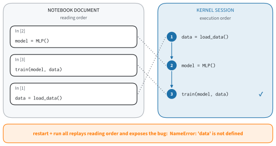
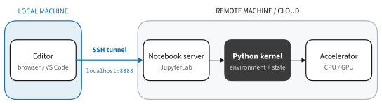

# Notebooks
:label:`sec_interactive_development`

Every section you have read so far placed code next to its prose, with the
output of each code cell printed below it. While reading, you may have wanted
to change one of those cells: try a smaller learning rate, a wider layer, or
half of the training data, and see what happens. The book is written for
this. Each section is a Jupyter notebook, a single document that holds prose,
mathematics, code, and results, and that you can edit and run one cell at a
time.

Running cells one at a time raises a question that a script never raises:
which code produced the result on the screen? A notebook remembers everything you
have run, in the order you ran it, and that order need not match the page. A
notebook can therefore show a result that nobody, its author included, can
reproduce after a restart. The remedy is to restart the notebook and run it
from the top before trusting or sharing a result.

Below we explain where a notebook keeps its state and how to check it, set up
the book's notebooks on your own machine, and work with them from an editor
and on a remote GPU. If you would rather not install anything,
:numref:`sec_hosted_notebooks` runs the same notebooks free of charge on
Colab or Kaggle. If you need more hardware than your laptop offers, see
:numref:`sec_cloud_instances`.

## The Notebook Execution Model

A plain Python script re-runs from the top every time, so a slow step — say,
loading and preprocessing a dataset — repeats on every experiment. A notebook
keeps a live Python process (the *kernel*) between executions: load the data
once, then iterate on the model as often as you like while the data stays in
memory. Inline plots and interleaved explanations make this execution model useful
for both teaching and research.

The same memory also outlives the code that filled it: a variable keeps its
value after you edit or delete the cell that assigned it. We therefore need to
know where this *state* lives and how long it lasts.

### The Document and the Kernel

A notebook has two parts. The *document* stores cells and saved
outputs — it is what you read, share, and commit. The *kernel* holds the live
state: imported modules, variables, random-number generators, open files,
compiled programs, and accelerator memory. The document orders cells top to
bottom; the kernel only knows the order in which you *executed* them.
Confusing these two orders causes many notebook bugs.


:label:`fig_tools_kernel_state`

:numref:`fig_tools_kernel_state` shows the classic failure. During an
editing session you executed a data-loading cell first, then wrote a
model-definition cell *above* it, and everything worked because the kernel
already held `data`. The document now tells a story that never happened. A
reader who runs the cells in the order shown — or you, tomorrow, after a
restart — hits a `NameError`.

The execution counters (`In [3]`, `In [1]`, …) number the cell executions
since the kernel started; they are historical clues, not a dependency
graph. The following pair of cells demonstrates benign, document-ordered
state: the second cell works only because the first ran.

```{.python .input #interactive-development-hidden-state-a}
import numpy as np

rng = np.random.default_rng(7)
samples = rng.normal(size=5)
```

```{.python .input #interactive-development-hidden-state-b}
float(samples.mean())
```

That dependency is fine, because it follows the reading order. A cell that
depends on an assignment *below* it, or on a cell you have since deleted, is
not. Keep cells small, keep function definitions separate from experiments,
and pass data explicitly rather than mutating globals across many cells.

### Restart and Run All

**Restart kernel and run all cells** discards the kernel's accumulated state
and replays the document from a blank slate, in reading order. It catches
hidden kernel state and order dependencies before a notebook is
shared. Run it before saving, sharing, or committing a notebook.
The book's build applies the same test: it executes every notebook from top
to bottom in a fresh kernel, and the outputs on the website come from those
runs.

## Running the Book Locally

### Setting Up

Numerical results and even APIs change between package versions, so the
book pins its environments. The notebook archive for each framework, described
in :ref:`chap_installation`, contains the notebooks, the `d2l` package, and
`uv` lock files for a CPU and a GPU environment. From the extracted directory,
create the environment once and launch JupyterLab in it:

```bash
uv venv --python 3.12
uv pip sync pylock.cpu.toml
uv run --no-sync jupyter lab
```

On Linux with an NVIDIA GPU, synchronize `pylock.gpu.toml` instead. The
`--no-sync` option keeps uv from altering the environment that the lock
selected. A clone of the [GitHub repository](https://github.com/smolix/d2l-neu)
builds its environments with `make` instead (as we will set up in
:numref:`sec_developers_guide`).

The *kernel* selected inside a notebook must belong to the environment where
the packages were installed. A Jupyter server can see many kernels; its own
Python process does not determine which one executes your notebook.

### A Quick Sanity Check

Before changing code, record a compact identity check:

```{.python .input #interactive-development-identity}
import os
import platform
import sys

{
    "python": sys.executable.replace(os.path.expanduser("~"), "~"),
    "version": platform.python_version(),
    "working_directory": os.path.basename(os.getcwd()),
}
```

This catches two common setup mistakes in one cell: a kernel from
the wrong environment (`sys.executable` points somewhere unexpected) and a
notebook opened from a directory where relative data paths no longer resolve.
The cell abbreviates the home directory to `~` and prints only the last
component of the working directory, so that its saved output reveals no
personal path.

## Working in an Editor

### JupyterLab

[JupyterLab](https://jupyterlab.readthedocs.io/) combines a file browser,
notebook editor, terminals, a text editor, debugger support, and a view of
running kernels. The essentials are stable even as the interface evolves:

* Run a cell with `Shift+Enter`; use a terminal tab for `uv`, Git, and
  inspecting files.
* Select the kernel by environment name, then verify `sys.executable`.
* Interrupt a long computation before restarting. Restarting releases Python
  state and, normally, the accelerator memory owned by that process.
* Use **Restart Kernel and Run All Cells** before saving a result for others.
* Inspect the **Running** panel and stop kernels you no longer use — closing
  a browser tab does not stop its kernel, and an orphaned kernel
  can hold gigabytes of GPU memory.

### VS Code

[Visual Studio Code](https://code.visualstudio.com/docs/datascience/jupyter-notebooks)
edits and runs `.ipynb` files with kernel selection, a variable inspector,
cell-level debugging, and notebook-aware diffs. Open the extracted directory
as a folder, choose the interpreter of the environment created above, and
select that interpreter as the notebook kernel.

When a notebook grows into a project, VS Code can navigate definitions, run
tests, format code, and review Git diffs. Keep testable logic in `.py` modules
and use the notebook for explanation and experiment records. This
repository also includes a VS Code extension for the book's
authoring workflow — switching framework views, previewing slides, syncing
edits back to the source — described in :numref:`sec_developers_guide`.

### Debugging and Timing

An exception ends the cell but not the kernel, which keeps the traceback
along with every variable. Running `%debug` in the next cell therefore opens a
debugger in the frame where the exception was raised. Use the notebook debugger when the
kernel supports it, or move a small failing call into a module and debug it
in a terminal. Resist broad `try/except` blocks that print "failed": they
discard the exception type and location that diagnosis needs. For quick
measurements, IPython's magics are built in:

```{.python .input #interactive-development-timing}
values = np.arange(100_000, dtype=np.float64)
%timeit values @ values
```

One caveat when timing accelerators: GPU operations are asynchronous, so a
host-side timer may measure only the dispatch of work, not its completion.
Synchronize explicitly (or use the framework's benchmarking utilities), warm
up compiled kernels first, and record the shapes, precision, device, and
library versions alongside the number.

## Remote Machines

Your editor, the notebook server, the kernel, and the accelerator need not
be on the same machine. A common setup runs JupyterLab next to the GPU while
you edit from a laptop.


:label:`fig_tools_remote_layers`

Bind the remote server to loopback and forward it over SSH:

```bash
# Remote machine
uv run --no-sync jupyter lab --no-browser --ip 127.0.0.1 --port 8888
```

```bash
# Local machine
ssh -N -L 8888:127.0.0.1:8888 myserver
```

Then open the tokenized `http://127.0.0.1:8888/...` URL locally. Never bind
an unauthenticated Jupyter server to all network interfaces: anyone who can
reach the port can execute code as you. The SSH tunnel provides encryption
and access control; Jupyter's token remains a useful second boundary.

VS Code's Remote SSH installs a small server-side
component so the editor UI runs locally while terminals, extensions, files,
and kernels all live on the remote machine. Confirm the status bar shows
**SSH** before selecting the Python environment — a local kernel cannot use
the remote GPU. In either setup, treat remote compute as disposable: commit code and copy
checkpoints to durable storage before
it is rebooted, preempted, or deleted (:numref:`sec_cloud_instances`).

Before sharing or committing a notebook, perform a final reproducibility and
privacy check:
restart and run all; check that setup does not rely on personal paths or
unrecorded downloads; remove secrets and private data from outputs; keep the
outputs that teach or verify something and delete noisy progress logs; and
note the environment and hardware needed to interpret any measurement.

## Summary

* Notebooks interleave prose, code, and results, and retain expensive state
  between experiments. Run and edit them rather than treating them as static
  documents.
* The document and the kernel hold different state in different orders;
  restart and run all is the test that they agree.
* Launch JupyterLab in the environment built from the book's `uv` lock
  files, and verify the kernel with `sys.executable` before trusting any
  result.
* JupyterLab integrates notebooks, terminals, and kernels; VS Code adds
  modules, tests, diffs, and remote development over SSH.
* Use SSH tunneling or VS Code Remote SSH instead of exposing a notebook
  server to the network.

## Exercises

1. [code] **Out-of-order execution.** Reproduce the failure of
   :numref:`fig_tools_kernel_state` in a new notebook: run a cell that
   defines `data`, insert a cell above it that uses `data`, and run the new
   cell. Restart and run all then stops with a `NameError`.
    1. Construct a pair of cells whose out-of-order execution changes a value
       instead of raising an error, for example a learning rate that a cell
       further down sets again before you rerun the training cell. What does
       restart and run all report for this notebook? Which of the two
       failures is more dangerous, and why?
    1. A saved notebook shows the execution counters $1, 2, \ldots, n$ on its
       $n$ code cells in document order. What does this guarantee about how
       its outputs were produced? :citet:`Pimentel.Murta.Braganholo.ea.2019`
       distinguish three kinds of hidden state: a re-executed cell, a cell
       edited after it ran, and a removed cell. Which of them can such a
       notebook still contain? A kernel restart resets the counter to $1$;
       take restarts into account.
    1. Another notebook shows the counters $3, 8, 9$ on its three code
       cells. What do the gaps tell you about executions that the document
       no longer shows? Do they prove that the outputs depend on hidden
       state?
   :exlabel:`ex_interactive-development-out-of-order`

1. **Limits of a clean run.** Restart and run all replays the
   document in a fresh kernel, but on the same machine. Consider five
   notebooks that pass this test on their author's machine:
   (i) a cell loads `features.npy` if the file exists and otherwise
   computes it, the computing branch contains a bug, and `features.npy` is
   not in the repository;
   (ii) a package was installed from a cell that has since been deleted;
   (iii) a cell reads `/home/alice/data/train.csv`;
   (iv) a cell reads an environment variable that is set in the shell that
   launched JupyterLab;
   (v) a paragraph quotes an accuracy that a cell computes with an unseeded
   random generator.
    1. For each notebook, describe what a reader who downloads it
       experiences.
    1. Suppose the notebook is instead executed top to bottom on a fresh
       machine, in a new environment built from the lock file, from a fresh
       clone of the repository. Which of the five failures does this
       catch? For the failures that remain, name a check that catches them.

1. [code] **Use-before-define detector.** ● Restart and run all finds an
   out-of-order dependency only by executing the notebook. A static check
   reads the document without running it.
    1. Write a function that reads a `.ipynb` file and reports every name
       that a code cell reads, that no earlier cell and no built-in binds,
       but that a later cell binds. Convert magics such as `%timeit` into
       Python with `IPython.core.inputtransformer2.TransformerManager`
       before you parse a cell with `ast`. Test the function on the notebook
       of exercise :exref:`ex_interactive-development-out-of-order`.
    1. The body of a function runs when the function is called, not when it
       is defined. Construct a notebook on which your detector raises a
       false alarm for this reason, and one on which it misses a real
       failure. Fix the false alarm.
    1. Add two warnings: a name that a cell binds again after an earlier
       cell has read it, and a cell that reads and rebinds the same name
       (such as `pixels = pixels / 255`). Which failure of exercise
       :exref:`ex_interactive-development-out-of-order`a and of repeated
       in-place cell execution does each warning target?
       Can either warning tell a harmless case from a harmful one?
   :exlabel:`ex_interactive-development-use-before-define`

1. [code] **Worker processes.** ● Python's `multiprocessing` starts workers
   by one of three methods: `fork` copies the parent process, `spawn` starts
   each worker in a fresh interpreter, and `forkserver` forks each worker
   from a server process that was itself started fresh. Under every method,
   a pool sends each task, including the function to call, to its workers
   with `pickle`. Data loaders with worker processes rely on the same
   mechanism.
    1. Define `square(i)` returning `i * i` in a notebook cell. In another
       cell, run `p.map(square, range(4))` inside
       `with multiprocessing.get_context(method).Pool(2) as p:` for every
       method that your system offers. If a cell does not return, interrupt
       the kernel. What happens for each method, and where do the error
       messages appear?
    1. Explain the behavior from what `pickle` stores for a function and
       from the module in which a notebook defines its functions.
    1. Python 3.12, which the book's environments use, starts workers with
       `fork` on Linux and with `spawn` on macOS and Windows. Python 3.14
       changed the default on Linux to `forkserver`. Restructure the notebook
       so that the pool works under every start method.

1. [code] **Asynchronous accelerator timing.** ● Consider the product of two
   $8192 \times 8192$ matrices in a 16-bit format on a GPU: bf16 where the
   GPU supports it, and fp16 on the T4 and P100 of the free Colab and Kaggle
   tiers (as we will set up in :numref:`sec_hosted_notebooks`), which have no
   bf16 units. Use one
   of these free GPUs if your machine has none.
    1. Compute the time the product needs at the dense throughput that your
       GPU's datasheet lists for this format, or, for an RTX 4090, at its
       entry of :numref:`tab_gpu_specs`.
    1. Time one call with `time.perf_counter()`, once with and once without
       a device synchronization before the timer stops. In both
       measurements, synchronize before the timer starts and exclude the
       first call. Which measurement is consistent with (a)? What throughput
       would the other imply?
    1. Time the first call on its own and explain why it differs from later
       calls.
    1. Time the unsynchronized product with `%timeit`, which runs it many
       times in a row. Where does the result fall relative to the two
       measurements of (b), and why?

1. **A shared GPU server.** ● Several users of one remote server each
   start JupyterLab with
   `uv run --no-sync jupyter lab --no-browser --ip 127.0.0.1 --port 8888` and connect
   from their laptops with `ssh -N -L 8888:127.0.0.1:8888 myserver`.
    1. Who can connect to a server that listens on `127.0.0.1` of that
       machine? What protects your kernel from them? Find where your
       running server records its token on disk, and which users can read
       that file.
    1. Your server holds port 8888 when a second user runs the same
       command. Jupyter then tries up to 50 other ports nearby by
       default. Where does the second user's tunnel lead, and what does that
       user see in the browser? How does the second user find the port on
       which their own server listens?
    1. On your laptop, a local JupyterLab that you use already listens on
       port 8888 when you open the tunnel. By default `ssh` only warns when
       it cannot bind the local port, and keeps running. What does the
       browser at `http://127.0.0.1:8888` reach? The cell
       `#interactive-development-identity` prints `~` for the home directory
       on the laptop and on the server alike. Which check tells the two
       machines apart?
    1. Write a connection procedure that turns each collision of (b) and (c)
       into an error you notice.

[Discussions](https://d2l.discourse.group/t/36841)

<!-- slides -->

::: {.slide}
::: {.cover}
[Dive into Deep Learning · §39.1]{.kicker}

Notebooks: Local Interactive Development, Kernel State, and Remote GPUs<br>**document vs. kernel · out-of-order state · restart & run all · uv lock files · debugging & timing · SSH tunneling**
:::
:::

::: {.slide title="Why Interactive Notebooks Create a New Failure Mode"}
[Motivation]{.kicker}

::: {.cols .vc}
::: {.col}
- **Why interactive state is powerful:** Keep a multi-gigabyte dataset resident in RAM or VRAM while iterating on model layers and plots cell by cell.
- **Why persistent state is hazardous:** Variable bindings outlive the cells that created them—editing or deleting a cell does not erase its side effects from memory.
- **Core discipline:** Explore interactively cell by cell, but always verify by replaying the entire document from a fresh kernel in reading order.
:::

::: {.col .fig .big}
@fig:ch39-tools-script-vs-notebook
:::
:::
:::

::: {.slide title="The Document vs. the Kernel: Two Different Orders"}
[The Execution Model]{.kicker}

A notebook consists of two distinct components whose state can diverge during an editing session:

::: {.cols .vc}
::: {.col}
- **The Document (`.ipynb` / `.md`):** Stores prose, code cells, and saved outputs ordered **top to bottom**—this is what you read, share, and commit to Git.
- **The Kernel (live process):** Holds imported modules, tensors, PRNG states, open files, and GPU allocations ordered by **execution history** (`In [1]`, `In [2]`, $\dots$).
- **Classic out-of-order bug:** Running a data loader first and later inserting a model cell *above* it succeeds in the live kernel (where `data` already exists) but fails with `NameError` on a fresh top-to-bottom run.
:::

::: {.col .fig}
{.nostretch width=100%}
:::
:::
:::

::: {.slide title="Document-Ordered State and Execution Counters"}
[State Dependencies]{.kicker}

Cross-cell state is benign when dependencies flow strictly downward in reading order:

::: {.cols}
::: {.col}
- **Downward dataflow:** The first cell seeds a NumPy generator and binds `samples`; the second cell computes `float(samples.mean())`.
- **Execution counters (`In [k]`):** Record the sequence number since kernel startup—they are historical breadcrumbs, not a dependency graph.
- **Defensive cell structure:** Keep cells focused, separate pure function definitions from stateful experiment invocations, and pass tensors explicitly rather than mutating globals across cells.
:::

::: {.col}
@interactive-development-hidden-state-a

@interactive-development-hidden-state-b
:::
:::
:::

::: {.slide title="Three Categories of Hidden Kernel State"}
[Reproducibility Hazards]{.kicker}

::: {.cols .vc}
::: {.col}
- **1. Out-of-order / re-executed cells:** Running a lower cell (`lr = 1e-4`) and re-running an upper training cell causes silent numerical drift on a fresh top-to-bottom replay (`lr = 1e-2`).
- **2. In-place self-mutation:** Re-running `pixels = pixels / 255` twice scales data by $1/255^2$ interactively vs. $1/255$ on a clean run.
- **3. Deleted or edited-after-run cells:** Leaves stale variables in RAM (`NameError` on replay) or displayed code that no longer matches its saved output.
:::

::: {.col .fig .big}
@fig:ch39-tools-hidden-state-types
:::
:::
:::

::: {.slide title="The Golden Rule: Restart Kernel and Run All Cells"}
[Verification]{.kicker}

::: {.cols .vc}
::: {.col}
- **What Restart & Run All catches:** Terminates the Python process, frees all RAM/VRAM, and catches use-before-define `NameError`s, double in-place mutations, and stale un-executed edits.
- **What still escapes a local clean run:** Uncommitted local cache files (`features.npy`), hard-coded personal paths (`/home/alice/...`), and unseeded random generators.
:::

::: {.col .fig .big}
@fig:ch39-tools-restart-run-all
:::
:::
:::

::: {.slide title="Deterministic Local Environments with uv Lock Files"}
[Local Setup]{.kicker}

::: {.cols .vc}
::: {.col}
- **Exact lock sync (`uv pip sync pylock.*.toml`):** Installs pinned dependencies and removes stray packages that could shadow imports.
- **Locked launch (`uv run --no-sync jupyter lab`):** Starts JupyterLab without re-resolving or altering the locked `.venv`.
- **Server vs. kernel:** Always verify the notebook's selected kernel actually points to `.venv/bin/python`!
:::

::: {.col .fig .big}
@fig:ch39-tools-uv-lock-flow
:::
:::
:::

::: {.slide title="Kernel Identity and Working Directory Sanity Check"}
[Environment Audit]{.kicker}

Before running experiments or debugging import errors, execute a compact identity check at the top of the notebook:

::: {.cols .vc}
::: {.col}
- **Verifying `sys.executable`:** Confirms that the active notebook kernel actually points to the Python interpreter inside your locked virtual environment rather than a global system Python.
- **Verifying `os.getcwd()`:** Confirms the working directory so relative dataset paths (`../data`) resolve properly.
- **Privacy-safe output:** Replacing the home path with `~` and printing `os.path.basename` avoids leaking personal usernames into committed notebook outputs.
:::

::: {.col .fig}
@interactive-development-identity
:::
:::
:::

::: {.slide title="Working Effectively in JupyterLab"}
[Editor Workflow]{.kicker}

::: {.cols .vc}
::: {.col}
- **Interrupt (`I, I`) vs. Restart (`0, 0`):** Interrupt stops a hung loop while preserving the stack trace for inspection; Restart wipes Python state and frees GPU VRAM.
- **Beware of orphaned GPU kernels:** Closing a browser tab **does not kill its kernel process**—a single forgotten notebook tab can hold 10–20 GB of VRAM indefinitely.
- **Running panel audit:** Shut down idle kernels explicitly in the **Running Terminals and Kernels** sidebar.
:::

::: {.col .fig .big}
@fig:ch39-tools-orphaned-kernels
:::
:::
:::

::: {.slide title="Scaling from Notebooks to Modules in VS Code"}
[Project Architecture]{.kicker}

::: {.cols .vc}
::: {.col}
- **Separate reusable logic from narrative:** Move tested data loaders, model classes, and losses into `.py` modules while keeping the notebook for narrative, plots, and ablations.
- **Why `.py` modules fix `DataLoader(num_workers > 0)`:** Worker processes under `spawn` (macOS/Windows) and `forkserver` (Python 3.14+ Linux) import functions by module path and fail on notebook `__main__` definitions.
:::

::: {.col .fig .big}
@fig:ch39-tools-notebook-to-module
:::
:::
:::

::: {.slide title="Post-Mortem Debugging with %debug" only="pytorch"}
[Diagnosing Failures]{.kicker}

::: {.cols .vc}
::: {.col}
- **Instant post-mortem inspection:** When a cell raises an exception, running `%debug` in the next cell opens `ipdb` right inside the failed stack frame with all local tensors still in memory.
- **Visual breakpoints:** Set line breakpoints directly inside JupyterLab or VS Code cells to step through tensor shapes and `NaN`s.
- **Avoid broad `try / except`:** Catching and printing `"failed"` destroys the stack frame needed by `%debug`.
:::

::: {.col .fig .big}
@fig:ch39-tools-postmortem-debug@pytorch
:::
:::
:::

::: {.slide title="Post-Mortem Debugging with %debug" only="jax"}
[Diagnosing Failures]{.kicker}

::: {.cols .vc}
::: {.col}
- **Instant post-mortem inspection:** When a cell raises an exception, running `%debug` in the next cell opens `ipdb` right inside the failed stack frame with all local tensors still in memory.
- **Visual breakpoints:** Set line breakpoints directly inside JupyterLab or VS Code cells to step through tensor shapes and `NaN`s.
- **Avoid broad `try / except`:** Catching and printing `"failed"` destroys the stack frame needed by `%debug`.
:::

::: {.col .fig .big}
@fig:ch39-tools-postmortem-debug@jax
:::
:::
:::

::: {.slide title="Post-Mortem Debugging with %debug" only="tensorflow"}
[Diagnosing Failures]{.kicker}

::: {.cols .vc}
::: {.col}
- **Instant post-mortem inspection:** When a cell raises an exception, running `%debug` in the next cell opens `ipdb` right inside the failed stack frame with all local tensors still in memory.
- **Visual breakpoints:** Set line breakpoints directly inside JupyterLab or VS Code cells to step through tensor shapes and `NaN`s.
- **Avoid broad `try / except`:** Catching and printing `"failed"` destroys the stack frame needed by `%debug`.
:::

::: {.col .fig .big}
@fig:ch39-tools-postmortem-debug@tensorflow
:::
:::
:::

::: {.slide title="Post-Mortem Debugging with %debug" only="mxnet"}
[Diagnosing Failures]{.kicker}

::: {.cols .vc}
::: {.col}
- **Instant post-mortem inspection:** When a cell raises an exception, running `%debug` in the next cell opens `ipdb` right inside the failed stack frame with all local tensors still in memory.
- **Visual breakpoints:** Set line breakpoints directly inside JupyterLab or VS Code cells to step through tensor shapes and `NaN`s.
- **Avoid broad `try / except`:** Catching and printing `"failed"` destroys the stack frame needed by `%debug`.
:::

::: {.col .fig .big}
@fig:ch39-tools-postmortem-debug@mxnet
:::
:::
:::

::: {.slide title="Microbenchmarking with %timeit and Async GPU Traps"}
[Performance Measurement]{.kicker}

IPython's `%timeit` magic automatically runs warmups and multiple loops to measure fast host operations reliably:

::: {.cols .vc}
::: {.col}
- **Host vs. accelerator timing:** On CPU arrays (`values @ values`), `%timeit` measures actual arithmetic completion time.
- **The asynchronous GPU dispatch trap:** CUDA and XLA kernel launches return control to Python *immediately* after queuing work on the device stream.
- **Three rules for GPU timing:**
  1. Warm up first to exclude JIT/CUDA compilation.
  2. Synchronize explicitly (`torch.cuda.synchronize()` or `.block_until_ready()`) before stopping the timer.
  3. Record tensor shapes, dtype, device name, and library versions with every benchmark.
:::

::: {.col .fig}
@interactive-development-timing
:::
:::
:::

::: {.slide title="Remote GPU Development Across Process Layers"}
[Remote Architecture]{.kicker}

Your browser or editor UI, the Jupyter server, the Python kernel, and the GPU need not reside on the same physical machine:

::: {.cols .vc}
::: {.col}
- **Decoupled architecture:** A lightweight laptop runs the browser UI or VS Code client while the notebook server and kernel execute directly on a remote workstation or cloud VM attached to the GPU.
- **Where code actually runs:** Tensors and GPU memory belong to the **remote kernel process**. In VS Code Remote SSH, always verify the status bar shows **SSH** before selecting the Python interpreter—a local laptop kernel cannot see the remote GPU.
:::

::: {.col .fig}
{.nostretch width=100%}
:::
:::
:::

::: {.slide title="Secure Remote Access via SSH Port Forwarding"}
[Network & Multi-User Safety]{.kicker}

::: {.cols .vc}
::: {.col}
- **Never bind `--ip 0.0.0.0`:** Anyone reaching an exposed Jupyter port can run arbitrary shell commands as you; always bind `--ip 127.0.0.1` and tunnel over SSH (`ssh -N -L`).
- **Remote & local port collisions:** On shared servers, port `8888` may already belong to a colleague (token mismatch) or your own laptop's local server; use a distinct port and `-o ExitOnForwardFailure=yes`.
:::

::: {.col .fig .big}
@fig:ch39-tools-ssh-port-collisions
:::
:::
:::

::: {.slide title="Concept Check: Kernel State and Remote Timing"}
[Check Your Understanding]{.kicker}

Work through these three diagnostic questions:

1. A saved 3-cell notebook displays execution counters `In [3]`, `In [8]`, `In [9]`. Does this prove the outputs are irreproducible, and would counters `In [1]`, `In [2]`, `In [3]` guarantee reproducibility?
2. You time an $8192 \times 8192$ BF16 matrix multiplication on an RTX 4090 with `time.perf_counter()` without device synchronization and observe $25\,\mu\text{s}$. Why is this physically impossible?
3. Before committing a finished notebook to Git, what five checks belong on your pre-share checklist?

::: {.d2l-note .fragment .fade-up}
**Answers:**

1. Gaps (`3, 8, 9`) show cells were re-run or deleted, which *warns* of possible hidden state but doesn't prove outputs are wrong; conversely, `1, 2, 3` **still does not guarantee reproducibility** if a cell was edited *after* it ran! Only a fresh **Restart and Run All** verifies agreement.
2. An $8192^3$ matmul requires $2 \times 8192^3 \approx 1.1 \times 10^{12}\text{ FLOPs}$. At $25\,\mu\text{s}$, that would imply $44{,}000\text{ TFLOP/s}$ ($\sim 130\times$ the 4090's datasheet peak)—you measured **host-side CUDA kernel launch overhead**, not GPU execution.
3. (i) Restart & run all; (ii) no personal paths/unrecorded downloads; (iii) scrub secrets/tokens from outputs; (iv) trim noisy progress logs; (v) record environment and hardware specs.
:::
:::

::: {.slide title="Summary: Reproducible Interactive Development"}
[Key Takeaways]{.kicker}

::: {.cols .vc}
::: {.col}
- **Reproducibility & Environment:** Always run **Restart Kernel and Run All Cells**, lock dependencies with `uv pip sync`, and verify `sys.executable` in cell 1.
- **Resource & Timing Discipline:** Shut down orphaned GPU kernels in JupyterLab's **Running** panel, and synchronize GPU streams before stopping benchmark timers.
- **Remote Safety:** Bind Jupyter to `127.0.0.1` and tunnel via SSH with `ExitOnForwardFailure=yes` or VS Code Remote SSH.
:::

::: {.col .fig .big}
@fig:ch39-tools-notebook-checklist
:::
:::
:::
