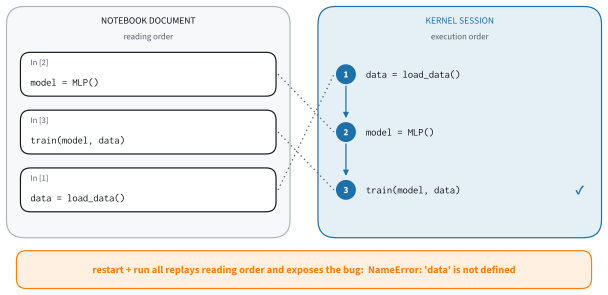
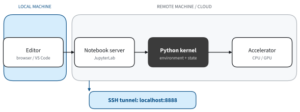

# Notebooks
:label:`sec_interactive_development`

Every section of this book is an executable notebook in which prose,
mathematics, code, and output share one document. This format supports the
empirical study of deep learning: readers can train a model, vary the learning
rate, layer width, or amount of data, and inspect the result beside the
explanation. Notebooks are also widely used for data inspection and research
prototypes.

The notebooks are designed to be edited and rerun, including with variants
mentioned only in the text. This section explains local execution and
effective notebook use, especially *restart and run all*, which detects hidden
state and order-dependent results. If you
would rather not install anything, :numref:`sec_hosted_notebooks` shows how
to run the same notebooks free of charge on Colab or Kaggle; if you need more
hardware than your laptop offers, see :numref:`sec_cloud_instances`.

## Why Notebooks?

A plain Python script re-runs from the top every time, so a slow step — say,
loading and preprocessing a dataset — repeats on every experiment. A notebook
keeps a live Python process (the *kernel*) between executions: load the data
once, then iterate on the model as often as you like while the data stays in
memory. Inline plots and interleaved explanations make this execution model useful
for both teaching and research.

This convenience introduces persistent *state*, whose location and lifetime
must be understood.

### The Document and the Kernel

A notebook is really two things. The *document* stores cells and saved
outputs — it is what you read, share, and commit. The *kernel* holds the live
state: imported modules, variables, random-number generators, open files,
compiled programs, and accelerator memory. The document orders cells top to
bottom; the kernel only knows the order in which you *executed* them.
Confusing these two orders causes many notebook bugs.


:label:`fig_tools_kernel_state`

:numref:`fig_tools_kernel_state` shows the classic failure. During an
editing session you executed a data-loading cell first, then wrote a
model-definition cell *above* it, and everything worked because the kernel
already held `data`. The document now tells a story that never happened. A
reader who runs the cells in the order shown — or you, tomorrow, after a
restart — hits a `NameError`.

The execution counters (`In [3]`, `In [1]`, …) number the cell executions
since the kernel started; they are historical clues, not a dependency
graph. The following pair of cells demonstrates benign, document-ordered
state: the second cell works only because the first ran.

```{.python .input #interactive-development-hidden-state-a}
import numpy as np

rng = np.random.default_rng(7)
samples = rng.normal(size=5)
```

```{.python .input #interactive-development-hidden-state-b}
float(samples.mean())
```

That dependency is fine, because it follows the reading order. A cell that
depends on an assignment *below* it, or on a cell you have since deleted, is
not. Keep cells small, keep function definitions separate from experiments,
and pass data explicitly rather than mutating globals across many cells.

### Restart and Run All

**Restart kernel and run all cells** discards the kernel's accumulated state
and replays the document from a blank slate, in reading order. It catches
hidden kernel state and order dependencies before a notebook is
shared. Run it before saving, sharing, or committing a notebook.
Every notebook in this book is built and tested with this procedure — the
outputs you see on the website are produced by a clean top-to-bottom run.

## Running the Book Locally

### Setting Up

Download the notebook archive described in :ref:`chap_installation`, or
clone the current sources from [GitHub](https://github.com/smolix/d2l-neu).
The archive includes CPU and GPU `uv` environment files. From the extracted
directory, create the environment once and launch JupyterLab through it:

```bash
uv sync --locked
uv run jupyter lab
```

Use the GPU lock file on a compatible NVIDIA system when the examples require
it. The *kernel* selected inside a
notebook must belong to the environment where the packages were installed. A
Jupyter server can see many kernels; its own Python process does not
determine which one executes your notebook.

### A Quick Sanity Check

Before changing code, record a compact identity check:

```{.python .input #interactive-development-identity}
import os
import platform
import sys

{
    "python": sys.executable.replace(os.path.expanduser("~"), "~"),
    "version": platform.python_version(),
    "working_directory": os.path.basename(os.getcwd()),
}
```

This catches the two most common setup mistakes in one cell: a kernel from
the wrong environment (`sys.executable` points somewhere unexpected) and a
notebook opened from a directory where relative data paths no longer resolve.
The cell abbreviates the home directory to `~` and prints only the last
component of the working directory, so that its saved output reveals no
personal path.

## Working in an Editor

### JupyterLab

[JupyterLab](https://jupyterlab.readthedocs.io/) combines a file browser,
notebook editor, terminals, a text editor, debugger support, and a view of
running kernels. The essentials are stable even as the interface evolves:

* Run a cell with `Shift+Enter`; use a terminal tab for `uv`, Git, and
  inspecting files.
* Select the kernel by environment name, then verify `sys.executable`.
* Interrupt a long computation before restarting. Restarting releases Python
  state and, normally, the accelerator memory owned by that process.
* Use **Restart Kernel and Run All Cells** before saving a result for others.
* Inspect the **Running** panel and stop kernels you no longer use — closing
  a browser tab does not necessarily stop its kernel, and an orphaned kernel
  can hold gigabytes of GPU memory.

### VS Code

[Visual Studio Code](https://code.visualstudio.com/docs/datascience/jupyter-notebooks)
edits and runs `.ipynb` files with kernel selection, a variable inspector,
cell-level debugging, and notebook-aware diffs. Open the repository as a
folder, choose the interpreter created by `uv`, and select that interpreter
as the notebook kernel.

When a notebook grows into a project, VS Code can navigate definitions, run
tests, format code, and review Git diffs. Keep testable logic in `.py` modules
and use the notebook for explanation and experiment records. This
repository also includes a VS Code extension for the book's
authoring workflow — switching framework views, previewing slides, syncing
edits back to the source — described in :numref:`sec_developers_guide`.

### Debugging and Timing

Use the notebook debugger when the kernel supports it, or move a small
failing call into a module and debug it in a terminal. Resist broad
`try/except` blocks that print "failed": they discard the exception type and
location that diagnosis needs. For quick measurements, IPython's magics are
built in:

```{.python .input #interactive-development-timing}
values = np.arange(100_000, dtype=np.float64)
%timeit values @ values
```

One caveat when timing accelerators: GPU operations are asynchronous, so a
host-side timer may measure only the dispatch of work, not its completion.
Synchronize explicitly (or use the framework's benchmarking utilities), warm
up compiled kernels first, and record the shapes, precision, device, and
library versions alongside the number.

## Remote Machines

Your editor, the notebook server, the kernel, and the accelerator need not
be on the same machine. A common setup runs JupyterLab next to the GPU while
you edit from a laptop.


:label:`fig_tools_remote_layers`

Bind the remote server to loopback and forward it over SSH:

```bash
# Remote machine
uv run jupyter lab --no-browser --ip 127.0.0.1 --port 8888
```

```bash
# Local machine
ssh -N -L 8888:127.0.0.1:8888 myserver
```

Then open the tokenized `http://127.0.0.1:8888/...` URL locally. Never bind
an unauthenticated Jupyter server to all network interfaces: anyone who can
reach the port can execute code as you. The SSH tunnel provides encryption
and access control; Jupyter's token remains a useful second boundary.

VS Code's Remote SSH installs a small server-side
component so the editor UI runs locally while terminals, extensions, files,
and kernels all live on the remote machine. Confirm the status bar shows
**SSH** before selecting the Python environment — a local kernel cannot use
the remote GPU. In either setup, treat remote compute as disposable: commit code and copy
checkpoints to durable storage before
it is rebooted, preempted, or deleted (:numref:`sec_cloud_instances`).

Before sharing or committing a notebook, perform a final reproducibility and
privacy check:
restart and run all; check that setup does not rely on personal paths or
unrecorded downloads; remove secrets and private data from outputs; keep the
outputs that teach or verify something and delete noisy progress logs; and
note the environment and hardware needed to interpret any measurement.

## Summary

* Notebooks interleave prose, code, and results, and retain expensive state
  between experiments. Run and edit them rather than treating them as static
  documents.
* The document and the kernel hold different state in different orders;
  restart and run all is the test that they agree.
* Launch JupyterLab from the book's `uv` environment, and verify the kernel
  with `sys.executable` before trusting any result.
* JupyterLab integrates notebooks, terminals, and kernels; VS Code adds
  modules, tests, diffs, and first-class remote development.
* Use SSH tunneling or VS Code Remote SSH instead of exposing a notebook
  server to the network.

## Exercises

1. [code] **Out-of-order execution.** Reproduce the failure of
   :numref:`fig_tools_kernel_state` in a new notebook: run a cell that
   defines `data`, insert a cell above it that uses `data`, and run the new
   cell. Restart and run all then stops with a `NameError`.
    1. Construct a pair of cells whose out-of-order execution changes a value
       instead of raising an error, for example a learning rate that a cell
       further down sets again before you rerun the training cell. What does
       restart and run all report for this notebook? Which of the two
       failures is more dangerous, and why?
    1. A saved notebook shows the execution counters $1, 2, \ldots, n$ on its
       $n$ code cells in document order. What does this guarantee about how
       its outputs were produced? :citet:`Pimentel.Murta.Braganholo.ea.2019`
       distinguish three kinds of hidden state: a re-executed cell, a cell
       edited after it ran, and a removed cell. Which of them can such a
       notebook still contain? A kernel restart resets the counter to $1$;
       take restarts into account.
    1. Another notebook shows the counters $3, 8, 9$ on its three code
       cells. What do the gaps tell you about executions that the document
       no longer shows? Do they prove that the outputs depend on hidden
       state?
   :exlabel:`ex_interactive-development-out-of-order`

1. [code] **Cell reruns.** The cell
   `#interactive-development-hidden-state-a` creates the generator `rng`
   and draws `samples` in one step, so rerunning it and then
   `#interactive-development-hidden-state-b` reproduces the printed mean
   $-0.2639$.
    1. Split the cell into one that creates `rng` and one that draws
       `samples`. Rerun the drawing cell twice and then
       `#interactive-development-hidden-state-b`. Predict whether the mean
       changes on each rerun, then check. Which value does restart and run
       all print?
    1. A cell rescales images with `pixels = pixels / 255`. What happens
       when a reader runs it twice? Rewrite the cell so that running it again
       leaves the kernel in the same state.
    1. An experiment cell trains a model from random initial weights that it
       draws from a generator created in an earlier cell. Restructure the
       cell so that every rerun of that cell alone reproduces its result,
       whichever other cells have run before it.
   :exlabel:`ex_interactive-development-rerun`

1. **Limits of a clean run.** Restart and run all replays the
   document in a fresh kernel, but on the same machine. Consider five
   notebooks that pass this test on their author's machine:
   (i) a cell loads `features.npy` if the file exists and otherwise
   computes it, the computing branch contains a bug, and `features.npy` is
   not in the repository;
   (ii) a package was installed from a cell that has since been deleted;
   (iii) a cell reads `/home/alice/data/train.csv`;
   (iv) a cell reads an environment variable that is set in the shell that
   launched JupyterLab;
   (v) a paragraph quotes an accuracy that a cell computes with an unseeded
   random generator.
    1. For each notebook, describe what a reader who downloads it
       experiences.
    1. Suppose the notebook is instead executed top to bottom on a fresh
       machine, in a new environment built from the lock file, from a fresh
       clone of the repository. Which of the five failures does this
       catch? For the failures that remain, name a check that catches them.

1. [code] **Kernel environment.** The cell
   `#interactive-development-identity` reports the interpreter and the
   working directory of the kernel.
    1. Run its code from a terminal with `python3`, from the extracted
       notebook directory with `uv run python`, in a JupyterLab kernel, and
       in a VS Code kernel. Explain every difference in `sys.executable` and
       in the working directory.
    1. In the extracted notebook archive, the figure files sit in a
       directory `img` next to the chapter directories, so this notebook
       reaches them as `../img/tools-kernel-state.svg`. Check with
       `os.path.exists` from the notebook and from `uv run python` started
       in the top-level directory of the archive. Rewrite the path so that
       it resolves in both cases.
    1. In a notebook cell, compare `sys.executable` with the output of
       `!python -c "import sys; print(sys.executable)"`. Explain how a shell
       command started from a cell chooses its interpreter, and describe a
       setup in which the two differ.
    1. The magic `%pip install` runs `pip` with the kernel's interpreter.
       The environments that `uv` creates contain no `pip`. What happens when
       you run `%pip install` in the book's environment, and how do you add
       a package to the environment of the kernel instead?

1. [code] **Output history.** When the last line of a cell is an
   expression whose value is displayed, IPython also stores the value in
   the dictionary `Out` and in the variables `_`, `__`, and `___`.
    1. Allocate `x = np.ones(10**7)` and create a weak reference
       `r = weakref.ref(x)`. Display `x` as the last line of a cell, then run
       `del x` in the next cell. Does `r()` still return the array? Find
       every reference that keeps it alive.
    1. Repeat with `x[:3]` instead of `x` as the displayed expression. How
       much memory does the displayed object keep alive?
    1. Free the array without restarting the kernel. Why does this matter
       more for an array that lives in accelerator memory?

1. [code] **Edited modules.** The section advises keeping testable logic in
   `.py` modules. Write a module `helpers.py` that defines a function
   `scale(x)` returning `2 * x` and a class `Box` with a method `get`
   returning `1`. In a notebook, run `import helpers`,
   `from helpers import scale`, and `b = helpers.Box()`. Then change the
   module so that `scale` returns `3 * x` and `get` returns `2`.
    1. Predict, then check, the values of `helpers.scale(1)`, `scale(1)`,
       `b.get()`, and `isinstance(b, helpers.Box)`, first after running
       `import helpers` again and then after `importlib.reload(helpers)`.
       Explain each value.
    1. Repeat the experiment in a fresh kernel after
       `%load_ext autoreload` and `%autoreload 2`.
    1. Add the line `self.size = 10` to a new `__init__` method of `Box`
       while `%autoreload 2` is active. Does the instance `b` now have the
       attribute `size`? Which kinds of edits can automatic reloading never
       apply to objects that already exist?

1. [code] **Broad exception handlers.** The following loop whitens the
   batches of a dataset with 1001 examples, and it prints `failed` once.

   ```python
   import numpy as np

   data = np.random.default_rng(0).normal(size=(1001, 4))

   def whiten(batch):
       cov = np.cov(batch, rowvar=False)
       return batch @ np.linalg.inv(np.linalg.cholesky(cov)).T

   for i in range(0, len(data), 100):
       try:
           out = whiten(data[i:i + 100])
       except Exception:
           print("failed")
   ```

    1. Remove the `try` statement, run the loop, and run `%debug` in the next
       cell. The debugger starts in the innermost frame, inside NumPy; move up
       to the frame of `whiten` and inspect `batch` and `cov`. Which batch
       fails, and why?
    1. Rewrite the handler so that the loop still processes the remaining
       batches but a failure keeps the information that the diagnosis in
       (a) needed.
    1. A training pipeline shuffles the 1001 examples in every epoch and
       splits them into batches of 100 as the loop does. Name two ways to
       handle the batch that fails in (a), and state what each one changes
       about the data the model sees.

1. [code] **Timing statistics.** The cell
   `#interactive-development-timing` printed
   `10.1 μs ± 302 ns per loop (mean ± std. dev. of 7 runs, 100,000 loops each)`.
    1. Before the seven timed runs, `%timeit` chose the number of loops: it
       timed 1, 10, 100, ... loops in turn and stopped at the first count
       that took at least 0.2 seconds. How many times did the product run in
       total? Of which quantities are the mean and the standard deviation
       computed? Why does $302$ ns not describe
       the spread of the time of a single call?
    1. The documentation of Python's `timeit` module recommends the minimum
       over runs, because slower runs mostly reflect interference from other
       processes. Rerun the cell with `%timeit -o` and compare the attributes
       `best` and `average` of the result. Which number do you report when
       comparing two implementations of one operation? Which number do you
       use to estimate how long ten million calls take inside a training
       run?

1. [code] **Layers of a remote session.** Open a notebook on a remote
   machine through the SSH tunnel of :numref:`fig_tools_remote_layers`.
    1. Run `socket.gethostname()`, `os.getcwd()`, and a cell that writes
       `probe.txt`. Upload a small file through the JupyterLab file browser.
       On which machine does each of these run or land, and which machine's
       file system does the editor show?
    1. Repeat (a) in VS Code with Remote SSH, and then in VS Code opening a
       local notebook with a kernel on the remote Jupyter server. Which
       answers change?
    1. Start a cell that prints a line every 10 seconds for 3 minutes.
       Close the tunnel after 30 seconds and reopen it after 2 minutes. Is
       the kernel still running? Which printed lines does the notebook show
       after the reconnection? What does the result imply for logging a
       long training run?

1. [code] **Output audit.** Before a notebook is shared, its outputs must
   not reveal personal paths or private data. The cell
   `#interactive-development-identity` replaces the home directory by `~`
   for this reason.
    1. A notebook file is JSON. Write a function `audit(path)` that loads a
       `.ipynb` file and reports every code cell whose outputs contain the
       absolute home directory, the user name, the host name, or a Jupyter
       URL with a `token=` parameter, together with every output larger
       than 100 kB. Run it on notebooks of this book and on one of your own.
    1. Which kinds of private information in outputs can a string search of
       this kind never find?

1. [code] **Use-before-define detector.** ● Restart and run all finds an
   out-of-order dependency only by executing the notebook. A static check
   reads the document without running it.
    1. Write a function that reads a `.ipynb` file and reports every name
       that a code cell reads, that no earlier cell and no built-in binds,
       but that a later cell binds. Convert magics such as `%timeit` into
       Python with `IPython.core.inputtransformer2.TransformerManager`
       before you parse a cell with `ast`. Test the function on the notebook
       of exercise :exref:`ex_interactive-development-out-of-order`.
    1. The body of a function runs when the function is called, not when it
       is defined. Construct a notebook on which your detector raises a
       false alarm for this reason, and one on which it misses a real
       failure. Fix the false alarm.
    1. Add two warnings: a name that a cell binds again after an earlier
       cell has read it, and a cell that reads and rebinds the same name.
       Which failure of exercise
       :exref:`ex_interactive-development-out-of-order`a and of exercise
       :exref:`ex_interactive-development-rerun`b does each warning target?
       Can either warning tell a harmless case from a harmful one?
   :exlabel:`ex_interactive-development-use-before-define`

1. [code] **Worker processes.** ● Python's `multiprocessing` starts workers
   by one of three methods: `fork` copies the parent process, `spawn` starts
   each worker in a fresh interpreter, and `forkserver` forks each worker
   from a server process that was itself started fresh. Under every method,
   a pool sends each task, including the function to call, to its workers
   with `pickle`. Data loaders with worker processes rely on the same
   mechanism.
    1. Define `square(i)` returning `i * i` in a notebook cell. In another
       cell, run `p.map(square, range(4))` inside
       `with multiprocessing.get_context(method).Pool(2) as p:` for every
       method that your system offers. If a cell does not return, interrupt
       the kernel. What happens for each method, and where do the error
       messages appear?
    1. Explain the behavior from what `pickle` stores for a function and
       from the module in which a notebook defines its functions.
    1. Python 3.12, which the book's environments use, starts workers with
       `fork` on Linux and with `spawn` on macOS and Windows. Python 3.14
       changed the default on Linux to `forkserver`. Restructure the notebook
       so that the pool works under every start method.

1. [code] **Overhead and throughput.** ● The cell
   `#interactive-development-timing` measures `values @ values` for
   $n = 100{,}000$ elements. Model the time of one call as
   $t(n) = a + b n$, where $a$ is the fixed cost per call and $b$ the cost
   per element.
    1. Measure the best time of `values @ values` with `%timeit -o` for
       $n = 10, 10^2, \ldots, 10^7$ and fit $a$ and $b$. Plot the
       measurements and the fit on log-log axes.
    1. At which $n$ does the fixed cost account for half of the time? Which
       fraction of the time at $n = 100{,}000$ is fixed cost on your
       machine? Convert $b$ into floating-point operations per second.
    1. A GPU has a fixed cost per operation of 5 to 15 microseconds for
       the launch (:numref:`tab_rules_of_thumb`) and a much smaller cost
       per element than a CPU. Use the model to find the size below which a
       GPU loses to your CPU on this operation, for a GPU with
       $a = 5\ \mu\text{s}$ and $b$ one hundredth of your CPU's value. What
       does the model imply for a network built from many small layers
       (:numref:`subsec_comp-overhead`)?

1. [code] **Asynchronous accelerator timing.** ● Consider the product of two
   $8192 \times 8192$ matrices in a 16-bit format on a GPU: bf16 where the
   GPU supports it, and fp16 on the T4 and P100 of the free Colab and Kaggle
   tiers (:numref:`sec_hosted_notebooks`), which have no bf16 units. Use one
   of these free GPUs if your machine has none.
    1. Compute the time the product needs at the dense throughput that your
       GPU's datasheet lists for this format, or, for an RTX 4090, at its
       entry of :numref:`tab_gpu_specs`.
    1. Time one call with `time.perf_counter()`, once with and once without
       a device synchronization before the timer stops. In both
       measurements, synchronize before the timer starts and exclude the
       first call. Which measurement is consistent with (a)? What throughput
       would the other imply?
    1. Time the first call on its own and explain why it differs from later
       calls.
    1. Time the unsynchronized product with `%timeit`, which runs it many
       times in a row. Where does the result fall relative to the two
       measurements of (b), and why?

1. **A shared GPU server.** ● Several users of one remote server each
   start JupyterLab with
   `uv run jupyter lab --no-browser --ip 127.0.0.1 --port 8888` and connect
   from their laptops with `ssh -N -L 8888:127.0.0.1:8888 myserver`.
    1. Who can connect to a server that listens on `127.0.0.1` of that
       machine? What protects your kernel from them? Find where your
       running server records its token on disk, and which users can read
       that file.
    1. Your server holds port 8888 when a second user runs the same
       command. Jupyter then tries up to 50 other ports nearby by
       default. Where does the second user's tunnel lead, and what does that
       user see in the browser? How does the second user find the port on
       which their own server listens?
    1. On your laptop, a local JupyterLab that you use already listens on
       port 8888 when you open the tunnel. By default `ssh` only warns when
       it cannot bind the local port, and keeps running. What does the
       browser at `http://127.0.0.1:8888` reach? The cell
       `#interactive-development-identity` prints `~` for the home directory
       on the laptop and on the server alike. Which check tells the two
       machines apart?
    1. Write a connection procedure that turns each collision of (b) and (c)
       into an error you notice.

1. [extended] **Reproducibility of public notebooks.** ●●
   :citet:`Pimentel.Murta.Braganholo.ea.2019` call the execution order of a
   notebook unambiguous when no two cells share an execution counter and no
   cell is marked as still executing. They attempted to execute 863,878
   Python notebooks from GitHub with an unambiguous execution order,
   running their cells in the order of the execution counters. Of these
   executions, 24.11% finished without errors and 4.03% reproduced the
   saved outputs; `ImportError` or `ModuleNotFoundError` ended 29.23% of
   them and `NameError` 14.53%. Repeat the study at small scale for deep
   learning notebooks written since 2024.
    1. Collect at least 100 such notebooks from public repositories, and
       record for each whether its repository declares its dependencies.
       Extend the detector of exercise
       :exref:`ex_interactive-development-use-before-define` to report for
       each notebook whether its execution order is unambiguous, whether
       its cells are out of order, and how many gaps its execution
       counters contain.
    1. Execute every notebook on a CPU in a fresh environment, with the
       declared dependencies where they exist and a time limit per
       notebook, once in document order and once in the order of its
       execution counters. Classify each outcome as success, missing
       module, `NameError`, missing file, missing accelerator, time limit,
       or other error. How does the order of execution change the
       distribution of outcomes?
    1. For every notebook that runs, compare the new outputs with the saved
       ones, once by exact text equality and once with a
       comparison that tolerates small numerical differences and ignores
       timings and memory addresses. Report both rates.
    1. Compare your rates with those of the study. Which differences come
       from your sample, and which from your method? Relate the failures
       you find to the static warnings of exercise
       :exref:`ex_interactive-development-use-before-define`.
