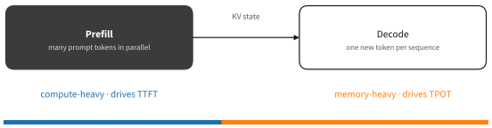
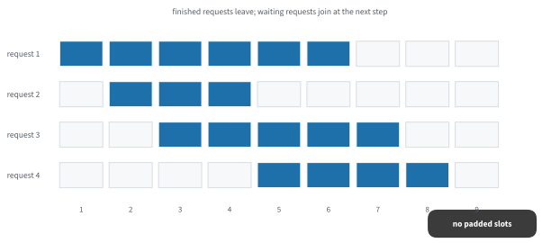
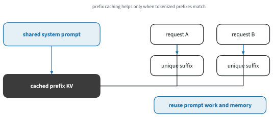

# Model Serving
:label:`sec_model_serving`

Training produces model parameters; serving exposes model inference to
people or programs. Serving emphasizes latency distributions, concurrent
request state, capacity planning, and operational controls. This section
compares representative local and server engines as of mid-2026 and explains
four recurring techniques: KV-cache management, continuous batching, prefix
reuse, and quantization.

## Know Your Workload

Two numbers govern interactive serving of autoregressive models: **time to
first token** (TTFT), counted from the arrival of the request and, on an idle
server, dominated by *prefill* — processing the prompt, a
parallel, compute-bound pass — and **time per output token** (TPOT),
dominated by *decode* — one token at a time, bandwidth-bound, as
:numref:`sec_hardware_buyers` quantified. Throughput (tokens per second
across all users) trades against both.


:label:`fig_tools_prefill_decode`

Which numbers matter depends on the workload, and the workload picks the
tool:

:Serving workloads and example starting points (mid-2026)
:label:`tab_serving_workloads`

| Workload | Optimize for | Start with |
|---|---|---|
| Personal assistant on your machine | simplicity, privacy | Ollama / LM Studio (llama.cpp), MLX on Macs |
| Offline batch scoring | throughput per dollar | vLLM offline mode |
| One application's API | operability | vLLM behind a small authenticated proxy |
| Multi-user / agentic service | goodput under an SLO | vLLM or SGLang, then NVIDIA Dynamo at scale |
| Max throughput on fixed NVIDIA fleet | compiled kernels | TensorRT-LLM |

"Goodput" — completed requests that also met their latency target — is the
production metric; overload can raise raw throughput while goodput
collapses.

## Serving on Your Own Machine
:label:`subsec_model-serving-local`

Many local inference tools use **llama.cpp** and its **GGUF** file format.
Community repositories commonly publish GGUF conversions of open-weight
models. Users often access llama.cpp through a wrapper:

* **Ollama** wraps it (plus an Apple-MLX backend) in a one-command
  experience — `ollama run qwen3:8b` downloads, caches, and serves a model
  with an OpenAI-compatible local API. It provides a low-configuration
  starting point for local use.
* **LM Studio** offers the same engines behind a GUI, with per-layer GPU
  offload control — a graphical interface for users who prefer not to work in a terminal.
* **MLX** is Apple's array framework; on M-series Macs, `mlx-lm` is
  optimized for Apple silicon and has many pre-converted models on the Hub.
  Performance depends on the model and conversion.

Common GGUF quantizations include `Q4_K_M` (~4.9 bits/weight),
`Q5_K_M`, and `Q8_0`. Higher-bit formats require more memory and usually
retain model quality better, but the effect is model- and task-dependent and
should be measured on the target workload.
The rule of thumb follows the decode bound of
:numref:`sec_hardware_buyers`: pick the largest model whose chosen quant
fits your memory with room for the KV cache, then take the highest quant
that still fits.

## Serving as a Service

### vLLM and SGLang

For an open-source GPU server, **vLLM** provides continuous batching, paged
KV-cache management, prefix caching,
tensor parallelism, quantized-model support, and an OpenAI-compatible
server in one command:

```bash
vllm serve Qwen/Qwen3-8B --max-model-len 32768
```

**SGLang** is its closest peer, distinguished by *RadixAttention* — a
radix-tree KV cache shared across requests, which can improve reuse when many
requests share long prefixes (chat with a system prompt, RAG over the
same documents, agent trees). The DeepSeek ecosystem has used it for such
workloads. Both projects evolve
quickly and support multiple accelerator backends. Benchmark both with the
target prompt-length and concurrency distributions before selecting one.

NVIDIA-specific tools trade portability for compiled optimizations.
**TensorRT-LLM** compiles a model into optimized engines, which can improve
steady-state serving at the cost of additional setup, while **Dynamo**
orchestrates disaggregated prefill/decode and KV-aware routing across a
fleet, wrapping vLLM, SGLang, or TensorRT-LLM as backends. These matter
at datacenter scale; below it, they are complexity you do not need.

### One Client Contract
:label:`subsec_model-serving-contract`

Many of these tools implement the OpenAI chat-completions API, which serves
as a common client contract — the same application code targets a
local Ollama, your vLLM server, or a commercial provider by changing the
base URL and the model name:

```text
from openai import OpenAI

client = OpenAI(base_url="http://127.0.0.1:8000/v1", api_key="local")
response = client.chat.completions.create(
    model="Qwen/Qwen3-8B",
    messages=[{"role": "user", "content": "Explain KV caching briefly."}],
    temperature=0,
)
print(response.choices[0].message.content)
```

"Compatible" is not "identical": tokenization, sampling defaults,
structured-output support, streaming behavior, and token accounting all
vary. Keep a small conformance test and rerun it before swapping engines.

## Why These Engines Are Fast

Four composable techniques explain much of serving-engine performance:

**Continuous batching.** A static batch waits for its slowest member.
Continuous batching admits new requests and retires finished ones between
decode steps, keeping the batch nearly full:


:label:`fig_tools_continuous_batching`

The toy scheduler below captures the idea in ten lines. Exercise
:exref:`ex_model-serving-arrivals` extends it with arrival times and a memory
budget:

```{.python .input #model-serving-scheduler}
from collections import deque

requests = deque([5, 2, 7, 3])  # output tokens requested
capacity = 2
active, timeline = [], []
while requests or active:
    while requests and len(active) < capacity:
        active.append(requests.popleft())
    timeline.append(tuple(active))
    active = [remaining - 1 for remaining in active if remaining > 1]

timeline
```

**Paged KV cache.** Each active sequence's key–value cache grows with its
length; vLLM's PagedAttention allocates it in fixed-size blocks, like
virtual memory, nearly eliminating the fragmentation that once capped batch
sizes. Capacity planning follows: GPU memory must hold weights *plus* KV
for every concurrent sequence. A model that fits for one request may therefore
exceed memory under high concurrency.

**Prefix caching.** When two requests share a tokenized prefix (the same
system prompt, the same document), its KV state can be computed once and
reused:


:label:`fig_tools_prefix_cache`

Some commercial APIs charge less for cached input tokens. Place shared,
stable content before variable suffixes when the provider's documented cache
semantics support prefix reuse; prices and eligibility vary by provider.

**Speculative decoding and quantization.** A small draft model proposes
several tokens; the target model verifies them in one parallel pass —
potential decode speedups when acceptance is high, while preserving the
target distribution under the algorithm's sampling assumptions.
Quantization reduces the bytes transferred during decode:
fewer bytes per weight, more tokens per second, up to a limit at the lowest
bit widths. On recent datacenter GPUs,
supported formats include FP8 on Hopper and NVFP4 on Blackwell, while vLLM
and SGLang support AWQ for 4-bit weights; GGUF
quants play the same role locally.

## Operating Notes

A model behind a port is not yet a service. The short version of the
production checklist: put authentication, TLS, and rate limits at a proxy
in front of the engine (never expose the raw port); make admission
control reject or queue *before* memory exhausts rather than OOM after;
propagate client cancellations so abandoned generations stop burning
compute; measure TTFT, TPOT, and end-to-end latency as p50/p95
distributions under realistic arrival patterns, not averages under a
closed loop; avoid logging raw prompts by default; and pin model,
tokenizer, quantization, and engine versions together — a faster server
that answers differently is a different system, so gate rollouts on task
quality as well as latency.

## Summary

* Separate prefill (compute-bound, sets TTFT) from decode
  (bandwidth-bound, sets TPOT), and pick tools by workload: Ollama/LM
  Studio/MLX locally, vLLM or SGLang for services, TensorRT-LLM and
  Dynamo at NVIDIA-fleet scale.
* GGUF quantizations are common in local serving, while server engines support
  formats such as AWQ, FP8, and NVFP4; in both cases quantization converts bytes saved into tokens
  per second, up to a limit at the lowest bit widths.
* Continuous batching, paged KV, prefix caching, and speculative decoding
  are four recurring serving optimizations — and prefix structure is
  something *you* control from the prompt side.
* The OpenAI-compatible API is the portable client contract; verify
  compatibility with your own conformance tests.
* Capacity is weights plus per-user KV; production means admission
  control, cancellation, percentile latencies, and pinned revisions.

## Exercises

1. **Batch size limits.** The command `vllm serve Qwen/Qwen3-8B` serves a
   model with 36 layers and 8 key-value heads of dimension 128, whose bf16
   weights occupy
   $B_w = 16.4$ GB. Its cache is stored in bf16 as well. Serve it on the
   H100 SXM of :numref:`tab_gpu_specs`, whose memory bandwidth is $\beta$.
   A decode step reads the weights once for the whole batch and the cache
   of every active sequence. For $b$ sequences that each hold $n$ cached
   tokens, the step, and hence the time per output token of every
   sequence, takes about

   $$t(b) = \frac{B_w + b\, n\, B_\textrm{kv}}{\beta},$$

   where $B_\textrm{kv}$ is the cache size per token.
    1. Compute $B_\textrm{kv}$ with :eqref:`eq_kv-cache-bytes`. Evaluate
       the TPOT and the throughput $b / t(b)$ at $n = 2048$ for
       $b \in \{1, 8, 64, 256\}$. Which value does the throughput approach
       as $b$ grows, and which term of $t(b)$ sets it? Count 2 FLOPs per
       parameter and token for the 8.2 billion parameters, and check with
       the bf16 rate of :numref:`tab_gpu_specs` that the step at $b = 256$
       is still bound by memory traffic.
    1. An interactive service promises a TPOT of at most 20 ms. What is
       the largest batch it can run? Which batch would an offline scoring
       job of :numref:`tab_serving_workloads` choose instead, and why?
    1. Let the engine use 72 GB of the card for weights and cache, and let
       the sequences hold 2,048 tokens on average. Before paged caches,
       servers reserved one contiguous region per request for its maximum
       length. How many sequences fit when each one reserves the
       `--max-model-len` of 32,768 tokens? What fraction of the reserved
       cache then holds token states? :citet:`Kwon.Li.Zhuang.ea.2023`
       measured 20.4% to 38.2% in such systems. Why is your fraction lower?
       How many sequences fit when the cache is allocated in blocks of 16
       tokens? Bound the memory that partly filled blocks waste.
    1. Which limit sets the batch of the interactive service under each of
       the two allocation schemes: memory or the TPOT target?
   :exlabel:`ex_model-serving-batch-limits`

1. **Choosing a local model.** :numref:`subsec_model-serving-local` gives a
   rule of thumb: pick the largest model whose chosen quant fits into
   memory with room for the KV cache, then take the highest quant that
   still fits. Consider a laptop that leaves 16 GB of its unified memory to
   the model and its cache and that reads memory at 120 GB/s. The
   candidates are the Qwen3 models with 4.0, 8.2, 14.8, and 32.8 billion
   parameters. They have 36, 36, 40, and 64 layers, all with 8 key-value
   heads of dimension 128 and a bf16 cache. The
   [llama.cpp quantization README](https://github.com/ggml-org/llama.cpp/blob/master/tools/quantize/README.md)
   lists 4.89 bits per weight for `Q4_K_M`, 5.70 for `Q5_K_M`, 6.56 for
   `Q6_K`, and 8.50 for `Q8_0`, measured on Llama 3.1 8B. Use these values
   for every candidate.
    1. Apply the rule with `Q4_K_M` as the chosen quant and a context of
       16,384 tokens. Which model and quant does it select? Bound the decode
       rate of the selection with :eqref:`eq_hardware-buyers-decode`, once
       for an empty context and once with the cache of the full context
       read in every step.
    1. Which configurations decode faster than 20 tokens/s at the full
       context? What does the rule leave out?

1. **Quantization and decode speed.** At a short context,
   :eqref:`eq_hardware-buyers-decode` bounds the decode rate by the memory
   bandwidth divided by the bytes of the weights, so shrinking the weights by some factor should raise the
   rate by the same factor. The
   [llama.cpp quantization README](https://github.com/ggml-org/llama.cpp/blob/master/tools/quantize/README.md)
   reports text generation rates for Llama 3.1 8B on one machine: 29.2
   tokens/s for `F16` (14.96 GiB), 50.9 for `Q8_0` (7.95 GiB), 71.9 for
   `Q4_K_M` (4.58 GiB), 90.0 for `Q2_K_S` (2.78 GiB), and 79.7 for `IQ1_S`
   (1.87 GiB).
    1. Compute the speedup of each format over `F16` and the factor by
       which it shrinks the weights. For which formats does the bound
       predict the speedup well?
    1. Why is `IQ1_S` slower than `Q2_K_S`, although it reads fewer bytes?
       What limits the speedup at the lowest bit widths?

1. [code] **Conformance test.** :numref:`subsec_model-serving-contract`
   recommends a small conformance test before swapping engines.
    1. Write a function `conformance(base_url, model)` with the `openai`
       client of :numref:`subsec_model-serving-contract` that runs four
       checks and reports which of them pass. Every check also requires a
       nonempty `content`. First, two identical requests
       at temperature 0 return the same text. Second, a request with
       `max_tokens=8` ends with `finish_reason` equal to `"length"` and
       reports at most 8 completion tokens in `usage`. Third, a request that
       asks the model to count from 1 to 20 with `stop=["7"]` returns text
       without the digit 7. Fourth, a streamed request at temperature 0 with
       `stream_options={"include_usage": True}` yields chunks whose
       concatenated content and final `usage` equal those of the same
       request without streaming. Run the test against Ollama with a small
       model such as `qwen3:0.6b`, which runs on a CPU, and against a second
       OpenAI-compatible server of your choice. Which checks fail, and why?
    1. On a vLLM server, the first check passes while the server is idle
       and fails occasionally while other clients send requests to it. No
       sampling takes place at temperature 0. Explain the failure.
    1. Both servers load the same model with the same tokenizer and
       receive the same messages, yet they report values of
       `usage.prompt_tokens` that differ by a few tokens. Name two possible
       causes. Why does such a difference matter to a client beyond
       billing?

1. [code] **Static versus continuous batching.** The cell that builds
   `timeline` admits a waiting request whenever a slot is free.
    1. Change the cell into a static batcher, which admits new requests
       only when every slot is empty. Compare the number of steps that both
       versions take for the four requests of the cell, and the fraction of
       slot-steps that produce a token. What is the smallest number of steps
       that any scheduler with `capacity = 2` needs for these requests?
    1. Draw 1,000 output lengths with a mean of about 100 tokens from three
       distributions: a constant, a uniform distribution on 1 to 199, and a
       geometric distribution. Schedule them with `capacity = 32`, and
       compare the steps of both schedulers with the lower bound of the
       first sub-problem. How does the gain from continuous batching depend
       on the spread of the output lengths?
    1. Even continuous batching misses the lower bound in the second
       sub-problem. Where in its timeline does it lose steps?

1. [code] **Prefix cache for an agent.** A coding agent calls a model 30
   times. The first prompt holds a system prompt and repository context of
   20,000 tokens. Every later prompt repeats the previous prompt and
   appends 1,000 tokens: the model's previous answer and a tool result.
    1. How many prompt tokens must the engine prefill over the 30 calls
       without prefix caching, and how many with a cache that keeps every
       earlier prompt? A provider charges a tenth of its input price for
       cached tokens. What fraction of the uncached input bill remains?
    1. vLLM caches only full blocks, and it keys each block by a hash of
       the key of the preceding block and of the block's own token ids.
       Implement this scheme with blocks of 16 tokens as a function
       `prefill_tokens(cache, tokens)` that returns the number of tokens to
       compute and adds the new full blocks to the set `cache`. Simulate the
       agent with random token ids, and compare the result with your count
       from the first sub-problem. Why does the key of a block include the
       key of the preceding block?
    1. The agent framework writes the current time, to the second, into
       the first line of the system prompt. Rerun the simulation. Where
       should the timestamp go instead?
    1. A retrieval application places three of 50 documents after a shared
       system prompt, in order of relevance. Two requests retrieve the same
       three documents in different orders. Which blocks does the second
       request reuse? Propose an ordering that raises reuse, and state what
       it gives up.

1. **A cache shared by tenants.** A service runs one engine with prefix
   caching for many customers. The engine serves a base model with one LoRA
   adapter per customer and accepts images in messages. Every request
   starts with the service's 3,000-token system prompt, followed by the
   customer's own documents and the user's message.
    1. Two requests agree in their first 5,000 token ids. Which other
       properties of the two requests and of the deployment must agree
       before the second request may reuse the cached keys and values of the
       first?
    1. An attacker who is also a customer sends prompts that begin with the
       system prompt followed by a guess of another customer's document, and
       measures the time to the first token. What can the attacker learn,
       and how?
    1. vLLM accepts a per-request `cache_salt` that enters the key of the
       first block, so that only requests with equal salts share cached
       blocks. Compare a salt per user, a salt per customer, and no salt by
       the protection that each gives and by the cache hits that each gives
       up.
    1. A customer asks the service to delete all of its data. Where in the
       serving stack can its content still reside?

1. **Closed and open loops.** A load generator runs $C = 16$ clients in a
   closed loop: each client sends its next request as soon as its previous
   request completes. Little's law :cite:`Little.1961` relates the mean
   number $L$ of requests in a system, their arrival rate $\lambda$, and
   their mean time $W$ in the system by $L = \lambda W$.
    1. The mean latency of the server is 4 s. At which rate does the
       generator send requests? An engine change doubles the mean latency.
       What happens to the rate? Why can the generator never build up a
       queue of more than $C$ requests?
    1. The benchmark reports a p95 time to first token of 300 ms. In
       production, requests arrive as a Poisson process at the rate of the
       first sub-problem, independently of how fast the server answers. Why
       does the benchmark predict the production tail latency poorly?
    1. `vllm bench serve` accepts a `--request-rate` and a
       `--max-concurrency`. The rate defaults to `inf`, and a finite rate
       draws Poisson arrivals at that rate. Which settings reproduce the
       closed loop? What does a run measure that sets both?
   :exlabel:`ex_model-serving-loops`

1. [extended] **Two engines, one model.** ● Serve Qwen3-8B on a machine
   with an NVIDIA GPU of at least 16 GB, once through Ollama, whose
   `qwen3:8b` is quantized to `Q4_K_M`, and once through vLLM with the
   `Qwen/Qwen3-8B-AWQ` checkpoint. Use the same 100 prompts for every
   measurement. Qwen3 writes a reasoning trace before its answer by
   default, and the two engines return it differently: Ollama in a
   separate `reasoning` field, and a vLLM server started without a
   reasoning parser inside `content`. Turn the trace off on both engines,
   with `reasoning_effort="none"` for Ollama and
   `extra_body={"chat_template_kwargs": {"enable_thinking": False}}` for
   vLLM.
    1. Write a client from the code of
       :numref:`subsec_model-serving-contract` with `stream=True` that
       records, for every request, the time to the first content chunk and
       the time per output token after it. Measure both engines in a closed
       loop at concurrency 1, 4, and 16, and report the p50 and p95 of both
       quantities and the output tokens per second.
    1. The Ollama FAQ documents the variable `OLLAMA_NUM_PARALLEL`, the
       number of requests that a model processes at once, with a default
       of 1. Explain the TTFT of Ollama at concurrency 16 with this
       default. Rerun with the variable set to 16. How does the memory that Ollama
       reserves for the cache change? What limits the number of concurrent
       sequences in vLLM instead?
    1. Run `vllm bench serve` against the vLLM server at five request rates
       with `--goodput ttft:1000 tpot:50`, which counts the requests that
       meet a TTFT of 1 s and a TPOT of 50 ms. Plot throughput and goodput
       against the request rate. At which rate do the two curves diverge?
       Why do the closed-loop numbers of the first sub-problem not show this
       rate (exercise :exref:`ex_model-serving-loops`)?
    1. The two engines run different weight formats. Which of your measured
       differences can the formats explain rather than the engines? Compare
       the answers of both engines on 50 questions of a task with checkable
       answers. Which engine would you deploy for each workload of
       :numref:`tab_serving_workloads` that your hardware supports?

1. [code] **Arrivals and a memory budget.** ● Extend the cell that builds
   `timeline` into a simulator in which time advances in decode steps.
   Request $i$ arrives at step $a_i$, has a prompt of $P_i$ tokens, and
   generates $T_i$ tokens, one per step from the step of its admission on.
   The server runs at most 64 sequences and holds at most 32,768 tokens of
   cache, and a sequence holds its prompt plus the tokens generated so far.
   Draw the arrivals from a Poisson process with $\lambda$ requests per
   step, draw $P_i$ uniformly from 100 to 1,000, and let $T_i$ be one plus
   an exponential variable with mean 200, rounded down and capped at
   `max_tokens = 1024`. Measure the time to first token in steps, from the
   arrival to the first generated token.
    1. Admit requests first come, first served when the cache can hold the
       prompt plus `max_tokens`, the most that a request can ever need.
       Reject an arriving request when 50 requests already wait. For
       $\lambda \in \{0.05, 0.1, 0.15, 0.2\}$, report the tokens generated
       per step, the p50 and p95 TTFT, and the rejected fraction.
    1. Admit a request instead whenever the cache can hold its prompt plus
       one token. When the active sequences outgrow the cache, preempt the
       most recently admitted one, free its cache, and put it back at the
       head of the queue, so that it recomputes its cache on readmission.
       Repeat the measurements. The simulator charges no time for prefill.
       Which resource does recomputation spend on a real server, and which
       would swapping the cache to CPU memory spend instead? How would
       charging for prefill change your comparison with the first
       sub-problem?
    1. Order the queue by the number of remaining tokens, shortest first,
       and run both admission rules at $\lambda = 0.2$. Compare this order
       with first come, first served on the p95 TTFT of all requests and on
       that of the 5% of requests with the longest outputs.
    1. A server knows `max_tokens` but not $T_i$. What could it order the
       queue by instead, and how much of the gain of the third sub-problem
       would you expect it to keep?
   :exlabel:`ex_model-serving-arrivals`

1. **Speculative sampling.** ● In the speculative decoding of
   :citet:`Leviathan.Kalman.Matias.2023`, a draft model with next-token
   distribution $q$ proposes a token $x \sim q$, and the target model,
   with next-token distribution $p$, accepts it with probability
   $\min(1, p(x) / q(x))$. After a rejection, the token is drawn instead
   from the residual distribution

   $$p'(x) = \frac{\max(0, p(x) - q(x))}{\sum_{x'} \max(0, p(x') - q(x'))}.$$

    1. Show that the emitted token is distributed according to $p$, and
       that the probability of acceptance is
       $\beta = \sum_x \min(p(x), q(x))$.
    1. In every round, the draft proposes $\gamma$ tokens one after
       another, and one pass of the target scores all of them. The target
       emits the accepted tokens up to the first rejection and then one
       token of its own, drawn from $p'$ after a rejection or from $p$ when
       all $\gamma$ tokens were accepted. Let $\alpha$ be the mean of the
       acceptance probability $\beta$ of the first sub-problem over the
       positions of a sequence, and assume that every draft token is
       accepted independently with probability $\alpha$. Show that a round
       emits $(1 - \alpha^{\gamma + 1}) / (1 - \alpha)$ tokens in
       expectation. A draft step takes a fraction $c$ of the time of a
       target step, and the scoring pass takes one target step. Derive the
       expected speedup over plain decoding, and find the best $\gamma$ for
       $c = 0.05$ and $\alpha \in \{0.6, 0.8, 0.9\}$.
    1. The scoring pass takes one target step only while it is bound by
       memory traffic. A server decodes $b$ sequences together, and each
       sequence scores $\gamma + 1$ positions per round. Ignore the cache,
       store the weights in bf16, and count 2 FLOPs per parameter and token.
       Above which $b$ does the pass become compute-bound on the H100 of
       :numref:`tab_gpu_specs` for $\gamma = 4$? What does this imply for
       speculative decoding on a busy server compared with a single user?

1. [extended] **Goodput under load.** ●● Turn your simulator of exercise
   :exref:`ex_model-serving-arrivals` into one whose clock runs in seconds
   instead of decode steps, for
   Qwen3-8B on the H100 of exercise :exref:`ex_model-serving-batch-limits`
   with 72 GB for weights and a paged cache. A step processes $p$ prompt
   tokens and one token for each of $b$ decoding sequences, which together
   hold $K$ cached tokens. With $N$ parameters, the dense bf16 rate $F$,
   and the notation of exercise :exref:`ex_model-serving-batch-limits`,
   the step takes

   $$t_\textrm{step} = \max\left(\frac{2N(p + b)}{F}, \frac{B_w + K B_\textrm{kv}}{\beta}\right),$$

   which ignores the FLOPs of the attention scores. Requests arrive as a
   Poisson process at $\lambda$ requests per second, with prompts uniform
   between 500 and 4,000 tokens, and output lengths of one plus an
   exponential variable with mean 250, rounded down and capped at 2,048. A
   request counts toward goodput when its TTFT is at most 1 s and its
   TPOT, the mean time between its output tokens, is at most 50 ms.
    1. Prefill every admitted prompt in full within one step. Estimate the
       saturation rate from $t_\textrm{step}$ before you simulate. Then
       sweep $\lambda$ from light load to well beyond saturation, and plot
       the throughput and the goodput in requests per second. At which rate
       does goodput peak, and how does it compare with your estimate?
    1. A full prefill of a long prompt delays the next token of every
       decoding sequence. Implement chunked prefill
       :cite:`Agrawal.Kedia.Panwar.ea.2024`, which caps the tokens of a
       step, decode tokens included, at a budget and spreads a prompt over
       several steps. Repeat the sweep for budgets of 512, 2,048, and 8,192
       tokens. Which budget maximizes goodput? How does the answer depend
       on the two SLOs?
    1. Add admission control that rejects a request as soon as its TTFT
       target can no longer be met. How does it change goodput beyond
       saturation? Explain why goodput collapses without it while
       throughput stays high.
    1. Let every client abandon its request after 10 s and send it once
       more. Compare goodput when the server keeps generating abandoned
       requests and when it cancels them.
    1. State the largest request rate at which at least 90% of all
       arriving requests meet both SLOs, counting rejected requests as
       misses, and the configuration that achieves it.
