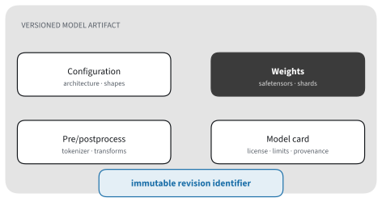

# Ecosystem
:label:`sec_software_ecosystem`

Modern machine learning projects commonly begin with pretrained checkpoints,
datasets, released code, and benchmark results. Using these artifacts requires
knowing where to find them, how to evaluate their relevance, and how to record
their provenance. This section surveys prominent sources as of 2026, explains
how to interpret leaderboards, and presents practices for managing external
artifacts safely.

## Where to Find Things

### Models

The [Hugging Face Hub](https://huggingface.co/models) listed more than two
million public models in spring 2026 and provides Git-style versioning, model
cards, and integrations with the libraries used in this book. Because
popularity does not establish suitability, search by task, inspect recency and
download signals, and read the model card before selecting a repository. Complementary sources include:

* [ModelScope](https://modelscope.cn/), Alibaba's hub, hosts a large part
  of the Chinese open-model ecosystem (Qwen and friends, 170,000+ models) —
  and frequently publishes new open-weight releases.
* [Kaggle Models](https://www.kaggle.com/models) hosts curated weights
  wired into Kaggle's competition and notebook infrastructure
  (:numref:`sec_hosted_notebooks`).
* The [Ollama library](https://ollama.com/library) is a short, curated
  menu of local-runtime models — less a discovery surface than a
  convenience layer (:numref:`sec_model_serving`).
* [`timm`](https://huggingface.co/timm) provides a broad collection of vision
  backbones; [Civitai](https://civitai.com/) hosts community image-generation
  checkpoints and LoRAs.

### Datasets

[Hugging Face Datasets](https://huggingface.co/datasets) (half a million
public datasets) and [Kaggle](https://www.kaggle.com/datasets) cover most
supervised needs. For pretraining-scale text, the lineage runs from raw
[Common Crawl](https://commoncrawl.org/) through filtered derivatives —
[FineWeb](https://huggingface.co/datasets/HuggingFaceFW/fineweb) (15
trillion tokens at its 2024 release and more than 18.5 trillion after later
versions added newer dumps, plus a 1,000-language successor) provides a widely used open
baseline, analogous to C4 in the period when
BERT was developed. For
vision–language pairs, DataComp provides an alternative to LAION with an emphasis on controlled
dataset construction and evaluation. Older and very large corpora are sometimes available only through
[Academic Torrents](https://academictorrents.com/). Whatever the source:
datasets, like models, have versions, licenses, and documented failure modes.
Review a dataset's documentation before adopting it.

### Papers and Code

New work appears on [arXiv](https://arxiv.org/list/cs.LG/recent) first;
the community's curated front page for ML is [Hugging Face
Papers](https://huggingface.co/papers), which absorbed that role when
Papers with Code—for years an index from papers to code and benchmarks—closed
in mid-2025. Its historical leaderboard data survives as a static archive,
illustrating why project inputs should not depend on one external index. [Semantic Scholar](https://www.semanticscholar.org/)
and [alphaXiv](https://alphaxiv.org/) help with search and discussion.
Released implementations commonly reside on GitHub. Issue history, recent
commits, and documented reproduction results provide evidence beyond the
paper's abstract.

## Choosing a Model: Benchmarks and Leaderboards

Model rankings change as models, evaluation sets, and optimization methods
evolve. Static benchmark suites can also enter training data. The Open LLM
Leaderboard was retired in 2025 after contamination reduced its usefulness.
Model selection should therefore combine several sources of evidence:

* [LMArena](https://lmarena.ai/) (now Arena) — blind human pairwise
  preference; it measures aggregate user preferences, which may differ from
  the target task.
* [LiveBench](https://livebench.ai/) — contamination-resistant by rotating
  fresh questions monthly.
* [SWE-bench Verified](https://www.swebench.com/) — an evaluation for
  coding agents on real GitHub issues; it exemplifies the
  benchmark-per-capability pattern (math, long context, safety all have
  their own).
* [Artificial Analysis](https://artificialanalysis.ai/) — the
  quality/price/latency triangulation across hundreds of models and
  providers; useful when cost and latency are selection criteria.
* [OpenRouter rankings](https://openrouter.ai/rankings) — revealed
  preference by real token volume rather than scores; instructive
  precisely where it disagrees with the quality leaderboards.

After forming a shortlist, build a small evaluation set from the target task
and run each candidate on it. The
gap between leaderboard rank and performance on your distribution is
routinely larger than the gap between adjacent leaderboard entries. The
evaluation discipline this book has practiced throughout — held-out data,
meaningful baselines, error analysis — applies to *choosing* models exactly
as it does to training them.

## Staying Current

A small, deliberate set of information sources is easier to evaluate than a
continuous stream of announcements.
A workable minimal set, as of 2026:

* [r/LocalLLaMA](https://www.reddit.com/r/LocalLLaMA/) — a community source
  for open-weight releases, quantizations, hardware reports, and reproduction
  attempts.
* [Hugging Face Papers](https://huggingface.co/papers) daily — a curated
  dozen papers instead of arXiv's daily hundreds.
* One good newsletter — Andrew Ng's *The Batch*, Jack Clark's *Import AI*,
  or Sebastian Raschka's *Ahead of AI* — for the weekly synthesis.
* For systems depth, the [GPU MODE](https://github.com/gpu-mode/lectures)
  lecture series and community, and the
  [EleutherAI Discord](https://www.eleuther.ai/community) for open
  research.

X/Twitter remains where labs announce and researchers argue; treat it as a
discovery feed, not an archive. And the chapter-end
resources of this book (:numref:`chap_appendix_tools`) collect the
durable long-form references.

## Using What You Found

### Pin the Identity


:label:`fig_tools_model_artifact`

A model is more than its weights: the tokenizer, preprocessing,
configuration, license, and revision all determine whether you can
reproduce a result (:numref:`fig_tools_model_artifact`). Repositories are
Git repositories — `main` moves. Pin the commit:

```text
from huggingface_hub import snapshot_download

path = snapshot_download(
    repo_id="organization/model-name",
    revision="0123456789abcdef",          # an immutable commit, not main
    allow_patterns=["*.json", "*.safetensors"],
)
```

A small manifest records the model identity explicitly. In production, add
file hashes, library versions, and an evaluation record:

```{.python .input #software-ecosystem-manifest}
from dataclasses import asdict, dataclass
import json

@dataclass(frozen=True)
class Artifact:
    repository: str
    revision: str
    task: str
    license: str
    parent: str | None = None

artifact = Artifact(repository="organization/model-name",
                    revision="0123456789abcdef",
                    task="text-generation", license="apache-2.0")
print(json.dumps(asdict(artifact), indent=2))
```

The same pinning discipline applies to *derived* artifacts: a LoRA adapter
without its base-model revision is incomplete, and a quantized conversion
(GGUF, AWQ, ONNX — see :numref:`sec_model_serving`) is a new artifact
whose numerical fidelity someone should have checked against the source.
For such artifacts, the field `parent` of `Artifact` identifies the artifact
they were derived from.

### Trust and Licenses

Downloaded models are software supply-chain inputs with security and licensing
implications:

* Prefer **safetensors** — a pure tensor container. Legacy pickle-based
  checkpoints can execute arbitrary code on load, and the Hub's scanners
  are a mitigation, not a guarantee.
* `trust_remote_code=True` runs Python from the repository on your
  machine. Read and pin that code; use the flag only when the architecture
  genuinely requires it.
* "Open" spans a wide range of licenses: permissive Apache/MIT weights,
  acceptable-use licenses with commercial thresholds, research-only
  releases, and gated models whose terms you accept per account. Record the
  license associated with the pinned repository revision, since repositories
  can relicense between revisions.
* Every hub client caches aggressively (tens to hundreds of gigabytes in
  `~/.cache/huggingface` is routine). Learn the cache tool's `scan` and
  `delete` commands and monitor disk use.

## Summary

* Discovery is a skill: Hugging Face is the center for models and
  datasets, with ModelScope, Kaggle, Ollama's library, and Civitai as the
  complements that matter; FineWeb-class corpora are the open pretraining
  baseline.
* Papers with Code closed in 2025; arXiv and Hugging Face Papers provide paper
  discovery, while repository activity and reproduction reports help assess
  released code.
* No leaderboard is trusted alone: triangulate Arena, LiveBench,
  task-specific benchmarks, and price/latency data — then decide on a
  small evaluation you built from your own task.
* Use a small set of complementary sources, such as a community, a curated
  paper feed, and a newsletter.
* Pin revisions, prefer safetensors, read licenses, treat remote code as
  code review, and manage your caches — treat external artifacts as supply-chain dependencies.

## Exercises

1. **Model card audit.** :citet:`Mitchell.Wu.Zaldivar.ea.2019` propose that
   a model card answer nine groups of questions: model details, intended
   use, factors, metrics, evaluation data, training data, quantitative
   analyses, ethical considerations, and caveats and recommendations.
    1. Compare the model card (`README.md`) of `openai-community/gpt2` with
       this list. Which groups does it answer, and which does it skip?
    1. Repeat the comparison for a recent model that you would consider for
       a named deployment, such as a customer-support assistant. Which
       missing answer would change your decision, and how would you obtain
       it yourself?

1. **Dataset versions.** The dataset card of `HuggingFaceFW/fineweb` keeps
   a changelog. Version 1.1.0 (May 2024) reprocessed eleven existing
   Common Crawl dumps after a deduplication bug. Versions 1.2.0 (January
   2025) and 1.4.0 (July 2025) added newer dumps. Version 1.3.0 (January
   2025) added documents that had been missing from nine 2024 dumps,
   among them `CC-MAIN-2024-18`, and removed specific domains after a
   cease-and-desist notice. The card states that earlier versions remain
   available in branches named after them.
    1. Two training runs read all dumps up to and including
       `CC-MAIN-2024-18` from the branch `main`, one in June 2024 and one
       in March 2025. Which changelog entries make their training data
       differ, and which do not?
    1. :citet:`Gebru.Morgenstern.Vecchione.ea.2021` ask of every dataset
       who maintains it, how updates are communicated, and whether older
       versions remain available. Answer these questions for a dataset you
       use, from its documentation alone. Which missing answer would worry
       you most?

1. **Evidence for released code.** Pick a paper from Hugging Face Papers
   that is at least a year old and has an official GitHub repository.
    1. From the repository alone, determine whether it pins its
       dependencies, links released weights at a fixed revision, and
       documents the command that reproduces a headline number of the
       paper. Which issues report attempts to reproduce that number, and
       with what outcome?
    1. Use Semantic Scholar to find later papers that cite it. Does any of
       them report an independent reproduction of the headline number?
    1. Take a model release announced on X/Twitter in the past month and
       trace each headline claim of the announcement to a primary source:
       a model card, a paper, a leaderboard entry, or a public
       reproduction. Which claims rest on the announcement alone?

1. **Rating gaps on the Arena.** LMArena fits the Bradley-Terry model
   :eqref:`eq_bradley_terry` of :numref:`sec_regularized` to pairwise votes
   :cite:`Chiang.Zheng.Sheng.ea.2024` and reports the scores on the Elo
   scale. Ignoring ties, model A then beats model B with probability
   $$P(A \succ B) = \frac{1}{1 + 10^{-(R_A - R_B)/400}},$$
   where $R_A$ and $R_B$ are the reported scores.
    1. Compute this probability for score gaps $R_A - R_B$ of 10, 20, 50,
       and 100 points.
    1. Linearize $P(A \succ B)$ around $R_A = R_B$, and show that a gap
       $R_A - R_B$ estimated from $v$ independent votes between two models
       of similar strength has a standard error of about $347/\sqrt{v}$
       points. How many votes are needed before a 20-point gap lies two
       standard errors from zero?
    1. Model A leads model B by 20 points over all votes. On the 10% of the
       votes cast on prompts that resemble your task, B wins 60%. What is
       A's win rate on the remaining votes? What does the result imply for
       choosing between A and B?
   :exlabel:`ex_software-ecosystem-rating-gaps`

1. **Error bars for small evaluations.** Two models A and B answer the
   same 25 items of your task. A answers 19 items correctly and B answers
   16. On 5 items A is right and B is wrong, and on 2 items B is right and
   A is wrong. The analysis follows :citet:`Miller.2024`.
    1. Compute the standard error of each accuracy and a 95% confidence
       interval for each.
    1. Compute the standard error of the difference in accuracy twice:
       once treating the two accuracies as independent, and once from the
       per-item differences $d_i \in \{-1, 0, 1\}$ between the scores of A
       and B. Why is the paired value smaller? Is the observed difference
       of 12 points resolved?
    1. Two other models disagree on 20% of the items of a larger
       evaluation set. How many items are needed for the paired standard
       error of their difference to fall to 2.5 points, so that a
       5-point difference lies two standard errors from zero?
   :exlabel:`ex_software-ecosystem-error-bars`

1. **What a revision pins.** A Hugging Face repository can be addressed
   by the branch `main`, by a tag such as `v1.0`, by a pull-request ref
   such as `refs/pr/3`, or by a 40-character commit hash.
    1. Which of these identifiers always refer to the same files, and
       which can refer to different files tomorrow? Who can move each of
       them? Dataset repositories are addressed the same way, and
       `HuggingFaceFW/fineweb` keeps each earlier version in a branch named
       after it, such as `v1.3.0`. Which identifier of that dataset should a
       training manifest record?
    1. A pinned commit of a repository contains a `config.json` whose
       `auto_map` entry reads
       `"AutoModelForCausalLM": "other-org/shared-code--modeling.MyModel"`.
       With `trust_remote_code=True`, `transformers` then imports
       `modeling.py` from the repository `other-org/shared-code`. Read
       `get_class_from_dynamic_module` in
       `transformers/dynamic_module_utils.py`. Which revision of
       `modeling.py` runs when you pass only `revision` with your commit,
       and what must the manifest therefore record?
    1. Name three inputs that lie outside all the repositories involved
       and still change the outputs of the loaded model when every
       repository is pinned to a commit.

1. **Repository inventory.** Revision
   `607a30d783dfa663caf39e06633721c8d4cfcd7e` of `openai-community/gpt2`
   holds 5.6 GB. At the top level it contains `config.json`,
   `generation_config.json`, `tokenizer_config.json`, `README.md` and
   `.gitattributes` (at most a few kilobytes each), `tokenizer.json` (1.4 MB),
   `vocab.json` (1.0 MB), `merges.txt` (0.5 MB), `model.safetensors`
   (548 MB), `pytorch_model.bin` (548 MB), `tf_model.h5` (498 MB),
   `flax_model.msgpack` (498 MB), `rust_model.ot` (703 MB), and three
   TensorFlow Lite files `64*.tflite` (870 MB together). A directory
   `onnx/` holds three ONNX decoders of about 654 MB each, together with
   their own configuration and tokenizer files. `snapshot_download`
   matches each entry of `allow_patterns` against the full path of a
   file, and `*` also matches `/`.
    1. Which files does PyTorch text generation with `transformers` need
       offline? Write the `allow_patterns` argument of `snapshot_download`
       that fetches exactly these files, and compute the fraction of the
       repository that it downloads.
    1. Which files does the pattern list `["*.json", "*.safetensors"]`
       fetch from this revision? Which file does a slow (pure Python)
       GPT-2 tokenizer need that the list misses?
   :exlabel:`ex_software-ecosystem-repository-inventory`

1. [code] **File hashes in the manifest.** The dataclass `Artifact` records
   a repository and a revision but no file contents.
    1. Extend `Artifact` with a field that maps each file name to its
       SHA-256 digest. Write `file_digests(directory)`, which computes the
       digests with `hashlib`, and `verify(directory, artifact)`, which
       names every missing, extra, or modified file. Test `verify` by
       changing one byte in a copy of a file.
    1. A commit hash already determines the content of a repository.
       Describe two situations in which the file digests catch a problem
       that the revision does not.
    1. The Hugging Face cache (`~/.cache/huggingface/hub`) stores each
       downloaded repository in the directories `blobs/`, `refs/`, and
       `snapshots/<commit>/`, and the entries of a snapshot are symbolic
       links into `blobs/`. Inspect a cached model and compare the names
       of the blobs of its large files with the digests that
       `file_digests` computes. Why does downloading a second revision that
       changes only `config.json` add almost nothing to the cache?

1. **Derived artifacts.** A LoRA adapter :cite:`Hu.Shen.Wallis.ea.2021`
   stores two low-rank matrices $\mathbf{B}$ and $\mathbf{A}$ whose
   product is added to a frozen weight matrix of the base model,
   $\mathbf{W}' = \mathbf{W} + \mathbf{B}\mathbf{A}$. An adapter was
   trained on revision r1 of a base model, and the base repository has
   since received four commits on `main`: the weights were converted
   from `pytorch_model.bin` to `model.safetensors` with identical tensors;
   the chat template in `tokenizer_config.json` was corrected; the
   weights were replaced by a checkpoint trained for longer; and ten
   tokens were added to the vocabulary.
    1. Consider each commit on its own, applied to revision r1. On which
       of the four resulting revisions does the adapter still reproduce the
       evaluation it was released with? What must the field `parent` of
       the adapter's `Artifact` therefore contain?
    1. A third party publishes a 4-bit conversion of revision r1 and
       reports that its perplexity on held-out text matches that of the
       source. Why is this weak evidence that the conversion is numerically
       faithful? Describe a stronger measurement on the same text.

1. [code] **Code on load.** Python's `pickle` rebuilds an object by
   calling whatever callable the object's `__reduce__` method returns,
   with the arguments it returns.
    1. Write a class whose `__reduce__` returns
       `(print, ("code ran during load",))`. Save an instance with
       `torch.save` inside a dictionary that also holds a tensor, and load
       the file with `torch.load` twice: with the default arguments and
       with `weights_only=False`. What happens in each case? Which file of
       the repository in exercise
       :exref:`ex_software-ecosystem-repository-inventory` is read by the
       same unpickling machinery?
    1. With `weights_only=True`, `torch.load` still interprets the pickle
       opcode stream but admits only an allowlist of classes and
       functions. In PyTorch 2.5.1 and earlier this restriction could be
       bypassed, so that loading a crafted file ran arbitrary code
       (CVE-2025-32434). Why does a safetensors loader need no such
       allowlist? Which risks remain when you load a safetensors model
       from a repository you do not trust?

1. **License terms.** `Qwen/Qwen3-8B` is released under the Apache 2.0
   license and `meta-llama/Llama-3.1-8B-Instruct` under the Llama 3.1
   Community License. The Llama 3 and Llama 3.1 licenses are the files
   `models/llama3/LICENSE` and `models/llama3_1/LICENSE` of the GitHub
   repository `meta-llama/llama-models`. Answer from the license texts.
    1. For each of the two models, may a startup deploy it in a commercial
       product, fine-tune it, and redistribute the fine-tuned weights?
       Which obligations come with each redistribution?
    1. A team generates training data with a Llama model and fine-tunes a
       Qwen model on it. What does the Llama 3 license say about this, and
       what does the Llama 3.1 license say? Under the Llama 3.1 license,
       what constraint applies to the name of the released model?
    1. The additional commercial terms of the Llama 3.1 license count
       monthly active users on the release date of Llama 3.1. As written,
       what do they imply for a company that passes 700 million monthly
       active users a year after that date? Why should the manifest record
       the license text of the pinned revision rather than only the
       license's name?

1. [code] **Selection bias at the top.** ● Leaderboards rank models by
   their observed scores. Suppose that $K$ models have the same true accuracy
   $p = 0.7$ on a benchmark of $n = 1000$ items, and that each model
   answers each item correctly with probability $p$, independently of
   the other models and items.
    1. Simulate the observed accuracy of the top-ranked model for
       $K \in \{1, 10, 100\}$, and compare its mean with $p$. Compare the
       gap with $\sigma m_K$, where $\sigma = \sqrt{p(1-p)/n}$ and $m_K$ is
       the expected maximum of $K$ independent standard normal variables
       (estimate $m_K$ by simulation).
    1. A provider tests $N$ private variants of equal true strength on the
       Arena, each on $v$ votes against opponents of the same strength
       whose scores are known, and publishes only the best one. Each
       variant's estimated score then has the standard error of
       exercise :exref:`ex_software-ecosystem-rating-gaps`b.
       :citet:`Singh.Nan.Wang.ea.2025`
       identify 27 private variants that one provider tested before a
       major release. Simulate the expected inflation of the published
       score for $N \in \{1, 3, 10, 27\}$ and $v = 3000$, and compare it
       with the gaps between neighboring entries at the top of the
       current Arena leaderboard.
    1. The provider measures the published variant again on fresh votes.
       What happens to the inflation, and why?

1. [extended] **Task-specific model selection.** ● Choose a task you know
   well, such as answering support questions in your field or extracting
   fields from documents you handle.
    1. Shortlist three models using LMArena or LiveBench, one benchmark
       for the capability your task needs, and Artificial Analysis. Where
       do the rankings disagree? Explain each disagreement by what the
       disagreeing leaderboards measure.
    1. Build an evaluation set from your task. Choose its size with the
       analysis of exercise :exref:`ex_software-ecosystem-error-bars` for
       the smallest difference in accuracy that would change your choice.
       Add a random baseline and a simple heuristic baseline, such as the
       most frequent answer or keyword matching.
    1. Run the shortlist and the baselines on the set. Report each score
       with its standard error and each difference between two models
       with its paired standard error. Which differences are resolved, and
       does your ranking agree with the leaderboards?

    *Adapted from Chip Huyen,
    [Machine Learning Systems Design](https://huyenchip.com/machine-learning-systems-design/design-a-machine-learning-system.html),
    "Model selection".*
   :exlabel:`ex_software-ecosystem-pick-task-you-care`

1. [code] **A tensor container from scratch.** ● A safetensors file
   consists of an 8-byte unsigned little-endian integer $N$, an $N$-byte
   UTF-8 JSON header, and a byte buffer. The header maps each tensor
   name to its `dtype` (such as `"F32"` or `"I64"`), its `shape`, and its
   `data_offsets`, a pair `[begin, end)` of byte positions relative to
   the start of the buffer. An optional key `__metadata__` maps strings
   to strings. Tensors are stored in little-endian byte order and
   row-major layout.
    1. Write `save_tensors(path, tensors, metadata)` and
       `load_tensors(path)` for dictionaries of NumPy arrays, using only
       `json`, `struct`, and `numpy`. Check that a round trip reproduces
       the arrays. If the `safetensors` package is installed, also check
       that `safetensors.numpy.load_file` reads your files.
    1. Add an argument to `load_tensors` that loads one named tensor
       through `np.memmap` without reading the rest of the buffer.
    1. Read only the header of `model.safetensors` from the revision of
       `openai-community/gpt2` in exercise
       :exref:`ex_software-ecosystem-repository-inventory`, using two
       HTTP range requests, and count the stored values from the shapes.
       Why does the count exceed the 124 million parameters of GPT-2
       small?
    1. List the checks that a loader must perform before it trusts a
       header from an unknown source. Build one malformed file that
       violates each check, and confirm that your loader rejects all of
       them.

1. [code] **Membership inference under time shift.** ●● A membership
   inference test decides from a model's outputs whether a given text was
   part of the model's training data. Min-K% Prob
   :cite:`Shi.Ajith.Xia.ea.2024` scores a text of tokens
   $x_1, \ldots, x_T$ under a causal language model by the mean
   log-probability of the $k$% of tokens that the model finds least
   likely,
   $$\textrm{MinK}(x) = \frac{1}{|S_k(x)|} \sum_{i \in S_k(x)} \log p(x_i \mid x_1, \ldots, x_{i-1}),$$
   where $S_k(x)$ holds the positions of those tokens. A high score is
   taken as evidence of membership. The WikiMIA benchmark
   (`swj0419/WikiMIA` on the Hugging Face Hub) labels Wikipedia event
   articles created before 2017 as members and articles created after
   2023 as non-members.
    1. Name two differences between the two groups of texts, other than
       membership, that change their log-probabilities under any language
       model. For which kind of model would an AUC above 0.5 have to come
       entirely from such differences?
    1. Implement Min-K% Prob with $k = 20$ and compute its AUC on the
       splits `WikiMIA_length32` and `WikiMIA_length128`, whose texts are
       cut to 32 and 128 words. Use two models that run on a CPU:
       `EleutherAI/pythia-160m`, which was trained on the Pile, a corpus
       that includes English Wikipedia, and `openai-community/gpt2`, whose
       training set WebText excluded all Wikipedia documents but not
       copies of Wikipedia text on other sites
       :cite:`Radford.Wu.Child.ea.2019`. What does the comparison show
       about what an AUC on WikiMIA measures?
    1. Train a classifier that sees only the texts, such as logistic
       regression on bag-of-words features, to separate the two groups,
       and estimate its AUC by cross-validation
       :cite:`Das.Zhang.Tramer.2024`. Compare it with the AUCs of
       Min-K% Prob.
    1. :citet:`Duan.Suri.Mireshghallah.ea.2024` draw members and
       non-members from the same distribution, the training and test
       splits of the Pile, and find that membership inference attacks
       perform barely better than chance. Propose a member and non-member
       split for testing whether the test set of a benchmark you care
       about leaked into a model's training data. Which confound does your
       split still leave?
