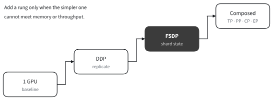
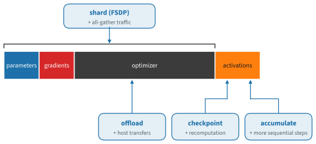

# Distributed Model Training
:label:`sec_training_systems`

The multi-GPU sections of :numref:`chap_performance` trained a ResNet and a
GPT on the four GPUs of one machine by giving every GPU a copy of the
model, and worked out how splitting the training state among the GPUs
makes room for a model that no single GPU holds. Models that people
fine-tune for real work are often larger still. A language model with 7
billion parameters, trained with Adam, needs about 112 GB for its weights,
gradients, and optimizer state before it stores a single activation. That
is more than the 80 GB of an H100, and training such a model from scratch
on one GPU would take years.

How do we spread the state and the work of one training run over many
accelerators, possibly in many machines, so that it computes the same
result in less time? Every answer partitions something: the batch, the
training state, the layers, or the sequence. Each partition adds
communication, and every added worker is one more place where the run can
fail. We therefore start from a measured single-device baseline and add
the simplest technique that removes an observed memory or throughput
limit. We order the techniques by the limit each removes, map them to the
libraries that implement them as of November 2026, and end with the
practices that keep a run of several weeks alive.

## Forms of Parallelism

### The Scaling Ladder

Each technique below removes a limit of the one before it and adds
communication, so we adopt them in order, the rungs of a *scaling ladder*
(:numref:`fig_tools_training_ladder`).


:label:`fig_tools_training_ladder`

1. **One accelerator** establishes the reference: loss curve, tokens or
   examples per second, peak memory, and a checkpoint you can trust.
1. **Data parallelism (DDP)** replicates the model on every GPU, feeds each
   a different slice of the batch, and averages gradients after every
   backward pass. It is the right choice whenever model, gradients, and
   optimizer state fit on one device.
1. **Fully sharded data parallelism (FSDP)**, stage 3 of the ZeRO family,
   shards parameters, gradients, and optimizer state across GPUs and
   gathers each layer only while it is being used
   (:numref:`subsec_mgp-fsdp`). It divides the per-device state memory by
   the number of GPUs and communicates about 1.5 times as much as DDP.
1. **Tensor, pipeline, context, and expert parallelism** split individual
   layers, groups of consecutive layers, the sequence dimension, and the
   experts of a mixture of experts (:numref:`sec_moe`), respectively.
   Large systems compose several of these, because no single axis scales
   far enough on its own.

In PyTorch, DDP and FSDP need a launcher and a wrapper:

```bash
torchrun --standalone --nproc-per-node=4 train.py
```

Inside `train.py`, `DistributedDataParallel(model)` applies DDP and
`fully_shard(model)` from `torch.distributed.fsdp` applies FSDP. This
API, known as FSDP2, stores each sharded parameter as a `DTensor`, and
PyTorch recommends it over the older `FullyShardedDataParallel` wrapper.
In JAX, arrays
carry a `NamedSharding` over a mesh of devices, and `jax.jit` compiles the
collectives that these placements imply
(:numref:`sec_multi_gpu_concise`).

Tensor parallelism exchanges activations inside every layer, while
pipeline parallelism sends activations only at stage boundaries. In the
Hugging Face *Ultra-Scale Playbook*, based on more than 4,000 runs on up
to 512 GPUs, stretching tensor parallelism from one 8-GPU node to two
typically cost about 43% of throughput, while stretching pipeline
parallelism the same way cost 14% when each step had few microbatches. Keep tensor parallelism inside a node,
where NVLink carries its traffic, and map the highest-volume collectives
to the fastest links.

One identity holds on every rung. The batch size that the optimizer sees is

$$
B_{\textrm{global}} = B_{\textrm{device}} \cdot N_{\textrm{ranks}} \cdot N_{\textrm{accumulation}},
$$
:eqlabel:`eq_global_batch`

the per-device batch times the number of data-parallel ranks times the
number of microbatches accumulated per optimizer step. Changing the number
of GPUs without adjusting the per-device batch size or the learning rate
therefore changes the optimization problem. Two further rules concern the
data: distributed samplers must not duplicate examples, and evaluation must
aggregate metrics with the right denominators. Violating either is the
usual reason a multi-GPU run reports a different accuracy.

### Training Memory

Most jobs outgrow one GPU because the training state does not fit, so the
first calculation is a memory budget (:numref:`fig_tools_training_memory`).


:label:`fig_tools_training_memory`

Peak training memory is the sum of parameters, gradients, optimizer state,
activations, communication buffers, and allocator overhead. For a model
with 7 billion parameters trained in BF16 with Adam, the parameters and
gradients take 14 GB each and Adam's two FP32 moments take 56 GB. The FP32
master copy of the parameters that mixed-precision training keeps adds
28 GB, for a total of 112 GB, or 16 bytes per parameter. The toy model
below leaves out the master copy, reuses the GB figures as GiB, and adds
18 GiB of activations and 5 GiB of temporary buffers. It is crude, but it
ranks the strategies correctly, and it needs no GPU to run:

```{.python .input #training-systems-memory-model}
terms_gib = {"parameters": 14.0, "gradients": 14.0, "optimizer": 56.0,
             "activations": 18.0, "temporary": 5.0}

def per_device_gib(world_size=1, shard_state=False, ckpt_activations=False):
    divisor = world_size if shard_state else 1
    state = sum(terms_gib[k] / divisor
                for k in ("parameters", "gradients", "optimizer"))
    activations = terms_gib["activations"] * (0.35 if ckpt_activations else 1)
    return state + activations + terms_gib["temporary"]

for label, cfg in [("1 GPU, plain", (1, False, False)),
                   ("8 GPU DDP + ckpt", (8, False, True)),
                   ("8 GPU FSDP + ckpt", (8, True, True))]:
    print(f"{label:>20s}: {per_device_gib(*cfg):6.1f} GiB/device")
```

Plain training needs 107 GiB, more than an 80 GB H100 holds. DDP with
activation checkpointing still needs 95 GiB on every GPU: it replicates
the 84 GiB of state, and only the activations shrink. FSDP with
checkpointing on eight GPUs divides the state by eight and needs 22 GiB
per device.

Each standard memory technique changes a different term of the sum at a
different cost. **Mixed precision** reduces the bytes used by
selected tensors and operations. **Gradient accumulation** runs a smaller
microbatch per step while keeping the global batch of
:eqref:`eq_global_batch`, which reduces activation memory but not model
state. **Activation checkpointing** recomputes selected activations during
backpropagation; its memory savings and compute overhead depend on which
activations it keeps. **CPU or NVMe offload**, such as DeepSpeed's
ZeRO-Offload, moves state out of device memory and adds host-device
transfers to every step.
**LoRA and QLoRA** train small low-rank adapters instead of all weights,
which removes most gradients and optimizer state; QLoRA also stores the
frozen weights in 4 bits, so a 7B model can be fine-tuned on one 16 GB
card. Combine techniques deliberately: individually sensible optimizations
can interfere with compilation, overlap, or numerics.

## Software Libraries

Beyond one node, few people write these techniques by hand. Libraries
implement them, and the choice among them follows mostly from the scale of
the job. The projects below were maintained and widely used as of November
2026; this layer changes quickly, so check a project's recent releases
before adopting it.

**PyTorch built-ins.** Besides DDP and FSDP2, PyTorch has tensor- and
context-parallel APIs built on `DTensor` and a pipeline-parallel API,
`torch.distributed.pipelining`. Its documentation still marks them as
experimental or alpha. Most higher-level
tools below generate calls to these primitives.

**Hugging Face stack.** `accelerate` launches the same script on DDP,
FSDP2, or DeepSpeed, selected by a configuration file rather than by code
changes; `transformers.Trainer` sits on top of it; `peft` implements LoRA
and QLoRA; and `trl` provides trainers for supervised fine-tuning, DPO, and
GRPO-style reinforcement learning. This stack covers most fine-tuning jobs
on one node or a small cluster.

**DeepSpeed.** ZeRO stages 1–3 (sharding the optimizer state, then the
gradients, then the parameters) plus CPU and NVMe offload. ZeRO introduced
the sharding that FSDP2 now provides natively, and FSDP2 can also offload
state to CPU memory. DeepSpeed remains the usual choice when a job offloads
to NVMe or when another framework builds on it.

**Megatron Core and TorchTitan.** Libraries for large-scale pretraining.
NVIDIA's Megatron Core implements tensor, pipeline, context, and expert
parallelism with FP8 and FP4 training; Megatron-LM is its reference
training stack. TorchTitan is the PyTorch-native counterpart: a compact
reference stack that composes FSDP2 with tensor, pipeline, context, and
expert parallelism, with model definitions that include Llama 3 405B and
DeepSeek-V3 and published measurements on up to 512 GPUs. Both suit
models that need several forms of parallelism at once.

**Fine-tuning front ends.** Unsloth began with fast single-GPU LoRA and
QLoRA through fused kernels and now also covers full fine-tuning, GRPO,
and multiple GPUs; its gains depend on model, sequence length, and
hardware. Axolotl drives full and parameter-efficient fine-tunes on one or
several nodes from one YAML file, with FSDP2 and DeepSpeed backends.
LLaMA-Factory covers a similar range with a web interface. The PyTorch
team's `torchtune` stopped active development in 2025.

**JAX.** MaxText is the reference stack for pretraining and post-training
on TPUs and GPUs. Marin, which trains with Levanter, records its training
runs from raw data to the final model, failed experiments included, and
publishes the code, data pipelines, and logs so that others can reproduce
them.

**Reinforcement-learning post-training.** veRL combines FSDP, FSDP2, or
Megatron training with vLLM or SGLang for generating rollouts. OpenRLHF
builds on Ray, DeepSpeed, and vLLM.

### Tools by Scale

:Training tools by scale (as of November 2026)
:label:`tab_training_tools`

| Scale | Typical job | Reach for |
|---|---|---|
| 1 GPU, ≥ 8 GB | LoRA/QLoRA fine-tune ≤ 8B | Unsloth, or PEFT + Trainer |
| 1 node, 2–8 GPUs | full fine-tune up to ~30B, DDP/FSDP2 | Accelerate or Axolotl |
| few nodes | large fine-tune, small pretrain | FSDP2 + torchrun, DeepSpeed |
| many nodes | large-scale pretraining, MoE | Megatron Core, TorchTitan, MaxText |
| RL post-training | GRPO/DPO pipelines | TRL (small), veRL/OpenRLHF (large) |

The model sizes follow from the 16 bytes per parameter of a full
fine-tune: eight 80 GB GPUs hold the state of about 30B parameters with
room for activations. Use the simplest row that meets the measured
constraints, since rows lower in the table need more configuration.

## Fault Tolerance in Long Runs
:label:`subsec_training_long_run`

A run that crashes on day ten and cannot resume has produced nothing. As
the number of workers and the duration of a job grow, failures of
hardware, network, and software become routine, so recovery has to be
designed and tested like the rest of training.

* **Checkpoint completely and atomically.** A resumable checkpoint holds
  model and optimizer state, the learning-rate schedule and step count,
  data-loader position, and RNG state. Write to a temporary path and
  rename on completion, so that a crash of the training process mid-write
  cannot destroy the previous checkpoint; keep more than one until
  restore has been tested. Sharded (per-rank) checkpoints avoid
  gathering a model larger than any single host's memory.
* **Drill the recovery.** Kill the job deliberately, restore on fresh
  workers, and check that loss, step count, and data position continue as
  if nothing happened. Test recovery before relying on spot-priced
  instances (:numref:`sec_cloud_instances`), whose savings depend on
  resuming after every interruption.
* **Keep the accelerators supplied with data.** Profile data loading
  separately from compute: storage reads, decoding and augmentation,
  tokenization, and host-to-device transfer. A GPU that waits for input
  delivers low throughput, and adding GPUs to a data-bound job increases
  contention without increasing speed.
* **Monitor convergence as well as speed.** A high token rate says nothing
  about the loss. Log both, plus the time spent in collectives and in
  checkpointing. Debug distributed failures by
  reproducing them on one process, then on one node, then on many, with
  rank and host on every log line.

These practices make a run restartable, but every checkpoint and restart
still costs time; the exercises work out how that cost sets the best
checkpoint interval for a given failure rate.

## Summary

* Distributed training partitions the batch, the training state, the
  layers, or the sequence. Starting from a measured single-GPU baseline,
  use DDP while the state fits, FSDP or ZeRO when it does not, and tensor,
  pipeline, context, or expert parallelism only when model scale requires
  them. Keep tensor parallelism inside a node.
* Peak memory is a sum of terms. Sharding, activation checkpointing,
  gradient accumulation, offload, and LoRA each reduce one term at a known
  cost in communication, computation, or transfer time.
* As of November 2026, typical choices are Unsloth or PEFT on one GPU,
  Accelerate or Axolotl with FSDP2 on a node, Megatron Core, TorchTitan, or
  MaxText for pretraining, and TRL or veRL for reinforcement-learning
  post-training.
* Long runs complete when checkpoints are atomic and complete, recovery has
  been tested, the input pipeline keeps up, and convergence is logged
  alongside throughput.

## Exercises

1. **Global batch size.** A pretraining job uses sequences of 4,096
   tokens and a global batch of $2^{22} \approx 4.2$ million tokens, that
   is, 1,024 sequences per optimizer step. Each GPU holds at most 4
   sequences per microbatch.
    1. For $N_{\textrm{ranks}} \in \{32, 64, 128, 256\}$, choose
       $B_{\textrm{device}}$ and $N_{\textrm{accumulation}}$ in
       :eqref:`eq_global_batch` so that the global batch stays at 1,024
       sequences with as few accumulation steps as possible. What is the
       largest world size that can train with this global batch under data
       parallelism alone?
    1. Let a microbatch of 4 sequences take time $t_{\textrm{mb}}$, and let
       the gradient all-reduce at the end of each optimizer step take time
       $t_{\textrm{ar}}$, without overlap. Write the time per optimizer step
       and the tokens per second per GPU as functions of
       $N_{\textrm{ranks}}$. For $t_{\textrm{ar}} = 2t_{\textrm{mb}}$, by
       what factor does the time to train on a fixed number of tokens
       shrink when the world size doubles from 32 to 64, and from 128 to
       256? What limits the speedup as the world size grows?
    1. A colleague moves the job from 64 to 128 GPUs and keeps
       $B_{\textrm{device}}$ and $N_{\textrm{accumulation}}$. How do the
       global batch and the number of optimizer steps for a fixed number of
       tokens change? For adaptive methods such as Adam,
       :numref:`sec_batch_size` scales the learning rate with the square
       root of the batch, $\eta(b) = \sqrt{b/b_0}\,\eta_0$, where $\eta_0$
       is tuned at batch size $b_0$. Which learning rate does this rule
       suggest if the larger batch is kept, and what happens to a warmup
       that is specified in steps?
   :exlabel:`ex_training-systems-global-batch`

1. [code] **Padded evaluation shards.** An evaluation set of 10,001
   examples is evaluated on 8 ranks, and rank $r$ iterates over
   `DistributedSampler(dataset, num_replicas=8, rank=r, shuffle=False)`.
   Because `num_replicas` and `rank` are passed explicitly, one process can
   construct the samplers of all ranks without starting a process group.
    1. Collect the indices of all 8 samplers for
       `dataset = list(range(10001))`. How many indices are there, which
       examples occur twice, and by how many percentage points can the
       duplicates shift the measured accuracy at most?
    1. Repeat with `drop_last=True`. Which examples are never evaluated?
    1. Write an exact evaluation in which the ranks partition the 10,001
       examples without padding, each rank counts its correct predictions
       and its examples, and the ranks combine the counts with
       `torch.distributed.all_reduce`. Test the reduction in one process by
       simulating the 8 ranks with random predictions and replacing the
       all-reduce by a sum over the ranks. Why is the mean of the 8
       per-rank accuracies not exact for these shards?
   :exlabel:`ex_training-systems-padded-evaluation`

1. [code] **Resume parity.** A resumed run is correct when it computes the
   same parameters as an uninterrupted one. Build a small experiment on the
   CPU: a two-layer MLP with dropout, trained on 1,024 random examples with
   20 features by Adam with a `LambdaLR` warmup schedule. The examples come
   from a `DataLoader` with batch size 32 and `shuffle=True`, whose
   shuffling is seeded per epoch by its own `torch.Generator`.
    1. Train for 64 steps without interruption. In a second run, train for
       40 steps, save a checkpoint, rebuild the model, optimizer,
       scheduler, and data loader from a different seed, restore the
       checkpoint, and train for the remaining 24 steps. Make the final
       parameters of both runs bitwise identical. Which object of this
       experiment holds each piece of state that
       :numref:`subsec_training_long_run` lists, and how does the restore
       resume the data loader in the middle of an epoch?
    1. Omit each piece of state from the restore in turn, and report the
       largest parameter difference after the 64 steps. Which omissions
       would show in a loss curve, and which would go unnoticed?
    1. Simulate a crash during `torch.save` by writing only the first half
       of a checkpoint's bytes to its final path, and load the file. Then
       write each checkpoint to a temporary file in the same directory and
       move it into place with `os.replace`. Why does the final path hold a
       complete checkpoint, the previous one or the new one, whenever the
       training process crashes during the second procedure? A power loss
       can leave the rename on disk before the file's contents. Which calls
       does the procedure need so that it also survives a power loss?
   :exlabel:`ex_training-systems-resume-parity`

1. **Data-bound scaling.** The CPUs of a node decode and augment 3,000
   images per second, independent of the number of GPUs, and each GPU
   trains on 1,200 images per second when its input is ready.
    1. Predict the throughput and the GPU utilization with 1, 2, 4, and 8
       GPUs. Beyond which number of GPUs does adding a GPU leave the
       throughput unchanged?
    1. Decoding takes 80% of the CPU time per image, and storing decoded
       images removes it. Compute the storage that the 1,281,167 training
       images of ImageNet occupy as decoded $256 \times 256$ RGB arrays of
       8-bit integers, and the read bandwidth that 8 GPUs need at 1,200
       images per second each. The node reads from network storage at
       1 GB/s and has 512 GB of host memory. Which resource limits the
       throughput in the first epoch, and which in later epochs? Which part
       of the input pipeline must still run in every epoch?
   :exlabel:`ex_training-systems-data-bound`

1. **Optimizer offload.** ● ZeRO-Offload
   :cite:`Ren.Rajbhandari.Aminabadi.ea.2021` keeps 16-bit parameters on
   the GPU for the forward and backward passes, and keeps FP32 master
   parameters and Adam's two moments in host memory, where the CPU performs
   the update. Each step sends the 16-bit gradients to the host and the
   updated 16-bit parameters back. The paper uses FP16, which has the same
   size as BF16. Consider a 7B model on one GPU that
   sustains 400 TFLOP/s, connected over PCIe at 50 GB/s in each direction
   to a host whose memory delivers 200 GB/s.
    1. Compute the time per step of the two transfers, run one after the
       other.
    1. The update on the CPU is limited by memory traffic. Count the bytes
       per parameter that an Adam update reads and writes in this layout,
       and estimate the time of the update.
    1. A forward and backward pass costs about $6N$ FLOPs per token for a
       model with $N$ parameters (:numref:`sec_scaling-laws`). How many
       tokens must a step contain so that the transfers and the update
       take less than 20% of the step time when nothing overlaps?
    1. The one-step delayed parameter update of ZeRO-Offload computes the
       update from the gradients of step $k$ on the CPU while the GPU runs
       the forward and backward passes of step $k + 1$ with the parameters
       that the gradients of step $k - 1$ produced. Under which condition
       does the update then cost no time? What does the delay change about
       the optimization?
   :exlabel:`ex_training-systems-optimizer-offload`

1. **Failures at scale.** ● In a synchronous job, one failed GPU stops all
   ranks, and the job restarts from its newest checkpoint. Let failures
   arrive at random with mean time $M$ between them, and let a blocking
   checkpoint take time $\delta$. The first-order analysis of
   :citet:`Young.1974`, which problem
   :exref:`ex_hosted-notebooks-checkpoint-interval`a of
   :numref:`sec_hosted_notebooks` derives, gives the checkpoint interval and
   the fraction of time lost to checkpoints and recomputation as

   $$\tau^* = \sqrt{2 \delta M}, \qquad f^* = \sqrt{2 \delta / M}.$$

   :citet:`Grattafiori.Dubey.Jauhri.ea.2024` report 419 unexpected
   interruptions during a 54-day period of pretraining Llama 3 405B on 16K
   GPUs.
    1. Compute $M$ for this job, and $\tau^*$ and $f^*$ for
       $\delta = 5$ min and for $\delta = 30$ s. Ignoring restart time,
       which values of $\delta$ are compatible with the effective training
       time above 90% that the report states?
    1. Suppose that every GPU fails independently at the same rate. How do
       $M$, $\tau^*$, and $f^*$ scale with the number of GPUs $N$? Evaluate
       them for the same hardware at 1,024 GPUs and $\delta = 30$ s.
    1. Each restart costs a further time $R$ for rescheduling, loading the
       checkpoint, and warming up. Add this cost to $f^*$. At 16K GPUs with
       $\delta = 30$ s and $R = 10$ min, which of the two costs is larger?
    1. A checkpoint of this model holds 14 bytes per parameter: the BF16
       parameters, FP32 master parameters, and two FP32 moments. Which
       aggregate write bandwidth over all ranks does $\delta = 30$ s
       require? Asynchronous checkpointing copies the state to host memory
       and writes it to storage in the background. Which duration takes the
       place of $\delta$ in the formulas, and what new constraint on
       $\tau$ appears?
   :exlabel:`ex_training-systems-failures-at-scale`

1. **Resumption on fewer workers.** ● A job trains with FSDP on 64 ranks with
   $B_{\textrm{device}} = 4$ sequences and $N_{\textrm{accumulation}} = 4$,
   writes sharded checkpoints, and must resume on 48 ranks after losing two
   nodes.
    1. Sort the contents of a resumable checkpoint, as listed in
       :numref:`subsec_training_long_run`, into state that is the same on
       every rank and state that differs between ranks. For each per-rank
       item, state what the restore must do when the number of ranks
       changes.
    1. Show that no choice of $B_{\textrm{device}}$ and
       $N_{\textrm{accumulation}}$ on 48 ranks reproduces the global batch
       of 1,024 sequences. Compare two remedies, a different global batch
       and unequal microbatches across the ranks, by what each changes
       about the optimization and what each requires of the loss
       normalization.
    1. Design a data order for which the resumed run sees every remaining
       example of the epoch exactly once, for any number of ranks. Why is it
       insufficient to store each rank's position in its own shard?
   :exlabel:`ex_training-systems-elastic-resume`

1. [extended] **Pipeline schedules.** ●● A pipeline of $p$ stages trains on
   $m$ microbatches per optimizer step. The forward pass of one microbatch
   through one stage takes time $t_f$, and its backward pass takes
   $t_b = 2t_f$. A stage can run the forward pass of microbatch $j$ once the
   previous stage has finished it, and the backward pass of $j$ once the
   next stage has finished its backward pass of $j$. A stage holds the
   activations of $j$ from its forward pass until its backward pass. GPipe
   :cite:`Huang.Cheng.Bapna.ea.2019` runs all forward passes before all
   backward passes, while the 1F1B schedule of
   :citet:`Narayanan.Shoeybi.Casper.ea.2021` runs a few warm-up forward
   passes and then alternates one forward and one backward pass. The
   bubble fraction of a schedule is its step time minus the ideal time
   $m(t_f + t_b)$, divided by the ideal time.
    1. Write a simulator that takes the order of the operations on each
       stage, runs each operation as soon as its stage is free and its
       inputs are ready, and returns the step time and, for each stage, the
       largest number of microbatches whose activations it holds at once.
    1. Generate GPipe and 1F1B orders for any $p$ and $m$, deriving the
       number of warm-up forward passes that each stage of 1F1B needs. Run
       them for $p \in \{2, 4, 8\}$ and $m \in \{1, 4, 8, 32\}$. From the
       results, derive the bubble fraction and the activation memory of
       each schedule as functions of $p$ and $m$.
    1. In the interleaved assignment of
       :citet:`Narayanan.Shoeybi.Casper.ea.2021`, each device holds $v$
       nonconsecutive chunks of layers. A microbatch then passes through
       $pv$ stages and visits every device $v$ times, each at $1/v$ of the
       cost. Simulate it for $v \in \{1, 2, 4\}$ with all forward passes
       first. How do the bubble fraction and the number of point-to-point
       transfers per step depend on $v$?
    1. With data parallelism of degree $d$ around the pipeline and
       microbatches of $b$ sequences, the global batch of 1,024 sequences of
       exercise :exref:`ex_training-systems-global-batch` gives
       $m = 1024/(db)$. For $p = 8$ and $b = 1$, compute the bubble
       fraction of 1F1B at $d = 8$, 16, and 64. What limits the
       data-parallel degree of a pipelined job at a fixed global batch?
   :exlabel:`ex_training-systems-pipeline-schedules`

[Discussions](https://d2l.discourse.group/t/36846)
