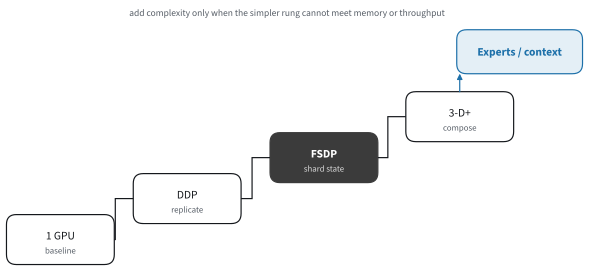
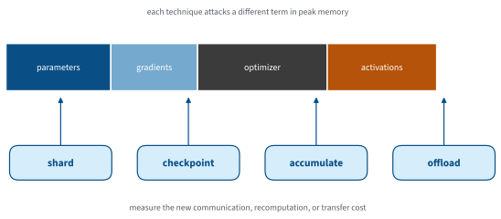

# Distributed Model Training
:label:`sec_training_systems`

Most examples in this book train on one device. Larger workloads may require
several devices because model state does not fit on one accelerator or
because a single-device run would take too long. This section introduces the
main forms of parallelism, the software layers available in mid-2026, and the
scale at which each becomes relevant. Distributed training partitions or
replicates state and work, adds communication, and complicates recovery.
Begin with a measured single-device baseline, then add the simplest technique
that removes an observed memory or throughput constraint.

## From One GPU to Many

### The Scaling Ladder


:label:`fig_tools_training_ladder`

1. **One accelerator** establishes the reference: loss curve, tokens or
   examples per second, peak memory, and a checkpoint you can trust.
1. **Data parallelism (DDP)** replicates the model on every GPU, feeds each
   a different slice of the batch, and averages gradients after every
   backward pass. It is the entry point whenever model, gradients, and
   optimizer state fit on one device.
1. **Fully sharded data parallelism (FSDP)** shards parameters, gradients,
   and optimizer state across GPUs and gathers each layer only while it is
   being used. It is related to DeepSpeed's ZeRO stage 3 and can reduce per-device state
   memory approximately in proportion to world size, while adding all-gather
   traffic.
1. **Tensor, pipeline, context, and expert parallelism** split individual
   layers, layer groups, the sequence dimension, and mixture-of-experts
   experts, respectively. Large systems compose several of these because no
   single axis suffices at scale.

In PyTorch, the first two rungs are a launcher and a wrapper:

```bash
torchrun --standalone --nproc-per-node=4 train.py
```

Inside `train.py`, DDP wraps the model
(`DistributedDataParallel(model)`), while FSDP's current API applies
`fully_shard(model)` — the rewritten "FSDP2", which shards each parameter
as a `DTensor` and has displaced the original FSDP wrapper in PyTorch's
documentation and in downstream libraries. JAX expresses the same ideas
through sharded arrays and named meshes: `jax.jit` with sharding
specifications compiles the collectives for you, which is why the JAX code
in this book has barely mentioned devices at all.

One bookkeeping identity matters on every rung. The batch size that
optimization sees is

$$
B_{\textrm{global}} = B_{\textrm{device}} \cdot N_{\textrm{ranks}} \cdot N_{\textrm{accumulation}},
$$
:eqlabel:`eq_global_batch`

so changing the number of GPUs without adjusting per-device batch size or
learning rate silently changes the optimization problem. Distributed
samplers must not duplicate examples, and evaluation must aggregate
metrics with the right denominators — the two classic sources of
"multi-GPU accuracy is different" bugs.

### Where the Memory Goes


:label:`fig_tools_training_memory`

Peak training memory is the sum of parameters, gradients, optimizer state,
activations, communication buffers, and allocator overhead — for a 7B-
parameter model trained in BF16 with Adam, roughly 14 + 14 + 56 GB of
parameters, gradients, and Adam moments before a single activation is
stored, and 28 GB more for the FP32 master parameters that mixed-precision
training usually keeps. The toy model below leaves out the master copy and
reuses the GB figures as GiB. It is crude but sorts strategies correctly,
and needs no GPU to run:

```{.python .input #training-systems-memory-model}
terms_gib = {"parameters": 14.0, "gradients": 14.0, "optimizer": 56.0,
             "activations": 18.0, "temporary": 5.0}

def per_device_gib(world_size=1, shard_state=False, ckpt_activations=False):
    divisor = world_size if shard_state else 1
    state = sum(terms_gib[k] / divisor
                for k in ("parameters", "gradients", "optimizer"))
    activations = terms_gib["activations"] * (0.35 if ckpt_activations else 1)
    return state + activations + terms_gib["temporary"]

for label, cfg in [("1 GPU, plain", (1, False, False)),
                   ("8 GPU DDP + ckpt", (8, False, True)),
                   ("8 GPU FSDP + ckpt", (8, True, True))]:
    print(f"{label:>20s}: {per_device_gib(*cfg):6.1f} GiB/device")
```

Plain training does not fit any single GPU; DDP does not help, because it
replicates state; FSDP brings the same model under 25 GiB per device. Each
standard memory technique changes a different term and introduces a
different cost. **Mixed precision** reduces the bytes used by selected tensors
and operations. **Gradient accumulation** permits a smaller per-step
microbatch while preserving a larger effective batch, reducing activation
memory but not model state. **Activation checkpointing** recomputes selected
activations during backpropagation; its memory savings and compute overhead
depend on the partition. **CPU/NVMe offload** (including DeepSpeed's
ZeRO-Offload) exchanges host-device transfer time for device capacity. **LoRA and
QLoRA** reduce trainable parameters and optimizer state; with compatible
quantization and sequence settings, a 7B fine-tune can fit on a 16 GB card.
Combine techniques deliberately: four
individually sensible optimizations can interfere with compilation,
overlap, or numerics.

Two topology guidelines from the Hugging Face *Ultra-Scale Playbook*, based
on more than 4,000 runs on up to 512 GPUs, summarize its measurements: keep
tensor parallelism *inside* a node, where NVLink can carry
its dense traffic — letting TP cross nodes loses several times as much
throughput as letting pipeline parallelism cross — and map the
highest-volume collectives to the fastest links available.

## The Library Landscape

As of mid-2026, the software ecosystem can be organized into several
layers. These assignments are dated because APIs and project activity change
quickly.

**PyTorch built-ins.** `torchrun` + DDP for replication; `fully_shard`
(FSDP2) for sharding; `DTensor` underneath as the common abstraction for
sharded tensors; tensor-, context-, and pipeline-parallel APIs exist but
are still marked experimental. These primitives are what most higher-level
tools now generate.

**Hugging Face stack.** `accelerate` launches the same script on DDP,
FSDP2, or DeepSpeed with a config file rather than code changes;
`transformers.Trainer` sits on top of it; `peft` implements LoRA/QLoRA;
and `trl` provides supervised fine-tuning, DPO, and GRPO-family
reinforcement-learning trainers. DeepSeek-R1-Zero demonstrated that
reinforcement learning alone could elicit some reasoning behaviors, while
the released DeepSeek-R1 training pipeline also included supervised stages.
This stack supports many fine-tuning jobs on one node or a small cluster.

**DeepSpeed.** ZeRO stages 1–3 (optimizer, gradient, parameter sharding)
plus CPU/NVMe offload. It introduced sharding techniques related to those in FSDP and remains
maintained. FSDP2 provides a native PyTorch alternative. DeepSpeed remains
relevant when CPU or NVMe offload is required, or when another framework
depends on it.

**Megatron-Core and TorchTitan.** Frameworks for large-scale pretraining. NVIDIA's
Megatron-Core implements tensor/pipeline/sequence/expert parallelism with
FP8 support and powers many industrial labs (and NVIDIA's own NeMo
framework and Nemotron models). TorchTitan is the PyTorch-native
equivalent: a clean reference stack composing FSDP, tensor, pipeline, and
context parallelism plus expert parallelism for MoE, demonstrated at
1,000-GPU scale on models from Llama 3 405B to DeepSeek-V3. These systems
expose many configuration choices and are most appropriate when
model scale requires several forms of parallelism.

**Fine-tuning frontends.** Unsloth targets single-GPU LoRA and QLoRA with
fused kernels and quantized training; its speed and memory gains depend on
model, sequence length, and hardware. Axolotl drives full and parameter-efficient
fine-tunes across a node or several from one YAML file, with FSDP2 and
DeepSpeed backends. LLaMA-Factory covers a similar space with a GUI and
very broad model support. (Its former peer `torchtune` wound down in 2025
— check a library's pulse before adopting it; this landscape churns.)

**JAX.** MaxText is the reference for TPU (and GPU) pretraining and now
post-training; Levanter/Marin demonstrated fully reproducible open
pretraining. On TPUs, XLA compiles array-sharding specifications into communication
operations. This moves some parallelism decisions from framework wrappers
into array layouts and compiler configuration.

**RL post-training at scale.** veRL combines FSDP or Megatron training with
vLLM or SGLang rollouts; OpenRLHF provides a Ray and DeepSpeed alternative.
Project adoption and APIs in this area change rapidly, so verify current
documentation before selecting a stack.

### What to Use at Which Scale

:Training tools by scale (mid-2026)
:label:`tab_training_tools`

| Scale | Typical job | Reach for |
|---|---|---|
| 1 GPU, ≥ 8 GB | LoRA/QLoRA fine-tune ≤ 8B | Unsloth, or PEFT + Trainer |
| 1 node, 2–8 GPUs | full fine-tune ≤ 70B, DDP/FSDP2 | Accelerate or Axolotl |
| few nodes | large fine-tune, small pretrain | FSDP2 + torchrun, DeepSpeed |
| many nodes | serious pretraining, MoE | Megatron-Core, TorchTitan, MaxText |
| RL post-training | GRPO/DPO pipelines | TRL (small), veRL/OpenRLHF (large) |

The table is a starting point rather than a prescription. Tools lower in the
table support more forms of parallelism but require more configuration. Use
the least complex row that satisfies the measured constraints.

## Keeping a Long Run Alive
:label:`subsec_training_long_run`

Throughput alone does not complete a long run. As worker count and duration
increase, hardware, network, and software failures become more likely, so
recovery must be designed and tested.

* **Checkpoint completely and atomically.** A resumable checkpoint holds
  model and optimizer state, the learning-rate schedule and step count,
  data-loader position, and RNG state. Write to a temporary path and
  rename on completion, so a crash of the training process mid-write
  cannot destroy the previous checkpoint; keep more than one until
  restore has been tested. Sharded (per-rank) checkpoints avoid
  gathering a model larger than any single host's memory.
* **Drill the recovery.** Kill the job deliberately, restore on fresh
  workers, and check that loss, step count, and data position continue as
  if nothing happened. Test recovery before relying on spot-priced training
  (:numref:`sec_cloud_instances`), whose savings depend on successful
  resumption after interruption.
* **Feed the accelerators.** Profile data loading separately from compute:
  storage reads, decoding and augmentation, tokenization, and host-to-
  device transfer. A starved GPU spends time waiting for input and delivers low throughput;
  adding more GPUs can increase contention without improving a data-bound
  job.
* **Watch convergence, not just speed.** Tokens per second without a loss
  curve rewards fast wrong runs. Log both, plus time spent in collectives
  and checkpoint duration; debug distributed failures by reproducing on
  one process, then one node, then many, with rank and host on every log
  line.

## Summary

* Scale in order — DDP while state fits, FSDP2/ZeRO when it does not,
  tensor, pipeline, or expert parallelism only when model scale requires it — from a
  measured single-GPU baseline.
* Peak memory is a sum of terms; each technique (sharding, checkpointing,
  accumulation, offload, LoRA) removes one term at a known price.
* The mid-2026 examples are Unsloth or PEFT on one GPU, Accelerate or Axolotl
  with FSDP2 on a node, Megatron-Core, TorchTitan, or MaxText for pretraining,
  and TRL or veRL for RL post-training; verify current project status.
* Keep tensor parallelism inside a node; map heavy collectives to fast
  links.
* Long runs survive on atomic checkpoints, tested recovery, a fed input
  pipeline, and convergence metrics — and explicit convergence monitoring.

## Exercises

1. **Global batch bookkeeping.** A pretraining job uses sequences of 4,096
   tokens and a global batch of $2^{22} \approx 4.2$ million tokens, that
   is, 1,024 sequences per optimizer step. Each GPU holds at most 4
   sequences per microbatch.
    1. For $N_{\textrm{ranks}} \in \{32, 64, 128, 256\}$, choose
       $B_{\textrm{device}}$ and $N_{\textrm{accumulation}}$ in
       :eqref:`eq_global_batch` so that the global batch stays at 1,024
       sequences with as few accumulation steps as possible. What is the
       largest world size that can train with this global batch under data
       parallelism alone?
    1. Let a microbatch of 4 sequences take time $t_{\textrm{mb}}$, and let
       the gradient all-reduce at the end of each optimizer step take time
       $t_{\textrm{ar}}$, without overlap. Write the time per optimizer step
       and the tokens per second per GPU as functions of
       $N_{\textrm{ranks}}$. For $t_{\textrm{ar}} = 2t_{\textrm{mb}}$, by
       what factor does the time to train on a fixed number of tokens
       shrink when the world size doubles from 32 to 64, and from 128 to
       256? What limits the speedup as the world size grows?
    1. A colleague moves the job from 64 to 128 GPUs and keeps
       $B_{\textrm{device}}$ and $N_{\textrm{accumulation}}$. How do the
       global batch and the number of optimizer steps for a fixed number of
       tokens change? Which learning rate does :eqref:`eq_lr-rules` suggest
       for Adam if the larger batch is kept, and what happens to a warmup
       that is specified in steps?
   :exlabel:`ex_training-systems-global-batch`

1. [code] **Padded evaluation shards.** An evaluation set of 10,001
   examples is evaluated on 8 ranks, and rank $r$ iterates over
   `DistributedSampler(dataset, num_replicas=8, rank=r, shuffle=False)`.
   Because `num_replicas` and `rank` are passed explicitly, one process can
   construct the samplers of all ranks without starting a process group.
    1. Collect the indices of all 8 samplers for
       `dataset = list(range(10001))`. How many indices are there, which
       examples occur twice, and by how many percentage points can the
       duplicates shift the measured accuracy at most?
    1. Repeat with `drop_last=True`. Which examples are never evaluated?
    1. Write an exact evaluation in which the ranks partition the 10,001
       examples without padding, each rank counts its correct predictions
       and its examples, and the ranks combine the counts with
       `torch.distributed.all_reduce`. Test the reduction in one process by
       simulating the 8 ranks with random predictions and replacing the
       all-reduce by a sum over the ranks. Why is the mean of the 8
       per-rank accuracies not exact for these shards?
   :exlabel:`ex_training-systems-padded-evaluation`

1. [code] **Resume parity.** A resumed run is correct when it computes the
   same parameters as an uninterrupted one. Build a small experiment on the
   CPU: a two-layer MLP with dropout, trained on 1,024 random examples with
   20 features by Adam with a `LambdaLR` warmup schedule. The examples come
   from a `DataLoader` with batch size 32 and `shuffle=True`, whose
   shuffling is seeded per epoch by its own `torch.Generator`.
    1. Train for 64 steps without interruption. In a second run, train for
       40 steps, save a checkpoint, rebuild the model, optimizer,
       scheduler, and data loader from a different seed, restore the
       checkpoint, and train for the remaining 24 steps. Make the final
       parameters of both runs bitwise identical. Which object of this
       experiment holds each piece of state that
       :numref:`subsec_training_long_run` lists, and how does the restore
       resume the data loader in the middle of an epoch?
    1. Omit each piece of state from the restore in turn, and report the
       largest parameter difference after the 64 steps. Which omissions
       would show in a loss curve, and which would go unnoticed?
    1. Simulate a crash during `torch.save` by writing only the first half
       of a checkpoint's bytes to its final path, and load the file. Then
       write each checkpoint to a temporary file in the same directory and
       move it into place with `os.replace`. Why does the final path hold a
       complete checkpoint, the previous one or the new one, whenever the
       training process crashes during the second procedure? A power loss
       can leave the rename on disk before the file's contents. Which calls
       does the procedure need so that it also survives a power loss?
   :exlabel:`ex_training-systems-resume-parity`

1. **Data-bound scaling.** The CPUs of a node decode and augment 3,000
   images per second, independent of the number of GPUs, and each GPU
   trains on 1,200 images per second when its input is ready.
    1. Predict the throughput and the GPU utilization with 1, 2, 4, and 8
       GPUs. Beyond which number of GPUs does adding a GPU leave the
       throughput unchanged?
    1. Decoding takes 80% of the CPU time per image, and storing decoded
       images removes it. Compute the storage that the 1,281,167 training
       images of ImageNet occupy as decoded $256 \times 256$ RGB arrays of
       8-bit integers, and the read bandwidth that 8 GPUs need at 1,200
       images per second each. The node reads from network storage at
       1 GB/s and has 512 GB of host memory. Which resource limits the
       throughput in the first epoch, and which in later epochs? Which part
       of the input pipeline must still run in every epoch?
   :exlabel:`ex_training-systems-data-bound`

1. **Optimizer offload.** ● ZeRO-Offload
   :cite:`Ren.Rajbhandari.Aminabadi.ea.2021` keeps 16-bit parameters on
   the GPU for the forward and backward passes, and keeps FP32 master
   parameters and Adam's two moments in host memory, where the CPU performs
   the update. Each step sends the 16-bit gradients to the host and the
   updated 16-bit parameters back. The paper uses FP16, which has the same
   size as BF16. Consider a 7B model on one GPU that
   sustains 400 TFLOP/s, connected over PCIe at 50 GB/s in each direction
   to a host whose memory delivers 200 GB/s.
    1. Compute the time per step of the two transfers, run one after the
       other.
    1. The update on the CPU is limited by memory traffic. Count the bytes
       per parameter that an Adam update reads and writes in this layout,
       and estimate the time of the update.
    1. With the cost of :eqref:`eq_six_nd`, how many tokens must a step
       contain so that the transfers and the update take less than 20% of
       the step time when nothing overlaps?
    1. The one-step delayed parameter update of ZeRO-Offload computes the
       update from the gradients of step $k$ on the CPU while the GPU runs
       the forward and backward passes of step $k + 1$ with the parameters
       that the gradients of step $k - 1$ produced. Under which condition
       does the update then cost no time? What does the delay change about
       the optimization?
   :exlabel:`ex_training-systems-optimizer-offload`

1. **Failures at scale.** ● In a synchronous job, one failed GPU stops all
   ranks, and the job restarts from its newest checkpoint. Let failures
   arrive at random with mean time $M$ between them, and let a blocking
   checkpoint take time $\delta$. The first-order analysis of
   :citet:`Young.1974`, which problem
   :exref:`ex_hosted-notebooks-checkpoint-interval`a of
   :numref:`sec_hosted_notebooks` derives, gives the checkpoint interval and
   the fraction of time lost to checkpoints and recomputation as

   $$\tau^* = \sqrt{2 \delta M}, \qquad f^* = \sqrt{2 \delta / M}.$$

   :citet:`Grattafiori.Dubey.Jauhri.ea.2024` report 419 unexpected
   interruptions during a 54-day period of pretraining Llama 3 405B on 16K
   GPUs.
    1. Compute $M$ for this job, and $\tau^*$ and $f^*$ for
       $\delta = 5$ min and for $\delta = 30$ s. Ignoring restart time,
       which values of $\delta$ are compatible with the effective training
       time above 90% that the report states?
    1. Suppose that every GPU fails independently at the same rate. How do
       $M$, $\tau^*$, and $f^*$ scale with the number of GPUs $N$? Evaluate
       them for the same hardware at 1,024 GPUs and $\delta = 30$ s.
    1. Each restart costs a further time $R$ for rescheduling, loading the
       checkpoint, and warming up. Add this cost to $f^*$. At 16K GPUs with
       $\delta = 30$ s and $R = 10$ min, which of the two costs is larger?
    1. A checkpoint of this model holds 14 bytes per parameter: the BF16
       parameters, FP32 master parameters, and two FP32 moments. Which
       aggregate write bandwidth over all ranks does $\delta = 30$ s
       require? Asynchronous checkpointing copies the state to host memory
       and writes it to storage in the background. Which duration takes the
       place of $\delta$ in the formulas, and what new constraint on
       $\tau$ appears?
   :exlabel:`ex_training-systems-failures-at-scale`

1. **Resumption on fewer workers.** ● A job trains with FSDP on 64 ranks with
   $B_{\textrm{device}} = 4$ sequences and $N_{\textrm{accumulation}} = 4$,
   writes sharded checkpoints, and must resume on 48 ranks after losing two
   nodes.
    1. Sort the contents of a resumable checkpoint, as listed in
       :numref:`subsec_training_long_run`, into state that is the same on
       every rank and state that differs between ranks. For each per-rank
       item, state what the restore must do when the number of ranks
       changes.
    1. Show that no choice of $B_{\textrm{device}}$ and
       $N_{\textrm{accumulation}}$ on 48 ranks reproduces the global batch
       of 1,024 sequences. Compare two remedies, a different global batch
       and unequal microbatches across the ranks, by what each changes
       about the optimization and what each requires of the loss
       normalization.
    1. Design a data order for which the resumed run sees every remaining
       example of the epoch exactly once, for any number of ranks. Why is it
       insufficient to store each rank's position in its own shard?
   :exlabel:`ex_training-systems-elastic-resume`

1. [extended] **Pipeline schedules.** ●● A pipeline of $p$ stages trains on
   $m$ microbatches per optimizer step. The forward pass of one microbatch
   through one stage takes time $t_f$, and its backward pass takes
   $t_b = 2t_f$. A stage can run the forward pass of microbatch $j$ once the
   previous stage has finished it, and the backward pass of $j$ once the
   next stage has finished its backward pass of $j$. A stage holds the
   activations of $j$ from its forward pass until its backward pass. GPipe
   :cite:`Huang.Cheng.Bapna.ea.2019` runs all forward passes before all
   backward passes, while the 1F1B schedule of
   :citet:`Narayanan.Shoeybi.Casper.ea.2021` runs a few warm-up forward
   passes and then alternates one forward and one backward pass. The
   bubble fraction of a schedule is its step time minus the ideal time
   $m(t_f + t_b)$, divided by the ideal time.
    1. Write a simulator that takes the order of the operations on each
       stage, runs each operation as soon as its stage is free and its
       inputs are ready, and returns the step time and, for each stage, the
       largest number of microbatches whose activations it holds at once.
    1. Generate GPipe and 1F1B orders for any $p$ and $m$, deriving the
       number of warm-up forward passes that each stage of 1F1B needs. Run
       them for $p \in \{2, 4, 8\}$ and $m \in \{1, 4, 8, 32\}$. From the
       results, derive the bubble fraction and the activation memory of
       each schedule as functions of $p$ and $m$.
    1. In the interleaved assignment of
       :citet:`Narayanan.Shoeybi.Casper.ea.2021`, each device holds $v$
       nonconsecutive chunks of layers. A microbatch then passes through
       $pv$ stages and visits every device $v$ times, each at $1/v$ of the
       cost. Simulate it for $v \in \{1, 2, 4\}$ with all forward passes
       first. How do the bubble fraction and the number of point-to-point
       transfers per step depend on $v$?
    1. With data parallelism of degree $d$ around the pipeline and
       microbatches of $b$ sequences, the global batch of 1,024 sequences of
       exercise :exref:`ex_training-systems-global-batch` gives
       $m = 1024/(db)$. For $p = 8$ and $b = 1$, compute the bubble
       fraction of 1F1B at $d = 8$, 16, and 64. What limits the
       data-parallel degree of a pipelined job at a fixed global batch?
   :exlabel:`ex_training-systems-pipeline-schedules`
