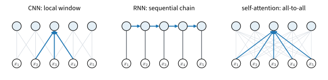
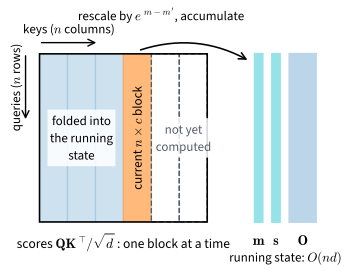

# The Cost of Attention
:label:`sec_attention-at-scale`

Self-attention compares every query with every key, allowing information to
move between any two sequence positions in one layer. For a sequence of $n$
tokens, however, the score matrix has $n^2$ entries. Its arithmetic and memory
costs therefore grow quadratically with sequence length and can dominate
long-context computation.

We first place self-attention next to the convolutional and recurrent layers
of earlier chapters and make the comparison quantitative, then verify the
quadratic cost of one attention layer against the actual allocator of a GPU.
The remainder of the section develops three approaches. Online softmax computes
exact attention without storing the full $n \times n$ matrix and underlies
FlashAttention. Sliding-window attention reduces the number of scored pairs and
uses depth to increase the receptive field. Factorized kernels remove the
softmax dependence between query--key pairs and yield a recurrent form related
to the state space models of :numref:`sec_ssm`.

```{.python .input #attention-at-scale-the-cost-of-attention}
%%tab pytorch
%matplotlib inline
from d2l import torch as d2l
import math
import time
import torch
from torch.nn import functional as F
from torch.nn.attention import SDPBackend, sdpa_kernel
```

```{.python .input #attention-at-scale-the-cost-of-attention}
%%tab jax
%matplotlib inline
from d2l import jax as d2l
import jax
from jax import numpy as jnp
import math
import time
```

## CNNs, RNNs, and Self-Attention

We begin by comparing the computational properties of three sequence layers.
Consider the problem of mapping a
sequence of $n$ tokens, each a $d$-dimensional vector, to another sequence
of the same shape. Three familiar architectures can perform this mapping: a
one-dimensional CNN (:numref:`chap_cnn`), an RNN (:numref:`sec_rnn`), and
self-attention (:numref:`sec_multihead-attention`).
:numref:`fig_cnn-rnn-self-attention` draws all three as graphs over the
sequence. Two properties of these graphs matter beyond raw arithmetic. The
number of *sequential* operations bounds how much of the work can run in
parallel on modern hardware. The *maximum path length* counts how many layer
transformations connect two positions. It is an architectural proxy, not a
learnability theorem: shorter paths avoid repeatedly multiplying recurrent
state Jacobians, but they do not by themselves guarantee that optimization
will recover a long-range dependency.


:label:`fig_cnn-rnn-self-attention`

A convolutional layer with kernel size $k$ and $d$ channels in and out costs
$\mathcal{O}(knd^2)$ operations: each of the $n$ positions mixes $k$
neighbors through a $d \times d$ map. All positions are computed at once, so
there are $\mathcal{O}(1)$ sequential steps, but the receptive field grows
by only $k-1$ positions per layer: connecting a pair of tokens $n$ apart
takes a stack of depth $\mathcal{O}(n/k)$. An RNN requires
$\mathcal{O}(nd^2)$ for the sequence—one $d \times d$ state update per
token—but the updates are inherently ordered: $\mathcal{O}(n)$ sequential
steps, and a signal from the first token reaches the last only through
$\mathcal{O}(n)$ applications of the cell. Self-attention first projects the
inputs at cost $\mathcal{O}(nd^2)$, then computes an $n \times d$ by
$d \times n$ product and an $n \times n$ by $n \times d$ product at cost
$\mathcal{O}(n^2d)$. These matrix multiplications have $\mathcal{O}(1)$
sequential depth, and any token can attend to any other in one layer, giving
path length $\mathcal{O}(1)$.
:numref:`tab_cnn-rnn-attn` collects the accounting.

:Per-layer cost of mapping $n$ tokens of dimension $d$ to $n$ tokens of dimension $d$.
:label:`tab_cnn-rnn-attn`

| layer type | complexity | sequential operations | maximum path length |
|:--|:--|:--|:--|
| convolution (kernel $k$) | $\mathcal{O}(knd^2)$ | $\mathcal{O}(1)$ | $\mathcal{O}(n/k)$ |
| recurrence | $\mathcal{O}(nd^2)$ | $\mathcal{O}(n)$ | $\mathcal{O}(n)$ |
| self-attention | $\mathcal{O}(nd^2+n^2d)$ | $\mathcal{O}(1)$ | $\mathcal{O}(1)$ |

Self-attention has constant sequential depth and path length, but its mixing
term is quadratic in $n$. The table includes the query, key, value, and
output projections so that all three rows count the complete layer. When
$n$ and $d$ are comparable, the linear projection and quadratic mixing terms
have similar order; for $n\gg d$, the mixing term dominates. The remainder
of this section studies ways to reduce its memory use or arithmetic cost.

## Quadratic Time and Memory

### Counting FLOPs

The leading constants make this comparison more precise. One attention layer
receives $n$ queries, keys, and values of dimension $d$ and computes
:eqref:`eq_softmax_QK_V`: the score matrix $\mathbf{Q}\mathbf{K}^\top$
costs $2n^2 d$ floating-point operations (each of the $n^2$ entries is a
length-$d$ dot product, counting one multiply–add as two FLOPs), the softmax
a few operations per entry, $\mathcal{O}(n^2)$, and the value mixing
$\mathrm{softmax}(\cdot)\mathbf{V}$ another $2n^2 d$. In total

$$
\underbrace{4 n^2 d}_{\textrm{scores and mixing}} + \; \mathcal{O}(n^2)
\quad \textrm{FLOPs}.
$$
:eqlabel:`eq_attn-layer-flops`

Recall from :eqref:`eq_multihead-flops` that the projections wrapped around
attention in a multi-head layer cost $8nd^2$, which is linear in $n$, and that the head
count drops out of both terms. Setting $4n^2d = 8nd^2$ locates the
crossover: the quadratic part dominates the layer as soon as $n > 2d$.
Working the ratio for a production-sized configuration, $d = 4096$ and
$n = 131{,}072$ give $n/2d = 16$: an attention layer at that context does
sixteen times as much score-and-mix work as projection work, and the
longest-context configurations sit one to two orders of magnitude past the
crossover.

### Counting Memory
:label:`subsec_attn-counting-memory`

Arithmetic is only one part of the cost, and at inference time memory is
often more important. A naive implementation materializes the score matrix
and its softmax:
two $n \times n$ buffers of activations, $8n^2$ bytes in single precision,
per head and per sequence in the batch; during training the attention
weights are also saved for the backward pass. The projections, by contrast,
keep only $\mathcal{O}(nd)$ activations. To feel the asymmetry: at
$n = 8192$ and a head dimension of $d_h = 64$ — the setting of the
experiments below — the inputs $\mathbf{Q}, \mathbf{K}, \mathbf{V}$
occupy 6 MB together, while the two score buffers occupy 512 MB. At a
context of $n = 131{,}072$ tokens a *single* attention map in fp32 would be
$n^2 \times 4$ bytes $\approx 69$ GB (per head, per sequence), which is why
no system at that scale ever stores one.

:begin_tab:`pytorch`
PyTorch's caching allocator reports exactly what a computation allocated, so
we can hold the formula against reality. `reset_peak_memory_stats` clears
the high-water mark and `max_memory_allocated` reads it back; we measure the
`d2l.DotProductAttention` layer from
:numref:`sec_attention-scoring-functions` on a single head. The prediction
is the two $n \times n$ float buffers, $8n^2$ bytes.
:end_tab:

:begin_tab:`jax`
Measuring per-op memory at runtime is awkward in JAX, for two reasons. XLA
*preallocates* a large fraction of GPU memory as an arena at startup (this
book's runs cap it at 40%), so device-side counters describe the arena, not
the operation. The compiler may also fuse or rematerialize operations, so
the buffers it materializes are determined during compilation rather than
directly by the Python source. The authoritative answer therefore comes from
the compiler itself: lowering a jitted function and compiling it yields a
`memory_analysis()` report of exactly how much temporary buffer space the
executable reserves. We compare it against the two $n \times n$ float
buffers, $8n^2$ bytes.
:end_tab:

```{.python .input #attention-at-scale-counting-memory-1}
%%tab pytorch
attention = d2l.DotProductAttention(dropout=0).to(d2l.try_gpu())
attention.eval()

def peak_memory(f, *args):
    """Extra peak memory allocated by f, in bytes."""
    torch.cuda.synchronize()
    torch.cuda.reset_peak_memory_stats()
    base = torch.cuda.memory_allocated()
    f(*args)
    torch.cuda.synchronize()
    return torch.cuda.max_memory_allocated() - base

d_h = 64
for n in [2048, 4096, 8192, 16384]:
    Q = torch.randn(1, n, d_h, device=d2l.try_gpu())
    with torch.no_grad():
        measured = peak_memory(attention, Q, Q, Q)
    print(f'n = {n:5d}: measured {measured/2**20:7.1f} MiB, '
          f'predicted 8n^2 B = {8*n*n/2**20:7.1f} MiB')
```

```{.python .input #attention-at-scale-counting-memory-1}
%%tab jax
def attention_layer(Q, K, V):
    scores = Q @ K.T / math.sqrt(Q.shape[-1])
    return jax.nn.softmax(scores, axis=-1) @ V

d_h = 64
for n in [2048, 4096, 8192, 16384]:
    Q = jax.random.normal(jax.random.key(0), (n, d_h))
    stats = jax.jit(attention_layer).lower(Q, Q, Q).compile()
    temp = stats.memory_analysis().temp_size_in_bytes
    print(f'n = {n:5d}: XLA temp {temp/2**20:7.1f} MiB, '
          f'predicted 8n^2 B = {8*n*n/2**20:7.1f} MiB')
```

The formula matches the measurement from $n = 4096$ onward, and the XLA
compiler report matches it at every size. The allocator's
smallest run ($n = 2048$) shows a few MiB of workspace overhead on top of
the two score buffers. Doubling $n$ quadruples the footprint. At
$n = 16{,}384$, a single fp32 head already needs 2 GB of temporary storage.
The runtime has the same quadratic dependence. We time the forward pass as $n$ doubles (after a warm-up
call, and synchronizing before reading the clock—on an accelerator, kernel
launches return before the work is done):

```{.python .input #attention-at-scale-counting-memory-2}
%%tab pytorch
def wall_clock(f, *args, reps=10):
    f(*args)  # Warm up
    torch.cuda.synchronize()
    start = time.time()
    for _ in range(reps):
        f(*args)
    torch.cuda.synchronize()
    return (time.time() - start) / reps

for n in [2048, 4096, 8192, 16384]:
    Q = torch.randn(1, n, d_h, device=d2l.try_gpu())
    with torch.no_grad():
        t = wall_clock(attention, Q, Q, Q)
    print(f'n = {n:5d}: {t*1e3:6.2f} ms')
```

```{.python .input #attention-at-scale-counting-memory-2}
%%tab jax
def wall_clock(f, *args, reps=10):
    f(*args).block_until_ready()  # Warm up (and compile)
    start = time.time()
    for _ in range(reps):
        f(*args).block_until_ready()
    return (time.time() - start) / reps

layer = jax.jit(attention_layer)
for n in [2048, 4096, 8192, 16384]:
    Q = jax.random.normal(jax.random.key(0), (n, d_h))
    print(f'n = {n:5d}: {wall_clock(layer, Q, Q, Q)*1e3:6.2f} ms')
```

At small $n$, the timings change little because the GPU is not saturated
and launch overhead dominates. Beyond a few thousand tokens, each doubling
of $n$ roughly quadruples the time, consistent with the $4n^2d$ operation
count.
(Accounting at the level of a whole *model*, including the allocation of
FLOPs among parameters and data, is the subject of the scaling-laws discussion in the
next chapter; here we stay inside one layer.)

## Exact Attention Without the Matrix

### Blockwise Online Softmax

The full $n \times n$ matrix need not be stored. The apparent obstacle to
computing attention piecewise
seems to be the softmax, since each weight
$\exp(a_j)/\sum_{j'}\exp(a_{j'})$ depends on *all* scores of its row
through the normalizer and, for numerical safety, through the row maximum
subtracted before exponentiation. Both quantities
can be maintained *online*, the way one computes a running mean
:cite:`Milakov.Gimelshein.2018`. Process the keys in blocks and keep, per
query, three running statistics: the maximum $m$ seen so far, the sum $s$ of
exponentials rescaled to that maximum, and the output accumulator
$\mathbf{o}$. A new block of scores $\{a_j\}$ with values
$\{\mathbf{v}_j\}$ updates them as

$$
\begin{aligned}
m' &= \max\big(m, \max_j a_j\big), \\
s' &= s\, e^{m - m'} + \sum\nolimits_j e^{a_j - m'}, \\
\mathbf{o}' &= \mathbf{o}\, e^{m - m'} + \sum\nolimits_j e^{a_j - m'}\, \mathbf{v}_j,
\end{aligned}
$$
:eqlabel:`eq_online-softmax`

and after the last block, $\mathbf{o}/s$ is *exactly*
$\mathrm{softmax}(\mathbf{a})\mathbf{V}$: whenever a new block raises the
maximum, the factor $e^{m - m'}$ rescales all quantities accumulated under
the old maximum. No approximation is made.
:numref:`fig_online-softmax` shows the resulting schedule: one
$n \times c$ stripe of the score matrix in memory at a time, against a
running state of size $\mathcal{O}(nd)$
:cite:`Rabe.Staats.2021`.


:label:`fig_online-softmax`

### A Chunked Implementation
:label:`subsec_attn-chunked`

From here on we work in the causal setting of a language model, masking with
the dtype-safe idiom of :numref:`sec_attention-scoring-functions`. We first implement a naive reference and then a chunked version.
The chunked implementation applies :eqref:`eq_online-softmax` to all
queries at once and processes one key block per iteration.

```{.python .input #attention-at-scale-a-chunked-implementation-1}
%%tab pytorch
def causal_attention(Q, K, V):
    """Reference: causal attention with the full score matrix."""
    d = Q.shape[-1]
    i = torch.arange(Q.shape[0], device=Q.device)
    scores = Q @ K.T / math.sqrt(d)
    scores.masked_fill_(i[None, :] > i[:, None], torch.finfo(Q.dtype).min)
    return torch.softmax(scores, dim=-1) @ V

def chunked_attention(Q, K, V, chunk_size=512):
    """Exact causal attention, one n-by-chunk_size block at a time."""
    d, n = Q.shape[-1], Q.shape[0]
    m = torch.full((n, 1), torch.finfo(Q.dtype).min, device=Q.device)
    s = torch.zeros(n, 1, device=Q.device)
    O = torch.zeros(n, V.shape[-1], device=Q.device)
    pos_q = torch.arange(n, device=Q.device)[:, None]
    for start in range(0, n, chunk_size):
        Kc, Vc = K[start:start + chunk_size], V[start:start + chunk_size]
        pos_k = torch.arange(start, start + Kc.shape[0], device=Q.device)
        scores = Q @ Kc.T / math.sqrt(d)
        scores.masked_fill_(pos_k[None, :] > pos_q, torch.finfo(Q.dtype).min)
        m_new = torch.maximum(m, scores.max(dim=-1, keepdim=True).values)
        scale = torch.exp(m - m_new)                  # Rescale the past
        P = torch.exp(scores - m_new)
        s = s * scale + P.sum(dim=-1, keepdim=True)
        O = O * scale + P @ Vc
        m = m_new
    return O / s
```

```{.python .input #attention-at-scale-a-chunked-implementation-1}
%%tab jax
def causal_attention(Q, K, V):
    """Reference: causal attention with the full score matrix."""
    d = Q.shape[-1]
    i = jnp.arange(Q.shape[0])
    scores = Q @ K.T / math.sqrt(d)
    scores = jnp.where(i[None, :] > i[:, None],
                       jnp.finfo(scores.dtype).min, scores)
    return jax.nn.softmax(scores, axis=-1) @ V

def chunked_attention(Q, K, V, chunk_size=512):
    """Exact causal attention, one n-by-chunk_size block at a time."""
    d, n = Q.shape[-1], Q.shape[0]
    pos_q = jnp.arange(n)[:, None]
    def block(carry, chunk):
        m, s, O, start = carry
        Kc, Vc = chunk
        pos_k = start + jnp.arange(Kc.shape[0])
        scores = Q @ Kc.T / math.sqrt(d)
        scores = jnp.where(pos_k[None, :] > pos_q,
                           jnp.finfo(scores.dtype).min, scores)
        m_new = jnp.maximum(m, scores.max(axis=-1, keepdims=True))
        scale = jnp.exp(m - m_new)                    # Rescale the past
        P = jnp.exp(scores - m_new)
        s = s * scale + P.sum(axis=-1, keepdims=True)
        O = O * scale + P @ Vc
        return (m_new, s, O, start + Kc.shape[0]), None
    init = (jnp.full((n, 1), jnp.finfo(Q.dtype).min), jnp.zeros((n, 1)),
            jnp.zeros((n, V.shape[-1])), 0)
    # The scan needs equal-sized blocks (the PyTorch loop handles a tail)
    assert n % chunk_size == 0, 'n must be a multiple of chunk_size'
    chunks = (K.reshape(-1, chunk_size, d),
              V.reshape(-1, chunk_size, V.shape[-1]))
    (m, s, O, _), _ = jax.lax.scan(block, init, chunks)
    return O / s
```

Exactness is the entire point, so we check it. (In JAX we pin matrix
multiplications to full fp32 for the comparison; by default they run in
TF32 on this hardware, which perturbs the two computations differently at
the $10^{-4}$ level.)

```{.python .input #attention-at-scale-a-chunked-implementation-2}
%%tab pytorch
torch.manual_seed(0)
n, d_h = 2048, 64
Q, K, V = (torch.randn(n, d_h, device=d2l.try_gpu()) for _ in range(3))
err = (chunked_attention(Q, K, V) - causal_attention(Q, K, V)).abs().max()
print(f'maximum deviation: {float(err):.2e}')
```

```{.python .input #attention-at-scale-a-chunked-implementation-2}
%%tab jax
n, d_h = 2048, 64
Q, K, V = (jax.random.normal(k, (n, d_h))
           for k in jax.random.split(jax.random.key(0), 3))
with jax.default_matmul_precision('highest'):
    err = jnp.abs(chunked_attention(Q, K, V)
                  - causal_attention(Q, K, V)).max()
print(f'maximum deviation: {float(err):.2e}')
```

The two computations agree up to floating-point rounding, around $10^{-7}$
in fp32. Chunking therefore changes the evaluation order rather than the
attention definition. The chunked version touches $n \times c$ scores at a time instead of
$n \times n$, so its footprint should grow linearly in $n$ rather than
quadratically:

```{.python .input #attention-at-scale-a-chunked-implementation-3}
%%tab pytorch
lengths, mems = [2048, 4096, 8192, 16384], [[], []]
for n in lengths:
    Q = torch.randn(n, d_h, device=d2l.try_gpu())
    mems[0].append(peak_memory(causal_attention, Q, Q, Q) / 2**20)
    mems[1].append(peak_memory(chunked_attention, Q, Q, Q) / 2**20)
d2l.plot(lengths, mems, 'sequence length n', 'peak memory (MiB)',
         legend=['full matrix', 'chunked'], xscale='log', yscale='log')
```

```{.python .input #attention-at-scale-a-chunked-implementation-3}
%%tab jax
lengths, mems = [2048, 4096, 8192, 16384], [[], []]
for n in lengths:
    Q = jax.random.normal(jax.random.key(0), (n, d_h))
    for i, f in enumerate([causal_attention, chunked_attention]):
        stats = jax.jit(f).lower(Q, Q, Q).compile()
        mems[i].append(stats.memory_analysis().temp_size_in_bytes / 2**20)
d2l.plot(lengths, mems, 'sequence length n', 'XLA temp memory (MiB)',
         legend=['full matrix', 'chunked'], xscale='log', yscale='log')
```

At $n = 16{,}384$ the full-matrix implementation needs about 2 GB of
scratch; the chunked one is more than an order of magnitude smaller, and
the gap doubles with every further doubling of $n$. The result and $4n^2d$
FLOP count are unchanged; only the summation order and memory schedule differ.

### Memory Traffic as the Computational Bottleneck

Chunking also reduces data movement. On a modern GPU, memory bandwidth often
limits attention more than arithmetic throughput: an
accelerator can execute hundreds of arithmetic operations in the time it
takes to fetch one float from off-chip memory. Naive attention writes the
$n^2$ score matrix to slow memory and reads it back for the softmax and
again for the value mixing. The chunked schedule keeps each stripe in
fast on-chip memory, finishes all work on it, and never writes it out.
FlashAttention :cite:`Dao.Fu.Ermon.ea.2022` is this algorithm engineered to
the hardware: tile sizes matched to on-chip SRAM, softmax statistics kept in
registers. During training, the backward pass recomputes the stripes instead
of storing the weights because this additional arithmetic costs less than
the avoided memory traffic. The result is exact attention that is faster *and*
asymptotically smaller, and it ships in every framework as a fused kernel:
`torch.nn.functional.scaled_dot_product_attention` in PyTorch,
`jax.nn.dot_product_attention` in JAX. We compare it with the naive implementation in a representative configuration (8 heads of dimension 64, half
precision, $n = 8192$):

```{.python .input #attention-at-scale-the-bottleneck-is-memory-traffic}
%%tab pytorch
B, H, n = 2, 8, 8192
X = torch.randn(B, H, n, d_h, device=d2l.try_gpu(), dtype=torch.float16)

def naive_heads(X):
    i = torch.arange(X.shape[-2], device=X.device)
    scores = X @ X.transpose(-1, -2) / math.sqrt(X.shape[-1])
    scores.masked_fill_(i[None, :] > i[:, None], torch.finfo(X.dtype).min)
    return torch.softmax(scores, dim=-1) @ X

def fused_heads(X):
    with sdpa_kernel(SDPBackend.FLASH_ATTENTION):
        return F.scaled_dot_product_attention(X, X, X, is_causal=True)

for name, f in [('naive', naive_heads), ('fused', fused_heads)]:
    t, mem = wall_clock(f, X), peak_memory(f, X)
    print(f'{name}: {t*1e3:6.2f} ms, peak memory {mem/2**20:7.1f} MiB')
```

```{.python .input #attention-at-scale-the-bottleneck-is-memory-traffic}
%%tab jax
B, H, n = 2, 8, 8192
X = jax.random.normal(jax.random.key(0), (B, n, H, d_h), dtype=jnp.float16)

def naive_heads(X):
    Xt = X.transpose(0, 2, 1, 3)
    i = jnp.arange(X.shape[1])
    scores = Xt @ Xt.swapaxes(-1, -2) / math.sqrt(X.shape[-1])
    scores = jnp.where(i[None, :] > i[:, None],
                       jnp.finfo(scores.dtype).min, scores)
    return (jax.nn.softmax(scores, axis=-1) @ Xt).transpose(0, 2, 1, 3)

def fused_heads(X):
    return jax.nn.dot_product_attention(X, X, X, is_causal=True,
                                        implementation='cudnn')

for name, f in [('naive', naive_heads), ('fused', fused_heads)]:
    jitted = jax.jit(f)
    temp = jitted.lower(X).compile().memory_analysis().temp_size_in_bytes
    print(f'{name}: {wall_clock(jitted, X)*1e3:6.2f} ms, '
          f'XLA temp {temp/2**20:7.1f} MiB')
```

:begin_tab:`pytorch`
On one GPU in half precision with the FlashAttention backend, the fused
kernel is more than ten times faster than the naive implementation and uses
hundreds of times less temporary memory: megabytes rather than gigabytes.
Both improvements result from keeping the score blocks out of off-chip
memory. Production systems therefore use fused kernels for dense attention
on sequences beyond a few hundred tokens.
:end_tab:

:begin_tab:`jax`
On one GPU in half precision with the cuDNN backend, the fused kernel is
several times faster than the naive implementation. The compiler report
also shows that the naive version reserves gigabytes of temporary memory for
score matrices, whereas the fused kernel keeps score blocks in on-chip
memory. Production systems therefore use fused kernels for dense attention
on sequences beyond a few hundred tokens.
:end_tab:

## Windowed and Sparse Attention

### Sliding-Window Attention

FlashAttention removes the $n^2$ *memory*, but every query still scores
every key: the arithmetic remains quadratic. To cut that too, we must
decide that some query–key pairs are not worth scoring, and the simplest
useful decision is locality: let each query attend only to the $w$ most
recent positions. In the masking framework of
:numref:`sec_attention-scoring-functions`, the causal mask becomes a band:

```{.python .input #attention-at-scale-attention-through-a-window}
%%tab pytorch
n, w = 12, 4
i = torch.arange(n)
band = (i[None, :] <= i[:, None]) & (i[:, None] - i[None, :] < w)
torch.manual_seed(0)
scores = torch.randn(n, n).masked_fill(~band, torch.finfo(torch.float32).min)
d2l.show_heatmaps(torch.softmax(scores, -1)[None, None],
                  xlabel='Keys', ylabel='Queries')
```

```{.python .input #attention-at-scale-attention-through-a-window}
%%tab jax
n, w = 12, 4
i = jnp.arange(n)
band = (i[None, :] <= i[:, None]) & (i[:, None] - i[None, :] < w)
scores = jax.random.normal(jax.random.key(0), (n, n))
scores = jnp.where(band, scores, jnp.finfo(scores.dtype).min)
d2l.show_heatmaps(jax.nn.softmax(scores, axis=-1)[None, None],
                  xlabel='Keys', ylabel='Queries')
```

### Receptive Field Growth with Depth
:label:`subsec_attn-receptive-field`

A window of width $w$ excludes direct interactions beyond $w$ tokens, but
depth increases the receptive field as in CNNs (:numref:`chap_cnn`). A query
in layer 2 attends
to keys that are themselves layer-1 outputs, each of which already
summarizes its own window; information therefore hops up to $w-1$
positions per layer, and after $L$ layers a token's receptive field spans
$1 + L(w-1)$ positions. We can compute this rather than assert it: the
band mask, read as an adjacency matrix, composes across layers by boolean
matrix multiplication, and the $L$-th power says who can influence whom
through $L$ layers.

```{.python .input #attention-at-scale-depth-restores-the-reach}
%%tab pytorch
n, w, depths = 64, 8, [1, 2, 4]
i = torch.arange(n)
band = ((i[None, :] <= i[:, None])
        & (i[:, None] - i[None, :] < w)).float()
reach, maps = torch.eye(n), []
for L in range(1, max(depths) + 1):
    reach = ((reach @ band) > 0).float()
    if L in depths:
        maps.append(reach)
        print(f'depth {L}: last query reaches {int(reach[-1].sum())} '
              f'positions (formula: {min(n, 1 + L * (w - 1))})')
d2l.show_heatmaps(torch.stack(maps)[None], xlabel='Influencing position',
                  ylabel='Position', titles=[f'depth {L}' for L in depths],
                  figsize=(9, 3))
```

```{.python .input #attention-at-scale-depth-restores-the-reach}
%%tab jax
n, w, depths = 64, 8, [1, 2, 4]
i = jnp.arange(n)
band = ((i[None, :] <= i[:, None])
        & (i[:, None] - i[None, :] < w)).astype(jnp.float32)
reach, maps = jnp.eye(n), []
for L in range(1, max(depths) + 1):
    reach = ((reach @ band) > 0).astype(jnp.float32)
    if L in depths:
        maps.append(reach)
        print(f'depth {L}: last query reaches {int(reach[-1].sum())} '
              f'positions (formula: {min(n, 1 + L * (w - 1))})')
d2l.show_heatmaps(jnp.stack(maps)[None], xlabel='Influencing position',
                  ylabel='Position', titles=[f'depth {L}' for L in depths],
                  figsize=(9, 3))
```

The count matches the formula exactly, and the heatmaps show the band
widening layer by layer. This is precisely the bet made by deployed
sliding-window models: Mistral 7B attends through a window of 4096 across
32 layers, for a theoretical reach beyond a hundred thousand tokens
:cite:`Jiang.Sablayrolles.Mensch.ea.2023`, and Longformer combined a local
window with a handful of global tokens to process whole documents
:cite:`beltagy2020longformer`, following the strided-and-local patterns of
:citet:`child2019generating`. The trade is the table of
:numref:`tab_cnn-rnn-attn` in miniature: windowed attention gives up the
$\mathcal{O}(1)$ path length that made attention attractive, keeping
$\mathcal{O}(n/w)$ instead. With $w$ in the thousands, this design assumes
that few dependencies require more than a small number of hops.

### A Linear-Cost Implementation

As with online softmax, the mask defines the semantics but not the savings:
`masked_softmax` over a band still scores all $n^2$ pairs and then discards
most of them. The efficient implementation processes the sequence in blocks
of $w$ queries; a query in block $b$ can only attend to keys in blocks
$b-1$ and $b$, so each block scores a $w \times 2w$ tile and the total work
is $2nw$ scores instead of $n^2$, which is linear in $n$ for fixed $w$.

```{.python .input #attention-at-scale-a-linear-cost-implementation-1}
%%tab pytorch
def windowed_attention(Q, K, V, w):
    """Causal sliding-window attention in O(nw) time and memory."""
    d, n = Q.shape[-1], Q.shape[0]
    assert n % w == 0, 'blocks must tile the sequence exactly'
    Qb = Q.reshape(-1, w, d)                       # (n/w, w, d) query blocks
    KV = torch.cat([torch.zeros(w, 2 * d, device=Q.device, dtype=K.dtype),
                    torch.cat([K, V], dim=-1)])   # Zero-pad one block
    idx = (torch.arange(n // w, device=Q.device)[:, None] * w
           + torch.arange(2 * w, device=Q.device)[None, :])
    KVb = KV[idx]                                  # (n/w, 2w, 2d) key blocks
    Kb, Vb = KVb[..., :d], KVb[..., d:]
    scores = Qb @ Kb.transpose(-1, -2) / math.sqrt(d)
    i = torch.arange(w, device=Q.device)[:, None]         # Query in block
    j = torch.arange(2 * w, device=Q.device)[None, :] - w  # Key offset
    block = torch.arange(n // w, device=Q.device)[:, None, None]
    valid = (j <= i) & (i - j < w) & (block * w + j >= 0)
    scores = scores.masked_fill(~valid, torch.finfo(Q.dtype).min)
    return (torch.softmax(scores, dim=-1) @ Vb).reshape(n, d)
```

```{.python .input #attention-at-scale-a-linear-cost-implementation-1}
%%tab jax
def windowed_attention(Q, K, V, w):
    """Causal sliding-window attention in O(nw) time and memory."""
    d, n = Q.shape[-1], Q.shape[0]
    assert n % w == 0, 'blocks must tile the sequence exactly'
    Qb = Q.reshape(-1, w, d)                       # (n/w, w, d) query blocks
    KV = jnp.concatenate([jnp.zeros((w, 2 * d), dtype=K.dtype),
                          jnp.concatenate([K, V], axis=-1)])  # Zero-pad
    idx = jnp.arange(n // w)[:, None] * w + jnp.arange(2 * w)[None, :]
    KVb = KV[idx]                                  # (n/w, 2w, 2d) key blocks
    Kb, Vb = KVb[..., :d], KVb[..., d:]
    scores = Qb @ Kb.swapaxes(-1, -2) / math.sqrt(d)
    i = jnp.arange(w)[:, None]                            # Query in block
    j = jnp.arange(2 * w)[None, :] - w                    # Key offset
    block = jnp.arange(n // w)[:, None, None]
    valid = (j <= i) & (i - j < w) & (block * w + j >= 0)
    scores = jnp.where(valid, scores, jnp.finfo(scores.dtype).min)
    return (jax.nn.softmax(scores, axis=-1) @ Vb).reshape(n, d)
```

The blocked version should agree with the mask-based definition while using
a lower-cost evaluation schedule:

```{.python .input #attention-at-scale-a-linear-cost-implementation-2}
%%tab pytorch
n, w = 2048, 128
torch.manual_seed(0)
Q, K, V = (torch.randn(n, d_h, device=d2l.try_gpu()) for _ in range(3))
scores = Q @ K.T / math.sqrt(d_h)
i = torch.arange(n, device=d2l.try_gpu())
band = (i[None, :] <= i[:, None]) & (i[:, None] - i[None, :] < w)
scores.masked_fill_(~band, torch.finfo(Q.dtype).min)
reference = torch.softmax(scores, dim=-1) @ V
err = (windowed_attention(Q, K, V, w) - reference).abs().max()
print(f'maximum deviation: {float(err):.2e}')
```

```{.python .input #attention-at-scale-a-linear-cost-implementation-2}
%%tab jax
n, w = 2048, 128
Q, K, V = (jax.random.normal(k, (n, d_h))
           for k in jax.random.split(jax.random.key(0), 3))
with jax.default_matmul_precision('highest'):
    i = jnp.arange(n)
    band = (i[None, :] <= i[:, None]) & (i[:, None] - i[None, :] < w)
    scores = jnp.where(band, Q @ K.T / math.sqrt(d_h),
                       jnp.finfo(jnp.float32).min)
    reference = jax.nn.softmax(scores, axis=-1) @ V
    err = jnp.abs(windowed_attention(Q, K, V, w) - reference).max()
print(f'maximum deviation: {float(err):.2e}')
```

Fixed windows are the crudest possible sparsity pattern: position decides
what may be attended, before the content is seen. The current frontier
makes the sparsity pattern itself trainable. DeepSeek's natively sparse
attention learns which blocks each query should visit, under the same
hardware-aligned block structure used here
:cite:`Yuan.Gao.Dai.ea.2025`.

## Linear Attention in Recurrent Form

### Kernelizing the Score

The third escape route attacks the softmax itself. Recall from
:numref:`sec_queries-keys-values` that attention began life as kernel
regression, with weights proportional to a similarity kernel; the
exponentiated dot product $\exp(\mathbf{q}^\top\mathbf{k}/\sqrt{d})$ is one
kernel among many. Suppose we choose instead a kernel that *factorizes*,
$k(\mathbf{q}, \mathbf{k}) = \phi(\mathbf{q})^\top \phi(\mathbf{k})$ for
some elementwise feature map $\phi$. Causal attention with this kernel is

$$
\mathbf{o}_t
= \frac{\sum_{s \leq t} \phi(\mathbf{q}_t)^\top \phi(\mathbf{k}_s)\,
        \mathbf{v}_s}
       {\sum_{s \leq t} \phi(\mathbf{q}_t)^\top \phi(\mathbf{k}_s)}
= \frac{\phi(\mathbf{q}_t)^\top \mathbf{S}_t}
       {\phi(\mathbf{q}_t)^\top \mathbf{z}_t},
\qquad
\mathbf{S}_t = \sum_{s \leq t} \phi(\mathbf{k}_s) \mathbf{v}_s^\top,
\quad
\mathbf{z}_t = \sum_{s \leq t} \phi(\mathbf{k}_s).
$$
:eqlabel:`eq_linear-attn`

Because the query enters linearly, it factors out of the
sum. The remaining terms, $\mathbf{S}_t$ and $\mathbf{z}_t$, do not depend
on the query. Reordering the sums therefore removes the explicit pairwise
interaction and its quadratic cost: instead of $t$ scores per query, one
matrix-vector product against a running summary
:cite:`Katharopoulos.Vyas.Pappas.ea.2020`. Following that paper, we take
$\phi(x) = \mathrm{elu}(x) + 1$, which keeps features positive so that the
normalizer cannot vanish.

The sums in :eqref:`eq_linear-attn` satisfy the recurrences

$$
\mathbf{S}_t = \mathbf{S}_{t-1} + \phi(\mathbf{k}_t)\, \mathbf{v}_t^\top,
\qquad
\mathbf{z}_t = \mathbf{z}_{t-1} + \phi(\mathbf{k}_t),
$$
:eqlabel:`eq_linear-attn-recurrence`

a *recurrence*: a fixed-size state of $d \times d$ numbers, updated by an
outer-product write as each token arrives, then read by the query. Linear
attention is a recurrent network whose hidden state is a matrix. The state
acts as an associative memory, with $\phi(\mathbf{k}_t)$ the address and
$\mathbf{v}_t$ the content, an idea that reaches back to the fast weight
programmers of the early 1990s :cite:`Schlag.Irie.Schmidhuber.2021`. The
same computation therefore has two implementations: a *parallel* form for
training, which computes all states at once with cumulative sums, and a
*recurrent* form for generation, which carries $(\mathbf{S}, \mathbf{z})$
forward one token at a time, in constant memory, like every RNN in
:numref:`chap_rnn`.

```{.python .input #attention-at-scale-kernelizing-the-score-1}
%%tab pytorch
def phi(X):
    return F.elu(X) + 1

def linear_attention_parallel(Q, K, V):
    """Training form: all outputs at once via cumulative sums."""
    Qp, Kp = phi(Q), phi(K)
    S = torch.cumsum(Kp[:, :, None] * V[:, None, :], dim=0)  # (n, d, d_v)
    z = torch.cumsum(Kp, dim=0)                              # (n, d)
    return (Qp[:, :, None] * S).sum(1) / (Qp * z).sum(-1, keepdim=True)

def linear_attention_recurrent(Q, K, V):
    """Generation form: a (d, d_v) state, updated token by token."""
    Qp, Kp = phi(Q), phi(K)
    S = torch.zeros(Q.shape[-1], V.shape[-1], device=Q.device)
    z = torch.zeros(Q.shape[-1], device=Q.device)
    outputs = []
    for t in range(Q.shape[0]):
        S = S + Kp[t][:, None] * V[t][None, :]   # Outer-product write
        z = z + Kp[t]
        outputs.append(Qp[t] @ S / (Qp[t] @ z))  # Query the memory
    return torch.stack(outputs)
```

```{.python .input #attention-at-scale-kernelizing-the-score-1}
%%tab jax
def phi(X):
    return jax.nn.elu(X) + 1

def linear_attention_parallel(Q, K, V):
    """Training form: all outputs at once via cumulative sums."""
    Qp, Kp = phi(Q), phi(K)
    S = jnp.cumsum(Kp[:, :, None] * V[:, None, :], axis=0)  # (n, d, d_v)
    z = jnp.cumsum(Kp, axis=0)                              # (n, d)
    return (Qp[:, :, None] * S).sum(1) / (Qp * z).sum(-1, keepdims=True)

def linear_attention_recurrent(Q, K, V):
    """Generation form: a (d, d_v) state, updated token by token."""
    Qp, Kp = phi(Q), phi(K)
    def step(carry, qkv):
        S, z = carry
        q, k, v = qkv
        S = S + k[:, None] * v[None, :]          # Outer-product write
        z = z + k
        return (S, z), q @ S / (q @ z)           # Query the memory
    init = (jnp.zeros((Q.shape[-1], V.shape[-1])), jnp.zeros(Q.shape[-1]))
    _, outputs = jax.lax.scan(step, init, (Qp, Kp, V))
    return outputs
```

Equations :eqref:`eq_linear-attn-recurrence` and :eqref:`eq_linear-attn`
sum the same terms in different orders. Their implementations therefore
agree up to floating-point rounding:

```{.python .input #attention-at-scale-kernelizing-the-score-2}
%%tab pytorch
torch.manual_seed(0)
n = 512
Q, K, V = (torch.randn(n, d_h, device=d2l.try_gpu()) for _ in range(3))
err = (linear_attention_parallel(Q, K, V)
       - linear_attention_recurrent(Q, K, V)).abs().max()
print(f'maximum deviation: {float(err):.2e}')
print(f'recurrent state: {d_h}x{d_h} + {d_h} floats '
      f'= {(d_h * d_h + d_h) * 4 / 1024:.0f} KiB at any sequence length')
```

```{.python .input #attention-at-scale-kernelizing-the-score-2}
%%tab jax
n = 512
Q, K, V = (jax.random.normal(k, (n, d_h))
           for k in jax.random.split(jax.random.key(0), 3))
err = jnp.abs(linear_attention_parallel(Q, K, V)
              - linear_attention_recurrent(Q, K, V)).max()
print(f'maximum deviation: {float(err):.2e}')
print(f'recurrent state: {d_h}x{d_h} + {d_h} floats '
      f'= {(d_h * d_h + d_h) * 4 / 1024:.0f} KiB at any sequence length')
```

At generation time this linear-attention layer carries 16 KiB of state,
independent of context length for $d_h=64$. A softmax head instead caches
every past key and value: $2nd_h\cdot4$ bytes in fp32, or about 4 MiB at
$n=8192$. Its cache therefore grows linearly with the generated sequence,
whereas the recurrent state above remains fixed.

The state $\mathbf{S}_t$ is a lossy summary. All past values are represented
by $d \times d$ numbers, so retrieval of one
specific token can degrade as the context grows. Exact attention retains
all token representations and can assign a nearly one-hot softmax weight,
whereas the factorized form uses a smoother polynomial kernel. Where the quality
gap matters and where it does not is an empirical question. A hybrid design
can retain occasional full-attention layers within a mostly linear stack, but
its quality and efficiency must be evaluated for the target workload.

### Measured Time and Memory

We compare time and peak memory
per forward pass for the three mechanisms—dense (exact, quadratic),
windowed (sparse, linear at fixed $w$), and linear attention's parallel
form—as the sequence grows from 512 to 16,384 tokens. These wall-clock and
memory figures come from a single GPU in fp32 and shift with hardware, dtype,
and kernel. The theoretical scaling predicts the shape of each curve; the
milliseconds are specific to this run.

```{.python .input #attention-at-scale-the-price-of-attention-measured}
%%tab pytorch
mechanisms = {'dense': causal_attention,
              'windowed (w=128)': lambda q, k, v: windowed_attention(
                  q, k, v, 128),
              'linear': linear_attention_parallel}
lengths = [512, 1024, 2048, 4096, 8192, 16384]
times = {name: [] for name in mechanisms}
mems = {name: [] for name in mechanisms}
for n in lengths:
    Q = torch.randn(n, d_h, device=d2l.try_gpu())
    for name, f in mechanisms.items():
        times[name].append(wall_clock(f, Q, Q, Q) * 1e3)
        mems[name].append(peak_memory(f, Q, Q, Q) / 2**20)

fig, axes = d2l.plt.subplots(1, 2, figsize=(9, 3.2))
for ax, data, ylabel in zip(axes, [times, mems],
                            ['time (ms)', 'peak memory (MiB)']):
    for name in mechanisms:
        ax.loglog(lengths, data[name], marker='o', label=name)
    ax.set_xlabel('sequence length n')
    ax.set_ylabel(ylabel)
    ax.grid(linestyle='--', alpha=0.4)
axes[0].legend();
```

```{.python .input #attention-at-scale-the-price-of-attention-measured}
%%tab jax
mechanisms = {'dense': jax.jit(causal_attention),
              'windowed (w=128)': jax.jit(
                  lambda q, k, v: windowed_attention(q, k, v, 128)),
              'linear': jax.jit(linear_attention_parallel)}
lengths = [512, 1024, 2048, 4096, 8192, 16384]
times = {name: [] for name in mechanisms}
mems = {name: [] for name in mechanisms}
for n in lengths:
    Q = jax.random.normal(jax.random.key(0), (n, d_h))
    for name, f in mechanisms.items():
        times[name].append(wall_clock(f, Q, Q, Q) * 1e3)
        stats = f.lower(Q, Q, Q).compile().memory_analysis()
        mems[name].append(stats.temp_size_in_bytes / 2**20)

fig, axes = d2l.plt.subplots(1, 2, figsize=(9, 3.2))
for ax, data, ylabel in zip(axes, [times, mems],
                            ['time (ms)', 'XLA temp memory (MiB)']):
    for name in mechanisms:
        ax.loglog(lengths, data[name], marker='o', label=name)
    ax.set_xlabel('sequence length n')
    ax.set_ylabel(ylabel)
    ax.grid(linestyle='--', alpha=0.4)
axes[0].legend();
```

:begin_tab:`pytorch`
Dense attention's curves approach slope two on the log--log axes, consistent
with quadratic scaling, while the windowed
mechanism's cost is so small at these sizes that it stays pinned near the
launch-overhead floor throughout. Linear attention has linear memory growth but a large $nd_h^2$ constant
because the parallel form materializes the running matrix state at every
position. It uses less memory than dense attention only once $n$ exceeds
$d_h^2$ by a sufficient margin. Its
wall clock is *worse* than dense attention's at moderate lengths: a
cumulative sum of outer products is bandwidth-bound, while dense attention
rides highly optimized matrix-multiply units, and asymptotics only pull
the two level at the longest length we measure, with every further
doubling tilting the balance. The decisive advantage of the linear form
is the constant-memory *recurrent* mode at generation time, not raw
training speed at moderate lengths. Production
linear-attention kernels close the training gap with the same blocking
tricks as FlashAttention, processing the sequence in chunks with the
recurrence carried between them.
:end_tab:

:begin_tab:`jax`
Dense attention's curves approach slope two on the log--log axes, consistent
with quadratic scaling, while the windowed
mechanism's cost stays near the launch-overhead floor at these sizes.
Linear attention fares better under XLA than a bandwidth-bound cumulative
sum of outer products might suggest: the compiler fuses the scan, and from
$n$ around eight thousand the linear form runs several times faster than
dense attention in our measurements. Its memory column holds a small
compiler lesson: at moderate lengths the reported temporaries track the
parallel form's $nd_h^2$ state materialization, then *drop* at the largest
sizes. XLA stops materializing the stacked outer products and streams them
instead. Under a fusing compiler, what exists in memory is a scheduling
decision. Both panels aside, the decisive advantage of the linear form is
the constant-memory *recurrent* mode at generation time; production
linear-attention kernels speed up training further with the same blocking
tricks as FlashAttention, processing the sequence in chunks with the
recurrence carried between them.
:end_tab:

Between 2019 and 2021, several *approximate* attention mechanisms were
proposed. Performer approximated the
softmax kernel itself with random features
:cite:`Choromanski.Likhosherstov.Dohan.ea.2021`, Linformer projected keys
and values to a low-rank subspace :cite:`Wang.Li.Khabsa.ea.2020`, Reformer
hashed similar queries and keys into shared buckets
:cite:`Kitaev.Kaiser.Levskaya.2020`, and surveys catalogued dozens more
:cite:`Tay.Dehghani.Bahri.ea.2020`. These methods are now less common in
deployed systems than exact attention computed with a memory-efficient
schedule (FlashAttention), restricted attention with a local sparsity pattern,
and linear attention implemented as a recurrence.

### Relation to State Space Models

Look once more at :eqref:`eq_linear-attn-recurrence`. A fixed-size state,
updated linearly at every step, trained in parallel, run recurrently at
inference: this is precisely the *linear state-space recurrence* of
:numref:`sec_ssm`, with the identity as its decay. The efficient way to
train it at scale is the associative parallel scan of
:numref:`subsec_parallel-scans`; give the state a learned, input-dependent
decay and you have the selective models of :numref:`sec_mamba`. That
convergence is no coincidence: Mamba-2's *state space duality* makes the
correspondence between selective state space models and masked attention
exact :cite:`Dao.Gu.2024`. Attention that retains the full history and
recurrence that compresses it into a fixed-size state are two endpoints of a design space,
and the mechanisms of this section—windows, chunks, matrix-state
recurrences provide intermediate tradeoffs used by production systems.

## Summary

Dense attention uses $4n^2d$ FLOPs and, in a naive implementation, two
$n \times n$ activation buffers. Online softmax computes the same result one
key block at a time while maintaining a running maximum, normalizer, and output;
FlashAttention adapts this schedule to the memory hierarchy. Sliding-window
attention reduces the operation count to $\mathcal{O}(nw)$, with receptive
field $1+L(w-1)$ after $L$ layers. A factorizing kernel yields linear attention,
whose $d \times d$ state can be computed in parallel during training or updated
recurrently during generation. This state has constant inference memory but is
a lossy summary of the past and connects linear attention to the state space
models of :numref:`sec_ssm`.

## Exercises

1. **Reaching across the sequence.** :numref:`tab_cnn-rnn-attn` compares
   layers one at a time, but connecting two distant tokens may take many
   layers. Count one multiply--add as two FLOPs, so that a convolution
   layer with kernel $k$ costs $2knd^2$, an RNN layer $4nd^2$, and a
   self-attention layer $8nd^2 + 4n^2d$. Let $n = 4096$, $d = 512$, and
   $k = 3$.
    1. A stack of plain convolutions must connect the first token with the
       last. Find the number of layers it needs and its total FLOPs, show
       that this total grows quadratically in $n$, as the cost of one
       attention layer does, and compare the two totals numerically.
    1. Dilated convolutions (:numref:`sec_dilation`) with dilation
       $k^{l-1}$ in layer $l$ grow the receptive field geometrically. Find
       the receptive field after $L$ layers, the depth needed to connect
       the two tokens, and the total FLOPs of that stack.
    1. Rank the four designs, namely one attention layer, the two
       convolution stacks, and one RNN layer, by total FLOPs and by
       sequential steps, counting each layer of a stack as one step and
       each token of the RNN as one step. Which resource does each design
       spend to connect the two tokens?

1. **The quadratic crossover.** A multi-head layer costs
   $8nd^2 + 4n^2 d$ FLOPs (:eqref:`eq_multihead-flops`,
   :eqref:`eq_attn-layer-flops`), and its two terms are equal at
   $n = 2d$.
    1. Derive the sequence length at which the quadratic term accounts for
       90% of the layer's FLOPs, as a function of $d$.
    1. Replace dense attention by a sliding window of width $w$, and count
       every query as scoring $w$ keys, as :eqref:`eq_attn-layer-flops`
       counts every query as scoring all $n$ keys. Show that the attention
       term becomes $4nwd$, derive the ratio of dense to windowed layer
       FLOPs, and find for
       $d = 128$ and $w = 4096$ the $n$ at which the windowed layer does
       half the work of the dense one.
    1. `windowed_attention` scores a $w \times 2w$ tile for every block of
       $w$ queries. Compute the fraction of these scores that the mask
       `valid` keeps. Generalize to blocks of $b \leq w$ queries, each
       scored against the $b + w - 1$ keys that its queries can reach, and
       explain what limits how small $b$ can be chosen in practice.

1. [code] **The running maximum.** Remove the running maximum from
   `chunked_attention`, so that the state accumulates plain sums of
   $e^{a_j}$. Run the result with $\mathbf{Q}$, $\mathbf{K}$, $\mathbf{V}$
   and the state $s$, $\mathbf{O}$ in float16, on queries scaled up by a
   factor of $10$.
    1. Before running, compute the largest exponent $x$ for which $e^x$ is
       finite in float16, and estimate the fraction of scaled scores that
       exceed it when queries and keys of width $64$ have independent
       standard normal entries.
    1. Run the modified function, and report at which operation the first
       infinite or undefined value appears.
    1. Explain why carrying $m$ bounds every exponent by zero. A term
       $e^{a_j - m'}$ that is smaller than the smallest positive float16
       number rounds to zero. Bound the total contribution of such terms to
       $s$, relative to the term of the largest score, for a row of $n$
       keys.
    1. `chunked_attention` initializes $m$ with the most negative finite
       value of the dtype and masks scores with the same value, the idiom
       of :numref:`sec_attention-scoring-functions`. Take $n = 2c$ for
       blocks of $c$ keys, and let the loop visit the two key blocks in
       reverse order, so that every score of the first visited block is
       masked for a query in the first block. Trace $m$, $s$, and
       $\mathbf{O}$ for that query through both iterations, and show that
       the final output is still exact.

1. **Merging partial states.** Fix one query with scores $a_j$ and values
   $\mathbf{v}_j$. For a set $B$ of keys, call the triple $(m_B, s_B,
   \mathbf{o}_B)$ that :eqref:`eq_online-softmax` produces from the keys in
   $B$ alone the partial state of $B$, so that $\mathbf{o}_B / s_B$ is the
   attention output restricted to $B$.
    1. Derive the partial state of $B \cup B'$ for disjoint sets $B$ and
       $B'$ from the two partial states, and show that
       :eqref:`eq_online-softmax` is the special case in which $B'$ is a
       single block.
    1. Show that this merge is associative and commutative. Conclude that
       the key blocks can be processed in any order, or in parallel and
       merged in a tree of depth $\lceil \log_2 (n/c) \rceil$ for blocks of
       $c$ keys, and explain why this matters when a single query attends
       to a long cache during generation.
    1. Replace the pair $(m_B, s_B)$ by the single number $\ell_B = m_B +
       \log s_B$ and the triple by $(\ell_B, \bar{\mathbf{o}}_B)$ with
       $\bar{\mathbf{o}}_B = \mathbf{o}_B / s_B$. Express the merged
       $\ell$ and $\bar{\mathbf{o}}$ in these terms, and show that
       $\bar{\mathbf{o}}$ is a convex combination of
       $\bar{\mathbf{o}}_B$ and $\bar{\mathbf{o}}_{B'}$ whose weights
       depend only on $\ell_B$ and $\ell_{B'}$.

1. **Memory of chunked attention.** `chunked_attention` keeps one
   $n \times c$ stripe of scores in memory at a time during the forward
   pass.
    1. Assume that every operation in the loop body writes a fresh array
       and that an array is freed once no variable refers to it. List the
       arrays alive at the peak of one iteration, and express the memory
       beyond the inputs as $\alpha\, nd + \beta\, nc$ floats with your
       values of $\alpha$ and $\beta$.
    1. Evaluate your formula for $n = 16{,}384$, $d = 64$, and $c = 512$
       in single precision, and compare it with the measurement in
       :numref:`subsec_attn-chunked`.

1. **Arithmetic intensity of attention.** The count
   :eqref:`eq_attn-layer-flops` extends to values of width $v$: for $n$
   queries and keys of width $d$, the two matrix products of
   :eqref:`eq_softmax_QK_V` cost $2n^2 d$ and $2n^2 v$ floating-point
   operations, and the softmax costs a few operations per score.
    1. Suppose that the score matrix is written to memory once and read
       once by the softmax, whose output is written once and read once by
       the value product, all in single precision. Count the bytes moved by
       these four passes, and by reading $\mathbf{Q}$, $\mathbf{K}$,
       $\mathbf{V}$ and writing the output.
    1. Neglecting the softmax arithmetic, form the ratio of operations to
       bytes and let $n \to \infty$ at fixed $d$ and $v$. Show that the
       limit is $(d + v)/8$, and state how the softmax arithmetic changes
       it.
    1. Look up the peak arithmetic throughput and the memory bandwidth of
       one accelerator, compute its ratio of operations per byte, and decide
       whether attention with $d = v = 64$ is limited by arithmetic or by
       memory traffic on it.

1. [code] **Dilated windows.** Longformer :cite:`beltagy2020longformer`
   combines its sliding window with *dilation*: a layer attends to the $w$
   positions $t, t - r, \ldots, t - (w-1)r$, spaced $r$ apart, as dilated
   convolutions do (:numref:`sec_dilation`).
    1. Build the dilated band mask, and recompute the receptive-field growth
       of :numref:`subsec_attn-receptive-field` with $n = 256$ and
       $L = 1, \ldots, 6$ for a stack that starts with a plain window
       ($w = 8$) and alternates it with a dilated one ($w = 8$, $r = 4$).
       Derive the closed form of the reach after $L$
       layers of this alternation.
    1. Repeat the computation for a stack of dilated layers only. Which
       offsets does it never reach, and why does alternating with a plain
       window fill the gaps?
    1. Compare the FLOP count of the alternating stack with that of a stack
       of plain windows that achieves the same reach.

1. **The cost of one more token.** During generation, dense causal
   attention appends the new key and value to a cache of $t$ past pairs,
   whereas `linear_attention_recurrent` updates a state of fixed size.
   Consider one head of width $d$ in single precision.
    1. Count the FLOPs and the bytes read from the cache to produce the
       output at position $t + 1$ under dense attention.
    1. Count the FLOPs and the bytes of state read and written for the same
       step under :eqref:`eq_linear-attn-recurrence`.
    1. Find the $t$ beyond which the dense cache traffic per token exceeds
       the state traffic of the linear form for $d = 64$. Compute the ratio
       of the two traffics at $t = 8192$, and compare it with the ratio of
       the two memory sizes at that length, a 16 KiB state against a 4 MiB
       cache.
    1. A sliding-window head of width $w$ keeps only the last $w$ keys and
       values. Compare its per-token cache traffic with the state traffic
       of the linear form for $d = 128$ and $w = 4096$, and state what each
       of the two fixed-size memories retains about the tokens before
       position $t - w$.

    *Adapted from Simon Prince,
    [Understanding Deep Learning](https://udlbook.github.io/udlbook/),
    Problems 12.7 and 12.10.*

1. [code] **The feature map.** The feature map $\phi(x) =
   \mathrm{elu}(x) + 1$ in `phi` is one choice among many. Compare it with
   $\phi(x) = \mathrm{relu}(x)$ and $\phi(x) = \exp(x)$, both applied
   elementwise, on $n = 512$ random queries and keys of width `d_h`.
    1. For each map, compute the causal linear-attention weight matrix
       with entries
       $$\frac{\phi(\mathbf{q}_t)^\top \phi(\mathbf{k}_s)}{\sum_{s' \leq t} \phi(\mathbf{q}_t)^\top \phi(\mathbf{k}_{s'})}, \qquad s \leq t,$$
       and measure its maximum absolute difference from the causal softmax
       weight matrix, which `causal_attention` forms before multiplying by
       $\mathbf{V}$, and the mean entropy of its rows.
    1. Under which condition on $\mathbf{q}_t$ and the keys
       $\mathbf{k}_1, \ldots, \mathbf{k}_t$ does the ReLU map produce an
       undefined row? Derive the probability of this event for row $t$
       when all entries are independent standard normal, and evaluate it
       for $t = 1$ at width $64$ and at width $4$.
    1. Multiply the queries by $\beta \in \{1, 4, 16\}$, and recompute the
       mean row entropy for the three maps and for the softmax weights.
       Explain from a property of each $\phi$ which maps cannot sharpen
       their weights in this way, and what this implies for approximating
       a softmax row that is nearly one-hot.

1. [code] **Backward memory of chunked attention.** ● Training also needs
   the backward pass of `causal_attention` and `chunked_attention`.
    1. For each of the two functions separately, differentiate the sum of
       its outputs with respect to $\mathbf{Q}$, $\mathbf{K}$, and
       $\mathbf{V}$ by automatic differentiation. From the arrays that the
       backward pass of each operation needs, predict how much memory
       automatic differentiation keeps for `chunked_attention` as a
       function of $n$, $c$, and $d$. Then measure the peak memory of the
       forward and backward computation of both functions for
       $n \in \{2048, 4096, 8192, 16384\}$ as in
       :numref:`subsec_attn-counting-memory`.
    1. Activation checkpointing (:numref:`subsec_activation_checkpointing`)
       of each iteration keeps only the inputs of every iteration. Count
       what it keeps over all $n/c$ iterations. FlashAttention instead
       keeps only the output and the two statistics $m_i$ and $s_i$ of
       every query :cite:`Dao.Fu.Ermon.ea.2022`. Show that every attention
       weight can be recomputed from its score and the single number
       $\ell_i = m_i + \log s_i$. Compare the floats stored by the three
       strategies at $n = 16{,}384$, with FlashAttention keeping $\ell_i$
       in place of the two statistics.

1. **Traffic of a tiled schedule.** ● By problem
   6a,
   the naive layer moves $4n^2$ floats to and from off-chip memory beyond
   the terms linear in $n$, since the score matrix and the weight matrix
   are each written once and read once. Ignore all traffic that is linear
   in $n$.
    1. Suppose that `chunked_attention` runs one operation at a time, each
       reading its inputs from off-chip memory and writing its output
       back. Count, as functions of $n$, $c$, and $d$, the floats moved for
       the score stripes, the floats moved for $\mathbf{Q}$ and the
       accumulator $\mathbf{O}$, and the number of operations launched.
       Which of these quantities does chunking reduce relative to the
       naive layer?
    1. A fused kernel instead holds a tile of $b$ queries, their output
       accumulator, and one tile each of $b$ keys and $b$ values in an
       on-chip memory of $M$ floats, so that $4bd \leq M$; scores and
       per-row statistics stay in registers. It loads each query tile once,
       streams all key and value tiles past it, and writes each output tile
       once. Show that its traffic beyond the linear terms is
       $2n^2 d / b$ floats and that the largest admissible tile gives
       $\Theta(n^2 d^2 / M)$, the bound that
       :citet:`Dao.Fu.Ermon.ea.2022` prove for FlashAttention.
    1. Compute the ratio of the fused traffic to the naive traffic for
       $d \in \{64, 128, 256\}$ with $M = 2^{16}$, and state how the head
       width limits the benefit of tiling.

1. **An exact feature map.** ● The softmax kernel $\kappa(\mathbf{q},
   \mathbf{k}) = \exp(\mathbf{q}^\top \mathbf{k} / \sqrt{d})$ also
   factorizes, but only with infinitely many features.
    1. Expand $\kappa$ in its Taylor series, and show that the degree-$m$
       term equals $\phi_m(\mathbf{q})^\top \phi_m(\mathbf{k})$ for a
       feature map $\phi_m$ of dimension $d^m$ built from the $m$-fold
       tensor product of its argument.
    1. Truncate the series after degree $2$. Show that the truncated kernel
       is positive for every pair of $\mathbf{q}$ and $\mathbf{k}$, so the
       normalizer of :eqref:`eq_linear-attn` cannot vanish, and give the
       dimension of the feature map that concatenates $\phi_0$, $\phi_1$,
       and $\phi_2$. For $d = 64$ and values of width $64$, compute the
       size of the state $(\mathbf{S}, \mathbf{z})$ in single precision and
       the length $n$ at which the key--value cache of a softmax head
       reaches the same size. A truncation of this kind is the feature map
       of Based :cite:`Arora.Eyuboglu.Zhang.ea.2024`.
    1. Take as given that the $n \times n$ matrix with entries
       $\kappa(\mathbf{x}_i, \mathbf{x}_j)$ is positive definite for
       distinct $\mathbf{x}_1, \ldots, \mathbf{x}_n$. Show that no feature
       map of dimension $D < n$ reproduces $\kappa$ exactly on these points
       when queries and keys coincide.

1. [extended] **Attention variants in a language model.** ● Whether the
   quality gap between exact and linear attention matters depends on the
   task. Measure it on `TinyCharLM` of
   :numref:`sec_positional-information`, with `pos='learned'` for every
   variant so that position enters the same way.
    1. Subclass `TinyCharLM` and override `_attend` twice: once with a
       causal band mask of width $w$ in place of the causal mask, and once
       with the causal linear-attention weights of :eqref:`eq_linear-attn`
       for $\phi(x) = \mathrm{elu}(x) + 1$, computed explicitly as a
       $T \times T$ matrix so that the method still returns its weights.
    1. Train dense attention, windows of width $w \in \{4, 16, 64\}$, and
       linear attention with the protocol of
       :numref:`subsec_pos-experiment`, and report validation perplexity at
       context $128$. Relate the window results to the reach $1 + 2(w-1)$
       of the two-block model.
    1. Build validation sequences of $128$ characters, each a random
       $64$-character excerpt of the validation text followed by the same
       excerpt again, and compare the mean loss on the second half with
       that on the first half for every variant. Which variants exploit the
       repetition, and how does the answer relate to the reach of the
       windowed models and to the fixed-size state of linear attention?

1. [code] **A decaying state.** ● Give the state of
   :eqref:`eq_linear-attn-recurrence` a scalar decay $\gamma \in (0, 1)$,
   $$\mathbf{S}_t = \gamma\, \mathbf{S}_{t-1} + \phi(\mathbf{k}_t)\,\mathbf{v}_t^\top, \qquad \mathbf{z}_t = \gamma\, \mathbf{z}_{t-1} + \phi(\mathbf{k}_t).$$
    1. Show that the parallel form now weights the contribution of position
       $s$ to the output at $t$ by $\gamma^{t-s}$, and implement it by
       rescaling the cumulative sums of `linear_attention_parallel` with
       powers of $\gamma$.
    1. Add the decay to `linear_attention_recurrent`, and verify that the
       two forms agree for $n = 512$ and $\gamma = 0.99$.
    1. The rescaling multiplies position $s$ by $\gamma^{-s}$ before the
       cumulative sum. For which $n$ does this overflow single precision at
       $\gamma = 0.9$ and at $\gamma = 0.5$?
    1. Split the sequence into chunks of $c$ positions, rescale each
       position relative to the start of its chunk, and carry the state
       from one chunk to the next with the decayed recurrence. Show that no
       factor larger than $\gamma^{-c}$ appears, implement this chunked
       form for $\gamma = 0.5$, $n = 512$, and $c = 64$, and compare it
       with the recurrent form.
    1. Compute the lag at which the weight $\gamma^{t-s}$ falls below
       $0.01$ for $\gamma = 0.99$. A task requires recalling one token
       from $2000$ positions back, while the tokens in between are filler.
       Explain why no fixed $\gamma$ serves both that token and the
       filler, and what a decay computed from each token's own input could
       do instead.

<!-- slides -->

::: {.slide}
::: {.cover}
[Dive into Deep Learning · §10.5]{.kicker}

The cost of attention<br>
**quadratic complexity · online softmax and FlashAttention · sliding windows · recurrent linear attention**
:::
:::

::: {.slide title="Sequence-layer complexity"}
Map $n$ tokens of dimension $d$ to $n$ tokens of dimension $d$:

| layer | complexity | sequential ops | max path length |
|:--|:--|:--|:--|
| convolution ($k$) | $\mathcal{O}(knd^2)$ | $\mathcal{O}(1)$ | $\mathcal{O}(n/k)$ |
| recurrence | $\mathcal{O}(nd^2)$ | $\mathcal{O}(n)$ | $\mathcal{O}(n)$ |
| self-attention | $\mathcal{O}(nd^2+n^2d)$ | $\mathcal{O}(1)$ | $\mathcal{O}(1)$ |

{width=62%}

Self-attention combines full parallelism and constant path length with
quadratic complexity in sequence length.
:::

::: {.slide title="Measured quadratic scaling"}
One layer: $4n^2d$ FLOPs, two $n \times n$ score buffers = $8n^2$ bytes
(fp32), per head, per sequence. Dominates the layer as soon as $n > 2d$.

@!attention-at-scale-counting-memory-1

- Exact from $n = 4096$ up (the smallest run adds a few MiB of allocator
  overhead); doubling $n$ quadruples this cost.
- At $n = 131{,}072$: one fp32 attention map $\approx$ 69 GB. Nobody stores
  it.
:::

::: {.slide title="Measured runtime is quadratic"}
@attention-at-scale-counting-memory-2

- Launch-bound while the GPU is idle; from a few thousand tokens on, each
  doubling of $n$ roughly quadruples the time, consistent with the $4n^2d$
  operation count.
:::

::: {.slide title="Online softmax: the matrix never needs to exist"}
Per query, carry a running max, normalizer, and output; process keys in
blocks:

$$m' = \max(m, \max_j a_j), \quad s' = s\,e^{m-m'} + \sum_j e^{a_j - m'}, \quad \mathbf{o}' = \mathbf{o}\,e^{m-m'} + \sum_j e^{a_j-m'}\mathbf{v}_j$$

$\mathbf{o}/s$ equals $\mathrm{softmax}(\mathbf{a})\mathbf{V}$. When the
running maximum increases, the factors $e^{m-m'}$ rescale earlier partial
sums.

{width=72%}
:::

::: {.slide title="Chunked attention: exact, in linear memory"}
Twenty lines carry the update over all queries, one key block at a time:

@attention-at-scale-a-chunked-implementation-2

. . .

@!attention-at-scale-a-chunked-implementation-3

- Same answer, same FLOPs; the $n^2$ footprint is gone.
:::

::: {.slide title="The bottleneck is memory traffic, not FLOPs"}
GPUs multiply hundreds of times faster than they fetch. Naive attention
writes $n^2$ scores to slow memory and reads them back twice.
**FlashAttention** (Dao et al., 2022): tiles in on-chip SRAM, softmax stats
in registers, backward pass *recomputes* instead of storing.

@attention-at-scale-the-bottleneck-is-memory-traffic

- Exact attention with no quadratic score buffer; use
  `scaled_dot_product_attention` or `jax.nn.dot_product_attention` when the
  corresponding optimized backend is available.
:::

::: {.slide title="Attention through a window"}
If each query attends to the $w$ most recent positions, the causal mask
becomes a band:

@!attention-at-scale-attention-through-a-window

- $\mathcal{O}(nw)$ work instead of $\mathcal{O}(n^2)$.
- Deployed: Mistral 7B ($w = 4096$, 32 layers); Longformer adds global
  tokens; NSA learns the sparsity pattern itself.
:::

::: {.slide title="Depth restores the reach"}
Information hops $w-1$ positions per layer: receptive field
$1 + L(w-1)$ after $L$ layers, as the following check confirms:

@!attention-at-scale-depth-restores-the-reach

- The CNN bet (ch. 7), re-made: locality compounds through depth.
:::

::: {.slide title="Linear attention: kernelize the score"}
Choose a factorizing kernel $\phi(\mathbf{q})^\top\phi(\mathbf{k})$ instead
of $\exp(\mathbf{q}^\top\mathbf{k}/\sqrt{d})$. The query factors out of the
attention sum:

$$\mathbf{o}_t = \frac{\phi(\mathbf{q}_t)^\top \mathbf{S}_t}{\phi(\mathbf{q}_t)^\top \mathbf{z}_t}, \qquad \mathbf{S}_t = \mathbf{S}_{t-1} + \phi(\mathbf{k}_t)\,\mathbf{v}_t^\top$$

. . .

A **recurrent network**: fixed $d \times d$ matrix state, outer-product
writes, queried like an associative memory (Katharopoulos et al., 2020;
fast weight programmers, 1991).
:::

::: {.slide title="Two forms, one answer"}
Parallel form (cumulative sums) for training; recurrent form (carry
$\mathbf{S}, \mathbf{z}$) for generation:

@attention-at-scale-kernelizing-the-score-2

- 16 KiB of state at **any** context length, vs. a KV cache that grows
  forever. The fixed-size state $\mathbf{S}_t$ is a lossy summary of the past.
:::

::: {.slide title="Measured time and memory"}
@!attention-at-scale-the-price-of-attention-measured

- Dense approaches slope 2; windowed remains near the launch-overhead floor;
  linear attention uses $nd_h^2$ memory and bandwidth-bound cumulative sums.
  Its principal advantage is the
  constant-memory recurrent mode.
- Current approaches emphasize memory-efficient exact attention, windowed
  attention, and linear attention in recurrent form.
:::

::: {.slide title="Recap: three scaling strategies"}
- **Reorganize**: online softmax → FlashAttention. Exact, linear memory;
  the bottleneck was traffic, not FLOPs.
- **Restrict**: sliding windows; depth restores reach as $1 + L(w-1)$.
- **Kernelize**: linear attention = linear recurrence with matrix state:

$$\mathbf{S}_t = \mathbf{S}_{t-1} + \phi(\mathbf{k}_t)\,\mathbf{v}_t^\top$$

. . .

With identity decay, this recurrence has the state-space form developed in
Chapter 12. Parallel scans and learned gates lead to related models such as
Mamba; attention and recurrence occupy two ends of this design space
(SSD, 2024).
:::
