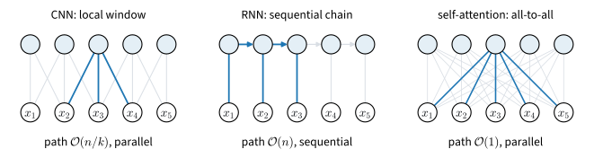

# The Cost of Attention
:label:`sec_attention-at-scale`

The language model of :numref:`sec_positional-information` was trained on
contexts of 128 bytes. Language models in use today read whole reports,
code repositories and books, often tens or hundreds of thousands of tokens
at once. Self-attention lets every token read every other token in a
single layer, and the cost is one score for every pair of positions. How
does this cost grow with the length of the context, and how can it be
reduced?

Doubling the context quadruples the number of pairs. A context of 8,192
tokens already has 67 million query--key pairs per head, and storing their
scores in single precision takes 256 MiB for one head of one sequence.
Arithmetic and memory both grow with the square of the sequence length, and
at long contexts this quadratic term dominates the cost of the whole layer.

We first compare self-attention with the convolutional and recurrent layers of
earlier chapters, count its cost, and check the count against measurements on
a GPU. The rest of the section develops three ways to reduce that cost. The
first changes only the order of the computation. It computes exact attention
one block of keys at a time, without ever storing the full matrix, and
FlashAttention fits this schedule to the memory hierarchy of a GPU. The
second scores fewer pairs: each token attends only to a window of recent
tokens, and depth restores the long-range paths. The third replaces the
softmax by a similarity kernel that factorizes, which turns attention into a
recurrent network whose state is a matrix. We end by timing the three side
by side.

<!-- WRITER: after the split this section covers only the cost count, the online softmax and fused kernels; windows, linear attention and the timing of the three strategies are in :numref:`sec_windowed-linear-attention`. The roadmap above (and the deck's cover line and goals slide) still promise them; one sentence should name the next section instead (worklist 5.B1). -->

```{.python .input #attention-at-scale-the-cost-of-attention}
%%tab pytorch
import math
import numpy as np
import torch
from torch import nn
from torch.nn import functional as F
from d2l import torch as d2l
```

```{.python .input #attention-at-scale-the-cost-of-attention}
%%tab jax
import math
import numpy as np
import jax
from jax import numpy as jnp
from flax import nnx
import optax
from d2l import jax as d2l
```

```{.python .input #attention-at-scale-the-cost-of-attention-1}
%%tab pytorch
from torch.nn.attention import SDPBackend, sdpa_kernel
```

## Quadratic Time and Memory

### CNNs, RNNs, and Self-Attention

Consider the problem of mapping a sequence of $n$ tokens, each a
$d$-dimensional vector, to another sequence of the same shape. Three familiar
architectures can perform this mapping: a one-dimensional CNN
(:numref:`chap_cnn`), an RNN (:numref:`sec_rnn`), and self-attention
(:numref:`sec_multihead-attention`). :numref:`fig_cnn-rnn-self-attention`
draws all three as graphs over the sequence. Two properties of these graphs
matter beyond raw arithmetic. The number of *sequential* operations bounds how
much of the work can run in parallel on modern hardware. The *maximum path
length* counts how many layer transformations connect two positions. Path
length is a property of the architecture. A short path avoids multiplying many
recurrent Jacobians, but it does not by itself guarantee that training finds a
long-range dependency.


:label:`fig_cnn-rnn-self-attention`

A convolutional layer with kernel size $k$ and $d$ channels in and out costs
$O(knd^2)$ operations: each of the $n$ positions mixes $k$
neighbors through a $d \times d$ map. All positions are computed at once, so
there are $O(1)$ sequential steps, but the receptive field grows by
only $k-1$ positions per layer. Connecting a pair of tokens $n$ apart takes a
stack of depth $O(n/k)$. An RNN requires $O(nd^2)$ for the
sequence, one $d \times d$ state update per token, but the updates are
ordered. It takes $O(n)$ sequential steps, and a signal from the
first token reaches the last only through $O(n)$ applications of
the cell.

Self-attention first projects the inputs at cost
$O(nd^2)$, then computes an $n \times d$ by $d \times n$ product and
an $n \times n$ by $n \times d$ product at cost $O(n^2d)$. These
matrix multiplications have $O(1)$ sequential depth, and any token
can attend to any other in one layer, giving path length $O(1)$.
:numref:`tab_cnn-rnn-attn` collects the accounting.

:Per-layer cost of mapping $n$ tokens of dimension $d$ to $n$ tokens of dimension $d$.
:label:`tab_cnn-rnn-attn`

| layer type | complexity | sequential operations | maximum path length |
|:--|:--|:--|:--|
| convolution (kernel $k$) | $O(knd^2)$ | $O(1)$ | $O(n/k)$ |
| recurrence | $O(nd^2)$ | $O(n)$ | $O(n)$ |
| self-attention | $O(nd^2+n^2d)$ | $O(1)$ | $O(1)$ |

Self-attention has constant sequential depth and path length, but its mixing
term is quadratic in $n$. The table includes the query, key, value, and
output projections so that all three rows count the complete layer. When
$n$ and $d$ are comparable, the linear projection and quadratic mixing terms
have similar order. For $n\gg d$, the mixing term dominates. The remainder
of this section studies ways to reduce its memory use or arithmetic cost.

### Counting FLOPs

The leading constants make this comparison more precise. One attention layer
receives $n$ queries, keys, and values of dimension $d$ and computes
$\mathrm{softmax}(\mathbf{Q}\mathbf{K}^\top/\sqrt{d})\mathbf{V}$
(:eqref:`eq_softmax_QK_V`). The score matrix $\mathbf{Q}\mathbf{K}^\top$
costs $2n^2 d$ floating-point operations, because each of its $n^2$ entries
is a length-$d$ dot product and we count one multiply--add as two FLOPs.
The softmax costs a few operations per entry, $O(n^2)$, and the
value mixing $\mathrm{softmax}(\cdot)\mathbf{V}$ another $2n^2 d$. In
total

$$
\underbrace{4 n^2 d}_{\textrm{scores and mixing}} + \; O(n^2)
\quad \textrm{FLOPs}.
$$
:eqlabel:`eq_attn-layer-flops`

The four projections around attention in a multi-head layer cost $8nd^2$,
which is linear in $n$, and the head count drops out of both terms
(:eqref:`eq_multihead-flops`). Setting $4n^2d = 8nd^2$ locates the
crossover: the quadratic part dominates the layer as soon as $n > 2d$. GPT-2
small, with $d = 768$ and contexts of 1,024 tokens, sits below the
crossover, so its projections still cost more than its scores. A model with
$d = 4096$ at $n = 131{,}072$ sits far beyond it. There $n/2d = 16$, so an
attention layer does sixteen times as much score-and-mix work as projection
work.

### Counting Memory
:label:`subsec_attn-counting-memory`

Arithmetic is only one part of the cost, and at long contexts memory is
often the binding constraint. A naive implementation materializes the score
matrix and its softmax. These are two $n \times n$ buffers of activations, $8n^2$
bytes in single precision, per head and per sequence in the batch. During
training the attention weights are also saved for the backward pass. The
projections, by contrast, keep only $O(nd)$ activations. At
$n = 8192$ and a head dimension of $d_h = 64$, the setting of the
experiments below, the inputs $\mathbf{Q}, \mathbf{K}, \mathbf{V}$
occupy 6 MiB together, while the two score buffers occupy 512 MiB. At a
context of $n = 131{,}072$ tokens a *single* attention map in fp32 would
take $n^2 \times 4$ bytes $\approx 69$ GB (per head, per sequence), which
is why no system at that scale ever stores one.

We check the formula against a measurement on one head. The function
`attention` computes $\mathrm{softmax}(\mathbf{Q}\mathbf{K}^\top/\sqrt{d})
\mathbf{V}$ through the full score matrix, and `d2l.peak_memory` of
:numref:`sec_use_gpu` reports the temporary memory that a call needs. The
prediction is the two $n \times n$ float buffers, $8n^2$ bytes.

:begin_tab:`pytorch`
PyTorch's caching allocator reports what a computation allocated.
`reset_peak_memory_stats` clears the high-water mark and
`max_memory_allocated` reads it back.
:end_tab:

:begin_tab:`jax`
Measuring per-op memory at runtime is awkward in JAX, for two reasons. XLA
*preallocates* a large fraction of GPU memory as an arena at startup, so
device-side counters describe the arena, not the operation. The compiler may
also fuse or rematerialize operations, so the buffers it materializes are
determined during compilation rather than directly by the Python source. The
reliable answer therefore comes from the compiler itself. Lowering a jitted
function and compiling it yields a `memory_analysis()` report of how much
temporary buffer space the executable reserves.
:end_tab:

```{.python .input #attention-at-scale-counting-memory-1}
%%tab pytorch
def attention(Q, K, V):
    """softmax(Q K^T / sqrt(d)) V through the full score matrix."""
    scores = Q @ K.transpose(-2, -1) / math.sqrt(Q.shape[-1])
    return torch.softmax(scores, dim=-1) @ V
```

```{.python .input #attention-at-scale-counting-memory-1}
%%tab jax
def attention(Q, K, V):
    """softmax(Q K^T / sqrt(d)) V through the full score matrix."""
    scores = Q @ K.swapaxes(-2, -1) / math.sqrt(Q.shape[-1])
    return jax.nn.softmax(scores, axis=-1) @ V
```

We measure a single head of width 64 as $n$ doubles.

```{.python .input #attention-at-scale-counting-memory-3}
%%tab pytorch
d_h = 64
for n in [2048, 4096, 8192, 16384]:
    Q = torch.randn(n, d_h, device=d2l.try_gpu())
    mem = d2l.peak_memory(attention, Q, Q, Q)  # Allocator high-water mark
    print(f'n = {n:5d}: measured {mem/2**20:7.1f}'
          f' MiB, predicted 8n^2 B = {8*n*n/2**20:7.1f} MiB')
```

```{.python .input #attention-at-scale-counting-memory-3}
%%tab jax
d_h = 64
for n in [2048, 4096, 8192, 16384]:
    Q = jax.random.normal(d2l.get_key(), (n, d_h))
    mem = d2l.peak_memory(attention, Q, Q, Q)  # XLA's compile-time scratch
    print(f'n = {n:5d}: XLA temp {mem/2**20:7.1f}'
          f' MiB, predicted 8n^2 B = {8*n*n/2**20:7.1f} MiB')
```

The measurement matches $8n^2$ bytes up to a small extra workspace, and
doubling $n$ quadruples it. At $n = 16{,}384$, a single fp32 head already
needs 2 GiB of temporary storage.

The running time has the same quadratic dependence. We time the forward pass
as $n$ doubles, after warm-up calls. On an accelerator, kernel launches
return before the work is done, so we synchronize before reading the clock.
`d2l.Benchmark` of :numref:`sec_use_gpu` does both and reports the average
time per call.

```{.python .input #attention-at-scale-counting-memory-2}
%%tab pytorch
for n in [2048, 4096, 8192, 16384]:
    Q = torch.randn(n, d_h, device=d2l.try_gpu())
    print(d2l.Benchmark(lambda: attention(Q, Q, Q), desc=f'n = {n:5d}'))
```

```{.python .input #attention-at-scale-counting-memory-2}
%%tab jax
attention_jit = jax.jit(attention)
for n in [2048, 4096, 8192, 16384]:
    Q = jax.random.normal(d2l.get_key(), (n, d_h))
    print(d2l.Benchmark(lambda: attention_jit(Q, Q, Q), desc=f'n = {n:5d}'))
```

At small $n$, the time does not yet follow the operation count: the GPU is
not saturated, launch overhead weighs in, and the smallest score matrices
still fit in the GPU's on-chip cache. Beyond a few thousand tokens, each
doubling of $n$ multiplies the time by about four, the growth of the $4n^2d$
operation count.

## Exact Attention Without the Matrix

### Blockwise Online Softmax

The full $n \times n$ matrix need not be stored. The apparent obstacle to
computing attention piecewise is the softmax. Each weight
$\exp(a_j)/\sum_{j'}\exp(a_{j'})$ depends on *all* scores of its row
through the normalizer and, for numerical safety, through the row maximum
subtracted before exponentiation. Both quantities can be maintained
*online*, the way one computes a running mean
:cite:`Milakov.Gimelshein.2018`. Process the keys in blocks and keep, per
query, three running statistics: the maximum $m$ seen so far, the sum $s$ of
exponentials rescaled to that maximum, and the output accumulator
$\mathbf{o}$. A new block of scores $\{a_j\}$ with values
$\{\mathbf{v}_j\}$ updates them as

$$
\begin{aligned}
m' &= \max\big(m, \max_j a_j\big), \\
s' &= s\, e^{m - m'} + \sum\nolimits_j e^{a_j - m'}, \\
\mathbf{o}' &= \mathbf{o}\, e^{m - m'} + \sum\nolimits_j e^{a_j - m'}\, \mathbf{v}_j,
\end{aligned}
$$
:eqlabel:`eq_online-softmax`

and after the last block, $\mathbf{o}/s$ is exactly
$\mathrm{softmax}(\mathbf{a})\mathbf{V}$. Whenever a new block raises the
maximum, the factor $e^{m - m'}$ rescales all quantities accumulated under
the old maximum, so no approximation is made.
:numref:`fig_online-softmax` shows the resulting schedule. One
$n \times c$ stripe of the score matrix is in memory at a time, next to a
running state of size $O(nd)$ :cite:`Rabe.Staats.2021`.


:label:`fig_online-softmax`

### A Chunked Implementation
:label:`subsec_attn-chunked`

From here on we work in the causal setting of a language model. Excluded
scores are overwritten with the most negative finite value of the dtype, and
`d2l.causal_mask` supplies the mask, as in
:numref:`sec_attention-scoring-functions`. We first implement a naive
reference, which accepts any number of leading axes such as heads, and then a
chunked version for one head. The chunked implementation applies
:eqref:`eq_online-softmax` to all queries at once and processes one key block
per iteration.

```{.python .input #attention-at-scale-a-chunked-implementation-1}
%%tab pytorch
def causal_attention(Q, K, V):
    """Reference: causal attention with the full score matrix."""
    scores = Q @ K.transpose(-2, -1) / math.sqrt(Q.shape[-1])
    mask = d2l.causal_mask(Q.shape[-2], device=Q.device)
    scores.masked_fill_(~mask, torch.finfo(Q.dtype).min)
    return torch.softmax(scores, dim=-1) @ V

def chunked_attention(Q, K, V, chunk_size=512):
    """Exact causal attention, one n-by-chunk_size block at a time."""
    n, d = Q.shape
    m = torch.full((n, 1), torch.finfo(Q.dtype).min, device=Q.device)
    s = torch.zeros(n, 1, device=Q.device)
    O = torch.zeros(n, V.shape[-1], device=Q.device)
    pos_q = torch.arange(n, device=Q.device)[:, None]
    for start in range(0, n, chunk_size):
        Kc, Vc = K[start:start + chunk_size], V[start:start + chunk_size]
        pos_k = torch.arange(start, start + Kc.shape[0], device=Q.device)
        scores = Q @ Kc.T / math.sqrt(d)
        scores.masked_fill_(pos_k[None, :] > pos_q, torch.finfo(Q.dtype).min)
        m_new = torch.maximum(m, scores.max(dim=-1, keepdim=True).values)
        scale = torch.exp(m - m_new)                  # Rescale the past
        P = torch.exp(scores - m_new)
        s = s * scale + P.sum(dim=-1, keepdim=True)
        O = O * scale + P @ Vc
        m = m_new
    return O / s
```

```{.python .input #attention-at-scale-a-chunked-implementation-1}
%%tab jax
def causal_attention(Q, K, V):
    """Reference: causal attention with the full score matrix."""
    scores = Q @ K.swapaxes(-2, -1) / math.sqrt(Q.shape[-1])
    mask = d2l.causal_mask(Q.shape[-2])
    scores = jnp.where(mask, scores, jnp.finfo(scores.dtype).min)
    return jax.nn.softmax(scores, axis=-1) @ V

def chunked_attention(Q, K, V, chunk_size=512):
    """Exact causal attention, one n-by-chunk_size block at a time."""
    (n, d), d_v = Q.shape, V.shape[-1]
    assert n % chunk_size == 0, 'lax.scan needs equal-sized blocks'
    pos_q = jnp.arange(n)[:, None]
    def block(carry, chunk):
        m, s, O = carry
        Kc, Vc, start = chunk
        pos_k = start + jnp.arange(chunk_size)
        scores = Q @ Kc.T / math.sqrt(d)
        scores = jnp.where(pos_k[None, :] > pos_q,
                           jnp.finfo(scores.dtype).min, scores)
        m_new = jnp.maximum(m, scores.max(axis=-1, keepdims=True))
        scale = jnp.exp(m - m_new)                    # Rescale the past
        P = jnp.exp(scores - m_new)
        s = s * scale + P.sum(axis=-1, keepdims=True)
        O = O * scale + P @ Vc
        return (m_new, s, O), None
    init = (jnp.full((n, 1), jnp.finfo(Q.dtype).min), jnp.zeros((n, 1)),
            jnp.zeros((n, d_v)))
    chunks = (K.reshape(-1, chunk_size, d), V.reshape(-1, chunk_size, d_v),
              jnp.arange(0, n, chunk_size))           # Blocks, their starts
    (m, s, O), _ = jax.lax.scan(block, init, chunks)
    return O / s
```

The chunked version is meant to be exact, so we check it against the
reference.

```{.python .input #attention-at-scale-a-chunked-implementation-2}
%%tab pytorch
n, d_h = 2048, 64
Q, K, V = (torch.randn(n, d_h, device=d2l.try_gpu()) for _ in range(3))
err = (chunked_attention(Q, K, V) - causal_attention(Q, K, V)).abs().max()
print(f'maximum deviation: {float(err):.2e}')
```

```{.python .input #attention-at-scale-a-chunked-implementation-2}
%%tab jax
n, d_h = 2048, 64
Q, K, V = (jax.random.normal(k, (n, d_h))
           for k in jax.random.split(d2l.get_key(), 3))
# Full fp32 matrix products: the GPU default (TF32) would perturb the two
# computations differently, at the 1e-4 level
with jax.default_matmul_precision('highest'):
    err = jnp.abs(chunked_attention(Q, K, V)
                  - causal_attention(Q, K, V)).max()
print(f'maximum deviation: {float(err):.2e}')
```

The two computations agree up to floating-point rounding, at the level of
$10^{-7}$ to $10^{-6}$ in fp32. Chunking changes the order of evaluation,
not the definition of attention. The chunked version holds $n \times c$
scores at a time instead of $n \times n$, so its footprint should grow
linearly in $n$ rather than quadratically.

```{.python .input #attention-at-scale-a-chunked-implementation-3}
%%tab pytorch
lengths, mems = [2048, 4096, 8192, 16384], [[], []]
for n in lengths:
    Q = torch.randn(n, d_h, device=d2l.try_gpu())
    mems[0].append(d2l.peak_memory(causal_attention, Q, Q, Q) / 2**20)
    mems[1].append(d2l.peak_memory(chunked_attention, Q, Q, Q) / 2**20)
d2l.plot(lengths, mems, 'sequence length n', 'peak memory (MiB)',
         legend=['full matrix', 'chunked'], xscale='log', yscale='log')
```

```{.python .input #attention-at-scale-a-chunked-implementation-3}
%%tab jax
lengths, mems = [2048, 4096, 8192, 16384], [[], []]
for n in lengths:
    Q = jax.random.normal(d2l.get_key(), (n, d_h))
    mems[0].append(d2l.peak_memory(causal_attention, Q, Q, Q) / 2**20)
    mems[1].append(d2l.peak_memory(chunked_attention, Q, Q, Q) / 2**20)
d2l.plot(lengths, mems, 'sequence length n', 'XLA temp memory (MiB)',
         legend=['full matrix', 'chunked'], xscale='log', yscale='log')
```

At $n = 16{,}384$ the full-matrix implementation needs about 2 GiB of
scratch memory. The chunked one needs more than an order of magnitude less,
and the gap doubles with every further doubling of $n$. The result and the
$4n^2d$ FLOP count are unchanged. Only the summation order and the memory
schedule differ.

### Memory Traffic as the Computational Bottleneck

Chunking also reduces data movement. On a modern GPU, memory bandwidth often
limits attention more than arithmetic throughput. An accelerator can execute
hundreds of arithmetic operations in the time it takes to fetch one float
from off-chip memory. Naive attention writes the $n^2$ score matrix to slow
memory and reads it back for the softmax and again for the value mixing. The
chunked schedule keeps each stripe in fast on-chip memory, finishes all work
on it, and never writes it out. FlashAttention :cite:`Dao.Fu.Ermon.ea.2022`
is this algorithm fitted to the hardware, with tile sizes matched to on-chip
SRAM and softmax statistics kept in registers. During training, the backward
pass recomputes the stripes instead of storing the weights, because the extra
arithmetic takes less time than the memory traffic it avoids. The result is
exact attention that is faster *and* needs asymptotically less memory.

Later versions keep the algorithm and change its schedule. FlashAttention-2
divides by the normalizer only once at the end, as `chunked_attention` does,
and cuts each sequence into blocks of queries that run in parallel, so that a
single long sequence still keeps the whole GPU busy :cite:`Dao.2024`.
FlashAttention-3 overlaps data movement, matrix products, and exponentials
on newer GPUs and adds an 8-bit floating-point mode
:cite:`Shah.Bikshandi.Zhang.ea.2024`. In 16-bit precision every version
computes exact attention; only the schedule follows the hardware. Frameworks
provide it as a fused kernel:
`torch.nn.functional.scaled_dot_product_attention` in PyTorch and
`jax.nn.dot_product_attention` in JAX. We compare it with the
naive reference on a minibatch of 2 sequences with 8 heads of dimension 64
in half precision at $n = 8192$.

```{.python .input #attention-at-scale-the-bottleneck-is-memory-traffic}
%%tab pytorch
def fused_attention(Q, K, V):
    """Causal attention in PyTorch's fused FlashAttention kernel."""
    with sdpa_kernel(SDPBackend.FLASH_ATTENTION):
        return F.scaled_dot_product_attention(Q, K, V, is_causal=True)

B, H, n = 2, 8, 8192
X = torch.randn(B, H, n, d_h, device=d2l.try_gpu(), dtype=torch.float16)
for name, f in [('naive', causal_attention), ('fused', fused_attention)]:
    t = d2l.Benchmark(lambda: f(X, X, X)).time
    mem = d2l.peak_memory(f, X, X, X)
    print(f'{name}: {t*1e3:6.2f} ms, peak memory {mem/2**20:7.1f} MiB')
```

```{.python .input #attention-at-scale-the-bottleneck-is-memory-traffic}
%%tab jax
def fused_attention(Q, K, V):
    """Causal attention in the fused cuDNN kernel."""
    # The kernel takes (batch, length, heads, width): swap axes 1 and 2
    Q, K, V = (A.swapaxes(1, 2) for A in (Q, K, V))
    O = jax.nn.dot_product_attention(Q, K, V, is_causal=True,
                                     implementation='cudnn')
    return O.swapaxes(1, 2)

B, H, n = 2, 8, 8192
X = jax.random.normal(d2l.get_key(), (B, H, n, d_h), dtype=jnp.float16)
for name, f in [('naive', causal_attention), ('fused', fused_attention)]:
    f_jit = jax.jit(f)
    t = d2l.Benchmark(lambda: f_jit(X, X, X)).time
    mem = d2l.peak_memory(f, X, X, X)
    print(f'{name}: {t*1e3:6.2f} ms, XLA temp {mem/2**20:7.1f} MiB')
```

The fused kernel is several times faster than the naive implementation, and
it needs almost no temporary memory where the naive one needs gigabytes.
Both gains come from keeping the score blocks out of off-chip memory. In
practice, dense attention on sequences beyond a few hundred tokens therefore
runs in a fused kernel.

:begin_tab:`pytorch`
`sdpa_kernel(SDPBackend.FLASH_ATTENTION)` restricts
`scaled_dot_product_attention` to the FlashAttention backend, which accepts
half and bfloat16 inputs of shape (batch, heads, length, head width).
Without the context manager, PyTorch picks a backend by itself and falls back
to an unfused computation when no fused kernel supports the inputs.
:end_tab:

:begin_tab:`jax`
`implementation='cudnn'` selects cuDNN's fused attention, which accepts half
and bfloat16 inputs on NVIDIA GPUs. The default implementation is XLA's own,
which materializes the score matrix.
:end_tab:

<!-- WRITER: the split ends the body here. Windows, linear attention and the timing figure now live in :numref:`sec_windowed-linear-attention` (chapter_attention/windowed-linear-attention.md). This section needs its closing judgment (worklist 5.B5): exact attention in a fused kernel removes the stored matrix and most of the traffic, but every query still scores every key, so the arithmetic stays $4n^2d$; that is the question of the next section. -->

## Summary

<!-- WRITER: the Summary below still covers windows, linear attention and the timing figure, which moved to sec_windowed-linear-attention; rewrite for this section only (worklist 5.B6). -->

Dense attention costs $4n^2d$ FLOPs and, in a naive implementation, two
$n \times n$ buffers per head. Online softmax computes the same result one
key block at a time while carrying a running maximum, normalizer, and
output, and FlashAttention fits this schedule to the memory hierarchy, so
exact attention runs in linear memory and several times faster. Sliding
windows reduce the work to $O(nw)$ and widen the receptive field
to $1 + L(w-1)$ after $L$ layers; interleaved global layers restore direct
paths, and a fused kernel saves work only in whole tiles. A factorizing
kernel turns attention into a recurrent network with a $d \times d_v$ matrix
state, computed in chunks for training and step by step for generation; the
state has constant size but is a lossy summary of the past. Measured,
dense time grows fourfold per doubling of the length and the time of the
linear-cost mechanisms twofold, so at long contexts they need a fraction of
its time.

## Exercises

1. **Reaching across the sequence.** :numref:`tab_cnn-rnn-attn` compares
   layers one at a time, but connecting two distant tokens may take many
   layers. Count one multiply--add as two FLOPs, so that a convolution
   layer with kernel $k$ costs $2knd^2$, an RNN layer $4nd^2$, and a
   self-attention layer $8nd^2 + 4n^2d$. Let $n = 4096$, $d = 512$, and
   $k = 3$.
    1. A stack of plain convolutions must connect the first token with the
       last. Find the number of layers it needs and its total FLOPs, show
       that this total grows quadratically in $n$, as the cost of one
       attention layer does, and compare the two totals numerically.
    1. Dilated convolutions (:numref:`sec_dilation`) with dilation
       $k^{l-1}$ in layer $l$ grow the receptive field geometrically. Find
       the receptive field after $L$ layers, the depth needed to connect
       the two tokens, and the total FLOPs of that stack.
    1. Rank the four designs, namely one attention layer, the two
       convolution stacks, and one RNN layer, by total FLOPs and by
       sequential steps, counting each layer of a stack as one step and
       each token of the RNN as one step. Which resource does each design
       spend to connect the two tokens?

1. [code] **The running maximum.** Remove the running maximum from
   `chunked_attention`, so that the state accumulates plain sums of
   $e^{a_j}$. Run the result with $\mathbf{Q}$, $\mathbf{K}$, $\mathbf{V}$
   and the state $s$, $\mathbf{O}$ in float16, on queries scaled up by a
   factor of $10$.
    1. Before running, compute the largest exponent $x$ for which $e^x$ is
       finite in float16, and estimate the fraction of scaled scores that
       exceed it when queries and keys of width $64$ have independent
       standard normal entries.
    1. Run the modified function, and report at which operation the first
       infinite or undefined value appears.
    1. Explain why carrying $m$ bounds every exponent by zero. A term
       $e^{a_j - m'}$ that is smaller than the smallest positive float16
       number rounds to zero. Bound the total contribution of such terms to
       $s$, relative to the term of the largest score, for a row of $n$
       keys.
    1. `chunked_attention` initializes $m$ with the most negative finite
       value of the dtype and masks scores with the same value, the idiom
       of :numref:`sec_attention-scoring-functions`. Take $n = 2c$ for
       blocks of $c$ keys, and let the loop visit the two key blocks in
       reverse order, so that every score of the first visited block is
       masked for a query in the first block. Trace $m$, $s$, and
       $\mathbf{O}$ for that query through both iterations, and show that
       the final output is still exact.

1. **Merging partial states.** Fix one query with scores $a_j$ and values
   $\mathbf{v}_j$. For a set $B$ of keys, call the triple $(m_B, s_B,
   \mathbf{o}_B)$ that :eqref:`eq_online-softmax` produces from the keys in
   $B$ alone the partial state of $B$, so that $\mathbf{o}_B / s_B$ is the
   attention output restricted to $B$.
    1. Derive the partial state of $B \cup B'$ for disjoint sets $B$ and
       $B'$ from the two partial states, and show that
       :eqref:`eq_online-softmax` is the special case in which $B'$ is a
       single block.
    1. Show that this merge is associative and commutative. Conclude that
       the key blocks can be processed in any order, or in parallel and
       merged in a tree of depth $\lceil \log_2 (n/c) \rceil$ for blocks of
       $c$ keys, and explain why this matters when a single query attends
       to a long cache during generation.
    1. Replace the pair $(m_B, s_B)$ by the single number $\ell_B = m_B +
       \log s_B$ and the triple by $(\ell_B, \bar{\mathbf{o}}_B)$ with
       $\bar{\mathbf{o}}_B = \mathbf{o}_B / s_B$. Express the merged
       $\ell$ and $\bar{\mathbf{o}}$ in these terms, and show that
       $\bar{\mathbf{o}}$ is a convex combination of
       $\bar{\mathbf{o}}_B$ and $\bar{\mathbf{o}}_{B'}$ whose weights
       depend only on $\ell_B$ and $\ell_{B'}$.

1. **Arithmetic intensity of attention.** The count
   :eqref:`eq_attn-layer-flops` extends to values of width $d_v$: for $n$
   queries and keys of width $d$, the two matrix products of
   :eqref:`eq_softmax_QK_V` cost $2n^2 d$ and $2n^2 d_v$ floating-point
   operations, and the softmax costs a few operations per score.
    1. Suppose that the score matrix is written to memory once and read
       once by the softmax, whose output is written once and read once by
       the value product, all in single precision. Count the bytes moved by
       these four passes, and by reading $\mathbf{Q}$, $\mathbf{K}$,
       $\mathbf{V}$ and writing the output.
    1. Neglecting the softmax arithmetic, form the ratio of operations to
       bytes and let $n \to \infty$ at fixed $d$ and $d_v$. Show that the
       limit is $(d + d_v)/8$, and state how the softmax arithmetic changes
       it.
    1. Look up the peak arithmetic throughput and the memory bandwidth of
       one accelerator, compute its ratio of operations per byte, and decide
       whether attention with $d = d_v = 64$ is limited by arithmetic or by
       memory traffic on it.
   :exlabel:`ex_attention-at-scale-arithmetic-intensity`

1. **Traffic of a tiled schedule.** ● By Exercise
   :exref:`ex_attention-at-scale-arithmetic-intensity`a,
   the naive layer moves $4n^2$ floats to and from off-chip memory beyond
   the terms linear in $n$, since the score matrix and the weight matrix
   are each written once and read once. Ignore all traffic that is linear
   in $n$.
    1. Suppose that `chunked_attention` runs one operation at a time, each
       reading its inputs from off-chip memory and writing its output
       back. Count, as functions of $n$, $c$, and $d$, the floats moved for
       the score stripes, the floats moved for $\mathbf{Q}$ and the
       accumulator $\mathbf{O}$, and the number of operations launched.
       Which of these quantities does chunking reduce relative to the
       naive layer?
    1. A fused kernel instead holds a tile of $b$ queries, their output
       accumulator, and one tile each of $b$ keys and $b$ values in an
       on-chip memory of $M$ floats, so that $4bd \leq M$; scores and
       per-row statistics stay in registers. It loads each query tile once,
       streams all key and value tiles past it, and writes each output tile
       once. Show that its traffic beyond the linear terms is
       $2n^2 d / b$ floats and that the largest admissible tile gives
       $\Theta(n^2 d^2 / M)$, the bound that
       :citet:`Dao.Fu.Ermon.ea.2022` prove for FlashAttention.
    1. Compute the ratio of the fused traffic to the naive traffic for
       $d \in \{64, 128, 256\}$ with $M = 2^{16}$, and state how the head
       width limits the benefit of tiling.

<!-- WRITER: Exercises 5, 6, 8, 9 and 10 moved to sec_windowed-linear-attention with the split. -->

[Discussions](https://d2l.discourse.group/t/36772)

<!-- slides -->

::: {.slide}
::: {.cover}
[Dive into Deep Learning · §10.5]{.kicker}

The Cost of Attention<br>
**quadratic cost · online softmax and FlashAttention · sliding windows · linear attention**
:::
:::

::: {.slide title="One Score Matrix at 131,072 Tokens Takes 69 GB"}
[The problem]{.kicker}

Self-attention scores every pair of positions: $n^2$ scores per head.

| context $n$ | scores per head | fp32 bytes |
|--:|--:|--:|
| 1,024 (GPT-2 small) | 1.0 M | 4 MiB |
| 8,192 | 67 M | 256 MiB |
| 131,072 | 17 G | 69 GB |

::: {.d2l-note}
Time and memory grow with $n^2$. How do long contexts fit at all?
:::
:::

::: {.slide title="By the End of This Deck You Can"}
[Goals]{.kicker}

- count the FLOPs and bytes of one attention layer and find where the
  $n^2$ term takes over;
- compute exact attention one key block at a time (online softmax), the
  algorithm inside FlashAttention;
- restrict attention to a window and compute how depth restores the reach;
- turn attention into a recurrence with a matrix state (linear attention);
- read a timing plot of the three strategies.

**Running example:** one head of GPT-2 small: width 64, $d = 768$, contexts
of 1,024 tokens, and the same head at 8,192 tokens.
:::

::: {.slide title="Making Attention Cheaper at Long Context"}
[Where this fits]{.kicker}

::: {.cols .vc}
::: {.col}
| section | adds |
|---|---|
| Queries, Keys, and Values | attention as a soft lookup |
| Attention Scoring and Masking | scaled dot products, masks |
| Multi-Head and Cross-Attention | several heads, shared keys and values |
| Positional Information | where a token sits |
| **The Cost of Attention** | **quadratic cost, fused kernels** |
| Attention Circuits | what trained heads compute |
:::

::: {.col .narrow}
- **Uses:** causal and padding masks, the KV cache, recurrent networks.
- **Skips:** serving engines, long-context training, sparse attention
  learned from content.
:::
:::
:::

::: {.slide title="Self-Attention Has Constant Path Length and Quadratic Cost"}
[Counting the cost]{.kicker}

| layer | complexity | sequential ops | max path length |
|:--|:--|:--|:--|
| convolution ($k$) | $O(knd^2)$ | $O(1)$ | $O(n/k)$ |
| recurrence | $O(nd^2)$ | $O(n)$ | $O(n)$ |
| self-attention | $O(nd^2+n^2d)$ | $O(1)$ | $O(1)$ |

{width=70%}
:::

::: {.slide title="Scores Cost More Than Projections Once n > 2d"}
[Counting the cost]{.kicker}

- Scores $\mathbf{Q}\mathbf{K}^\top$: $2n^2d$ FLOPs; mixing with
  $\mathbf{V}$: another $2n^2d$.
- Projections $\mathbf{W}_q, \mathbf{W}_k, \mathbf{W}_v, \mathbf{W}_o$:
  $8nd^2$, for any number of heads.
- Ratio $\dfrac{4n^2d}{8nd^2} = \dfrac{n}{2d}$.

::: {.d2l-note}
$d = 4096$ at $n = 131{,}072$: the scores cost 16× the projections.
:::
:::

::: {.slide title="Check: GPT-2 Small at Its Own Context"}
[Check]{.kicker}

GPT-2 small: $d = 768$, context $n = 1{,}024$. Which costs more per layer,
the projections or the scores? At which context do they cost the same?

::: {.fragment .fade-up}
::: {.d2l-note}
**Answer.** $n/2d = 1024/1536 \approx 0.67$: the projections still cost
more. The two match at $n = 2d = 1{,}536$.
:::
:::
:::

::: {.slide title="Score Buffers Take 8n² Bytes per Head, and Time Grows as n²"}
[Counting the cost]{.kicker}

Naive attention keeps the scores and their softmax: two $n \times n$ fp32
buffers, $8n^2$ bytes per head and sequence.

@!attention-at-scale-counting-memory-3

- Doubling $n$ quadruples the footprint: 512 MiB per head at 8,192 tokens.
- Time behaves almost the same way: from a few thousand tokens on, each
  doubling of $n$ multiplies it by about four.
:::

::: {.slide title="Online Softmax Carries Three Statistics per Query"}
[Exact attention without the matrix]{.kicker}

Process keys in blocks; per query keep the running maximum $m$, the sum $s$,
and the output $\mathbf{o}$:

$$m' = \max\big(m, \max_j a_j\big)$$
$$s' = s\,e^{m-m'} + \textstyle\sum_j e^{a_j - m'}$$
$$\mathbf{o}' = \mathbf{o}\,e^{m-m'} + \textstyle\sum_j e^{a_j-m'}\mathbf{v}_j$$

::: {.d2l-note}
After the last block $\mathbf{o}/s = \mathrm{softmax}(\mathbf{a})\mathbf{V}$
exactly: $e^{m-m'}$ rescales everything summed under the old maximum.
:::
:::

::: {.slide title="Only One Stripe of Scores Is Ever in Memory"}
[Exact attention without the matrix]{.kicker}

{width=78%}

Memory: one $n \times c$ stripe plus $O(nd)$ running state,
instead of $n \times n$.
:::

::: {.slide title="Chunked Attention Is Exact in Linear Memory"}
[Exact attention without the matrix]{.kicker}

@!attention-at-scale-a-chunked-implementation-2

@!attention-at-scale-a-chunked-implementation-3

Same answer to fp32 rounding, same FLOPs; the footprint grows with $n$,
not $n^2$.
:::

::: {.slide title="Memory Traffic, Not FLOPs, Limits Naive Attention"}
[Exact attention without the matrix]{.kicker}

GPUs compute hundreds of FLOPs per float fetched. Naive attention writes
$n^2$ scores to slow memory and reads them back twice.

**FlashAttention:** online softmax with tiles in on-chip SRAM; the backward
pass recomputes tiles instead of storing them.

@!attention-at-scale-the-bottleneck-is-memory-traffic

2 sequences × 8 heads, $n = 8192$, fp16: several times faster, almost no scratch memory
instead of gigabytes.
:::

::: {.slide title="FlashAttention-2 and -3 Change the Schedule, Not the Result"}
[Exact attention without the matrix]{.kicker}

- **FlashAttention-2:** divide by $s$ once at the end; run blocks of
  *queries* in parallel, so one long sequence fills the GPU.
- **FlashAttention-3:** overlap loads, matrix products, and exponentials on
  newer GPUs; 8-bit floating point.
- In code: `scaled_dot_product_attention` (PyTorch),
  `dot_product_attention` (JAX).

::: {.d2l-note}
In practice, dense attention beyond a few hundred tokens runs in a fused
kernel.
:::

[Dao 2024; Shah et al. 2024]{.small}
:::

::: {.slide title="Check: Score Memory of GPT-2 Small"}
[Check]{.kicker}

One layer of GPT-2 small: 12 heads of width 64, $n = 1{,}024$, one
sequence. How much temporary memory do the naive layer (fp32 scores) and the
fused kernel (fp16) need? And at $n = 8{,}192$?

::: {.fragment .fade-up}
::: {.d2l-note}
**Answer.** Naive: $12 \cdot 8n^2$ bytes $= 96$ MiB at 1,024 tokens and
6 GiB at 8,192. Fused: the output plus one number per query, about
1.5 MiB and 12 MiB, linear in $n$.
:::
:::
:::

<!-- WRITER: the split moved the slides on windows, linear attention and the timing figure to the deck of windowed-linear-attention.md. The goals slide, the map and this wrap-up still name them; this deck ends on the closing judgment of the section (worklist 5.B8). -->

::: {.slide title="Reorganize, Restrict, Kernelize"}
[Wrap-up]{.kicker}

- **Cost:** $4n^2d$ FLOPs, $8n^2$ bytes per head; scores dominate once
  $n > 2d$ (GPT-2 small at 1,024 tokens: not yet).
- **Reorganize:** online softmax and FlashAttention give exact attention in
  linear memory, several times faster.
- **Restrict:** windows cost $O(nw)$ and reach $1 + L(w-1)$;
  global layers restore direct paths; savings come in whole tiles.
- **Kernelize:** linear attention is a recurrence with a $d \times d_v$
  state, trained in chunks.

**Next:** what trained attention heads compute.
:::
