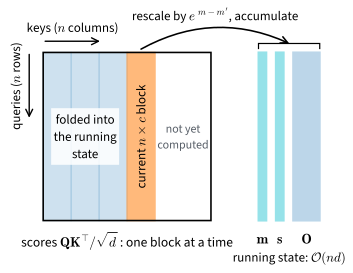
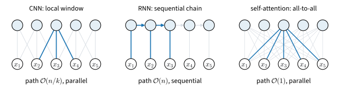

# The Cost of Attention
:label:`sec_attention-at-scale`

Self-attention lets every token read every other token in a single layer. The
cost is one score for every pair of positions. A context of 8,192 tokens has
67 million query--key pairs per head, and storing their scores in single
precision takes 256 MiB for one head of one sequence. At 131,072 tokens a
single score matrix would take 69 GB. Arithmetic and memory both grow with the
square of the sequence length, and at long contexts this quadratic term
dominates the cost of the whole layer.

We first compare self-attention with the convolutional and recurrent layers of
earlier chapters, count its cost, and check the count against measurements on
a GPU. The rest of the section develops three ways to reduce that cost. The
first changes only the order of the computation: an online softmax computes
exact attention one block of keys at a time without storing the full matrix,
and FlashAttention fits this schedule to the memory hierarchy of a GPU. The
second scores fewer pairs: each token attends to a window of recent tokens,
and depth restores the long-range paths. The third replaces the softmax by a
kernel that factorizes, which turns attention into a recurrent network whose
state is a matrix. We end by timing the three side by side.

```{.python .input #attention-at-scale-the-cost-of-attention}
%%tab pytorch
%matplotlib inline
from d2l import torch as d2l
import math
import time
import torch
from torch.nn import functional as F
from torch.nn.attention import SDPBackend, sdpa_kernel
from torch.nn.attention.flex_attention import create_block_mask, flex_attention
import warnings
```

```{.python .input #attention-at-scale-the-cost-of-attention}
%%tab jax
%matplotlib inline
from d2l import jax as d2l
import jax
from jax import numpy as jnp
import math
import time
```

## Quadratic Time and Memory

### CNNs, RNNs, and Self-Attention

Consider the problem of mapping a sequence of $n$ tokens, each a
$d$-dimensional vector, to another sequence of the same shape. Three familiar
architectures can perform this mapping: a one-dimensional CNN
(:numref:`chap_cnn`), an RNN (:numref:`sec_rnn`), and self-attention
(:numref:`sec_multihead-attention`). :numref:`fig_cnn-rnn-self-attention`
draws all three as graphs over the sequence. Two properties of these graphs
matter beyond raw arithmetic. The number of *sequential* operations bounds how
much of the work can run in parallel on modern hardware. The *maximum path
length* counts how many layer transformations connect two positions. Path
length is a property of the architecture. A short path avoids multiplying many
recurrent Jacobians, but it does not by itself guarantee that training finds a
long-range dependency.


:label:`fig_cnn-rnn-self-attention`

A convolutional layer with kernel size $k$ and $d$ channels in and out costs
$\mathcal{O}(knd^2)$ operations: each of the $n$ positions mixes $k$
neighbors through a $d \times d$ map. All positions are computed at once, so
there are $\mathcal{O}(1)$ sequential steps, but the receptive field grows by
only $k-1$ positions per layer. Connecting a pair of tokens $n$ apart takes a
stack of depth $\mathcal{O}(n/k)$. An RNN requires $\mathcal{O}(nd^2)$ for the
sequence, one $d \times d$ state update per token, but the updates are
ordered. It takes $\mathcal{O}(n)$ sequential steps, and a signal from the
first token reaches the last only through $\mathcal{O}(n)$ applications of
the cell. Self-attention first projects the inputs at cost
$\mathcal{O}(nd^2)$, then computes an $n \times d$ by $d \times n$ product and
an $n \times n$ by $n \times d$ product at cost $\mathcal{O}(n^2d)$. These
matrix multiplications have $\mathcal{O}(1)$ sequential depth, and any token
can attend to any other in one layer, giving path length $\mathcal{O}(1)$.
:numref:`tab_cnn-rnn-attn` collects the accounting.

:Per-layer cost of mapping $n$ tokens of dimension $d$ to $n$ tokens of dimension $d$.
:label:`tab_cnn-rnn-attn`

| layer type | complexity | sequential operations | maximum path length |
|:--|:--|:--|:--|
| convolution (kernel $k$) | $\mathcal{O}(knd^2)$ | $\mathcal{O}(1)$ | $\mathcal{O}(n/k)$ |
| recurrence | $\mathcal{O}(nd^2)$ | $\mathcal{O}(n)$ | $\mathcal{O}(n)$ |
| self-attention | $\mathcal{O}(nd^2+n^2d)$ | $\mathcal{O}(1)$ | $\mathcal{O}(1)$ |

Self-attention has constant sequential depth and path length, but its mixing
term is quadratic in $n$. The table includes the query, key, value, and
output projections so that all three rows count the complete layer. When
$n$ and $d$ are comparable, the linear projection and quadratic mixing terms
have similar order. For $n\gg d$, the mixing term dominates. The remainder
of this section studies ways to reduce its memory use or arithmetic cost.

### Counting FLOPs

The leading constants make this comparison more precise. One attention layer
receives $n$ queries, keys, and values of dimension $d$ and computes
$\mathrm{softmax}(\mathbf{Q}\mathbf{K}^\top/\sqrt{d})\mathbf{V}$
(:eqref:`eq_softmax_QK_V`). The score matrix $\mathbf{Q}\mathbf{K}^\top$
costs $2n^2 d$ floating-point operations, because each of its $n^2$ entries
is a length-$d$ dot product and we count one multiply--add as two FLOPs.
The softmax costs a few operations per entry, $\mathcal{O}(n^2)$, and the
value mixing $\mathrm{softmax}(\cdot)\mathbf{V}$ another $2n^2 d$. In
total

$$
\underbrace{4 n^2 d}_{\textrm{scores and mixing}} + \; \mathcal{O}(n^2)
\quad \textrm{FLOPs}.
$$
:eqlabel:`eq_attn-layer-flops`

The four projections around attention in a multi-head layer cost $8nd^2$,
which is linear in $n$, and the head count drops out of both terms
(:eqref:`eq_multihead-flops`). Setting $4n^2d = 8nd^2$ locates the
crossover: the quadratic part dominates the layer as soon as $n > 2d$. GPT-2
small, with $d = 768$ and contexts of 1,024 tokens, sits below the
crossover, so its projections still cost more than its scores. A model with
$d = 4096$ at $n = 131{,}072$ sits far beyond it, with $n/2d = 16$: an
attention layer at that context does sixteen times as much score-and-mix work
as projection work.

### Counting Memory
:label:`subsec_attn-counting-memory`

Arithmetic is only one part of the cost, and at long contexts memory is
often the binding constraint. A naive implementation materializes the score
matrix and its softmax. These are two $n \times n$ buffers of activations, $8n^2$
bytes in single precision, per head and per sequence in the batch. During
training the attention weights are also saved for the backward pass. The
projections, by contrast, keep only $\mathcal{O}(nd)$ activations. At
$n = 8192$ and a head dimension of $d_h = 64$, the setting of the
experiments below, the inputs $\mathbf{Q}, \mathbf{K}, \mathbf{V}$
occupy 6 MiB together, while the two score buffers occupy 512 MiB. At a
context of $n = 131{,}072$ tokens a *single* attention map in fp32 would
take $n^2 \times 4$ bytes $\approx 69$ GB (per head, per sequence), which
is why no system at that scale ever stores one.

:begin_tab:`pytorch`
PyTorch's caching allocator reports what a computation allocated, so we can
check the formula against a measurement. `reset_peak_memory_stats` clears
the high-water mark and `max_memory_allocated` reads it back. We measure the
`d2l.DotProductAttention` layer from
:numref:`sec_attention-scoring-functions` on a single head. The prediction
is the two $n \times n$ float buffers, $8n^2$ bytes.
:end_tab:

:begin_tab:`jax`
Measuring per-op memory at runtime is awkward in JAX, for two reasons. XLA
*preallocates* a large fraction of GPU memory as an arena at startup, so
device-side counters describe the arena, not the operation. The compiler may
also fuse or rematerialize operations, so the buffers it materializes are
determined during compilation rather than directly by the Python source. The
reliable answer therefore comes from the compiler itself. Lowering a jitted
function and compiling it yields a `memory_analysis()` report of how much
temporary buffer space the executable reserves. We compare it against the
two $n \times n$ float buffers, $8n^2$ bytes.
:end_tab:

```{.python .input #attention-at-scale-counting-memory-1}
%%tab pytorch
attention = d2l.DotProductAttention(dropout=0).to(d2l.try_gpu())
attention.eval()

def peak_memory(f, *args):
    """Extra peak memory allocated by f, in bytes."""
    torch.cuda.synchronize()
    torch.cuda.reset_peak_memory_stats()
    base = torch.cuda.memory_allocated()
    f(*args)
    torch.cuda.synchronize()
    return torch.cuda.max_memory_allocated() - base

d_h = 64
for n in [2048, 4096, 8192, 16384]:
    Q = torch.randn(1, n, d_h, device=d2l.try_gpu())
    with torch.no_grad():
        measured = peak_memory(attention, Q, Q, Q)
    print(f'n = {n:5d}: measured {measured/2**20:7.1f} MiB, '
          f'predicted 8n^2 B = {8*n*n/2**20:7.1f} MiB')
attention.attention_weights = None  # Release the last stored weights
```

```{.python .input #attention-at-scale-counting-memory-1}
%%tab jax
def attention_layer(Q, K, V):
    scores = Q @ K.T / math.sqrt(Q.shape[-1])
    return jax.nn.softmax(scores, axis=-1) @ V

d_h = 64
for n in [2048, 4096, 8192, 16384]:
    Q = jax.random.normal(d2l.get_key(), (n, d_h))
    stats = jax.jit(attention_layer).lower(Q, Q, Q).compile()
    temp = stats.memory_analysis().temp_size_in_bytes
    print(f'n = {n:5d}: XLA temp {temp/2**20:7.1f} MiB, '
          f'predicted 8n^2 B = {8*n*n/2**20:7.1f} MiB')
```

The measurement matches $8n^2$ bytes to within a few MiB of workspace, and
doubling $n$ quadruples it. At $n = 16{,}384$, a single fp32 head already
needs 2 GiB of temporary storage.

The running time has the same quadratic dependence. We time the forward pass
as $n$ doubles, after a warm-up call. On an accelerator, kernel launches
return before the work is done, so we synchronize before reading the clock.

```{.python .input #attention-at-scale-counting-memory-2}
%%tab pytorch
def wall_clock(f, *args, reps=10):
    """Average seconds per call of f, after one warm-up call."""
    f(*args)  # Warm up
    torch.cuda.synchronize()
    start = time.perf_counter()
    for _ in range(reps):
        f(*args)
    torch.cuda.synchronize()
    return (time.perf_counter() - start) / reps

for n in [2048, 4096, 8192, 16384]:
    Q = torch.randn(1, n, d_h, device=d2l.try_gpu())
    with torch.no_grad():
        t = wall_clock(attention, Q, Q, Q)
    print(f'n = {n:5d}: {t*1e3:6.2f} ms')
attention.attention_weights = None
```

```{.python .input #attention-at-scale-counting-memory-2}
%%tab jax
def wall_clock(f, *args, reps=10):
    """Average seconds per call of f, after one warm-up call."""
    f(*args).block_until_ready()  # Warm up (and compile)
    start = time.perf_counter()
    for _ in range(reps):
        f(*args).block_until_ready()
    return (time.perf_counter() - start) / reps

layer = jax.jit(attention_layer)
for n in [2048, 4096, 8192, 16384]:
    Q = jax.random.normal(d2l.get_key(), (n, d_h))
    print(f'n = {n:5d}: {wall_clock(layer, Q, Q, Q)*1e3:6.2f} ms')
```

At small $n$, the timings change little because the GPU is not saturated
and launch overhead dominates. Beyond a few thousand tokens, each doubling
of $n$ roughly quadruples the time, consistent with the $4n^2d$ operation
count.

## Exact Attention Without the Matrix

### Blockwise Online Softmax

The full $n \times n$ matrix need not be stored. The apparent obstacle to
computing attention piecewise is the softmax. Each weight
$\exp(a_j)/\sum_{j'}\exp(a_{j'})$ depends on *all* scores of its row
through the normalizer and, for numerical safety, through the row maximum
subtracted before exponentiation. Both quantities can be maintained
*online*, the way one computes a running mean
:cite:`Milakov.Gimelshein.2018`. Process the keys in blocks and keep, per
query, three running statistics: the maximum $m$ seen so far, the sum $s$ of
exponentials rescaled to that maximum, and the output accumulator
$\mathbf{o}$. A new block of scores $\{a_j\}$ with values
$\{\mathbf{v}_j\}$ updates them as

$$
\begin{aligned}
m' &= \max\big(m, \max_j a_j\big), \\
s' &= s\, e^{m - m'} + \sum\nolimits_j e^{a_j - m'}, \\
\mathbf{o}' &= \mathbf{o}\, e^{m - m'} + \sum\nolimits_j e^{a_j - m'}\, \mathbf{v}_j,
\end{aligned}
$$
:eqlabel:`eq_online-softmax`

and after the last block, $\mathbf{o}/s$ is exactly
$\mathrm{softmax}(\mathbf{a})\mathbf{V}$. Whenever a new block raises the
maximum, the factor $e^{m - m'}$ rescales all quantities accumulated under
the old maximum, so no approximation is made.
:numref:`fig_online-softmax` shows the resulting schedule. One
$n \times c$ stripe of the score matrix is in memory at a time, next to a
running state of size $\mathcal{O}(nd)$ :cite:`Rabe.Staats.2021`.


:label:`fig_online-softmax`

### A Chunked Implementation
:label:`subsec_attn-chunked`

From here on we work in the causal setting of a language model. Excluded
scores are overwritten with the most negative finite value of the dtype, and
`d2l.causal_mask` supplies the mask, as in
:numref:`sec_attention-scoring-functions`. We first implement a naive
reference, which accepts any number of leading axes such as heads, and then a
chunked version for one head. The chunked implementation applies
:eqref:`eq_online-softmax` to all queries at once and processes one key block
per iteration.

```{.python .input #attention-at-scale-a-chunked-implementation-1}
%%tab pytorch
def causal_attention(Q, K, V):
    """Reference: causal attention with the full score matrix."""
    scores = Q @ K.transpose(-2, -1) / math.sqrt(Q.shape[-1])
    mask = d2l.causal_mask(Q.shape[-2], device=Q.device)
    scores.masked_fill_(~mask, torch.finfo(Q.dtype).min)
    return torch.softmax(scores, dim=-1) @ V

def chunked_attention(Q, K, V, chunk_size=512):
    """Exact causal attention, one n-by-chunk_size block at a time."""
    d, n = Q.shape[-1], Q.shape[0]
    m = torch.full((n, 1), torch.finfo(Q.dtype).min, device=Q.device)
    s = torch.zeros(n, 1, device=Q.device)
    O = torch.zeros(n, V.shape[-1], device=Q.device)
    pos_q = torch.arange(n, device=Q.device)[:, None]
    for start in range(0, n, chunk_size):
        Kc, Vc = K[start:start + chunk_size], V[start:start + chunk_size]
        pos_k = torch.arange(start, start + Kc.shape[0], device=Q.device)
        scores = Q @ Kc.T / math.sqrt(d)
        scores.masked_fill_(pos_k[None, :] > pos_q, torch.finfo(Q.dtype).min)
        m_new = torch.maximum(m, scores.max(dim=-1, keepdim=True).values)
        scale = torch.exp(m - m_new)                  # Rescale the past
        P = torch.exp(scores - m_new)
        s = s * scale + P.sum(dim=-1, keepdim=True)
        O = O * scale + P @ Vc
        m = m_new
    return O / s
```

```{.python .input #attention-at-scale-a-chunked-implementation-1}
%%tab jax
def causal_attention(Q, K, V):
    """Reference: causal attention with the full score matrix."""
    scores = Q @ K.swapaxes(-2, -1) / math.sqrt(Q.shape[-1])
    mask = d2l.causal_mask(Q.shape[-2])
    scores = jnp.where(mask, scores, jnp.finfo(scores.dtype).min)
    return jax.nn.softmax(scores, axis=-1) @ V

def chunked_attention(Q, K, V, chunk_size=512):
    """Exact causal attention, one n-by-chunk_size block at a time."""
    d, n = Q.shape[-1], Q.shape[0]
    pos_q = jnp.arange(n)[:, None]
    def block(carry, chunk):
        m, s, O, start = carry
        Kc, Vc = chunk
        pos_k = start + jnp.arange(Kc.shape[0])
        scores = Q @ Kc.T / math.sqrt(d)
        scores = jnp.where(pos_k[None, :] > pos_q,
                           jnp.finfo(scores.dtype).min, scores)
        m_new = jnp.maximum(m, scores.max(axis=-1, keepdims=True))
        scale = jnp.exp(m - m_new)                    # Rescale the past
        P = jnp.exp(scores - m_new)
        s = s * scale + P.sum(axis=-1, keepdims=True)
        O = O * scale + P @ Vc
        return (m_new, s, O, start + Kc.shape[0]), None
    init = (jnp.full((n, 1), jnp.finfo(Q.dtype).min), jnp.zeros((n, 1)),
            jnp.zeros((n, V.shape[-1])), 0)
    assert n % chunk_size == 0, 'lax.scan needs equal-sized blocks'
    chunks = (K.reshape(-1, chunk_size, d),
              V.reshape(-1, chunk_size, V.shape[-1]))
    (m, s, O, _), _ = jax.lax.scan(block, init, chunks)
    return O / s
```

The chunked version is meant to be exact, so we check it against the
reference.

```{.python .input #attention-at-scale-a-chunked-implementation-2}
%%tab pytorch
n, d_h = 2048, 64
Q, K, V = (torch.randn(n, d_h, device=d2l.try_gpu()) for _ in range(3))
err = (chunked_attention(Q, K, V) - causal_attention(Q, K, V)).abs().max()
print(f'maximum deviation: {float(err):.2e}')
```

```{.python .input #attention-at-scale-a-chunked-implementation-2}
%%tab jax
n, d_h = 2048, 64
Q, K, V = (jax.random.normal(k, (n, d_h))
           for k in jax.random.split(d2l.get_key(), 3))
# Full fp32 matrix products: the GPU default (TF32) would perturb the two
# computations differently, at the 1e-4 level
with jax.default_matmul_precision('highest'):
    err = jnp.abs(chunked_attention(Q, K, V)
                  - causal_attention(Q, K, V)).max()
print(f'maximum deviation: {float(err):.2e}')
```

The two computations agree up to floating-point rounding, around $10^{-7}$
in fp32. Chunking changes the order of evaluation, not the definition of
attention. The chunked version holds $n \times c$ scores at a time instead
of $n \times n$, so its footprint should grow linearly in $n$ rather than
quadratically.

```{.python .input #attention-at-scale-a-chunked-implementation-3}
%%tab pytorch
lengths, mems = [2048, 4096, 8192, 16384], [[], []]
for n in lengths:
    Q = torch.randn(n, d_h, device=d2l.try_gpu())
    mems[0].append(peak_memory(causal_attention, Q, Q, Q) / 2**20)
    mems[1].append(peak_memory(chunked_attention, Q, Q, Q) / 2**20)
d2l.plot(lengths, mems, 'sequence length n', 'peak memory (MiB)',
         legend=['full matrix', 'chunked'], xscale='log', yscale='log')
```

```{.python .input #attention-at-scale-a-chunked-implementation-3}
%%tab jax
lengths, mems = [2048, 4096, 8192, 16384], [[], []]
for n in lengths:
    Q = jax.random.normal(d2l.get_key(), (n, d_h))
    for i, f in enumerate([causal_attention, chunked_attention]):
        stats = jax.jit(f).lower(Q, Q, Q).compile()
        mems[i].append(stats.memory_analysis().temp_size_in_bytes / 2**20)
d2l.plot(lengths, mems, 'sequence length n', 'XLA temp memory (MiB)',
         legend=['full matrix', 'chunked'], xscale='log', yscale='log')
```

At $n = 16{,}384$ the full-matrix implementation needs about 2 GiB of
scratch memory. The chunked one needs more than an order of magnitude less,
and the gap doubles with every further doubling of $n$. The result and the
$4n^2d$ FLOP count are unchanged. Only the summation order and the memory
schedule differ.

### Memory Traffic as the Computational Bottleneck

Chunking also reduces data movement. On a modern GPU, memory bandwidth often
limits attention more than arithmetic throughput. An accelerator can execute
hundreds of arithmetic operations in the time it takes to fetch one float
from off-chip memory. Naive attention writes the $n^2$ score matrix to slow
memory and reads it back for the softmax and again for the value mixing. The
chunked schedule keeps each stripe in fast on-chip memory, finishes all work
on it, and never writes it out. FlashAttention :cite:`Dao.Fu.Ermon.ea.2022`
is this algorithm fitted to the hardware, with tile sizes matched to on-chip
SRAM and softmax statistics kept in registers. During training, the backward
pass recomputes the stripes instead of storing the weights, because the extra
arithmetic takes less time than the memory traffic it avoids. The result is
exact attention that is faster *and* asymptotically smaller.

Later versions keep the algorithm and change its schedule. FlashAttention-2
divides by the normalizer only once at the end, as `chunked_attention` does,
and cuts each sequence into blocks of queries that run in parallel, so that a
single long sequence still keeps the whole GPU busy :cite:`Dao.2024`.
FlashAttention-3 overlaps data movement, matrix products, and exponentials
on newer GPUs and adds an 8-bit floating-point mode
:cite:`Shah.Bikshandi.Zhang.ea.2024`. In 16-bit precision every version
computes exact attention; only the schedule follows the hardware. Frameworks
provide it as a fused kernel:
`torch.nn.functional.scaled_dot_product_attention` in PyTorch and
`jax.nn.dot_product_attention` in JAX. We compare it with the
naive reference for 8 heads of dimension 64 in half precision at $n = 8192$.

```{.python .input #attention-at-scale-the-bottleneck-is-memory-traffic}
%%tab pytorch
def fused_attention(Q, K, V):
    """Causal attention in PyTorch's fused FlashAttention kernel."""
    with sdpa_kernel(SDPBackend.FLASH_ATTENTION):
        return F.scaled_dot_product_attention(Q, K, V, is_causal=True)

B, H, n = 2, 8, 8192
X = torch.randn(B, H, n, d_h, device=d2l.try_gpu(), dtype=torch.float16)
for name, f in [('naive', causal_attention), ('fused', fused_attention)]:
    t, mem = wall_clock(f, X, X, X), peak_memory(f, X, X, X)
    print(f'{name}: {t*1e3:6.2f} ms, peak memory {mem/2**20:7.1f} MiB')
```

```{.python .input #attention-at-scale-the-bottleneck-is-memory-traffic}
%%tab jax
def fused_attention(Q, K, V):
    """Causal attention in the fused cuDNN kernel."""
    # The kernel takes (batch, length, heads, width): swap axes 1 and 2
    Q, K, V = (A.swapaxes(1, 2) for A in (Q, K, V))
    O = jax.nn.dot_product_attention(Q, K, V, is_causal=True,
                                     implementation='cudnn')
    return O.swapaxes(1, 2)

B, H, n = 2, 8, 8192
X = jax.random.normal(d2l.get_key(), (B, H, n, d_h), dtype=jnp.float16)
for name, f in [('naive', causal_attention), ('fused', fused_attention)]:
    f = jax.jit(f)
    temp = f.lower(X, X, X).compile().memory_analysis().temp_size_in_bytes
    print(f'{name}: {wall_clock(f, X, X, X)*1e3:6.2f} ms, '
          f'XLA temp {temp/2**20:7.1f} MiB')
```

The fused kernel is several times faster than the naive implementation and
needs almost no temporary memory instead of gigabytes. Both gains come
from keeping the score blocks out of off-chip memory. Dense attention on
sequences beyond a few hundred tokens therefore runs in a fused kernel in
practice.

:begin_tab:`pytorch`
`sdpa_kernel(SDPBackend.FLASH_ATTENTION)` restricts
`scaled_dot_product_attention` to the FlashAttention backend, which accepts
half and bfloat16 inputs of shape (batch, heads, length, head width).
Without the context manager, PyTorch picks a backend by itself and falls back
to an unfused computation when no fused kernel supports the inputs.
:end_tab:

:begin_tab:`jax`
`implementation='cudnn'` selects cuDNN's fused attention, which accepts half
and bfloat16 inputs on NVIDIA GPUs. The default implementation is XLA's own,
which materializes the score matrix.
:end_tab:

## Windowed and Sparse Attention

### Sliding-Window Attention

FlashAttention removes the $n^2$ *memory*, but every query still scores
every key, so the arithmetic remains quadratic. To reduce it too, we must
decide that some query--key pairs are not worth scoring. The simplest
useful rule is locality: each query attends only to the $w$ most recent
positions. With the masks of :numref:`sec_attention-scoring-functions`, the
causal mask becomes a band: causal, and at most $w - 1$ positions back.

```{.python .input #attention-at-scale-attention-through-a-window}
%%tab pytorch
def window_mask(n, w, device=None):
    """Causal band: query i may attend to keys i - w + 1, ..., i."""
    i = torch.arange(n, device=device)
    return d2l.causal_mask(n, device=device) & (i[:, None] - i[None, :] < w)

scores = torch.randn(12, 12)
d2l.show_heatmaps(d2l.masked_softmax(scores, window_mask(12, 4))[None, None],
                  xlabel='Keys', ylabel='Queries')
```

```{.python .input #attention-at-scale-attention-through-a-window}
%%tab jax
def window_mask(n, w):
    """Causal band: query i may attend to keys i - w + 1, ..., i."""
    i = jnp.arange(n)
    return d2l.causal_mask(n) & (i[:, None] - i[None, :] < w)

scores = jax.random.normal(d2l.get_key(), (12, 12))
d2l.show_heatmaps(d2l.masked_softmax(scores, window_mask(12, 4))[None, None],
                  xlabel='Keys', ylabel='Queries')
```

### Receptive Field Growth with Depth
:label:`subsec_attn-receptive-field`

A window of width $w$ excludes direct interactions beyond $w$ tokens, but
depth increases the receptive field as in CNNs (:numref:`chap_cnn`). A query
in layer 2 attends to keys that are themselves layer-1 outputs, each of
which already summarizes its own window. Information therefore hops up to
$w-1$ positions per layer, and after $L$ layers a token's receptive field
spans $1 + L(w-1)$ positions. We can compute this directly. The band mask,
read as an adjacency matrix, composes across layers by boolean matrix
multiplication, and its $L$-th power says which positions can influence
which through $L$ layers.

```{.python .input #attention-at-scale-depth-restores-the-reach}
%%tab pytorch
n, w, depths = 64, 8, [1, 2, 4]
band = window_mask(n, w).float()
reach, maps = torch.eye(n), []
for L in range(1, max(depths) + 1):
    reach = ((reach @ band) > 0).float()
    if L in depths:
        maps.append(reach)
        print(f'depth {L}: last query reaches {int(reach[-1].sum())} '
              f'positions (formula: {min(n, 1 + L * (w - 1))})')
d2l.show_heatmaps(torch.stack(maps)[None], xlabel='Influencing position',
                  ylabel='Position', titles=[f'depth {L}' for L in depths],
                  figsize=(8, 3.2))
```

```{.python .input #attention-at-scale-depth-restores-the-reach}
%%tab jax
n, w, depths = 64, 8, [1, 2, 4]
band = window_mask(n, w).astype(jnp.float32)
reach, maps = jnp.eye(n), []
for L in range(1, max(depths) + 1):
    reach = ((reach @ band) > 0).astype(jnp.float32)
    if L in depths:
        maps.append(reach)
        print(f'depth {L}: last query reaches {int(reach[-1].sum())} '
              f'positions (formula: {min(n, 1 + L * (w - 1))})')
d2l.show_heatmaps(jnp.stack(maps)[None], xlabel='Influencing position',
                  ylabel='Position', titles=[f'depth {L}' for L in depths],
                  figsize=(8, 3.2))
```

The count matches the formula, and the heatmaps show the band widening layer
by layer. Mistral 7B uses this growth: it attends through a window of 4096 in
each of its 32 layers, for a reach beyond a hundred thousand tokens
:cite:`Jiang.Sablayrolles.Mensch.ea.2023`. :numref:`tab_cnn-rnn-attn`
describes what is given up. A stack of windows has path length
$\mathcal{O}(n/w)$ instead of $\mathcal{O}(1)$, so with $w$ in the thousands
it assumes that few dependencies need more than a small number of hops.

More recent models therefore interleave windowed layers with a few layers of
full attention, called *global* layers. Gemma 3 follows every five windowed
layers of width 1024 with one global layer :cite:`Gemma.Team.2025`, and
gpt-oss alternates global layers with windows of 128 tokens
:cite:`OpenAI.2025`. The global layers restore the $\mathcal{O}(1)$ path
length. The windowed layers keep both the arithmetic and the memory of
generation small: a model that generates text caches the keys and values of
past tokens (:numref:`sec_multihead-attention`), and a windowed layer needs
to keep only the last $w$ of them. With $r$ windowed layers per global
layer, the cache shrinks to

$$
\frac{r \min(n, w) + n}{(r + 1)\, n}
$$

of the cache of a stack of global layers only: each of the $r$ windowed
layers caches $\min(n, w)$ positions and the global layer all $n$, against
$(r+1)n$ positions for global layers throughout. For Gemma 3's $r = 5$ and
$w = 1024$, this is about a quarter at $n = 8192$, and it approaches $1/6$
as the context grows.

Llama 4 also drops the positional encoding from its global layers, which
then work like the NoPE of :numref:`sec_positional-information`. It keeps
the rotary encoding only in its local layers, which attend within chunks of
the sequence and therefore see only short offsets :cite:`Meta.2025`. The aim
is a model that runs at contexts longer than those it was trained on.

### A Linear-Cost Implementation

As with online softmax, the mask defines the result but does not save any
work. A masked softmax over a band still scores all $n^2$ pairs and then
discards most of them. The efficient implementation processes the sequence
in blocks of $w$ queries. A query can attend only to keys in its own block
and in the block before it, so each block scores a $w \times 2w$ tile. The
total work is $2nw$ scores instead of $n^2$, which is linear in $n$ for fixed
$w$.

```{.python .input #attention-at-scale-a-linear-cost-implementation-1}
%%tab pytorch
def windowed_attention(Q, K, V, w):
    """Causal sliding-window attention in O(nw) time and memory."""
    d, n = Q.shape[-1], Q.shape[0]
    assert n % w == 0, 'blocks must tile the sequence exactly'
    Qb = Q.reshape(-1, w, d)                       # (n/w, w, d) query blocks
    KV = torch.cat([torch.zeros(w, 2 * d, device=Q.device, dtype=K.dtype),
                    torch.cat([K, V], dim=-1)])   # Zero-pad one block
    idx = (torch.arange(n // w, device=Q.device)[:, None] * w
           + torch.arange(2 * w, device=Q.device)[None, :])
    KVb = KV[idx]                                  # (n/w, 2w, 2d) key blocks
    Kb, Vb = KVb[..., :d], KVb[..., d:]
    scores = Qb @ Kb.transpose(-1, -2) / math.sqrt(d)
    i = torch.arange(w, device=Q.device)[:, None]         # Query in block
    j = torch.arange(2 * w, device=Q.device)[None, :] - w  # Key offset
    block = torch.arange(n // w, device=Q.device)[:, None, None]
    valid = (j <= i) & (i - j < w) & (block * w + j >= 0)
    scores = scores.masked_fill(~valid, torch.finfo(Q.dtype).min)
    return (torch.softmax(scores, dim=-1) @ Vb).reshape(n, d)
```

```{.python .input #attention-at-scale-a-linear-cost-implementation-1}
%%tab jax
def windowed_attention(Q, K, V, w):
    """Causal sliding-window attention in O(nw) time and memory."""
    d, n = Q.shape[-1], Q.shape[0]
    assert n % w == 0, 'blocks must tile the sequence exactly'
    Qb = Q.reshape(-1, w, d)                       # (n/w, w, d) query blocks
    KV = jnp.concatenate([jnp.zeros((w, 2 * d), dtype=K.dtype),
                          jnp.concatenate([K, V], axis=-1)])  # Zero-pad
    idx = jnp.arange(n // w)[:, None] * w + jnp.arange(2 * w)[None, :]
    KVb = KV[idx]                                  # (n/w, 2w, 2d) key blocks
    Kb, Vb = KVb[..., :d], KVb[..., d:]
    scores = Qb @ Kb.swapaxes(-1, -2) / math.sqrt(d)
    i = jnp.arange(w)[:, None]                            # Query in block
    j = jnp.arange(2 * w)[None, :] - w                    # Key offset
    block = jnp.arange(n // w)[:, None, None]
    valid = (j <= i) & (i - j < w) & (block * w + j >= 0)
    scores = jnp.where(valid, scores, jnp.finfo(scores.dtype).min)
    return (jax.nn.softmax(scores, axis=-1) @ Vb).reshape(n, d)
```

The blocked version should agree with the mask-based definition.

```{.python .input #attention-at-scale-a-linear-cost-implementation-2}
%%tab pytorch
n, w = 2048, 128
Q, K, V = (torch.randn(n, d_h, device=d2l.try_gpu()) for _ in range(3))
scores = Q @ K.T / math.sqrt(d_h)
reference = d2l.masked_softmax(scores, window_mask(n, w, Q.device)) @ V
err = (windowed_attention(Q, K, V, w) - reference).abs().max()
print(f'maximum deviation: {float(err):.2e}')
```

```{.python .input #attention-at-scale-a-linear-cost-implementation-2}
%%tab jax
n, w = 2048, 128
Q, K, V = (jax.random.normal(k, (n, d_h))
           for k in jax.random.split(d2l.get_key(), 3))
with jax.default_matmul_precision('highest'):
    scores = Q @ K.T / math.sqrt(d_h)
    reference = d2l.masked_softmax(scores, window_mask(n, w)) @ V
    err = jnp.abs(windowed_attention(Q, K, V, w) - reference).max()
print(f'maximum deviation: {float(err):.2e}')
```

A fused kernel cannot skip single scores. It computes in tiles of
$b \times b$ scores held in on-chip memory, and it can skip a tile only if
the mask excludes all of it. Tiles inside the mask are computed without
masking, and only tiles that straddle its edge apply the mask entry by
entry. The cost of
a mask in a fused kernel is therefore the fraction of tiles it touches. We
count it for tiles of $b = 128$, the usual size.

```{.python .input #attention-at-scale-a-linear-cost-implementation-3}
%%tab pytorch
def tiles_visited(mask, b):
    """Fraction of b-by-b tiles of a mask that hold at least one True."""
    T = mask.shape[0] // b
    return mask.reshape(T, b, T, b).any(dim=(1, 3)).float().mean().item()

n, b, w = 2048, 128, 128
print(f'causal:  {tiles_visited(d2l.causal_mask(n), b):.1%} of tiles')
print(f'window:  {tiles_visited(window_mask(n, w), b):.1%} of tiles')
# FlexAttention: the mask as a rule on positions, evaluated once per tile
def band_mod(w):
    """FlexAttention mask_mod: True where query q may attend to key k."""
    return lambda batch, head, q, k: (k <= q) & (q - k < w)

block_mask = create_block_mask(band_mod(w), None, None, n, n,
                               device=d2l.try_gpu())
print(block_mask)
Q, K, V = (torch.randn(1, 1, n, d_h, device=d2l.try_gpu()) for _ in range(3))
with warnings.catch_warnings():  # Uncompiled flex_attention warns: unfused
    warnings.simplefilter('ignore')
    O = flex_attention(Q, K, V, block_mask=block_mask)
O_ref = windowed_attention(Q[0, 0], K[0, 0], V[0, 0], w)
print(f'maximum deviation: {float((O[0, 0] - O_ref).abs().max()):.2e}')
```

```{.python .input #attention-at-scale-a-linear-cost-implementation-3}
%%tab jax
def tiles_visited(mask, b):
    """Fraction of b-by-b tiles of a mask that hold at least one True."""
    T = mask.shape[0] // b
    return float(mask.reshape(T, b, T, b).any(axis=(1, 3)).mean())

n, b, w = 2048, 128, 128
print(f'causal:  {tiles_visited(d2l.causal_mask(n), b):.1%} of tiles')
print(f'window:  {tiles_visited(window_mask(n, w), b):.1%} of tiles')
# The fused kernel's own window argument against windowed_attention
Q, K, V = (jax.random.normal(k, (1, n, 1, d_h))
           for k in jax.random.split(d2l.get_key(), 3))
with jax.default_matmul_precision('highest'):
    O = jax.nn.dot_product_attention(Q, K, V, is_causal=True,
                                     local_window_size=(w - 1, 0))
    O_ref = windowed_attention(Q[0, :, 0], K[0, :, 0], V[0, :, 0], w)
print(f'maximum deviation: {float(jnp.abs(O[0, :, 0] - O_ref).max()):.2e}')
```

A causal mask touches just over half of the tiles, and a window of 128
touches about one in eight: the diagonal tile and its left neighbor in each
row of tiles. A windowed fused kernel therefore costs time proportional to
$nw$, rounded up to whole tiles, and narrowing the window below the tile
size saves nothing more.

:begin_tab:`pytorch`
FlexAttention :cite:`Dong.Feng.Guessous.ea.2025` makes this tile map the
interface to a fused kernel. The user writes the mask as a function of the
query and key positions, here the band, and `create_block_mask` evaluates it
once per tile. The printed `BlockMask` is the tile map we just counted: its
sparsity is the fraction of tiles skipped. `flex_attention` with this block
mask equals `windowed_attention`. Called as here, without compilation, it
computes the full score matrix; under `torch.compile` it generates a kernel
in the style of FlashAttention that visits only the kept tiles, so every
mask built from the pieces of :numref:`sec_attention-scoring-functions`
(windows, packed documents, prefixes) runs at the speed of a fused kernel.
:end_tab:

:begin_tab:`jax`
`jax.nn.dot_product_attention` takes the window as an argument:
`local_window_size=(w - 1, 0)` lets each query see $w - 1$ earlier keys and
none after it, and with `is_causal=True` this is the band of `window_mask`.
The output equals that of `windowed_attention`. XLA's default
implementation applies the window as a mask over the full score matrix;
`implementation='cudnn'` passes it to the fused kernel as a parameter
instead.
:end_tab:

Fixed windows decide by position what may be attended, before the content is
seen. Natively sparse attention instead learns which blocks of keys each
query visits, at the same block granularity, and runs as a fused kernel
that visits only the chosen blocks :cite:`Yuan.Gao.Dai.ea.2025`.

## Linear Attention in Recurrent Form

### Kernelizing the Score

The third approach changes the softmax itself. Attention pooling with a
fixed kernel (:numref:`sec_queries-keys-values`) weights each value in
proportion to a similarity kernel, and the exponentiated dot product
$\exp(\mathbf{q}^\top\mathbf{k}/\sqrt{d})$ is one kernel among many. Suppose
we choose instead a kernel that *factorizes*,
$k(\mathbf{q}, \mathbf{k}) = \phi(\mathbf{q})^\top \phi(\mathbf{k})$ for
some elementwise feature map $\phi$. Causal attention with this kernel is

$$
\mathbf{o}_t^\top
= \frac{\sum_{s \leq t} \phi(\mathbf{q}_t)^\top \phi(\mathbf{k}_s)\,
        \mathbf{v}_s^\top}
       {\sum_{s \leq t} \phi(\mathbf{q}_t)^\top \phi(\mathbf{k}_s)}
= \frac{\phi(\mathbf{q}_t)^\top \mathbf{S}_t}
       {\phi(\mathbf{q}_t)^\top \mathbf{z}_t},
\qquad
\mathbf{S}_t = \sum_{s \leq t} \phi(\mathbf{k}_s) \mathbf{v}_s^\top,
\quad
\mathbf{z}_t = \sum_{s \leq t} \phi(\mathbf{k}_s).
$$
:eqlabel:`eq_linear-attn`

Because the query enters linearly, it factors out of the sum. The
remaining terms, $\mathbf{S}_t$ and $\mathbf{z}_t$, do not depend on the
query. Reordering the sums therefore removes the explicit pairwise
interaction and its quadratic cost. Instead of $t$ scores, each query needs
one matrix-vector product against a running summary
:cite:`Katharopoulos.Vyas.Pappas.ea.2020`. Following that paper, we take
$\phi(x) = \mathrm{elu}(x) + 1$, which keeps features positive so that the
normalizer cannot vanish.

The sums in :eqref:`eq_linear-attn` satisfy the recurrences

$$
\mathbf{S}_t = \mathbf{S}_{t-1} + \phi(\mathbf{k}_t)\, \mathbf{v}_t^\top,
\qquad
\mathbf{z}_t = \mathbf{z}_{t-1} + \phi(\mathbf{k}_t),
$$
:eqlabel:`eq_linear-attn-recurrence`

which define a fixed-size state of $d \times d_v$ numbers. The state is
updated by an outer-product write as each token arrives, then read by the
query. Linear attention is a recurrent network whose hidden state is a
matrix. The state acts as an associative memory, with $\phi(\mathbf{k}_t)$
the address and $\mathbf{v}_t$ the content.
:citet:`Schlag.Irie.Schmidhuber.2021` showed that this layer is the fast
weight programmer of the early 1990s. The same computation therefore has two
implementations. The *parallel* form for training computes all states at
once with cumulative sums. The *recurrent* form for generation carries
$(\mathbf{S}, \mathbf{z})$ forward one token at a time, in constant memory,
like every RNN in :numref:`chap_rnn`.

```{.python .input #attention-at-scale-kernelizing-the-score-1}
%%tab pytorch
def phi(X):
    return F.elu(X) + 1

def linear_attention_parallel(Q, K, V):
    """Training form: all outputs at once via cumulative sums."""
    Qp, Kp = phi(Q), phi(K)
    S = torch.cumsum(Kp[:, :, None] * V[:, None, :], dim=0)  # (n, d, d_v)
    z = torch.cumsum(Kp, dim=0)                              # (n, d)
    return (Qp[:, :, None] * S).sum(1) / (Qp * z).sum(-1, keepdim=True)

def linear_attention_recurrent(Q, K, V):
    """Generation form: a (d, d_v) state, updated token by token."""
    Qp, Kp = phi(Q), phi(K)
    S = torch.zeros(Q.shape[-1], V.shape[-1], device=Q.device)
    z = torch.zeros(Q.shape[-1], device=Q.device)
    outputs = []
    for t in range(Q.shape[0]):
        S = S + Kp[t][:, None] * V[t][None, :]   # Outer-product write
        z = z + Kp[t]
        outputs.append(Qp[t] @ S / (Qp[t] @ z))  # Query the memory
    return torch.stack(outputs)
```

```{.python .input #attention-at-scale-kernelizing-the-score-1}
%%tab jax
def phi(X):
    return jax.nn.elu(X) + 1

def linear_attention_parallel(Q, K, V):
    """Training form: all outputs at once via cumulative sums."""
    Qp, Kp = phi(Q), phi(K)
    S = jnp.cumsum(Kp[:, :, None] * V[:, None, :], axis=0)  # (n, d, d_v)
    z = jnp.cumsum(Kp, axis=0)                              # (n, d)
    return (Qp[:, :, None] * S).sum(1) / (Qp * z).sum(-1, keepdims=True)

def linear_attention_recurrent(Q, K, V):
    """Generation form: a (d, d_v) state, updated token by token."""
    Qp, Kp = phi(Q), phi(K)
    def step(carry, qkv):
        S, z = carry
        q, k, v = qkv
        S = S + k[:, None] * v[None, :]          # Outer-product write
        z = z + k
        return (S, z), q @ S / (q @ z)           # Query the memory
    init = (jnp.zeros((Q.shape[-1], V.shape[-1])), jnp.zeros(Q.shape[-1]))
    _, outputs = jax.lax.scan(step, init, (Qp, Kp, V))
    return outputs
```

Equations :eqref:`eq_linear-attn-recurrence` and :eqref:`eq_linear-attn`
sum the same terms in different orders, so their implementations should
agree up to floating-point rounding.

```{.python .input #attention-at-scale-kernelizing-the-score-2}
%%tab pytorch
n = 512
Q, K, V = (torch.randn(n, d_h, device=d2l.try_gpu()) for _ in range(3))
err = (linear_attention_parallel(Q, K, V)
       - linear_attention_recurrent(Q, K, V)).abs().max()
print(f'maximum deviation: {float(err):.2e}')
print(f'recurrent state: {d_h}x{d_h} + {d_h} floats '
      f'= {(d_h * d_h + d_h) * 4 / 1024:.0f} KiB at any sequence length')
```

```{.python .input #attention-at-scale-kernelizing-the-score-2}
%%tab jax
n = 512
Q, K, V = (jax.random.normal(k, (n, d_h))
           for k in jax.random.split(d2l.get_key(), 3))
err = jnp.abs(linear_attention_parallel(Q, K, V)
              - linear_attention_recurrent(Q, K, V)).max()
print(f'maximum deviation: {float(err):.2e}')
print(f'recurrent state: {d_h}x{d_h} + {d_h} floats '
      f'= {(d_h * d_h + d_h) * 4 / 1024:.0f} KiB at any sequence length')
```

At generation time this linear-attention layer with $d_h=64$ carries
16 KiB of state, whatever the context length. A softmax head instead caches
every past key and value, $2nd_h\cdot4$ bytes in fp32, or about 4 MiB at
$n=8192$. Its cache grows linearly with the generated sequence, whereas the
recurrent state stays fixed.

The state $\mathbf{S}_t$ is a lossy summary. It holds $d \times d_v$ numbers
however many tokens it has absorbed, so as the context grows the writes
interfere, and retrieving one particular value becomes approximate. Softmax
attention keeps every key and can put nearly all of a query's weight on one
of them. A kernel with positive features such as $\mathrm{elu} + 1$ cannot
become nearly one-hot in the same way: scaling up a query sharpens the
softmax without limit but leaves the normalized weights of this kernel almost
unchanged (Exercise :exref:`ex_attention-at-scale-feature-map`).

### Chunked Computation

Neither form suits a GPU during training. The parallel form stores the state
at every position, $n$ matrices of $d \times d_v$ numbers: 256 MiB for one
head at $n = 16{,}384$ in fp32, more than the score matrix it replaces until
$n$ exceeds $d\, d_v = 4096$. The recurrent form stores one state but takes
$n$ sequential steps of matrix--vector work, which leaves the matrix units
of a GPU idle. Practical kernels divide the sequence into chunks of $c$
positions, as online softmax divided the keys :cite:`Yang.Wang.Shen.ea.2024`.
Inside a chunk, the outputs come from the quadratic form, a causally masked
$c \times c$ matrix of kernel values. Across chunks, the state carries the
sum over all earlier chunks. For a chunk that starts at position $t_0$, with
$\mathbf{S}$ and $\mathbf{z}$ the sums over all positions before $t_0$,

$$
\mathbf{o}_t^\top = \frac{\phi(\mathbf{q}_t)^\top \mathbf{S}
  + \sum_{t_0 \le s \le t} \phi(\mathbf{q}_t)^\top\phi(\mathbf{k}_s)\,
    \mathbf{v}_s^\top}
  {\phi(\mathbf{q}_t)^\top \mathbf{z}
  + \sum_{t_0 \le s \le t} \phi(\mathbf{q}_t)^\top\phi(\mathbf{k}_s)}.
$$
:eqlabel:`eq_linear-attn-chunked`

The first term of the numerator reads the memory of the earlier chunks, and
the second attends within the chunk. Both are matrix products. For each
chunk, a $c \times d$ by $d \times c$ product gives the kernel values, and
the state advances by a $d \times c$ by $c \times d_v$ product. The total
work is $\mathcal{O}(ncd + nd\,d_v)$, linear in $n$, and only one state per
chunk is stored.

```{.python .input #attention-at-scale-chunked-computation-1}
%%tab pytorch
def linear_attention_chunked(Q, K, V, c=64):
    """Training form in chunks: quadratic within, recurrent across."""
    n, d = Q.shape
    assert n % c == 0, 'chunks must tile the sequence exactly'
    Qp, Kp = phi(Q).reshape(n // c, c, d), phi(K).reshape(n // c, c, d)
    Vc = V.reshape(n // c, c, -1)
    # The state each chunk starts from: sums over all earlier chunks
    S = torch.cumsum(Kp.transpose(-1, -2) @ Vc, dim=0)   # (n/c, d, d_v)
    z = torch.cumsum(Kp.sum(1), dim=0)                   # (n/c, d)
    S = torch.cat([torch.zeros_like(S[:1]), S[:-1]])
    z = torch.cat([torch.zeros_like(z[:1]), z[:-1]])
    A = torch.tril(Qp @ Kp.transpose(-1, -2))            # (n/c, c, c)
    num = Qp @ S + A @ Vc                                # Past + this chunk
    den = Qp @ z[..., None] + A.sum(-1, keepdim=True)
    return (num / den).reshape(n, -1)
```

```{.python .input #attention-at-scale-chunked-computation-1}
%%tab jax
def linear_attention_chunked(Q, K, V, c=64):
    """Training form in chunks: quadratic within, recurrent across."""
    n, d = Q.shape
    assert n % c == 0, 'chunks must tile the sequence exactly'
    Qp, Kp = phi(Q).reshape(n // c, c, d), phi(K).reshape(n // c, c, d)
    Vc = V.reshape(n // c, c, -1)
    # The state each chunk starts from: sums over all earlier chunks
    S = jnp.cumsum(Kp.swapaxes(-1, -2) @ Vc, axis=0)     # (n/c, d, d_v)
    z = jnp.cumsum(Kp.sum(1), axis=0)                    # (n/c, d)
    S = jnp.concatenate([jnp.zeros_like(S[:1]), S[:-1]])
    z = jnp.concatenate([jnp.zeros_like(z[:1]), z[:-1]])
    A = jnp.tril(Qp @ Kp.swapaxes(-1, -2))               # (n/c, c, c)
    num = Qp @ S + A @ Vc                                # Past + this chunk
    den = Qp @ z[..., None] + A.sum(-1, keepdims=True)
    return (num / den).reshape(n, -1)
```

The chunked form sums the same terms once more, so it too should match the
recurrent form.

```{.python .input #attention-at-scale-chunked-computation-2}
%%tab pytorch
n = 512
Q, K, V = (torch.randn(n, d_h, device=d2l.try_gpu()) for _ in range(3))
err = (linear_attention_chunked(Q, K, V)
       - linear_attention_recurrent(Q, K, V)).abs().max()
print(f'maximum deviation: {float(err):.2e}')
```

```{.python .input #attention-at-scale-chunked-computation-2}
%%tab jax
n = 512
Q, K, V = (jax.random.normal(k, (n, d_h))
           for k in jax.random.split(d2l.get_key(), 3))
with jax.default_matmul_precision('highest'):
    err = jnp.abs(linear_attention_chunked(Q, K, V)
                  - linear_attention_recurrent(Q, K, V)).max()
print(f'maximum deviation: {float(err):.2e}')
```

The three forms agree to floating-point rounding. They differ only in what
they keep in memory and in how much of the work is matrix products.

### Linear Attention in Practice

Plain kernelized attention of this kind did not replace softmax attention in
language models. At equal size it models language less well, and it is
weakest on tasks that must recall one particular earlier token
:cite:`Arora.Eyuboglu.Zhang.ea.2024,Yang.Wang.Shen.ea.2024`. Two changes
made the recurrent form competitive. First, the state learns to forget: a
decay computed from each input multiplies $\mathbf{S}_{t-1}$ before the new
write, so that old content fades when new content needs the room
(Exercise :exref:`ex_attention-at-scale-decaying-state` works out the case
of a constant decay).
Second, models keep a few softmax layers for recall. MiniMax-01, for
instance, places one softmax attention layer after every seven
linear-attention layers :cite:`MiniMax.2025`. A recurrence with a
fixed-size state that is updated linearly, as in
:eqref:`eq_linear-attn-recurrence`, is a *linear state space model*.
:numref:`sec_ssm` develops these models and their input-dependent decay from
this starting point.

## Measured Running Time

We now time the three strategies of this section on equal terms, as the
sequence grows from 512 to 32,768 tokens: dense causal attention in the
fused kernel, windowed attention with $w = 128$, and chunked linear
attention. All three process 32 heads of width 64 at once, for instance a
minibatch of 4 sequences with 8 heads each, in bfloat16, the precision in
which attention is trained; `vmap` maps the one-head functions of this
section over the heads. Enough work per call keeps the fixed cost of
launching kernels from hiding the growth with $n$. The milliseconds depend
on the GPU; the slopes on the log--log plot follow from the operation
counts.

```{.python .input #attention-at-scale-the-price-of-attention-measured}
%%tab pytorch
H, lengths = 32, [512, 1024, 2048, 4096, 8192, 16384, 32768]
mechanisms = {
    'dense (fused)': lambda Q, K, V: fused_attention(Q[None], K[None],
                                                     V[None]),
    'windowed (w=128)': torch.vmap(
        lambda Q, K, V: windowed_attention(Q, K, V, 128)),
    'linear (chunked)': torch.vmap(linear_attention_chunked)}
times = {name: [] for name in mechanisms}
for n in lengths:
    X = torch.randn(H, n, d_h, device=d2l.try_gpu(), dtype=torch.bfloat16)
    for name, f in mechanisms.items():
        times[name].append(wall_clock(f, X, X, X) * 1e3)
d2l.plot(lengths, list(times.values()), 'sequence length n', 'time (ms)',
         legend=list(times), xscale='log', yscale='log', figsize=(4.5, 3))
```

```{.python .input #attention-at-scale-the-price-of-attention-measured}
%%tab jax
H, lengths = 32, [512, 1024, 2048, 4096, 8192, 16384, 32768]
mechanisms = {
    'dense (fused)': jax.jit(
        lambda Q, K, V: fused_attention(Q[None], K[None], V[None])),
    'windowed (w=128)': jax.jit(jax.vmap(
        lambda Q, K, V: windowed_attention(Q, K, V, 128))),
    'linear (chunked)': jax.jit(jax.vmap(linear_attention_chunked))}
times = {name: [] for name in mechanisms}
for n in lengths:
    X = jax.random.normal(d2l.get_key(), (H, n, d_h), dtype=jnp.bfloat16)
    for name, f in mechanisms.items():
        times[name].append(wall_clock(f, X, X, X) * 1e3)
d2l.plot(lengths, list(times.values()), 'sequence length n', 'time (ms)',
         legend=list(times), xscale='log', yscale='log', figsize=(4.5, 3))
```

At short lengths the fused dense kernel is at least as fast as the other
two: its work is small, and it runs as a single kernel. At long lengths its
time grows about fourfold with every doubling of $n$, while the times of the
windowed and the chunked linear mechanisms grow about twofold. Both
therefore overtake dense attention within the measured range, and at 32,768
tokens they are several times faster. Dense attention remains the default
at moderate lengths, where it is exact and fast. The mechanisms of linear
cost are faster at long contexts, and linear attention also during
generation, where its state stays the size of one matrix.

## Summary

Dense attention costs $4n^2d$ FLOPs and, in a naive implementation, two
$n \times n$ buffers per head. Online softmax computes the same result one
key block at a time while carrying a running maximum, normalizer, and
output, and FlashAttention fits this schedule to the memory hierarchy, so
exact attention runs in linear memory and several times faster. Sliding
windows reduce the work to $\mathcal{O}(nw)$ and widen the receptive field
to $1 + L(w-1)$ after $L$ layers; interleaved global layers restore direct
paths, and a fused kernel saves work only in whole tiles. A factorizing
kernel turns attention into a recurrent network with a $d \times d_v$ matrix
state, computed in chunks for training and step by step for generation; the
state has constant size but is a lossy summary of the past. At short
lengths the fused dense kernel is fastest; at long contexts the mechanisms
of linear cost overtake it.

## Exercises

1. **Reaching across the sequence.** :numref:`tab_cnn-rnn-attn` compares
   layers one at a time, but connecting two distant tokens may take many
   layers. Count one multiply--add as two FLOPs, so that a convolution
   layer with kernel $k$ costs $2knd^2$, an RNN layer $4nd^2$, and a
   self-attention layer $8nd^2 + 4n^2d$. Let $n = 4096$, $d = 512$, and
   $k = 3$.
    1. A stack of plain convolutions must connect the first token with the
       last. Find the number of layers it needs and its total FLOPs, show
       that this total grows quadratically in $n$, as the cost of one
       attention layer does, and compare the two totals numerically.
    1. Dilated convolutions (:numref:`sec_dilation`) with dilation
       $k^{l-1}$ in layer $l$ grow the receptive field geometrically. Find
       the receptive field after $L$ layers, the depth needed to connect
       the two tokens, and the total FLOPs of that stack.
    1. Rank the four designs, namely one attention layer, the two
       convolution stacks, and one RNN layer, by total FLOPs and by
       sequential steps, counting each layer of a stack as one step and
       each token of the RNN as one step. Which resource does each design
       spend to connect the two tokens?

1. [code] **The running maximum.** Remove the running maximum from
   `chunked_attention`, so that the state accumulates plain sums of
   $e^{a_j}$. Run the result with $\mathbf{Q}$, $\mathbf{K}$, $\mathbf{V}$
   and the state $s$, $\mathbf{O}$ in float16, on queries scaled up by a
   factor of $10$.
    1. Before running, compute the largest exponent $x$ for which $e^x$ is
       finite in float16, and estimate the fraction of scaled scores that
       exceed it when queries and keys of width $64$ have independent
       standard normal entries.
    1. Run the modified function, and report at which operation the first
       infinite or undefined value appears.
    1. Explain why carrying $m$ bounds every exponent by zero. A term
       $e^{a_j - m'}$ that is smaller than the smallest positive float16
       number rounds to zero. Bound the total contribution of such terms to
       $s$, relative to the term of the largest score, for a row of $n$
       keys.
    1. `chunked_attention` initializes $m$ with the most negative finite
       value of the dtype and masks scores with the same value, the idiom
       of :numref:`sec_attention-scoring-functions`. Take $n = 2c$ for
       blocks of $c$ keys, and let the loop visit the two key blocks in
       reverse order, so that every score of the first visited block is
       masked for a query in the first block. Trace $m$, $s$, and
       $\mathbf{O}$ for that query through both iterations, and show that
       the final output is still exact.

1. **Merging partial states.** Fix one query with scores $a_j$ and values
   $\mathbf{v}_j$. For a set $B$ of keys, call the triple $(m_B, s_B,
   \mathbf{o}_B)$ that :eqref:`eq_online-softmax` produces from the keys in
   $B$ alone the partial state of $B$, so that $\mathbf{o}_B / s_B$ is the
   attention output restricted to $B$.
    1. Derive the partial state of $B \cup B'$ for disjoint sets $B$ and
       $B'$ from the two partial states, and show that
       :eqref:`eq_online-softmax` is the special case in which $B'$ is a
       single block.
    1. Show that this merge is associative and commutative. Conclude that
       the key blocks can be processed in any order, or in parallel and
       merged in a tree of depth $\lceil \log_2 (n/c) \rceil$ for blocks of
       $c$ keys, and explain why this matters when a single query attends
       to a long cache during generation.
    1. Replace the pair $(m_B, s_B)$ by the single number $\ell_B = m_B +
       \log s_B$ and the triple by $(\ell_B, \bar{\mathbf{o}}_B)$ with
       $\bar{\mathbf{o}}_B = \mathbf{o}_B / s_B$. Express the merged
       $\ell$ and $\bar{\mathbf{o}}$ in these terms, and show that
       $\bar{\mathbf{o}}$ is a convex combination of
       $\bar{\mathbf{o}}_B$ and $\bar{\mathbf{o}}_{B'}$ whose weights
       depend only on $\ell_B$ and $\ell_{B'}$.

1. **Arithmetic intensity of attention.** The count
   :eqref:`eq_attn-layer-flops` extends to values of width $d_v$: for $n$
   queries and keys of width $d$, the two matrix products of
   :eqref:`eq_softmax_QK_V` cost $2n^2 d$ and $2n^2 d_v$ floating-point
   operations, and the softmax costs a few operations per score.
    1. Suppose that the score matrix is written to memory once and read
       once by the softmax, whose output is written once and read once by
       the value product, all in single precision. Count the bytes moved by
       these four passes, and by reading $\mathbf{Q}$, $\mathbf{K}$,
       $\mathbf{V}$ and writing the output.
    1. Neglecting the softmax arithmetic, form the ratio of operations to
       bytes and let $n \to \infty$ at fixed $d$ and $d_v$. Show that the
       limit is $(d + d_v)/8$, and state how the softmax arithmetic changes
       it.
    1. Look up the peak arithmetic throughput and the memory bandwidth of
       one accelerator, compute its ratio of operations per byte, and decide
       whether attention with $d = d_v = 64$ is limited by arithmetic or by
       memory traffic on it.
   :exlabel:`ex_attention-at-scale-arithmetic-intensity`

1. [code] **Tiles of a fused kernel.** A fused kernel works on tiles of
   $b \times b$ scores and skips a tile only if the mask excludes all of it.
   Let $T = n/b$.
    1. Show that a causal mask leaves $T(T+1)/2$ of the $T^2$ tiles, and
       that a window of width $w$, a multiple of $b$, leaves about
       $T(w/b + 1)$. Check both counts with `tiles_visited`. Below which
       width does narrowing the window stop saving tiles?
    1. Several documents are packed into one sequence of $n = 2048$ tokens,
       and the mask combines causality with "same document" as in
       :numref:`sec_attention-scoring-functions`, using `tiles_visited` and
       $b = 128$. Compare four documents of 512 tokens with documents of
       1,000, 600, 300, and 148 tokens. Explain why documents whose
       boundaries do not fall on tile boundaries cost more tiles.
    1. A kernel that receives the mask as an $n \times n$ boolean tensor
       must read it from memory. Compare the size of that tensor at
       $n = 32{,}768$ with the size of $\mathbf{Q}$, $\mathbf{K}$, and
       $\mathbf{V}$ for 8 heads of width 64 in bfloat16, and explain why
       FlexAttention evaluates the mask as a rule, once per tile.

1. [code] **The feature map.** The feature map $\phi(x) =
   \mathrm{elu}(x) + 1$ in `phi` is one choice among many. Compare it with
   $\phi(x) = \mathrm{relu}(x)$ and $\phi(x) = \exp(x)$, both applied
   elementwise, on $n = 512$ random queries and keys of width `d_h`.
    1. For each map, compute the causal linear-attention weight matrix
       with entries
       $$\frac{\phi(\mathbf{q}_t)^\top \phi(\mathbf{k}_s)}{\sum_{s' \leq t} \phi(\mathbf{q}_t)^\top \phi(\mathbf{k}_{s'})}, \qquad s \leq t,$$
       and measure its maximum absolute difference from the causal softmax
       weight matrix, which `causal_attention` forms before multiplying by
       $\mathbf{V}$, and the mean entropy of its rows.
    1. Under which condition on $\mathbf{q}_t$ and the keys
       $\mathbf{k}_1, \ldots, \mathbf{k}_t$ does the ReLU map produce an
       undefined row? Derive the probability of this event for row $t$
       when all entries are independent standard normal, and evaluate it
       for $t = 1$ at width $64$ and at width $4$.
    1. Multiply the queries by $\beta \in \{1, 4, 16\}$, and recompute the
       mean row entropy for the three maps and for the softmax weights.
       Explain from a property of each $\phi$ which maps cannot sharpen
       their weights in this way, and what this implies for approximating
       a softmax row that is nearly one-hot.
   :exlabel:`ex_attention-at-scale-feature-map`

1. **Traffic of a tiled schedule.** ● By Exercise
   :exref:`ex_attention-at-scale-arithmetic-intensity`a,
   the naive layer moves $4n^2$ floats to and from off-chip memory beyond
   the terms linear in $n$, since the score matrix and the weight matrix
   are each written once and read once. Ignore all traffic that is linear
   in $n$.
    1. Suppose that `chunked_attention` runs one operation at a time, each
       reading its inputs from off-chip memory and writing its output
       back. Count, as functions of $n$, $c$, and $d$, the floats moved for
       the score stripes, the floats moved for $\mathbf{Q}$ and the
       accumulator $\mathbf{O}$, and the number of operations launched.
       Which of these quantities does chunking reduce relative to the
       naive layer?
    1. A fused kernel instead holds a tile of $b$ queries, their output
       accumulator, and one tile each of $b$ keys and $b$ values in an
       on-chip memory of $M$ floats, so that $4bd \leq M$; scores and
       per-row statistics stay in registers. It loads each query tile once,
       streams all key and value tiles past it, and writes each output tile
       once. Show that its traffic beyond the linear terms is
       $2n^2 d / b$ floats and that the largest admissible tile gives
       $\Theta(n^2 d^2 / M)$, the bound that
       :citet:`Dao.Fu.Ermon.ea.2022` prove for FlashAttention.
    1. Compute the ratio of the fused traffic to the naive traffic for
       $d \in \{64, 128, 256\}$ with $M = 2^{16}$, and state how the head
       width limits the benefit of tiling.

1. **An exact feature map.** ● The softmax kernel $\kappa(\mathbf{q},
   \mathbf{k}) = \exp(\mathbf{q}^\top \mathbf{k} / \sqrt{d})$ also
   factorizes, but only with infinitely many features.
    1. Expand $\kappa$ in its Taylor series, and show that the degree-$p$
       term equals $\phi_p(\mathbf{q})^\top \phi_p(\mathbf{k})$ for a
       feature map $\phi_p$ of dimension $d^p$ built from the $p$-fold
       tensor product of its argument.
    1. Truncate the series after degree $2$. Show that the truncated kernel
       is positive for every pair of $\mathbf{q}$ and $\mathbf{k}$, so the
       normalizer of :eqref:`eq_linear-attn` cannot vanish, and give the
       dimension of the feature map that concatenates $\phi_0$, $\phi_1$,
       and $\phi_2$. For $d = 64$ and values of width $64$, compute the
       size of the state $(\mathbf{S}, \mathbf{z})$ in single precision and
       the length $n$ at which the key--value cache of a softmax head
       reaches the same size. A truncation of this kind is the feature map
       of Based :cite:`Arora.Eyuboglu.Zhang.ea.2024`.
    1. Take as given that the $n \times n$ matrix with entries
       $\kappa(\mathbf{x}_i, \mathbf{x}_j)$ is positive definite for
       distinct $\mathbf{x}_1, \ldots, \mathbf{x}_n$. Show that no feature
       map of dimension $D < n$ reproduces $\kappa$ exactly on these points
       when queries and keys coincide.

1. [extended] **Attention variants in a language model.** ● Whether the
   quality gap between exact and linear attention matters depends on the
   task. Measure it on `TinyCharLM` of
   :numref:`sec_positional-information`, with `pos='learned'` for every
   variant so that position enters the same way.
    1. Subclass `TinyCharLM` and override `_attend` twice: once with a
       causal band mask of width $w$ in place of the causal mask, and once
       with the causal linear-attention weights of :eqref:`eq_linear-attn`
       for $\phi(x) = \mathrm{elu}(x) + 1$, computed explicitly as a
       $T \times T$ matrix so that the method still returns its weights.
    1. Train dense attention, windows of width $w \in \{4, 16, 64\}$, and
       linear attention with the protocol of
       :numref:`subsec_pos-experiment`, and report validation perplexity at
       context $128$. Relate the window results to the reach $1 + 2(w-1)$
       of the two-block model.
    1. Build validation sequences of $128$ characters, each a random
       $64$-character excerpt of the validation text followed by the same
       excerpt again, and compare the mean loss on the second half with
       that on the first half for every variant. Which variants exploit the
       repetition, and how does the answer relate to the reach of the
       windowed models and to the fixed-size state of linear attention?

1. [code] **A decaying state.** ● Give the state of
   :eqref:`eq_linear-attn-recurrence` a scalar decay $\gamma \in (0, 1)$,
   $$\mathbf{S}_t = \gamma\, \mathbf{S}_{t-1} + \phi(\mathbf{k}_t)\,\mathbf{v}_t^\top, \qquad \mathbf{z}_t = \gamma\, \mathbf{z}_{t-1} + \phi(\mathbf{k}_t).$$
    1. Show that the parallel form now weights the contribution of position
       $s$ to the output at $t$ by $\gamma^{t-s}$, and implement it by
       rescaling the cumulative sums of `linear_attention_parallel` with
       powers of $\gamma$.
    1. Add the decay to `linear_attention_recurrent`, and verify that the
       two forms agree for $n = 512$ and $\gamma = 0.99$.
    1. The rescaling multiplies position $s$ by $\gamma^{-s}$ before the
       cumulative sum. For which $n$ does this overflow single precision at
       $\gamma = 0.9$ and at $\gamma = 0.5$?
    1. Add the decay to `linear_attention_chunked`: rescale each position
       relative to the start of its chunk, and carry the state from one
       chunk to the next with the decayed recurrence. Show that no factor
       larger than $\gamma^{-c}$ appears, run the result for $\gamma = 0.5$,
       $n = 512$, and $c = 64$, and compare it with the recurrent form.
    1. Compute the lag at which the weight $\gamma^{t-s}$ falls below
       $0.01$ for $\gamma = 0.99$. A task requires recalling one token
       from $2000$ positions back, while the tokens in between are filler.
       Explain why no fixed $\gamma$ serves both that token and the
       filler, and what a decay computed from each token's own input could
       do instead.
   :exlabel:`ex_attention-at-scale-decaying-state`

[Discussions](https://d2l.discourse.group/t/36772)

<!-- slides -->

::: {.slide}
::: {.cover}
[Dive into Deep Learning · §10.5]{.kicker}

The Cost of Attention<br>
**quadratic cost · online softmax and FlashAttention · sliding windows · linear attention**
:::
:::

::: {.slide title="One Score Matrix at 131,072 Tokens Takes 69 GB"}
[The problem]{.kicker}

Self-attention scores every pair of positions: $n^2$ scores per head.

| context $n$ | scores per head | fp32 bytes |
|--:|--:|--:|
| 1,024 (GPT-2 small) | 1.0 M | 4 MiB |
| 8,192 | 67 M | 256 MiB |
| 131,072 | 17 G | 69 GB |

::: {.d2l-note}
Time and memory grow with $n^2$. How do long contexts fit at all?
:::
:::

::: {.slide title="By the End of This Deck You Can"}
[Goals]{.kicker}

- count the FLOPs and bytes of one attention layer and find where the
  $n^2$ term takes over;
- compute exact attention one key block at a time (online softmax), the
  algorithm inside FlashAttention;
- restrict attention to a window and compute how depth restores the reach;
- turn attention into a recurrence with a matrix state (linear attention);
- read a timing plot of the three strategies.

**Running example:** one head of GPT-2 small: width 64, $d = 768$, contexts
of 1,024 tokens, and the same head at 8,192 tokens.
:::

::: {.slide title="Making Attention Cheaper at Long Context"}
[Where this fits]{.kicker}

::: {.cols .vc}
::: {.col}
| section | adds |
|---|---|
| Queries, Keys, and Values | attention as a soft lookup |
| Attention Scoring and Masking | scaled dot products, masks |
| Multi-Head and Cross-Attention | several heads, shared keys and values |
| Positional Information | where a token sits |
| **The Cost of Attention** | **quadratic cost, fused kernels** |
| Attention Circuits | what trained heads do |
:::

::: {.col .narrow}
- **Uses:** causal and padding masks, the KV cache, recurrent networks.
- **Skips:** serving engines, long-context training, sparse attention
  learned from content.
:::
:::
:::

::: {.slide title="Self-Attention Has Constant Path Length and Quadratic Cost"}
[Counting the cost]{.kicker}

| layer | complexity | sequential ops | max path length |
|:--|:--|:--|:--|
| convolution ($k$) | $\mathcal{O}(knd^2)$ | $\mathcal{O}(1)$ | $\mathcal{O}(n/k)$ |
| recurrence | $\mathcal{O}(nd^2)$ | $\mathcal{O}(n)$ | $\mathcal{O}(n)$ |
| self-attention | $\mathcal{O}(nd^2+n^2d)$ | $\mathcal{O}(1)$ | $\mathcal{O}(1)$ |

{width=70%}
:::

::: {.slide title="Scores Cost More Than Projections Once n > 2d"}
[Counting the cost]{.kicker}

- Scores $\mathbf{Q}\mathbf{K}^\top$: $2n^2d$ FLOPs; mixing with
  $\mathbf{V}$: another $2n^2d$.
- Projections $\mathbf{W}_q, \mathbf{W}_k, \mathbf{W}_v, \mathbf{W}_o$:
  $8nd^2$, for any number of heads.
- Ratio $\dfrac{4n^2d}{8nd^2} = \dfrac{n}{2d}$.

::: {.d2l-note}
$d = 4096$ at $n = 131{,}072$: the scores cost 16× the projections.
:::
:::

::: {.slide title="Check: GPT-2 Small at Its Own Context"}
[Check]{.kicker}

GPT-2 small: $d = 768$, context $n = 1{,}024$. Which costs more per layer,
the projections or the scores? At which context do they cost the same?

::: {.fragment .fade-up}
::: {.d2l-note}
**Answer.** $n/2d = 1024/1536 \approx 0.67$: the projections still cost
more. The two match at $n = 2d = 1{,}536$.
:::
:::
:::

::: {.slide title="Score Buffers Take 8n² Bytes per Head, and Time Grows as n²"}
[Counting the cost]{.kicker}

Naive attention keeps the scores and their softmax: two $n \times n$ fp32
buffers, $8n^2$ bytes per head and sequence.

@!attention-at-scale-counting-memory-1

- Doubling $n$ quadruples the footprint: 512 MiB per head at 8,192 tokens.
- Time behaves the same way: from a few thousand tokens on, each doubling of
  $n$ roughly quadruples it.
:::

::: {.slide title="Online Softmax Carries Three Statistics per Query"}
[Exact attention without the matrix]{.kicker}

Process keys in blocks; per query keep the running maximum $m$, the sum $s$,
and the output $\mathbf{o}$:

$$m' = \max\big(m, \max_j a_j\big)$$
$$s' = s\,e^{m-m'} + \textstyle\sum_j e^{a_j - m'}$$
$$\mathbf{o}' = \mathbf{o}\,e^{m-m'} + \textstyle\sum_j e^{a_j-m'}\mathbf{v}_j$$

::: {.d2l-note}
After the last block $\mathbf{o}/s = \mathrm{softmax}(\mathbf{a})\mathbf{V}$
exactly: $e^{m-m'}$ rescales everything summed under the old maximum.
:::
:::

::: {.slide title="Only One Stripe of Scores Is Ever in Memory"}
[Exact attention without the matrix]{.kicker}

{width=78%}

Memory: one $n \times c$ stripe plus $\mathcal{O}(nd)$ running state,
instead of $n \times n$.
:::

::: {.slide title="Chunked Attention Is Exact in Linear Memory"}
[Exact attention without the matrix]{.kicker}

@!attention-at-scale-a-chunked-implementation-2

@!attention-at-scale-a-chunked-implementation-3

Same answer to fp32 rounding, same FLOPs; the footprint grows with $n$,
not $n^2$.
:::

::: {.slide title="Memory Traffic, Not FLOPs, Limits Naive Attention"}
[Exact attention without the matrix]{.kicker}

GPUs compute hundreds of FLOPs per float fetched. Naive attention writes
$n^2$ scores to slow memory and reads them back twice.

**FlashAttention:** online softmax with tiles in on-chip SRAM; the backward
pass recomputes tiles instead of storing them.

@!attention-at-scale-the-bottleneck-is-memory-traffic

8 heads, $n = 8192$, fp16: several times faster, almost no scratch memory
instead of gigabytes.
:::

::: {.slide title="FlashAttention-2 and -3 Change the Schedule, Not the Result"}
[Exact attention without the matrix]{.kicker}

- **FlashAttention-2:** divide by $s$ once at the end; run blocks of
  *queries* in parallel, so one long sequence fills the GPU.
- **FlashAttention-3:** overlap loads, matrix products, and exponentials on
  newer GPUs; 8-bit floating point.
- In code: `scaled_dot_product_attention` (PyTorch),
  `dot_product_attention` (JAX).

::: {.d2l-note}
Dense attention beyond a few hundred tokens in practice runs in a fused
kernel.
:::

[Dao 2024; Shah et al. 2024]{.small}
:::

::: {.slide title="Check: Score Memory of GPT-2 Small"}
[Check]{.kicker}

One layer of GPT-2 small: 12 heads of width 64, $n = 1{,}024$, one
sequence. How much temporary memory do the naive layer (fp32 scores) and the
fused kernel (fp16) need? And at $n = 8{,}192$?

::: {.fragment .fade-up}
::: {.d2l-note}
**Answer.** Naive: $12 \cdot 8n^2$ bytes $= 96$ MiB at 1,024 tokens and
6 GiB at 8,192. Fused: the output plus one number per query, about
1.5 MiB and 12 MiB, linear in $n$.
:::
:::
:::

::: {.slide title="A Sliding Window Turns the Causal Mask into a Band"}
[Windows]{.kicker}

Each query attends to its $w$ most recent positions:
`causal_mask(n) & (i - j < w)`.

@!attention-at-scale-attention-through-a-window

$2nw$ scores instead of $n^2$: linear in $n$ for fixed $w$.
:::

::: {.slide title="Depth Restores the Reach: 1 + L(w − 1) Positions"}
[Windows]{.kicker}

@!attention-at-scale-depth-restores-the-reach

Mistral 7B: $w = 4096$ in 32 layers reaches beyond 100,000 tokens, but
the path length is $\mathcal{O}(n/w)$ instead of $\mathcal{O}(1)$.
:::

::: {.slide title="Global Layers Keep Direct Paths; Windows Shrink the Cache"}
[Windows]{.kicker}

$r$ windowed layers per global layer: KV cache relative to all-global
$= \dfrac{r\min(n, w) + n}{(r+1)\,n}$.

| Gemma 3: $r = 5$, $w = 1024$ | 8K | 32K | 128K |
|:--|--:|--:|--:|
| cache vs. all-global | 0.27 | 0.19 | 0.17 |

Global layers restore $\mathcal{O}(1)$ paths; Llama 4 also drops RoPE there
(as in NoPE).

[Gemma Team 2025; OpenAI 2025; Meta 2025]{.small}
:::

::: {.slide title="A Fused Kernel Skips Work Only in Whole Tiles"}
[Windows]{.kicker}

Blocked windowed attention matches the masked definition:

@!attention-at-scale-a-linear-cost-implementation-2

Tiles of $128 \times 128$ scores at $n = 2048$: causal touches about half,
a window of 128 about one in eight.

::: {.d2l-note}
FlexAttention: write the mask as a rule on positions; it is evaluated once
per tile and compiled into a fused kernel.
:::
:::

::: {.slide title="Check: Tiles for a Narrower Window"}
[Check]{.kicker}

Tiles of $b = 128$, $n = 2048$. A window of $w = 128$ touches 31 of the 256
tiles. How many does a window of $w = 32$ touch? Of $w = 512$?

::: {.fragment .fade-up}
::: {.d2l-note}
**Answer.** $w = 32$: still 31, the diagonal tile and its left neighbor in
each row; narrowing below a tile saves nothing. $w = 512$: up to 5 tiles
per row, $16 \cdot 5 - 10 = 70$.
:::
:::
:::

::: {.slide title="A Factorized Kernel Turns Attention into a Recurrence"}
[Linear attention]{.kicker}

Replace $\exp(\mathbf{q}^\top\mathbf{k}/\sqrt{d})$ by
$\phi(\mathbf{q})^\top\phi(\mathbf{k})$, with $\phi = \mathrm{elu} + 1 > 0$.
The query factors out of the sum:

$$\mathbf{o}_t^\top = \frac{\phi(\mathbf{q}_t)^\top \mathbf{S}_t}{\phi(\mathbf{q}_t)^\top \mathbf{z}_t}$$
$$\mathbf{S}_t = \mathbf{S}_{t-1} + \phi(\mathbf{k}_t)\,\mathbf{v}_t^\top, \qquad \mathbf{z}_t = \mathbf{z}_{t-1} + \phi(\mathbf{k}_t)$$

::: {.d2l-note}
A recurrent network with a $d \times d_v$ matrix state: write by outer
products, read with the query.
:::

[Katharopoulos et al. 2020]{.small}
:::

::: {.slide title="The State Stays 16 KiB While a KV Cache Grows"}
[Linear attention]{.kicker}

@!attention-at-scale-kernelizing-the-score-2

- Parallel form (cumulative sums) and recurrent form agree.
- One head, $d_h = 64$: 16 KiB of state at any length; a softmax KV cache
  is 4 MiB at 8,192 tokens.
- Lossy: the state cannot hold every token, and positive features cannot
  become nearly one-hot.
:::

::: {.slide title="Chunks Turn Linear Attention into Matrix Products"}
[Linear attention]{.kicker}

Chunks of $c$ positions:

- **inside a chunk:** a causally masked $c \times c$ matrix of kernel
  values;
- **across chunks:** carry $\mathbf{S}$ and $\mathbf{z}$, one update per
  chunk.

Work $\mathcal{O}(ncd + nd\,d_v)$, all matrix products; one state per chunk.

@!attention-at-scale-chunked-computation-2

The same terms in a third order: the result matches the recurrent form.
:::

::: {.slide title="Linear Attention Ships with Gates and a Few Softmax Layers"}
[Linear attention]{.kicker}

- Plain linear attention models language less well and fails at recalling
  one particular token.
- **Forgetting:** an input-dependent decay multiplies $\mathbf{S}_{t-1}$
  before each write.
- **Hybrids:** MiniMax-01 places one softmax layer after every seven
  linear-attention layers.

::: {.d2l-note}
A linear recurrence with a fixed-size state is a state space model.
:::

[Arora et al. 2024; Yang et al. 2024; MiniMax 2025]{.small}
:::

::: {.slide title="Fused Dense Wins Short Sequences, Linear Cost Wins Long Ones"}
[Measured]{.kicker}

@!attention-at-scale-the-price-of-attention-measured

32 heads of width 64, bfloat16. At long lengths dense grows about 4× per
doubling of $n$, windowed and chunked linear about 2×.
:::

::: {.slide title="Reorganize, Restrict, Kernelize"}
[Wrap-up]{.kicker}

- **Cost:** $4n^2d$ FLOPs, $8n^2$ bytes per head; scores dominate once
  $n > 2d$ (GPT-2 small at 1,024 tokens: not yet).
- **Reorganize:** online softmax and FlashAttention give exact attention in
  linear memory, several times faster.
- **Restrict:** windows cost $\mathcal{O}(nw)$ and reach $1 + L(w-1)$;
  global layers restore direct paths; savings come in whole tiles.
- **Kernelize:** linear attention is a recurrence with a $d \times d_v$
  state, trained in chunks.

**Next:** what trained attention heads compute.
:::
