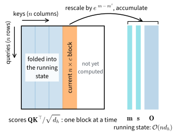

# The Cost of Attention
:label:`sec_attention-at-scale`

Long-context language models process tens or hundreds of thousands of tokens
in a single pass. Because dense self-attention evaluates a score for every
pair of positions, both its arithmetic and its naive memory footprint grow
quadratically with sequence length $n$. At $n = 8{,}192$, a single head
evaluates $6.7 \times 10^7$ query--key pairs (256 MiB in float32).

For several years, $O(n^2)$ memory was widely assumed to be an unavoidable
cost of exact attention. Then :citet:`Rabe.Staats.2021` demonstrated—building
on the *online softmax* algorithm of :citet:`Milakov.Gimelshein.2018`—that
exact attention never requires materializing the $n \times n$ score matrix,
and *FlashAttention* :cite:`Dao.Fu.Ermon.ea.2022` turned tiled online softmax
into an IO-aware GPU kernel that is both faster than naive attention and
linear in memory.

This section counts the FLOPs and memory of dense attention, benchmarks them
on a GPU, derives blockwise online softmax, and compares a chunked
implementation and fused FlashAttention kernels against naive matrix
materialization.

```{.python .input #attention-at-scale-the-cost-of-attention}
%%tab pytorch
import math
import numpy as np
import torch
from torch import nn
from torch.nn import functional as F
from d2l import torch as d2l
```

```{.python .input #attention-at-scale-the-cost-of-attention}
%%tab jax
import math
import numpy as np
import jax
from jax import numpy as jnp
from flax import nnx
import optax
from d2l import jax as d2l
```

```{.python .input #attention-at-scale-the-cost-of-attention-1}
%%tab pytorch
from torch.nn.attention import SDPBackend, sdpa_kernel
```

## Quadratic Time and Memory

### Counting FLOPs

For a multi-head self-attention layer of width $d$ with $H$ heads of width
$d_h = d/H$ over $n$ tokens, :eqref:`eq_multihead-flops` together with the
row-wise softmax gives

$$
\underbrace{8 n d^2}_{\textrm{projections}} \;+\;
\underbrace{4 n^2 d}_{\textrm{scores and mixing}} \;+\; O(Hn^2)
\quad \textrm{FLOPs}.
$$
:eqlabel:`eq_attn-layer-flops`

The quadratic $4n^2 d$ term ($2n^2 d_h$ for $\mathbf{Q}\mathbf{K}^\top$ and
$2n^2 d_h$ for $\mathbf{A}\mathbf{V}$ across $H$ heads) overtakes the linear
$8nd^2$ projection term once $n > 2d$. For GPT-2 small ($d = 768$, $n =
1{,}024$), projections still dominate; for a model with $d = 4{,}096$ at
$n = 131{,}072$, $n / (2d) = 16$, so scoring and mixing require $16\times$ as
many FLOPs as the attention projections (and roughly $5\times$ as many as the
entire transformer block once the feed-forward network of
:numref:`chap_transformers` is included, which moves the block crossover to
$n \approx 6d$).

### Counting Memory
:label:`subsec_attn-counting-memory`

At long contexts, memory often becomes the bottleneck before arithmetic. A
naive implementation materializes both the $n \times n$ score matrix and its
$n \times n$ softmax weight matrix, consuming $8n^2$ bytes per head and
sequence in float32 (versus $O(nd)$ for projections). For one head of width
$d_h = 64$ at $n = 8{,}192$, $\mathbf{Q}, \mathbf{K}, \mathbf{V}$ occupy just
6 MiB together while the two $n \times n$ buffers consume 512 MiB; at $n =
131{,}072$, a single float32 attention matrix would require 64 GiB. During
training, saving attention weights across all 12 layers and 12 heads of GPT-2
small at $n = 8{,}192$ would require $144 \times 256\textrm{ MiB} = 36\textrm{
GiB}$ per sequence.

We verify the $8n^2$-byte scratch footprint on one float32 head ($d_h = 64$)
using `d2l.peak_memory` (:numref:`sec_use_gpu`):

```{.python .input #attention-at-scale-counting-memory-1}
%%tab pytorch
def attention(Q, K, V):
    """softmax(Q K^T / sqrt(d_h)) V through the full score matrix."""
    scores = Q @ K.transpose(-2, -1) / math.sqrt(Q.shape[-1])
    return torch.softmax(scores, dim=-1) @ V
```

```{.python .input #attention-at-scale-counting-memory-1}
%%tab jax
def attention(Q, K, V):
    """softmax(Q K^T / sqrt(d_h)) V through the full score matrix."""
    scores = Q @ K.swapaxes(-2, -1) / math.sqrt(Q.shape[-1])
    return jax.nn.softmax(scores, axis=-1) @ V
```

Evaluating `d2l.peak_memory(attention, Q, Q, Q)` across sequence lengths $n \in \{2048, 4096, 8192, 16384\}$ confirms that each doubling of $n$ quadruples the temporary memory allocation right in line with $8n^2$ bytes:

```{.python .input #attention-at-scale-counting-memory-3}
%%tab pytorch
d_h = 64
for n in [2048, 4096, 8192, 16384]:
    Q = torch.randn(n, d_h, device=d2l.try_gpu())
    mem = d2l.peak_memory(attention, Q, Q, Q)  # Allocator high-water mark
    print(f'n = {n:5d}: measured {mem/2**20:7.1f}'
          f' MiB, predicted 8n^2 B = {8*n*n/2**20:7.1f} MiB')
```

```{.python .input #attention-at-scale-counting-memory-3}
%%tab jax
d_h = 64
for n in [2048, 4096, 8192, 16384]:
    Q = jax.random.normal(d2l.get_key(), (n, d_h))
    mem = d2l.peak_memory(attention, Q, Q, Q)  # XLA's compile-time scratch
    print(f'n = {n:5d}: XLA temp {mem/2**20:7.1f}'
          f' MiB, predicted 8n^2 B = {8*n*n/2**20:7.1f} MiB')
```

### Measuring Time

Timing the same forward pass with `d2l.Benchmark` (:numref:`sec_use_gpu`)
confirms the quadratic runtime growth once $n$ is large enough to amortize
kernel launch latency ($n \ge 8{,}192$):

```{.python .input #attention-at-scale-counting-memory-2}
%%tab pytorch
for n in [2048, 4096, 8192, 16384]:
    Q = torch.randn(n, d_h, device=d2l.try_gpu())
    print(d2l.Benchmark(lambda: attention(Q, Q, Q), desc=f'n = {n:5d}'))
```

```{.python .input #attention-at-scale-counting-memory-2}
%%tab jax
attention_jit = jax.jit(attention)
for n in [2048, 4096, 8192, 16384]:
    Q = jax.random.normal(d2l.get_key(), (n, d_h))
    print(d2l.Benchmark(lambda: attention_jit(Q, Q, Q), desc=f'n = {n:5d}'))
```

## Exact Attention Without the Matrix

### Blockwise Online Softmax

At first glance, the softmax denominator $\sum_{j'} \exp(a_{j'})$ and the
numerical-stability row maximum $\max_{j'} a_{j'}$
(:numref:`subsec_softmax-implementation-revisited`) appear to require all $n$
scores before any value can be weighted. *Online softmax*
:cite:`Milakov.Gimelshein.2018` avoids this two-pass requirement by
processing keys in blocks of size $c$ and maintaining three running statistics
per query: the running maximum score $m$, the running denominator sum $s =
\sum_j e^{a_j - m}$, and the unnormalized output accumulator $\mathbf{o} =
\sum_j e^{a_j - m} \mathbf{v}_j$.

When a new block of scores $\{a_j\}$ and values $\{\mathbf{v}_j\}$ arrives,
updating the running maximum to $m' = \max(m, \max_j a_j)$ requires rescaling
the previously accumulated sum $s$ and output $\mathbf{o}$ by $e^{m - m'}$:

$$
\begin{aligned}
m' &= \max\big(m, \max_j a_j\big), \\
s' &= s\, e^{m - m'} + \sum\nolimits_j e^{a_j - m'}, \\
\mathbf{o}' &= \mathbf{o}\, e^{m - m'} + \sum\nolimits_j e^{a_j - m'}\, \mathbf{v}_j.
\end{aligned}
$$
:eqlabel:`eq_online-softmax`

For example, if block 1 has scores $(1, 3)$, then $m = 3$ and $s = e^{-2} +
e^0 \approx 1.135$. If block 2 has scores $(5, 2)$, the new maximum is $m' =
5$, so the block-1 sum is rescaled by $e^{3 - 5} = e^{-2}$ and incremented by
$e^{5 - 5} + e^{2 - 5}$, yielding $s' = e^{-4} + e^{-2} + e^0 + e^{-3}
\approx 1.203$—identical to the standard softmax denominator computed with
the global maximum $5$ known in advance. After the final block,
$\mathbf{o} / s$ equals $\mathrm{softmax}(\mathbf{a})\mathbf{V}$ up to
floating-point round-off, while holding only one $n \times c$ score stripe in
memory at a time (:numref:`fig_online-softmax`, :cite:`Rabe.Staats.2021`).


:label:`fig_online-softmax`

### A Chunked Implementation
:label:`subsec_attn-chunked`

We compare full-matrix `causal_attention` against `chunked_attention`, which
steps through key--value blocks of width `chunk_size=512` using
:eqref:`eq_online-softmax` (initializing $m$ and masking future positions with
`finfo(dtype).min` to avoid $-\infty - (-\infty) = \mathrm{NaN}$ when an
entire block is causally masked; see Exercise
:exref:`ex_attention-at-scale-running-maximum`d).

```{.python .input #attention-at-scale-a-chunked-implementation-1}
%%tab pytorch
def causal_attention(Q, K, V):
    """Reference: causal attention with the full score matrix."""
    scores = Q @ K.transpose(-2, -1) / math.sqrt(Q.shape[-1])
    mask = d2l.causal_mask(Q.shape[-2], device=Q.device)
    scores.masked_fill_(~mask, torch.finfo(Q.dtype).min)
    return torch.softmax(scores, dim=-1) @ V

def chunked_attention(Q, K, V, chunk_size=512):
    """Exact causal attention, one n-by-chunk_size block at a time."""
    n, d_h = Q.shape
    m = torch.full((n, 1), torch.finfo(Q.dtype).min, device=Q.device)
    s = torch.zeros(n, 1, device=Q.device)
    O = torch.zeros(n, V.shape[-1], device=Q.device)
    pos_q = torch.arange(n, device=Q.device)[:, None]
    for start in range(0, n, chunk_size):
        Kc, Vc = K[start:start + chunk_size], V[start:start + chunk_size]
        pos_k = torch.arange(start, start + Kc.shape[0], device=Q.device)
        scores = Q @ Kc.T / math.sqrt(d_h)
        scores.masked_fill_(pos_k[None, :] > pos_q, torch.finfo(Q.dtype).min)
        m_new = torch.maximum(m, scores.max(dim=-1, keepdim=True).values)
        scale = torch.exp(m - m_new)                  # Rescale the past
        P = torch.exp(scores - m_new)
        s = s * scale + P.sum(dim=-1, keepdim=True)
        O = O * scale + P @ Vc
        m = m_new
    return O / s
```

```{.python .input #attention-at-scale-a-chunked-implementation-1}
%%tab jax
def causal_attention(Q, K, V):
    """Reference: causal attention with the full score matrix."""
    scores = Q @ K.swapaxes(-2, -1) / math.sqrt(Q.shape[-1])
    mask = d2l.causal_mask(Q.shape[-2])
    scores = jnp.where(mask, scores, jnp.finfo(scores.dtype).min)
    return jax.nn.softmax(scores, axis=-1) @ V

def chunked_attention(Q, K, V, chunk_size=512):
    """Exact causal attention, one n-by-chunk_size block at a time."""
    (n, d_h), d_v = Q.shape, V.shape[-1]
    assert n % chunk_size == 0, 'lax.scan needs equal-sized blocks'
    pos_q = jnp.arange(n)[:, None]
    def block(carry, chunk):
        m, s, O = carry
        Kc, Vc, start = chunk
        pos_k = start + jnp.arange(chunk_size)
        scores = Q @ Kc.T / math.sqrt(d_h)
        scores = jnp.where(pos_k[None, :] > pos_q,
                           jnp.finfo(scores.dtype).min, scores)
        m_new = jnp.maximum(m, scores.max(axis=-1, keepdims=True))
        scale = jnp.exp(m - m_new)                    # Rescale the past
        P = jnp.exp(scores - m_new)
        s = s * scale + P.sum(axis=-1, keepdims=True)
        O = O * scale + P @ Vc
        return (m_new, s, O), None
    init = (jnp.full((n, 1), jnp.finfo(Q.dtype).min), jnp.zeros((n, 1)),
            jnp.zeros((n, d_v)))
    chunks = (K.reshape(-1, chunk_size, d_h), V.reshape(-1, chunk_size, d_v),
              jnp.arange(0, n, chunk_size))           # Blocks, their starts
    (m, s, O), _ = jax.lax.scan(block, init, chunks)
    return O / s
```

`chunked_attention` matches `causal_attention` to float32 precision ($\sim
10^{-6}$) while reducing peak memory from $O(n^2)$ to $O(nc)$:

```{.python .input #attention-at-scale-a-chunked-implementation-2}
%%tab pytorch
n, d_h = 2048, 64
Q, K, V = (torch.randn(n, d_h, device=d2l.try_gpu()) for _ in range(3))
err = (chunked_attention(Q, K, V) - causal_attention(Q, K, V)).abs().max()
print(f'maximum deviation: {float(err):.2e}')
```

```{.python .input #attention-at-scale-a-chunked-implementation-2}
%%tab jax
n, d_h = 2048, 64
Q, K, V = (jax.random.normal(k, (n, d_h))
           for k in jax.random.split(d2l.get_key(), 3))
# Full fp32 matrix products: the GPU default (TF32) would perturb the two
# computations differently, at the 1e-4 level
with jax.default_matmul_precision('highest'):
    err = jnp.abs(chunked_attention(Q, K, V)
                  - causal_attention(Q, K, V)).max()
print(f'maximum deviation: {float(err):.2e}')
```

Comparing `d2l.peak_memory` across $n \in \{2048, 4096, 8192, 16384\}$ verifies that `chunked_attention` replaces the quadratic $O(n^2)$ memory curve of `causal_attention` with linear $O(nc)$ scaling:

```{.python .input #attention-at-scale-a-chunked-implementation-3}
%%tab pytorch
lengths, mems = [2048, 4096, 8192, 16384], [[], []]
for n in lengths:
    Q = torch.randn(n, d_h, device=d2l.try_gpu())
    mems[0].append(d2l.peak_memory(causal_attention, Q, Q, Q) / 2**20)
    mems[1].append(d2l.peak_memory(chunked_attention, Q, Q, Q) / 2**20)
print(f'n = {n:,}: full matrix {mems[0][-1]:6.1f} MiB, '
      f'chunked {mems[1][-1]:6.1f} MiB')
d2l.plot(lengths, mems, 'sequence length n', 'peak memory (MiB)',
         legend=['full matrix', 'chunked'], xscale='log', yscale='log')
```

```{.python .input #attention-at-scale-a-chunked-implementation-3}
%%tab jax
lengths, mems = [2048, 4096, 8192, 16384], [[], []]
for n in lengths:
    Q = jax.random.normal(d2l.get_key(), (n, d_h))
    mems[0].append(d2l.peak_memory(causal_attention, Q, Q, Q) / 2**20)
    mems[1].append(d2l.peak_memory(chunked_attention, Q, Q, Q) / 2**20)
print(f'n = {n:,}: full matrix {mems[0][-1]:6.1f} MiB, '
      f'chunked {mems[1][-1]:6.1f} MiB')
d2l.plot(lengths, mems, 'sequence length n', 'XLA temp memory (MiB)',
         legend=['full matrix', 'chunked'], xscale='log', yscale='log')
```

### Memory Traffic and Fused Kernels

A GPU's compute units execute matrix arithmetic orders of magnitude faster
than its off-chip high-bandwidth memory (HBM) can transfer data (e.g., on an
RTX 4090, $\sim 165$ TFLOP/s in float16 versus $\sim 0.9$ TB/s HBM bandwidth;
see :numref:`chap_performance`). Naive attention is *memory-bandwidth bound*:
it writes the $n \times n$ score matrix to HBM, reads it back for softmax,
writes the $n \times n$ weights to HBM, and reads them again to multiply by
$\mathbf{V}$—moving $4n^2$ floats across HBM with low arithmetic intensity
(Exercises :exref:`ex_attention-at-scale-arithmetic-intensity` and
:exref:`ex_attention-at-scale-tiled-traffic`). Because a Python loop like
`chunked_attention` still launches separate GPU kernels that read and write
every $n \times c$ stripe to HBM, it reduces peak memory allocation without
reducing total HBM traffic.

*FlashAttention* :cite:`Dao.Fu.Ermon.ea.2022` tiles both queries and keys so
that each score block and its running statistics $(m, s, \mathbf{o})$ reside
entirely in fast on-chip SRAM throughout the loop, never touching HBM. For
the backward pass, instead of saving $n \times n$ attention weights, the
forward pass stores only the scalar log-normalizer $\ell = m + \log s$ per
query ($O(n)$ memory) and recomputes the score tiles on chip during
backpropagation.

We benchmark the framework-provided fused FlashAttention kernel
against `causal_attention` on $B = 2$
sequences, $H = 8$ heads, $d_h = 64$, and $n = 8{,}192$ in float16. Including
an unmasked fused run separates the $O(n^2)$ HBM-traffic speedup from the
$\sim 1.5\times$ speedup of skipping upper-triangular causal tiles:

:begin_tab:`pytorch`
The fused kernel is `F.scaled_dot_product_attention`.
:end_tab:

:begin_tab:`jax`
The fused kernel is `jax.nn.dot_product_attention` with `implementation='cudnn'`.
:end_tab:

```{.python .input #attention-at-scale-the-bottleneck-is-memory-traffic}
%%tab pytorch
def fused_attention(Q, K, V, is_causal=True):
    """Attention in PyTorch's fused FlashAttention kernel."""
    with sdpa_kernel(SDPBackend.FLASH_ATTENTION):
        return F.scaled_dot_product_attention(Q, K, V, is_causal=is_causal)

B, H, n = 2, 8, 8192
X = torch.randn(B, H, n, d_h, device=d2l.try_gpu(), dtype=torch.float16)
# The unmasked kernel computes every tile: it shows what skipping saves
for name, f in [('naive', causal_attention), ('fused', fused_attention),
                ('fused, no mask',
                 lambda Q, K, V: fused_attention(Q, K, V, is_causal=False))]:
    t = d2l.Benchmark(lambda: f(X, X, X)).time
    mem = d2l.peak_memory(f, X, X, X)
    print(f'{name:>14}: {t*1e3:6.2f} ms, peak memory {mem/2**20:7.1f} MiB')
```

```{.python .input #attention-at-scale-the-bottleneck-is-memory-traffic}
%%tab jax
def fused_attention(Q, K, V, is_causal=True):
    """Attention in the fused cuDNN kernel."""
    # The kernel takes (batch, length, heads, width): swap axes 1 and 2
    Q, K, V = (A.swapaxes(1, 2) for A in (Q, K, V))
    O = jax.nn.dot_product_attention(Q, K, V, is_causal=is_causal,
                                     implementation='cudnn')
    return O.swapaxes(1, 2)

B, H, n = 2, 8, 8192
X = jax.random.normal(d2l.get_key(), (B, H, n, d_h), dtype=jnp.float16)
# The unmasked kernel computes every tile: it shows what skipping saves
for name, f in [('naive', causal_attention), ('fused', fused_attention),
                ('fused, no mask',
                 lambda Q, K, V: fused_attention(Q, K, V, is_causal=False))]:
    f_jit = jax.jit(f)
    t = d2l.Benchmark(lambda: f_jit(X, X, X)).time
    mem = d2l.peak_memory(f, X, X, X)
    print(f'{name:>14}: {t*1e3:6.2f} ms, XLA temp {mem/2**20:7.1f} MiB')
```

The fused kernel reduces temporary memory from $\sim 4$ GiB ($16 \cdot 4n^2$
bytes) to a small multiple of the 16 MiB output and runs several times faster
close to the GPU's peak matrix throughput. Even with fused kernels, however,
exact attention still performs $\Theta(n^2 d)$ arithmetic operations;
achieving linear time complexity requires changing the attention mechanism
itself (:numref:`sec_windowed-linear-attention`).

## Summary

* Dense self-attention requires $8nd^2 + 4n^2d$ FLOPs per layer; the
  quadratic score-and-mix term dominates the projections once $n > 2d$.
* Materializing the $n \times n$ score and weight matrices consumes $8n^2$
  bytes per head in float32 and makes naive attention memory-bandwidth bound.
* *Online softmax* computes exact attention block by block by maintaining a
  running maximum $m$, normalizer $s$, and value accumulator $\mathbf{o}$,
  rescaling prior sums by $e^{m - m'}$ whenever $m$ increases.
* *FlashAttention* fuses tiled online softmax in on-chip SRAM, reducing
  memory to $O(n)$ and achieving large wall-clock speedups while leaving the
  $\Theta(n^2 d)$ FLOP count intact.

## Exercises

1. **Online softmax by hand.** One query meets four keys in two blocks of
   two. Its scores are $(0, 2)$ in the first block and $(1, 3)$ in the
   second, and the values are the numbers $1, 2$ in the first block and
   $3, 4$ in the second.
    1. Apply :eqref:`eq_online-softmax` block by block, starting from
       $m = -\infty$, $s = 0$ and $o = 0$. Record $m$, $s$ and $o$ after
       each block, and divide to obtain the output.
    1. Compute the four softmax weights directly, and check that they give
       the same output.
    1. After the last block, form $\ell = m + \log s$ and recompute each of
       the four weights as $e^{a_j - \ell}$ from its score alone. Check that
       they agree with the weights of the previous part and sum to one, and
       explain why a fused kernel's backward pass can keep $\ell$ instead of
       $m$ and $s$.

1. [code] **The running maximum.** Remove the running maximum from
   `chunked_attention`, so that the state accumulates plain sums of
   $e^{a_j}$. Run the result with $\mathbf{Q}$, $\mathbf{K}$, $\mathbf{V}$
   and the state $s$, $\mathbf{O}$ in float16, on queries scaled up by a
   factor of $10$.
    1. Before running, compute the largest exponent $x$ for which $e^x$ is
       finite in float16, and estimate the fraction of scaled scores that
       exceed it when queries and keys of width $64$ have independent
       standard normal entries.
    1. Run the modified function, and report at which operation the first
       infinite or undefined value appears.
    1. Explain why carrying $m$ bounds every exponent by zero. A term
       $e^{a_j - m'}$ that is smaller than the smallest positive float16
       number rounds to zero. Bound the total contribution of such terms to
       $s$, relative to the term of the largest score, for a row of $n$
       keys.
    1. `chunked_attention` initializes $m$ with the most negative finite
       value of the dtype and masks scores with the same value. Take
       $n = 2c$ for blocks of $c$ keys, and let the loop visit the two key
       blocks in reverse order, so that every score of the first visited
       block is masked for a query in the first block. Trace $m$, $s$, and
       $\mathbf{O}$ for that query through both iterations, and show that
       the final output is still exact.
   :exlabel:`ex_attention-at-scale-running-maximum`

1. **Merging partial states.** Fix one query with scores $a_j$ and values
   $\mathbf{v}_j$. For a set $B$ of keys, call the triple $(m_B, s_B,
   \mathbf{o}_B)$ that :eqref:`eq_online-softmax` produces from the keys in
   $B$ alone the partial state of $B$, so that $\mathbf{o}_B / s_B$ is the
   attention output restricted to $B$.
    1. Derive the partial state of $B \cup B'$ for disjoint sets $B$ and
       $B'$ from the two partial states, and show that
       :eqref:`eq_online-softmax` is the special case in which $B'$ is a
       single block.
    1. Show that this merge is associative and commutative. Conclude that
       the key blocks can be processed in any order, or in parallel and
       merged in a tree of depth $\lceil \log_2 (n/c) \rceil$ for blocks of
       $c$ keys, and explain why this matters when a single query attends
       to a long cache during generation.
    1. Replace the pair $(m_B, s_B)$ by the single number $\ell_B = m_B +
       \log s_B$ and the triple by $(\ell_B, \bar{\mathbf{o}}_B)$ with
       $\bar{\mathbf{o}}_B = \mathbf{o}_B / s_B$. Express the merged
       $\ell$ and $\bar{\mathbf{o}}$ in these terms, and show that
       $\bar{\mathbf{o}}$ is a convex combination of
       $\bar{\mathbf{o}}_B$ and $\bar{\mathbf{o}}_{B'}$ whose weights
       depend only on $\ell_B$ and $\ell_{B'}$.

1. **Arithmetic intensity of attention.** Consider one head with $n$
   queries and keys of width $d_h$ and values of width $d_v$. Its two matrix
   products, $\mathbf{Q}\mathbf{K}^\top$ and the product of the weights with
   $\mathbf{V}$, cost $2n^2 d_h$ and $2n^2 d_v$ floating-point operations,
   and the softmax costs a few operations per score.
    1. Suppose that the score matrix is written to memory once and read
       once by the softmax, whose output is written once and read once by
       the value product, all in single precision. Count the bytes moved by
       these four passes, and by reading $\mathbf{Q}$, $\mathbf{K}$,
       $\mathbf{V}$ and writing the output.
    1. Neglecting the softmax arithmetic, form the ratio of operations to
       bytes and let $n \to \infty$ at fixed $d_h$ and $d_v$. Show that the
       limit is $(d_h + d_v)/8$, and state how the softmax arithmetic
       changes it.
    1. Redo the limit for inputs and scores in a 16-bit format. Take the
       16-bit throughput and the memory bandwidth of an H100 or a B200 from
       :numref:`tab_gpu_specs`, compute the ratio of operations per byte,
       and decide whether attention with $d_h = d_v = 64$ is limited by
       arithmetic or by memory traffic on it.
   :exlabel:`ex_attention-at-scale-arithmetic-intensity`

1. **Traffic of a tiled schedule.** ● By Exercise
   :exref:`ex_attention-at-scale-arithmetic-intensity`a,
   the naive layer moves $4n^2$ floats to and from main memory beyond
   the terms linear in $n$, since the score matrix and the weight matrix
   are each written once and read once. Ignore all traffic that is linear
   in $n$.
    1. Suppose that `chunked_attention` runs one operation at a time, each
       reading its inputs from main memory and writing its output back.
       Count, as functions of $n$, $c$, and $d_h$, the floats moved for the
       score stripes, the floats moved for $\mathbf{Q}$ and the accumulator
       $\mathbf{O}$, and the number of operations launched. Which of these
       quantities does chunking reduce relative to the naive layer?
    1. A fused kernel instead holds a tile of $b$ queries, their output
       accumulator, and one tile each of $b$ keys and $b$ values in a fast
       memory of $M$ floats, so that $4bd_h \leq M$; the scores of a tile
       and the running $m$ and $s$ stay in fast memory as well. It loads
       each query tile once, streams
       all key and value tiles past it, and writes each output tile once.
       Show that its traffic beyond the linear terms is $2n^2 d_h / b$
       floats and that the largest admissible tile gives
       $\Theta(n^2 d_h^2 / M)$, the bound that
       :citet:`Dao.Fu.Ermon.ea.2022` prove for FlashAttention.
    1. Compute the ratio of the fused traffic to the naive traffic for
       $d_h \in \{64, 128, 256\}$ with $M = 2^{16}$, and state how the head
       width limits the benefit of tiling.
   :exlabel:`ex_attention-at-scale-tiled-traffic`

[Discussions](https://d2l.discourse.group/t/36772)

<!-- slides -->

::: {.slide}
::: {.cover}
[Dive into Deep Learning · §10.5]{.kicker}

Attention at Scale: Memory Bandwidth, Online Softmax, and FlashAttention<br>**quadratic FLOP & memory scaling · arithmetic intensity · blockwise online softmax · SRAM tiling · FlashAttention**
:::
:::

::: {.slide title="Why Long-Context Attention Hits a Memory Wall"}
[Motivation]{.kicker}

::: {.cols .vc}
::: {.col}
- **Quadratic Scratch Footprint ($8n^2$ Bytes/Head in FP32):** Materializing the $n \times n$ score and softmax weight matrices consumes $8\text{ MiB}$ at $n = 1{,}024$, $512\text{ MiB}$ at $n = 8{,}192$, and **$128\text{ GiB}$ per head** at $n = 131{,}072$!
- **Training Multiplier:** Saving weights across all $144$ heads of GPT-2 small at $n = 8{,}192$ requires $36\text{ GiB}$ per sequence.
- **The Breakthrough:** Online softmax (Milakov & Gimelshein, 2018; Rabe & Staats, 2021) and **FlashAttention** (Dao et al., 2022) compute *exact* attention in **$O(n)$ memory**.
:::

::: {.col .fig .big}
@fig:ch10-attn-scale-memory-wall
:::
:::
:::

::: {.slide title="Counting FLOPs: When Scores Overtake Projections"}
[Arithmetic Scaling]{.kicker}

::: {.cols .vc}
::: {.col}
- **Per-Layer FLOP Decomposition:**
  $$\textrm{FLOPs} = 8 n d^2 + 4 n^2 d + O(H n^2)$$
- **The Crossover Ratio:** Dividing quadratic score-and-mix work ($4n^2d$) by linear projection work ($8nd^2$) gives $n / (2d)$.
- **Short vs. Long Contexts:** At $d = 768, n = 1{,}024$, projections dominate ($n/2d = 0.67$); at $d = 4{,}096, n = 131{,}072$, attention scoring and mixing cost **$16\times$** more FLOPs than all projections combined!
:::

::: {.col .fig}
@fig:ch10-attn-scale-flop-crossover
:::
:::
:::

::: {.slide title="Counting Memory: The 8n²-Byte Scratch Footprint"}
[Memory Allocation]{.kicker}

Why does naive attention allocate $8n^2$ bytes of temporary memory per head in `float32`?

::: {.cols .vc}
::: {.col}
- **Two $n \times n$ Materializations:** `scores = Q @ K.T / sqrt(d_h)` allocates $4n^2$ bytes, and `softmax(scores)` allocates a second $4n^2$-byte buffer for the weights before multiplying by `V`.
- **Inputs Are Tiny by Comparison:** At $n = 8{,}192, d_h = 64$, the input tensors $\mathbf{Q}, \mathbf{K}, \mathbf{V}$ occupy only $3 \times 8{,}192 \times 64 \times 4\text{ B} = 6\text{ MiB}$, while the two $n \times n$ buffers consume **$512\text{ MiB}$** ($85\times$ larger)!
:::

::: {.col .fig}
@attention-at-scale-counting-memory-1
:::
:::
:::

::: {.slide title="Measuring Quadratic Memory and Runtime on a GPU"}
[Empirical Benchmarks]{.kicker}

Measuring peak scratch memory (`d2l.peak_memory`) and wall-clock execution time (`d2l.Benchmark`) on a single `float32` head ($d_h = 64$) confirms the exact $8n^2$ byte footprint and $4\times$ time jump per doubling of $n$:

@!attention-at-scale-counting-memory-3

@!attention-at-scale-counting-memory-2
:::

::: {.slide title="Why Naive Softmax Seems to Require Two Passes"}
[The Two-Pass Bottleneck]{.kicker}

::: {.cols .vc}
::: {.col}
- **Two Global Statistics Needed:** Standard stable softmax requires the global row maximum $m = \max_j a_j$ and denominator $s = \sum_j \exp(a_j - m)$ before weighting any value $\mathbf{v}_j$.
- **Why Must We Keep $m$?** Without subtracting $m$, $\exp(a_j)$ overflows `float16` above $a_j \approx 11.09$ and `float32` above $a_j \approx 88.7$.
- **The Online Insight:** Process keys in blocks and *rescale* running sums whenever a new block contains a larger maximum $m' > m$!
:::

::: {.col .fig .big}
@fig:ch10-attn-scale-two-pass-vs-online
:::
:::
:::

::: {.slide title="Deriving Blockwise Online Softmax"}
[Online Softmax Recurrence]{.kicker}

::: {.cols .vc}
::: {.col}
- **Three Running Statistics per Query:** Running maximum $m$, unnormalized sum $s = \sum_j e^{a_j - m}$, and unnormalized output $\mathbf{o} = \sum_j e^{a_j - m}\mathbf{v}_j$.
- **Block Update Rule:**
  $$m' = \max\!\big(m, \max_j a_j\big), \quad s' = s\,e^{m - m'} + \sum_j e^{a_j - m'}$$
  $$\mathbf{o}' = \mathbf{o}\,e^{m - m'} + \sum_j e^{a_j - m'}\mathbf{v}_j$$
- **Exact Output:** After all blocks, $\mathbf{o} / s = \mathrm{softmax}(\mathbf{a})\mathbf{V}$.
:::

::: {.col .fig}
@fig:ch10-attn-scale-online-recurrence
:::
:::
:::

::: {.slide title="Worked Example: Online Softmax Across Two Blocks"}
[Step-by-Step Numerical Trace]{.kicker}

::: {.cols .vc}
::: {.col}
- **Block 1 (scores $1, 3$):** Sets $m_1 = 3$ and $s_1 = e^{-2} + e^0 \approx 1.1353$.
- **Block 2 (scores $5, 2$):** Updates maximum to $m_2 = \max(3, 5) = 5$, rescales $s_1$ by $e^{3-5} = e^{-2}$, and adds $e^0 + e^{-3}$ to reach $s_2 \approx 1.2034$.
- **Associative & Commutative:** Processing Block 2 before Block 1 keeps $m = 5$ ($e^{m-m'} = 1$) and yields the exact same sum $1.2034$.
:::

::: {.col .fig .big}
@fig:ch10-attn-scale-online-trace
:::
:::
:::

::: {.slide title="Visualizing Striped Online Softmax Memory"}
[Linear Working Memory]{.kicker}

::: {.cols .vc}
::: {.col}
- **One Stripe at a Time:** Instead of materializing the $n \times n$ score matrix, we hold only one $n \times c$ score stripe for the current block of $c$ keys.
- **Running Query State:** Alongside the stripe, we store $\mathbf{m} \in \mathbb{R}^{n \times 1}$, $\mathbf{s} \in \mathbb{R}^{n \times 1}$, and $\mathbf{O} \in \mathbb{R}^{n \times d_v}$ ($O(n d_v)$ floats total).
- **Memory Reduction:** Peak score memory drops from $O(n^2)$ to $O(nc)$, which is **linear in $n$** for fixed block size $c$!
:::

::: {.col .fig}
{.nostretch width=100%}
:::
:::
:::

::: {.slide title="Implementing Chunked Causal Attention"}
[Code Implementation]{.kicker}

`chunked_attention` steps through key–value blocks of width `chunk_size=512`, initializing `m` and masking future keys with `finfo(dtype).min` so fully masked future blocks never trigger $-\infty - (-\infty) = \mathrm{NaN}$:

@attention-at-scale-a-chunked-implementation-1
:::

::: {.slide title="Verifying Exactness and Linear Memory Growth"}
[Chunked vs. Full-Matrix Benchmark]{.kicker}

::: {.cols .vc}
::: {.col}
- **Exact to Machine Precision:** At $n = 2{,}048, d_h = 64$, `chunked_attention` matches `causal_attention` within $\sim 10^{-7}$ (`float32` rounding):

@!attention-at-scale-a-chunked-implementation-2

- **Quadratic $\to$ Linear Memory:** At $n = 16{,}384$, full-matrix attention consumes $2{,}048\text{ MiB}$ ($2\text{ GiB}$), whereas `chunked_attention` ($c = 512$) uses only $\approx 68\text{ MiB}$ ($30\times$ less)!
:::

::: {.col .fig}
@!attention-at-scale-a-chunked-implementation-3
:::
:::
:::

::: {.slide title="The Hardware Bottleneck: GPU HBM vs. On-Chip SRAM"}
[GPU Memory Hierarchy]{.kicker}

::: {.cols .vc}
::: {.col}
- **Tensor Cores vs. HBM:** A GPU executes $\sim 165$–$1{,}000\text{ TFLOP/s}$ in 16-bit matrix arithmetic, while off-chip HBM transfers only $\sim 0.9$–$3.3\text{ TB/s}$ ($\sim 180$ FLOPs per byte transferred!).
- **On-Chip SRAM ($\sim 19\text{ TB/s}$):** Registers and L1/shared memory are $10$–$20\times$ faster than HBM but hold only $\sim 128$–$256\text{ KiB}$ per SM.
- **Why Python Chunking Is Still Slow:** Launching separate kernels reads and writes every $n \times c$ stripe to slow HBM.
:::

::: {.col .fig .big}
@fig:ch10-attn-scale-sram-hierarchy
:::
:::
:::

::: {.slide title="Arithmetic Intensity of Naive Attention"}
[Roofline Analysis]{.kicker}

::: {.cols .vc}
::: {.col}
- **Four HBM Passes Over $n^2$ Floats:** Naive attention writes $\mathbf{S}$ to HBM, reads $\mathbf{S}$ for softmax, writes $\mathbf{A}$ to HBM, and reads $\mathbf{A}$ to multiply by $\mathbf{V}$.
- **Low Arithmetic Intensity:**
  $$\textrm{Intensity} \;\xrightarrow{n \to \infty}\; \frac{d_h + d_v}{4}\;\textrm{FLOPs/byte (fp16)}$$
- **Memory-Bound Regime:** For $d_h = d_v = 64$ in FP16, intensity is only $32\text{ FLOPs/byte}$—far below the $\sim 180\text{ FLOPs/byte}$ Tensor Core ridge point.
:::

::: {.col .fig}
@fig:ch10-attn-scale-hbm-passes
:::
:::
:::

::: {.slide title="FlashAttention: Tiling Queries and Keys in SRAM"}
[IO-Aware Kernel Fusion]{.kicker}

::: {.cols .vc}
::: {.col}
- **Zero HBM Score Traffic:** FlashAttention loads a query tile $\mathbf{Q}_i$ and $(m_i, s_i, \mathbf{O}_i)$ into on-chip SRAM, streams $(\mathbf{K}_j, \mathbf{V}_j)$ tiles from HBM, and writes $\mathbf{O}_i / s_i$ to HBM only once.
- **HBM Traffic Bound:** Choosing max tile size $b \propto M / d_h$ cuts quadratic HBM traffic from $4n^2$ to $\Theta(n^2 d_h^2 / M)$ floats.
- **$O(n)$ Backward Recomputation:** Saves only $\ell_i = m_i + \log s_i$ ($1$ float/query) and recomputes $\alpha_{ij} = \exp(a_{ij} - \ell_i)$ on chip during backprop!
:::

::: {.col .fig .big}
@fig:ch10-attn-scale-flash-tiling
:::
:::
:::

::: {.slide title="Benchmarking Fused FlashAttention vs. Naive Attention"}
[Code & Wall-Clock Speedup]{.kicker}

We benchmark `causal_attention` against the framework's fused FlashAttention kernel on $B = 2$ sequences, $H = 8$ heads, $d_h = 64$, and $n = 8{,}192$ in `float16`:

@attention-at-scale-the-bottleneck-is-memory-traffic
:::

::: {.slide title="Analyzing the Fused Kernel Speedup and Causal Skipping"}
[Dissecting the Benchmark]{.kicker}

Comparing `naive`, `fused` (causal), and `fused, no mask` separates two distinct sources of speedup:

- **1. Eliminating HBM Score Traffic (`naive` $\to$ `fused, no mask`):** Cuts peak temporary memory from $\sim 4{,}096\text{ MiB}$ ($16 \times 4n^2$ bytes) down to the $16\text{ MiB}$ output tensor ($> 200\times$ memory reduction) and speeds up execution several-fold by running near peak Tensor Core throughput ($2.7 \times 10^{11}\text{ FLOPs}$).
- **2. Causal Tile Skipping (`fused, no mask` $\to$ `fused`):** Because a causal mask zeroes all entries above the diagonal ($j > i$), a tiled kernel skips the entire upper triangle of empty tiles without computing them.
- **Why Causal Skipping Gives $\sim 1.5\times$ Instead of $2\times$:** Diagonal tiles straddle $j = i$ and must apply elementwise masking, and thread-block scheduling across variable-length causal rows incurs small load-balancing overhead.
:::

::: {.slide title="What Fused Kernels Solve—and What Remains O(n²)"}
[Architectural Perspective]{.kicker}

::: {.cols .vc}
::: {.col}
- **What FlashAttention solves:** Eliminates the $\Theta(n^2)$ HBM score and weight matrices, reducing peak scratch memory to $\Theta(n d_h)$ and HBM traffic to $\Theta(n^2 d_h^2 / M)$.
- **What remains $\Theta(n^2)$:** Total arithmetic FLOPs still scale as $\Theta(n^2 d)$, and the autoregressive KV cache still grows as $O(n d)$—motivating **sliding windows** and **linear attention** (§10.6).
:::

::: {.col .fig .big}
@fig:ch10-attn-scale-solved-vs-open
:::
:::
:::

::: {.slide title="Concept Check: Online Softmax and Memory Traffic"}
[Check Your Understanding]{.kicker}

Work through these three systems and algorithmic questions:

1. **Log-Sum-Exp Backward Reconstruction:** After the final block of online softmax produces $(m, s, \mathbf{o})$, how can the backward pass recover the exact softmax weight $\alpha_j$ of key $j$ from its score $a_j$ and the single stored scalar $\ell = m + \log s$?
2. **Float16 Overflow Without Running Max:** In `float16` (max finite value $65{,}504 \approx e^{11.09}$), what happens if you accumulate raw $\sum_j e^{a_j}$ without subtracting the running maximum $m$ when a scaled score reaches $a_j = 12$?
3. **Tile Size vs. Head Width:** Using FlashAttention's HBM traffic bound $\Theta(n^2 d_h^2 / M)$ for on-chip SRAM size $M$, how does doubling the head width from $d_h = 64$ to $d_h = 128$ (at fixed total width $d$) affect the maximum tile size $b$ and HBM traffic?

::: {.d2l-note .fragment .fade-up}
**Answers:**

1. **$\alpha_j = \exp(a_j - \ell)$**, because $\exp(a_j - m - \log s) = \exp(a_j - m) / s = \alpha_j$, requiring only $1$ float per query instead of $(m, s)$ or all $n$ weights!
2. **Immediate overflow to `inf`**, followed by `inf / inf = NaN` in the output normalizer. Carrying $m$ guarantees $a_j - m' \le 0$ so every exponential lies in $(0, 1]$.
3. **Tile size $b \le M / (4d_h)$ halves**, so twice as many passes over $\mathbf{K}, \mathbf{V}$ are needed and quadratic HBM traffic increases (by $2\times$ per head, or $4\times$ at fixed head count).
:::
:::

::: {.slide title="Summary: The Computational Cost of Attention"}
[Key Takeaways]{.kicker}

::: {.cols .vc}
::: {.col}
- **The $O(n^2)$ HBM Wall:** Naive attention allocates $8 H n^2$ bytes ($64\text{ GiB}$ at $n = 128\text{K}$) and is severely HBM-bandwidth bound.
- **Online Softmax Recurrence:** Updates running $(m, s, \mathbf{o})$ in one streaming pass via $e^{m - m'}$ rescaling.
- **FlashAttention Tiling:** Fuses $\mathbf{Q}\mathbf{K}^\top$, softmax, and $\mathbf{P}\mathbf{V}$ inside on-chip SRAM in $\Theta(n)$ HBM memory while skipping empty upper-triangular causal tiles.
:::

::: {.col .fig .big}
@fig:ch10-attn-scale-summary
:::
:::
:::
