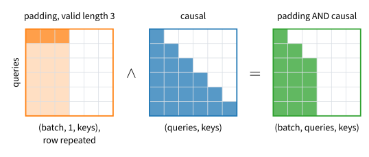
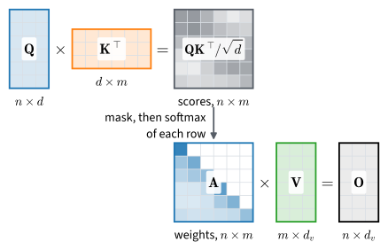
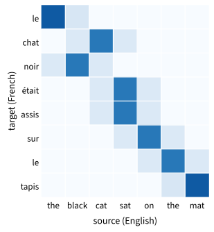

# Attention Scoring and Masking
:label:`sec_attention-scoring-functions`

The Nadaraya--Watson weights of :numref:`sec_attention-pooling` come from a
kernel chosen in advance. Two capabilities are missing before soft lookup
can serve as a layer of a trained network. First, a fixed kernel measures
compatibility as distance in a fixed space, so it cannot learn what
compatibility should mean for a task, for instance that a verb should find
its subject. We need a score that learned representations can shape and
that is fast to evaluate for every query--key pair: one attention head of
GPT-2 small, reading a context of 1,024 tokens, scores
$1{,}024^2 = 1{,}048{,}576$ pairs. Second, some of those pairs must not
count. Sequences of different lengths share a minibatch only after
padding, and no query should attend to the padding. A language model
trained to predict each next token processes all positions at once, and
the query at position $t$ must not see the tokens after it; in the GPT-2
head that rules out $523{,}776$ of the $1{,}048{,}576$ scores.

This section supplies both. The score is the dot product of query and
key, divided by $\sqrt{d}$ so that its scale does not grow with the width
$d$ of the vectors. Exclusions are boolean masks applied before the
softmax, and several of them combine by logical AND. With both in place,
attention over a whole minibatch is two batched matrix multiplications and
a softmax, the `DotProductAttention` layer that every later model in this
book builds on. The section ends with the translation model in which
learned attention first appeared.

```{.python .input #attention-scoring-attention-scoring-and-masking}
%%tab pytorch
%matplotlib inline
from d2l import torch as d2l
import math
import torch
from torch import nn
from torch.nn import functional as F
```

```{.python .input #attention-scoring-attention-scoring-and-masking}
%%tab jax
%matplotlib inline
from d2l import jax as d2l
from flax import nnx
import jax
from jax import numpy as jnp
import math
```

## Dot-Product Attention

Expanding the exponent of the Gaussian kernel gives the score

$$
a(\mathbf{q}, \mathbf{k}_i) = -\frac{1}{2} \|\mathbf{q} - \mathbf{k}_i\|^2  = \mathbf{q}^\top \mathbf{k}_i -\frac{1}{2} \|\mathbf{k}_i\|^2  -\frac{1}{2} \|\mathbf{q}\|^2.
$$
:eqlabel:`eq_gaussian-expansion`

The last term depends on the query only. It is the same for all keys, and
the softmax normalization :eqref:`eq_softmax_attention` removes it. If all
keys have the same norm, the middle term drops out in the same way, and
the Gaussian kernel and the dot product give identical weights. In general
the norms differ, and keeping only $\mathbf{q}^\top \mathbf{k}_i$ is a
modeling decision rather than an approximation: the dot product becomes
the compatibility function in its own right. Learned query and key
representations then decide what compatibility means, and the Gaussian
kernel remains the special case of keys with equal norms.

One adjustment controls the size of the scores. Suppose that the $d$
coordinates of the query and of the key are independent random variables
with mean zero and variance one. Their dot product then has mean zero and
variance $d$; for the GPT-2 head, with $d = 64$, a typical score is about
$\pm 8$. Dividing by $\sqrt{d}$ restores unit variance and gives the
*scaled dot-product* score of the Transformer
:cite:`Vaswani.Shazeer.Parmar.ea.2017`:

$$ a(\mathbf{q}, \mathbf{k}_i) = \mathbf{q}^\top \mathbf{k}_i / \sqrt{d}.$$
:eqlabel:`eq_dot_product_attention`

The attention weights are, as always, the softmax of the scores:

$$\alpha(\mathbf{q}, \mathbf{k}_i) = \mathrm{softmax}(a(\mathbf{q}, \mathbf{k}_i)) = \frac{\exp(\mathbf{q}^\top \mathbf{k}_i / \sqrt{d})}{\sum_{j=1}^m \exp(\mathbf{q}^\top \mathbf{k}_j / \sqrt{d})}.$$
:eqlabel:`eq_attn-scoring-alpha`

### Score Variance and the $1/\sqrt{d}$ Factor

Learned queries and keys are neither independent nor of unit variance, so
the calculation above describes a network at initialization. That is when
it matters. If one score exceeds the others by a wide margin, its weight
approaches $1$, the others approach $0$, and the softmax *saturates*. The
gradient that reaches the scores shrinks with it, because the Jacobian of
the softmax is

$$
\frac{\partial \boldsymbol{\alpha}}{\partial \mathbf{a}} = \mathrm{diag}(\boldsymbol{\alpha}) - \boldsymbol{\alpha} \boldsymbol{\alpha}^\top,
$$
:eqlabel:`eq_softmax-jacobian`

which tends to the zero matrix as $\boldsymbol{\alpha}$ approaches a
one-hot vector. Row $i$ of the Jacobian carries the factor $\alpha_i$, so
the gradient of the loss with respect to score $i$ is proportional to the
weight of key $i$. In a saturated row, the keys with negligible weight
receive almost no gradient, and the query learns only about the few keys
that already carry weight. A key that loses at the start has little
chance to catch up. Only this route saturates. Gradients still reach the
values, the output projection, and any residual connection. For finite
scores the Jacobian is never exactly zero, since the all-ones vector alone
spans its null space (an exercise below proves this), but it can come
arbitrarily close.

We measure both effects. We draw random queries and keys with independent
standard normal entries, compute the attention weights of each query over
$64$ keys, and record the entropy of the weights as the dimension $d$
grows, with and without the factor $1/\sqrt{d}$. For reference, the
uniform distribution over $64$ keys has entropy $\log 64 \approx 4.2$
nats, and a one-hot distribution has entropy $0$.

```{.python .input #attention-scoring-softmax-saturation-and-the-1-sqrt-d-factor-1}
%%tab pytorch
def attention_stats(d, num_keys=64, num_queries=256, scaled=True):
    q = torch.randn(num_queries, d)
    keys = torch.randn(num_queries, num_keys, d)
    scores = (keys @ q[..., None]).squeeze(-1)
    if scaled:
        scores = scores / math.sqrt(d)
    alpha = F.softmax(scores, dim=-1)
    entropy = -(alpha * torch.log(alpha + 1e-12)).sum(-1).mean()
    # Frobenius norm of the softmax Jacobian diag(alpha) - alpha alpha^T
    jac = torch.diag_embed(alpha) - alpha[..., :, None] * alpha[..., None, :]
    return entropy.item(), jac.square().sum((-2, -1)).sqrt().mean().item()

ds = [2**k for k in range(2, 10)]
entropies = [[attention_stats(d, scaled=s)[0] for d in ds]
             for s in (False, True)]
d2l.plot(ds, entropies, 'dimension d', 'entropy (nats)',
         legend=['unscaled', 'scaled by 1/sqrt(d)'], xscale='log')
```

```{.python .input #attention-scoring-softmax-saturation-and-the-1-sqrt-d-factor-1}
%%tab jax
def attention_stats(d, num_keys=64, num_queries=256, scaled=True):
    q = jax.random.normal(d2l.get_key(), (num_queries, d))
    keys = jax.random.normal(d2l.get_key(), (num_queries, num_keys, d))
    scores = (keys @ q[..., None]).squeeze(-1)
    if scaled:
        scores = scores / math.sqrt(d)
    alpha = jax.nn.softmax(scores, axis=-1)
    entropy = -(alpha * jnp.log(alpha + 1e-12)).sum(-1).mean()
    # Frobenius norm of the softmax Jacobian diag(alpha) - alpha alpha^T
    jac = (alpha[..., None] * jnp.eye(num_keys)
           - alpha[..., :, None] * alpha[..., None, :])
    return float(entropy), float(jnp.sqrt((jac**2).sum((-2, -1))).mean())

ds = [2**k for k in range(2, 10)]
entropies = [[attention_stats(d, scaled=s)[0] for d in ds]
             for s in (False, True)]
d2l.plot(ds, entropies, 'dimension d', 'entropy (nats)',
         legend=['unscaled', 'scaled by 1/sqrt(d)'], xscale='log')
```

With scaling, the entropy stays near $3.7$ nats over two orders of
magnitude of $d$: the weights are equally sharp at every width. Without
scaling it collapses as $d$ grows, to about $0.2$ nats at $d = 512$, a
nearly one-hot weighting that comes from the length of the vectors alone.
Unscaled, the largest of the $64$ weights takes about $80\%$ of the total
at $d = 64$ and about $90\%$ at $d = 512$. The norm of the Jacobian shows
what this does to the gradient that reaches the scores:

```{.python .input #attention-scoring-softmax-saturation-and-the-1-sqrt-d-factor-2}
%%tab pytorch, jax
for d in (4, 64, 512):
    _, jac_unscaled = attention_stats(d, scaled=False)
    _, jac_scaled = attention_stats(d, scaled=True)
    print(f'd = {d:3d}: Jacobian norm {jac_unscaled:.3f} (unscaled), '
          f'{jac_scaled:.3f} (scaled)')
```

With scaling, the norm is the same at every dimension. Without it, the
norm first *rises*: at small $d$ the unscaled weights concentrate on a few
keys, and the Jacobian is largest when two keys share the weight (an
exercise below finds this maximum). It crosses the scaled value near
$d = 128$, falls to about half of it at $d = 512$, and keeps falling. A
model with unscaled scores would therefore start training with nearly
one-hot attention, and the gradient that reaches its scores would flow
almost entirely through the few keys that each query already favors. The
factor $1/\sqrt{d}$ removes this dependence on the dimension. That is why
it is part of the definition :eqref:`eq_dot_product_attention` rather
than a hyperparameter to tune.

## Masking

So far every query attends to every key. Two situations require
exclusions. The first is *padding*. Sequences of different lengths share
a minibatch only after they are padded with a dummy token to a common
length (here `<blank>`):

```
Dive  into  Deep    Learning
Learn to    code    <blank>
Hello world <blank> <blank>
```

The padding carries no meaning, and no query should give it weight. The
second is *causality*. A language model trained to predict the next token
computes its outputs for all positions of a sequence at once, and the
query at position $t$ must not see the keys at positions after $t$.
Otherwise it could copy the very token it is asked to predict.

Both are described by one object, a boolean *mask* with one entry per
query--key pair that is true where the query may attend to the key. The
true entries of a row need not form a prefix, so the same object also
describes the attention windows and document boundaries we meet later.

### The Masked Softmax Operation

The *masked softmax* gives zero weight to the excluded pairs. It does not
skip them, which would leave rows of different lengths. Instead it
overwrites the excluded scores with a very negative number before the
softmax, so that their exponentials vanish, and keeps the regular array
shapes that batched kernels need.

The number has to be chosen with the precision in mind. Older code used a
constant such as $-10^6$. That works in single precision. Float16, a format
used for training today, cannot represent numbers beyond about
$6.5 \times 10^4$, and depending on the framework $-10^6$ either
overflows to $-\infty$ or is refused with an error. Literal $-\infty$
also masks correctly, until some query has no valid key at all. Every
score of its row is then $-\infty$, the softmax subtracts the row maximum
and computes $-\infty - (-\infty)$, and the row becomes NaN. The NaN
spreads to everything computed from it. We therefore overwrite with the most negative
*finite* value of the dtype (`finfo(dtype).min`). After the softmax
subtracts the row maximum, its exponential underflows to exactly zero at
any precision, and no NaN can arise.

One case remains. A query whose keys are all excluded would now receive
the uniform average of invalid values, because all its scores are equal.
`masked_softmax` sets such rows to zero. A model should still ensure that
every query keeps at least one valid key.

```{.python .input #attention-scoring-the-masked-softmax-operation-1}
%%tab pytorch
def masked_softmax(X, mask=None):  #@save
    """Softmax over the last axis with zero weight where mask is False."""
    if mask is None:
        return F.softmax(X, dim=-1)
    # Most negative finite value: zero weight at any precision, no NaN
    X = X.masked_fill(~mask, torch.finfo(X.dtype).min)
    weights = F.softmax(X, dim=-1)
    # A query without any valid key gets zero weights, not a uniform row
    return torch.where(mask.any(-1, keepdim=True), weights, 0.0)
```

```{.python .input #attention-scoring-the-masked-softmax-operation-1}
%%tab jax
def masked_softmax(X, mask=None):  #@save
    """Softmax over the last axis with zero weight where mask is False."""
    if mask is None:
        return jax.nn.softmax(X, axis=-1)
    # Most negative finite value: zero weight at any precision, no NaN
    X = jnp.where(mask, X, jnp.finfo(X.dtype).min)
    weights = jax.nn.softmax(X, axis=-1)
    # A query without any valid key gets zero weights, not a uniform row
    return jnp.where(mask.any(-1, keepdims=True), weights, 0.0)
```

The mask need only *broadcast* against the scores, so a mask that is the
same for every query, or for every sequence, is stored once. A padding
mask is of this kind: key $j$ of a sequence is valid when $j$ is less than
the sequence's valid length. `padding_mask` turns a vector of valid
lengths, one per sequence, into a mask of shape (batch, 1, keys), which
the softmax broadcasts over the queries. A matrix of lengths, one per
query, gives a mask of shape (batch, queries, keys).

```{.python .input #attention-scoring-the-masked-softmax-operation-4}
%%tab pytorch
def padding_mask(valid_lens, num_keys):  #@save
    """Boolean mask that is True for the first valid_lens keys."""
    # valid_lens of shape (batch,) gives (batch, 1, keys); per-query
    # lengths of shape (batch, queries) give (batch, queries, keys)
    if valid_lens.dim() == 1:
        valid_lens = valid_lens[:, None]
    keys = torch.arange(num_keys, device=valid_lens.device)
    return keys < valid_lens[..., None]
```

```{.python .input #attention-scoring-the-masked-softmax-operation-4}
%%tab jax
def padding_mask(valid_lens, num_keys):  #@save
    """Boolean mask that is True for the first valid_lens keys."""
    # valid_lens of shape (batch,) gives (batch, 1, keys); per-query
    # lengths of shape (batch, queries) give (batch, queries, keys)
    if valid_lens.ndim == 1:
        valid_lens = valid_lens[:, None]
    return jnp.arange(num_keys) < valid_lens[..., None]
```

We try both on a minibatch of two sequences with two queries and four
keys each, and with valid lengths $2$ and $3$. The weights beyond the
valid length should be zero, and each row should still sum to $1$.

```{.python .input #attention-scoring-the-masked-softmax-operation-2}
%%tab pytorch
masked_softmax(torch.rand(2, 2, 4), padding_mask(torch.tensor([2, 3]), 4))
```

```{.python .input #attention-scoring-the-masked-softmax-operation-2}
%%tab jax
masked_softmax(jax.random.uniform(d2l.get_key(), (2, 2, 4)),
               padding_mask(jnp.array([2, 3]), 4))
```

With one valid length per query, each row is cut at its own length:

```{.python .input #attention-scoring-the-masked-softmax-operation-3}
%%tab pytorch
masked_softmax(torch.rand(2, 2, 4),
               padding_mask(torch.tensor([[1, 3], [2, 4]]), 4))
```

```{.python .input #attention-scoring-the-masked-softmax-operation-3}
%%tab jax
masked_softmax(jax.random.uniform(d2l.get_key(), (2, 2, 4)),
               padding_mask(jnp.array([[1, 3], [2, 4]]), 4))
```

### Causal Masking

In a causal mask, the query at position $i$ may see the keys at positions
$j \leq i$. The mask is a lower triangle, and in a sequence of length $n$
it excludes $n(n-1)/2$ of the $n^2$ pairs, almost half of them.
`causal_mask` also covers the case of fewer queries than keys, which
arises when new tokens attend to the keys of earlier tokens kept in a
cache (:numref:`sec_kv-cache`). The queries are then the *last* positions
of the sequence, and query $i$ may see key $j$ when $j \leq i +
(\textrm{keys} - \textrm{queries})$.

```{.python .input #attention-scoring-causal-masking}
%%tab pytorch
def causal_mask(num_queries, num_keys=None, device=None):  #@save
    """Boolean (queries, keys) mask, True where a query may see a key."""
    # Queries are the last positions, as when new tokens attend to a
    # cache: query i sees key j if j <= i + num_keys - num_queries
    num_keys = num_queries if num_keys is None else num_keys
    i = torch.arange(num_queries, device=device)[:, None]
    j = torch.arange(num_keys, device=device)[None, :]
    return j <= i + (num_keys - num_queries)

scores = torch.randn(1, 6, 6)
d2l.show_heatmaps(masked_softmax(scores, causal_mask(6))[None],
                  xlabel='Keys', ylabel='Queries')
```

```{.python .input #attention-scoring-causal-masking}
%%tab jax
def causal_mask(num_queries, num_keys=None):  #@save
    """Boolean (queries, keys) mask, True where a query may see a key."""
    # Queries are the last positions, as when new tokens attend to a
    # cache: query i sees key j if j <= i + num_keys - num_queries
    num_keys = num_queries if num_keys is None else num_keys
    i = jnp.arange(num_queries)[:, None]
    j = jnp.arange(num_keys)[None, :]
    return j <= i + (num_keys - num_queries)

scores = jax.random.normal(d2l.get_key(), (1, 6, 6))
d2l.show_heatmaps(masked_softmax(scores, causal_mask(6))[None],
                  xlabel='Keys', ylabel='Queries')
```

The first query attends only to itself, and each later query spreads its
weight over itself and its predecessors. The triangle lets a model train
on all positions of a sequence in parallel without showing any position
its future. Every decoder in the following chapters uses it.

### Composing Masks
:label:`subsec_composing-masks`

Each requirement excludes some pairs. Padding excludes the keys beyond a
sequence's length, causality the keys after the query, and the attention
windows of :numref:`sec_attention-at-scale` the keys too far from it. A
pair is allowed only if every requirement allows it, so masks compose by
logical AND. Broadcasting keeps the composite small. A padding mask of
shape (batch, 1, keys) and a causal mask of shape (queries, keys) combine
into a mask of shape (batch, queries, keys), and neither is copied per
example or per query before the AND (:numref:`fig_mask-algebra`).


:label:`fig_mask-algebra`

Here are the weights for a minibatch of two sequences of length $6$ with
valid lengths $6$ and $3$:

```{.python .input #attention-scoring-composing-masks}
%%tab pytorch
n = 6
padding = padding_mask(torch.tensor([6, 3]), n)  # (batch, 1, key)
causal = causal_mask(n)                          # (query, key)
mask = padding & causal                          # (batch, query, key)
weights = masked_softmax(torch.randn(2, n, n), mask)
d2l.show_heatmaps(weights[None], xlabel='Keys', ylabel='Queries',
                  titles=['valid length 6', 'valid length 3'],
                  figsize=(5, 2.5))
```

```{.python .input #attention-scoring-composing-masks}
%%tab jax
n = 6
padding = padding_mask(jnp.array([6, 3]), n)  # (batch, 1, key)
causal = causal_mask(n)                       # (query, key)
mask = padding & causal                       # (batch, query, key)
weights = masked_softmax(jax.random.normal(d2l.get_key(), (2, n, n)), mask)
d2l.show_heatmaps(weights[None], xlabel='Keys', ylabel='Queries',
                  titles=['valid length 6', 'valid length 3'],
                  figsize=(5, 2.5))
```

The first sequence shows the plain causal triangle. The second has valid
length $3$, so every row stops at the third key. Composition makes empty
rows more likely. Masks that each leave every query a key can still have
an empty intersection, so the guarantee of a valid key must hold for the
composite mask.

The same algebra handles *packed sequences*. Padding many short documents
to a common length wastes computation on the padding, so training
pipelines concatenate documents into one row instead. A mask that allows a
pair only within one document, ANDed with the causal mask, keeps the
documents apart. Here a row of length $6$ holds three documents of
lengths $3$, $2$, and $1$:

```{.python .input #attention-scoring-composing-masks-1}
%%tab pytorch
doc = torch.tensor([0, 0, 0, 1, 1, 2])  # Document of each position
same_doc = doc[:, None] == doc[None, :]
packed = same_doc & causal_mask(6)
d2l.show_heatmaps(packed.float()[None, None], xlabel='Keys',
                  ylabel='Queries', cbar=False)
```

```{.python .input #attention-scoring-composing-masks-1}
%%tab jax
doc = jnp.array([0, 0, 0, 1, 1, 2])  # Document of each position
same_doc = doc[:, None] == doc[None, :]
packed = same_doc & causal_mask(6)
d2l.show_heatmaps(packed.astype(jnp.float32)[None, None], xlabel='Keys',
                  ylabel='Queries', cbar=False)
```

The composite mask is block diagonal, with one causal triangle per
document: each position attends only to the earlier positions of its own
document.

## Batched Attention

### Batch Matrix Multiplication
:label:`subsec_batch_dot`

Attention is computed on minibatches of queries, keys, and values, so we
need to multiply batches of matrices with each other. Consider two
batches of $n$ matrices each,

$$
\mathbf{Q} = [\mathbf{Q}_1, \mathbf{Q}_2, \ldots, \mathbf{Q}_n]  \in \mathbb{R}^{n \times a \times b}, \qquad
\mathbf{K} = [\mathbf{K}_1, \mathbf{K}_2, \ldots, \mathbf{K}_n]  \in \mathbb{R}^{n \times b \times c}.
$$

The *batch matrix multiplication* (BMM) computes one matrix product per
batch element,

$$\textrm{BMM}(\mathbf{Q}, \mathbf{K}) = [\mathbf{Q}_1 \mathbf{K}_1, \mathbf{Q}_2 \mathbf{K}_2, \ldots, \mathbf{Q}_n \mathbf{K}_n] \in \mathbb{R}^{n \times a \times c}.$$
:eqlabel:`eq_batch-matrix-mul`

The `@` operator computes it. It batches over any number of leading
axes, which the attention layers of the next sections use for their extra
axis of heads.

```{.python .input #attention-scoring-batch-matrix-multiplication}
%%tab pytorch
Q = torch.ones((2, 3, 4))
K = torch.ones((2, 4, 6))
d2l.check_shape(Q @ K, (2, 3, 6))
```

```{.python .input #attention-scoring-batch-matrix-multiplication}
%%tab jax
Q = jnp.ones((2, 3, 4))
K = jnp.ones((2, 4, 6))
d2l.check_shape(Q @ K, (2, 3, 6))
```

:begin_tab:`pytorch`
`torch.bmm(Q, K)` computes the same product for arrays with exactly one
batch axis. The `@` operator, short for `torch.matmul`, also accepts any
number of leading axes and broadcasts them.
:end_tab:

:begin_tab:`jax`
The `@` operator is short for `jnp.matmul`, which treats every axis before
the last two as a batch axis and broadcasts them.
:end_tab:

### The DotProductAttention Class
:label:`subsec_dot-product-attention-class`

Scaled dot-product attention can now be written for many queries at once.
For $n$ queries and $m$ key--value pairs, with queries and keys of width
$d$ and values of width $d_v$, stack the queries into $\mathbf{Q} \in
\mathbb{R}^{n \times d}$, the keys into $\mathbf{K} \in \mathbb{R}^{m
\times d}$, and the values into $\mathbf{V} \in \mathbb{R}^{m \times
d_v}$. The whole computation is two matrix products and a softmax
(:numref:`fig_attention-shapes`):

$$ \mathrm{softmax}\left(\frac{\mathbf{Q} \mathbf{K}^\top }{\sqrt{d}}\right) \mathbf{V} \in \mathbb{R}^{n \times d_v}.$$
:eqlabel:`eq_softmax_QK_V`


:label:`fig_attention-shapes`

The softmax normalizes each row of the score matrix, so row $i$ of the
output is the attention :eqref:`eq_attention_pooling` of query $i$. The
cost is visible in the shapes. For the GPT-2 head at a context of $n = m
= 1{,}024$ with $d = d_v = 64$, the score matrix holds $1{,}048{,}576$
entries, 4 MiB in single precision, and the two products take $2 \cdot 2
n^2 d \approx 0.27$ billion floating-point operations. Both numbers grow
with the square of the context length, which is the subject of
:numref:`sec_attention-at-scale`.

Queries and keys must have the same width $d$. That is no restriction in
practice, because the queries and keys of a network are computed from its
inputs by learned linear maps, which can map to any common width
(:numref:`sec_multihead-attention`). On a minibatch,
:eqref:`eq_softmax_QK_V` uses the batch matrix multiplication
:eqref:`eq_batch-matrix-mul` twice. The class applies dropout to the
attention weights as a regularizer and keeps the weights of its last call
in `attention_weights` for inspection.

```{.python .input #attention-scoring-the-dotproductattention-class-1}
%%tab pytorch
class DotProductAttention(nn.Module):  #@save
    """Scaled dot-product attention over the last two axes."""
    def __init__(self, dropout=0.0):
        super().__init__()
        self.dropout = nn.Dropout(dropout)
        self.attention_weights = None

    # Leading axes (batch, and heads if present) are carried along.
    # Shape of queries: (..., no. of queries, d)
    # Shape of keys: (..., no. of key-value pairs, d)
    # Shape of values: (..., no. of key-value pairs, value dimension)
    # mask: boolean, broadcastable to (..., no. of queries, no. of keys),
    # True where a query may attend to a key
    def forward(self, queries, keys, values, mask=None):
        d = queries.shape[-1]
        scores = queries @ keys.transpose(-2, -1) / math.sqrt(d)
        self.attention_weights = masked_softmax(scores, mask)
        return self.dropout(self.attention_weights) @ values
```

```{.python .input #attention-scoring-the-dotproductattention-class-1}
%%tab jax
class DotProductAttention(nnx.Module):  #@save
    """Scaled dot-product attention over the last two axes."""
    def __init__(self, dropout=0.0, *, rngs=None):
        # rngs is needed only to draw dropout masks (dropout > 0)
        self.dropout = nnx.Dropout(dropout, rngs=rngs)
        # A Variable, so that views of the module (nnx.view) share it
        self.last_weights = nnx.Intermediate(None)

    # Leading axes (batch, and heads if present) are carried along.
    # Shape of queries: (..., no. of queries, d)
    # Shape of keys: (..., no. of key-value pairs, d)
    # Shape of values: (..., no. of key-value pairs, value dimension)
    # mask: boolean, broadcastable to (..., no. of queries, no. of keys),
    # True where a query may attend to a key
    def __call__(self, queries, keys, values, mask=None):
        d = queries.shape[-1]
        scores = queries @ keys.swapaxes(-2, -1) / math.sqrt(d)
        weights = masked_softmax(scores, mask)
        if not isinstance(weights, jax.core.Tracer):
            # Record the weights of eager calls for inspection; inside
            # jit-compiled code skip it, so the module state keeps a
            # fixed structure and the compiled step is reused
            self.last_weights.set_value(weights)
        return self.dropout(weights) @ values

    @property
    def attention_weights(self):
        """Weights of the last eager call: (..., queries, keys)."""
        return self.last_weights.get_value()
```

:begin_tab:`jax`
The weights live in an `nnx.Intermediate` variable rather than in a plain
attribute, so that a view of the module created with `nnx.view` shares
them with the original. The class records them only in eager calls. Under
`nnx.jit` the weights are abstract values of a function being compiled.
Storing them would change the structure of the module's state between
calls and force a new compilation. It would also make every compiled
training step hand back the full (queries, keys) weight array of every
layer, memory that the step otherwise frees as soon as the weights have
been used. The record therefore keeps its previous value under `jit`, and
we call the module outside `jit` when we want to look at its weights.
:end_tab:

We test the class on a minibatch of two sequences, each with one query of
width $2$ and ten key--value pairs with values of width $4$, and with
valid lengths $2$ and $6$. Evaluation mode switches dropout off. The
output has one row of width $4$ per query.

```{.python .input #attention-scoring-the-dotproductattention-class-2}
%%tab pytorch
queries = torch.randn(2, 1, 2)
keys = torch.randn(2, 10, 2)
values = torch.randn(2, 10, 4)
mask = padding_mask(torch.tensor([2, 6]), 10)

attention = DotProductAttention(dropout=0.5)
attention.eval()
d2l.check_shape(attention(queries, keys, values, mask), (2, 1, 4))
```

```{.python .input #attention-scoring-the-dotproductattention-class-2}
%%tab jax
queries = jax.random.normal(d2l.get_key(), (2, 1, 2))
keys = jax.random.normal(d2l.get_key(), (2, 10, 2))
values = jax.random.normal(d2l.get_key(), (2, 10, 4))
mask = padding_mask(jnp.array([2, 6]), 10)

attention = DotProductAttention(dropout=0.5,
                                rngs=nnx.Rngs(d2l.get_key()))
attention.eval()
d2l.check_shape(attention(queries, keys, values, mask), (2, 1, 4))
```

The stored weights confirm the mask. Each row holds the weights of one
sequence's query, and they vanish beyond the second and the sixth key,
respectively.

```{.python .input #attention-scoring-the-dotproductattention-class-3}
%%tab pytorch, jax
d2l.show_heatmaps(attention.attention_weights.reshape((1, 1, 2, 10)),
                  xlabel='Keys', ylabel='Sequences', figsize=(4, 1.6))
```

## Attention as Learned Alignment
:label:`subsec_learned-alignment`

Learned attention first appeared in neural machine translation. Around
2014 the leading neural approach encoded a source sentence with an RNN
into one fixed-size vector and decoded the translation from that vector
with a second RNN; we build such an encoder--decoder in
:numref:`sec_seq2seq`. This is the bottleneck of
:numref:`sec_queries-keys-values`: one vector had to represent the whole
sentence, and translation quality fell as sentences grew longer.

:citet:`Bahdanau.Cho.Bengio.2014` kept the two RNNs but changed what the
decoder reads. At every output step, the current decoder state served as a
query against all encoder states, which served as keys and values. The
weighted sum, a fresh one for every output token, entered the next
prediction. The paper's title called this "jointly learning to align and
translate". The learned weights resembled the soft word alignments of
classical statistical translation: mostly monotone along the diagonal,
with departures where the two languages order words differently, as
sketched in :numref:`fig_alignment`. Nothing in the training objective
asked for alignments. They emerged because they help to translate.


:label:`fig_alignment`

One detail differed from the score we chose above. The decoder state and
the encoder states had different widths, so instead of a dot product,
:citet:`Bahdanau.Cho.Bengio.2014` scored with a small network with one
hidden layer, now called *additive attention*:

$$a(\mathbf{q}, \mathbf{k}) = \mathbf{w}_v^\top \tanh(\mathbf{W}_q \mathbf{q} + \mathbf{W}_k \mathbf{k}) \in \mathbb{R}.$$
:eqlabel:`eq_additive-attn`

Here $\mathbf{q} \in \mathbb{R}^{d_q}$ and $\mathbf{k} \in
\mathbb{R}^{d_k}$ may have different widths, and the learned parameters
are $\mathbf{W}_q \in \mathbb{R}^{r \times d_q}$, $\mathbf{W}_k \in
\mathbb{R}^{r \times d_k}$, and $\mathbf{w}_v \in \mathbb{R}^{r}$ for a
hidden width $r$. The two projections map queries and keys into a shared
$r$-dimensional space, and $\mathbf{w}_v$ reads a score off their sum. We
score three queries of width $20$ against six keys of width $2$, widths
that no dot product could pair.

```{.python .input #attention-scoring-from-alignment-to-attention}
%%tab pytorch
queries, keys = torch.randn(3, 20), torch.randn(6, 2)
r = 8  # Hidden width
W_q = torch.randn(r, 20) / math.sqrt(20)
W_k = torch.randn(r, 2) / math.sqrt(2)
w_v = torch.randn(r) / math.sqrt(r)
features = torch.tanh((queries @ W_q.T)[:, None, :]
                      + (keys @ W_k.T)[None, :, :])
scores = features @ w_v
d2l.check_shape(scores, (3, 6))
F.softmax(scores, dim=-1)
```

```{.python .input #attention-scoring-from-alignment-to-attention}
%%tab jax
queries = jax.random.normal(d2l.get_key(), (3, 20))
keys = jax.random.normal(d2l.get_key(), (6, 2))
r = 8  # Hidden width
normal = lambda *shape: jax.random.normal(d2l.get_key(), shape)
W_q = normal(r, 20) / math.sqrt(20)
W_k = normal(r, 2) / math.sqrt(2)
w_v = normal(r) / math.sqrt(r)
features = jnp.tanh((queries @ W_q.T)[:, None, :]
                    + (keys @ W_k.T)[None, :, :])
scores = features @ w_v
d2l.check_shape(scores, (3, 6))
jax.nn.softmax(scores, axis=-1)
```

Each row is a distribution over the six keys. The intermediate array
`features` has shape $3 \times 6 \times 8$, one hidden vector per
query--key pair, and this array is why the dot product replaced the
additive score. All dot products of queries and keys form one matrix
multiplication, which accelerators execute fast, while the additive score
needs an $n \times m \times r$ array of hidden activations. The dot
product can still use a learned metric. Projecting queries and keys with
learned matrices first leaves a score that runs at the speed of matrix
multiplication. This is the form attention takes in the Transformer,
whose authors dropped the recurrent networks altogether and kept attention
as the only operation that relates positions
:cite:`Vaswani.Shazeer.Parmar.ea.2017`.

We can now compute attention for a whole minibatch, with scores that
learned representations can shape and with any pattern of exclusions.
Each query, however, still forms a single weighted average, and nothing in
the computation knows where in the sequence a key sits.
:numref:`sec_multihead-attention` runs several lookups side by side, and
:numref:`sec_positional-information` adds positions.

## Summary

Scaled dot-product attention scores a query against a key by
$\mathbf{q}^\top \mathbf{k}/\sqrt{d}$, which is the Gaussian kernel without
the norm terms, and it scores all pairs of a minibatch with one batched
matrix multiplication. The factor $1/\sqrt{d}$ keeps the score variance
independent of the width, so the softmax does not saturate at
initialization merely because the vectors are long. A boolean mask
excludes padding, future positions, or any other pairs before the
softmax. Masks compose by logical AND under broadcasting. The excluded
scores are overwritten with the most negative finite value of the dtype,
which is safe in reduced precision. `DotProductAttention` combines
scoring, masking, dropout, and the weighted sum of values. Additive
attention, the score of the first neural alignment model, gave way to the
dot product because the dot product is a matrix multiplication.

## Exercises

1. **Invariances of the score.** The Gaussian score
   :eqref:`eq_gaussian-expansion` and the scaled dot product
   :eqref:`eq_dot_product_attention` both define attention weights through
   the softmax :eqref:`eq_attn-scoring-alpha`.
    1. For each of the two scores, determine which of the following
       transformations leaves the weights unchanged: adding one vector
       $\mathbf{c}$ to every key; adding $\mathbf{c}$ to the query and to
       every key; multiplying the query and every key by one orthogonal
       matrix.
    1. Queries and keys are usually computed from inputs by affine maps,
       $\mathbf{q} = \mathbf{W}_q \mathbf{x} + \mathbf{b}_q$ and
       $\mathbf{k}_i = \mathbf{W}_k \mathbf{y}_i + \mathbf{b}_k$. Expand
       $\mathbf{q}^\top \mathbf{k}_i$ into four terms and show that the
       weights do not depend on $\mathbf{b}_k$. What is the gradient of the
       loss with respect to $\mathbf{b}_k$?
    1. Through which of the four terms does $\mathbf{b}_q$ affect the
       weights, and what preference over the keys can it express that the
       bias-free score cannot?

1. [code] **The softmax Jacobian.** `attention_stats` measures the
   Frobenius norm of the Jacobian :eqref:`eq_softmax-jacobian`.
    1. Derive :eqref:`eq_softmax-jacobian` from
       :eqref:`eq_attn-scoring-alpha`, show that for finite scores its null
       space is spanned by the all-ones vector, and check the formula
       against automatic differentiation on a random score vector.
    1. Compute the Frobenius norm when $\boldsymbol{\alpha}$ is one-hot and
       when it is uniform over $m$ keys, and evaluate the uniform case for
       $m = 64$. Show that the squared norm is close to $\sum_i \alpha_i^2$
       when every weight is small, and use this to explain why the scaled
       norms printed for $d \in \{4, 64, 512\}$ exceed the uniform value.
    1. Compute the norm for weights spread uniformly over $k$ of the $m$
       keys, find the $k$ that maximizes it, and confirm by sampling random
       weight vectors that none exceeds this maximum. Use the result to
       explain why the unscaled norm printed for $d = 4$ exceeds the scaled
       one.

1. **Fully masked rows.** `masked_softmax` overwrites excluded scores with
   the most negative finite value of the dtype and then zeroes the rows of
   queries that have no valid key.
    1. Explain why, without the final zeroing, a fully masked row returns
       the uniform distribution, and why the same row returns NaN when the
       scores are overwritten with $-\infty$ instead. Trace both cases
       through the subtraction of the row maximum that a numerically stable
       softmax performs.
    1. In a self-attention layer, whose queries, keys, and values all come
       from the same sequence, let a query at a padding position have no
       valid key, as the composite masks of :numref:`subsec_composing-masks`
       can arrange, and let the excluded scores be overwritten with
       $-\infty$, so that the output at that position is NaN. That output
       is discarded, and in the next attention layer every valid query
       excludes the padding position as a key. Explain why the NaN
       nevertheless corrupts the outputs of all valid positions of that
       sequence in the next layer.

1. **Composite masks.** :numref:`subsec_composing-masks` combines masks by
   logical AND and warns that masks that are harmless alone can leave a
   query with no valid key. A causal sliding window of width $w$ lets the
   query at position $t$ attend to the keys at positions $t - w + 1, \ldots,
   t$.
    1. For a sequence of length $6$ with valid length $3$, write the padding
       mask and the causal sliding window of width $2$ as $6 \times 6$
       boolean matrices. Check that each leaves every query at least one
       key, and find the queries whose row of the AND is empty.
    1. Show that an AND of masks has no empty row if every mask allows each
       query to attend to its own position. Which of the padding, causal,
       sliding-window, and packed-sequence masks satisfy this condition, and
       what does the answer say about the empty rows you found?
    1. Some implementations add a bias matrix with entries $0$ for allowed
       pairs and $c < 0$ for excluded pairs, and compose masks by adding
       their biases. Take for $c$ the most negative finite single-precision
       value, about $-3.4 \times 10^{38}$. Compute the sum of two such
       biases in single precision, and determine what the softmax returns
       for a row in which every key is excluded by both masks and for a row
       in which every key is excluded but some keys by only one mask.

1. [code] **Attention dropout.** `DotProductAttention` applies dropout with
   rate $p$ to the attention weights, and the weights it exposes for
   visualization are those before dropout. Dropout multiplies each kept
   weight by $1/(1 - p)$ and sets the others to zero, so a row of weights
   no longer sums to $1$.
    1. Show that the row sum after dropout has expectation $1$ and variance
       $\frac{p}{1-p} \sum_i \alpha_i^2$, and evaluate the variance for a
       row that is uniform over $l$ keys and for a one-hot row. What is the
       output of a one-hot row in the draws in which dropout removes the
       attended weight?
    1. Use the inputs of :numref:`subsec_dot-product-attention-class` with
       dropout $0.5$ active, and pass as values a batch of $10 \times 10$
       identity matrices, so that each output row equals the weights after
       dropout. Compare the mean and the variance of the row sums over many
       draws with the prediction computed from the weights before dropout.

1. **Entropy of random scores.** ● The scaled curve of `attention_stats`
   stays near $3.7$ nats, below the uniform value $\log 64 \approx 4.16$.
   Fix one query $\mathbf{q} \in \mathbb{R}^d$ and draw $m$ keys with
   independent standard normal coordinates, as `attention_stats` does.
    1. Show that the scaled scores $a_i = \mathbf{q}^\top \mathbf{k}_i /
       \sqrt{d}$ are independent normal variables with mean $0$ and variance
       $s^2 = \|\mathbf{q}\|^2 / d$, and compute the expected value of $s^2$
       when $\mathbf{q}$ is drawn as in `attention_stats`.
    1. The entropy of the weights is $H = \log Z - \sum_i \alpha_i a_i$ with
       $Z = \sum_j \exp(a_j)$. For large $m$, replace $Z/m$ and
       $\sum_i \exp(a_i)\, a_i / m$ by their expected values and derive
       $$H \approx \log m - \frac{s^2}{2}.$$
       Evaluate the approximation for $m = 64$ and $s = 1$.
    1. The approximation needs $Z$ to concentrate around its mean. Compute
       the relative standard deviation of $Z$ as a function of $s$ and $m$,
       and derive from it a condition on $s^2$ under which the approximation
       holds. Unscaled scores have $s^2 = \|\mathbf{q}\|^2$, whose expected
       value is $d$. Evaluate the relative standard deviation for $m = 64$
       at $s^2 = 4$ and $s^2 = 8$, and compare the approximation with the
       unscaled entropies that `attention_stats` returns for $d = 4$ and
       $d = 8$.

1. [code] **Additive scores near zero.** ● The additive score
   :eqref:`eq_additive-attn` adds the projected query and the projected key
   inside a $\tanh$.
    1. Replace $\tanh$ by the identity and show that the attention weights
       then do not depend on the query.
    1. Expand $\tanh$ to third order around zero, identify the lowest-order
       terms through which the weights depend on the query, and state how
       this dependence scales when $\mathbf{W}_q$ and $\mathbf{W}_k$ are
       both multiplied by a small factor $\epsilon$.
    1. Multiply `W_q` and `W_k` in the code of
       :numref:`subsec_learned-alignment` by $\epsilon \in \{1, 0.3, 0.1,
       0.03\}$, and measure the largest difference between the weight rows
       of the three queries. Check the scaling you derived, and state what
       the result for $\epsilon = 1$ implies for additive attention at
       initialization.

1. [extended] **A learned alignment.** ●
   :citet:`Bahdanau.Cho.Bengio.2014` observed that attention weights trained
   only for translation behave like alignments (:numref:`fig_alignment`).
   The same effect appears in a toy model without recurrent networks. Draw
   source sequences of $8$ tokens uniformly from a vocabulary of $16$, and
   let the target at output position $j$ be the source token at position
   $\pi(j)$ for a fixed permutation $\pi$ of the positions. Score one
   learned query per output position against keys that a learned linear map
   computes from the concatenated one-hot token and one-hot position of each
   source token, use the one-hot source tokens as values, and train on the
   negative logarithm of the output entry that belongs to the target token.
    1. Implement the model with `DotProductAttention`, train it, and plot
       the attention weights of one sequence with `d2l.show_heatmaps`.
       Compare the map with $\pi$.
    1. Replace the score by the additive rule :eqref:`eq_additive-attn` and
       compare the number of steps that each model needs to reach $99\%$
       accuracy.
    1. Give queries and keys the width $d \in \{16, 256, 1024\}$ with
       standard normal initialization, and train with and without the
       factor $1/\sqrt{d}$. Relate the training curves to the entropy of the
       weights at initialization.
    1. Explain why a fixed query per output position cannot learn a
       reordering that depends on the tokens, such as swapping two
       neighbors only when the first belongs to a designated subset of the
       vocabulary, and state what the query would have to depend on.

[Discussions](https://d2l.discourse.group/t/36769)

<!-- slides -->

::: {.slide}
::: {.cover}
[Dive into Deep Learning · §10.2]{.kicker}

Attention Scoring and Masking<br>
**scaled dot products · the 1/√d factor · masks and their algebra · attention as two matrix products · additive attention**
:::
:::

::: {.slide title="One Causal Head Scores a Million Pairs and Must Discard Half"}
[The problem]{.kicker}

One GPT-2-small head at a context of 1,024 tokens:

- $1{,}024^2 = 1{,}048{,}576$ query–key scores per layer;
- a fixed kernel cannot learn which of them should be large;
- a language model must ignore the future: $523{,}776$ scores excluded;
- a padded minibatch must ignore the padding.

::: {.d2l-note .warn}
We need a learnable score that is fast for every pair, and a way to
exclude pairs.
:::
:::

::: {.slide title="By the End of This Deck You Can"}
[Goals]{.kicker}

- derive the dot-product score from the Gaussian kernel;
- explain and measure why scores are divided by $\sqrt{d}$;
- build padding and causal masks and combine them by AND;
- write attention for $n$ queries as two matrix products and a softmax;
- count the scores, bytes, and FLOPs of one head.

**Running example:** one GPT-2-small head, $d = 64$, context
$n = 1{,}024$.
:::

::: {.slide title="Learned Scores, Masks, and Batching Turn Lookup into a Layer"}
[Where this fits]{.kicker}

::: {.cols .vc}
::: {.col}
| section | adds |
|---|---|
| Queries, Keys, and Values | attention as a soft lookup |
| **Attention Scoring and Masking** | **scaled dot products, masks** |
| Multi-Head and Cross-Attention | several heads, shared keys and values |
| Positional Information | where a token sits |
| The Cost of Attention | quadratic cost, fused kernels |
| Attention Circuits | what trained heads compute |
:::

::: {.col .narrow}
- **Uses:** soft lookup, softmax, padding of minibatches.
- **Skips:** heads and projections (next deck), positions.
:::
:::
:::

::: {.slide title="The Gaussian Kernel Is a Dot Product Plus Two Norms"}
$$-\tfrac{1}{2}\|\mathbf{q} - \mathbf{k}_i\|^2 = \mathbf{q}^\top \mathbf{k}_i - \tfrac{1}{2}\|\mathbf{k}_i\|^2 - \tfrac{1}{2}\|\mathbf{q}\|^2$$

- $\|\mathbf{q}\|^2$ is the same for every key: the softmax removes it.
- $\|\mathbf{k}_i\|^2$ drops out when all keys have equal norm.
- Keeping only $\mathbf{q}^\top\mathbf{k}_i$ is a modeling choice: learned
  queries and keys decide what "compatible" means.
:::

::: {.slide title="At d = 64 a Typical Unscaled Score Is ±8"}
Entries of $\mathbf{q}, \mathbf{k} \in \mathbb{R}^d$ independent, mean 0,
variance 1:

$$\operatorname{Var}(\mathbf{q}^\top \mathbf{k}) = \sum_{j=1}^d \operatorname{Var}(q_j k_j) = d$$

- $d = 64$: standard deviation $8$.
- Divide by $\sqrt{d}$: variance 1 at every width.

$$a(\mathbf{q}, \mathbf{k}) = \mathbf{q}^\top \mathbf{k} / \sqrt{d}$$
:::

::: {.slide title="Unscaled Scores Collapse the Softmax Entropy"}
256 random queries, 64 keys each; entropy of the weights:

@!attention-scoring-softmax-saturation-and-the-1-sqrt-d-factor-1

- Uniform over 64 keys: 4.2 nats. Scaled: about 3.7 at every $d$.
- Unscaled: about 0.2 nats at $d = 512$, nearly one-hot.
:::

::: {.slide title="Saturation Shrinks the Gradient That Reaches the Scores"}
$$\frac{\partial \boldsymbol{\alpha}}{\partial \mathbf{a}} = \mathrm{diag}(\boldsymbol{\alpha}) - \boldsymbol{\alpha}\boldsymbol{\alpha}^\top \to \mathbf{0} \quad \textrm{as } \boldsymbol{\alpha} \to \textrm{one-hot}$$

@!attention-scoring-softmax-saturation-and-the-1-sqrt-d-factor-2

- Scaled: the same norm at every $d$. Unscaled: larger at $d = 64$, about
  half at $d = 512$, still falling.
- The gradient of score $i$ carries the factor $\alpha_i$: queries and
  keys learn only through the few keys that already carry weight.
:::

::: {.slide title="Check: Two Keys One Standard Deviation Apart"}
[Check]{.kicker}

In a $d = 64$ head, two keys score one standard deviation apart. What is
the ratio of their weights without and with the factor $1/\sqrt{d}$?

::: {.fragment .fade-up}
::: {.d2l-note}
**Answer.** Unscaled, the scores differ by 8: ratio $e^8 \approx 3{,}000$.
Scaled, they differ by 1: ratio $e \approx 2.7$. Without the factor, one
key takes most of the weight (about 80% over 64 random keys) before
training has begun.
:::
:::
:::

::: {.slide title="Padding and Causality Both Exclude Query–Key Pairs"}
**Padding:** sequences of different lengths share a minibatch.

```
Dive  into  Deep    Learning
Learn to    code    <blank>
Hello world <blank> <blank>
```

**Causality:** the query at position $t$ must not see keys after $t$, or
it can copy the token it should predict.

::: {.d2l-note .rule}
One object for both: a boolean mask, true where query $i$ may attend to
key $j$.
:::
:::

::: {.slide title="Fill Excluded Scores with the Most Negative Finite Value"}
| fill value | excluded key | row with every key excluded |
|---|---|---|
| $-10^6$ | weight 0; float16 overflows to $-\infty$ or refuses it | uniform; float16: NaN or an error |
| $-\infty$ | weight 0 | NaN: $-\infty - (-\infty)$ |
| `finfo(dtype).min` | weight 0 at any precision | uniform, then set to zero |

::: {.d2l-note}
float16 stops at $6.5 \times 10^4$. `finfo(float16).min`
$\approx -6.5 \times 10^4$, and its exponential underflows to exactly 0.
:::
:::

::: {.slide title="The Masked Softmax Fills, Normalizes, and Zeroes Empty Rows"}
@attention-scoring-the-masked-softmax-operation-1

The mask only has to broadcast against the scores
(…, queries, keys).
:::

::: {.slide title="Valid Lengths Become a Padding Mask"}
Two sequences, two queries, four keys; valid lengths 2 and 3:

@attention-scoring-the-masked-softmax-operation-2

- Shape (batch, 1, keys): one row per sequence, broadcast over queries.
- Excluded weights are exactly 0; each row sums to 1.
:::

::: {.slide title="A Causal Mask Is a Lower Triangle"}
@!attention-scoring-causal-masking

- Query $i$ sees keys $j \le i$: $n(n-1)/2$ of $n^2$ pairs excluded.
- With fewer queries than keys (a cache), the queries are the last
  positions.
:::

::: {.slide title="Masks Compose by AND Under Broadcasting"}
{width=92%}

A pair is allowed only if every mask allows it; no mask is copied per
query or per example.
:::

::: {.slide title="Packed Documents Need a Block-Diagonal Mask"}
Three documents of lengths 3, 2, 1 in one row: same document AND causal.

@!attention-scoring-composing-masks-1

Each position attends only to earlier positions of its own document.
:::

::: {.slide title="Check: An Empty Row"}
[Check]{.kicker}

A query's row of the composite mask is all false. What does the softmax
return if the excluded scores are filled with $-\infty$? With
`finfo.min`? What does `masked_softmax` return?

::: {.fragment .fade-up}
::: {.d2l-note}
**Answer.** NaN, which then spreads to every later layer; a uniform
average over invalid values; a row of zeros. Masks that are harmless
alone can still intersect to an empty row.
:::
:::
:::

::: {.slide title="Attention Is Two Matrix Products and a Softmax"}
$$\mathrm{softmax}\left(\frac{\mathbf{Q}\mathbf{K}^\top}{\sqrt{d}}\right)\mathbf{V} \in \mathbb{R}^{n \times d_v}$$

{width=48%}
:::

::: {.slide title="The Layer Is Three Lines" only="pytorch"}
The core of `DotProductAttention.forward`:

```{.python #attention-scoring-exercises-1}
# queries (..., n, d), keys (..., m, d), values (..., m, d_v)
scores = queries @ keys.transpose(-2, -1) / math.sqrt(d)
weights = masked_softmax(scores, mask)  # (..., n, m)
output = dropout(weights) @ values      # (..., n, d_v)
```

- Leading axes (batch, later heads) are carried along by `@`.
- The class keeps `weights` in `attention_weights` for inspection.
:::

::: {.slide title="The Layer Is Three Lines" only="jax"}
The core of `DotProductAttention.__call__`:

```{.python #attention-scoring-exercises-2}
# queries (..., n, d), keys (..., m, d), values (..., m, d_v)
scores = queries @ keys.swapaxes(-2, -1) / math.sqrt(d)
weights = masked_softmax(scores, mask)  # (..., n, m)
output = dropout(weights) @ values      # (..., n, d_v)
```

- Leading axes (batch, later heads) are carried along by `@`.
- The class keeps `weights` in `attention_weights` for inspection.
:::

::: {.slide title="One GPT-2 Head at 1,024 Tokens: 4 MiB of Scores, 0.27 GFLOP"}
$n = m = 1{,}024$, $d = d_v = 64$, float32:

- scores: $1{,}024^2 = 1{,}048{,}576$ entries, $\times 4$ bytes = 4 MiB;
- FLOPs: $2 \cdot n^2 d$ for $\mathbf{Q}\mathbf{K}^\top$ plus
  $2 \cdot n^2 d_v$ for $\mathbf{A}\mathbf{V}$ $\approx 0.27$ billion.

**Check.** How large is the score matrix at $n = 8{,}192$?

::: {.fragment .fade-up}
::: {.d2l-note}
$8{,}192^2 \times 4$ bytes = 256 MiB per head and layer: 64 times more
for 8 times the context.
:::
:::
:::

::: {.slide title="DotProductAttention Keeps Its Weights for Inspection"}
Batch of 2, one query each, 10 keys, valid lengths 2 and 6:

@!attention-scoring-the-dotproductattention-class-3

- The layer: scores, masked softmax, dropout on the weights, weighted sum.
- `attention_weights` holds the weights of the last call.
:::

::: {.slide title="Learned Attention Began as Alignment in Translation"}
[2014]{.kicker}

An RNN encoder squeezed each source sentence into one vector; quality fell
with sentence length. Bahdanau, Cho, and Bengio let the decoder state
query all encoder states, a fresh weighted sum per output word.

{width=34%}
:::

::: {.slide title="Additive Attention Scores Vectors of Different Widths"}
$$a(\mathbf{q}, \mathbf{k}) = \mathbf{w}_v^\top \tanh(\mathbf{W}_q \mathbf{q} + \mathbf{W}_k \mathbf{k})$$

$\mathbf{W}_q \in \mathbb{R}^{r \times d_q}$, $\mathbf{W}_k \in
\mathbb{R}^{r \times d_k}$, $\mathbf{w}_v \in \mathbb{R}^{r}$: a network
with one hidden layer of width $r$.

- It needs an $n \times m \times r$ array of hidden activations.
- The dot product is one matrix multiplication; learned projections
  before it recover a learned metric.
:::

::: {.slide title="Wrap-up"}
- Score $\mathbf{q}^\top\mathbf{k}/\sqrt{d}$: the Gaussian kernel without
  the norms; at $d = 64$ the factor turns a ±8 score into ±1.
- Unscaled scores saturate the softmax: about 0.2 nats of entropy at
  $d = 512$ instead of 3.7.
- Masks are booleans that compose by AND; fill with the dtype's most
  negative finite value; empty rows become zeros.
- One GPT-2 head at 1,024 tokens: 1M scores, 4 MiB, 0.27 GFLOP.

**Next:** several heads, each with its own learned projections.
:::
