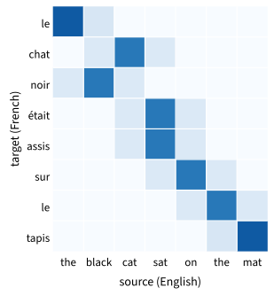

# Attention Scoring and Masking
:label:`sec_attention-scoring-functions`

In :numref:`sec_attention-pooling`, distance-based kernels such as the Gaussian
defined the attention weights. A more general attention layer first computes a
score $a(\mathbf{q}, \mathbf{k})$ and then normalizes the scores with softmax
:eqref:`eq_softmax_attention`. This section derives scaled dot-product
attention, including the $1/\sqrt d$ factor. Masked softmax handles padding and
causal constraints, while batched matrix multiplication evaluates many queries
and sequences efficiently. We conclude with the alignment model from neural
machine translation that introduced learned attention.

```{.python .input #attention-scoring-attention-scoring-and-masking}
%%tab pytorch
%matplotlib inline
from d2l import torch as d2l
import math
import torch
from torch import nn
from torch.nn import functional as F
```

```{.python .input #attention-scoring-attention-scoring-and-masking}
%%tab jax
%matplotlib inline
from d2l import jax as d2l
from flax import nnx
import jax
from jax import numpy as jnp
import math
```

## Dot-Product Attention

Expanding the Gaussian kernel gives the following attention score before
exponentiation:

$$
a(\mathbf{q}, \mathbf{k}_i) = -\frac{1}{2} \|\mathbf{q} - \mathbf{k}_i\|^2  = \mathbf{q}^\top \mathbf{k}_i -\frac{1}{2} \|\mathbf{k}_i\|^2  -\frac{1}{2} \|\mathbf{q}\|^2.
$$
:eqlabel:`eq_gaussian-expansion`

First, the final term depends on $\mathbf{q}$ only, so it is identical for
all keys, and the softmax normalization :eqref:`eq_softmax_attention`
removes it entirely. Second, if the key norms $\|\mathbf{k}_i\|$ are all
equal, the middle term drops out the same way, and the Gaussian kernel and
the dot product induce identical attention weights. In general the norms are
not equal, and dropping the term is a modeling decision rather than an
approximation: we adopt the dot product $\mathbf{q}^\top \mathbf{k}_i$ as a
compatibility function in its own right. Learned query and key representations can shape this
compatibility, while the Gaussian expansion remains an exact special case
when all key norms are equal.

One adjustment controls the nominal score magnitude at initialization. Assume
for this calculation that the $d_k$ coordinates of the query and key are
independent, zero-mean, unit-variance random variables. Their dot product then
has zero mean and variance $d_k$. Rescaling by $1/\sqrt{d_k}$ removes this
dimension dependence under the stated assumptions and yields the *scaled
dot-product attention* scoring function of the Transformer
:cite:`Vaswani.Shazeer.Parmar.ea.2017`:

$$ a(\mathbf{q}, \mathbf{k}_i) = \mathbf{q}^\top \mathbf{k}_i / \sqrt{d_k}.$$
:eqlabel:`eq_dot_product_attention`

The attention weights are obtained, as always, with the softmax:

$$\alpha(\mathbf{q}, \mathbf{k}_i) = \mathrm{softmax}(a(\mathbf{q}, \mathbf{k}_i)) = \frac{\exp(\mathbf{q}^\top \mathbf{k}_i / \sqrt{d_k})}{\sum_{j=1}^m \exp(\mathbf{q}^\top \mathbf{k}_j / \sqrt{d_k})}.$$
:eqlabel:`eq_attn-scoring-alpha`

### Score Variance and the $1/\sqrt{d}$ Factor

Learned queries and keys need not retain the independence or unit-variance
assumptions, so the calculation is a scaling heuristic rather than a
trained-model guarantee. Its purpose is to avoid dimension-induced softmax
saturation at initialization. Once one score
exceeds the others by a large margin, the winning weight approaches $1$ and
the rest approach $0$. The gradient returning along the *score* path shrinks
with them, because the Jacobian of the softmax is

$$
\frac{\partial \boldsymbol{\alpha}}{\partial \mathbf{a}} = \mathrm{diag}(\boldsymbol{\alpha}) - \boldsymbol{\alpha} \boldsymbol{\alpha}^\top,
$$
:eqlabel:`eq_softmax-jacobian`

and this tends to the zero matrix as $\boldsymbol{\alpha}$ approaches a
one-hot vector, so the queries and keys behind those scores stop being
updated. (Only that query–key route saturates; gradients still flow through
the values, the output projection, and any residual connection.) For finite
scores this Jacobian is
never the zero matrix — as we noted in :numref:`sec_queries-keys-values`, it
always keeps the all-ones vector in its null space and nothing else — but it
can come arbitrarily close. We measure both effects with random queries
and keys with unit-variance entries, compute attention over $64$ candidate
keys, and record the entropy of the resulting weight distribution as the
dimension $d$ grows, with and without the $1/\sqrt{d}$ factor.

```{.python .input #attention-scoring-softmax-saturation-and-the-1-sqrt-d-factor-1}
%%tab pytorch
def attention_stats(d, num_keys=64, num_queries=256, scaled=True):
    q = torch.randn(num_queries, d)
    keys = torch.randn(num_queries, num_keys, d)
    scores = (keys @ q[..., None]).squeeze(-1)
    if scaled:
        scores = scores / math.sqrt(d)
    alpha = F.softmax(scores, dim=-1)
    entropy = -(alpha * torch.log(alpha + 1e-12)).sum(-1).mean()
    # Frobenius norm of the softmax Jacobian diag(alpha) - alpha alpha^T
    jac = torch.diag_embed(alpha) - alpha[..., :, None] * alpha[..., None, :]
    return entropy.item(), jac.square().sum((-2, -1)).sqrt().mean().item()

torch.manual_seed(0)
ds = [2**k for k in range(2, 10)]
entropies = [[attention_stats(d, scaled=s)[0] for d in ds]
             for s in (False, True)]
d2l.plot(ds, entropies, 'dimension d', 'entropy (nats)',
         legend=['unscaled', 'scaled by 1/sqrt(d)'], xscale='log')
```

```{.python .input #attention-scoring-softmax-saturation-and-the-1-sqrt-d-factor-1}
%%tab jax
def attention_stats(d, num_keys=64, num_queries=256, scaled=True, seed=0):
    key_q, key_k = jax.random.split(jax.random.key(seed))
    q = jax.random.normal(key_q, (num_queries, d))
    keys = jax.random.normal(key_k, (num_queries, num_keys, d))
    scores = (keys @ q[..., None]).squeeze(-1)
    if scaled:
        scores = scores / math.sqrt(d)
    alpha = jax.nn.softmax(scores, axis=-1)
    entropy = -(alpha * jnp.log(alpha + 1e-12)).sum(-1).mean()
    # Frobenius norm of the softmax Jacobian diag(alpha) - alpha alpha^T
    jac = (alpha[..., None] * jnp.eye(num_keys)
           - alpha[..., :, None] * alpha[..., None, :])
    return float(entropy), float(jnp.sqrt((jac**2).sum((-2, -1))).mean())

ds = [2**k for k in range(2, 10)]
entropies = [[attention_stats(d, scaled=s)[0] for d in ds]
             for s in (False, True)]
d2l.plot(ds, entropies, 'dimension d', 'entropy (nats)',
         legend=['unscaled', 'scaled by 1/sqrt(d)'], xscale='log')
```

A uniform distribution over $64$ keys has entropy $\ln 64 \approx 4.2$ nats.
The scaled scores retain an entropy of about $3.7$ nats across two orders of
magnitude in $d$. Thus the weight distribution retains similar sharpness as
the vector dimension grows. Without
scaling, the entropy collapses as $d$ grows—below $0.2$ nats by $d = 512$,
a near-deterministic weighting that concentrates almost all its mass on a
single key purely because the vectors are long. The Jacobian norm measures
the corresponding change in the score gradient:

```{.python .input #attention-scoring-softmax-saturation-and-the-1-sqrt-d-factor-2}
%%tab pytorch
torch.manual_seed(0)
for d in (4, 64, 512):
    _, jac_unscaled = attention_stats(d, scaled=False)
    _, jac_scaled = attention_stats(d, scaled=True)
    print(f'd = {d:3d}: Jacobian norm {jac_unscaled:.3f} (unscaled), '
          f'{jac_scaled:.3f} (scaled)')
```

```{.python .input #attention-scoring-softmax-saturation-and-the-1-sqrt-d-factor-2}
%%tab jax
for d in (4, 64, 512):
    _, jac_unscaled = attention_stats(d, scaled=False)
    _, jac_scaled = attention_stats(d, scaled=True)
    print(f'd = {d:3d}: Jacobian norm {jac_unscaled:.3f} (unscaled), '
          f'{jac_scaled:.3f} (scaled)')
```

With scaling, the Jacobian norm is the same at every dimension. Without it,
the norm decays as the softmax saturates—by $d = 512$ it has fallen to
about half the scaled value and is still shrinking. At realistic dimensions, a model with unscaled scores would therefore begin
with near-one-hot attention and small score gradients. Division by $\sqrt{d}$
removes the dimension-induced scaling, so it is part of the definition
:eqref:`eq_dot_product_attention` rather than a tuned hyperparameter.

## Masking

Attention as defined so far attends to *every* key. In practice we routinely
need it not to, for one of two reasons. The first is *padding*: sequences of
different lengths end up in the same minibatch, padded with dummy tokens to
a common length (here shown as `<blank>`):

```
Dive  into  Deep    Learning
Learn to    code    <blank>
Hello world <blank> <blank>
```

Padding tokens carry no meaning, and no query should waste weight on them.
The second reason is *causality*: a language model trained to predict the
next token computes outputs for all positions of a sequence in parallel, and
the query at position $t$ must not see keys at positions beyond $t$—
otherwise the model can copy the very future it is being trained to predict.
Both cases call for the same operation: restrict the attention sum
$\sum_{i=1}^n \alpha(\mathbf{q}, \mathbf{k}_i) \mathbf{v}_i$ to a valid
prefix $\sum_{i=1}^l \alpha(\mathbf{q}, \mathbf{k}_i) \mathbf{v}_i$ with
$l \leq n$, where $l$ depends on the sequence (padding) or on the query
position (causality).

### The Masked Softmax Operation

The *masked softmax* implements this restriction without branching over
keys. It overwrites invalid scores with a very negative number before the
softmax, making their normalized weights zero. This formulation preserves
the regular array operations used by optimized batched kernels.

The replacement value depends on the numerical precision. Older codebases used a literal
constant such as $-10^{6}$. In single precision that works; in the half
precisions that modern training runs in, it does not. The float16 format
tops out near $6.5 \times 10^4$, so $-10^6$ silently overflows, and in
bfloat16 a merely-large constant may fail to fully suppress a weight once
genuine scores are large themselves. Writing literal $-\infty$ masks exactly, but if every key of some query is
masked, the softmax returns NaN and can invalidate the training run. We therefore adopt the dtype-safe idiom, which
masks with the most negative *finite* value of the score's dtype
(`torch.finfo(X.dtype).min` and `jnp.finfo(X.dtype).min`, respectively): the
masked weights are exactly zero at any precision, with no NaN. A fully masked query, which has no valid key, would otherwise produce a
uniform average over invalid values. The `masked_softmax` implementation
therefore zeroes such a row, although callers should still ensure that every
query retains at least one valid key.

```{.python .input #attention-scoring-the-masked-softmax-operation-1}
%%tab pytorch
def masked_softmax(X, valid_lens):  #@save
    """Perform softmax operation by masking elements on the last axis."""
    # X: 3D tensor, valid_lens: 1D or 2D tensor
    if valid_lens is None:
        return F.softmax(X, dim=-1)
    shape = X.shape
    if valid_lens.dim() == 1:
        valid_lens = torch.repeat_interleave(valid_lens, shape[1])
    else:
        valid_lens = valid_lens.reshape(-1)
    mask = torch.arange(shape[-1], device=X.device)[None, :]
    mask = mask < valid_lens[:, None]
    # Most negative finite score: exactly zero weight after the softmax,
    # at any precision, without the NaN risk of literal -inf
    X = X.reshape(-1, shape[-1]).masked_fill(~mask, torch.finfo(X.dtype).min)
    weights = F.softmax(X, dim=-1)
    # A fully masked query (no valid key) would be a uniform average over
    # invalid values; zero those rows so no padded position leaks through
    weights = torch.where(mask.any(-1, keepdim=True), weights, 0.0)
    return weights.reshape(shape)
```

```{.python .input #attention-scoring-the-masked-softmax-operation-1}
%%tab jax
def masked_softmax(X, valid_lens):  #@save
    """Perform softmax operation by masking elements on the last axis."""
    # X: 3D tensor, valid_lens: 1D or 2D tensor
    if valid_lens is None:
        return jax.nn.softmax(X, axis=-1)
    shape = X.shape
    if valid_lens.ndim == 1:
        valid_lens = jnp.repeat(valid_lens, shape[1])
    else:
        valid_lens = valid_lens.reshape(-1)
    mask = jnp.arange(shape[-1])[None, :] < valid_lens[:, None]
    # Most negative finite score: exactly zero weight after the softmax,
    # at any precision, without the NaN risk of literal -inf
    X = jnp.where(mask, X.reshape(-1, shape[-1]), jnp.finfo(X.dtype).min)
    weights = jax.nn.softmax(X, axis=-1)
    # A fully masked query (no valid key) would be a uniform average over
    # invalid values; zero those rows so no padded position leaks through
    weights = jnp.where(mask.any(-1, keepdims=True), weights, 0.0)
    return weights.reshape(shape)
```

To illustrate how this function works, consider a minibatch of two examples
with two queries and four keys each, where the valid lengths are $2$ and
$3$, respectively. All weights beyond the valid length come out as zero,
and each row still sums to $1$:

```{.python .input #attention-scoring-the-masked-softmax-operation-2}
%%tab pytorch
masked_softmax(torch.rand(2, 2, 4), torch.tensor([2, 3]))
```

```{.python .input #attention-scoring-the-masked-softmax-operation-2}
%%tab jax
masked_softmax(jax.random.uniform(jax.random.key(0), (2, 2, 4)),
               jnp.array([2, 3]))
```

For finer control we can pass a two-dimensional tensor of valid lengths,
one per query:

```{.python .input #attention-scoring-the-masked-softmax-operation-3}
%%tab pytorch
masked_softmax(torch.rand(2, 2, 4), torch.tensor([[1, 3], [2, 4]]))
```

```{.python .input #attention-scoring-the-masked-softmax-operation-3}
%%tab jax
masked_softmax(jax.random.uniform(jax.random.key(1), (2, 2, 4)),
               jnp.array([[1, 3], [2, 4]]))
```

### Causal Masking

Per-query valid lengths are exactly what causality needs: for a sequence of
length $n$, the query at position $t$ may attend to keys $1, \ldots, t$, so
the valid lengths are $(1, 2, \ldots, n)$, shared by every sequence
in the batch. The resulting attention pattern is lower triangular:

```{.python .input #attention-scoring-causal-masking}
%%tab pytorch
torch.manual_seed(0)
scores = torch.randn(1, 6, 6)
causal_lens = torch.arange(1, 7)[None, :]  # query t sees keys 1..t
d2l.show_heatmaps(masked_softmax(scores, causal_lens)[None],
                  xlabel='Keys', ylabel='Queries')
```

```{.python .input #attention-scoring-causal-masking}
%%tab jax
scores = jax.random.normal(jax.random.key(2), (1, 6, 6))
causal_lens = jnp.arange(1, 7)[None, :]  # query t sees keys 1..t
d2l.show_heatmaps(masked_softmax(scores, causal_lens)[None],
                  xlabel='Keys', ylabel='Queries')
```

This triangular mask lets a generative model train all sequence positions in
parallel without exposing future tokens. Generation additionally requires a
shifted next-token objective and a decoding loop. The mask will accompany us through
every decoder in the chapters ahead.

### Composing Masks
:label:`subsec_composing-masks`

`valid_lens` describes prefixes, which cover the two cases above, but the
general interface is a boolean tensor: entry $(i, j)$ says whether query $i$
may attend to key $j$. Every requirement takes this form — padding excludes
keys beyond the sequence length, causality excludes keys beyond the query,
and structural patterns such as the attention windows of
:numref:`sec_attention-at-scale` exclude by distance — and a key must
survive *all* requirements at once, so masks compose by logical AND.
Broadcasting keeps the bookkeeping cheap: a padding mask has shape
$(\textrm{batch}, 1, \textrm{keys})$, a causal mask
$(1, \textrm{queries}, \textrm{keys})$, and their AND broadcasts to the full
$(\textrm{batch}, \textrm{queries}, \textrm{keys})$ without materializing
either input per example. Applying the composite is the same idiom as
before: overwrite the excluded scores with the dtype's most negative finite
value, then softmax.

```{.python .input #attention-scoring-composing-masks}
%%tab pytorch
valid_lens, n = torch.tensor([6, 3]), 6
j = torch.arange(n)
padding = (j[None, :] < valid_lens[:, None])[:, None, :]  # (batch, 1, key)
causal = (j[None, :] <= j[:, None])[None, :, :]         # (1, query, key)
mask = padding & causal                                 # (batch, query, key)
torch.manual_seed(0)
scores = torch.randn(2, n, n)
weights = F.softmax(
    scores.masked_fill(~mask, torch.finfo(scores.dtype).min), dim=-1)
d2l.show_heatmaps(weights[:, None], xlabel='Keys', ylabel='Queries')
```

```{.python .input #attention-scoring-composing-masks}
%%tab jax
valid_lens, n = jnp.array([6, 3]), 6
j = jnp.arange(n)
padding = (j[None, :] < valid_lens[:, None])[:, None, :]  # (batch, 1, key)
causal = (j[None, :] <= j[:, None])[None, :, :]         # (1, query, key)
mask = padding & causal                                 # (batch, query, key)
scores = jax.random.normal(jax.random.key(0), (2, n, n))
weights = jax.nn.softmax(
    jnp.where(mask, scores, jnp.finfo(scores.dtype).min), axis=-1)
d2l.show_heatmaps(weights[:, None], xlabel='Keys', ylabel='Queries')
```

The first sequence shows the plain causal triangle; the second is cut off
at its valid length of $3$, the intersection of both constraints. Composition
sharpens the fully-masked hazard flagged above: masks that are harmless
alone can leave some query with an empty intersection, so the guarantee of
at least one valid key per query must hold for the *composite*. The same mask composition handles *packed sequences*, in which several
documents are concatenated into one training row. ANDing the causal mask
with a block-diagonal mask prevents attention across document boundaries.

## Batched Attention

### Batch Matrix Multiplication
:label:`subsec_batch_dot`

Attention is computed on minibatches of queries, keys, and values, so we
need to multiply batches of matrices by one another. Assume that

$$
\mathbf{Q} = [\mathbf{Q}_1, \mathbf{Q}_2, \ldots, \mathbf{Q}_n]  \in \mathbb{R}^{n \times a \times b}, \qquad
\mathbf{K} = [\mathbf{K}_1, \mathbf{K}_2, \ldots, \mathbf{K}_n]  \in \mathbb{R}^{n \times b \times c}.
$$

Then the batch matrix multiplication (BMM) computes one matrix product per
batch element,

$$\textrm{BMM}(\mathbf{Q}, \mathbf{K}) = [\mathbf{Q}_1 \mathbf{K}_1, \mathbf{Q}_2 \mathbf{K}_2, \ldots, \mathbf{Q}_n \mathbf{K}_n] \in \mathbb{R}^{n \times a \times c}.$$
:eqlabel:`eq_batch-matrix-mul`

A framework batch-matrix multiplication has the expected shape:

```{.python .input #attention-scoring-batch-matrix-multiplication}
%%tab pytorch
Q = torch.ones((2, 3, 4))
K = torch.ones((2, 4, 6))
d2l.check_shape(torch.bmm(Q, K), (2, 3, 6))
```

```{.python .input #attention-scoring-batch-matrix-multiplication}
%%tab jax
Q = jnp.ones((2, 3, 4))
K = jnp.ones((2, 4, 6))
d2l.check_shape(jax.lax.batch_matmul(Q, K), (2, 3, 6))
```

### The DotProductAttention Class
:label:`subsec_dot-product-attention-class`

Scaled dot-product attention can now be written in its matrix form. For $n$ queries and $m$ key--value pairs, with queries
and keys of length $d$ and values of length $v$, stack the queries into
$\mathbf{Q} \in \mathbb{R}^{n \times d}$, the keys into $\mathbf{K} \in
\mathbb{R}^{m \times d}$, and the values into $\mathbf{V} \in
\mathbb{R}^{m \times v}$. Then the entire attention computation is two
matrix products and a softmax:

$$ \mathrm{softmax}\left(\frac{\mathbf{Q} \mathbf{K}^\top }{\sqrt{d}}\right) \mathbf{V} \in \mathbb{R}^{n \times v}.$$
:eqlabel:`eq_softmax_QK_V`

Requiring queries and keys to share the length $d$ is no real restriction:
a learned matrix $\mathbf{M}$ turns $\mathbf{q}^\top \mathbf{k}$ into
$\mathbf{q}^\top \mathbf{M} \mathbf{k}$ and translates between spaces of
different dimension (an exercise below). Applied to a minibatch,
:eqref:`eq_softmax_QK_V` uses the batch matrix multiplication of
:eqref:`eq_batch-matrix-mul` twice. The implementation applies dropout to
the attention weights as regularization, and stores the weights for
visualization:

```{.python .input #attention-scoring-the-dotproductattention-class-1}
%%tab pytorch
class DotProductAttention(nn.Module):  #@save
    """Scaled dot product attention."""
    def __init__(self, dropout):
        super().__init__()
        self.dropout = nn.Dropout(dropout)

    # Shape of queries: (batch_size, no. of queries, d)
    # Shape of keys: (batch_size, no. of key-value pairs, d)
    # Shape of values: (batch_size, no. of key-value pairs, value dimension)
    # Shape of valid_lens: (batch_size,) or (batch_size, no. of queries)
    def forward(self, queries, keys, values, valid_lens=None):
        d = queries.shape[-1]
        # Swap the last two dimensions of keys with keys.transpose(1, 2)
        scores = torch.bmm(queries, keys.transpose(1, 2)) / math.sqrt(d)
        self.attention_weights = masked_softmax(scores, valid_lens)
        return torch.bmm(self.dropout(self.attention_weights), values)
```

```{.python .input #attention-scoring-the-dotproductattention-class-1}
%%tab jax
class DotProductAttention(nnx.Module):  #@save
    """Scaled dot product attention."""
    def __init__(self, dropout, rngs=None):
        rngs = nnx.Rngs(dropout=0) if rngs is None else rngs
        self.dropout = nnx.Dropout(dropout, rngs=rngs)

    # Shape of queries: (batch_size, no. of queries, d)
    # Shape of keys: (batch_size, no. of key-value pairs, d)
    # Shape of values: (batch_size, no. of key-value pairs, value dimension)
    # Shape of valid_lens: (batch_size,) or (batch_size, no. of queries)
    def __call__(self, queries, keys, values, valid_lens=None):
        d = queries.shape[-1]
        # Swap the last two dimensions of keys with keys.swapaxes(1, 2)
        scores = queries@(keys.swapaxes(1, 2)) / math.sqrt(d)
        attention_weights = masked_softmax(scores, valid_lens)
        # NNX idiom: return (output, weights); PyTorch stores weights on self
        return self.dropout(attention_weights) @ values, attention_weights
```

To see the class at work we use a minibatch of size $2$, with $10$ keys and
values of dimension $4$, a single $2$-dimensional query per example, and
valid lengths of $2$ and $6$. The output is one $4$-dimensional row per
query:

```{.python .input #attention-scoring-the-dotproductattention-class-2}
%%tab pytorch
torch.manual_seed(0)
queries = torch.randn(2, 1, 2)
keys = torch.randn(2, 10, 2)
values = torch.randn(2, 10, 4)
valid_lens = torch.tensor([2, 6])

attention = DotProductAttention(dropout=0.5)
attention.eval()
d2l.check_shape(attention(queries, keys, values, valid_lens), (2, 1, 4))
```

```{.python .input #attention-scoring-the-dotproductattention-class-2}
%%tab jax
queries = jax.random.normal(jax.random.key(0), (2, 1, 2))
keys = jax.random.normal(jax.random.key(1), (2, 10, 2))
values = jax.random.normal(jax.random.key(2), (2, 10, 4))
valid_lens = jnp.array([2, 6])

attention = DotProductAttention(dropout=0.5)
output, attention_weights = nnx.view(
    attention, deterministic=True)(queries, keys, values, valid_lens)
d2l.check_shape(output, (2, 1, 4))
```

The stored attention weights confirm the effect of the mask: weights
vanish beyond the second and sixth key, respectively.

```{.python .input #attention-scoring-the-dotproductattention-class-3}
%%tab pytorch
d2l.show_heatmaps(attention.attention_weights.reshape((1, 1, 2, 10)),
                  xlabel='Keys', ylabel='Queries')
```

```{.python .input #attention-scoring-the-dotproductattention-class-3}
%%tab jax
d2l.show_heatmaps(attention_weights.reshape((1, 1, 2, 10)),
                  xlabel='Keys', ylabel='Queries')
```

## Attention as Learned Alignment
:label:`subsec_learned-alignment`

Learned attention first became prominent in neural machine translation.
Around 2014, the leading neural approach encoded a source
sentence with an RNN into a single fixed-size state vector and decoded the
translation from that vector with a second RNN (we build such
encoder--decoder models in full in :numref:`sec_seq2seq`). The design has
the flaw this chapter opened with: one fixed-size vector must represent the entire sentence, which becomes
increasingly restrictive as sentences grow. Translation quality
degraded visibly with sentence length. :citet:`Graves.2013` had faced a
version of this problem when generating handwriting from text, and solved
it with a differentiable model that *aligned* each output pen stroke with a
position in the source text—though with the constraint that the alignment
could only move forward, an assumption borrowed from decoding in speech
recognition :cite:`rabiner1993fundamentals`.

:citet:`Bahdanau.Cho.Bengio.2014` removed the constraint. Their translation
model kept the two RNNs but changed the decoder input at every step. The
current decoder state served as a *query* against all encoder
states, which serve as keys and values, and feed the resulting weighted
summary—a fresh one per output token—into the next prediction. The paper's
title called the idea "jointly learning to align and translate", and the
learned weights behaved exactly like the soft alignments of classical
statistical translation: mostly monotone along the diagonal, with clean
departures where the two languages order words differently, as sketched in
:numref:`fig_alignment`. The training objective did not directly supervise these alignments; they
emerged while the model learned translation. This computation instantiates
the attention mechanism in :eqref:`eq_attention_pooling`.


:label:`fig_alignment`

One detail differed from the scoring function we settled on above. The
decoder state and the encoder states were vectors of different sizes, so
instead of a dot product, :citet:`Bahdanau.Cho.Bengio.2014` scored with a
small one-hidden-layer MLP, now known as *additive attention*:

$$a(\mathbf{q}, \mathbf{k}) = \mathbf{w}_v^\top \tanh(\mathbf{W}_q \mathbf{q} + \mathbf{W}_k \mathbf{k}) \in \mathbb{R},$$
:eqlabel:`eq_additive-attn`

where $\mathbf{W}_q \in \mathbb{R}^{h \times q}$, $\mathbf{W}_k \in
\mathbb{R}^{h \times k}$, and $\mathbf{w}_v \in \mathbb{R}^{h}$ are learned.
The two projections embed queries and keys into a shared $h$-dimensional
space, and $\mathbf{w}_v$ reads a score off the sum. It takes only a few
lines to compute—here scoring three $20$-dimensional queries against six
$2$-dimensional keys, dimensions no dot product could pair up:

```{.python .input #attention-scoring-from-alignment-to-attention}
%%tab pytorch
torch.manual_seed(0)
queries, keys = torch.randn(3, 20), torch.randn(6, 2)
num_hiddens = 8
W_q = torch.randn(num_hiddens, 20) / math.sqrt(20)
W_k = torch.randn(num_hiddens, 2) / math.sqrt(2)
w_v = torch.randn(num_hiddens) / math.sqrt(num_hiddens)
features = torch.tanh((queries @ W_q.T)[:, None, :]
                      + (keys @ W_k.T)[None, :, :])
scores = features @ w_v
d2l.check_shape(scores, (3, 6))
F.softmax(scores, dim=-1)
```

```{.python .input #attention-scoring-from-alignment-to-attention}
%%tab jax
key_q, key_k, k1, k2, k3 = jax.random.split(jax.random.key(0), 5)
queries = jax.random.normal(key_q, (3, 20))
keys = jax.random.normal(key_k, (6, 2))
num_hiddens = 8
W_q = jax.random.normal(k1, (num_hiddens, 20)) / math.sqrt(20)
W_k = jax.random.normal(k2, (num_hiddens, 2)) / math.sqrt(2)
w_v = jax.random.normal(k3, (num_hiddens,)) / math.sqrt(num_hiddens)
features = jnp.tanh((queries @ W_q.T)[:, None, :]
                    + (keys @ W_k.T)[None, :, :])
scores = features @ w_v
d2l.check_shape(scores, (3, 6))
jax.nn.softmax(scores, axis=-1)
```

Dot-product attention later became the standard choice partly because it maps
efficiently to accelerator hardware. All query--key dot products form one
matrix multiplication, whereas the additive score requires an
$n \times m \times h$ tensor of hidden activations. When a learned metric
is wanted, we can project queries and keys with learned matrices *before* the
dot product and have it at matmul speed—which is precisely the form attention
takes inside the Transformer, whose authors then discarded the RNN
scaffolding altogether and kept attention as the only mechanism relating
sequence positions :cite:`Vaswani.Shazeer.Parmar.ea.2017`. The next
next sections develop multiple attention heads and then introduce explicit
positional information to replace the RNN's sequential ordering.

## Summary

Scaled dot-product attention computes scores with one batched matrix
multiplication. Dividing by $\sqrt d$ keeps the score variance independent of
dimension and prevents premature softmax saturation. A mask excludes padding,
future positions, or other invalid query--key pairs before normalization; use
the most negative finite value of the dtype so the operation remains valid in
reduced precision. Boolean masks for several constraints compose by logical
AND. `DotProductAttention` combines scoring, masking, dropout, and value
pooling. Additive attention provides an alternative learned score and was the
form used in the original neural alignment model.

## Exercises

1. **Invariances of the score.** The Gaussian score
   :eqref:`eq_gaussian-expansion` and the scaled dot product
   :eqref:`eq_dot_product_attention` both define attention weights through
   the softmax :eqref:`eq_attn-scoring-alpha`.
    1. For each of the two scores, determine which of the following
       transformations leaves the weights unchanged: adding one vector
       $\mathbf{c}$ to every key; adding $\mathbf{c}$ to the query and to
       every key; multiplying the query and every key by one orthogonal
       matrix.
    1. Queries and keys are usually computed from inputs by affine maps,
       $\mathbf{q} = \mathbf{W}_q \mathbf{x} + \mathbf{b}_q$ and
       $\mathbf{k}_i = \mathbf{W}_k \mathbf{y}_i + \mathbf{b}_k$. Expand
       $\mathbf{q}^\top \mathbf{k}_i$ into four terms and show that the
       weights do not depend on $\mathbf{b}_k$. What is the gradient of the
       loss with respect to $\mathbf{b}_k$?
    1. Through which of the four terms does $\mathbf{b}_q$ affect the
       weights, and what preference over the keys can it express that the
       bias-free score cannot?

1. [code] **Distance-based attention.** Equation
   :eqref:`eq_gaussian-expansion` writes the Gaussian score as a dot product
   minus two squared norms, and the section drops the key-norm term to
   arrive at :eqref:`eq_dot_product_attention`.
    1. Modify `DotProductAttention` so that it keeps the term
       $-\tfrac{1}{2}\|\mathbf{k}_i\|^2$, using one batch matrix
       multiplication for the dot products and a broadcast of the $m$
       squared key norms, without forming the $n \times m \times d$ tensor
       of differences $\mathbf{q} - \mathbf{k}_i$. Apply the $1/\sqrt{d}$
       scaling to both terms.
    1. Verify on random inputs that the resulting weights equal those of a
       direct evaluation of $\exp(-\|\mathbf{q} - \mathbf{k}_i\|^2 /
       (2\sqrt{d}))$ normalized over the keys.
    1. Compare the weights of the two scoring rules on the inputs of
       :numref:`subsec_dot-product-attention-class`, ten random
       two-dimensional keys per example. For which keys do the rules
       disagree most, and why?

1. [code] **The softmax Jacobian.** `attention_stats` measures the
   Frobenius norm of the Jacobian :eqref:`eq_softmax-jacobian`.
    1. Derive :eqref:`eq_softmax-jacobian` from
       :eqref:`eq_attn-scoring-alpha`, show that for finite scores its null
       space is spanned by the all-ones vector, and check the formula
       against automatic differentiation on a random score vector.
    1. Compute the Frobenius norm when $\boldsymbol{\alpha}$ is one-hot and
       when it is uniform over $m$ keys, and evaluate the uniform case for
       $m = 64$. Show that the squared norm is close to $\sum_i \alpha_i^2$
       when every weight is small, and use this to explain why the scaled
       norms printed for $d \in \{4, 64, 512\}$ exceed the uniform value.
    1. Compute the norm for weights spread uniformly over $k$ of the $m$
       keys, find the $k$ that maximizes it, and confirm by sampling random
       weight vectors that none exceeds this maximum. Use the result to
       explain why the unscaled norm printed for $d = 4$ exceeds the scaled
       one.

1. **Fully masked rows.** `masked_softmax` overwrites excluded scores with
   the most negative finite value of the dtype and then zeroes the rows of
   queries that have no valid key.
    1. Explain why, without the final zeroing, a fully masked row returns
       the uniform distribution, and why the same row returns NaN when the
       scores are overwritten with $-\infty$ instead. Trace both cases
       through the subtraction of the row maximum that a numerically stable
       softmax performs.
    1. An older codebase overwrites excluded scores with the constant
       $-10^6$ and computes its scores in float16, whose largest finite
       magnitude is about $6.55 \times 10^4$. Determine the value that the
       constant takes when it is rounded to float16, and state what the
       softmax of such a codebase returns for a fully masked row and for a
       row with at least one valid key.
    1. In a self-attention layer, whose queries, keys, and values all come
       from the same sequence, let a query at a padding position have no
       valid key, as the composite masks of :numref:`subsec_composing-masks`
       can arrange, and let the excluded scores be overwritten with
       $-\infty$, so that the output at that position is NaN. That output
       is discarded, and in the next attention layer every valid query
       excludes the padding position as a key. Explain why the NaN
       nevertheless corrupts the outputs of all valid positions of that
       sequence in the next layer.

1. **Composite masks.** :numref:`subsec_composing-masks` combines masks by
   logical AND and warns that masks that are harmless alone can leave a
   query with no valid key. A causal sliding window of width $w$ lets the
   query at position $t$ attend to the keys at positions $t - w + 1, \ldots,
   t$.
    1. For a sequence of length $6$ with valid length $3$, write the padding
       mask and the causal sliding window of width $2$ as $6 \times 6$
       boolean matrices. Check that each leaves every query at least one
       key, and find the queries whose row of the AND is empty.
    1. Show that an AND of masks has no empty row if every mask allows each
       query to attend to its own position. Which of the padding, causal,
       sliding-window, and packed-sequence masks satisfy this condition, and
       what does the answer say about the empty rows you found?
    1. Some implementations add a bias matrix with entries $0$ for allowed
       pairs and $c < 0$ for excluded pairs, and compose masks by adding
       their biases. Take for $c$ the most negative finite single-precision
       value, about $-3.4 \times 10^{38}$. Compute the sum of two such
       biases in single precision, and determine what the softmax returns
       for a row in which every key is excluded by both masks and for a row
       in which every key is excluded but some keys by only one mask.

1. [code] **Two masking conventions.** `masked_softmax` describes the valid
   keys of a query by a prefix length, whereas the masks of
   :numref:`subsec_composing-masks` and many libraries use a boolean tensor
   in which `True` marks a pair the query may attend to.
    1. Write a converter from `valid_lens` of shape (batch size,) or (batch
       size, number of queries) to a boolean mask of shape (batch size,
       number of queries, number of keys), and a variant of `masked_softmax`
       that takes such a mask.
    1. Verify on ten random padding and causal configurations that both
       routes produce identical weights, including for fully masked rows.
    1. Pack two documents of lengths $4$ and $2$ into one row of length
       $6$. Build the boolean mask that combines the causal mask with the
       block-diagonal mask of document indices, and verify that attention
       with your variant gives each document the outputs it receives when
       it is processed alone with a causal mask.
    1. Which of the following masks can be expressed by one prefix length
       per query: padding, causal, padding combined with causal, the packed
       mask, and a causal sliding window? State what the boolean interface
       costs in memory for $B$ sequences of length $n$ relative to
       `valid_lens`.

    *Adapted from Stanford CS336,
    [Assignment 1](https://github.com/stanford-cs336/assignment1-basics/blob/main/cs336_assignment1_basics.pdf),
    Problem (scaled_dot_product_attention).*

1. [code] **Attention dropout.** `DotProductAttention` applies dropout with
   rate $p$ to the attention weights, and the weights it exposes for
   visualization are those before dropout. Dropout multiplies each kept
   weight by $1/(1 - p)$ and sets the others to zero, so a row of weights
   no longer sums to $1$.
    1. Show that the row sum after dropout has expectation $1$ and variance
       $\frac{p}{1-p} \sum_i \alpha_i^2$, and evaluate the variance for a
       row that is uniform over $l$ keys and for a one-hot row. What is the
       output of a one-hot row in the draws in which dropout removes the
       attended weight?
    1. Use the inputs of :numref:`subsec_dot-product-attention-class` with
       dropout $0.5$ active, and pass as values a batch of $10 \times 10$
       identity matrices, so that each output row equals the weights after
       dropout. Compare the mean and the variance of the row sums over many
       draws with the prediction computed from the weights before dropout.

1. [code] **Keys of a different width.**
   :numref:`subsec_dot-product-attention-class` notes that a matrix
   $\mathbf{M} \in \mathbb{R}^{d_q \times d_k}$ turns the dot product into
   the score $\mathbf{q}^\top \mathbf{M} \mathbf{k}$ for queries
   $\mathbf{q} \in \mathbb{R}^{d_q}$ and keys $\mathbf{k} \in
   \mathbb{R}^{d_k}$.
    1. Implement this score for a batch of $n$ queries and $m$ keys with a
       learnable $\mathbf{M}$, and test it on three $20$-dimensional queries
       against six $2$-dimensional keys, the dimensions used in
       :numref:`subsec_learned-alignment`. Count the floating-point
       operations of the two evaluation orders
       $(\mathbf{Q}\mathbf{M})\mathbf{K}^\top$ and
       $\mathbf{Q}(\mathbf{M}\mathbf{K}^\top)$ for these dimensions, and
       state the rule that decides between them.
    1. The factorization $\mathbf{M} = \mathbf{W}_q^\top \mathbf{W}_k$ with
       $\mathbf{W}_q \in \mathbb{R}^{r \times d_q}$ and $\mathbf{W}_k \in
       \mathbb{R}^{r \times d_k}$ turns the score into a dot product of two
       projected vectors. Count the parameters of both parameterizations,
       find the values of $r$ for which the factored form has fewer, and
       state the constraint it places on $\mathbf{M}$.
    1. Let $\mathbf{q}$ and $\mathbf{k}$ have independent zero-mean,
       unit-variance coordinates, and let $\mathbf{W}_q$ and $\mathbf{W}_k$
       have independent zero-mean entries of variance $1/d_q$ and $1/d_k$,
       as `W_q` and `W_k` in :numref:`subsec_learned-alignment` do. Compute
       the variance of the factored score, and state the factor that
       replaces $1/\sqrt{d}$.

1. **Entropy of random scores.** ● The scaled curve of `attention_stats`
   stays near $3.7$ nats, below the uniform value $\ln 64 \approx 4.16$.
   Fix one query $\mathbf{q} \in \mathbb{R}^d$ and draw $m$ keys with
   independent standard normal coordinates, as `attention_stats` does.
    1. Show that the scaled scores $a_i = \mathbf{q}^\top \mathbf{k}_i /
       \sqrt{d}$ are independent normal variables with mean $0$ and variance
       $s^2 = \|\mathbf{q}\|^2 / d$, and compute the expected value of $s^2$
       when $\mathbf{q}$ is drawn as in `attention_stats`.
    1. The entropy of the weights is $H = \ln Z - \sum_i \alpha_i a_i$ with
       $Z = \sum_j \exp(a_j)$. For large $m$, replace $Z/m$ and
       $\sum_i \exp(a_i)\, a_i / m$ by their expected values and derive
       $$H \approx \ln m - \frac{s^2}{2}.$$
       Evaluate the approximation for $m = 64$ and $s = 1$.
    1. The approximation needs $Z$ to concentrate around its mean. Compute
       the relative standard deviation of $Z$ as a function of $s$ and $m$,
       and derive from it a condition on $s^2$ under which the approximation
       holds. Unscaled scores have $s^2 = \|\mathbf{q}\|^2$, whose expected
       value is $d$. Evaluate the relative standard deviation for $m = 64$
       at $s^2 = 4$ and $s^2 = 8$, and compare the approximation with the
       unscaled entropies that `attention_stats` returns for $d = 4$ and
       $d = 8$.

1. [code] **Additive scores near zero.** ● The additive score
   :eqref:`eq_additive-attn` adds the projected query and the projected key
   inside a $\tanh$.
    1. Replace $\tanh$ by the identity and show that the attention weights
       then do not depend on the query.
    1. Expand $\tanh$ to third order around zero, identify the lowest-order
       terms through which the weights depend on the query, and state how
       this dependence scales when $\mathbf{W}_q$ and $\mathbf{W}_k$ are
       both multiplied by a small factor $\epsilon$.
    1. Multiply `W_q` and `W_k` in the code of
       :numref:`subsec_learned-alignment` by $\epsilon \in \{1, 0.3, 0.1,
       0.03\}$, and measure the largest difference between the weight rows
       of the three queries. Check the scaling you derived, and state what
       the result for $\epsilon = 1$ implies for additive attention at
       initialization.

1. [code] **Additive versus dot-product cost.** ● Score $n$ queries of
   width $d_q$ against $m$ keys of width $d_k$ with the additive rule
   :eqref:`eq_additive-attn` of hidden size $h$, and $n$ queries against
   $m$ keys of a shared width $d$ with :eqref:`eq_dot_product_attention`.
    1. Count the parameters, the floating-point operations, and the size of
       the largest intermediate tensor for each rule.
    1. Implement a batched version of :eqref:`eq_additive-attn` that
       produces weights of shape (batch size, $n$, $m$), and check it
       against the unbatched code of :numref:`subsec_learned-alignment`.
    1. Time both rules for a batch of $4$ sequences with $n = m = 512$ at
       $d_q = d_k = d = h = 64$ and at $d_q = d_k = d = h = 256$. Relate
       the ratio of the two times
       to your counts of operations and of intermediate memory.

1. [extended] **A learned alignment.** ●
   :citet:`Bahdanau.Cho.Bengio.2014` observed that attention weights trained
   only for translation behave like alignments (:numref:`fig_alignment`).
   The same effect appears in a toy model without recurrent networks. Draw
   source sequences of $8$ tokens uniformly from a vocabulary of $16$, and
   let the target at output position $j$ be the source token at position
   $\pi(j)$ for a fixed permutation $\pi$ of the positions. Score one
   learned query per output position against keys that a learned linear map
   computes from the concatenated one-hot token and one-hot position of each
   source token, use the one-hot source tokens as values, and train on the
   negative logarithm of the output entry that belongs to the target token.
    1. Implement the model with `DotProductAttention`, train it, and plot
       the attention weights of one sequence with `d2l.show_heatmaps`.
       Compare the map with $\pi$.
    1. Replace the score by the additive rule :eqref:`eq_additive-attn` and
       compare the number of steps that each model needs to reach $99\%$
       accuracy.
    1. Give queries and keys the width $d \in \{16, 256, 1024\}$ with
       standard normal initialization, and train with and without the
       factor $1/\sqrt{d}$. Relate the training curves to the entropy of the
       weights at initialization.
    1. Explain why a fixed query per output position cannot learn a
       reordering that depends on the tokens, such as swapping two
       neighbors only when the first belongs to a designated subset of the
       vocabulary, and state what the query would have to depend on.

<!-- slides -->

::: {.slide}
::: {.cover}
[Dive into Deep Learning · §10.2]{.kicker}

Attention scoring and masking<br>
**dot-product scores · the 1/√d factor, measured · masked softmax · batched attention · from alignment to attention**
:::
:::

::: {.slide title="From kernels to dot products"}
Expand the Gaussian kernel's exponent:

$$-\tfrac{1}{2}\|\mathbf{q} - \mathbf{k}_i\|^2 = \mathbf{q}^\top \mathbf{k}_i - \tfrac{1}{2}\|\mathbf{k}_i\|^2 - \tfrac{1}{2}\|\mathbf{q}\|^2.$$

The query term cancels in the softmax; the key-norm term cancels too when
all key norms are equal. Keeping only the dot product is a modeling choice:
a compatibility score that learned representations can shape freely.

. . .

For unit-variance entries, $\operatorname{Var}(\mathbf{q}^\top\mathbf{k}) = d$
— scores grow with vector length for no semantic reason. Hence the
Transformer's scoring function:

$$a(\mathbf{q}, \mathbf{k}_i) = \mathbf{q}^\top \mathbf{k}_i / \sqrt{d}.$$
:::

::: {.slide title="Measured softmax saturation"}
Random queries and keys, attention over 64 candidates, entropy of the
weight distribution as $d$ grows:

@!attention-scoring-softmax-saturation-and-the-1-sqrt-d-factor-1

- Uniform over 64 keys ≈ 4.2 nats; scaled scores hold ≈ 3.7 nats at every $d$.
- Unscaled: below 0.2 nats by $d = 512$ — a near-deterministic weighting,
  from vector length alone.
:::

::: {.slide title="Saturation reduces the softmax gradient"}
The softmax Jacobian
$\partial \boldsymbol{\alpha} / \partial \mathbf{a} = \mathrm{diag}(\boldsymbol{\alpha}) - \boldsymbol{\alpha}\boldsymbol{\alpha}^\top$
tends to zero as $\boldsymbol{\alpha}$ approaches one-hot:

@attention-scoring-softmax-saturation-and-the-1-sqrt-d-factor-2

- Scaled: constant at every dimension. Unscaled: decaying — about half by
  $d = 512$, still falling.
- Division by $\sqrt{d}$ keeps this scale independent of dimension.
:::

::: {.slide title="Two reasons to mask"}
**Padding** — variable-length sequences share a minibatch:

```
Dive  into  Deep    Learning
Learn to    code    <blank>
Hello world <blank> <blank>
```

**Causality** — a language model computes all positions in parallel, but
query $t$ must not see keys beyond $t$.

Same fix for both: overwrite invalid scores before the softmax.

::: {.d2l-note}
Not with $-10^6$ (overflows float16), not with $-\infty$ (a fully masked
query → NaN). Use the dtype's most negative *finite* value.
:::
:::

::: {.slide title="masked_softmax"}
@attention-scoring-the-masked-softmax-operation-1
:::

::: {.slide title="Masking in action"}
Valid lengths 2 and 3 — weights beyond the prefix are exactly zero, rows
still sum to one:

@attention-scoring-the-masked-softmax-operation-2

. . .

Per-query valid lengths work too:

@attention-scoring-the-masked-softmax-operation-3
:::

::: {.slide title="Causal masking"}
Query $t$ sees keys $1, \ldots, t$, so the valid lengths are
$(1, 2, \ldots, n)$. The pattern is lower triangular:

@attention-scoring-causal-masking

- The mask permits parallel training over all positions without exposing
  future tokens.
:::

::: {.slide title="Composing masks"}
The general interface is a boolean tensor — entry $(i, j)$: may query $i$
see key $j$? Requirements compose by AND, broadcasting does the bookkeeping:
padding $(\textrm{batch}, 1, \textrm{keys})$ ∧ causal
$(1, \textrm{queries}, \textrm{keys})$.

@!attention-scoring-composing-masks

::: {.d2l-note}
The composite must still leave every query at least one valid key — masks
that are harmless alone can intersect to an empty row.
:::
:::

::: {.slide title="Batched attention"}
Attention over a minibatch is two batched matrix multiplications and one
softmax:

$$\mathrm{softmax}\left(\frac{\mathbf{Q}\mathbf{K}^\top}{\sqrt{d}}\right)\mathbf{V} \in \mathbb{R}^{n \times v}.$$

@attention-scoring-batch-matrix-multiplication
:::

::: {.slide title="DotProductAttention"}
The implementation combines scoring, masking, dropout on the weights, and
value pooling:

@attention-scoring-the-dotproductattention-class-1
:::

::: {.slide title="Masked attention, verified"}
Valid lengths (2, 6): the stored weights vanish beyond the second and
sixth key.

@!attention-scoring-the-dotproductattention-class-3
:::

::: {.slide title="Attention as learned alignment"}
[Machine translation]{.kicker}

In 2014 neural machine translation, one fixed vector connected the encoder
and decoder RNNs, restricting the representation of long sentences. Bahdanau, Cho & Bengio: let the decoder state
*query* all encoder states, one fresh summary per output token —
"jointly learning to align and translate".

{width=46%}
:::

::: {.slide title="Additive scoring"}
Decoder state and encoder states had different sizes, so the original
score was a tiny MLP:

$$a(\mathbf{q}, \mathbf{k}) = \mathbf{w}_v^\top \tanh(\mathbf{W}_q \mathbf{q} + \mathbf{W}_k \mathbf{k}).$$

@attention-scoring-from-alignment-to-attention

- Dot products are efficient on current hardware: one matrix multiplication
  instead of an $n \times m \times h$ tensor of activations. Learned
  projections followed by a dot product give the metric
  back, which gives the form used in the Transformer.
:::

::: {.slide title="Recap"}
- Scaled dot product is the standard scoring function:
  $\mathbf{q}^\top\mathbf{k}/\sqrt{d}$ keeps score variance at 1, so the
  softmax avoids dimension-induced saturation and small score gradients.
- Masking handles padding and causality with one primitive: overwrite
  invalid scores with the dtype's most negative finite value.
- `DotProductAttention` uses BMM, masked softmax, dropout, and a second BMM.
- Additive attention introduced learned soft alignment for translation.
:::
