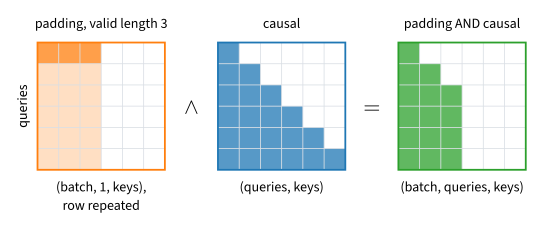

# Attention Scoring and Masking
:label:`sec_attention-scoring-functions`

In :numref:`sec_attention-pooling` the attention weights came from a kernel
chosen by hand. They follow distance in a fixed input space, and no amount
of data changes what counts as similar. In a sentence, however, a verb looking for
its subject wants the word that plays that grammatical role, which need not
be the word whose representation is closest to its own. Turning soft lookup
into a layer of a trained network raises two questions: which score should
the network learn, and which query--key pairs should count at all?

The score must be shaped by learned representations, and it must be cheap,
because it is evaluated for every pair: one attention head of GPT-2 small,
reading a context of 1,024 tokens, scores $1{,}024^2 = 1{,}048{,}576$
pairs. Some of those pairs must not count. Sequences of different lengths
share a minibatch only after padding, and no query should attend to the
padding. A language model trained to predict each next token processes all
positions at once, and the query at position $t$ must not see the tokens
after it.

The score we arrive at is the dot product of query and key, divided by the
square root of their width, and the exclusions become boolean masks
applied before the softmax. We test both on examples whose answers we know
in advance, and end where learned attention began, with a model that learns
to align two sequences.

```{.python .input #attention-scoring-attention-scoring-and-masking}
%%tab pytorch
import math
import numpy as np
import torch
from torch import nn
from torch.nn import functional as F
from d2l import torch as d2l
```

```{.python .input #attention-scoring-attention-scoring-and-masking}
%%tab jax
import math
import numpy as np
import jax
from jax import numpy as jnp
from flax import nnx
import optax
from d2l import jax as d2l
```

## Dot-Product Attention

We look for a score that learned queries and keys can shape and that costs
one short computation per pair. The Gaussian kernel of
:numref:`sec_attention-pooling` already contains one. Let us set its
bandwidth to $\sigma = 1$ for the moment and expand the exponent:

$$
a(\mathbf{q}, \mathbf{k}_i) = -\frac{1}{2} \|\mathbf{q} - \mathbf{k}_i\|^2  = \mathbf{q}^\top \mathbf{k}_i -\frac{1}{2} \|\mathbf{k}_i\|^2  -\frac{1}{2} \|\mathbf{q}\|^2.
$$
:eqlabel:`eq_gaussian-expansion`

The last term depends on the query only. It is the same for all keys, and
the softmax normalization removes it, since adding one constant to every
score leaves the weights unchanged. If all keys have the same norm, the
middle term drops out in the same way, and the Gaussian kernel and the dot
product give identical weights. In general the norms differ, and keeping
only $\mathbf{q}^\top \mathbf{k}_i$ is a modeling decision rather than an
approximation: the dot product becomes the score in its own right, and
learned queries and keys decide what a good match means. This short
calculation is the most important one in the section.

The decision has a visible consequence. The Gaussian score penalizes a long
key through its norm. The dot product rewards it: a long key draws extra
weight from every query that points roughly its way, so the norm of a key
acts as a prior on how often it is chosen. This is why, as you may have
found in Exercise :exref:`ex_queries-keys-values-average-two-values`c of
:numref:`sec_queries-keys-values`, a query meant to average the values of
two keys collapses onto the longer key.

The dot product was not the first learned score. The first attention models,
built for translation and met again at the end of this section, scored a
query against a key with a small network with one hidden layer, now called
*additive attention* :cite:`Bahdanau.Cho.Bengio.2014`:

$$a(\mathbf{q}, \mathbf{k}) = \mathbf{w}_v^\top \tanh(\mathbf{W}_q \mathbf{q} + \mathbf{W}_k \mathbf{k}) \in \mathbb{R}.$$
:eqlabel:`eq_additive-attn`

Here $\mathbf{q} \in \mathbb{R}^{d_q}$ and $\mathbf{k} \in
\mathbb{R}^{d_k}$ may have different widths, and the learned parameters
are $\mathbf{W}_q \in \mathbb{R}^{r \times d_q}$, $\mathbf{W}_k \in
\mathbb{R}^{r \times d_k}$, and $\mathbf{w}_v \in \mathbb{R}^{r}$ for a
hidden width $r$. The two projections map queries and keys into a shared
$r$-dimensional space, and $\mathbf{w}_v$ reads a score off their sum.

Why did the dot product replace it? Not by doing less arithmetic. For $n$
queries and $m$ keys of width $d$, the additive score takes on the order of
$nmr$ operations and the dot product $nmd$. The dot product won because the
dot products of all pairs form a single matrix product, the operation
accelerators are built for. The additive score instead builds an
$n \times m \times r$ array of hidden activations and applies $\tanh$ to
every entry.

Nothing learnable is lost by the switch. Keep the two projections of the
additive score and replace $\tanh$ and $\mathbf{w}_v$ by a dot product: the
score $(\mathbf{W}_q \mathbf{q})^\top (\mathbf{W}_k \mathbf{k}) =
\mathbf{q}^\top \mathbf{W}_q^\top \mathbf{W}_k \mathbf{k}$ is a learned
similarity, and for all pairs it is still one matrix product. In a network
the projections disappear into the computation of the queries and keys
themselves, which it obtains from its inputs by learned linear maps, so the
plain dot product of those queries and keys gives up no generality. The
additive score, on the other hand, has a
weakness of its own. Near zero, $\tanh$ is almost linear, and a linear
score adds the same query term $\mathbf{w}_v^\top \mathbf{W}_q \mathbf{q}$
to every key, which the softmax removes. With small projections, the
additive weights therefore barely depend on the query (Exercise
:exref:`ex_attention-scoring-additive-near-zero`).

One adjustment remains, and it concerns the size of the scores. Suppose
that the $d$ coordinates of the query and of the key are independent random
variables with mean zero and variance one. Each product $q_j k_j$ then has
mean zero and variance one, the $d$ products are independent, and their sum
$\mathbf{q}^\top \mathbf{k}$ has mean zero and variance $d$. For the GPT-2
head, with $d = 64$, a typical score is about $\pm 8$. The authors of the
Transformer noted that at large widths unscaled dot products had done worse
than additive attention, and suspected that large scores were pushing the
softmax into a region of tiny gradients. Their remedy
:cite:`Vaswani.Shazeer.Parmar.ea.2017` divides by $\sqrt{d}$, which
restores unit variance and gives the *scaled dot-product* score

$$ a(\mathbf{q}, \mathbf{k}_i) = \mathbf{q}^\top \mathbf{k}_i / \sqrt{d}.$$
:eqlabel:`eq_dot_product_attention`

The factor plays the part of the bandwidth in
:numref:`sec_attention-pooling`. There the Gaussian score
$-\|\mathbf{q} - \mathbf{k}\|^2/2\sigma^2$ carried the factor $1/\sigma^2$,
a number in front of all scores. It sets how sharply the softmax selects:
nearly one-hot when it is large, nearly uniform when it is small. There it
was tuned by hand. Here the width sets it. The attention weights are, as
always, the softmax of the scores:

$$\alpha(\mathbf{q}, \mathbf{k}_i) = \mathrm{softmax}(a(\mathbf{q}, \mathbf{k}_i)) = \frac{\exp(\mathbf{q}^\top \mathbf{k}_i / \sqrt{d})}{\sum_{j=1}^m \exp(\mathbf{q}^\top \mathbf{k}_j / \sqrt{d})}.$$
:eqlabel:`eq_attn-scoring-alpha`

The output for the query is, as in :numref:`sec_queries-keys-values`, the
weighted sum $\sum_{i=1}^m \alpha(\mathbf{q}, \mathbf{k}_i)\, \mathbf{v}_i$
of the values.

### A Worked Example
:label:`subsec_attention-worked-example`

Formulas of this kind are easiest to trust after one has pushed a few
numbers through them by hand. Take $d = 4$, so that the scale factor is
$1/\sqrt{4} = 1/2$, two queries, and three keys with their values:

$$
\begin{aligned}
\mathbf{q}_1 &= (2, 2, 0, 0), & \mathbf{k}_1 &= (1, 1, 0, 0), & \mathbf{v}_1 &= (1, 0),\\
\mathbf{q}_2 &= (0, 0, 2, 0), & \mathbf{k}_2 &= (0, 0, 1, 1), & \mathbf{v}_2 &= (0, 1),\\
& & \mathbf{k}_3 &= (0, 0, 1, -1), & \mathbf{v}_3 &= (1, 1).
\end{aligned}
$$

*Score.* The first query matches $\mathbf{k}_1$ and is orthogonal to the
other two keys, so its dot products are $(4, 0, 0)$. The second is
orthogonal to $\mathbf{k}_1$ and meets $\mathbf{k}_2$ and $\mathbf{k}_3$ in
the third coordinate: $(0, 2, 2)$. *Scale.* Halving gives $(2, 0, 0)$ and
$(0, 1, 1)$. *Softmax.* The first query puts
$e^2/(e^2 + 2) \approx 0.787$ on $\mathbf{k}_1$ and
$1/(e^2 + 2) \approx 0.107$ on each of the others. The second puts
$1/(1 + 2e) \approx 0.155$ on $\mathbf{k}_1$ and
$e/(1 + 2e) \approx 0.422$ on each of $\mathbf{k}_2$ and $\mathbf{k}_3$.
*Sum.* The outputs are
$\mathbf{o}_1 = 0.787\,\mathbf{v}_1 + 0.107\,\mathbf{v}_2 + 0.107\,\mathbf{v}_3 \approx (0.893, 0.213)$
and $\mathbf{o}_2 \approx (0.578, 0.845)$.

Two things in these numbers are worth a second look. The first query
matches $\mathbf{k}_1$ perfectly and still gives a fifth of its weight to
keys it is orthogonal to: a softmax never gives zero weight to a finite
score. The second query cannot tell $\mathbf{k}_2$ from $\mathbf{k}_3$,
since they differ only in the fourth coordinate, where the query is zero, so
it splits its weight between them equally. And without the factor $1/2$,
the first query would put $e^4/(e^4 + 2) \approx 0.96$ on $\mathbf{k}_1$:
the same vectors, a sharper choice.

### Score Variance and the $1/\sqrt{d}$ Factor

Why should the size of the scores matter? If one score exceeds the others
by a wide margin, its weight approaches $1$, the others approach $0$, and
the softmax *saturates*. The gradient that reaches the scores shrinks with
it, because the Jacobian of the softmax is

$$
\frac{\partial \boldsymbol{\alpha}}{\partial \mathbf{a}} = \mathrm{diag}(\boldsymbol{\alpha}) - \boldsymbol{\alpha} \boldsymbol{\alpha}^\top,
$$
:eqlabel:`eq_softmax-jacobian`

which tends to the zero matrix as $\boldsymbol{\alpha}$ approaches a
one-hot vector. Row $i$ of the Jacobian carries the factor $\alpha_i$, and
the Jacobian is symmetric, so the gradient of the loss with respect to
score $i$ carries it too: it is $\alpha_i$ times the amount by which the
loss gradient for key $i$ differs from its weighted mean over the keys. In
a saturated row, the keys with negligible weight receive almost no
gradient, and once one key holds nearly all the weight, it receives almost
none either. A key that loses at the start has little chance to catch up.
Only the path through the scores saturates. Gradients still reach the
values of the keys that carry weight, and the layers that read the output.
For finite scores the Jacobian is never exactly zero, since the all-ones
vector alone spans its null space (Exercise
:exref:`ex_attention-scoring-softmax-jacobian`), but it can come
arbitrarily close.

We measure the sharpening of the weights and the shrinking of the gradient
on random vectors. We draw $2{,}048$ queries with independent standard
normal entries, give each $64$ keys of the same kind, and record the
entropy of the weights as the width $d$ grows, with and without the factor
$1/\sqrt{d}$. For reference, the uniform distribution over $64$ keys has
entropy $\log 64 \approx 4.16$ nats, and a one-hot distribution has
entropy $0$.

```{.python .input #attention-scoring-softmax-saturation-and-the-1-sqrt-d-factor-1}
%%tab pytorch
def softmax_weights(d, scale, num_keys=64, num_queries=2048):
    """Log-weights of random queries over random keys, scores scaled."""
    q = torch.randn(num_queries, d)
    keys = torch.randn(num_queries, num_keys, d)
    scores = (keys @ q[..., None]).squeeze(-1) * scale
    return F.log_softmax(scores, dim=-1)

def entropy(log_alpha):
    return -(log_alpha.exp() * log_alpha).sum(-1).mean().item()

def largest_weight(log_alpha):
    return log_alpha.exp().max(-1).values.mean().item()

def jacobian_norm(log_alpha):
    """Mean Frobenius norm of the Jacobian diag(alpha) - alpha alpha^T."""
    alpha = log_alpha.exp()
    J = torch.diag_embed(alpha) - alpha[..., :, None] * alpha[..., None, :]
    return torch.linalg.matrix_norm(J).mean().item()
```

```{.python .input #attention-scoring-softmax-saturation-and-the-1-sqrt-d-factor-1}
%%tab jax
def softmax_weights(d, scale, num_keys=64, num_queries=2048):
    """Log-weights of random queries over random keys, scores scaled."""
    q = jax.random.normal(d2l.get_key(), (num_queries, d))
    keys = jax.random.normal(d2l.get_key(), (num_queries, num_keys, d))
    scores = (keys @ q[..., None]).squeeze(-1) * scale
    return jax.nn.log_softmax(scores, axis=-1)

def entropy(log_alpha):
    return float(-(jnp.exp(log_alpha) * log_alpha).sum(-1).mean())

def largest_weight(log_alpha):
    return float(jnp.exp(log_alpha).max(-1).mean())

def jacobian_norm(log_alpha):
    """Mean Frobenius norm of the Jacobian diag(alpha) - alpha alpha^T."""
    alpha = jnp.exp(log_alpha)
    J = (alpha[..., None] * jnp.eye(alpha.shape[-1])
         - alpha[..., :, None] * alpha[..., None, :])
    return float(jnp.linalg.norm(J, axis=(-2, -1)).mean())
```

The entropy uses the log-weights directly, so a weight that underflows to
zero contributes exactly zero rather than the NaN that $0 \cdot \log 0$
gives in floating point.

```{.python .input #attention-scoring-score-variance-and-the-1-sqrt-d-factor-1}
%%tab pytorch, jax
ds = [2**k for k in range(2, 10)]
entropies = [[entropy(softmax_weights(d, 1.0)) for d in ds],
             [entropy(softmax_weights(d, 1 / math.sqrt(d))) for d in ds]]
d2l.plot(ds, entropies, 'width d', 'entropy (nats)',
         legend=['unscaled', 'scaled by 1/sqrt(d)'], xscale='log')
```

The scaled curve is flat and the unscaled one falls steadily. A table puts
numbers on the plot at five widths and adds two more measurements: the
largest of the $64$ weights, averaged over the queries, and the norm of the
Jacobian, which says how much gradient reaches the scores.

```{.python .input #attention-scoring-softmax-saturation-and-the-1-sqrt-d-factor-2}
%%tab pytorch, jax
print('      entropy (nats)    largest weight     Jacobian norm')
print('  d' + '   unscaled scaled' * 3)
for d in (4, 16, 64, 128, 512):
    stats = [(entropy(la), largest_weight(la), jacobian_norm(la))
             for la in (softmax_weights(d, 1.0),
                        softmax_weights(d, 1 / math.sqrt(d)))]
    print(f'{d:3d}' + ''.join(f'   {u:8.3f} {s:6.3f}'
                              for u, s in zip(*stats)))
```

Entropy in nats is hard to picture, but its exponential is not: $e^H$ is
the number of keys among which a uniform choice would be equally uncertain.
With the factor, the entropy stays near $3.7$ nats at every width from $4$
to $512$, so each query spreads its weight about as evenly as a uniform
choice among $40$ of its $64$ keys. The largest weight stays near $0.11$
and the Jacobian norm near $0.18$: the weights are equally sharp however
wide the vectors are. The entropy sits about half a nat below uniform,
close to $\log 64 - \tfrac{1}{2} \approx 3.66$, a value Exercise
:exref:`ex_attention-scoring-entropy-of-random-scores` derives. Without the
factor, the weights sharpen from the width alone. At $d = 64$ the entropy
is about $0.6$ nats, fewer than two keys' worth, and the largest weight
takes about $0.8$ of the total. At $d = 512$ the entropy is down to about
$0.2$ nats, barely more than one key, and the largest weight is above
$0.9$: the query has, in effect, picked its key before anything has been
learned.

The unscaled Jacobian norm does not simply fall. It first rises, from about
$0.26$ at $d = 4$ to about $0.3$ at $d = 16$. The reason is that the
weights move from many keys to a few, and the Jacobian is largest when two
keys share the weight (Exercise
:exref:`ex_attention-scoring-softmax-jacobian` finds this maximum). It is
still above the scaled value at $d = 64$, falls below it by $d = 128$, and
is about half of it at $d = 512$.

How far does this experiment reach? Its vectors had coordinates of unit
variance. Whether a fresh network has them depends on its initialization
and on how its inputs are normalized, but the dependence on width holds for
coordinates of any fixed size: unscaled scores grow like $\sqrt{d}$. With
the factor, the sharpness of the weights at the start does not depend on
$d$, so a model does not become sharper, or harder to train through its
scores, merely because it was made wider. The factor sets the temperature
of the softmax, the number in front of all scores, at the start and nothing
more. Training is free to move it by growing or shrinking the queries, and
a head that needs one-hot weights will learn them. Once training has
aligned queries with their keys, most of the $d$ products in a score agree
in sign and the score grows like $d$ rather than
$\sqrt{d}$, which is why the maximal update parametrization of
:numref:`sec_scaling` divides by $d$ itself.

## Masking

So far every query attends to every key. The first of the two exclusions
named at the start is *padding*. Here is a minibatch of three sentences,
padded with the dummy token `<blank>` to a common length:

```
Dive  into  Deep    Learning
Learn to    code    <blank>
Hello world <blank> <blank>
```

The padding carries no meaning, and no query should give it weight. The
second is *causality*: the query at position $t$ must not see the keys
after $t$, or a language model trained on all positions at once could copy
the very token it is asked to predict.

Both are described by one object, a boolean *mask* with one entry per
query--key pair that is true where the query may attend to the key. The
true entries of a row need not form a prefix, so the same object also
describes a window of nearby keys or the boundaries between documents.

### The Masked Softmax Operation

The *masked softmax* gives zero weight to the excluded pairs. It does not
skip them, which would leave rows of different lengths. Instead it
overwrites the excluded scores with a very negative number before the
softmax, so that their exponentials vanish, and keeps the regular array
shapes that batched kernels need.

The fill value looks like a detail, but each obvious choice fails somewhere.
Older code used a constant such as $-10^6$. That works in single precision,
and in bfloat16, which has the exponent range of single precision. Float16,
also used for training, cannot represent numbers beyond about
$6.5 \times 10^4$, and $-10^6$ either overflows to $-\infty$ or is refused
with an error.

Literal $-\infty$ is a perfectly good mask until a row has nothing left to
attend to. Every score of that row is then $-\infty$. A numerically stable
softmax, such as the framework's, subtracts the row maximum before
exponentiating (:numref:`subsec_softmax-implementation-revisited`), so it
computes $-\infty - (-\infty)$, and the row becomes NaN. The NaN spreads to
everything computed from it. We therefore overwrite with the most negative
*finite* value of the dtype (`finfo(dtype).min`), which is right for every
dtype without our having to know which one is in use. After the row maximum
is subtracted, the exponential of an excluded score underflows to exactly
zero at any precision, and no NaN can arise.

:begin_tab:`pytorch`
In PyTorch, `masked_fill` with $-10^6$ on a float16 tensor raises an error
because the value does not fit the dtype.
:end_tab:

:begin_tab:`jax`
In JAX, $-10^6$ written into a float16 array becomes $-\infty$, which
brings back the NaN of a fully excluded row.
:end_tab:

One case remains. A query whose keys are all excluded would now receive
the uniform average of invalid values, because all its scores are equal.
`masked_softmax` sets such rows to zero. A model should still ensure that
every query keeps at least one valid key.

```{.python .input #attention-scoring-the-masked-softmax-operation-1}
%%tab pytorch
def masked_softmax(X, mask=None):  #@save
    """Softmax over the last axis with zero weight where mask is False."""
    if mask is None:
        return F.softmax(X, dim=-1)
    # Most negative finite value: zero weight at any precision, no NaN
    X = X.masked_fill(~mask, torch.finfo(X.dtype).min)
    weights = F.softmax(X, dim=-1)
    # A query without any valid key gets zero weights, not a uniform row
    return torch.where(mask.any(-1, keepdim=True), weights, 0.0)
```

```{.python .input #attention-scoring-the-masked-softmax-operation-1}
%%tab jax
def masked_softmax(X, mask=None):  #@save
    """Softmax over the last axis with zero weight where mask is False."""
    if mask is None:
        return jax.nn.softmax(X, axis=-1)
    # Most negative finite value: zero weight at any precision, no NaN
    X = jnp.where(mask, X, jnp.finfo(X.dtype).min)
    weights = jax.nn.softmax(X, axis=-1)
    # A query without any valid key gets zero weights, not a uniform row
    return jnp.where(mask.any(-1, keepdims=True), weights, 0.0)
```

The mask need only *broadcast* against the scores, so a mask that is the
same for every query, or for every sequence, is stored once. A padding
mask is of this kind: key $j$ of a sequence is valid when $j$ is less than
the sequence's valid length. `padding_mask` turns a vector of valid
lengths, one per sequence, into a mask of shape (batch, 1, keys), which
the softmax broadcasts over the queries.

```{.python .input #attention-scoring-the-masked-softmax-operation-4}
%%tab pytorch
def padding_mask(valid_lens, num_keys):  #@save
    """Boolean mask that is True for the first valid_lens keys."""
    # valid_lens of shape (batch,) gives (batch, 1, keys); per-query
    # lengths of shape (batch, queries) give (batch, queries, keys)
    if valid_lens.dim() == 1:
        valid_lens = valid_lens[:, None]
    keys = torch.arange(num_keys, device=valid_lens.device)
    return keys < valid_lens[..., None]
```

```{.python .input #attention-scoring-the-masked-softmax-operation-4}
%%tab jax
def padding_mask(valid_lens, num_keys):  #@save
    """Boolean mask that is True for the first valid_lens keys."""
    # valid_lens of shape (batch,) gives (batch, 1, keys); per-query
    # lengths of shape (batch, queries) give (batch, queries, keys)
    if valid_lens.ndim == 1:
        valid_lens = valid_lens[:, None]
    return jnp.arange(num_keys) < valid_lens[..., None]
```

We try both on a minibatch of two sequences, each with two queries and four
keys, and with valid lengths $2$ and $3$. To make the answer predictable we
give every pair the same score, zero. The weights must then be shared
equally among the valid keys: each row of the first sequence should read
$(\tfrac12, \tfrac12, 0, 0)$, and each row of the second
$(\tfrac13, \tfrac13, \tfrac13, 0)$.

```{.python .input #attention-scoring-the-masked-softmax-operation-2}
%%tab pytorch
masked_softmax(torch.zeros(2, 2, 4), padding_mask(torch.tensor([2, 3]), 4))
```

```{.python .input #attention-scoring-the-masked-softmax-operation-2}
%%tab jax
masked_softmax(jnp.zeros((2, 2, 4)), padding_mask(jnp.array([2, 3]), 4))
```

### Causal Masking

In a causal mask, the query at position $i$ may see the keys at positions
$j \leq i$. The mask is a lower triangle, and in a sequence of length $n$
it excludes $n(n-1)/2$ of the $n^2$ pairs, almost half of them. For one head
of GPT-2 small reading $n = 1{,}024$ tokens, that is $523{,}776$ of the
$1{,}048{,}576$ scores. The triangle lets a model train on all positions of
a sequence in parallel without showing any position its future, and every
attention model that generates text in the following chapters uses it.
`causal_mask` also accepts fewer queries than keys and then treats the
queries as the last positions of the sequence, as when a model generates
new tokens against the stored keys of earlier ones.

```{.python .input #attention-scoring-causal-masking}
%%tab pytorch
def causal_mask(num_queries, num_keys=None, device=None):  #@save
    """Boolean (queries, keys) mask, True where a query may see a key."""
    # Queries are the last positions, as when new tokens attend to a
    # cache: query i sees key j if j <= i + num_keys - num_queries
    num_keys = num_queries if num_keys is None else num_keys
    i = torch.arange(num_queries, device=device)[:, None]
    j = torch.arange(num_keys, device=device)[None, :]
    return j <= i + (num_keys - num_queries)
```

```{.python .input #attention-scoring-causal-masking}
%%tab jax
def causal_mask(num_queries, num_keys=None):  #@save
    """Boolean (queries, keys) mask, True where a query may see a key."""
    # Queries are the last positions, as when new tokens attend to a
    # cache: query i sees key j if j <= i + num_keys - num_queries
    num_keys = num_queries if num_keys is None else num_keys
    i = jnp.arange(num_queries)[:, None]
    j = jnp.arange(num_keys)[None, :]
    return j <= i + (num_keys - num_queries)
```

### Composing Masks
:label:`subsec_composing-masks`

Each requirement excludes some pairs. Padding excludes the keys beyond a
sequence's length, causality the keys after the query, and a window the
keys too far from it. A pair is allowed only if every requirement
allows it, so masks compose by logical AND. Broadcasting keeps the composite
small. A padding mask of shape (batch, 1, keys) and a causal mask of shape
(queries, keys) combine into a mask of shape (batch, queries, keys), and
neither is copied per example or per query before the AND
(:numref:`fig_mask-algebra`).


:label:`fig_mask-algebra`

Two sequences of length $6$, with valid lengths $6$ and $3$, put the
composite to work, again on equal scores. Counting positions from $0$, row
$i$ of the first sequence shares its weight equally among keys $0$ to $i$,
so it holds $1/(i+1)$ on each. Where should the rows of the second sequence
stop? Rows $0$ to $2$ look the same as in the first, and from row $3$ on the
padding takes over: every row ends at the third key, with $\tfrac13$ on
each of the first three.

```{.python .input #attention-scoring-composing-masks}
%%tab pytorch
n = 6
padding = padding_mask(torch.tensor([6, 3]), n)  # (batch, 1, key)
causal = causal_mask(n)                          # (query, key)
mask = padding & causal                          # (batch, query, key)
weights = masked_softmax(torch.zeros(2, n, n), mask)  # Equal scores
d2l.show_heatmaps(weights[None], xlabel='keys', ylabel='queries',
                  titles=['valid length 6', 'valid length 3'],
                  figsize=(5, 2.5))
```

```{.python .input #attention-scoring-composing-masks}
%%tab jax
n = 6
padding = padding_mask(jnp.array([6, 3]), n)  # (batch, 1, key)
causal = causal_mask(n)                       # (query, key)
mask = padding & causal                       # (batch, query, key)
weights = masked_softmax(jnp.zeros((2, n, n)), mask)  # Equal scores
d2l.show_heatmaps(weights[None], xlabel='keys', ylabel='queries',
                  titles=['valid length 6', 'valid length 3'],
                  figsize=(5, 2.5))
```

The first sequence shows the causal triangle: the first query attends only
to itself, and each later query spreads its weight over itself and its
predecessors. In the second, every row stops at the third key. No row is
empty here, but composition makes empty rows more likely: masks that each
leave every query a key can still have an empty intersection (Exercise
:exref:`ex_attention-scoring-composite-masks` builds one), so the
guarantee of a valid key must hold for the composite mask.

The same algebra handles *packed sequences*. Padding many short documents
to a common length wastes computation on the padding, so training
pipelines concatenate documents into one row instead. A mask that allows a
pair only within one document, ANDed with the causal mask, keeps the
documents apart. Here a row of length $6$ holds three documents of
lengths $3$, $2$, and $1$:

```{.python .input #attention-scoring-composing-masks-1}
%%tab pytorch
doc = torch.tensor([0, 0, 0, 1, 1, 2])  # Document of each position
same_doc = doc[:, None] == doc[None, :]
packed = same_doc & causal_mask(6)
d2l.show_heatmaps(packed.float()[None, None], xlabel='keys',
                  ylabel='queries', cbar=False)
```

```{.python .input #attention-scoring-composing-masks-1}
%%tab jax
doc = jnp.array([0, 0, 0, 1, 1, 2])  # Document of each position
same_doc = doc[:, None] == doc[None, :]
packed = same_doc & causal_mask(6)
d2l.show_heatmaps(packed.astype(jnp.float32)[None, None], xlabel='keys',
                  ylabel='queries', cbar=False)
```

The composite mask is block diagonal, with one causal triangle per
document: each position attends only to the earlier positions of its own
document.

## Attention for a Minibatch

So far our formulas have scored one query at a time. A layer must score
many: every position of a sequence asks its own question, and a minibatch
holds many sequences. Stack the $n$ queries into the rows of a matrix
$\mathbf{Q}$, the $m$ keys into $\mathbf{K}$, and their values into
$\mathbf{V}$. With queries and keys of width $d$ and values of width $d_v$,
these have the shapes $\mathbf{Q} \in \mathbb{R}^{n \times d}$,
$\mathbf{K} \in \mathbb{R}^{m \times d}$, and
$\mathbf{V} \in \mathbb{R}^{m \times d_v}$. The whole computation is two
matrix products and a softmax (:numref:`fig_attention-shapes`):

$$ \mathrm{softmax}\left(\frac{\mathbf{Q} \mathbf{K}^\top }{\sqrt{d}}\right) \mathbf{V} \in \mathbb{R}^{n \times d_v}.$$
:eqlabel:`eq_softmax_QK_V`


:label:`fig_attention-shapes`

The softmax normalizes each row of the score matrix, so row $i$ of the
output is the weighted sum of the values that query $i$ alone would
produce. In the worked example of :numref:`subsec_attention-worked-example`,
the scaled scores $(2, 0, 0)$ and $(0, 1, 1)$ are the two rows of
$\mathbf{Q}\mathbf{K}^\top/\sqrt{d}$, the weights are the rows of its
softmax, and $\mathbf{o}_1$ and $\mathbf{o}_2$ are the rows of the output.
For a minibatch, $\mathbf{Q}$, $\mathbf{K}$, and $\mathbf{V}$ gain a
leading batch axis and nothing else changes, because the `@` operator
multiplies the last two axes and carries every leading axis along (the
batch now, and later the heads).

The cost is visible in the shapes. For the GPT-2 head at a context of
$n = m = 1{,}024$ with $d = d_v = 64$, the score matrix holds
$1{,}048{,}576$ entries, 4 MiB in single precision. The two products take
$2 \cdot 2 n^2 d \approx 0.27$ billion floating-point operations. Both
numbers grow with the square of the context length, a cost that the later
sections of this chapter take up. Queries and keys must have the same
width $d$, which is no restriction: the learned maps that produce them can
map to any common width.

### The DotProductAttention Class
:label:`subsec_dot-product-attention-class`

The class `DotProductAttention` performs the four steps of the worked
example for any number of leading axes, with an optional mask applied
between scaling and softmax. It also applies dropout to the attention
weights as a regularizer; most current language models train with
attention dropout switched off, and the default rate is $0$. The class
keeps the weights of its last call in `attention_weights` for inspection.

```{.python .input #attention-scoring-the-dotproductattention-class-1}
%%tab pytorch
class DotProductAttention(nn.Module):  #@save
    """Scaled dot-product attention over the last two axes."""
    def __init__(self, dropout=0.0):
        super().__init__()
        self.dropout = nn.Dropout(dropout)
        self.attention_weights = None

    # Leading axes (batch, and heads if present) are carried along.
    # Shape of queries: (..., no. of queries, d)
    # Shape of keys: (..., no. of key-value pairs, d)
    # Shape of values: (..., no. of key-value pairs, value dimension)
    # mask: boolean, broadcastable to (..., no. of queries, no. of keys),
    # True where a query may attend to a key
    def forward(self, queries, keys, values, mask=None):
        d = queries.shape[-1]
        scores = queries @ keys.transpose(-2, -1) / math.sqrt(d)
        self.attention_weights = masked_softmax(scores, mask)
        return self.dropout(self.attention_weights) @ values
```

```{.python .input #attention-scoring-the-dotproductattention-class-1}
%%tab jax
class DotProductAttention(nnx.Module):  #@save
    """Scaled dot-product attention over the last two axes."""
    def __init__(self, dropout=0.0, *, rngs=None):
        # rngs is needed only to draw dropout masks (dropout > 0)
        self.dropout = nnx.Dropout(dropout, rngs=rngs)
        # A Variable, so that views of the module (nnx.view) share it
        self.last_weights = nnx.Intermediate(None)

    # Leading axes (batch, and heads if present) are carried along.
    # Shape of queries: (..., no. of queries, d)
    # Shape of keys: (..., no. of key-value pairs, d)
    # Shape of values: (..., no. of key-value pairs, value dimension)
    # mask: boolean, broadcastable to (..., no. of queries, no. of keys),
    # True where a query may attend to a key
    def __call__(self, queries, keys, values, mask=None):
        d = queries.shape[-1]
        scores = queries @ keys.swapaxes(-2, -1) / math.sqrt(d)
        weights = masked_softmax(scores, mask)
        if not isinstance(weights, jax.core.Tracer):
            # Record the weights of eager calls for inspection; inside
            # jit-compiled code skip it, so the module state keeps a
            # fixed structure and the compiled step is reused
            self.last_weights.set_value(weights)
        return self.dropout(weights) @ values

    @property
    def attention_weights(self):
        """Weights of the last eager call: (..., queries, keys)."""
        return self.last_weights.get_value()
```

:begin_tab:`jax`
In JAX the class records the weights only in eager calls, so we call the
module outside `nnx.jit` when we want to inspect them.
:end_tab:

We run the class on the worked example. It should print the weights and
the outputs we computed by hand:

```{.python .input #attention-scoring-the-dotproductattention-class-2}
%%tab pytorch, jax
queries = d2l.tensor([[[2.0, 2, 0, 0], [0, 0, 2, 0]]])           # (1, 2, 4)
keys = d2l.tensor([[[1.0, 1, 0, 0], [0, 0, 1, 1], [0, 0, 1, -1]]])  # (1, 3, 4)
values = d2l.tensor([[[1.0, 0], [0, 1], [1, 1]]])                   # (1, 3, 2)
attention = DotProductAttention()
output = attention(queries, keys, values)
print('weights:', np.asarray(attention.attention_weights[0]).round(3))
print('output: ', np.asarray(output[0]).round(3))
```

It does, to the last printed digit.

### Matching the Letters of Two Words
:label:`subsec_cross-attention-alignment`

In the worked example we chose the vectors so that the answer could be
computed by hand. A second test lets the vectors be random and still tells
us the answer in advance. Give every letter that occurs a random embedding
of width $32$ with standard normal entries, and let the letters of
"attention" query the letters of "translation" through plain scaled
dot-product attention, with no learned maps; the keys also serve as values.
Equal letters share an embedding $\mathbf{e}$, so their scaled score is
$\|\mathbf{e}\|^2/\sqrt{32}$, on average $32/\sqrt{32} = \sqrt{32} \approx
5.7$, give or take $1.4$. Different letters have independent embeddings,
and their scaled score has mean zero and variance one. A gap of $5.7$ in
the scores is a factor of about $300$ in the weights, so we know which keys
each query should find before we run the layer.

```{.python .input #multihead-attention-an-alignment-you-can-read}
%%tab pytorch
words = 'attention', 'translation'
letters = sorted(set(''.join(words)))
emb = torch.randn(len(letters), 32)
queries, keys = (emb[[letters.index(c) for c in w]][None] for w in words)
attention = DotProductAttention()
attention(queries, keys, keys)
d2l.show_heatmaps(attention.attention_weights[None], xlabel='keys',
                  ylabel='queries', figsize=(4, 3.5), cmap='Blues',
                  xticklabels=words[1], yticklabels=words[0])
```

```{.python .input #multihead-attention-an-alignment-you-can-read}
%%tab jax
words = 'attention', 'translation'
letters = sorted(set(''.join(words)))
emb = jax.random.normal(d2l.get_key(), (len(letters), 32))
queries, keys = (emb[jnp.array([letters.index(c) for c in w])][None]
                 for w in words)
attention = DotProductAttention()
attention(queries, keys, keys)
d2l.show_heatmaps(attention.attention_weights[None], xlabel='keys',
                  ylabel='queries', figsize=(4, 3.5), cmap='Blues',
                  xticklabels=words[1], yticklabels=words[0])
```

The map reads row by row, with the letters of "attention" as queries and
the letters of "translation" as keys. Three patterns appear. The `i` and
`o` queries find their single partners and put most of their weight there.
The `a`, `t`, and `n` queries find *two* copies each and split their weight
equally between them. Equal letters have equal keys, and nothing in a
key says which copy it is, so no query can prefer one copy to the other.
Content alone cannot tell two occurrences of a letter apart; only position
could. The `e` query, whose letter does not occur in "translation", has no
partner, and its weight spreads over keys that resemble it by chance. The
softmax must spend all of its probability mass, even when no key deserves
any.

Trained language models often send such leftover weight to the first token
of the sequence, which then acts as a *sink* for attention that has nowhere
useful to go :cite:`Xiao.Tian.Chen.ea.2024`. A large weight on a sink says
that no key was relevant, not that the sink is. An attention map shows
where the softmax put its mass, which is not always where the information
came from.

This layer does not know where a token sits. If "translation" were spelled
backward, every letter of "attention" would retrieve the same mixture, and
only the columns of the map would change places.

## Attention as Learned Alignment
:label:`subsec_learned-alignment`

Learned attention first appeared in neural machine translation. Around
2014 the leading neural approach read a source sentence with one RNN into a
vector of fixed size and generated the translation from that vector with a
second RNN (:numref:`sec_seq2seq` builds such an encoder--decoder). This is
the bottleneck that opened the chapter: one vector had to hold the whole
sentence, and translation quality fell as sentences grew longer.
:citet:`Bahdanau.Cho.Bengio.2014` kept the two RNNs and let the decoder look
back. Before producing each output word, the decoder used its state from the
previous step as a query against all encoder states, which served as keys
and values, and scored each pair with the additive network
:eqref:`eq_additive-attn`. The learned weights resembled the word
alignments of classical statistical translation, the tables that say which
source words each target word renders: mostly along the diagonal, with
departures where the two languages order words differently. Nothing in the
training objective asked for alignments. They emerged because they help to
translate.

We can watch an alignment form in a model small enough to train in
seconds. Each source sequence holds $8$ tokens drawn from a vocabulary of
$16$, and the target at output position $j$ is the source token at
position $\pi(j)$ of a fixed permutation $\pi$. The permutation keeps
every position except two neighbors, which it swaps, the way an adjective
and its noun change places between "black cat" and "chat noir". In place
of a decoder state, each output position has one learned query, which
knows which output it serves but nothing about the source. The keys are a
learned linear map of the one-hot token and the one-hot position of each
source token. The values are the one-hot tokens, so each output is a
distribution over the vocabulary.

```{.python .input #attention-scoring-attention-as-learned-alignment-1}
%%tab pytorch
class ToyAligner(nn.Module):
    """One learned query per output position; keys from token and position."""
    def __init__(self, seq_len=8, vocab_size=16, d=16):
        super().__init__()
        self.vocab_size, n_in = vocab_size, vocab_size + seq_len
        self.queries = nn.Parameter(torch.randn(seq_len, d))
        self.W_k = nn.Parameter(torch.randn(n_in, d) / math.sqrt(n_in))
        self.attention = DotProductAttention()

    def forward(self, X):
        # X: (batch, seq_len) token ids; the values are their one-hot vectors
        tokens = F.one_hot(X, self.vocab_size).float()
        eye = torch.eye(X.shape[1], device=X.device)
        positions = eye.expand(len(X), -1, -1)
        keys = torch.cat((tokens, positions), -1) @ self.W_k
        # The queries broadcast over the batch: (batch, seq_len, vocab_size)
        return self.attention(self.queries, keys, tokens)
```

```{.python .input #attention-scoring-attention-as-learned-alignment-1}
%%tab jax
class ToyAligner(nnx.Module):
    """One learned query per output position; keys from token and position."""
    def __init__(self, seq_len=8, vocab_size=16, d=16, *, rngs):
        self.vocab_size, n_in = vocab_size, vocab_size + seq_len
        self.queries = nnx.Param(
            jax.random.normal(rngs.params(), (seq_len, d)))
        self.W_k = nnx.Param(jax.random.normal(rngs.params(), (n_in, d))
                             / math.sqrt(n_in))
        self.attention = DotProductAttention()

    def __call__(self, X):
        # X: (batch, seq_len) token ids; the values are their one-hot vectors
        tokens = jax.nn.one_hot(X, self.vocab_size)
        n = X.shape[1]
        positions = jnp.broadcast_to(jnp.eye(n), (len(X), n, n))
        keys = jnp.concatenate((tokens, positions), -1) @ self.W_k
        # The queries broadcast over the batch: (batch, seq_len, vocab_size)
        return self.attention(self.queries, keys, tokens)
```

The loss is the negative logarithm of the probability that the output
gives the target token, and every training step draws a fresh minibatch.
The loss never mentions a position.

```{.python .input #attention-scoring-attention-as-learned-alignment-2}
%%tab pytorch
perm = torch.tensor([0, 1, 2, 4, 3, 5, 6, 7])  # Output j copies source perm[j]

def align_data(n, seq_len=8, vocab_size=16):
    X = torch.randint(0, vocab_size, (n, seq_len))
    return X, X[:, perm]

def train_aligner(num_steps=100):
    model = ToyAligner()
    optimizer = torch.optim.Adam(model.parameters(), lr=0.05)
    for _ in range(num_steps):
        X, Y = align_data(128)
        loss = -model(X).gather(-1, Y[..., None]).log().mean()
        optimizer.zero_grad()
        loss.backward()
        optimizer.step()
    return model
```

```{.python .input #attention-scoring-attention-as-learned-alignment-2}
%%tab jax
perm = jnp.array([0, 1, 2, 4, 3, 5, 6, 7])  # Output j copies source perm[j]

def align_data(key, n, seq_len=8, vocab_size=16):
    X = jax.random.randint(key, (n, seq_len), 0, vocab_size)
    return X, X[:, perm]

@nnx.jit
def align_step(model, optimizer, key):
    X, Y = align_data(key, 128)
    loss = lambda model: -jnp.log(
        jnp.take_along_axis(model(X), Y[..., None], -1)).mean()
    optimizer.update(model, nnx.grad(loss)(model))

def train_aligner(num_steps=100):
    model = ToyAligner(rngs=nnx.Rngs(d2l.get_key()))
    optimizer = nnx.Optimizer(model, optax.adam(0.05), wrt=nnx.Param)
    for key in jax.random.split(d2l.get_key(), num_steps):
        align_step(model, optimizer, key)
    return model
```

Before we train anything, it helps to know what a model that has learned
nothing scores. The cell first evaluates one untrained model, then three
models trained from different random starts, all on the same $1{,}000$
fresh sequences. For each it prints the accuracy of the most probable
token, the fraction of output positions $j$ whose largest weight falls on
source position $\pi(j)$, and the mean weight on that position.

```{.python .input #attention-scoring-attention-as-learned-alignment-3}
%%tab pytorch
X, Y = align_data(1000)

def evaluate_aligner(model, X, Y, name):
    with torch.inference_mode():
        accuracy = (model(X).argmax(-1) == Y).float().mean()
    weights = model.attention.attention_weights  # (1000, 8, 8)
    largest = (weights.argmax(-1) == perm).float().mean()
    on_perm = weights[:, torch.arange(8), perm].mean()
    print(f'{name:>9}: accuracy {accuracy:.3f}, largest weight on pi(j) '
          f'{largest:.3f}, mean weight on pi(j) {on_perm:.3f}')

untrained = ToyAligner()
evaluate_aligner(untrained, X, Y, 'untrained')
for run in range(1, 4):
    model = train_aligner()
    evaluate_aligner(model, X, Y, f'run {run}')
```

```{.python .input #attention-scoring-attention-as-learned-alignment-3}
%%tab jax
X, Y = align_data(d2l.get_key(), 1000)

def evaluate_aligner(model, X, Y, name):
    accuracy = (model(X).argmax(-1) == Y).mean()
    weights = model.attention.attention_weights  # (1000, 8, 8)
    largest = (weights.argmax(-1) == perm).mean()
    on_perm = weights[:, jnp.arange(8), perm].mean()
    print(f'{name:>9}: accuracy {accuracy:.3f}, largest weight on pi(j) '
          f'{largest:.3f}, mean weight on pi(j) {on_perm:.3f}')

untrained = ToyAligner(rngs=nnx.Rngs(d2l.get_key()))
evaluate_aligner(untrained, X, Y, 'untrained')
for run in range(1, 4):
    model = train_aligner()
    evaluate_aligner(model, X, Y, f'run {run}')
```

The untrained model gets about a fifth to a quarter of the tokens right.
That is already better than the $1/16$ of a blind guess, because every
output is a mixture of source tokens, so the right one is always among the
candidates. Its mean weight on $\pi(j)$ sits near $1/8$, which is what a
query that spreads its weight evenly over eight positions would give.
After a hundred steps all three runs print $1.000$ for the accuracy and
for the fraction of positions whose largest weight falls on $\pi(j)$, and
a mean weight of $0.999$ or more there. The weights of the untrained model
and of the last trained one on the first test sequence, with a letter for
each token id, show the difference:

```{.python .input #attention-scoring-attention-as-learned-alignment-4}
%%tab pytorch, jax
letters = 'abcdefghijklmnop'  # One letter per token id
maps = d2l.stack([untrained.attention.attention_weights[0],
                  model.attention.attention_weights[0]])
d2l.show_heatmaps(maps[None], xlabel='source', ylabel='target',
                  titles=['untrained', 'trained'], figsize=(5.5, 3),
                  cmap='Blues', xticklabels=[letters[int(i)] for i in X[0]],
                  yticklabels=[letters[int(i)] for i in Y[0]])
```

The untrained map spreads each row over all eight positions, with no
structure to speak of. The trained map is the permutation matrix of $\pi$:
a diagonal with one crossing. When the source repeats a token, as random
sources of this length usually do, every target row still picks a single
source position, which the letters of "attention" could not do. The keys
carry the position, so the query of an output can ask for a place in the
source rather than for any copy of a token.

How much does the toy prove? In translation an alignment is not the only
way to lower the loss, and that one emerged anyway was the finding of
Bahdanau and his colleagues. In our toy it is the only way, since every
output is a weighted sum of source tokens, so the experiment shows only
that gradient descent finds the alignment from a random start. The
toy also succeeded because its task fit the mechanism. Every output needed
one source token, and we handed each query its output position and each
key its source position as one-hot vectors. A language model has none of
these luxuries. Its queries must come from the sequence itself. A word may
need several other words at once, while each query forms a single weighted
average. And positions must work for sequences of any length.
:numref:`sec_multihead-attention` takes up the first two problems and
:numref:`sec_positional-information` the third.

## Summary

A learned score is computed for every query--key pair, so it must be
cheap. The dot product $\mathbf{q}^\top\mathbf{k}$ is the Gaussian kernel
without its norm terms, and dropping the key-norm term turns the norm of a
key into a prior over keys. The dot products of all pairs form one matrix
product, which is why the dot product replaced the additive score of the
first attention models. Dividing by $\sqrt{d}$ keeps the size of the
scores, and with it the sharpness of the softmax, independent of the width
at the start of training; without the factor, random vectors give nearly
one-hot weights and little gradient to the scores as $d$ grows. Masks are
boolean arrays applied before the softmax and composed by logical AND
under broadcasting; excluded scores are filled with the most negative
finite value of the dtype, and rows without a valid key are set to zero.
For a minibatch, attention is
$\mathrm{softmax}(\mathbf{Q}\mathbf{K}^\top/\sqrt{d})\mathbf{V}$, computed by
`DotProductAttention`. Content alone cannot tell equal keys apart, while
keys that carry positions let a model learn an alignment from a loss on
its outputs alone.

## Exercises

1. **Attention by hand.** Let $d = 2$, with keys $\mathbf{k}_1 = (1, 0)$,
   $\mathbf{k}_2 = (0, 1)$, $\mathbf{k}_3 = (1, 1)$, values
   $\mathbf{v}_1 = (1, 0)$, $\mathbf{v}_2 = (0, 1)$,
   $\mathbf{v}_3 = (1, 1)$, and queries $\mathbf{q}_1 = (2, 0)$ and
   $\mathbf{q}_2 = (0, 2)$. Use a calculator.
    1. Compute the scaled scores :eqref:`eq_dot_product_attention`, the
       weights, and the outputs of both queries.
    1. The first query gives $\mathbf{k}_1$ and $\mathbf{k}_3$ the same
       score, although $\mathbf{k}_1$ is the closer key. Recompute its
       weights with the Gaussian score
       $-\tfrac{1}{2}\|\mathbf{q} - \mathbf{k}_i\|^2$ and use
       :eqref:`eq_gaussian-expansion` to explain the difference.
    1. Let the two queries be the last two of three positions, so that a
       causal mask lets $\mathbf{q}_1$ see $\mathbf{k}_1$ and
       $\mathbf{k}_2$ and lets $\mathbf{q}_2$ see all three keys.
       Recompute the weights and outputs, and check your answers with
       `DotProductAttention` and `causal_mask(2, 3)`.

1. **Invariances of the score.** The Gaussian score
   :eqref:`eq_gaussian-expansion` and the scaled dot product
   :eqref:`eq_dot_product_attention` both define attention weights through
   the softmax :eqref:`eq_attn-scoring-alpha`.
    1. For each of the two scores, determine which of the following
       transformations leaves the weights unchanged: adding one vector
       $\mathbf{c}$ to every key; adding $\mathbf{c}$ to the query and to
       every key; multiplying the query and every key by one orthogonal
       matrix.
    1. Queries and keys are usually computed from inputs by affine maps,
       $\mathbf{q} = \mathbf{W}_q \mathbf{x} + \mathbf{b}_q$ and
       $\mathbf{k}_i = \mathbf{W}_k \mathbf{y}_i + \mathbf{b}_k$. Expand
       $\mathbf{q}^\top \mathbf{k}_i$ into four terms and show that the
       weights do not depend on $\mathbf{b}_k$. What is the gradient of the
       loss with respect to $\mathbf{b}_k$?
    1. Through which of the four terms does $\mathbf{b}_q$ affect the
       weights, and what preference over the keys can it express that the
       bias-free score cannot?

1. [code] **The softmax Jacobian.** `jacobian_norm` measures the
   Frobenius norm of the Jacobian :eqref:`eq_softmax-jacobian`.
    1. Derive :eqref:`eq_softmax-jacobian` from
       :eqref:`eq_attn-scoring-alpha`, show that for finite scores its null
       space is spanned by the all-ones vector, and check the formula
       against automatic differentiation on a random score vector.
    1. Compute the norm for weights spread uniformly over $k$ of the $m$
       keys, find the $k$ that maximizes it, and confirm by sampling random
       weight vectors that none exceeds this maximum. Use the result to
       explain why the unscaled norm in the table rises from $d = 4$ to
       $d = 16$ and then falls.
   :exlabel:`ex_attention-scoring-softmax-jacobian`

1. **Fully masked rows.** `masked_softmax` overwrites excluded scores with
   the most negative finite value of the dtype and then zeroes the rows of
   queries that have no valid key.
    1. Build a row of four scores in which every key is excluded. Fill it
       with $-10^6$ in float16, with $-\infty$ in float32, and with
       `finfo(dtype).min` in float32, and apply the framework's softmax to
       each, without the final zeroing of `masked_softmax`. Report what you
       get and trace each result through the subtraction of the row
       maximum.
    1. In a self-attention layer, whose queries, keys, and values all come
       from the same sequence, let a query at a padding position have no
       valid key, as the composite masks of :numref:`subsec_composing-masks`
       can arrange, and let the excluded scores be overwritten with
       $-\infty$, so that the output at that position is NaN. That output
       is discarded, and in the next attention layer every valid query
       excludes the padding position as a key. Explain why the NaN
       nevertheless corrupts the outputs of all valid positions of that
       sequence in the next layer.

1. **Composite masks.** :numref:`subsec_composing-masks` combines masks by
   logical AND and warns that masks that are harmless alone can leave a
   query with no valid key. A causal sliding window of width $w$ lets the
   query at position $t$ attend to the keys at positions $t - w + 1, \ldots,
   t$.
    1. For a sequence of length $6$ with valid length $3$, write the padding
       mask and the causal sliding window of width $2$ as $6 \times 6$
       boolean matrices. Check that each leaves every query at least one
       key, and find the queries whose row of the AND is empty.
    1. Show that an AND of masks has no empty row if every mask allows each
       query to attend to its own position. Which of the padding, causal,
       sliding-window, and packed-sequence masks satisfy this condition, and
       what does the answer say about the empty rows you found?
    1. Some implementations add a bias matrix with entries $0$ for allowed
       pairs and $c < 0$ for excluded pairs, and compose masks by adding
       their biases. Take for $c$ the most negative finite single-precision
       value, about $-3.4 \times 10^{38}$. Compute the sum of two such
       biases in single precision, and determine what the softmax returns
       for a row in which every key is excluded by both masks and for a row
       in which every key is excluded but some keys by only one mask.
   :exlabel:`ex_attention-scoring-composite-masks`

1. **Entropy of random scores.** ● The scaled entropy curve above
   stays near $3.7$ nats, below the uniform value $\log 64 \approx 4.16$.
   Fix one query $\mathbf{q} \in \mathbb{R}^d$ and draw $m$ keys with
   independent standard normal coordinates, as `softmax_weights` does.
    1. Show that the scaled scores $a_i = \mathbf{q}^\top \mathbf{k}_i /
       \sqrt{d}$ are independent normal variables with mean $0$ and variance
       $s^2 = \|\mathbf{q}\|^2 / d$, and compute the expected value of $s^2$
       when $\mathbf{q}$ is drawn as in `softmax_weights`.
    1. The entropy of the weights is $H = \log Z - \sum_i \alpha_i a_i$ with
       $Z = \sum_j \exp(a_j)$. For large $m$, replace $Z/m$ and
       $\sum_i \exp(a_i)\, a_i / m$ by their expected values and derive
       $$H \approx \log m - \frac{s^2}{2}.$$
       Evaluate the approximation for $m = 64$ and $s = 1$.
    1. The approximation needs $Z$ to concentrate around its mean. Compute
       the relative standard deviation of $Z$ as a function of $s$ and $m$,
       and derive from it a condition on $s^2$ under which the approximation
       holds. Unscaled scores have $s^2 = \|\mathbf{q}\|^2$, whose expected
       value is $d$. Evaluate the relative standard deviation for $m = 64$
       at $s^2 = 4$ and $s^2 = 8$, and compare the approximation with the
       unscaled entropies plotted above for $d = 4$ and
       $d = 8$.
   :exlabel:`ex_attention-scoring-entropy-of-random-scores`

1. [code] **Additive scores near zero.** ● The additive score
   :eqref:`eq_additive-attn` adds the projected query and the projected key
   inside a $\tanh$.
    1. Replace $\tanh$ by the identity and show that the attention weights
       then do not depend on the query.
    1. Expand $\tanh$ to third order around zero, identify the lowest-order
       terms through which the weights depend on the query, and state how
       this dependence scales when $\mathbf{W}_q$ and $\mathbf{W}_k$ are
       both multiplied by a small factor $\epsilon$.
    1. Implement the additive score for $3$ queries and $6$ keys in
       $\mathbb{R}^8$ with standard normal entries and a hidden width
       $r = 16$, drawing $\mathbf{W}_q$, $\mathbf{W}_k$, and $\mathbf{w}_v$
       with standard normal entries divided by the square root of their
       input width. Multiply $\mathbf{W}_q$ and $\mathbf{W}_k$ by
       $\epsilon \in \{1, 0.3, 0.1, 0.03\}$, measure the largest difference
       between the weight rows of the three queries, averaged over many
       draws, and check the scaling you derived. For which of these scales
       do the weights depend appreciably on the query?
   :exlabel:`ex_attention-scoring-additive-near-zero`

1. [code] **Alignment variants.** ● `ToyAligner` in
   :numref:`subsec_learned-alignment` learns the permutation $\pi$ from one
   learned query per output position and keys that carry the token and the
   position.
    1. Remove the one-hot position from the keys, so that they depend on
       the token alone. Predict, before training, whether output position
       $j$ can still put its weight on $\pi(j)$ and roughly what accuracy
       the model can reach; then train it and compare. Relate the result to
       the letters of :numref:`subsec_cross-attention-alignment`.
    1. Replace the score by the additive rule :eqref:`eq_additive-attn` and
       compare the number of steps that each model needs to reach $99\%$
       accuracy. Before training, use Exercise
       :exref:`ex_attention-scoring-additive-near-zero` to predict how the
       additive model starts when its projections are initialized small,
       and test the prediction.
    1. Give queries and keys the width $d \in \{16, 256, 1024\}$ with
       standard normal initialization, and train with and without the
       factor $1/\sqrt{d}$. Relate the training curves to the entropy of the
       weights at initialization.
    1. Show that `ToyAligner` cannot learn a reordering that depends on
       the tokens, such as swapping two neighbors only when the first
       belongs to a designated subset of the vocabulary. (Hint: its score
       is a token term shared by all positions plus a position term;
       compare the scores of the two neighbors.) State what the query, or
       the keys, would have to depend on.

[Discussions](https://d2l.discourse.group/t/36769)

<!-- slides -->

::: {.slide}
::: {.cover}
[Dive into Deep Learning · §10.2]{.kicker}

Attention Scoring and Masking<br>
**scaled dot products · the 1/√d factor · masks and their algebra · attention as two matrix products · a learned alignment**
:::
:::

::: {.slide title="One Causal Head Scores a Million Pairs and Must Discard Half"}
[The problem]{.kicker}

One GPT-2-small head at a context of 1,024 tokens:

- $1{,}024^2 = 1{,}048{,}576$ query–key scores per layer;
- a fixed kernel cannot learn which of them should be large;
- a language model must ignore the future: $523{,}776$ scores excluded;
- a padded minibatch must ignore the padding.

::: {.d2l-note .warn}
We need a learnable score that is fast for every pair, and a way to
exclude pairs.
:::
:::

::: {.slide title="By the End of This Deck You Can"}
[Goals]{.kicker}

- derive the dot-product score from the Gaussian kernel;
- explain and measure why scores are divided by $\sqrt{d}$;
- build padding and causal masks and combine them by AND;
- compute attention for three keys by hand, then as two matrix products;
- read an alignment that a model learns from its outputs alone.

**Running example:** one GPT-2-small head, $d = 64$, context
$n = 1{,}024$.
:::

::: {.slide title="Learned Scores and Masks Turn Lookup into a Layer"}
[Where this fits]{.kicker}

::: {.cols .vc}
::: {.col}
| section | adds |
|---|---|
| Queries, Keys, and Values | attention as a soft lookup |
| **Attention Scoring and Masking** | **learned scores, masks, the batched layer** |
| Self-Attention and Multiple Heads | a sequence reads itself; several heads |
| Positional Information | where a token sits |
| The Cost of Attention | quadratic cost, computed exactly |
| Windowed and Linear Attention | what linear cost gives up |
| Attention Circuits | what trained heads compute |
:::

::: {.col .narrow}
- **Uses:** soft lookup, softmax, padding of minibatches.
- **Skips:** self-attention and heads (next deck), positions.
:::
:::
:::

::: {.slide title="The Gaussian Kernel Is a Dot Product Plus Two Norms"}
$$-\tfrac{1}{2}\|\mathbf{q} - \mathbf{k}_i\|^2 = \mathbf{q}^\top \mathbf{k}_i - \tfrac{1}{2}\|\mathbf{k}_i\|^2 - \tfrac{1}{2}\|\mathbf{q}\|^2$$

- $\|\mathbf{q}\|^2$ is the same for every key: the softmax removes it.
- $\|\mathbf{k}_i\|^2$ drops out when all keys have equal norm.
- Keeping only $\mathbf{q}^\top\mathbf{k}_i$ is a modeling choice: a long
  key now draws weight from every query pointing its way.

::: {.d2l-note}
The dot product turns the key norm from a penalty into a prior.
:::
:::

::: {.slide title="Additive Scores Fill an n × m × r Array; Dot Products Are One Matrix Product"}
The first attention models scored with a one-hidden-layer network:

$$a(\mathbf{q}, \mathbf{k}) = \mathbf{w}_v^\top \tanh(\mathbf{W}_q \mathbf{q} + \mathbf{W}_k \mathbf{k}), \quad \mathbf{W}_q \in \mathbb{R}^{r \times d_q}, \ \mathbf{W}_k \in \mathbb{R}^{r \times d_k}$$

- $n$ queries, $m$ keys: about $nmr$ operations, but in an
  $n \times m \times r$ array of $\tanh$ activations.
- Dot products of all pairs: one matrix product $\mathbf{Q}\mathbf{K}^\top$.
- Keep the projections, drop $\tanh$: $\mathbf{q}^\top\mathbf{W}_q^\top\mathbf{W}_k\mathbf{k}$
  is still learned, and still one matrix product.
- Small $\mathbf{W}_q, \mathbf{W}_k$: $\tanh$ is almost linear,
  $\mathbf{w}_v^\top\mathbf{W}_q\mathbf{q}$ is the same for every key, the
  softmax removes it, and the weights barely depend on the query.
:::

::: {.slide title="At d = 64 a Typical Unscaled Score Is ±8"}
Entries of $\mathbf{q}, \mathbf{k} \in \mathbb{R}^d$ independent, mean 0,
variance 1:

$$\textrm{Var}(\mathbf{q}^\top \mathbf{k}) = \sum_{j=1}^d \textrm{Var}(q_j k_j) = d$$

- $d = 64$: standard deviation $8$.
- Divide by $\sqrt{d}$: variance 1 at every width.

$$a(\mathbf{q}, \mathbf{k}) = \mathbf{q}^\top \mathbf{k} / \sqrt{d}$$

::: {.d2l-note}
$1/\sqrt{d}$ is the kernel's bandwidth knob, set by the width instead of by
hand.
:::
:::

::: {.slide title="Two Queries, Three Keys, by Hand"}
[Worked example]{.kicker}

$d = 4$, so scale by $1/2$. $\mathbf{q}_1 = (2,2,0,0)$,
$\mathbf{q}_2 = (0,0,2,0)$; keys $(1,1,0,0)$, $(0,0,1,1)$, $(0,0,1,-1)$;
values $(1,0)$, $(0,1)$, $(1,1)$.

| | scores | scaled | weights | output |
|---|---|---|---|---|
| $\mathbf{q}_1$ | $(4, 0, 0)$ | $(2, 0, 0)$ | $(0.787, 0.107, 0.107)$ | $(0.893, 0.213)$ |
| $\mathbf{q}_2$ | $(0, 2, 2)$ | $(0, 1, 1)$ | $(0.155, 0.422, 0.422)$ | $(0.578, 0.845)$ |

- A perfect match still leaves a fifth of the weight elsewhere.
- Query 2 is zero where keys 2 and 3 differ: it splits its weight equally.

::: {.d2l-note}
Without the factor $1/2$, query 1 would put $0.96$ on key 1: the same
vectors, a sharper choice.
:::
:::

::: {.slide title="Unscaled Scores Collapse the Softmax Entropy"}
2,048 random queries, 64 keys each; entropy of the weights:

@!attention-scoring-score-variance-and-the-1-sqrt-d-factor-1

- Uniform over 64 keys: 4.16 nats. Scaled: about 3.7 at every $d$, as
  even as a uniform choice among about 40 keys.
- Unscaled: about 0.2 nats at $d = 512$, barely more than one key.
:::

::: {.slide title="Saturation Shrinks the Gradient That Reaches the Scores"}
Scores $\mathbf{a}$ of one query, weights $\boldsymbol{\alpha} = \mathrm{softmax}(\mathbf{a})$:

$$\frac{\partial \boldsymbol{\alpha}}{\partial \mathbf{a}} = \mathrm{diag}(\boldsymbol{\alpha}) - \boldsymbol{\alpha}\boldsymbol{\alpha}^\top \to \mathbf{0} \quad \textrm{as } \boldsymbol{\alpha} \to \textrm{one-hot}$$

@!attention-scoring-softmax-saturation-and-the-1-sqrt-d-factor-2

- Scaled: largest weight 0.11, Jacobian norm 0.18 at every $d$.
- Unscaled: the norm rises to $d = 16$, drops below the scaled value by
  $d = 128$, and is about half of it at $d = 512$.
:::

::: {.slide title="Check: Two Keys One Standard Deviation Apart"}
[Check]{.kicker}

In a $d = 64$ head, two keys score one standard deviation apart. What is
the ratio of their weights without and with the factor $1/\sqrt{d}$?

::: {.fragment .fade-up}
::: {.d2l-note}
**Answer.** Unscaled, the scores differ by 8: ratio $e^8 \approx 3{,}000$.
Scaled, they differ by 1: ratio $e \approx 2.7$. Without the factor and
with unit-variance queries and keys, one key takes most of the weight
(about 80% over 64 random keys).
:::
:::
:::

::: {.slide title="Padding and Causality Both Exclude Query–Key Pairs"}
**Padding:** sequences of different lengths share a minibatch.

```
Dive  into  Deep    Learning
Learn to    code    <blank>
Hello world <blank> <blank>
```

**Causality:** the query at position $t$ must not see keys after $t$, or
it can copy the token it should predict.

::: {.d2l-note .rule}
One object for both: a boolean mask, true where query $i$ may attend to
key $j$.
:::
:::

::: {.slide title="Fill Excluded Scores with the Most Negative Finite Value"}
| fill value | excluded key | row with every key excluded |
|---|---|---|
| $-10^6$ | weight 0 in float32, bfloat16; float16 overflows or refuses | uniform; float16: NaN or an error |
| $-\infty$ | weight 0 | NaN: $-\infty - (-\infty)$ |
| `finfo(dtype).min` | weight 0 at any precision | uniform, then set to zero |

::: {.d2l-note}
float16 stops at $6.5 \times 10^4$; bfloat16 has float32's range.
`finfo(dtype).min` is right without knowing which dtype is in use.
:::
:::

::: {.slide title="The Masked Softmax Fills, Normalizes, and Zeroes Empty Rows"}
@attention-scoring-the-masked-softmax-operation-1

The mask only has to broadcast against the scores
(…, queries, keys).
:::

::: {.slide title="Equal Scores Make the Masked Weights Predictable"}
Two sequences, two queries, four keys, every score 0; valid lengths 2
and 3. Prediction: rows $(\tfrac12, \tfrac12, 0, 0)$ and
$(\tfrac13, \tfrac13, \tfrac13, 0)$.

@attention-scoring-the-masked-softmax-operation-2

- The padding mask has shape (batch, 1, keys), broadcast over queries.
:::

::: {.slide title="Masks Compose by AND: Padding and Causal on Equal Scores"}
{width=60%}

@!attention-scoring-composing-masks

- Causal row $i$ holds $1/(i+1)$ on keys $0, \ldots, i$: $n(n-1)/2$ of
  $n^2$ pairs excluded. With valid length 3, rows stop at the third key.
:::

::: {.slide title="Packed Documents Need a Block-Diagonal Mask"}
Three documents of lengths 3, 2, 1 in one row: same document AND causal.

@!attention-scoring-composing-masks-1

Each position attends only to earlier positions of its own document.
:::

::: {.slide title="Check: An Empty Row"}
[Check]{.kicker}

A query's row of the composite mask is all false. What does the softmax
return if the excluded scores are filled with $-\infty$? With
`finfo.min`? What does `masked_softmax` return?

::: {.fragment .fade-up}
::: {.d2l-note}
**Answer.** NaN, which then spreads to every later layer; a uniform
average over invalid values; a row of zeros. Masks that are harmless
alone can still intersect to an empty row.
:::
:::
:::

::: {.slide title="Attention Is Two Matrix Products and a Softmax"}
$\mathbf{Q} \in \mathbb{R}^{n \times d}$: one query per row;
$\mathbf{K} \in \mathbb{R}^{m \times d}$; $\mathbf{V} \in \mathbb{R}^{m \times d_v}$.

$$\mathrm{softmax}\left(\frac{\mathbf{Q}\mathbf{K}^\top}{\sqrt{d}}\right)\mathbf{V} \in \mathbb{R}^{n \times d_v}$$

{width=48%}

::: {.d2l-note}
Row $i$ of the output is what query $i$ alone would produce; the worked
example is two rows of it.
:::
:::

::: {.slide title="One GPT-2 Head at 1,024 Tokens: 4 MiB of Scores, 0.27 GFLOP"}
$n = m = 1{,}024$, $d = d_v = 64$, float32:

- scores: $1{,}024^2 = 1{,}048{,}576$ entries, $\times 4$ bytes = 4 MiB;
- FLOPs: $2 \cdot n^2 d$ for $\mathbf{Q}\mathbf{K}^\top$ plus
  $2 \cdot n^2 d_v$ for $\mathbf{A}\mathbf{V}$ $\approx 0.27$ billion.

**Check.** How large is the score matrix at $n = 8{,}192$?

::: {.fragment .fade-up}
::: {.d2l-note}
$8{,}192^2 \times 4$ bytes = 256 MiB per head and layer: 64 times more
for 8 times the context.
:::
:::
:::

::: {.slide title="The Layer Is Three Lines" only="pytorch"}
The core of `DotProductAttention.forward`:

```{.python #attention-scoring-exercises-1}
# queries (..., n, d), keys (..., m, d), values (..., m, d_v)
scores = queries @ keys.transpose(-2, -1) / math.sqrt(d)
weights = masked_softmax(scores, mask)  # (..., n, m)
output = dropout(weights) @ values      # (..., n, d_v)
```

- Leading axes (batch, later heads) are carried along by `@`.
- Attention dropout defaults to 0, as in most current language models.
:::

::: {.slide title="The Layer Is Three Lines" only="jax"}
The core of `DotProductAttention.__call__`:

```{.python #attention-scoring-exercises-2}
# queries (..., n, d), keys (..., m, d), values (..., m, d_v)
scores = queries @ keys.swapaxes(-2, -1) / math.sqrt(d)
weights = masked_softmax(scores, mask)  # (..., n, m)
output = dropout(weights) @ values      # (..., n, d_v)
```

- Leading axes (batch, later heads) are carried along by `@`.
- Attention dropout defaults to 0, as in most current language models.
:::

::: {.slide title="The Class Reproduces the Hand Computation"}
The worked example, through `DotProductAttention`:

@attention-scoring-the-dotproductattention-class-2

- The same weights and outputs as by hand, to the last printed digit.
:::

::: {.slide title="Equal Letters Score √32 ≈ 5.7, So We Know the Answer"}
Random letter embeddings of width 32; "attention" queries "translation":

@!multihead-attention-an-alignment-you-can-read

- `i`, `o`: one partner, most of the weight.
- `a`, `t`, `n`: two equal keys, weight split; content cannot tell copies
  apart.
- `e`: no partner; the softmax spends its mass anyway.
:::

::: {.slide title="Keys That Carry Positions Let a Toy Model Learn a Permutation"}
[Alignment]{.kicker}

Translation (Bahdanau et al.): the decoder state queried the encoder
states, and the weights came out as word alignments. A toy version: 8
tokens from 16; output $j$ copies source $\pi(j)$, one pair swapped.
Queries: one learned vector per output. Keys: $\mathbf{W}_k$ applied to
[one-hot token; one-hot position]. Values: one-hot tokens.

@!attention-scoring-attention-as-learned-alignment-4

- Untrained: a fifth to a quarter of the tokens right, about $1/8$ of the
  weight on $\pi(j)$. Trained, three runs: accuracy 1.000, the largest
  weight on $\pi(j)$ at every position.
- Repeated tokens are told apart: the keys carry the position.
:::

::: {.slide title="Check: A Toy Without Positions"}
[Check]{.kicker}

Remove the one-hot position from the toy's keys. Can output $j$ still put
its weight on source position $\pi(j)$?

::: {.fragment .fade-up}
::: {.d2l-note}
**Answer.** No. Equal tokens then have equal keys, and every position with
the same token gets the same weight, as with the letters of
"attention". The output can depend only on which tokens occur, not where.
:::
:::
:::

::: {.slide title="Wrap-up"}
- Score $\mathbf{q}^\top\mathbf{k}/\sqrt{d}$: the Gaussian kernel without
  the norms; at $d = 64$ the factor turns a ±8 score into ±1.
- Unscaled scores of random vectors saturate the softmax: about 0.2 nats
  of entropy at $d = 512$ instead of 3.7.
- Masks are booleans that compose by AND; fill with the dtype's most
  negative finite value; empty rows become zeros.
- One GPT-2 head at 1,024 tokens: 1M scores, 4 MiB, 0.27 GFLOP.
- Equal keys split the weight; keys with positions learn an alignment.

**Next:** a sequence that queries itself, and several heads.
:::
