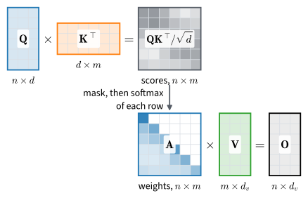

# Attention Scoring and Masking
:label:`sec_attention-scoring-functions`

In :numref:`sec_attention-pooling`, attention weights were determined by a
fixed Gaussian kernel over Euclidean distance in input space. In a sequence
model, however, similarity must be learned—a verb seeking its subject needs
the word playing that syntactic role, not the closest raw embedding. Turning
soft lookup into a trainable network layer raises two questions: which
scoring function $a(\mathbf{q}, \mathbf{k})$ should the layer compute, and
which query--key pairs should be excluded from the lookup?

Because a head reading $n = 1{,}024$ tokens evaluates $n^2 = 1{,}048{,}576$
query--key pairs per sequence, the score must be inexpensive and map cleanly
onto matrix multiplication hardware. Furthermore, invalid pairs—such as
padding tokens in a variable-length minibatch or future tokens in an
autoregressive language model—must be zeroed out before normalization.

This section derives *scaled dot-product attention*
($\mathbf{q}^\top\mathbf{k}/\sqrt{d}$), explains how the $1/\sqrt{d}$ factor
prevents softmax saturation at initialization, implements boolean masking and
mask composition, and demonstrates how learned attention recovers sequence
alignments from output supervision alone.

```{.python .input #attention-scoring-attention-scoring-and-masking}
%%tab pytorch
import math
import numpy as np
import torch
from torch import nn
from torch.nn import functional as F
from d2l import torch as d2l
```

```{.python .input #attention-scoring-attention-scoring-and-masking}
%%tab jax
import math
import numpy as np
import jax
from jax import numpy as jnp
from flax import nnx
import optax
from d2l import jax as d2l
```

## Dot-Product Attention

Expanding the negative squared distance of the unit-bandwidth Gaussian kernel
from :numref:`sec_attention-pooling` reveals an inner product plus two squared
norms:

$$
a(\mathbf{q}, \mathbf{k}_i) = -\frac{1}{2} \|\mathbf{q} - \mathbf{k}_i\|^2 = \mathbf{q}^\top \mathbf{k}_i -\frac{1}{2} \|\mathbf{k}_i\|^2 -\frac{1}{2} \|\mathbf{q}\|^2.
$$
:eqlabel:`eq_gaussian-expansion`

Because $-\tfrac{1}{2}\|\mathbf{q}\|^2$ is constant across all keys $i$, the
softmax normalization cancels it out. If all keys have equal norm,
$-\tfrac{1}{2}\|\mathbf{k}_i\|^2$ cancels as well. Dropping both norm terms
even when key norms vary yields the *dot-product score* $\mathbf{q}^\top
\mathbf{k}_i$. Unlike the Gaussian kernel, which penalizes large
$\|\mathbf{k}_i\|$, the dot product allows a key's norm to act as a multiplicative
prior: a longer key attracts larger weight from every query aligned with it
(Exercise :exref:`ex_queries-keys-values-average-two-values`c).

Early neural machine translation models instead used a one-hidden-layer MLP
known as *additive attention* :cite:`Bahdanau.Cho.Bengio.2014`:

$$a(\mathbf{q}, \mathbf{k}) = \mathbf{w}_v^\top \tanh(\mathbf{W}_q \mathbf{q} + \mathbf{W}_k \mathbf{k}) \in \mathbb{R},$$
:eqlabel:`eq_additive-attn`

with learned matrices $\mathbf{W}_q \in \mathbb{R}^{r \times d_q}$,
$\mathbf{W}_k \in \mathbb{R}^{r \times d_k}$, and weight vector
$\mathbf{w}_v \in \mathbb{R}^{r}$. Although additive and dot-product scoring
have similar asymptotic operation counts ($O(nmr)$ versus $O(nmd)$ for $n$
queries and $m$ keys), additive attention must materialize an $n \times m
\times r$ tensor of hidden activations and apply $\tanh$ elementwise.
Dot-product attention computes all $n \times m$ scores in a single matrix
multiplication $\mathbf{Q}\mathbf{K}^\top$, without losing expressivity when
queries and keys are already produced by learned linear projections
$(\mathbf{W}_q \mathbf{q})^\top (\mathbf{W}_k \mathbf{k})$ (see also Exercise
:exref:`ex_attention-scoring-additive-near-zero`).

One crucial scaling factor remains. Suppose the coordinates of $\mathbf{q},
\mathbf{k} \in \mathbb{R}^d$ are independent random variables with mean $0$
and variance $1$. Then each term $q_j k_j$ has mean $0$ and variance $1$, so
the sum $\mathbf{q}^\top \mathbf{k}$ has mean $0$ and variance $d$ (standard
deviation $8$ at $d = 64$). To prevent large dot products from pushing the
softmax into regions of vanishing gradients at large $d$,
:citet:`Vaswani.Shazeer.Parmar.ea.2017` divide by $\sqrt{d}$ to restore unit
variance, giving the *scaled dot-product* score:

$$a(\mathbf{q}, \mathbf{k}_i) = \mathbf{q}^\top \mathbf{k}_i / \sqrt{d}.$$
:eqlabel:`eq_dot_product_attention`

Here $1/\sqrt{d}$ plays the role of the inverse temperature $1/\sigma^2$ in
:numref:`sec_attention-pooling`, calibrated automatically to the vector width
$d$. Softmax normalization then yields the attention weights

$$\alpha(\mathbf{q}, \mathbf{k}_i) = \mathrm{softmax}(a(\mathbf{q}, \mathbf{k}_i)) = \frac{\exp(\mathbf{q}^\top \mathbf{k}_i / \sqrt{d})}{\sum_{j=1}^m \exp(\mathbf{q}^\top \mathbf{k}_j / \sqrt{d})},$$
:eqlabel:`eq_attn-scoring-alpha`

and the output $\sum_{i=1}^m \alpha(\mathbf{q}, \mathbf{k}_i)\, \mathbf{v}_i$.

### A Worked Example
:label:`subsec_attention-worked-example`

Let $d = 4$ (so $1/\sqrt{d} = 1/2$) with two queries and three key--value
pairs:

$$
\begin{aligned}
\mathbf{q}_1 &= (2, 2, 0, 0), & \mathbf{k}_1 &= (1, 1, 0, 0), & \mathbf{v}_1 &= (1, 0),\\
\mathbf{q}_2 &= (0, 0, 2, 0), & \mathbf{k}_2 &= (0, 0, 1, 1), & \mathbf{v}_2 &= (0, 1),\\
& & \mathbf{k}_3 &= (0, 0, 1, -1), & \mathbf{v}_3 &= (1, 1).
\end{aligned}
$$

1. *Scores:* $\mathbf{q}_1$ has raw dot products $(4, 0, 0)$ with the three
   keys; $\mathbf{q}_2$ has $(0, 2, 2)$.
2. *Scaling:* Dividing by $\sqrt{4} = 2$ gives $(2, 0, 0)$ and $(0, 1, 1)$.
3. *Softmax:* $\mathbf{q}_1$ assigns weights
   $\big(e^2/(e^2 + 2),\, 1/(e^2 + 2),\, 1/(e^2 + 2)\big) \approx
   (0.787, 0.107, 0.107)$; $\mathbf{q}_2$ assigns
   $\big(1/(1 + 2e),\, e/(1 + 2e),\, e/(1 + 2e)\big) \approx
   (0.155, 0.422, 0.422)$.
4. *Weighted sum:* $\mathbf{o}_1 = 0.787\,\mathbf{v}_1 + 0.107\,\mathbf{v}_2
   + 0.107\,\mathbf{v}_3 \approx (0.893, 0.213)$ and $\mathbf{o}_2 \approx
   (0.578, 0.845)$.

Even an orthogonal key receives nonzero softmax weight ($0.107$), and keys
that tie on the active coordinates of a query ($\mathbf{k}_2$ and
$\mathbf{k}_3$ under $\mathbf{q}_2$) split the remaining weight equally.
Omitting the $1/2$ scaling factor would sharpen $\mathbf{q}_1$'s weight on
$\mathbf{k}_1$ from $0.787$ to $e^4/(e^4 + 2) \approx 0.96$.

### Score Variance and the $1/\sqrt{d}$ Factor

When one score exceeds all others by a wide margin, the weight vector
$\boldsymbol{\alpha}$ approaches a one-hot vector and the softmax *saturates*.
The Jacobian of $\boldsymbol{\alpha} = \mathrm{softmax}(\mathbf{a})$,

$$
\frac{\partial \boldsymbol{\alpha}}{\partial \mathbf{a}} = \mathrm{diag}(\boldsymbol{\alpha}) - \boldsymbol{\alpha} \boldsymbol{\alpha}^\top,
$$
:eqlabel:`eq_softmax-jacobian`

converges to the zero matrix as $\boldsymbol{\alpha}$ becomes one-hot
(Exercise :exref:`ex_attention-scoring-softmax-jacobian`). In a saturated
row, backpropagated gradients with respect to the scores vanish, making it
difficult for unselected keys to gain weight during training.

We can measure this effect on random standard normal queries ($2{,}048$
queries, each attending over $64$ random keys) across dimensions $d \in
\{4, \ldots, 512\}$, comparing unscaled scores against scores scaled by
$1/\sqrt{d}$. Uniform weights over $64$ keys have entropy $\log 64 \approx
4.16$ nats, whereas a one-hot distribution has entropy $0$.

```{.python .input #attention-scoring-softmax-saturation-and-the-1-sqrt-d-factor-1}
%%tab pytorch
def softmax_weights(d, scale, num_keys=64, num_queries=2048):
    """Log-weights of random queries over random keys, scores scaled."""
    q = torch.randn(num_queries, d)
    keys = torch.randn(num_queries, num_keys, d)
    scores = (keys @ q[..., None]).squeeze(-1) * scale
    return F.log_softmax(scores, dim=-1)

def entropy(log_alpha):
    return -(log_alpha.exp() * log_alpha).sum(-1).mean().item()

def largest_weight(log_alpha):
    return log_alpha.exp().max(-1).values.mean().item()

def jacobian_norm(log_alpha):
    """Mean Frobenius norm of the Jacobian diag(alpha) - alpha alpha^T."""
    alpha = log_alpha.exp()
    J = torch.diag_embed(alpha) - alpha[..., :, None] * alpha[..., None, :]
    return torch.linalg.matrix_norm(J).mean().item()
```

```{.python .input #attention-scoring-softmax-saturation-and-the-1-sqrt-d-factor-1}
%%tab jax
def softmax_weights(d, scale, num_keys=64, num_queries=2048):
    """Log-weights of random queries over random keys, scores scaled."""
    q = jax.random.normal(d2l.get_key(), (num_queries, d))
    keys = jax.random.normal(d2l.get_key(), (num_queries, num_keys, d))
    scores = (keys @ q[..., None]).squeeze(-1) * scale
    return jax.nn.log_softmax(scores, axis=-1)

def entropy(log_alpha):
    return float(-(jnp.exp(log_alpha) * log_alpha).sum(-1).mean())

def largest_weight(log_alpha):
    return float(jnp.exp(log_alpha).max(-1).mean())

def jacobian_norm(log_alpha):
    """Mean Frobenius norm of the Jacobian diag(alpha) - alpha alpha^T."""
    alpha = jnp.exp(log_alpha)
    J = (alpha[..., None] * jnp.eye(alpha.shape[-1])
         - alpha[..., :, None] * alpha[..., None, :])
    return float(jnp.linalg.norm(J, axis=(-2, -1)).mean())
```

```{.python .input #attention-scoring-score-variance-and-the-1-sqrt-d-factor-1}
%%tab pytorch, jax
ds = [2**k for k in range(2, 10)]
entropies = [[entropy(softmax_weights(d, 1.0)) for d in ds],
             [entropy(softmax_weights(d, 1 / math.sqrt(d))) for d in ds]]
d2l.plot(ds, entropies, 'width d', 'entropy (nats)',
         legend=['unscaled', 'scaled by 1/sqrt(d)'], xscale='log')
```

The table below reports the entropy, mean maximum weight, and mean Frobenius
norm of the softmax Jacobian at five widths.

```{.python .input #attention-scoring-softmax-saturation-and-the-1-sqrt-d-factor-2}
%%tab pytorch, jax
print('      entropy (nats)    largest weight     Jacobian norm')
print('  d' + '   unscaled scaled' * 3)
for d in (4, 16, 64, 128, 512):
    stats = [(entropy(la), largest_weight(la), jacobian_norm(la))
             for la in (softmax_weights(d, 1.0),
                        softmax_weights(d, 1 / math.sqrt(d)))]
    print(f'{d:3d}' + ''.join(f'   {u:8.3f} {s:6.3f}'
                              for u, s in zip(*stats)))
```

With $1/\sqrt{d}$ scaling, the entropy stays near $\log 64 - \tfrac{1}{2}
\approx 3.66$ nats across all widths (Exercise
:exref:`ex_attention-scoring-entropy-of-random-scores`), with maximum weight
$\approx 0.11$ and Jacobian norm $\approx 0.18$. Without scaling, score
standard deviation grows as $\sqrt{d}$: by $d = 512$, entropy collapses to
$\approx 0.2$ nats, the top key takes over $90\%$ of the weight at random
initialization, and the Jacobian norm falls by half. Scaling by $1/\sqrt{d}$
decouples initial softmax sharpness from head width while leaving learned
projections free to sharpen weights during training (once queries and keys
align, dot products grow as $O(d)$, motivating the $1/d$ scaling in maximal
update parametrization, :numref:`sec_scaling`).

## Masking

Two standard conditions exclude specific query--key pairs from attention:

1. **Padding:** When sequences of unequal lengths are padded with `<blank>`
   tokens to form a minibatch, no query should attend to padding positions.
2. **Causality:** In autoregressive language modeling, the query at position
   $t$ may attend only to keys at positions $j \le t$.

Both constraints are represented by a boolean *mask* tensor that is `True`
where query $i$ is permitted to attend to key $j$.

### The Masked Softmax Operation

To preserve dense tensor shapes, *masked softmax* replaces excluded scores
(`~mask`) with a large negative number before calling `softmax`. The choice of
fill value requires care across floating-point formats:

* A hardcoded constant such as $-10^6$ overflows float16 (whose maximum finite
  magnitude is $65{,}504$).
* Literal $-\infty$ produces `NaN` whenever an entire query row is masked out,
  because the numerically stable softmax subtracts the row maximum $-\infty$
  to form $-\infty - (-\infty) = \mathrm{NaN}$.
* Using the most negative *finite* value of the tensor's data type
  (`finfo(dtype).min`) underflows excluded exponentials to exact zero in
  float16, bfloat16, and float32 without producing `NaN`. For any query row
  where all keys are masked out (`~mask.any(-1)`), `masked_softmax` explicitly
  zeroes the resulting weights.

```{.python .input #attention-scoring-the-masked-softmax-operation-1}
%%tab pytorch
def masked_softmax(X, mask=None):  #@save
    """Softmax over the last axis with zero weight where mask is False."""
    if mask is None:
        return F.softmax(X, dim=-1)
    # Most negative finite value: zero weight at any precision, no NaN
    X = X.masked_fill(~mask, torch.finfo(X.dtype).min)
    weights = F.softmax(X, dim=-1)
    # A query without any valid key gets zero weights, not a uniform row
    return torch.where(mask.any(-1, keepdim=True), weights, 0.0)
```

```{.python .input #attention-scoring-the-masked-softmax-operation-1}
%%tab jax
def masked_softmax(X, mask=None):  #@save
    """Softmax over the last axis with zero weight where mask is False."""
    if mask is None:
        return jax.nn.softmax(X, axis=-1)
    # Most negative finite value: zero weight at any precision, no NaN
    X = jnp.where(mask, X, jnp.finfo(X.dtype).min)
    weights = jax.nn.softmax(X, axis=-1)
    # A query without any valid key gets zero weights, not a uniform row
    return jnp.where(mask.any(-1, keepdims=True), weights, 0.0)
```

Because `mask` only needs to broadcast against `X`, a padding mask shared
across all queries in a sequence can be stored with shape `(batch, 1, keys)`.

```{.python .input #attention-scoring-the-masked-softmax-operation-4}
%%tab pytorch
def padding_mask(valid_lens, num_keys):  #@save
    """Boolean mask that is True for the first valid_lens keys."""
    # valid_lens of shape (batch,) gives (batch, 1, keys); per-query
    # lengths of shape (batch, queries) give (batch, queries, keys)
    if valid_lens.dim() == 1:
        valid_lens = valid_lens[:, None]
    keys = torch.arange(num_keys, device=valid_lens.device)
    return keys < valid_lens[..., None]
```

```{.python .input #attention-scoring-the-masked-softmax-operation-4}
%%tab jax
def padding_mask(valid_lens, num_keys):  #@save
    """Boolean mask that is True for the first valid_lens keys."""
    # valid_lens of shape (batch,) gives (batch, 1, keys); per-query
    # lengths of shape (batch, queries) give (batch, queries, keys)
    if valid_lens.ndim == 1:
        valid_lens = valid_lens[:, None]
    return jnp.arange(num_keys) < valid_lens[..., None]
```

On a batch of two zero-score sequences of length $4$ with valid lengths $2$
and $3$, `masked_softmax` distributes weight uniformly over the valid prefix
of each row:

```{.python .input #attention-scoring-the-masked-softmax-operation-2}
%%tab pytorch
masked_softmax(torch.zeros(2, 2, 4), padding_mask(torch.tensor([2, 3]), 4))
```

```{.python .input #attention-scoring-the-masked-softmax-operation-2}
%%tab jax
masked_softmax(jnp.zeros((2, 2, 4)), padding_mask(jnp.array([2, 3]), 4))
```

### Causal Masking

A causal mask allows query $i$ to attend to key $j$ only if $j \le i$,
forming a lower-triangular matrix that excludes $n(n-1)/2$ of the $n^2$ pairs
($523{,}776$ pairs at $n = 1{,}024$). When `num_queries < num_keys` (as during
cached generation), `causal_mask` aligns the queries with the final positions
of the sequence.

```{.python .input #attention-scoring-causal-masking}
%%tab pytorch
def causal_mask(num_queries, num_keys=None, device=None):  #@save
    """Boolean (queries, keys) mask, True where a query may see a key."""
    # Queries are the last positions, as when new tokens attend to a
    # cache: query i sees key j if j <= i + num_keys - num_queries
    num_keys = num_queries if num_keys is None else num_keys
    i = torch.arange(num_queries, device=device)[:, None]
    j = torch.arange(num_keys, device=device)[None, :]
    return j <= i + (num_keys - num_queries)
```

```{.python .input #attention-scoring-causal-masking}
%%tab jax
def causal_mask(num_queries, num_keys=None):  #@save
    """Boolean (queries, keys) mask, True where a query may see a key."""
    # Queries are the last positions, as when new tokens attend to a
    # cache: query i sees key j if j <= i + num_keys - num_queries
    num_keys = num_queries if num_keys is None else num_keys
    i = jnp.arange(num_queries)[:, None]
    j = jnp.arange(num_keys)[None, :]
    return j <= i + (num_keys - num_queries)
```

### Composing Masks
:label:`subsec_composing-masks`

When multiple constraints apply simultaneously, a pair is valid only if every
constraint permits it, so boolean masks compose via logical AND (`&`) under
broadcasting (:numref:`fig_mask-algebra`).


:label:`fig_mask-algebra`

Combining a padding mask (valid lengths $6$ and $3$) with a causal mask on
equal scores produces a full causal triangle for the first sequence and
truncates all rows of the second sequence at key $3$:

```{.python .input #attention-scoring-composing-masks}
%%tab pytorch
n = 6
padding = padding_mask(torch.tensor([6, 3]), n)  # (batch, 1, key)
causal = causal_mask(n)                          # (query, key)
mask = padding & causal                          # (batch, query, key)
weights = masked_softmax(torch.zeros(2, n, n), mask)  # Equal scores
d2l.show_heatmaps(weights[None], xlabel='keys', ylabel='queries',
                  titles=['valid length 6', 'valid length 3'],
                  figsize=(5, 2.5))
```

```{.python .input #attention-scoring-composing-masks}
%%tab jax
n = 6
padding = padding_mask(jnp.array([6, 3]), n)  # (batch, 1, key)
causal = causal_mask(n)                       # (query, key)
mask = padding & causal                       # (batch, query, key)
weights = masked_softmax(jnp.zeros((2, n, n)), mask)  # Equal scores
d2l.show_heatmaps(weights[None], xlabel='keys', ylabel='queries',
                  titles=['valid length 6', 'valid length 3'],
                  figsize=(5, 2.5))
```

The same boolean algebra handles *packed sequences*, where multiple short
documents are concatenated into a single row to avoid padding overhead.
ANDing a same-document indicator `doc[:, None] == doc[None, :]` with
`causal_mask` produces a block-diagonal causal mask:

```{.python .input #attention-scoring-composing-masks-1}
%%tab pytorch
doc = torch.tensor([0, 0, 0, 1, 1, 2])  # Document of each position
same_doc = doc[:, None] == doc[None, :]
packed = same_doc & causal_mask(6)
d2l.show_heatmaps(packed.float()[None, None], xlabel='keys',
                  ylabel='queries', cbar=False)
```

```{.python .input #attention-scoring-composing-masks-1}
%%tab jax
doc = jnp.array([0, 0, 0, 1, 1, 2])  # Document of each position
same_doc = doc[:, None] == doc[None, :]
packed = same_doc & causal_mask(6)
d2l.show_heatmaps(packed.astype(jnp.float32)[None, None], xlabel='keys',
                  ylabel='queries', cbar=False)
```

## Attention for a Minibatch

Stacking $n$ queries into $\mathbf{Q} \in \mathbb{R}^{n \times d}$, $m$ keys
into $\mathbf{K} \in \mathbb{R}^{m \times d}$, and $m$ values into
$\mathbf{V} \in \mathbb{R}^{m \times d_v}$ expresses scaled dot-product
attention as two matrix multiplications and a row-wise softmax
(:numref:`fig_attention-shapes`):

$$\mathrm{softmax}\left(\frac{\mathbf{Q} \mathbf{K}^\top}{\sqrt{d}}\right) \mathbf{V} \in \mathbb{R}^{n \times d_v}.$$
:eqlabel:`eq_softmax_QK_V`


:label:`fig_attention-shapes`

For batched inputs with leading batch (and head) axes, the batched matrix
product `@` operates over the last two dimensions and broadcasts leading axes
automatically. For one head of GPT-2 small ($n = m = 1{,}024$, $d = d_v =
64$), the score matrix holds $1{,}048{,}576$ floats (4 MiB in fp32) and the
two products require $4n^2 d \approx 0.27$ GFLOPs—both quadratic in $n$.

### The DotProductAttention Class
:label:`subsec_dot-product-attention-class`

`DotProductAttention` implements :eqref:`eq_softmax_QK_V` with optional
masking and attention-weight dropout (default $0.0$), storing the most recent
attention weights in `attention_weights` for inspection.

```{.python .input #attention-scoring-the-dotproductattention-class-1}
%%tab pytorch
class DotProductAttention(nn.Module):  #@save
    """Scaled dot-product attention over the last two axes."""
    def __init__(self, dropout=0.0):
        super().__init__()
        self.dropout = nn.Dropout(dropout)
        self.attention_weights = None

    # Leading axes (batch, and heads if present) are carried along.
    # Shape of queries: (..., no. of queries, d)
    # Shape of keys: (..., no. of key-value pairs, d)
    # Shape of values: (..., no. of key-value pairs, value dimension)
    # mask: boolean, broadcastable to (..., no. of queries, no. of keys),
    # True where a query may attend to a key
    def forward(self, queries, keys, values, mask=None):
        d = queries.shape[-1]
        scores = queries @ keys.transpose(-2, -1) / math.sqrt(d)
        self.attention_weights = masked_softmax(scores, mask)
        return self.dropout(self.attention_weights) @ values
```

```{.python .input #attention-scoring-the-dotproductattention-class-1}
%%tab jax
class DotProductAttention(nnx.Module):  #@save
    """Scaled dot-product attention over the last two axes."""
    def __init__(self, dropout=0.0, *, rngs=None):
        # rngs is needed only to draw dropout masks (dropout > 0)
        self.dropout = nnx.Dropout(dropout, rngs=rngs)
        # A Variable, so that views of the module (nnx.view) share it
        self.last_weights = nnx.Intermediate(None)

    # Leading axes (batch, and heads if present) are carried along.
    # Shape of queries: (..., no. of queries, d)
    # Shape of keys: (..., no. of key-value pairs, d)
    # Shape of values: (..., no. of key-value pairs, value dimension)
    # mask: boolean, broadcastable to (..., no. of queries, no. of keys),
    # True where a query may attend to a key
    def __call__(self, queries, keys, values, mask=None):
        d = queries.shape[-1]
        scores = queries @ keys.swapaxes(-2, -1) / math.sqrt(d)
        weights = masked_softmax(scores, mask)
        if not isinstance(weights, jax.core.Tracer):
            # Record the weights of eager calls for inspection; inside
            # jit-compiled code skip it, so the module state keeps a
            # fixed structure and the compiled step is reused
            self.last_weights.set_value(weights)
        return self.dropout(weights) @ values

    @property
    def attention_weights(self):
        """Weights of the last eager call: (..., queries, keys)."""
        return self.last_weights.get_value()
```

Evaluating `DotProductAttention` on the vectors from
:numref:`subsec_attention-worked-example` reproduces our hand calculation:

```{.python .input #attention-scoring-the-dotproductattention-class-2}
%%tab pytorch, jax
queries = d2l.tensor([[[2.0, 2, 0, 0], [0, 0, 2, 0]]])           # (1, 2, 4)
keys = d2l.tensor([[[1.0, 1, 0, 0], [0, 0, 1, 1], [0, 0, 1, -1]]])  # (1, 3, 4)
values = d2l.tensor([[[1.0, 0], [0, 1], [1, 1]]])                   # (1, 3, 2)
attention = DotProductAttention()
output = attention(queries, keys, values)
print('weights:', np.asarray(attention.attention_weights[0]).round(3))
print('output: ', np.asarray(output[0]).round(3))
```

### Matching the Letters of Two Words
:label:`subsec_cross-attention-alignment`

To see what unprojected content matching can and cannot distinguish, assign
each distinct letter in `"attention"` and `"translation"` a random standard
normal embedding $\mathbf{e} \in \mathbb{R}^{32}$ and let the letters of
`"attention"` query the letters of `"translation"`. Identical letters have
expected scaled score $\mathbb{E}[\|\mathbf{e}\|^2]/\sqrt{32} = \sqrt{32}
\approx 5.7$, whereas distinct letters have expected score $0$ and unit
variance.

```{.python .input #multihead-attention-an-alignment-you-can-read}
%%tab pytorch
words = 'attention', 'translation'
letters = sorted(set(''.join(words)))
emb = torch.randn(len(letters), 32)
queries, keys = (emb[[letters.index(c) for c in w]][None] for w in words)
attention = DotProductAttention()
attention(queries, keys, keys)
d2l.show_heatmaps(attention.attention_weights[None], xlabel='keys',
                  ylabel='queries', figsize=(4, 3.5), cmap='Blues',
                  xticklabels=words[1], yticklabels=words[0])
```

```{.python .input #multihead-attention-an-alignment-you-can-read}
%%tab jax
words = 'attention', 'translation'
letters = sorted(set(''.join(words)))
emb = jax.random.normal(d2l.get_key(), (len(letters), 32))
queries, keys = (emb[jnp.array([letters.index(c) for c in w])][None]
                 for w in words)
attention = DotProductAttention()
attention(queries, keys, keys)
d2l.show_heatmaps(attention.attention_weights[None], xlabel='keys',
                  ylabel='queries', figsize=(4, 3.5), cmap='Blues',
                  xticklabels=words[1], yticklabels=words[0])
```

Three behaviors stand out:

1. Unique matches (`i`, `o`) concentrate nearly all weight on their partner.
2. Repeated matches (`a`, `t`, `n`) split their weight equally across every
   occurrence of the letter in `"translation"`, because content-only keys
   carry no positional identity.
3. Unmatched queries (`e`) spread their probability mass across random keys,
   because softmax weights must sum to one even when no relevant key exists
   (in trained language models, the initial token often absorbs such unused
   mass as an *attention sink*, :cite:`Xiao.Tian.Chen.ea.2024`).

## Attention as Learned Alignment
:label:`subsec_learned-alignment`

Learned attention originated in neural machine translation
:cite:`Bahdanau.Cho.Bengio.2014` to relieve the fixed-vector bottleneck of
sequence-to-sequence RNNs (:numref:`sec_seq2seq`). At each decoding step, the
decoder queried all encoder states, and the learned attention weights
spontaneously recovered word alignments between source and target languages—a
monotonic diagonal with off-diagonal crossings where word order differed
(e.g., English *"black cat"* versus French *"chat noir"*).

We can observe alignment emergence in a minimal model `ToyAligner`. Source
sequences consist of $8$ tokens drawn from a vocabulary of size $16$, and the
target sequence applies a fixed permutation $\pi$ that swaps positions $3$
and $4$. Each output position $j$ has a learned query vector; each source
key is a linear projection of the concatenated one-hot token and one-hot
source position; and values are the one-hot source tokens.

```{.python .input #attention-scoring-attention-as-learned-alignment-1}
%%tab pytorch
class ToyAligner(nn.Module):
    """One learned query per output position; keys from token and position."""
    def __init__(self, seq_len=8, vocab_size=16, d=16):
        super().__init__()
        self.vocab_size, n_in = vocab_size, vocab_size + seq_len
        self.queries = nn.Parameter(torch.randn(seq_len, d))
        self.W_k = nn.Parameter(torch.randn(n_in, d) / math.sqrt(n_in))
        self.attention = DotProductAttention()

    def forward(self, X):
        # X: (batch, seq_len) token ids; the values are their one-hot vectors
        tokens = F.one_hot(X, self.vocab_size).float()
        eye = torch.eye(X.shape[1], device=X.device)
        positions = eye.expand(len(X), -1, -1)
        keys = torch.cat((tokens, positions), -1) @ self.W_k
        # The queries broadcast over the batch: (batch, seq_len, vocab_size)
        return self.attention(self.queries, keys, tokens)
```

```{.python .input #attention-scoring-attention-as-learned-alignment-1}
%%tab jax
class ToyAligner(nnx.Module):
    """One learned query per output position; keys from token and position."""
    def __init__(self, seq_len=8, vocab_size=16, d=16, *, rngs):
        self.vocab_size, n_in = vocab_size, vocab_size + seq_len
        self.queries = nnx.Param(
            jax.random.normal(rngs.params(), (seq_len, d)))
        self.W_k = nnx.Param(jax.random.normal(rngs.params(), (n_in, d))
                             / math.sqrt(n_in))
        self.attention = DotProductAttention()

    def __call__(self, X):
        # X: (batch, seq_len) token ids; the values are their one-hot vectors
        tokens = jax.nn.one_hot(X, self.vocab_size)
        n = X.shape[1]
        positions = jnp.broadcast_to(jnp.eye(n), (len(X), n, n))
        keys = jnp.concatenate((tokens, positions), -1) @ self.W_k
        # The queries broadcast over the batch: (batch, seq_len, vocab_size)
        return self.attention(self.queries, keys, tokens)
```

We train `ToyAligner` with Adam for 100 steps by minimizing the negative
log-likelihood of the permuted target tokens.

```{.python .input #attention-scoring-attention-as-learned-alignment-2}
%%tab pytorch
perm = torch.tensor([0, 1, 2, 4, 3, 5, 6, 7])  # Output j copies source perm[j]

def align_data(n, seq_len=8, vocab_size=16):
    X = torch.randint(0, vocab_size, (n, seq_len))
    return X, X[:, perm]

def train_aligner(num_steps=100):
    model = ToyAligner()
    optimizer = torch.optim.Adam(model.parameters(), lr=0.05)
    for _ in range(num_steps):
        X, Y = align_data(128)
        loss = -model(X).gather(-1, Y[..., None]).log().mean()
        optimizer.zero_grad()
        loss.backward()
        optimizer.step()
    return model
```

```{.python .input #attention-scoring-attention-as-learned-alignment-2}
%%tab jax
perm = jnp.array([0, 1, 2, 4, 3, 5, 6, 7])  # Output j copies source perm[j]

def align_data(key, n, seq_len=8, vocab_size=16):
    X = jax.random.randint(key, (n, seq_len), 0, vocab_size)
    return X, X[:, perm]

@nnx.jit
def align_step(model, optimizer, key):
    X, Y = align_data(key, 128)
    loss = lambda model: -jnp.log(
        jnp.take_along_axis(model(X), Y[..., None], -1)).mean()
    optimizer.update(model, nnx.grad(loss)(model))

def train_aligner(num_steps=100):
    model = ToyAligner(rngs=nnx.Rngs(d2l.get_key()))
    optimizer = nnx.Optimizer(model, optax.adam(0.05), wrt=nnx.Param)
    for key in jax.random.split(d2l.get_key(), num_steps):
        align_step(model, optimizer, key)
    return model
```

Comparing an untrained model against three independent training runs on
$1{,}000$ test sequences shows that gradient descent reliably converges to
$100\%$ accuracy, placing over $0.999$ of each output position's weight on
$\pi(j)$:

```{.python .input #attention-scoring-attention-as-learned-alignment-3}
%%tab pytorch
X, Y = align_data(1000)

def evaluate_aligner(model, X, Y, name):
    with torch.inference_mode():
        accuracy = (model(X).argmax(-1) == Y).float().mean()
    weights = model.attention.attention_weights  # (1000, 8, 8)
    largest = (weights.argmax(-1) == perm).float().mean()
    on_perm = weights[:, torch.arange(8), perm].mean()
    print(f'{name:>9}: accuracy {accuracy:.3f}, largest weight on pi(j) '
          f'{largest:.3f}, mean weight on pi(j) {on_perm:.3f}')

untrained = ToyAligner()
evaluate_aligner(untrained, X, Y, 'untrained')
for run in range(1, 4):
    model = train_aligner()
    evaluate_aligner(model, X, Y, f'run {run}')
```

```{.python .input #attention-scoring-attention-as-learned-alignment-3}
%%tab jax
X, Y = align_data(d2l.get_key(), 1000)

def evaluate_aligner(model, X, Y, name):
    accuracy = (model(X).argmax(-1) == Y).mean()
    weights = model.attention.attention_weights  # (1000, 8, 8)
    largest = (weights.argmax(-1) == perm).mean()
    on_perm = weights[:, jnp.arange(8), perm].mean()
    print(f'{name:>9}: accuracy {accuracy:.3f}, largest weight on pi(j) '
          f'{largest:.3f}, mean weight on pi(j) {on_perm:.3f}')

untrained = ToyAligner(rngs=nnx.Rngs(d2l.get_key()))
evaluate_aligner(untrained, X, Y, 'untrained')
for run in range(1, 4):
    model = train_aligner()
    evaluate_aligner(model, X, Y, f'run {run}')
```

```{.python .input #attention-scoring-attention-as-learned-alignment-4}
%%tab pytorch, jax
letters = 'abcdefghijklmnop'  # One letter per token id
maps = d2l.stack([untrained.attention.attention_weights[0],
                  model.attention.attention_weights[0]])
d2l.show_heatmaps(maps[None], xlabel='source', ylabel='target',
                  titles=['untrained', 'trained'], figsize=(5.5, 3),
                  cmap='Blues', xticklabels=[letters[int(i)] for i in X[0]],
                  yticklabels=[letters[int(i)] for i in Y[0]])
```

The trained attention heatmap recovers the exact permutation matrix of $\pi$,
even when tokens repeat in the source sequence, because the keys encode
position alongside token identity. In general sequence modeling, however,
queries must be derived from the sequence itself, a single position may need
to retrieve multiple distinct values simultaneously
(:numref:`sec_multihead-attention`), and positional encodings must generalize
across sequence lengths (:numref:`sec_positional-information`).

## Summary

* Scaled dot-product scoring $a(\mathbf{q}, \mathbf{k}) = \mathbf{q}^\top
  \mathbf{k} / \sqrt{d}$ drops the norm penalties of the Gaussian kernel and
  computes all pairwise scores via a single matrix multiplication
  $\mathbf{Q}\mathbf{K}^\top$.
* Dividing by $\sqrt{d}$ preserves unit score variance for unit-variance
  inputs, preventing softmax saturation and vanishing score gradients as head
  width $d$ increases.
* Boolean masks exclude invalid query--key pairs (such as padding and future
  tokens) and compose via logical AND under broadcasting; filling excluded
  scores with `finfo(dtype).min` avoids float16 overflow and `NaN` rows.
* Content-only keys split attention equally across duplicate tokens, whereas
  position-aware keys enable end-to-end learning of sequence alignments.

## Exercises

1. **Attention by hand.** Let $d = 2$, with keys $\mathbf{k}_1 = (1, 0)$,
   $\mathbf{k}_2 = (0, 1)$, $\mathbf{k}_3 = (1, 1)$, values
   $\mathbf{v}_1 = (1, 0)$, $\mathbf{v}_2 = (0, 1)$,
   $\mathbf{v}_3 = (1, 1)$, and queries $\mathbf{q}_1 = (2, 0)$ and
   $\mathbf{q}_2 = (0, 2)$. Use a calculator.
    1. Compute the scaled scores :eqref:`eq_dot_product_attention`, the
       weights, and the outputs of both queries.
    1. The first query gives $\mathbf{k}_1$ and $\mathbf{k}_3$ the same
       score, although $\mathbf{k}_1$ is the closer key. Recompute its
       weights with the Gaussian score
       $-\tfrac{1}{2}\|\mathbf{q} - \mathbf{k}_i\|^2$ and use
       :eqref:`eq_gaussian-expansion` to explain the difference.
    1. Let the two queries be the last two of three positions, so that a
       causal mask lets $\mathbf{q}_1$ see $\mathbf{k}_1$ and
       $\mathbf{k}_2$ and lets $\mathbf{q}_2$ see all three keys.
       Recompute the weights and outputs, and check your answers with
       `DotProductAttention` and `causal_mask(2, 3)`.

1. **Invariances of the score.** The Gaussian score
   :eqref:`eq_gaussian-expansion` and the scaled dot product
   :eqref:`eq_dot_product_attention` both define attention weights through
   the softmax :eqref:`eq_attn-scoring-alpha`.
    1. For each of the two scores, determine which of the following
       transformations leaves the weights unchanged: adding one vector
       $\mathbf{c}$ to every key; adding $\mathbf{c}$ to the query and to
       every key; multiplying the query and every key by one orthogonal
       matrix.
    1. Queries and keys are usually computed from inputs by affine maps,
       $\mathbf{q} = \mathbf{W}_q \mathbf{x} + \mathbf{b}_q$ and
       $\mathbf{k}_i = \mathbf{W}_k \mathbf{y}_i + \mathbf{b}_k$. Expand
       $\mathbf{q}^\top \mathbf{k}_i$ into four terms and show that the
       weights do not depend on $\mathbf{b}_k$. What is the gradient of the
       loss with respect to $\mathbf{b}_k$?
    1. Through which of the four terms does $\mathbf{b}_q$ affect the
       weights, and what preference over the keys can it express that the
       bias-free score cannot?

1. [code] **The softmax Jacobian.** `jacobian_norm` measures the
   Frobenius norm of the Jacobian :eqref:`eq_softmax-jacobian`.
    1. Derive :eqref:`eq_softmax-jacobian` from
       :eqref:`eq_attn-scoring-alpha`, show that for finite scores its null
       space is spanned by the all-ones vector, and check the formula
       against automatic differentiation on a random score vector.
    1. Compute the norm for weights spread uniformly over $k$ of the $m$
       keys, find the $k$ that maximizes it, and confirm by sampling random
       weight vectors that none exceeds this maximum. Use the result to
       explain why the unscaled norm in the table rises from $d = 4$ to
       $d = 16$ and then falls.
   :exlabel:`ex_attention-scoring-softmax-jacobian`

1. **Fully masked rows.** `masked_softmax` overwrites excluded scores with
   the most negative finite value of the dtype and then zeroes the rows of
   queries that have no valid key.
    1. Build a row of four scores in which every key is excluded. Fill it
       with $-10^6$ in float16, with $-\infty$ in float32, and with
       `finfo(dtype).min` in float32, and apply the framework's softmax to
       each, without the final zeroing of `masked_softmax`. Report what you
       get and trace each result through the subtraction of the row
       maximum.
    1. In a self-attention layer, whose queries, keys, and values all come
       from the same sequence, let a query at a padding position have no
       valid key, as the composite masks of :numref:`subsec_composing-masks`
       can arrange, and let the excluded scores be overwritten with
       $-\infty$, so that the output at that position is NaN. That output
       is discarded, and in the next attention layer every valid query
       excludes the padding position as a key. Explain why the NaN
       nevertheless corrupts the outputs of all valid positions of that
       sequence in the next layer.

1. **Composite masks.** :numref:`subsec_composing-masks` combines masks by
   logical AND and warns that masks that are harmless alone can leave a
   query with no valid key. A causal sliding window of width $w$ lets the
   query at position $t$ attend to the keys at positions $t - w + 1, \ldots,
   t$.
    1. For a sequence of length $6$ with valid length $3$, write the padding
       mask and the causal sliding window of width $2$ as $6 \times 6$
       boolean matrices. Check that each leaves every query at least one
       key, and find the queries whose row of the AND is empty.
    1. Show that an AND of masks has no empty row if every mask allows each
       query to attend to its own position. Which of the padding, causal,
       sliding-window, and packed-sequence masks satisfy this condition, and
       what does the answer say about the empty rows you found?
    1. Some implementations add a bias matrix with entries $0$ for allowed
       pairs and $c < 0$ for excluded pairs, and compose masks by adding
       their biases. Take for $c$ the most negative finite single-precision
       value, about $-3.4 \times 10^{38}$. Compute the sum of two such
       biases in single precision, and determine what the softmax returns
       for a row in which every key is excluded by both masks and for a row
       in which every key is excluded but some keys by only one mask.
   :exlabel:`ex_attention-scoring-composite-masks`

1. **Entropy of random scores.** ● The scaled entropy curve above
   stays near $3.7$ nats, below the uniform value $\log 64 \approx 4.16$.
   Fix one query $\mathbf{q} \in \mathbb{R}^d$ and draw $m$ keys with
   independent standard normal coordinates, as `softmax_weights` does.
    1. Show that the scaled scores $a_i = \mathbf{q}^\top \mathbf{k}_i /
       \sqrt{d}$ are independent normal variables with mean $0$ and variance
       $s^2 = \|\mathbf{q}\|^2 / d$, and compute the expected value of $s^2$
       when $\mathbf{q}$ is drawn as in `softmax_weights`.
    1. The entropy of the weights is $H = \log Z - \sum_i \alpha_i a_i$ with
       $Z = \sum_j \exp(a_j)$. For large $m$, replace $Z/m$ and
       $\sum_i \exp(a_i)\, a_i / m$ by their expected values and derive
       $$H \approx \log m - \frac{s^2}{2}.$$
       Evaluate the approximation for $m = 64$ and $s = 1$.
    1. The approximation needs $Z$ to concentrate around its mean. Compute
       the relative standard deviation of $Z$ as a function of $s$ and $m$,
       and derive from it a condition on $s^2$ under which the approximation
       holds. Unscaled scores have $s^2 = \|\mathbf{q}\|^2$, whose expected
       value is $d$. Evaluate the relative standard deviation for $m = 64$
       at $s^2 = 4$ and $s^2 = 8$, and compare the approximation with the
       unscaled entropies plotted above for $d = 4$ and
       $d = 8$.
   :exlabel:`ex_attention-scoring-entropy-of-random-scores`

1. [code] **Additive scores near zero.** ● The additive score
   :eqref:`eq_additive-attn` adds the projected query and the projected key
   inside a $\tanh$.
    1. Replace $\tanh$ by the identity and show that the attention weights
       then do not depend on the query.
    1. Expand $\tanh$ to third order around zero, identify the lowest-order
       terms through which the weights depend on the query, and state how
       this dependence scales when $\mathbf{W}_q$ and $\mathbf{W}_k$ are
       both multiplied by a small factor $\epsilon$.
    1. Implement the additive score for $3$ queries and $6$ keys in
       $\mathbb{R}^8$ with standard normal entries and a hidden width
       $r = 16$, drawing $\mathbf{W}_q$, $\mathbf{W}_k$, and $\mathbf{w}_v$
       with standard normal entries divided by the square root of their
       input width. Multiply $\mathbf{W}_q$ and $\mathbf{W}_k$ by
       $\epsilon \in \{1, 0.3, 0.1, 0.03\}$, measure the largest difference
       between the weight rows of the three queries, averaged over many
       draws, and check the scaling you derived. For which of these scales
       do the weights depend appreciably on the query?
   :exlabel:`ex_attention-scoring-additive-near-zero`

1. [code] **Alignment variants.** ● `ToyAligner` in
   :numref:`subsec_learned-alignment` learns the permutation $\pi$ from one
   learned query per output position and keys that carry the token and the
   position.
    1. Remove the one-hot position from the keys, so that they depend on
       the token alone. Predict, before training, whether output position
       $j$ can still put its weight on $\pi(j)$ and roughly what accuracy
       the model can reach; then train it and compare. Relate the result to
       the letters of :numref:`subsec_cross-attention-alignment`.
    1. Replace the score by the additive rule :eqref:`eq_additive-attn` and
       compare the number of steps that each model needs to reach $99\%$
       accuracy. Before training, use Exercise
       :exref:`ex_attention-scoring-additive-near-zero` to predict how the
       additive model starts when its projections are initialized small,
       and test the prediction.
    1. Give queries and keys the width $d \in \{16, 256, 1024\}$ with
       standard normal initialization, and train with and without the
       factor $1/\sqrt{d}$. Relate the training curves to the entropy of the
       weights at initialization.
    1. Show that `ToyAligner` cannot learn a reordering that depends on
       the tokens, such as swapping two neighbors only when the first
       belongs to a designated subset of the vocabulary. (Hint: its score
       is a token term shared by all positions plus a position term;
       compare the scores of the two neighbors.) State what the query, or
       the keys, would have to depend on.

[Discussions](https://d2l.discourse.group/t/36769)

<!-- slides -->

::: {.slide}
::: {.cover}
[Dive into Deep Learning · §10.2]{.kicker}

Attention Scoring Functions, Scaled Dot-Product, and Masking<br>**dot-product vs. additive scoring · 1/√d variance scaling · softmax Jacobian · boolean mask algebra · learned alignment**
:::
:::

::: {.slide title="Two Requirements for a Trainable Attention Layer"}
[Motivation]{.kicker}

Turning soft key–value lookup into a general sequence-modeling layer requires solving two computational and structural problems at scale:

::: {.cols .vc}
::: {.col}
- **1. Fast, Learnable Scoring ($n^2$ Pairs):** A single attention head reading $n = 1{,}024$ tokens evaluates $1{,}024^2 = 1{,}048{,}576$ query–key pairs per layer. The scoring rule $a(\mathbf{q}, \mathbf{k})$ must map directly onto dense GPU matrix-multiplication hardware.
:::

::: {.col}
- **2. Excluding Invalid Pairs (Masking):** Not every stored key is legal to read: padded minibatches contain `<blank>` tokens, and causal language models must block $n(n-1)/2 = 523{,}776$ future pairs so position $t$ cannot peek at tokens $> t$.
:::
:::

::: {.d2l-note}
In this section we derive **scaled dot-product attention** ($\mathbf{q}^\top\mathbf{k}/\sqrt{d}$), prove why $1/\sqrt{d}$ prevents gradient collapse, and build a composable boolean mask algebra.
:::
:::

::: {.slide title="From Gaussian Distance to the Dot-Product Score"}
[Deriving the Score]{.kicker}

Expanding the negative squared Euclidean distance of the unit-bandwidth Gaussian kernel reveals an inner product plus two squared norms:

$$a(\mathbf{q}, \mathbf{k}_i) = -\frac{1}{2}\|\mathbf{q} - \mathbf{k}_i\|^2 = \mathbf{q}^\top \mathbf{k}_i - \frac{1}{2}\|\mathbf{k}_i\|^2 - \frac{1}{2}\|\mathbf{q}\|^2$$

- **Query Norm Cancels Exactly:** Because $-\frac{1}{2}\|\mathbf{q}\|^2$ is identical across all keys $i = 1, \ldots, m$, softmax shift invariance cancels it out completely.
- **Key Norm Cancels Under Unit Normalization:** If all keys have equal norm $\|\mathbf{k}_i\| = c$, the term $-\frac{1}{2}\|\mathbf{k}_i\|^2$ also cancels in the softmax.
- **Dropping Norms Turns Key Length into a Prior:** Defining $a(\mathbf{q}, \mathbf{k}_i) = \mathbf{q}^\top \mathbf{k}_i$ without norm penalties lets the network use $\|\mathbf{k}_i\|$ as a multiplicative prior: longer keys attract larger weight from every aligned query.
:::

::: {.slide title="Additive (MLP) vs. Dot-Product Scoring"}
[Hardware Efficiency]{.kicker}

Early neural machine translation (Bahdanau et al., 2014) scored query–key pairs with a one-hidden-layer MLP called **additive attention**:

$$a_{\textrm{add}}(\mathbf{q}, \mathbf{k}) = \mathbf{w}_v^\top \tanh(\mathbf{W}_q \mathbf{q} + \mathbf{W}_k \mathbf{k}), \qquad a_{\textrm{dot}}(\mathbf{q}, \mathbf{k}) = \frac{(\mathbf{W}_q \mathbf{q})^\top (\mathbf{W}_k \mathbf{k})}{\sqrt{d}}$$

| Property | Additive Attention ($\mathbf{w}_v^\top \tanh(\mathbf{W}_q \mathbf{q} + \mathbf{W}_k \mathbf{k})$) | Scaled Dot-Product Attention ($\mathbf{Q}\mathbf{K}^\top / \sqrt{d}$) |
| :--- | :--- | :--- |
| **Asymptotic FLOPs ($n$ queries, $m$ keys)** | $O(nmr)$ where $r$ is MLP hidden width | $O(nmd)$ where $d$ is head width |
| **Intermediate Memory Tensor** | Materializes a 3D $(n, m, r)$ activation tensor | Materializes only the 2D $(n, m)$ score matrix |
| **Hardware Kernel Primitive** | Broadcasted 3D elementwise addition + `tanh` | Single Tensor Core GEMM ($\mathbf{Q}\mathbf{K}^\top$) |
| **Small-Weight Initialization Hazard** | Near $0$, $\tanh(u) \approx u$ is linear, so query terms cancel in softmax! | Bilinear product $(\mathbf{W}_q\mathbf{q})^\top(\mathbf{W}_k\mathbf{k})$ couples $\mathbf{q}$ and $\mathbf{k}$ at all scales |
:::

::: {.slide title="Why Unscaled Dot Products Grow as √d"}
[Variance Calibration]{.kicker}

Suppose the coordinates of $\mathbf{q}, \mathbf{k} \in \mathbb{R}^d$ are independent random variables with mean $0$ and variance $1$:

$$\mathbb{E}[\mathbf{q}^\top \mathbf{k}] = \sum_{j=1}^d \mathbb{E}[q_j]\,\mathbb{E}[k_j] = 0, \qquad \textrm{Var}(\mathbf{q}^\top \mathbf{k}) = \sum_{j=1}^d \textrm{Var}(q_j k_j) = d$$

- **Growing Spread:** At head width $d = 64$ (GPT-2 small), unscaled dot products have standard deviation $\sqrt{64} = 8$; at $d = 512$, standard deviation reaches $\approx 22.6$.
- **Restoring Unit Variance:** Dividing by $\sqrt{d}$ rescales the score variance to $1$ for every head width $d$:
  $$a(\mathbf{q}, \mathbf{k}_i) = \frac{\mathbf{q}^\top \mathbf{k}_i}{\sqrt{d}}, \qquad \alpha(\mathbf{q}, \mathbf{k}_i) = \frac{\exp(\mathbf{q}^\top \mathbf{k}_i / \sqrt{d})}{\sum_{j=1}^m \exp(\mathbf{q}^\top \mathbf{k}_j / \sqrt{d})}$$
- **Automatic Temperature:** The factor $1/\sqrt{d}$ acts as the inverse bandwidth $1/\sigma^2$ of §10.1, keeping initial softmax sharpness invariant to head width.
:::

::: {.slide title="Worked Example: Scaled Dot-Product by Hand"}
[Step-by-Step Trace]{.kicker}

Let $d = 4$ ($1/\sqrt{d} = 1/2$) with queries $\mathbf{q}_1 = (2,2,0,0)$, $\mathbf{q}_2 = (0,0,2,0)$, keys $\mathbf{k}_1 = (1,1,0,0)$, $\mathbf{k}_2 = (0,0,1,1)$, $\mathbf{k}_3 = (0,0,1,-1)$, and values $\mathbf{v}_1 = (1,0)$, $\mathbf{v}_2 = (0,1)$, $\mathbf{v}_3 = (1,1)$:

| Query | Raw Dots $\mathbf{q}^\top\mathbf{k}_j$ | Scaled Scores $\mathbf{q}^\top\mathbf{k}_j / 2$ | Softmax Weights $\boldsymbol{\alpha}$ | Output $\sum_j \alpha_j \mathbf{v}_j$ |
| :--- | :---: | :---: | :---: | :---: |
| **$\mathbf{q}_1 = (2, 2, 0, 0)$** | $(4,\; 0,\; 0)$ | $(2,\; 0,\; 0)$ | $\left(\frac{e^2}{e^2+2}, \frac{1}{e^2+2}, \frac{1}{e^2+2}\right) \approx (0.787, 0.107, 0.107)$ | $(0.893,\; 0.213)$ |
| **$\mathbf{q}_2 = (0, 0, 2, 0)$** | $(0,\; 2,\; 2)$ | $(0,\; 1,\; 1)$ | $\left(\frac{1}{1+2e}, \frac{e}{1+2e}, \frac{e}{1+2e}\right) \approx (0.155, 0.422, 0.422)$ | $(0.578,\; 0.845)$ |

- **Orthogonal Keys Still Receive Weight:** Keys $\mathbf{k}_2, \mathbf{k}_3$ are orthogonal to $\mathbf{q}_1$ (score $0$), yet $e^0 = 1$ gives each $10.7\%$ of the weight.
- **Effect of $1/\sqrt{d}$:** Omitting the $1/2$ factor sharpens $\mathbf{q}_1$'s weight on $\mathbf{k}_1$ from $0.787$ to $e^4 / (e^4 + 2) \approx 0.965$.
:::

::: {.slide title="Softmax Saturation and the Softmax Jacobian"}
[Gradient Dynamics]{.kicker}

Why does a sharp softmax distribution at initialization stall gradient descent? Differentiating $\boldsymbol{\alpha} = \mathrm{softmax}(\mathbf{a})$ with respect to the score vector $\mathbf{a} \in \mathbb{R}^m$ yields the symmetric Jacobian matrix:

$$\frac{\partial \boldsymbol{\alpha}}{\partial \mathbf{a}} = \mathrm{diag}(\boldsymbol{\alpha}) - \boldsymbol{\alpha}\boldsymbol{\alpha}^\top, \qquad \frac{\partial \alpha_i}{\partial a_j} = \alpha_i(\delta_{ij} - \alpha_j)$$

- **Vanishing Jacobian at One-Hot Corners:** When one score dominates ($\alpha_{i^*} \to 1$ and $\alpha_j \to 0$ for $j \neq i^*$), every diagonal entry $\alpha_i(1 - \alpha_i) \to 0$ and every off-diagonal entry $-\alpha_i \alpha_j \to 0$:
  $$\mathrm{diag}(\boldsymbol{\alpha}) - \boldsymbol{\alpha}\boldsymbol{\alpha}^\top \;\xrightarrow{\;\boldsymbol{\alpha} \to \mathbf{e}_{i^*}\;}\; \mathbf{0}$$
- **Training Consequence:** In a saturated row, backpropagated score gradients $\partial \mathcal{L} / \partial \mathbf{a} = (\partial \boldsymbol{\alpha}/\partial \mathbf{a})\,\partial \mathcal{L}/\partial \boldsymbol{\alpha}$ vanish, making it hard for unselected keys to ever gain weight.
:::

::: {.slide title="Measuring Entropy Collapse Across Head Widths"}
[Empirical Verification]{.kicker}

::: {.cols .vc}
::: {.col}
- **Experimental Setup:** $2{,}048$ standard normal queries attend over $m = 64$ standard normal keys across widths $d \in \{4, \ldots, 512\}$.
- **Scaled Invariance:** With $1/\sqrt{d}$, weight entropy stays flat near $\log 64 - \frac{1}{2} \approx 3.66$ nats (an effective pool of $\approx 39$ keys) across all widths.
- **Unscaled Collapse:** Without $1/\sqrt{d}$, entropy plunges to $0.21$ nats by $d = 512$—nearly one-hot before a single gradient update!
:::

::: {.col .fig}
@!attention-scoring-score-variance-and-the-1-sqrt-d-factor-1
:::
:::
:::

::: {.slide title="Largest Weight and Jacobian Norm vs. Dimension d"}
[Quantitative Diagnostics]{.kicker}

Comparing the mean maximum weight $\max_i \alpha_i$ and the mean Frobenius norm $\|\mathrm{diag}(\boldsymbol{\alpha}) - \boldsymbol{\alpha}\boldsymbol{\alpha}^\top\|_F$ confirms how $1/\sqrt{d}$ stabilizes gradients:

@!attention-scoring-softmax-saturation-and-the-1-sqrt-d-factor-2

::: {.d2l-note}
Why does the unscaled Jacobian norm rise from $d = 4$ ($0.292$) to $d = 16$ ($0.338$) before falling? $\|\mathbf{J}\|_F$ is maximized when weight splits evenly between $k = 2$ competing keys ($1/\sqrt{2} \approx 0.707$), which occurs transiently as weights transition from uniform ($m = 64$) toward one-hot ($k = 1$).
:::
:::

::: {.slide title="Why Sequence Models Need Boolean Attention Masks"}
[Attention Masking]{.kicker}

Dense GPU matrix multiplication evaluates all $n \times m$ query–key pairs at once, so structural constraints are enforced by masking out forbidden pairs prior to softmax normalization:

::: {.cols}
::: {.col}
- **1. Padding Masks (Variable-Length Batches):** When sequences of length $2, 3, 4$ are padded with `<blank>` tokens to share a `(batch, 4)` tensor, no query should ever read a `<blank>` key.
- Broadcast shape `(batch, 1, keys)` applies the same valid key prefix to every query in a sequence.
:::

::: {.col}
- **2. Causal Masks (Autoregressive Decoding):** When predicting token $t + 1$ from positions $\le t$, query $i$ may attend to key $j$ only if $j \le i$.
- A lower-triangular boolean matrix of shape `(queries, keys)` excludes all $n(n-1)/2$ upper-triangular future pairs.
:::
:::
:::

::: {.slide title="Pitfall: Choosing the Fill Value for Masked Softmax"}
[Floating-Point Hazards]{.kicker}

Replacing excluded scores (`~mask`) with a negative fill value before `softmax` has two subtle floating-point traps across `float32`, `bfloat16`, and `float16`:

| Candidate Fill Value | Behavior on Partially Masked Row | Behavior on Fully Masked Row (`all False`) | Low-Precision (`float16`) Safety |
| :--- | :--- | :--- | :--- |
| **Hardcoded `-1e6` or `-1e9`** | Excluded weights underflow to `0.0` in `float32` | Returns uniform $1/m$ weights over invalid keys! | **Fails in `float16`** (max finite magnitude is $65{,}504$) |
| **Literal `-inf`** | Excluded weights evaluate to $\exp(-\infty) = 0$ | **Produces `NaN`!** Row max is $-\infty$, giving $-\infty - (-\infty) = \mathrm{NaN}$ | Safe on non-empty rows; **corrupts entire network** if any row is empty |
| **`finfo(dtype).min` + zeroing** | Underflows $\exp$ to exact `0.0` in every dtype | Finite subtraction gives $0$, then `where(mask.any(-1))` zeroes the row | **Works identically in `float16`, `bfloat16`, and `float32`** |

::: {.d2l-note .warn}
Even if a fully masked padding query's output is discarded in layer 1, a `NaN` in its vector enters layer 2's matrix multiplication $\mathbf{Q}\mathbf{K}^\top$ and infects *every* valid token (`0 * NaN = NaN`)!
:::
:::

::: {.slide title="Implementing Safe Masked Softmax and Padding Masks"}
[Implementation]{.kicker}

`masked_softmax` fills excluded entries with `finfo(X.dtype).min` and explicitly zeroes any query row that has no valid keys:

@attention-scoring-the-masked-softmax-operation-1

@attention-scoring-the-masked-softmax-operation-2
:::

::: {.slide title="Composing Masks via Boolean Algebra (Logical AND)"}
[Mask Composition]{.kicker}

::: {.cols .vc}
::: {.col}
- **Conjunction Rule:** When multiple constraints apply simultaneously, query $i$ may attend to key $j$ if and only if *every* constraint permits $(i, j)$:
  $$\texttt{mask} = \texttt{padding\_mask} \;\mathbin{\&}\; \texttt{causal\_mask}$$
- **Broadcasted Intersection:** A `(batch, 1, n)` padding mask and an `(n, n)` causal mask broadcast under `&` to `(batch, n, n)` cleanly.
:::

::: {.col .fig}
{.nostretch width=100%}
:::
:::
:::

::: {.slide title="Visualizing Composite and Packed-Document Masks"}
[Mask Heatmaps]{.kicker}

::: {.cols .vc}
::: {.col}
- **Padding `&` Causal (Top):** On uniform zero scores, row $i$ averages over $\min(i+1, \ell_{\textrm{valid}})$ keys, truncating the second sequence at key $3$.
- **Document Packing (Bottom):** Concatenating short documents `doc = [0,0,0, 1,1, 2]` into one row and computing `(doc[:, None] == doc[None, :]) & causal_mask(6)` forms a block-diagonal causal mask with zero cross-document leakage.
:::

::: {.col .fig}
@!attention-scoring-composing-masks

@!attention-scoring-composing-masks-1
:::
:::
:::

::: {.slide title="Batched Attention as Two Matrix Multiplications"}
[Matrix Formulation]{.kicker}

::: {.cols .vc}
::: {.col}
- Stacking $n$ queries into $\mathbf{Q} \in \mathbb{R}^{n \times d}$, $m$ keys into $\mathbf{K} \in \mathbb{R}^{m \times d}$, and $m$ values into $\mathbf{V} \in \mathbb{R}^{m \times d_v}$ computes all $n$ lookups in two GEMMs:
  $$\textrm{Attention}(\mathbf{Q}, \mathbf{K}, \mathbf{V}) = \mathrm{softmax}\!\left(\frac{\mathbf{Q}\mathbf{K}^\top}{\sqrt{d}}\right)\mathbf{V} \in \mathbb{R}^{n \times d_v}$$
- **GPT-2 Small Head ($n=m=1{,}024, d=d_v=64$):** Score matrix holds $1{,}024^2 = 1{,}048{,}576$ floats ($4\text{ MiB}$ in `float32`); the two products cost $4n^2 d \approx 0.27\text{ GFLOPs}$.
:::

::: {.col .fig}
{.nostretch width=100%}
:::
:::
:::

::: {.slide title="The DotProductAttention Module"}
[Module Implementation]{.kicker}

Operating over the last two axes allows `DotProductAttention` to carry arbitrary leading batch and head dimensions automatically:

@attention-scoring-the-dotproductattention-class-1
:::

::: {.slide title="Verifying the Hand Calculation in Code"}
[Sanity Check]{.kicker}

Passing the two $4\text{D}$ queries and three $4\text{D}$ keys from our worked example into `DotProductAttention` reproduces our exact hand-computed weights and outputs:

@attention-scoring-the-dotproductattention-class-2

::: {.d2l-note}
Always verify custom attention and masking modules on small inputs with known closed-form softmax outputs before training at scale.
:::
:::

::: {.slide title="What Content-Only Matching Can and Cannot Do"}
[Content-Only Lookup]{.kicker}

::: {.cols .vc}
::: {.col}
- Assign each distinct letter in `"attention"` and `"translation"` a random embedding $\mathbf{e} \in \mathbb{R}^{32}$ (identical letters score $\approx \sqrt{32} \approx 5.7$; distinct letters score $\approx 0 \pm 1$):
- **Unique matches (`i`, `o`):** Concentrate nearly $100\%$ of their weight on their partner.
- **Repeated matches (`a`, `t`, `n`):** Split weight *equally* across all copies—content alone cannot distinguish positions!
- **Unmatched query (`e`):** Forced to sum to $1$, spreading mass across random keys (motivating **attention sinks** in LLMs).
:::

::: {.col .fig}
@!multihead-attention-an-alignment-you-can-read
:::
:::
:::

::: {.slide title="Learning Sequence Alignments End to End"}
[Learned Alignment]{.kicker}

Can gradient descent discover a word reordering from output supervision alone? In `ToyAligner`, output position $j$ must copy source token $\pi(j)$ where $\pi = (0, 1, 2, 4, 3, 5, 6, 7)$ swaps positions $3$ and $4$:

::: {.cols .vc}
::: {.col}
- **Model Architecture:** Each output position $j$ holds a trainable query $\mathbf{q}_j \in \mathbb{R}^{16}$.
- **Position-Aware Keys:** Source position $i$ concatenates its one-hot token ($16\text{D}$) and one-hot position ($8\text{D}$) before multiplying by $\mathbf{W}_k \in \mathbb{R}^{24 \times 16}$.
- **Values:** One-hot source tokens, so the attention output directly gives the predicted token distribution.
:::

::: {.col .fig}
@attention-scoring-attention-as-learned-alignment-1
:::
:::
:::

::: {.slide title="Emergence of the Permutation Matrix in ToyAligner"}
[Training Results]{.kicker}

::: {.cols .vc}
::: {.col}
- After $100$ Adam steps minimizing negative log-likelihood on random sequences, all three runs reach $100\%$ test accuracy and place $> 0.999$ of their weight on $\pi(j)$:
- Even when source tokens repeat (`c`, `o`), the learned key projection routes each query cleanly to $\pi(j)$, visible as the off-diagonal crossing in rows 3 and 4.
:::

::: {.col .fig}
@!attention-scoring-attention-as-learned-alignment-4
:::
:::
:::

::: {.slide title="Concept Check: Scaling, Masking, and Invariances"}
[Check Your Understanding]{.kicker}

Test your understanding of scaled dot-product scoring and boolean masking:

1. **Score Ratio Without Scaling:** In a head of width $d = 64$, two keys lie one standard deviation apart in raw dot-product score ($\Delta = \sqrt{64} = 8$). What is the ratio of their softmax weights without $1/\sqrt{d}$ versus with $1/\sqrt{d}$?
2. **Affine Key Bias Invariance:** Suppose keys are produced by an affine layer $\mathbf{k}_i = \mathbf{W}_k \mathbf{y}_i + \mathbf{b}_k$. Why does the bias vector $\mathbf{b}_k$ have zero gradient ($\nabla_{\mathbf{b}_k} \mathcal{L} = \mathbf{0}$) in dot-product attention?
3. **Composite Window + Padding Hazard:** Suppose sequence 2 has valid length $3$ in a padded length-$6$ tensor, and we apply `padding_mask & sliding_window(w=2)`. What happens to the mask row for query position $i = 5$?

::: {.d2l-note .fragment .fade-up}
**Answers:**

1. **Unscaled:** $e^8 \approx 2{,}981 : 1$. **Scaled by $1/\sqrt{64} = 1/8$:** $\Delta' = 1$, giving $e^1 \approx 2.72 : 1$.
2. Expanding $\mathbf{q}^\top(\mathbf{W}_k\mathbf{y}_i + \mathbf{b}_k) = \mathbf{q}^\top\mathbf{W}_k\mathbf{y}_i + \mathbf{q}^\top\mathbf{b}_k$ shows that $\mathbf{q}^\top\mathbf{b}_k$ is independent of key index $i$, so softmax shift invariance cancels it out identically!
3. **Row $i = 5$ is completely empty (`all False`)!** The window allows keys $\{4, 5\}$ while padding allows $\{0, 1, 2\}$, whose intersection is $\emptyset$—why `masked_softmax` must safely zero out empty rows.
:::
:::

::: {.slide title="Summary: Attention Scoring and Masking"}
[Key Takeaways]{.kicker}

| Mechanism / Operation | Mathematical Form / Rule | Complexity / Behavior | Deep Learning Purpose |
| :--- | :--- | :--- | :--- |
| **Scaled Dot-Product** | $a(\mathbf{q}, \mathbf{k}) = \dfrac{\mathbf{q}^\top \mathbf{k}}{\sqrt{d}}$ | $2nmd$ FLOPs via one GEMM $\mathbf{Q}\mathbf{K}^\top$ | Fast, hardware-native pairwise similarity scoring |
| **Additive Scoring** | $\mathbf{w}_v^\top \tanh(\mathbf{W}_q\mathbf{q} + \mathbf{W}_k\mathbf{k})$ | $O(nmr)$ FLOPs, $n \times m \times r$ memory | Historical NMT score; superseded by projected dot products |
| **$1/\sqrt{d}$ Scaling** | $\textrm{Var}(\mathbf{q}^\top\mathbf{k}/\sqrt{d}) = 1$ | Keeps entropy $\approx \log m - \frac{1}{2}$ at init | Prevents softmax Jacobian $\mathrm{diag}(\boldsymbol{\alpha})-\boldsymbol{\alpha}\boldsymbol{\alpha}^\top \to \mathbf{0}$ |
| **Padding Mask** | `keys < valid_lens[..., None]` | Shape `(batch, 1, m)` broadcasts to queries | Excludes `<blank>` tokens in variable-length minibatches |
| **Causal Mask** | `j <= i + (m - n)` | Excludes $n(n-1)/2$ upper-triangular pairs | Prevents autoregressive models from peeking at future tokens |
| **Mask Algebra & Fill** | `mask1 & mask2`, fill `finfo(dtype).min` | Zeroes all-`False` rows via `where(mask.any(-1))` | Composes constraints without `float16` overflow or `NaN` |
:::
