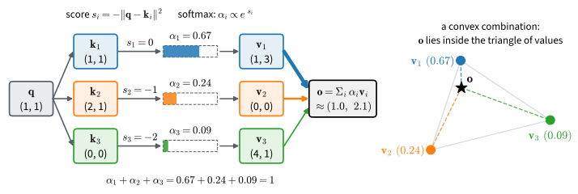

# Attention
:label:`chap_attention`

The recurrent models of :numref:`chap_rnn` read a sequence one token at a
time and compress everything they have seen into a hidden state of fixed
size. If a prediction near the end of a long document depends on a detail
from the first paragraph, the recurrent network must have written that detail
into its hidden state long before knowing it would be needed. Rather than
compressing history into a single vector, can a network retain a
representation at every position and retrieve only what the current
prediction requires?

*Attention* does exactly this. At each lookup, a *query* vector representing
what the current position seeks is scored against a *key* vector at every
candidate position. A softmax converts those scores into nonnegative weights
that sum to one, and the layer returns the weighted average of the *value*
vectors stored at those positions. Because a weighted average is smooth,
gradient descent can train the projections that produce queries, keys, and
values end to end. Running several such lookups in parallel gives *multi-head
attention*. Introduced for neural machine translation so a decoder could
consult every source word directly :cite:`Bahdanau.Cho.Bengio.2014`,
attention became the sole position-mixing operation in the Transformer
:cite:`Vaswani.Shazeer.Parmar.ea.2017`.

Replacing recurrence with all-pairs lookup introduces three new challenges:

1. **Order blindness:** A weighted sum is invariant to permutations of its
   inputs, so positional information must be injected explicitly.
2. **Quadratic scaling:** Scoring all pairs of $n$ tokens requires $O(n^2)$
   operations and memory, motivating both IO-aware exact kernels and sub-quadratic
   approximations.
3. **Mechanistic interpretation:** Attention weights show *where* a head
   reads, not *what* function it computes across layers.

The first three sections construct the layer: differentiable key--value
lookup (:numref:`sec_queries-keys-values`), scaled dot-product scoring and
boolean masking (:numref:`sec_attention-scoring-functions`), and multi-head
self-attention (:numref:`sec_multihead-attention`).
:numref:`sec_positional-information` addresses sequence order through
absolute, rotary (RoPE), and relative (ALiBi) positional encodings. The next
two sections address computational scale: :numref:`sec_attention-at-scale`
derives tiled online-softmax kernels (FlashAttention) that avoid
materializing the $n \times n$ score matrix, and
:numref:`sec_windowed-linear-attention` examines sliding-window and linear
attention variants. Finally, :numref:`sec_what-attention-computes` analyzes
trained attention circuits through the residual stream, QK/OV decompositions,
and two-layer induction heads, and :numref:`sec_attention-further-reading`
surveys extensions and primary literature.

Readers heading directly to :numref:`chap_transformers` need only the first
four sections and the residual-stream formulation at the start of
:numref:`sec_what-attention-computes`; the sections on computational cost can
be read alongside :numref:`sec_kv-cache` and :numref:`chap_modern_rnn`.

```toc
:maxdepth: 2

queries-keys-values
attention-scoring
multihead-attention
positional-information
attention-at-scale
windowed-linear-attention
what-attention-computes
further-reading
```

<!-- slides -->

::: {.slide}
::: {.cover}
[Dive into Deep Learning · §10]{.kicker}

Reading every position<br>
**soft lookup · scoring and masks · self-attention and heads · positions · cost · windows and linear attention · circuits**
:::
:::

::: {.slide title="A Fixed-Size State Must Guess What Will Be Asked"}
[The problem]{.kicker}

- A recurrent model as wide as GPT-2 small (768) that has read 1,024
  tokens keeps 768 numbers about all of them.
- It writes them before anyone knows which token a later prediction
  needs.
- A reader who forgot a name on page one turns back and looks.

::: {.d2l-note}
Attention lets a network look back: keep one vector per position and read
only what the current prediction needs.
:::
:::

::: {.slide title="Attention Scores Every Key and Averages the Values"}
[The idea]{.kicker}

{width=70%}

- **query**: what a position looks for; **key**: what a position offers;
  **value**: what it hands back.
- A weighted average is differentiable, so the network learns what to
  look for.
- One such lookup is a **head**; a layer runs several side by side.
:::

::: {.slide title="Looking Back Creates Three Problems a Recurrent Network Never Had"}
[The problem]{.kicker}

| problem | why |
|---|---|
| **order** | a weighted average is the same for any order of its inputs |
| **cost** | all pairs of positions: time and memory grow as $n^2$ for $n$ tokens |
| **meaning** | a map of weights shows where a head looks, not what it computes |

**Check:** how many scores does one head compute over 1,024 tokens?

::: {.fragment .fade-up}
::: {.d2l-note}
One per pair of positions: $1{,}024^2 \approx 10^6$, about half of them
hidden when each token may look only backward. Doubling the context
quadruples the count.
:::
:::
:::

::: {.slide title="By the End of This Chapter You Can"}
[Goals]{.kicker}

- compute scaled dot-product attention by hand, with masks for padding and
  for the future;
- run one head of self-attention on a sentence, and prove what one set of
  weights per query cannot express;
- encode position by rotating queries and keys (RoPE) or by a penalty on
  distance (ALiBi), and extend a trained context;
- compute exact attention without storing its scores, and say what a
  window of recent keys and linear attention (a state of fixed size) give
  up;
- read from the weights where a head looks (QK) and what it moves (OV),
  and test the reading by removing heads.

**Running example:** one head of GPT-2 small, width 64 in a model of width
768, reading 1,024 tokens.
:::

::: {.slide title="Four Sections Lead to the Transformer, Two on Cost Can Wait"}
[Scope and place]{.kicker}

- **Assumes:** softmax, matrix products, the recurrent language model.
- **Core:** the first four sections, and the opening of the last: how
  every layer adds its output to one running vector per position, the
  residual stream.
- **Can wait:** the two sections on cost, until the transformer chapter's
  cache of keys and values or the state space model chapter builds on
  them.
- **Leaves out:** feed-forward layers, normalization, and the training
  recipe, which the next chapter adds to make a transformer.
:::

::: {.slide title="Build the Layer, Then Solve What It Breaks"}
[Chapter map]{.kicker}

| | section | question |
|---|---|---|
| **build** | Queries, Keys, and Values | how can a lookup be made differentiable? |
| | Attention Scoring and Masking | which score can a network learn, and which pairs may count? |
| | Self-Attention and Multiple Heads | what does a sentence reading itself compute, and what can one head not express? |
| **order** | Positional Information | how does an order-blind layer learn where a token stands? |
| **cost** | The Cost of Attention | what does exact attention cost, and how much of it is avoidable? |
| | Windowed and Linear Attention | what is given up for a cost linear in the length? |
| **meaning** | Attention Circuits | what do trained heads compute, and how can we tell? |
:::

::: {.slide title="Every Section Tests Its Claims on an Example Small Enough to Run"}
[Running examples]{.kicker}

| section | example |
|---|---|
| Queries, Keys, and Values | a table of two records; kernel regression on noisy 1-D data |
| Attention Scoring and Masking | two queries and three keys by hand; the letters of two words; a learned permutation |
| Self-Attention and Multiple Heads | "Alice gave Bob the book"; a task that needs two values per query |
| Positional Information | `TinyCharLM` on WikiText-103 bytes, five position schemes |
| The Cost of Attention | one GPT-2-small head, up to 16,384 tokens |
| Windowed and Linear Attention | GPT-2-sized heads with a window of 128 keys, up to 32,768 tokens; 1,000 queries against 8 keys |
| Attention Circuits | `TinyCharLM` on repeated random patterns |

::: {.d2l-note}
The first five sections also count their costs on the GPT-2 head.
:::
:::
