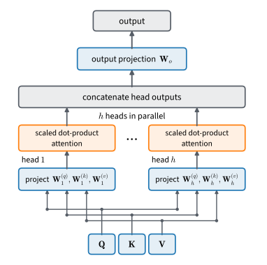
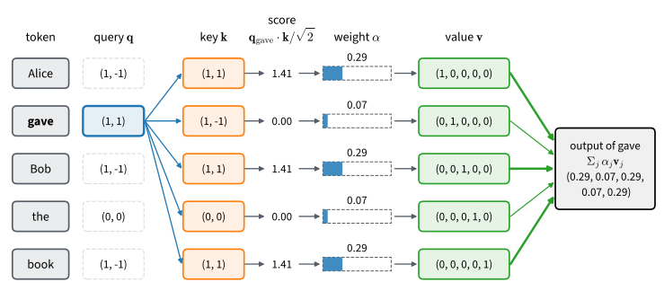
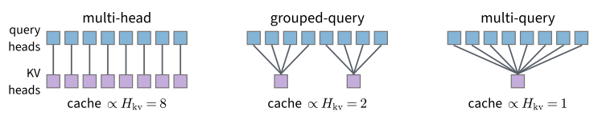

# Self-Attention and Multiple Heads
:label:`sec_multihead-attention`

In the examples of :numref:`sec_attention-scoring-functions`, queries came
from one sequence and keys and values from another. A decoder-only language
model has only a single sequence: to contextualize each token, queries, keys,
and values must all be derived from that sequence itself.

Consider the sentence *"Alice gave Bob the book"*. Interpreting *gave*
requires identifying the giver (*Alice*), the recipient (*Bob*), and the
object (*book*). In *self-attention*
:cite:`Cheng.Dong.Lapata.2016,Lin.Feng.Santos.ea.2017,Vaswani.Shazeer.Parmar.ea.2017`,
every token projects its representation into a query, a key, and a value,
allowing *gave* to query the other words in the sentence and aggregate their
values.

However, a single attention lookup produces only *one* probability
distribution per query and returns a single blended vector. How can a token
retrieve several distinct arguments without collapsing them into one average?
We first trace a single head of self-attention on our five-word sentence,
then prove an information-theoretic lower bound showing why one head cannot
recover two independent values, and finally construct *multi-head attention*
and *grouped-query attention* (GQA).

```{.python .input #multihead-attention-multi-head-and-cross-attention}
%%tab pytorch
import math
import numpy as np
import torch
from torch import nn
from torch.nn import functional as F
from d2l import torch as d2l
```

```{.python .input #multihead-attention-multi-head-and-cross-attention}
%%tab jax
import math
import numpy as np
import jax
from jax import numpy as jnp
from flax import nnx
import optax
from d2l import jax as d2l
```

## Self-Attention

In self-attention, each token representation $\mathbf{x}_i \in \mathbb{R}^d$
(row $i$ of $\mathbf{X} \in \mathbb{R}^{n \times d}$) plays three distinct
roles via learned linear projections $\mathbf{W}_q, \mathbf{W}_k \in
\mathbb{R}^{d \times d_h}$ and $\mathbf{W}_v \in \mathbb{R}^{d \times d_v}$:
the *query* $\mathbf{x}_i\mathbf{W}_q$ specifies what the token seeks, the
*key* $\mathbf{x}_i\mathbf{W}_k$ specifies what it offers to other queries,
and the *value* $\mathbf{x}_i\mathbf{W}_v$ specifies the content returned
when selected. Applying scaled dot-product attention yields one attention
*head* of width $d_h$:

$$
\mathrm{softmax}\left(\frac{(\mathbf{X}\mathbf{W}_q)(\mathbf{X}\mathbf{W}_k)^\top}{\sqrt{d_h}}\right)\mathbf{X}\mathbf{W}_v \in \mathbb{R}^{n \times d_v}.
$$
:eqlabel:`eq_self-attention`

### One Head on One Sentence

To trace :eqref:`eq_self-attention` concretely, represent each word of
*"Alice gave Bob the book"* by a 9-dimensional vector concatenating a 4D
one-hot grammatical role (person, action, thing, or function word) and a 5D
one-hot word identity. Set $\mathbf{W}_q$ and $\mathbf{W}_k$ to read only the
4D role into $d_h = 2$ dimensions, and $\mathbf{W}_v$ to extract the 5D word
indicator:

| role | query | key |
|:--|:--|:--|
| person (Alice, Bob) | $(1, -1)$ | $(1, 1)$ |
| action (*gave*) | $(1, 1)$ | $(1, -1)$ |
| thing (book) | $(1, -1)$ | $(1, 1)$ |
| function word ("the") | $(0, 0)$ | $(0, 0)$ |

```{.python .input #multihead-attention-self-attention}
%%tab pytorch, jax
tokens = ['Alice', 'gave', 'Bob', 'the', 'book']
# Role of each token: person, action, thing, function word
roles = d2l.tensor([[1.0, 0, 0, 0], [0, 1, 0, 0], [1, 0, 0, 0],
                    [0, 0, 0, 1], [0, 0, 1, 0]])
X = d2l.concat((roles, d2l.eye(5)), 1)  # (5, 9): the role, then the word
# Queries and keys read the role part (rows: person, action, thing,
# function word), values the word part
W_q = d2l.concat((d2l.tensor([[1.0, -1], [1, 1], [1, -1], [0, 0]]),
                  d2l.zeros((5, 2))))
W_k = d2l.concat((d2l.tensor([[1.0, 1], [1, -1], [1, 1], [0, 0]]),
                  d2l.zeros((5, 2))))
W_v = d2l.concat((d2l.zeros((4, 5)), d2l.eye(5)))
Q, K, V = X @ W_q, X @ W_k, X @ W_v  # (5, 2), (5, 2), (5, 5)
```

For *gave*, the query $(1, 1)$ has dot product $2$ with each noun's key
$(1, 1)$ and $0$ with *gave* and *"the"*. Dividing by $\sqrt{2}$ gives scaled
scores $1.41$ on each noun and $0$ elsewhere, which softmax converts into
weights $e^{1.41}/(3e^{1.41} + 2) \approx 0.29$ per noun and $0.07$ on *gave*
and *"the"* (:numref:`fig_self-attention`).


:label:`fig_self-attention`

```{.python .input #multihead-attention-self-attention-1}
%%tab pytorch, jax
attention = d2l.DotProductAttention()
Y = attention(Q[None], K[None], V[None])  # A minibatch of one sentence
weights = attention.attention_weights[0]
scores = Q[1] @ K.T / math.sqrt(Q.shape[-1])  # Scaled by sqrt(d_h)
print('scores of gave: ', np.asarray(scores).round(2))
print('weights of gave:', np.asarray(weights[1]).round(2))
print('weights of the: ', np.asarray(weights[3]).round(2))
print('output of gave: ', np.asarray(Y[0, 1]).round(2))
attention(Q[None], K[None], V[None], d2l.causal_mask(5))
print('causal weights of gave:',
      np.asarray(attention.attention_weights[0, 1]).round(2))
d2l.show_heatmaps(weights[None, None], xlabel='keys', ylabel='queries',
                  figsize=(3.2, 3.2), cmap='Blues',
                  xticklabels=tokens, yticklabels=tokens)
```

Conversely, each noun's query $(1, -1)$ scores $1.41$ on *gave* (weight
$0.51$) and $0$ elsewhere, while *"the"* has a zero query and attends
uniformly ($0.20$ across all five words). Applying a causal mask restricts
*gave* to *Alice* and itself, renormalizing their scores $(1.41, 0)$ to
$(0.80, 0.20)$.

### Separate Maps for Queries and Keys

Why use separate matrices $\mathbf{W}_q$ and $\mathbf{W}_k$? If a single
projection $\mathbf{u}_i = \mathbf{x}_i\mathbf{W}$ served as both query and
key, the score matrix $s_{ij} = \mathbf{u}_i^\top \mathbf{u}_j / \sqrt{d_h}$
would be symmetric and positive semidefinite, satisfying $s_{ij} \le
\sqrt{s_{ii}\, s_{jj}}$ by Cauchy--Schwarz. No token could prefer another
token over their geometric-mean self-affinity—a verb could not selectively
seek nouns without seeking itself at least as strongly. Separate query, key,
and value projections decouple *who looks*, *who is found*, and *what content
is passed on*.

## Limits of a Single Head
:label:`subsec_one-mixture-bottleneck`

In our five-word sentence, *gave* blended *Alice*, *Bob*, and *book* into a
single weighted average. To quantify the bottleneck of having only one
attention distribution per query, consider the *copy-both task*: two source
positions hold independent standard Gaussian value vectors $\mathbf{v}_1,
\mathbf{v}_2 \in \mathbb{R}^{d_v}$ with fixed position-only keys, and a
single query must output their concatenation $\mathbf{t} = [\mathbf{v}_1;
\mathbf{v}_2] \in \mathbb{R}^{2d_v}$ via a linear readout.

Because the keys depend only on position, a single head assigns fixed softmax
weights $(\alpha_1, \alpha_2)$ with $\alpha_1 + \alpha_2 = 1$ and passes a
single mixture $\mathbf{m} = \alpha_1 \mathbf{v}_1 + \alpha_2 \mathbf{v}_2
\in \mathbb{R}^{d_v}$ to the linear readout.

**Proposition.** For one attention head with two fixed position-only keys,
independent standard Gaussian values $\mathbf{v}_1, \mathbf{v}_2 \in
\mathbb{R}^{d_v}$, and a linear readout, the minimum achievable relative
squared error on the copy-both task is $1/2$ for every softmax pair
$(\alpha_1, \alpha_2)$.

**Proof.** Given $\mathbf{m} = \alpha_1 \mathbf{v}_1 + \alpha_2 \mathbf{v}_2$,
the minimum mean-squared error estimator of $\mathbf{v}_1$ is the conditional
expectation $\mathbb{E}[\mathbf{v}_1 \mid \mathbf{m}] =
\tfrac{\alpha_1}{\alpha_1^2 + \alpha_2^2}\, \mathbf{m}$, which is linear in
$\mathbf{m}$ and leaves residual variance $1 - \tfrac{\alpha_1^2}{\alpha_1^2
+ \alpha_2^2} = \tfrac{\alpha_2^2}{\alpha_1^2 + \alpha_2^2}$ per coordinate.
By symmetry, estimating $\mathbf{v}_2$ leaves residual variance
$\tfrac{\alpha_1^2}{\alpha_1^2 + \alpha_2^2}$ per coordinate. Their sum is
$1$ per coordinate out of a total target variance of $2$ per coordinate,
giving a relative squared error of $1/2$ regardless of $(\alpha_1, \alpha_2)$.
$\blacksquare$

Solving the copy-both task requires two ingredients: (1) at least two
linearly independent *weightings* over the keys, and (2) sufficient *output
dimension* (room) to hold all $2d_v$ retrieved coordinates (Exercise
:exref:`ex_multihead-what-the-bound-counts`). We verify the $\sqrt{1/2}
\approx 0.707$ root-mean-square relative error bound for one head, and show
that two heads with distinct weightings—even soft ones such as $(0.88, 0.12)$
and $(0.12, 0.88)$—allow a linear readout to invert the $2 \times 2$ mixing
matrix up to floating-point precision (:numref:`fig_one-head-averages`).

```{.python .input #multihead-attention-one-head-must-average-1}
%%tab pytorch
N, d_v = 10000, 8
V1, V2 = torch.randn(N, d_v), torch.randn(N, d_v)
target = torch.cat([V1, V2], dim=1)

def readout_error(M, target):
    """Best linear readout of target from M, relative error."""
    W = torch.linalg.lstsq(M, target).solution
    return ((M @ W - target).norm() / target.norm()).item()

M = 0.7 * V1 + 0.3 * V2
print(f'one head, weights (0.70, 0.30): relative error '
      f'{readout_error(M, target):.3f}; sqrt(1/2) = {0.5 ** 0.5:.3f}')
for a in (1.0, 0.88):
    M2 = torch.cat([a * V1 + (1 - a) * V2, (1 - a) * V1 + a * V2], dim=1)
    print(f'two heads, weights ({a:.2f}, {1 - a:.2f}) and '
          f'({1 - a:.2f}, {a:.2f}): '
          f'relative error {readout_error(M2, target):.1e}')
```

```{.python .input #multihead-attention-one-head-must-average-1}
%%tab jax
N, d_v = 10000, 8
key1, key2 = jax.random.split(d2l.get_key())
V1, V2 = jax.random.normal(key1, (N, d_v)), jax.random.normal(key2, (N, d_v))
target = jnp.concatenate([V1, V2], axis=1)

def readout_error(M, target):
    """Best linear readout of target from M, relative error."""
    # Full fp32 products: TF32, the default on recent NVIDIA cards, would
    # stop the two-head errors near 1e-4
    with jax.default_matmul_precision('highest'):
        W = jnp.linalg.lstsq(M, target)[0]
        err = jnp.linalg.norm(M @ W - target) / jnp.linalg.norm(target)
    return float(err)

M = 0.7 * V1 + 0.3 * V2
print(f'one head, weights (0.70, 0.30): relative error '
      f'{readout_error(M, target):.3f}; sqrt(1/2) = {0.5 ** 0.5:.3f}')
for a in (1.0, 0.88):
    M2 = jnp.concatenate([a * V1 + (1 - a) * V2, (1 - a) * V1 + a * V2],
                         axis=1)
    print(f'two heads, weights ({a:.2f}, {1 - a:.2f}) and '
          f'({1 - a:.2f}, {a:.2f}): '
          f'relative error {readout_error(M2, target):.1e}')
```


:label:`fig_one-head-averages`

## Multi-Head Attention

### Projected Heads

*Multi-head attention* :cite:`Vaswani.Shazeer.Parmar.ea.2017` runs $H$
independent attention heads in parallel, each with its own query, key, and
value projections $\mathbf{W}_i^{(q)}, \mathbf{W}_i^{(k)}, \mathbf{W}_i^{(v)}
\in \mathbb{R}^{d \times d_h}$:

$$
\mathbf{Z}_i = \mathrm{softmax}\left(\frac{(\mathbf{X}\mathbf{W}_i^{(q)})(\mathbf{X}\mathbf{W}_i^{(k)})^\top}{\sqrt{d_h}}\right)\mathbf{X}\mathbf{W}_i^{(v)} \in \mathbb{R}^{n \times d_h}, \qquad i = 1, \ldots, H,
$$
:eqlabel:`eq_multihead-head`

and concatenates their outputs before applying a final linear projection
$\mathbf{W}_o \in \mathbb{R}^{H d_h \times d}$ (:numref:`fig_multi-head-attention`):

$$
[\mathbf{Z}_1, \ldots, \mathbf{Z}_H]\, \mathbf{W}_o \in \mathbb{R}^{n \times d}.
$$
:eqlabel:`eq_multihead-output`


:label:`fig_multi-head-attention`

### Parameter and FLOP Counts

Setting the head width to $d_h = d/H$ keeps the total dimension across all
heads equal to $H d_h = d$. Stacked side by side, the $H$ query projections
form a single $d \times d$ matrix, as do the key, value, and output
projections. Counting one multiply--add as $2$ FLOPs, a multi-head
self-attention layer over $n$ tokens requires

$$
\underbrace{8nd^2}_{\textrm{projections}} \;+\; \underbrace{4n^2 d}_{\textrm{scores and mixing}} \quad \textrm{FLOPs,} \qquad 4d^2 \ \textrm{parameters.}
$$
:eqlabel:`eq_multihead-flops`

For one layer of GPT-2 small ($d = 768$, $n = 1{,}024$), this amounts to
$4.8$ GFLOPs for projections, $3.2$ GFLOPs for scores and value mixing, and
$2.4 \times 10^6$ parameters. Remarkably, neither the parameter count nor the
leading FLOP count depends on the number of heads $H$: splitting $d$ into
$H$ heads shrinks each head's inner product by $1/H$ while running $H$ of
them (only the $O(Hn^2)$ softmax overhead scales with $H$). Conversely, $d_h$
cannot be made arbitrarily small: at $d_h = 1$, scalar scores $q k_j$ are
monotone in $k_j$, so a query can focus only on the extremal keys (Exercise
:exref:`ex_multihead-narrow-heads`). In practice, $d_h \in \{64, 128\}$ is
standard.

### Comparison with Convolution and Recurrence

:numref:`fig_cnn-rnn-self-attention` and :numref:`tab_cnn-rnn-attn` compare
1D convolution (:numref:`chap_cnn`), recurrence (:numref:`sec_rnn`), and
self-attention as sequence-to-sequence layers over $n$ tokens of width $d$.


:label:`fig_cnn-rnn-self-attention`

:Per-layer cost of mapping $n$ tokens of dimension $d$ to $n$ tokens of dimension $d$.
:label:`tab_cnn-rnn-attn`

| layer type | complexity | sequential operations | maximum path length |
|:--|:--|:--|:--|
| convolution (kernel $k$) | $O(knd^2)$ | $O(1)$ | $O(n/k)$ |
| recurrence | $O(nd^2)$ | $O(n)$ | $O(n)$ |
| self-attention | $O(nd^2+n^2d)$ | $O(1)$ | $O(1)$ |

Self-attention combines $O(1)$ sequential steps (full training parallelism)
with $O(1)$ maximum path length between any pair of tokens, eliminating the
$O(n)$-step recurrent gradient chain (:numref:`sec_bptt`). The price is the
quadratic $4n^2 d$ score-and-mix term, which exceeds the $8nd^2$ projection
cost once $n > 2d$ ($n > 1{,}536$ for GPT-2 small).

### Implementation

In `MultiHeadAttention`, a single linear layer computes all $H$ head
projections at once, and `split_heads` reshapes `(batch, length, H * d_h)`
into `(batch, H, length, d_h)` so that `DotProductAttention` executes all
heads in one batched operation (:numref:`fig_head-split`). Projections omit
additive biases by default (`bias=False`), following modern transformer
conventions. The parameter `num_kv_heads` supports key--value head sharing
(:numref:`subsec_kv-head-sharing`).

```{.python .input #multihead-attention-linear-init}
%%tab jax
class Linear(nnx.Linear):  #@save
    """nnx.Linear with weights and biases drawn from U(-a, a), where
    a = 1/sqrt(in_features)."""
    def __init__(self, in_features, out_features, *, use_bias=True, rngs,
                 **kwargs):
        a = in_features ** -0.5
        init = lambda key, shape, dtype=jnp.float32: jax.random.uniform(
            key, shape, dtype, -a, a)
        super().__init__(in_features, out_features, use_bias=use_bias,
                         kernel_init=init, bias_init=init, rngs=rngs,
                         **kwargs)
```

```{.python .input #multihead-attention-implementation-1}
%%tab pytorch
class MultiHeadAttention(nn.Module):  #@save
    """Multi-head attention with heads as an explicit axis; num_kv_heads <
    num_heads shares each key-value head across a group of query heads."""
    def __init__(self, num_hiddens, num_heads, dropout=0.0, bias=False,
                 num_kv_heads=None):
        super().__init__()
        assert num_hiddens % num_heads == 0, 'heads must divide num_hiddens'
        self.num_heads = num_heads
        self.num_kv_heads = num_kv_heads or num_heads
        assert num_heads % self.num_kv_heads == 0
        kv_hiddens = self.num_kv_heads * (num_hiddens // num_heads)
        self.attention = d2l.DotProductAttention(dropout)
        self.W_q = nn.Linear(num_hiddens, num_hiddens, bias=bias)
        self.W_k = nn.Linear(num_hiddens, kv_hiddens, bias=bias)
        self.W_v = nn.Linear(num_hiddens, kv_hiddens, bias=bias)
        self.W_o = nn.Linear(num_hiddens, num_hiddens, bias=bias)

    def forward(self, queries, keys, values, mask=None):
        # queries: (batch, no. of queries, num_hiddens); keys and values:
        # (batch, no. of key-value pairs, num_hiddens). mask: boolean,
        # broadcastable to (batch, no. of queries, no. of keys), shared by
        # all heads, or to (batch, num_heads, no. of queries, no. of keys)
        q = self.split_heads(self.W_q(queries), self.num_heads)
        k = self.split_heads(self.W_k(keys), self.num_kv_heads)
        v = self.split_heads(self.W_v(values), self.num_kv_heads)
        group = self.num_heads // self.num_kv_heads
        k, v = k.repeat_interleave(group, 1), v.repeat_interleave(group, 1)
        if mask is not None and mask.dim() == 3:
            mask = mask[:, None]           # The same mask for every head
        # Shape of Y: (batch, num_heads, no. of queries, head width)
        Y = self.attention(q, k, v, mask)
        return self.W_o(self.merge_heads(Y))

    @property
    def attention_weights(self):
        """Weights of the last call: (batch, num_heads, queries, keys)."""
        return self.attention.attention_weights
```

```{.python .input #multihead-attention-implementation-1}
%%tab jax
class MultiHeadAttention(nnx.Module):  #@save
    """Multi-head attention with heads as an explicit axis; num_kv_heads <
    num_heads shares each key-value head across a group of query heads."""
    def __init__(self, num_hiddens, num_heads, dropout=0.0, bias=False,
                 num_kv_heads=None, *, rngs):
        assert num_hiddens % num_heads == 0, 'heads must divide num_hiddens'
        self.num_heads = num_heads
        self.num_kv_heads = num_kv_heads or num_heads
        assert num_heads % self.num_kv_heads == 0
        kv_hiddens = self.num_kv_heads * (num_hiddens // num_heads)
        self.attention = d2l.DotProductAttention(dropout, rngs=rngs)
        self.W_q = Linear(num_hiddens, num_hiddens, use_bias=bias, rngs=rngs)
        self.W_k = Linear(num_hiddens, kv_hiddens, use_bias=bias, rngs=rngs)
        self.W_v = Linear(num_hiddens, kv_hiddens, use_bias=bias, rngs=rngs)
        self.W_o = Linear(num_hiddens, num_hiddens, use_bias=bias, rngs=rngs)

    def __call__(self, queries, keys, values, mask=None):
        # queries: (batch, no. of queries, num_hiddens); keys and values:
        # (batch, no. of key-value pairs, num_hiddens). mask: boolean,
        # broadcastable to (batch, no. of queries, no. of keys), shared by
        # all heads, or to (batch, num_heads, no. of queries, no. of keys)
        q = self.split_heads(self.W_q(queries), self.num_heads)
        k = self.split_heads(self.W_k(keys), self.num_kv_heads)
        v = self.split_heads(self.W_v(values), self.num_kv_heads)
        group = self.num_heads // self.num_kv_heads
        k, v = jnp.repeat(k, group, axis=1), jnp.repeat(v, group, axis=1)
        if mask is not None and mask.ndim == 3:
            mask = mask[:, None]           # The same mask for every head
        # Shape of Y: (batch, num_heads, no. of queries, head width)
        Y = self.attention(q, k, v, mask)
        return self.W_o(self.merge_heads(Y))

    @property
    def attention_weights(self):
        """Weights of the last call: (batch, num_heads, queries, keys)."""
        return self.attention.attention_weights
```


:label:`fig_head-split`

The two reshape-and-transpose helpers `split_heads` and `merge_heads` (:numref:`fig_head-split`) fold the last dimension $H d_h$ into an explicit head axis `(batch, num_heads, length, width)` before attention and re-concatenate the $H$ head outputs afterward:

```{.python .input #multihead-attention-implementation-2}
%%tab pytorch
@d2l.add_to_class(MultiHeadAttention)  #@save
def split_heads(self, X, num_heads):
    """(batch, length, num_heads * width) -> (batch, num_heads, length,
    width)."""
    return X.reshape(X.shape[0], X.shape[1], num_heads, -1).transpose(1, 2)

@d2l.add_to_class(MultiHeadAttention)  #@save
def merge_heads(self, X):
    """Reverse split_heads: (batch, num_heads, length, width) -> (batch,
    length, num_heads * width)."""
    return X.transpose(1, 2).reshape(X.shape[0], X.shape[2], -1)
```

```{.python .input #multihead-attention-implementation-2}
%%tab jax
@d2l.add_to_class(MultiHeadAttention)  #@save
def split_heads(self, X, num_heads):
    """(batch, length, num_heads * width) -> (batch, num_heads, length,
    width)."""
    return X.reshape(X.shape[0], X.shape[1], num_heads, -1).swapaxes(1, 2)

@d2l.add_to_class(MultiHeadAttention)  #@save
def merge_heads(self, X):
    """Reverse split_heads: (batch, num_heads, length, width) -> (batch,
    length, num_heads * width)."""
    return X.swapaxes(1, 2).reshape(X.shape[0], X.shape[2], -1)
```

### Learned Heads on the Copy-Both Task
:label:`subsec_copy-both-learned`

We now test `MultiHeadAttention` of width $d = 16$ on the copy-both task
($d_v = 8$, padded with zeros to width $16$; keys $\mathbf{e}_1,
\mathbf{e}_2$ and query $\mathbf{e}_3$).

```{.python .input #multihead-attention-learned-heads-on-the-copy-both-task-1}
%%tab pytorch
def copy_both_data(n, d=16, d_v=8):
    """One query, two position-only keys, values of width d_v padded to d."""
    V = torch.randn(n, 2, d_v)
    keys = torch.eye(d)[:2].expand(n, 2, d)    # e_1, e_2 mark the positions
    query = torch.eye(d)[2].expand(n, 1, d)    # e_3 asks for both values
    values = F.pad(V, (0, d - d_v))
    return query, keys, values, V.reshape(n, 1, 2 * d_v)

def train_copy_both(num_heads, num_kv_heads=None, num_steps=2000):
    model = MultiHeadAttention(16, num_heads, num_kv_heads=num_kv_heads)
    optimizer = torch.optim.Adam(model.parameters(), lr=1e-2)
    for _ in range(num_steps):
        query, keys, values, target = copy_both_data(256)
        loss = ((model(query, keys, values) - target) ** 2).mean()
        optimizer.zero_grad()
        loss.backward()
        optimizer.step()
    return model

def evaluate_copy_both(model, n=10000):
    """Relative error on fresh examples; each head's weight on v_1."""
    query, keys, values, target = copy_both_data(n)
    with torch.inference_mode():
        err = (model(query, keys, values) - target).norm() / target.norm()
    return err.item(), model.attention_weights[0, :, 0, 0].tolist()
```

```{.python .input #multihead-attention-learned-heads-on-the-copy-both-task-1}
%%tab jax
def copy_both_data(key, n, d=16, d_v=8):
    """One query, two position-only keys, values of width d_v padded to d."""
    V = jax.random.normal(key, (n, 2, d_v))
    keys = jnp.broadcast_to(jnp.eye(d)[:2], (n, 2, d))  # e_1, e_2: positions
    query = jnp.broadcast_to(jnp.eye(d)[2], (n, 1, d))  # e_3 asks for both
    values = jnp.pad(V, ((0, 0), (0, 0), (0, d - d_v)))
    return query, keys, values, V.reshape(n, 1, 2 * d_v)

@nnx.jit
def copy_both_step(model, optimizer, key):
    query, keys, values, target = copy_both_data(key, 256)
    loss = lambda model: ((model(query, keys, values) - target) ** 2).mean()
    optimizer.update(model, nnx.grad(loss)(model))

def train_copy_both(num_heads, num_kv_heads=None, num_steps=2000):
    model = MultiHeadAttention(16, num_heads, num_kv_heads=num_kv_heads,
                               rngs=nnx.Rngs(d2l.get_key()))
    optimizer = nnx.Optimizer(model, optax.adam(1e-2), wrt=nnx.Param)
    # Full fp32 products: TF32, the default on recent NVIDIA cards, would
    # stop the error of a solved task near 1e-3 instead of fp32 rounding
    with jax.default_matmul_precision('highest'):
        for key in jax.random.split(d2l.get_key(), num_steps):
            copy_both_step(model, optimizer, key)
    return model

def evaluate_copy_both(model, n=10000):
    """Relative error on fresh examples; each head's weight on v_1."""
    query, keys, values, target = copy_both_data(d2l.get_key(), n)
    with jax.default_matmul_precision('highest'):
        Y = model(query, keys, values)
    err = jnp.linalg.norm(Y - target) / jnp.linalg.norm(target)
    return float(err), model.attention_weights[0, :, 0, 0].tolist()
```

Training two seeds at each head count $H \in \{1, 2, 4\}$ (all sharing the same total width $d = 16$ and parameter count $1{,}024$) compares their relative reconstruction error and the attention weight $\alpha_1$ that each head places on the first value vector $\mathbf{v}_1$:

```{.python .input #multihead-attention-learned-heads-on-the-copy-both-task-2}
%%tab pytorch, jax
print('H  run  parameters  error    weight on v_1, per head')
for num_heads in (1, 2, 4):
    for run in (1, 2):
        model = train_copy_both(num_heads)
        err, alpha_1 = evaluate_copy_both(model)
        print(f'{num_heads}  {run:3d}  {d2l.num_params(model):10d}  '
              f'{err:<#8.2g} ' + ' '.join(f'{a:.2f}' for a in alpha_1))
```

All configurations have $4 \times 16^2 = 1{,}024$ parameters. As predicted by
our proposition, $H = 1$ stalls at the $\sqrt{1/2} \approx 0.71$ bound,
whereas $H \in \{2, 4\}$ learns distinct head weightings and reduces the
error to $\sim 10^{-7}$.

### Shared Keys and Values
:label:`subsec_kv-head-sharing`

During autoregressive generation, past keys and values are cached in memory so each new token can attend to all previous positions without recomputing their projections (a mechanism we analyze in detail in :numref:`sec_kv-cache`). *Grouped-query attention* (GQA)
:cite:`Ainslie.Lee-Thorp.Jong.ea.2023` reduces this cache by a factor of
$H / H_\textrm{kv}$ by sharing each key--value head across a group of $H /
H_\textrm{kv}$ query heads; setting $H_\textrm{kv} = 1$ gives *multi-query
attention* (MQA) :cite:`Shazeer.2019`.

On the copy-both task, the shared value heads span at most $H_\textrm{kv}
d_h$ coordinates per value, so recovering a $d_v$-dimensional value requires
$H_\textrm{kv} d_h \ge d_v$ (Exercise
:exref:`ex_multihead-sharing-keys-and-values`). With $d = 16$ and $d_v = 8$,
layouts $(H, H_\textrm{kv}) = (2, 1)$ and $(4, 2)$ have $H_\textrm{kv} d_h =
8$ and solve the task to fp32 precision, whereas $(4, 1)$ has $H_\textrm{kv}
d_h = 4$ and returns to the $0.71$ bottleneck despite learning distinct
weightings across its four query heads:

```{.python .input #multihead-attention-sharing-keys-and-values}
%%tab pytorch, jax
print('H  H_kv  run  parameters  error    weight on v_1, per head')
for num_heads, num_kv_heads in ((2, 1), (4, 2), (4, 1)):
    for run in (1, 2):
        model = train_copy_both(num_heads, num_kv_heads)
        err, alpha_1 = evaluate_copy_both(model)
        print(f'{num_heads}  {num_kv_heads:4d}  {run:3d}  '
              f'{d2l.num_params(model):10d}  {err:<#8.2g} '
              + ' '.join(f'{a:.2f}' for a in alpha_1))
```

## Cross-Attention

While self-attention passes the same sequence $\mathbf{X}$ as queries, keys,
and values (`attention(X, X, X)`), *cross-attention* draws queries from a
target sequence $\mathbf{A}$ and keys and values from a source sequence
$\mathbf{B}$ (`attention(A, B, B)`), producing one output row per token of
$\mathbf{A}$. Encoder--decoder transformers use cross-attention to read an
encoded source sentence during translation, and multimodal models use it to
let text tokens query visual features :cite:`alayrac2022flamingo`.

Even with multiple heads, however, self-attention remains blind to word
order: swapping *Alice* and *Bob* in *"Alice gave Bob the book"* leaves the
output at *gave* unchanged. Injecting sequence order is the subject of
:numref:`sec_positional-information`.

## Summary

* Self-attention projects each token of a sequence into a query, a key, and a
  value, connecting all pairs of positions in $O(1)$ sequential steps and
  $O(1)$ path length at $O(nd^2 + n^2d)$ FLOPs.
* A single head forms only one convex mixture of values per query; on the
  copy-both task, any single head incurs a relative squared error of at least
  $1/2$.
* Multi-head attention runs $H$ heads of width $d_h = d/H$ in parallel and
  combines them via $\mathbf{W}_o$, requiring $4d^2$ parameters and
  $8nd^2 + 4n^2d$ FLOPs independent of $H$.
* Grouped-query and multi-query attention share $H_\textrm{kv} < H$
  key--value heads across query groups to shrink generation caches by
  $H/H_\textrm{kv}$, preserving capacity so long as $H_\textrm{kv} d_h$ has
  room for the retrieved values.

## Exercises

1. **Self-attention by hand.** Three tokens have the inputs
   $\mathbf{x}_1 = (1, 0)$, $\mathbf{x}_2 = (0, 1)$, and $\mathbf{x}_3 =
   (1, 1)$. One head of width $d_h = 2$ uses
   $\mathbf{W}_q = \sqrt{2}\,\mathbf{I}$, the swap
   $\mathbf{W}_k = \left(\begin{smallmatrix} 0 & 1 \\ 1 & 0
   \end{smallmatrix}\right)$, and $\mathbf{W}_v = \mathbf{I}$, so that the
   factor $\sqrt{2}$ cancels the scale $1/\sqrt{d_h}$.
    1. Compute the queries, keys, and values, the $3 \times 3$ matrix of
       scaled scores, the weights, and the three outputs, each to two
       decimals. Which token does the first token attend to least, and why?
    1. Apply a causal mask and recompute. Which rows change, and why does
       the last row stay as it was?
    1. Replace $\mathbf{W}_k$ by the identity, so that each key points the
       same way as the query of its token. Recompute the weights of the
       first token. Why can no key of the same length as $\mathbf{x}_1$
       score higher than the first token's own key, and why does the key of
       the third token score as high anyway?
    1. Check your numbers with `d2l.DotProductAttention`.

1. [code] **Narrow heads.** With $d_h = d/H$, the leading count of
   :eqref:`eq_multihead-flops` does not depend on $H$, so the number of heads
   looks free up to $H = d$. Consider one head with scores
   $\mathbf{q}^\top \mathbf{k}_j / \sqrt{d_h}$ over keys $\mathbf{k}_1,
   \ldots, \mathbf{k}_m \in \mathbb{R}^{d_h}$ and no mask. Call a query sharp
   on key $j$ when its weights concentrate on $\mathbf{k}_j$ as the query
   is scaled by a factor that grows without bound.
    1. For $d_h = 1$ and distinct scalar keys, show that every query's weights
       are monotone in $k_j$. Conclude that the queries of such a head can
       be sharp only on the largest or the smallest key.
    1. Show that for $d_h = 2$ the keys and queries can be chosen so that
       each of $n$ queries is sharp on a key of its own choosing, for every
       assignment of queries to keys.
    1. Use these two results to state which attention patterns a layer
       gives up as $H$ approaches $d$.
    1. Time the forward pass of `MultiHeadAttention` with dropout 0 for
       self-attention with $d = 256$ and $n = 512$ on a minibatch of $8$
       sequences for $H \in \{1, 2, 4, 8, 16, 32, 64\}$. Make a warm-up
       call first and wait for the result before stopping the clock.
       Report the ratio of the slowest to the fastest configuration.
       Identify the cost that grows with $H$ and that
       :eqref:`eq_multihead-flops` leaves out, and check that it accounts
       for the trend.
   :exlabel:`ex_multihead-narrow-heads`

1. [code] **Heads as slices.** `MultiHeadAttention` computes one projection
   of width $d$ for each of the queries, keys, and values and splits it
   into heads with `split_heads`.
    1. Head $i$ owns a slice of the output features of `W_q`, `W_k`, and
       `W_v`. Determine which input features of `W_o` receive that head's
       output. Write a forward pass that loops over the heads, applies the
       sliced projections, and calls `d2l.DotProductAttention` once per
       head. Verify on random inputs with a padding mask that it matches
       `MultiHeadAttention` with dropout 0, and extend your loop to
       `num_kv_heads < num_heads`.
    1. Replace the body of `split_heads` by
       `X.reshape(X.shape[0], num_heads, X.shape[1], -1)`, which returns a
       tensor of the same shape. Describe which numbers each "head" now
       holds, show on random inputs that the output changes, and explain why
       no shape check can detect the mistake. Which input lengths and widths,
       if any, make the two versions agree?

1. **Permuting the source.** In cross-attention, the queries come from
   $\mathbf{A} \in \mathbb{R}^{n \times d}$ and the keys and values from
   $\mathbf{B} \in \mathbb{R}^{m \times d}$, neither carrying positional
   information. Let $\boldsymbol{\Pi}$ be an $m \times m$ permutation
   matrix.
    1. Show that replacing $\mathbf{B}$ by $\boldsymbol{\Pi}\mathbf{B}$ in
       both the key and the value argument leaves the output of
       `MultiHeadAttention` unchanged when no mask is applied, and that
       replacing it in the key argument alone changes the output in general.
    1. Now let a padding mask mark only the first $\ell$ rows of
       $\mathbf{B}$ as valid. Which permutations leave the output unchanged
       when the mask stays fixed?
   :exlabel:`ex_multihead-permuting-the-source`

1. [code] **Nonlinear readouts.** ● For Gaussian values, the proof of the
   proposition in :numref:`subsec_one-mixture-bottleneck` shows that the
   conditional mean $\mathbb{E}[\mathbf{v}_1 \mid \mathbf{m}]$ is linear in
   the mixture. Hence no readout, linear or not, improves on the relative
   error $\sqrt{1/2}$ that `readout_error` measures.
    1. Train a small multilayer perceptron to predict `target` from the
       mixture $\mathbf{m} = a\,\mathbf{v}_1 + (1 - a)\,\mathbf{v}_2$
       formed from `V1` and `V2`, for $a = 0.5$ and $a = 0.7$. Compare its
       relative error on held-out samples with that of the linear readout.
    1. Now draw the values uniformly from $\{-1, +1\}^{d_v}$. For $a = 0.5$,
       compute $\mathbb{E}[\mathbf{v}_1 \mid \mathbf{m}]$ coordinate by
       coordinate, show that it is again linear in $\mathbf{m}$, and
       conclude that the error stays at $\sqrt{1/2}$ for every readout.
    1. For $a = 0.7$ and the same discrete values, show that the map
       $(v_{1j}, v_{2j}) \mapsto m_j$ is injective. Train the perceptron
       again and report its held-out error. Explain why this escape from
       the bound does not contradict the proposition.

1. [code] **Nearly identical heads.** ● Two heads with weights
   $(0.5 + \epsilon, 0.5 - \epsilon)$ and $(0.5 - \epsilon, 0.5 +
   \epsilon)$ supply two distinct mixtures, so the linear readout inverts
   them exactly for every $\epsilon > 0$.
    1. Write the $2 \times 2$ mixing matrix, compute its eigenvalues and
       eigenvectors, and express its condition number as a function of
       $\epsilon$.
    1. Add independent Gaussian noise of standard deviation $\sigma = 0.01$
       to both mixtures and measure the error with `readout_error` for
       $\epsilon \in \{0.4, 0.1, 0.03, 0.01, 0.003, 0.001\}$. Plot the
       error against $\epsilon$ on logarithmic axes, read off the slope
       where the curve is straight, and explain it with the condition
       number from (a).
    1. Every head of a freshly initialized layer weights the two positions
       of the copy-both task close to $(0.5, 0.5)$. Modify
       `train_copy_both` to record the relative error and the weights of
       each head every 20 steps, and plot both for $H = 2$. Use the
       conditioning of the mixing matrix to explain the shape of the error
       curve in the first few hundred steps. Repeat for $H = 8$ and sort the
       final heads into those that are nearly one-hot, those that are soft
       but distinct, and those that nearly duplicate another head.
   :exlabel:`ex_multihead-nearly-identical-heads`

1. **What the bound counts.** ● The proposition of
   :numref:`subsec_one-mixture-bottleneck` fixes the softmax weights, but
   its error bound rests on a weaker fact: the readout receives a single
   vector $\mathbf{m} \in \mathbb{R}^{d_v}$ and must produce the target
   $\mathbf{t} \in \mathbb{R}^{2d_v}$.
    1. Let $\mathbf{m} \in \mathbb{R}^{d_v}$ be any function of
       $\mathbf{v}_1$ and $\mathbf{v}_2$, including a mixture whose weights
       depend on the values, and let $\mathbf{W}_o \in \mathbb{R}^{d_v
       \times 2d_v}$ be any matrix. Show that
       $$\mathbb{E}\,\|\mathbf{m}\mathbf{W}_o - \mathbf{t}\|^2 \geq \tfrac{1}{2}\, \mathbb{E}\,\|\mathbf{t}\|^2.$$
       Conclude that content-dependent keys, more layers, or a residual
       connection leave the bound in place as long as the readout is linear
       and receives $d_v$ numbers.
    1. A layer of width $d$ with two heads of width $d_h = d/2$ receives the
       values $\mathbf{v}_1, \mathbf{v}_2 \in \mathbb{R}^{d/2}$ padded with
       zeros to width $d$. Give the attention weights of each head, value
       projections $\mathbf{W}_i^{(v)}$, and an output projection
       $\mathbf{W}_o$ that solve the task exactly. Compare your weights with
       those printed in :numref:`subsec_copy-both-learned`.
    1. Generalize the proposition to $k$ source positions with independent
       standard Gaussian values $\mathbf{v}_1, \ldots, \mathbf{v}_k \in
       \mathbb{R}^{d_v}$ and the target $[\mathbf{v}_1; \ldots;
       \mathbf{v}_k]$. Each of $H$ heads applies fixed weights to the
       values, the weights of head $i$ form row $i$ of a matrix
       $\mathbf{A} \in \mathbb{R}^{H \times k}$, and a linear readout sees
       all $H$ mixtures. Show that the best relative squared error is
       $$1 - \frac{\operatorname{rank}(\mathbf{A})}{k},$$
       and that softmax weights, whose entries are all positive, can attain
       $\operatorname{rank}(\mathbf{A}) = \min(H, k)$.
   :exlabel:`ex_multihead-what-the-bound-counts`

1. [code] **Sharing keys and values on the copy-both task.** ● Let a layer
   of width $d$ have $H$ query heads of width $d_h = d/H$ and
   $H_\textrm{kv} < H$ key--value heads.
    1. Use the counting of Exercise
       :exref:`ex_multihead-what-the-bound-counts` to show that it can solve
       the task only if $H_\textrm{kv} d_h \ge d_v$, and that this condition
       suffices.
    1. Train a layer with `train_copy_both(2, 1)`, in which two query heads
       share one key--value head. Find the parameters that differ between
       the two heads and those they share, and explain from the copy-both
       task why the difference must lie where you found it.
   :exlabel:`ex_multihead-sharing-keys-and-values`

[Discussions](https://d2l.discourse.group/t/36770)

<!-- slides -->

::: {.slide}
::: {.cover}
[Dive into Deep Learning · §10.3]{.kicker}

Self-Attention, Multi-Head Attention, and Key–Value Sharing<br>**self-attention · single-head mixture bottleneck · parallel subspace heads · FLOP & parameter counts · GQA & MQA**
:::
:::

::: {.slide title="Why One Sequence Must Query Itself in Multiple Ways"}
[Motivation]{.kicker}

::: {.cols .vc}
::: {.col}
- **Multiple Syntactic Arguments:** In *"Alice gave Bob the book"*, interpreting the verb *gave* requires identifying the giver (*Alice*), the recipient (*Bob*), and the object (*book*).
- **The Single-Head Bottleneck:** A single attention head computes *one* probability distribution per query and returns a single blended vector ($64$ floats in GPT-2 small), averaging all attended arguments together.
- **Parallel Subspace Heads:** Running $H$ independent lookups in parallel lets a token retrieve multiple distinct arguments simultaneously.
:::

::: {.col .fig .big}
@fig:ch10-attn-mha-multi-arg
:::
:::
:::

::: {.slide title="Self-Attention: Three Learned Projections per Token"}
[Self-Attention Formulation]{.kicker}

::: {.cols .vc}
::: {.col}
- **Three Distinct Roles from One Input $\mathbf{X} \in \mathbb{R}^{n \times d}$:**
  $$\textrm{SelfAttention}(\mathbf{X}) = \mathrm{softmax}\!\left(\frac{(\mathbf{X}\mathbf{W}_q)(\mathbf{X}\mathbf{W}_k)^\top}{\sqrt{d_h}}\right)\mathbf{X}\mathbf{W}_v$$
- **Query ($\mathbf{q}_i = \mathbf{x}_i \mathbf{W}_q$):** What contextual features position $i$ seeks.
- **Key ($\mathbf{k}_j = \mathbf{x}_j \mathbf{W}_k$) & Value ($\mathbf{v}_j = \mathbf{x}_j \mathbf{W}_v$):** What position $j$ advertises and what content vector it returns when selected.
:::

::: {.col .fig}
@fig:ch10-attn-mha-qkv-projections
:::
:::
:::

::: {.slide title="Why Queries and Keys Require Separate Matrices"}
[Asymmetry of Lookup]{.kicker}

::: {.cols .vc}
::: {.col}
- **Symmetric PSD Trap ($\mathbf{W}_q = \mathbf{W}_k = \mathbf{W}$):** Setting $\mathbf{u}_i = \mathbf{x}_i \mathbf{W}$ makes the score matrix $s_{ij} = \mathbf{u}_i^\top \mathbf{u}_j / \sqrt{d_h}$ symmetric and positive semidefinite.
- **Cauchy–Schwarz Self-Affinity Bound:**
  $$s_{ij} \le \sqrt{s_{ii}\,s_{jj}}$$
- **Linguistic Failure Mode:** Under a shared projection, no token of equal norm can prefer a *different* token over itself—separate $\mathbf{W}_q \neq \mathbf{W}_k$ break this symmetry!
:::

::: {.col .fig}
@fig:ch10-attn-mha-asymmetry
:::
:::
:::

::: {.slide title="Worked Example: One Head on a Five-Word Sentence"}
[Tracing Self-Attention]{.kicker}

Represent each word of *"Alice gave Bob the book"* by a $9\text{D}$ vector concatenating a $4\text{D}$ one-hot grammatical role and a $5\text{D}$ one-hot word indicator, with head width $d_h = 2$:

::: {.cols .vc}
::: {.col}
| Token(s) | Grammatical Role | Query $\mathbf{x}_i\mathbf{W}_q$ | Key $\mathbf{x}_i\mathbf{W}_k$ |
| :--- | :--- | :---: | :---: |
| *Alice, Bob* | Person | $(1, -1)$ | $(1, 1)$ |
| *gave* | Action (verb) | $(1, 1)$ | $(1, -1)$ |
| *book* | Thing | $(1, -1)$ | $(1, 1)$ |
| *the* | Function word | $(0, 0)$ | $(0, 0)$ |
:::

::: {.col}
- **Scoring *gave*:** Its query $(1, 1)$ has dot product $2$ with each noun's key $(1, 1)$ and $0$ with *gave* and *the*.
- **Scaling & Softmax:** Dividing by $\sqrt{2}$ gives scores $1.41$ on the three nouns and $0$ elsewhere, yielding weights $e^{1.41}/(3e^{1.41}+2) \approx \mathbf{0.29}$ per noun and $\mathbf{0.07}$ on *gave* and *the*.
:::
:::
:::

::: {.slide title="Visualizing One Head on 'Alice gave Bob the book'"}
[Geometry & Causal Masking]{.kicker}

{.nostretch width=90%}
:::

::: {.slide title="Computing One Head on 'Alice gave Bob the book'"}
[Geometry & Causal Masking]{.kicker}

@!multihead-attention-self-attention-1
:::

::: {.slide title="The Single-Head Bottleneck: The Copy-Both Task"}
[Information-Theoretic Limit]{.kicker}

In our sentence, *gave* received an equal blend $0.29\,\mathbf{v}_{\textrm{Alice}} + 0.29\,\mathbf{v}_{\textrm{Bob}} + 0.29\,\mathbf{v}_{\textrm{book}}$. To quantify why one head cannot disentangle multiple arguments, define the **copy-both task**:

::: {.cols .vc}
::: {.col}
- **Setup:** Two source positions hold independent Gaussian values $\mathbf{v}_1, \mathbf{v}_2 \sim \mathcal{N}(\mathbf{0}, \mathbf{I}_{d_v})$ with fixed position-only keys; one query must output $\mathbf{t} = [\mathbf{v}_1; \mathbf{v}_2] \in \mathbb{R}^{2d_v}$ via a linear readout.
- **One-Mixture Bottleneck:** Because keys are fixed, a single head assigns fixed weights $(\alpha_1, \alpha_2)$ and hands the readout only *one* $d_v$-dimensional vector $\mathbf{m} = \alpha_1 \mathbf{v}_1 + \alpha_2 \mathbf{v}_2$.
:::

::: {.col .fig}
{.nostretch width=100%}
:::
:::
:::

::: {.slide title="Theorem: Any Single Head Loses Half the Variance"}
[Lower Bound Proof]{.kicker}

::: {.cols .vc}
::: {.col}
- **Optimal Bayes Estimator:** Given $\mathbf{m} = \alpha_1 \mathbf{v}_1 + \alpha_2 \mathbf{v}_2$, the minimum MSE estimator of $\mathbf{v}_1$ is $\mathbb{E}[\mathbf{v}_1 \mid \mathbf{m}] = \frac{\alpha_1}{\alpha_1^2 + \alpha_2^2}\,\mathbf{m}$, leaving residual variance $\frac{\alpha_2^2}{\alpha_1^2 + \alpha_2^2}$.
- **Conservation of Error:** Estimating $\mathbf{v}_2$ leaves residual variance $\frac{\alpha_1^2}{\alpha_1^2 + \alpha_2^2}$; their sum is $1$ out of target variance $2$, giving relative MSE **$1/2$** (RMS error $\sqrt{1/2} \approx 0.707$) for *every* $(\alpha_1, \alpha_2)$!
- **Two Heads Invert Exactly:** Two distinct weightings form an invertible $2 \times 2$ mixing matrix.
:::

::: {.col .fig}
@fig:ch10-attn-mha-copy-both-bound
:::
:::
:::

::: {.slide title="Two Heads Invert the Mixture to Machine Precision"}
[Empirical Verification]{.kicker}

Two heads with distinct weightings—even soft ones like $(0.88, 0.12)$ and $(0.12, 0.88)$—supply two linearly independent mixtures $[\mathbf{m}_1; \mathbf{m}_2] \in \mathbb{R}^{2d_v}$ that a linear readout inverts to `float32` precision:

@!multihead-attention-one-head-must-average-1

::: {.d2l-note .rule}
Recovering $k$ independent $d_v$-dimensional values requires two resources simultaneously: (1) **at least $k$ linearly independent attention weightings** ($\operatorname{rank}(\mathbf{A}) = k$), and (2) **at least $k\,d_v$ total output coordinates** (room).
:::
:::

::: {.slide title="Multi-Head Attention: Parallel Subspace Lookups"}
[Multi-Head Architecture]{.kicker}

::: {.cols .vc}
::: {.col}
- **Subspace Projections ($i = 1, \ldots, H$):** Each head $i$ projects $\mathbf{X} \in \mathbb{R}^{n \times d}$ into width $d_h = d/H$ via $\mathbf{W}_i^{(q)}, \mathbf{W}_i^{(k)}, \mathbf{W}_i^{(v)} \in \mathbb{R}^{d \times d_h}$:
  $$\mathbf{Z}_i = \mathrm{softmax}\!\left(\frac{(\mathbf{X}\mathbf{W}_i^{(q)})(\mathbf{X}\mathbf{W}_i^{(k)})^\top}{\sqrt{d_h}}\right)\mathbf{X}\mathbf{W}_i^{(v)}$$
- **Concatenation & Output Projection:** Concatenate all $H$ head outputs into $n \times H d_h$ and mix across heads with $\mathbf{W}_o \in \mathbb{R}^{H d_h \times d}$:
  $$\textrm{MHA}(\mathbf{X}) = [\mathbf{Z}_1, \ldots, \mathbf{Z}_H]\,\mathbf{W}_o \in \mathbb{R}^{n \times d}$$
:::

::: {.col .fig}
{.nostretch width=100%}
:::
:::
:::

::: {.slide title="Parameter and FLOP Counts Are Independent of H"}
[Computational Complexity]{.kicker}

::: {.cols .vc}
::: {.col}
- **Leading Complexity (with $d_h = d / H$):**
  $$\textrm{Params} = 4d^2, \qquad \textrm{FLOPs} = 8nd^2 + 4n^2 d$$
- **GPT-2 Small Layer ($d = 768, n = 1{,}024$):** $2.36\text{M}$ parameters, $4.83\text{ GFLOPs}$ for projections, and $3.22\text{ GFLOPs}$ for scores and value mixing—identical whether $H = 1$ or $H = 12$!
- **Why Not $H = d$ ($d_h = 1$)?** At $d_h = 1$, scalar scores $q_i k_j$ are monotone in $k_j$, so queries can only sharpen onto extremal keys.
:::

::: {.col .fig}
@fig:ch10-attn-mha-flop-invariance
:::
:::
:::

::: {.slide title="Comparing Convolution, Recurrence, and Attention"}
[Sequence Layer Taxonomy]{.kicker}

::: {.cols .vc}
::: {.col}
| Layer Type | FLOP Complexity | Sequential Steps | Max Path Length |
| :--- | :--- | :---: | :---: |
| **1D Conv (kernel $k$)** | $O(knd^2)$ | $O(1)$ | $O(n/k)$ |
| **Recurrence (RNN)** | $O(nd^2)$ | $O(n)$ | $O(n)$ |
| **Self-Attention** | $O(nd^2 + n^2d)$ | **$O(1)$** | **$O(1)$** |

- Self-attention achieves both $O(1)$ parallel training depth and $O(1)$ direct token-to-token path length; its $4n^2d$ term overtakes $8nd^2$ only when $n > 2d$.
:::

::: {.col .fig}
{.nostretch width=100%}
:::
:::
:::

::: {.slide title="Vectorizing Heads via Tensor Reshape and Transpose"}
[Batched Head Axis]{.kicker}

::: {.cols .vc}
::: {.col}
- Instead of launching $H$ separate matrix multiplications in a Python loop, we project all heads at once into `(batch, n, H * d_h)`.
- **`split_heads`:** Reshapes the feature axis into `(batch, n, H, d_h)` and transposes axes `1` and `2` to `(batch, H, n, d_h)` so `H` acts as a batch dimension.
- **`merge_heads`:** Swaps axes `1` and `2` back and flattens `(H, d_h)` to `H * d_h` before $\mathbf{W}_o$.
:::

::: {.col .fig}
{.nostretch width=100%}
:::
:::
:::

::: {.slide title="Implementing MultiHeadAttention"}
[Module Implementation]{.kicker}

`MultiHeadAttention` supports both standard multi-head attention (`num_kv_heads = num_heads`) and grouped-query attention (`num_kv_heads < num_heads`):

@multihead-attention-implementation-1
:::

::: {.slide title="Pitfall: Reshaping Directly to (B, H, n, d_h)"}
[Silent Tensor Bug]{.kicker}

::: {.cols .vc}
::: {.col}
- **Correct (reshape, then swap axes 1 and 2):** Slices each token's $d$-dimensional vector into $H$ contiguous blocks of width $d_h$.
- **Buggy (`X.reshape(B, H, n, d_h)`):** Because memory is row-major along the sequence axis $n$, reshaping directly packs the first $n/H$ *tokens* into "head 0"!
- **Insidious Shape Match:** Both return `(B, H, n, d_h)`, so no shape check catches the bug.

@multihead-attention-implementation-2
:::

::: {.col .fig}
@fig:ch10-attn-mha-reshape-bug
:::
:::
:::

::: {.slide title="Trained Multi-Head Layers on the Copy-Both Task"}
[Empirical Verification]{.kicker}

We train `MultiHeadAttention` ($d = 16$, values $d_v = 8$ padded to $16$, all models having $4 \times 16^2 = 1{,}024$ parameters) for $2{,}000$ Adam steps on the copy-both task:

@!multihead-attention-learned-heads-on-the-copy-both-task-2

- **$H = 1$ Head:** Stalls at relative error $0.71 \approx \sqrt{1/2}$ with attention weights near $(0.50, 0.50)$, matching our theorem.
- **$H \in \{2, 4\}$ Heads:** Specialize automatically—one head places $> 0.80$ weight on $\mathbf{v}_1$ while another places $< 0.20$ on $\mathbf{v}_1$—driving relative error down to `float32` rounding ($\sim 10^{-7}$).
:::

::: {.slide title="Grouped-Query (GQA) and Multi-Query Attention (MQA)"}
[Key–Value Head Sharing]{.kicker}

::: {.cols .vc}
::: {.col}
- **The Generation Bottleneck:** Autoregressive decoding caches past keys and values in GPU memory ($2 \cdot H \cdot d_h$ floats per token per layer).
- **GQA ($H_{\textrm{kv}} < H$) and MQA ($H_{\textrm{kv}} = 1$):** Share each key–value head across a group of $H / H_{\textrm{kv}}$ query heads, cutting the KV cache by $H / H_{\textrm{kv}}$ (e.g., $36\text{ KiB} \to 12\text{ KiB}$/token in 16-bit GPT-2 small when $12 \to 4$).
- **Subspace Capacity Condition:** Shared value heads span $H_{\textrm{kv}} d_h$ coordinates per token, so copying $d_v$-dimensional values requires $H_{\textrm{kv}} d_h \ge d_v$:
:::

::: {.col .fig}
{.nostretch width=100%}
:::
:::
:::

::: {.slide title="Testing Key–Value Head Sharing on Copy-Both"}
[GQA & MQA Experiments]{.kicker}

Evaluating $(H, H_{\textrm{kv}}) \in \{(2, 1), (4, 2), (4, 1)\}$ with $d = 16$ and $d_v = 8$ verifies the subspace capacity threshold $H_{\textrm{kv}} d_h \ge d_v$:

@!multihead-attention-sharing-keys-and-values

- **Sufficient Value Width ($(2, 1)$ and $(4, 2)$):** Both have $H_{\textrm{kv}} d_h = 8 = d_v$ and solve the copy-both task to machine precision ($\sim 10^{-7}$) using only $768$ parameters instead of $1{,}024$.
- **Value Bottleneck ($(4, 1)$):** Has four query heads (four distinct weightings) but only $H_{\textrm{kv}} d_h = 1 \times 4 = 4 < 8$ shared value coordinates, returning to the $0.71$ error bound!
:::

::: {.slide title="Self-Attention vs. Cross-Attention"}
[Input Routing]{.kicker}

::: {.cols .vc}
::: {.col}
- **Self-Attention (`attention(X, X, X)`):** Queries, keys, and values all come from the same sequence $\mathbf{X} \in \mathbb{R}^{n \times d}$, producing an $n \times n$ score matrix.
- **Cross-Attention (`attention(A, B, B)`):** Queries come from target $\mathbf{A} \in \mathbb{R}^{n \times d}$ while keys and values come from source $\mathbf{B} \in \mathbb{R}^{m \times d}$, producing an $n \times m$ score matrix.
- **Source Permutation Invariance:** In unmasked cross-attention, permuting rows of $\mathbf{B} \mapsto \boldsymbol{\Pi}\mathbf{B}$ leaves the output at every query of $\mathbf{A}$ unchanged.
:::

::: {.col .fig .big}
@fig:ch10-attn-mha-self-vs-cross
:::
:::
:::

::: {.slide title="Concept Check: Heads, FLOPs, and GQA Capacity"}
[Check Your Understanding]{.kicker}

Test your understanding of multi-head scaling and capacity bounds:

1. **FLOP Crossover:** For a layer with hidden width $d = 4{,}096$ and $H = 32$ heads ($d_h = 128$), at what sequence length $n$ does the quadratic score-and-mix FLOP count ($4n^2 d$) equal the linear QKVO projection FLOP count ($8nd^2$)? Does changing $H$ to $64$ alter this crossover?
2. **General $k$-Value Copy Bound:** If a single query uses $H$ heads with fixed attention weight matrix $\mathbf{A} \in \mathbb{R}^{H \times k}$ to retrieve $k$ independent Gaussian values $[\mathbf{v}_1; \ldots; \mathbf{v}_k]$, what is the minimum relative squared error?
3. **Word-Order Invariance:** If we swap *Alice* and *Bob* to form *"Bob gave Alice the book"*, does the unmasked self-attention output at *gave* change with $H = 12$ heads?

::: {.d2l-note .fragment .fade-up}
**Answers:**

1. **$n = 2d = 8{,}192$ tokens** ($4n^2d = 8nd^2 \iff n = 2d$). Changing $H$ to $64$ leaves both leading FLOP counts and the crossover unchanged.
2. **$1 - \operatorname{rank}(\mathbf{A}) / k$** (provided the output has room $H d_h \ge k d_v$); for $H = 1$ and $k = 2$, $\operatorname{rank}(\mathbf{A}) = 1$ gives $1 - 1/2 = 1/2$.
3. **No!** Swapping two tokens permutes their keys and values together across every head, so the weighted sum at *gave* is identical—motivating positional encodings (§10.4).
:::
:::

::: {.slide title="Summary: Self-Attention and Multiple Heads"}
[Key Takeaways]{.kicker}

| Concept / Variant | Mathematical Form / Dimension | Parameters & FLOPs | Key Capability / Bottleneck |
| :--- | :--- | :--- | :--- |
| **Single Head ($H=1$)** | $\mathrm{softmax}\!\left(\frac{\mathbf{X}\mathbf{W}_q(\mathbf{X}\mathbf{W}_k)^\top}{\sqrt{d_h}}\right)\mathbf{X}\mathbf{W}_v$ | $3d d_h$ params; $O(nd d_h + n^2 d_h)$ | Forms 1 mixture per query; $\ge 1/2$ MSE on 2-value copy |
| **Separate $\mathbf{W}_q \neq \mathbf{W}_k$** | Asymmetric score matrix $\mathbf{Q}\mathbf{K}^\top$ | Decouples query and key subspaces | Escapes the PSD bound $s_{ij} \le \sqrt{s_{ii}s_{jj}}$ of shared maps |
| **Multi-Head (MHA)** | $[\mathbf{Z}_1, \ldots, \mathbf{Z}_H]\mathbf{W}_o$, $d_h = d/H$ | **$4d^2$ params; $8nd^2 + 4n^2d$ FLOPs** | $H$ distinct mixtures per query at $H$-independent cost |
| **Grouped-Query (GQA)** | $H$ query heads share $H_{\textrm{kv}}$ KV heads | $(2 + 2 H_{\textrm{kv}}/H)d^2$ params | Cuts generation KV cache by $H/H_{\textrm{kv}}$; needs $H_{\textrm{kv}}d_h \ge d_v$ |
| **Multi-Query (MQA)** | All $H$ query heads share $H_{\textrm{kv}} = 1$ KV head | $(2 + 2/H)d^2$ params | Maximum $H\times$ KV-cache reduction |
| **Cross-Attention** | `attention(A, B, B)` ($n$ queries, $m$ keys) | $O((n+m)d^2 + nmd)$ FLOPs | Routes information from source $\mathbf{B}$ to target $\mathbf{A}$ |
:::
