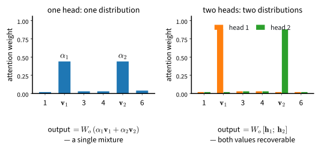
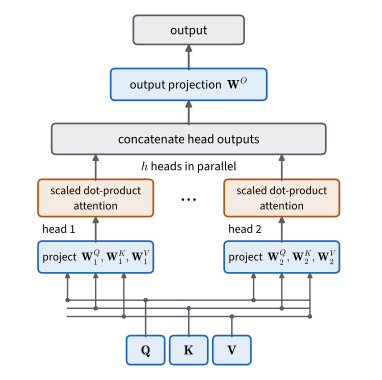

# Multi-Head and Cross-Attention
:label:`sec_multihead-attention`

Scaled dot-product attention assigns each query one distribution over the keys
and returns one weighted average of the values. A single average cannot preserve
several independently requested values. We demonstrate this limitation on a
task for which any single head loses half of the target variance.
*Multi-head attention* :cite:`Vaswani.Shazeer.Parmar.ea.2017` computes several
projected attention outputs and combines them linearly. With the usual choice
of head dimensions, this changes the representation without changing the
leading parameter or FLOP counts. We then distinguish self-attention and
cross-attention as two input configurations of the same operation.

```{.python .input #multihead-attention-multi-head-and-cross-attention}
%%tab pytorch
%matplotlib inline
from d2l import torch as d2l
import torch
from torch import nn
```

```{.python .input #multihead-attention-multi-head-and-cross-attention}
%%tab jax
%matplotlib inline
from d2l import jax as d2l
from flax import nnx
import jax
from jax import numpy as jnp
```

## A One-Mixture Bottleneck with Position-Only Keys
:label:`subsec_one-mixture-bottleneck`

Consider a task that exposes this limitation. Two source positions
hold value vectors $\mathbf{v}_1, \mathbf{v}_2 \in \mathbb{R}^d$, drawn
independently at random for every example; their keys mark only the
*positions*, not the content. A query must report **both** values: the target
is the concatenation $\mathbf{t} = [\mathbf{v}_1; \mathbf{v}_2] \in
\mathbb{R}^{2d}$. Think of a pronoun that must simultaneously retrieve its
antecedent and its governing verb.

A single head can only produce, for this query, softmax weights
$(\alpha_1, \alpha_2)$ with $\alpha_1 + \alpha_2 = 1$, the mixture
$\mathbf{m} = \alpha_1 \mathbf{v}_1 + \alpha_2 \mathbf{v}_2$, and then a
linear readout $\mathbf{W}_o \mathbf{m}$. Since the keys are fixed position
markers, the weights cannot depend on the values: whatever the head learns,
it applies the *same* mixture to every example. How well can it do?

**Proposition.** Consider one attention layer with two fixed, position-only
keys, independent isotropic Gaussian values, no residual path, and a linear
readout. For the copy-both task, the best achievable relative squared error of
a single head is $1/2$ for every softmax pair
$(\alpha_1,\alpha_2)$.

**Proof.** Given the mixture $\mathbf{m} = \alpha_1 \mathbf{v}_1 + \alpha_2
\mathbf{v}_2$, the best estimate of $\mathbf{v}_1$ is the conditional mean
$\mathbb{E}[\mathbf{v}_1 \mid \mathbf{m}] = \tfrac{\alpha_1}{\alpha_1^2 +
\alpha_2^2}\, \mathbf{m}$, which is linear, so a linear readout attains it.
Its per-dimension error variance is $1 - \tfrac{\alpha_1^2}{\alpha_1^2 +
\alpha_2^2} = \tfrac{\alpha_2^2}{\alpha_1^2 + \alpha_2^2}$; the error for
$\mathbf{v}_2$ is $\tfrac{\alpha_1^2}{\alpha_1^2 + \alpha_2^2}$. The two errors sum to exactly $1$ per dimension, while the target's total
variance is $2$ per dimension. Thus the relative squared error is $1/2$
regardless of how the head splits its attention.
$\blacksquare$

Changing the softmax weights cannot remove the error because one head supplies
the readout with only a single mixture of the two values. The following
experiment verifies the bound.

```{.python .input #multihead-attention-one-head-must-average-1}
%%tab pytorch
torch.manual_seed(0)
N, d = 10000, 16
V1, V2 = torch.randn(N, d), torch.randn(N, d)
target = torch.cat([V1, V2], dim=1)

def readout_error(M, target):
    """Best linear readout of target from M, relative error."""
    W = torch.linalg.lstsq(M, target).solution
    return ((M @ W - target).norm() / target.norm()).item()

for a in (0.5, 0.7, 0.9, 1.0):
    M = a * V1 + (1 - a) * V2
    print(f'single head, weights ({a:.1f}, {1 - a:.1f}): '
          f'relative error {readout_error(M, target):.3f}')
print(f'theory: sqrt(1/2) = {0.5 ** 0.5:.3f}')
```

```{.python .input #multihead-attention-one-head-must-average-1}
%%tab jax
N, d = 10000, 16
key1, key2 = jax.random.split(jax.random.key(0))
V1, V2 = jax.random.normal(key1, (N, d)), jax.random.normal(key2, (N, d))
target = jnp.concatenate([V1, V2], axis=1)

def readout_error(M, target):
    """Best linear readout of target from M, relative error."""
    W = jnp.linalg.lstsq(M, target)[0]
    return float(jnp.linalg.norm(M @ W - target) / jnp.linalg.norm(target))

for a in (0.5, 0.7, 0.9, 1.0):
    M = a * V1 + (1 - a) * V2
    print(f'single head, weights ({a:.1f}, {1 - a:.1f}): '
          f'relative error {readout_error(M, target):.3f}')
print(f'theory: sqrt(1/2) = {0.5 ** 0.5:.3f}')
```

The error sits at $\sqrt{1/2} \approx 0.707$ across the whole range, exactly
as computed. Now give the model a second head: two sets of attention weights,
their outputs concatenated before the readout.

```{.python .input #multihead-attention-one-head-must-average-2}
%%tab pytorch
for a in (1.0, 0.88):
    M2 = torch.cat([a * V1 + (1 - a) * V2,
                    (1 - a) * V1 + a * V2], dim=1)
    print(f'two heads, weights ({a:.2f}, {1 - a:.2f}) and '
          f'({1 - a:.2f}, {a:.2f}): '
          f'relative error {readout_error(M2, target):.1e}')
```

```{.python .input #multihead-attention-one-head-must-average-2}
%%tab jax
for a in (1.0, 0.88):
    M2 = jnp.concatenate([a * V1 + (1 - a) * V2,
                          (1 - a) * V1 + a * V2], axis=1)
    print(f'two heads, weights ({a:.2f}, {1 - a:.2f}) and '
          f'({1 - a:.2f}, {a:.2f}): '
          f'relative error {readout_error(M2, target):.1e}')
```

Two heads reduce the error to the least-squares solver's floating-point
precision. The second row does so with *soft* attention weights
$(0.88, 0.12)$. The two heads need distinct rather than one-hot weightings:
they supply two mixtures, the readout inverts the $2 \times 2$ mixing matrix,
and both values are recovered exactly (the
inversion is well conditioned as long as the heads differ appreciably; the
exercises probe what happens as they collapse toward each other).
:numref:`fig_one-head-averages` summarizes the geometry.


:label:`fig_one-head-averages`

The bound is not a universal law, but it holds beyond the interface of the
proposition, which has one layer and value-blind keys that mark position only.
A linear readout keeps the bound in place even with content-dependent keys,
more depth, or a residual connection, because it still receives only $d$
numbers per query. The bound lifts once the readout receives more than $d$
numbers, or once nonlinear layers before the attention encode the values for
a nonlinear readout, and the copy-both separation from two heads narrows
accordingly.

Multi-head attention addresses this limitation by assigning each query several
independently parameterized attention distributions and recombining their
outputs with a learned projection, provided that its output is wide enough for
all requested values. The two-head construction of
:numref:`fig_one-head-averages` passes $2d$ numbers to the readout. A
multi-head layer instead returns $d$ numbers per query by
:eqref:`eq_multihead-output`, so with values in $\mathbb{R}^d$ its linear
readout still loses half of the copy-both target variance for any number of
heads.

## Multi-Head Attention

### Extending to $h$ Heads

Rather than hand-designing the heads as above, we learn them. Given a query
$\mathbf{q} \in \mathbb{R}^{d}$, keys $\mathbf{k} \in \mathbb{R}^{d}$, and
values $\mathbf{v} \in \mathbb{R}^{d}$, head $i$ ($i = 1, \ldots, h$) first
projects them into its own subspace and then runs ordinary scaled dot product
attention $f$ from :numref:`sec_attention-scoring-functions`:

$$
\mathbf{h}_i = f\big(\mathbf W_i^{(q)}\mathbf q,\; \mathbf W_i^{(k)}\mathbf k,\; \mathbf W_i^{(v)}\mathbf v\big) \in \mathbb R^{p},
$$
:eqlabel:`eq_multihead-head`

with learnable $\mathbf W_i^{(q)}, \mathbf W_i^{(k)}, \mathbf W_i^{(v)} \in
\mathbb R^{p \times d}$. Because each head scores with its own projected
queries and keys, each head attends according to its own notion of relevance,
and each moves its own projection of the values — the two independent
mixtures of the construction above, now learned and generalized to $h$. The
output is a learned linear recombination of the concatenated heads:

$$
\mathbf W_o \begin{bmatrix}\mathbf h_1\\\vdots\\\mathbf h_h\end{bmatrix} \in \mathbb{R}^{d}, \qquad \mathbf W_o \in \mathbb R^{d \times hp}.
$$
:eqlabel:`eq_multihead-output`

:numref:`fig_multi-head-attention` shows the layout.


:label:`fig_multi-head-attention`

### Parameter and FLOP Counts

The standard dimension choice makes the heads collectively no more expensive
than one big head: set the per-head width to $p = d/h$, so the $h$ heads
together produce $hp = d$ numbers per token, exactly what a single head of
width $d$ would. For self-attention, write the sequence inputs as
$\mathbf{Q},\mathbf{K},\mathbf{V}\in\mathbb{R}^{n\times d}$; each of the
four learned projections is a $d\times d$ matrix, and each head receives
matrices of shape $n\times p$. The resulting cost is

$$
\underbrace{8nd^2}_{\textrm{projections}} \;+\; \underbrace{4n^2 d}_{\textrm{scores and mixing}} \quad \textrm{FLOPs,} \qquad 4d^2 \ \textrm{parameters,}
$$
:eqlabel:`eq_multihead-flops`

*independent of $h$*: the four projection matrices are $d \times d$
regardless of how their outputs are sliced into heads, and each head's score
and mixing matmuls shrink by the factor $h$ that their count grows by
(counting one multiply–add as two FLOPs). In this arithmetic, the number of
heads changes the representation but not the leading operation count.
Realized cost is not exactly constant because increasing the number of heads
produces more, smaller matrix multiplications and softmaxes, whose kernel
efficiency may differ. What *does*
change with $h$ is the shape of the attention map — $h$ distributions of $n$
weights per query instead of one.

### Implementation

The per-head dimension choice also yields a standard implementation:
compute *one* query projection of width $d$, then
*reshape* it into $h$ heads of width $d/h$, and fold the head axis into the
batch axis. The attention code from :numref:`sec_attention-scoring-functions`
then runs all heads of all sequences as one big batched matrix
multiplication, with no loop over heads. Within the forward pass, `valid_lens`
is repeated $h$ times so that each head of a sequence sees that sequence's
mask.

```{.python .input #multihead-attention-implementation-1}
%%tab pytorch
class MultiHeadAttention(d2l.Module):  #@save
    """Multi-head attention."""
    def __init__(self, num_hiddens, num_heads, dropout, bias=False, **kwargs):
        super().__init__()
        assert num_hiddens % num_heads == 0, 'heads must divide num_hiddens'
        self.num_heads = num_heads
        self.attention = d2l.DotProductAttention(dropout)
        self.W_q = nn.LazyLinear(num_hiddens, bias=bias)
        self.W_k = nn.LazyLinear(num_hiddens, bias=bias)
        self.W_v = nn.LazyLinear(num_hiddens, bias=bias)
        self.W_o = nn.LazyLinear(num_hiddens, bias=bias)

    def forward(self, queries, keys, values, valid_lens):
        # Shape of queries, keys, or values:
        # (batch_size, no. of queries or key-value pairs, num_hiddens)
        # Shape of valid_lens: (batch_size,) or (batch_size, no. of queries)
        queries = self.transpose_qkv(self.W_q(queries))
        keys = self.transpose_qkv(self.W_k(keys))
        values = self.transpose_qkv(self.W_v(values))

        if valid_lens is not None:
            # On axis 0, copy the first item (scalar or vector) for num_heads
            # times, then copy the next item, and so on
            valid_lens = torch.repeat_interleave(
                valid_lens, repeats=self.num_heads, dim=0)

        # Shape of output: (batch_size * num_heads, no. of queries,
        # num_hiddens / num_heads)
        output = self.attention(queries, keys, values, valid_lens)
        # Shape of output_concat: (batch_size, no. of queries, num_hiddens)
        output_concat = self.transpose_output(output)
        return self.W_o(output_concat)
```

```{.python .input #multihead-attention-implementation-1}
%%tab jax
class MultiHeadAttention(nnx.Module):  #@save
    """Multi-head attention."""
    def __init__(self, num_hiddens, num_heads, dropout, bias=False, rngs=None):
        assert num_hiddens % num_heads == 0, 'heads must divide num_hiddens'
        rngs = nnx.Rngs(params=0, dropout=1) if rngs is None else rngs
        self.num_hiddens, self.num_heads = num_hiddens, num_heads
        self.attention = d2l.DotProductAttention(dropout, rngs=rngs)
        self.W_q = nnx.Linear(num_hiddens, num_hiddens, use_bias=bias,
                              rngs=rngs)
        self.W_k = nnx.Linear(num_hiddens, num_hiddens, use_bias=bias,
                              rngs=rngs)
        self.W_v = nnx.Linear(num_hiddens, num_hiddens, use_bias=bias,
                              rngs=rngs)
        self.W_o = nnx.Linear(num_hiddens, num_hiddens, use_bias=bias,
                              rngs=rngs)

    def __call__(self, queries, keys, values, valid_lens):
        # Shape of queries, keys, or values:
        # (batch_size, no. of queries or key-value pairs, num_hiddens)
        # Shape of valid_lens: (batch_size,) or (batch_size, no. of queries)
        queries = self.transpose_qkv(self.W_q(queries))
        keys = self.transpose_qkv(self.W_k(keys))
        values = self.transpose_qkv(self.W_v(values))

        if valid_lens is not None:
            # On axis 0, copy the first item (scalar or vector) for num_heads
            # times, then copy the next item, and so on
            valid_lens = jnp.repeat(valid_lens, self.num_heads, axis=0)

        # Shape of output: (batch_size * num_heads, no. of queries,
        # num_hiddens / num_heads)
        output, attention_weights = self.attention(
            queries, keys, values, valid_lens)
        # Shape of output_concat: (batch_size, no. of queries, num_hiddens)
        output_concat = self.transpose_output(output)
        # NNX idiom: return (output, weights); PyTorch returns output only
        return self.W_o(output_concat), attention_weights
```

The two transpositions do the head bookkeeping: `transpose_qkv` moves from
`(batch, length, num_hiddens)` to `(batch * num_heads, length,
num_hiddens / num_heads)`, and `transpose_output` reverses it after the
attention call.

```{.python .input #multihead-attention-implementation-2}
%%tab pytorch
@d2l.add_to_class(MultiHeadAttention)  #@save
def transpose_qkv(self, X):
    """Transposition for parallel computation of multiple attention heads."""
    # Shape of input X: (batch_size, no. of queries or key-value pairs,
    # num_hiddens). Shape of output X: (batch_size, no. of queries or
    # key-value pairs, num_heads, num_hiddens / num_heads)
    X = X.reshape(X.shape[0], X.shape[1], self.num_heads, -1)
    # Shape of output X: (batch_size, num_heads, no. of queries or key-value
    # pairs, num_hiddens / num_heads)
    X = X.permute(0, 2, 1, 3)
    # Shape of output: (batch_size * num_heads, no. of queries or key-value
    # pairs, num_hiddens / num_heads)
    return X.reshape(-1, X.shape[2], X.shape[3])

@d2l.add_to_class(MultiHeadAttention)  #@save
def transpose_output(self, X):
    """Reverse the operation of transpose_qkv."""
    X = X.reshape(-1, self.num_heads, X.shape[1], X.shape[2])
    X = X.permute(0, 2, 1, 3)
    return X.reshape(X.shape[0], X.shape[1], -1)
```

```{.python .input #multihead-attention-implementation-2}
%%tab jax
@d2l.add_to_class(MultiHeadAttention)  #@save
def transpose_qkv(self, X):
    """Transposition for parallel computation of multiple attention heads."""
    # Shape of input X: (batch_size, no. of queries or key-value pairs,
    # num_hiddens). Shape of output X: (batch_size, no. of queries or
    # key-value pairs, num_heads, num_hiddens / num_heads)
    X = X.reshape((X.shape[0], X.shape[1], self.num_heads, -1))
    # Shape of output X: (batch_size, num_heads, no. of queries or key-value
    # pairs, num_hiddens / num_heads)
    X = jnp.transpose(X, (0, 2, 1, 3))
    # Shape of output: (batch_size * num_heads, no. of queries or key-value
    # pairs, num_hiddens / num_heads)
    return X.reshape((-1, X.shape[2], X.shape[3]))

@d2l.add_to_class(MultiHeadAttention)  #@save
def transpose_output(self, X):
    """Reverse the operation of transpose_qkv."""
    X = X.reshape((-1, self.num_heads, X.shape[1], X.shape[2]))
    X = jnp.transpose(X, (0, 2, 1, 3))
    return X.reshape((X.shape[0], X.shape[1], -1))
```

A shape check: with 5 heads and 100 hidden units, batches of 2 sequences with
4 queries against 6 key–value pairs come back as
(`batch_size`, `num_queries`, `num_hiddens`), and the per-sequence
`valid_lens` masking flows through unchanged.

```{.python .input #multihead-attention-implementation-3}
%%tab pytorch
num_hiddens, num_heads = 100, 5
attention = MultiHeadAttention(num_hiddens, num_heads, 0.5)
batch_size, num_queries, num_kvpairs = 2, 4, 6
valid_lens = d2l.tensor([3, 2])
X = d2l.ones((batch_size, num_queries, num_hiddens))
Y = d2l.ones((batch_size, num_kvpairs, num_hiddens))
d2l.check_shape(attention(X, Y, Y, valid_lens),
                (batch_size, num_queries, num_hiddens))
```

```{.python .input #multihead-attention-implementation-3}
%%tab jax
num_hiddens, num_heads = 100, 5
attention = MultiHeadAttention(num_hiddens, num_heads, 0.5)
batch_size, num_queries, num_kvpairs = 2, 4, 6
valid_lens = d2l.tensor([3, 2])
X = d2l.ones((batch_size, num_queries, num_hiddens))
Y = d2l.ones((batch_size, num_kvpairs, num_hiddens))
d2l.check_shape(nnx.view(attention, deterministic=True)(
                    X, Y, Y, valid_lens)[0],
                (batch_size, num_queries, num_hiddens))
```

And the accounting of :eqref:`eq_multihead-flops` in the flesh: the parameter
count does not move as the head count sweeps from 1 to 8.

```{.python .input #multihead-attention-implementation-4}
%%tab pytorch
X = d2l.ones((2, 10, 256))
for num_heads in (1, 2, 4, 8):
    attention = MultiHeadAttention(num_hiddens=256, num_heads=num_heads,
                                   dropout=0)
    attention(X, X, X, None)  # Materialize the lazily initialized layers
    print(f'{num_heads} heads: '
          f'{sum(p.numel() for p in attention.parameters())} parameters')
```

```{.python .input #multihead-attention-implementation-4}
%%tab jax
for num_heads in (1, 2, 4, 8):
    attention = MultiHeadAttention(num_hiddens=256, num_heads=num_heads,
                                   dropout=0)
    num_params = sum(p.size for p in jax.tree.leaves(
        nnx.state(attention, nnx.Param)))
    print(f'{num_heads} heads: {num_params} parameters')
```

## Self-Attention and Cross-Attention

`MultiHeadAttention` takes three sequence arguments: queries, keys, and values.
Self-attention and cross-attention differ only in the sources of these
arguments.

### Self-Attention

In *self-attention* :cite:`Lin.Feng.Santos.ea.2017,Vaswani.Shazeer.Parmar.ea.2017`,
one sequence supplies all three arguments: every token emits a query against
every token's key, and each output position is a value mixture from the same
sequence. Given inputs $\mathbf{x}_1, \ldots, \mathbf{x}_n \in \mathbb{R}^d$,
the layer returns an equally long sequence $\mathbf{y}_1, \ldots,
\mathbf{y}_n$ with

$$
\mathbf{y}_i = f\big(\mathbf{x}_i,\; (\mathbf{x}_1, \mathbf{x}_1), \ldots, (\mathbf{x}_n, \mathbf{x}_n)\big) \in \mathbb{R}^d,
$$
:eqlabel:`eq_self-attention`

where $f$ is multi-head attention pooling. Each token's new representation combines information from the whole
sequence in a single step. Transformers stack these layers because the
output and input shapes agree.

```{.python .input #multihead-attention-one-sequence-querying-itself}
%%tab pytorch
num_hiddens, num_heads = 100, 5
attention = MultiHeadAttention(num_hiddens, num_heads, 0.5)
batch_size, num_queries, valid_lens = 2, 4, d2l.tensor([3, 2])
X = d2l.ones((batch_size, num_queries, num_hiddens))
d2l.check_shape(attention(X, X, X, valid_lens),
                (batch_size, num_queries, num_hiddens))
```

```{.python .input #multihead-attention-one-sequence-querying-itself}
%%tab jax
num_hiddens, num_heads = 100, 5
attention = MultiHeadAttention(num_hiddens, num_heads, 0.5)
batch_size, num_queries, valid_lens = 2, 4, d2l.tensor([3, 2])
X = d2l.ones((batch_size, num_queries, num_hiddens))
d2l.check_shape(nnx.view(attention, deterministic=True)(
                    X, X, X, valid_lens)[0],
                (batch_size, num_queries, num_hiddens))
```

### Cross-Attention

In *cross-attention*, the queries come from sequence $\mathbf{A}$, while keys
and values come from sequence $\mathbf{B}$. The output has the length of
$\mathbf{A}$ and aggregates information from $\mathbf{B}$. This is the wiring of the
original encoder–decoder transformer, where each target-language position
queries the source sentence; of a vision–language model, where text tokens
query image patches; and of the historical alignment models that introduced learned attention
(:numref:`sec_attention-scoring-functions`). These cases use the same
function with different argument sources:

```{.python .input #multihead-attention-one-sequence-querying-another}
%%tab pytorch
A = d2l.ones((batch_size, 4, num_hiddens))
B = d2l.ones((batch_size, 9, num_hiddens))
d2l.check_shape(attention(A, B, B, None),
                (batch_size, 4, num_hiddens))
```

```{.python .input #multihead-attention-one-sequence-querying-another}
%%tab jax
A = d2l.ones((batch_size, 4, num_hiddens))
B = d2l.ones((batch_size, 9, num_hiddens))
d2l.check_shape(nnx.view(attention, deterministic=True)(
                    A, B, B, None)[0],
                (batch_size, 4, num_hiddens))
```

### Visualizing Cross-Attention Alignment
:label:`subsec_cross-attention-alignment`

To visualize cross-attention, assign every letter of the alphabet a random embedding,
and let the letters of one word query the letters of another through plain
scaled dot product attention — no learned projections. Matching letters
share an embedding, so their score concentrates near $\sqrt{d}$ after
scaling, while unrelated pairs score near zero; softmax turns this gap into
a readable alignment.

```{.python .input #multihead-attention-an-alignment-you-can-read}
%%tab pytorch
words = 'attention', 'translation'
letters = sorted(set(''.join(words)))
torch.manual_seed(0)
emb = torch.randn(len(letters), 32)
queries, keys = (emb[[letters.index(c) for c in w]][None] for w in words)
attention = d2l.DotProductAttention(dropout=0)
attention(queries, keys, keys, None)
d2l.show_heatmaps(attention.attention_weights[None],
                  xlabel='keys:  t  r  a  n  s  l  a  t  i  o  n',
                  ylabel='queries:  a  t  t  e  n  t  i  o  n',
                  figsize=(4, 3.5), cmap='Blues')
```

```{.python .input #multihead-attention-an-alignment-you-can-read}
%%tab jax
words = 'attention', 'translation'
letters = sorted(set(''.join(words)))
emb = jax.random.normal(jax.random.key(0), (len(letters), 32))
queries, keys = (emb[jnp.array([letters.index(c) for c in w])][None]
                 for w in words)
attention = d2l.DotProductAttention(dropout=0)
output, attention_weights = attention(queries, keys, keys, None)
d2l.show_heatmaps(attention_weights[None],
                  xlabel='keys:  t  r  a  n  s  l  a  t  i  o  n',
                  ylabel='queries:  a  t  t  e  n  t  i  o  n',
                  figsize=(4, 3.5), cmap='Blues')
```

Read the map row by row (queries are the letters of "attention", keys the
letters of "translation"). Three regimes appear. The `i` and `o` queries find
their unique partners and attend sharply. The `a`, `t`, and `n` queries find
*two* copies each and split their weight: a single head cannot choose
between identical keys, the averaging of the first section in miniature.
And the `e` query, whose letter does not occur in "translation" at all,
spreads its weight diffusely because softmax assigns all probability mass
across the available keys even when none matches. Trained models show all three regimes
too, which is one reason reading attention maps as explanations requires
care. A diffuse row may indicate that no key is relevant rather than that
all keys are relevant.

## Summary

A single attention head gives each query one distribution over the keys and
therefore one value mixture. On the value-blind copy-both task, any single head
loses half the target variance. Multi-head attention computes $h$ projected
mixtures and combines them linearly. With per-head width $d/h$, the parameter
and FLOP counts are independent of $h$; implementations can fold the head axis
into the batch axis. Self-attention draws queries, keys, and values from one
sequence. Cross-attention draws queries from one sequence and keys and values
from another, with output length equal to the query length.

## Exercises

1. [code] **Head pruning.** Removing heads from a trained layer at
   inference time :cite:`Michel.Levy.Neubig.2019` requires a measure of
   each head's importance. The copy-both task supplies a case in which
   importance is not additive.
    1. Form three heads with weights $(1, 0)$, $(0.88, 0.12)$, and again
       $(0.88, 0.12)$, concatenate their mixtures, and evaluate
       `readout_error` after removing each single head and after removing
       each pair of heads.
    1. Define a head's importance as the increase in error when it alone is
       removed. A one-shot procedure computes every importance once and
       removes all heads whose importance is below the tolerance
       $\tau = 0.01$. Which heads does it remove, and which error results?
    1. A greedy procedure instead removes the least important head,
       re-estimates the importance of the remaining heads, and repeats
       until every remaining head has an importance of at least $\tau$.
       Find the heads it keeps and the resulting error. Without the
       stopping rule, count the evaluations of `readout_error` that it
       needs to prune $h$ heads down to one, and compare the count with
       the number that the one-shot procedure needs.

1. [code] **Narrow heads.** With $p = d/h$, the leading count of
   :eqref:`eq_multihead-flops` does not depend on $h$, so the head count
   looks free up to $h = d$. Consider one head with scores
   $\mathbf{q}^\top \mathbf{k}_j / \sqrt{p}$ over keys $\mathbf{k}_1,
   \ldots, \mathbf{k}_m \in \mathbb{R}^p$ and no mask. Call a query sharp
   on key $j$ when its weights concentrate on $\mathbf{k}_j$ as the query
   is scaled by a factor that grows without bound.
    1. For $p = 1$ and distinct scalar keys, show that every query's weights
       are monotone in $k_j$. Conclude that the queries of such a head can
       be sharp only on the largest or the smallest key.
    1. Show that for $p = 2$ the keys and queries can be chosen so that
       each of $n$ queries is sharp on a key of its own choosing, for every
       assignment of queries to keys.
    1. Use these two results to state which attention patterns a layer
       gives up as $h$ approaches $d$.
    1. Time the forward pass of `MultiHeadAttention` with dropout 0 for
       self-attention with $d = 256$ and $n = 512$ on a batch of $8$
       sequences for $h \in \{1, 2, 4, 8, 16, 32, 64\}$. Make a warm-up
       call first and wait for the result before stopping the clock.
       Report the ratio of the slowest to the fastest configuration.
       Identify the cost that grows with $h$ and that
       :eqref:`eq_multihead-flops` leaves out, and check that it accounts
       for the trend.

1. **Cost of cross-attention.** :eqref:`eq_multihead-flops` counts
   self-attention over $n$ tokens.
    1. Redo the count for cross-attention with $n$ queries from
       $\mathbf{A}$ and $m$ keys and values from $\mathbf{B}$. Identify
       which terms grow with $n$, which with $m$, and which with $nm$.
    1. A decoder generates its output one token at a time and
       cross-attends from each new token to a fixed source of $m$ tokens.
       Count the FLOPs per generated token when the projected source keys
       and values are recomputed at every step and when they are computed
       once and stored. Give the ratio for $d = 512$ and $m = 1000$.

1. **Multi-query and grouped-query attention.** Multi-query attention
   :cite:`Shazeer.2019` shares one key head and one value head of width
   $p = d/h$ across all $h$ query heads. Grouped-query attention
   :cite:`Ainslie.Lee-Thorp.Jong.ea.2023` shares them within each of $g$
   groups of $h/g$ query heads.
    1. Redo the parameter count and the FLOP count of
       :eqref:`eq_multihead-flops` for both schemes. Which of the two terms
       changes, and by what factor?
    1. During autoregressive generation every past key and value is cached.
       Compute the cache size per token and per layer in bytes for
       $d = 4096$, $h = 32$, and 16-bit numbers under the three schemes,
       with $g = 8$ for grouped-query attention.
    1. Show that two query heads that share one key head and one value head
       can still produce two distinct mixtures of the same projected
       values, as the copy-both construction requires. Then state the
       limit that sharing places on the information the layer can move
       from each source token to its output.

1. [code] **Heads as slices.** `MultiHeadAttention` computes one projection
   of width $d$ for each of the queries, keys, and values and splits it
   into heads with `transpose_qkv`.
    1. Determine from `transpose_qkv` which output features of `W_q`,
       `W_k`, and `W_v` feed head $i$, and which input features of `W_o`
       receive that head's output. Write a forward pass that loops over the
       heads, applies the sliced projections, and calls
       `d2l.DotProductAttention` once per head. Verify on random inputs
       with `valid_lens` that it matches `MultiHeadAttention` with
       dropout 0.
    1. Replace the repetition of `valid_lens` in the forward pass of
       `MultiHeadAttention` with a tiling that copies the whole vector
       `num_heads` times. Find inputs for which the output changes, and
       explain which mask each head of each sequence receives. Characterize
       the `valid_lens` for which no test can detect the change.

1. **Permuting the source.** In cross-attention, the queries come from
   $\mathbf{A} \in \mathbb{R}^{n \times d}$ and the keys and values from
   $\mathbf{B} \in \mathbb{R}^{m \times d}$, neither carrying positional
   information. Let $\boldsymbol{\Pi}$ be an $m \times m$ permutation
   matrix.
    1. Show that replacing $\mathbf{B}$ by $\boldsymbol{\Pi}\mathbf{B}$ in
       both the key and the value argument leaves the output of
       `MultiHeadAttention` unchanged when no mask is applied, and that
       replacing it in the key argument alone changes the output in general.
    1. Now let `valid_lens` mark only the first $\ell$ rows of
       $\mathbf{B}$ as valid. Which permutations leave the output unchanged
       when `valid_lens` stays fixed?
    1. Self-attention without positional information is permutation
       equivariant: permuting the rows of its input permutes the rows of
       its output in the same way. A translation decoder cross-attends to
       the output of an encoder built from such self-attention layers.
       Show that the decoder's outputs are identical for the source
       sentences "dog bites man" and "man bites dog", and state where word
       order must enter the model for cross-attention to use it.

1. [code] **Random projections and readable maps.** The alignment of
   :numref:`subsec_cross-attention-alignment` uses shared random embeddings
   and no learned projections.
    1. Pass the letter embeddings of the two words as queries, keys, and
       values through a freshly initialized `MultiHeadAttention` with 4
       heads, 32 hidden units, and dropout 0, and plot the attention
       weights of each head.
    1. Which properties of the plain map hold in every head, whatever the
       projections, and which are lost? Explain both from the score that
       head $i$ assigns to a query letter with embedding $\mathbf{e}$ and a
       key letter with embedding $\mathbf{e}'$,
       $$\mathbf{e}^\top \mathbf{W}_i^{(q)\top} \mathbf{W}_i^{(k)} \mathbf{e}' / \sqrt{p}.$$
    1. State what this implies for reading the attention maps of a trained
       network whose projections have not been inspected.

1. [code] **Nonlinear readouts.** ● For Gaussian values, the proof of the
   proposition in :numref:`subsec_one-mixture-bottleneck` shows that the
   conditional mean $\mathbb{E}[\mathbf{v}_1 \mid \mathbf{m}]$ is linear in
   the mixture. Hence no readout, linear or not, improves on the relative
   error $\sqrt{1/2}$ that `readout_error` measures.
    1. Train a small multilayer perceptron to predict `target` from the
       mixture $\mathbf{m} = a\,\mathbf{v}_1 + (1 - a)\,\mathbf{v}_2$
       formed from `V1` and `V2`, for $a = 0.5$ and $a = 0.7$. Compare its
       relative error on held-out samples with that of the linear readout.
    1. Now draw the values uniformly from $\{-1, +1\}^d$. For $a = 0.5$,
       compute $\mathbb{E}[\mathbf{v}_1 \mid \mathbf{m}]$ coordinate by
       coordinate, show that it is again linear in $\mathbf{m}$, and
       conclude that the error stays at $\sqrt{1/2}$ for every readout.
    1. For $a = 0.7$ and the same discrete values, show that the map
       $(v_{1j}, v_{2j}) \mapsto m_j$ is injective. Train the perceptron
       again and report its held-out error. Explain why this escape from
       the bound does not contradict the proposition.

1. [code] **Nearly identical heads.** ● Two heads with weights
   $(0.5 + \epsilon, 0.5 - \epsilon)$ and $(0.5 - \epsilon, 0.5 +
   \epsilon)$ supply two distinct mixtures, so the linear readout inverts
   them exactly for every $\epsilon > 0$.
    1. Write the $2 \times 2$ mixing matrix, compute its eigenvalues and
       eigenvectors, and express its condition number as a function of
       $\epsilon$.
    1. Add independent Gaussian noise of standard deviation $\sigma = 0.01$
       to both mixtures and measure the error with `readout_error` for
       $\epsilon \in \{0.4, 0.1, 0.03, 0.01, 0.003, 0.001\}$. Plot the
       error against $\epsilon$ on logarithmic axes and read off the slope
       where the curve is straight.
    1. Rewrite the two noisy mixtures as noisy observations of
       $\mathbf{v}_1 + \mathbf{v}_2$ and of $\mathbf{v}_1 - \mathbf{v}_2$.
       Use this to explain the slope, to locate the $\epsilon$ below which
       the second head stops helping, and to predict how that point moves
       with $\sigma$. Check the prediction by repeating the sweep at
       $\sigma = 0.001$, extended down to $\epsilon = 10^{-5}$.

1. **What the bound counts.** ● The proposition of
   :numref:`subsec_one-mixture-bottleneck` fixes the softmax weights, but
   its error bound rests on a weaker fact: the readout receives a single
   vector $\mathbf{m} \in \mathbb{R}^d$ and must produce the target
   $\mathbf{t} \in \mathbb{R}^{2d}$.
    1. Let $\mathbf{m} \in \mathbb{R}^d$ be any function of $\mathbf{v}_1$
       and $\mathbf{v}_2$, including a mixture whose weights depend on the
       values, and let $\mathbf{W}_o \in \mathbb{R}^{2d \times d}$ be any
       matrix. Show that
       $$\mathbb{E}\,\|\mathbf{W}_o \mathbf{m} - \mathbf{t}\|^2 \geq \tfrac{1}{2}\, \mathbb{E}\,\|\mathbf{t}\|^2.$$
    1. The two-head construction of :numref:`fig_one-head-averages`
       concatenates two mixtures, so its readout receives $2d$ numbers. A
       multi-head layer instead returns a vector of width $d$, by
       :eqref:`eq_multihead-output`. Show that no number of heads lets such
       a layer, followed by a linear readout, solve the copy-both task with
       values in $\mathbb{R}^d$.
    1. Now let $\mathbf{v}_1, \mathbf{v}_2 \in \mathbb{R}^c$ with $c < d$,
       padded with zeros to width $d$ before they enter the layer. Find the
       largest $c$ for which a layer with two heads of width $p = d/2$
       solves the task exactly. Give the attention weights of each head,
       value projections $\mathbf{W}_i^{(v)}$, and an output projection
       $\mathbf{W}_o$ that do so.
    1. Generalize the proposition to $k$ source positions with independent
       isotropic Gaussian values $\mathbf{v}_1, \ldots, \mathbf{v}_k \in
       \mathbb{R}^c$ and the target $[\mathbf{v}_1; \ldots;
       \mathbf{v}_k]$. Each of $h$ heads applies fixed weights to the
       values, the weights of head $i$ form row $i$ of a matrix
       $\mathbf{A} \in \mathbb{R}^{h \times k}$, and a linear readout sees
       all $h$ mixtures. Show that the best relative squared error is
       $$1 - \frac{\operatorname{rank}(\mathbf{A})}{k},$$
       and that softmax weights, whose entries are all positive, can attain
       $\operatorname{rank}(\mathbf{A}) = \min(h, k)$.

1. [code] **Averages under key noise.** ● Let $m = 4$ keys
   $\mathbf{k}_i \in \mathbb{R}^8$ be drawn as $\mathbf{k}_i \sim
   \mathcal{N}(\boldsymbol{\mu}_i, \boldsymbol{\Sigma}_i)$ with orthonormal
   means $\boldsymbol{\mu}_i$, let the values $\mathbf{v}_1, \ldots,
   \mathbf{v}_4$ be the standard basis vectors of $\mathbb{R}^4$, and let
   the score be $\mathbf{q}^\top \mathbf{k}_i$. When every covariance is
   $\beta \mathbf{I}$ with vanishingly small $\beta$, the keys are nearly
   orthonormal, so by Exercise
   3a
   of :numref:`sec_queries-keys-values` the query
   $c\,(\boldsymbol{\mu}_a + \boldsymbol{\mu}_b)$ with a large scale $c$
   returns an output $\mathbf{o}$ close to $\tfrac{1}{2}(\mathbf{v}_a +
   \mathbf{v}_b)$.
    1. Now let $\boldsymbol{\Sigma}_a = \beta \mathbf{I} + \tfrac{1}{2}
       \boldsymbol{\mu}_a \boldsymbol{\mu}_a^\top$, so that
       $\mathbf{k}_a \approx (1 + \gamma)\, \boldsymbol{\mu}_a$ with
       $\gamma \sim \mathcal{N}(0, \tfrac{1}{2})$, and leave the other
       covariances at $\beta \mathbf{I}$. Each draw of the keys then gives
       $\mathbf{k}_a$ and $\mathbf{k}_b$ different norms, the case of
       Exercise
       3c
       of :numref:`sec_queries-keys-values`: as $\beta \to 0$, the weights
       on $\mathbf{k}_a$ and $\mathbf{k}_b$ stand in the ratio
       $e^{c\gamma}$, and the other two weights are negligible at large
       $c$. Derive from this the probability, over resamples of the keys,
       that $\|\mathbf{o} - \tfrac{1}{2}(\mathbf{v}_a + \mathbf{v}_b)\|$
       exceeds $0.1$, and evaluate it for $c = 10$ and $c = 100$. What
       does the probability tend to as $c \to \infty$?
    1. Replace the single query by two queries $\mathbf{q}_1$ and
       $\mathbf{q}_2$, each with its own softmax and output
       $\mathbf{o}_1$ or $\mathbf{o}_2$, and return $\tfrac{1}{2}
       (\mathbf{o}_1 + \mathbf{o}_2)$. Choose the queries so that the
       output tends to $\tfrac{1}{2}(\mathbf{v}_a + \mathbf{v}_b)$ as
       $c \to \infty$ for most values of $\gamma$, and identify the values
       of $\gamma$ for which it does not.
    1. Simulate three settings: isotropic covariances with the query
       $c\,(\boldsymbol{\mu}_a + \boldsymbol{\mu}_b)$, the anisotropic
       $\mathbf{k}_a$ with that query, and the anisotropic $\mathbf{k}_a$
       with the two queries. Use $\beta = 10^{-4}$,
       $c \in \{10, 100\}$, and $1000$ resamples of the keys. Report the
       median of $\|\mathbf{o} - \tfrac{1}{2}(\mathbf{v}_a +
       \mathbf{v}_b)\|$ and the fraction of resamples on which it exceeds
       $0.1$. Compare that fraction for the anisotropic $\mathbf{k}_a$ and
       the single query with the probability from (a). Explain why raising
       $c$ from $10$ to $100$ hurts the single query even when the
       covariances are isotropic.
    1. Repeat the two single-query settings with the query
       $-c \sum_{i \notin \{a, b\}} \boldsymbol{\mu}_i$, which lowers the
       scores of the other keys instead of raising those of $\mathbf{k}_a$
       and $\mathbf{k}_b$. Show that its output does not depend on
       $\gamma$, and determine which failure of the query
       $c\,(\boldsymbol{\mu}_a + \boldsymbol{\mu}_b)$ remains. Explain why
       the two queries avoid it.

    *Adapted from Stanford CS224N,
    [Assignment 4](https://web.stanford.edu/class/cs224n/assignments_w25/a4.pdf),
    Problem 1(c) and 1(d).*

1. [extended] **Learned copy-both heads.** ● Train `MultiHeadAttention`
   with 16 hidden units and dropout 0 on a copy-both task whose target
   fits the layer's width. Each example has one query and two key--value
   pairs, all vectors in $\mathbb{R}^{16}$. The values are
   $[\mathbf{v}_1; \mathbf{0}]$ and $[\mathbf{v}_2; \mathbf{0}]$, with
   $\mathbf{v}_1, \mathbf{v}_2 \in \mathbb{R}^4$ drawn independently from
   $\mathcal{N}(\mathbf{0}, \mathbf{I})$ for every example. The two keys
   are the first two standard basis vectors, so they mark position only,
   and the query is the third standard basis vector in every example. The
   prediction is the first 8 coordinates of the layer's output, and the
   target is $[\mathbf{v}_1; \mathbf{v}_2]$. By the proposition of
   :numref:`subsec_one-mixture-bottleneck`, one head cannot bring the
   relative error below $\sqrt{1/2}$ on this task, whereas two heads with
   suitable projections bring it to zero.
    1. Train the layer with Adam on the squared error for
       $h \in \{1, 2, 4, 8\}$, and report the relative error on held-out
       examples.
    1. Plot the attention weights of each head after training, and sort
       the heads into those that end near one-hot, those that are soft but
       distinct from all others, and those that nearly duplicate another
       head. Every head starts with weights close to $(0.5, 0.5)$, where
       the mixing matrix of any two heads is nearly singular. Explain what
       this start implies for the early phase of training and for the
       duplicates you observe.

<!-- slides -->

::: {.slide}
::: {.cover}
[Dive into Deep Learning · §10.3]{.kicker}

Multi-head and cross-attention<br>
**single-head limitations · multi-head computation · self- and cross-attention**
:::
:::

::: {.slide title="A single head provides one mixture"}
[A limiting example]{.kicker}

Two positions hold random values $\mathbf{v}_1, \mathbf{v}_2$; keys mark
positions only. One query must report **both**:
$\mathbf{t} = [\mathbf{v}_1; \mathbf{v}_2]$.

A head can only output $\mathbf{W}_o(\alpha_1 \mathbf{v}_1 + \alpha_2 \mathbf{v}_2)$
— one convex mixture per query.

. . .

**Proposition.** Best achievable relative squared error $= 1/2$,
for *every* choice of $(\alpha_1, \alpha_2)$.

Changing the weights cannot create a second independent mixture.
:::

::: {.slide title="The bound, numerically"}
@!multihead-attention-one-head-must-average-1

- Best linear readout via least squares, attention split swept from
  $(0.5, 0.5)$ to $(1, 0)$.
- Error pinned at $\sqrt{1/2} \approx 0.707$ across the whole range.
:::

::: {.slide title="Two heads suffice"}
@!multihead-attention-one-head-must-average-2

- The error falls to the solver's floating-point precision.
- Soft heads with weights $(0.88, 0.12)$ also recover both values. Two
  **different** mixtures let the readout invert the $2 \times 2$ mixing
  matrix; the weights need not be one-hot.

@fig:mdl-attention-one-head-averages
:::

::: {.slide title="Multi-head attention"}
Learn the heads: each gets its own projections, then ordinary scaled
dot product attention

$$\mathbf{h}_i = f\big(\mathbf W_i^{(q)}\mathbf q, \mathbf W_i^{(k)}\mathbf k, \mathbf W_i^{(v)}\mathbf v\big), \qquad \textrm{output} = \mathbf W_o [\mathbf h_1; \ldots; \mathbf h_h].$$

@fig:multi-head-attention
:::

::: {.slide title="Cost of multiple heads"}
Per-head width $p = d/h$ ⇒ for $n$ tokens:

$$\underbrace{8nd^2}_{\textrm{projections}} + \underbrace{4n^2 d}_{\textrm{scores, mixing}} \ \textrm{FLOPs}, \qquad 4d^2 \ \textrm{parameters}$$

The expression is **independent of $h$**. The leading FLOP and parameter
counts remain fixed,
although kernel efficiency varies with head count.

::: {.d2l-note}
What does change with $h$: the attention map — $h$ distributions per query
instead of one.
:::
:::

::: {.slide title="Implementation"}
One $d \times d$ projection each for Q, K, V; *reshape* into $h$ heads;
fold the head axis into the batch axis:

@multihead-attention-implementation-1
:::

::: {.slide title="Folding heads into the batch axis"}
`(batch, len, d)` → `(batch, len, h, d/h)` → `(batch·h, len, d/h)`:
The attention code treats heads as extra batch entries and requires no loop
over heads.

@multihead-attention-implementation-2
:::

::: {.slide title="Shape and cost checks"}
@multihead-attention-implementation-3

. . .

@!multihead-attention-implementation-4
:::

::: {.slide title="Self- vs. cross-attention: two wirings"}
Self-attention and cross-attention differ only in the sources of their
arguments.

- **Self-attention**: `attention(X, X, X)` — one sequence queries itself;
  output shape = input shape (the stackable case).
- **Cross-attention**: `attention(A, B, B)` — sequence A asks, sequence B
  answers; output length = query length.

@multihead-attention-one-sequence-querying-another
:::

::: {.slide title="A cross-attention alignment"}
Letters of "attention" query letters of "translation" through raw
dot product attention on shared random embeddings:

@!multihead-attention-an-alignment-you-can-read
:::

::: {.slide title="Three regimes in one map"}
- `i`, `o`: unique partner → **sharp** attention.
- `a`, `t`, `n`: two copies → weight **splits** — the averaging of the
  construction, in miniature.
- `e`: no partner → **diffuse** row because softmax still normalizes over all
  keys.

::: {.d2l-note}
A diffuse row may indicate that no key is relevant rather than that every key
is relevant. This ambiguity limits attention maps as explanations.
:::
:::

::: {.slide title="Recap"}
- One head provides one softmax distribution and one value mixture per
  query; on the copy-both task its relative squared error is $1/2$.
- Multi-head: $h$ independently projected heads, concatenated, recombined
  by $\mathbf{W}_o$. With $p = d/h$, the leading parameter and FLOP counts
  equal those of one full-width head.
- Implementation folds heads into the batch axis: one batched matmul.
- Self-attention and cross-attention are the same code with different
  arguments; only the wiring differs.
:::
