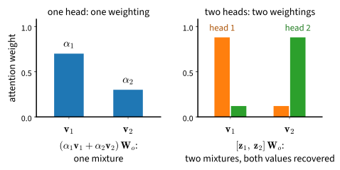
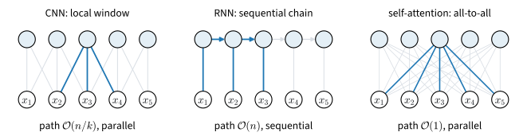
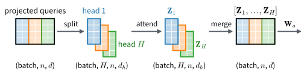

# Self-Attention and Multiple Heads
:label:`sec_multihead-attention`

In the examples of :numref:`sec_attention-scoring-functions`, queries came
from one sequence and keys and values from another. A decoder-only language
model has only a single sequence: to contextualize each token, queries, keys,
and values must all be derived from that sequence itself.

Consider the sentence *"Alice gave Bob the book"*. Interpreting *gave*
requires identifying the giver (*Alice*), the recipient (*Bob*), and the
object (*book*). In *self-attention*
:cite:`Cheng.Dong.Lapata.2016,Lin.Feng.Santos.ea.2017,Vaswani.Shazeer.Parmar.ea.2017`,
every token projects its representation into a query, a key, and a value,
allowing *gave* to query the other words in the sentence and aggregate their
values.

However, a single attention lookup produces only *one* probability
distribution per query and returns a single blended vector. How can a token
retrieve several distinct arguments without collapsing them into one average?
We first trace a single head of self-attention on our five-word sentence,
then prove an information-theoretic lower bound showing why one head cannot
recover two independent values, and finally construct *multi-head attention*
and *grouped-query attention* (GQA).

```{.python .input #multihead-attention-multi-head-and-cross-attention}
%%tab pytorch
import math
import numpy as np
import torch
from torch import nn
from torch.nn import functional as F
from d2l import torch as d2l
```

```{.python .input #multihead-attention-multi-head-and-cross-attention}
%%tab jax
import math
import numpy as np
import jax
from jax import numpy as jnp
from flax import nnx
import optax
from d2l import jax as d2l
```

## Self-Attention

In self-attention, each token representation $\mathbf{x}_i \in \mathbb{R}^d$
(row $i$ of $\mathbf{X} \in \mathbb{R}^{n \times d}$) plays three distinct
roles via learned linear projections $\mathbf{W}_q, \mathbf{W}_k \in
\mathbb{R}^{d \times d_h}$ and $\mathbf{W}_v \in \mathbb{R}^{d \times d_v}$:
the *query* $\mathbf{x}_i\mathbf{W}_q$ specifies what the token seeks, the
*key* $\mathbf{x}_i\mathbf{W}_k$ specifies what it offers to other queries,
and the *value* $\mathbf{x}_i\mathbf{W}_v$ specifies the content returned
when selected. Applying scaled dot-product attention yields one attention
*head* of width $d_h$:

$$
\mathrm{softmax}\left(\frac{(\mathbf{X}\mathbf{W}_q)(\mathbf{X}\mathbf{W}_k)^\top}{\sqrt{d_h}}\right)\mathbf{X}\mathbf{W}_v \in \mathbb{R}^{n \times d_v}.
$$
:eqlabel:`eq_self-attention`

### One Head on One Sentence

To trace :eqref:`eq_self-attention` concretely, represent each word of
*"Alice gave Bob the book"* by a 9-dimensional vector concatenating a 4D
one-hot grammatical role (person, action, thing, or function word) and a 5D
one-hot word identity. Set $\mathbf{W}_q$ and $\mathbf{W}_k$ to read only the
4D role into $d_h = 2$ dimensions, and $\mathbf{W}_v$ to extract the 5D word
indicator:

| role | query | key |
|:--|:--|:--|
| person (Alice, Bob) | $(1, -1)$ | $(1, 1)$ |
| action (*gave*) | $(1, 1)$ | $(1, -1)$ |
| thing (book) | $(1, -1)$ | $(1, 1)$ |
| function word ("the") | $(0, 0)$ | $(0, 0)$ |

```{.python .input #multihead-attention-self-attention}
%%tab pytorch, jax
tokens = ['Alice', 'gave', 'Bob', 'the', 'book']
# Role of each token: person, action, thing, function word
roles = d2l.tensor([[1.0, 0, 0, 0], [0, 1, 0, 0], [1, 0, 0, 0],
                    [0, 0, 0, 1], [0, 0, 1, 0]])
X = d2l.concat((roles, d2l.eye(5)), 1)  # (5, 9): the role, then the word
# Queries and keys read the role part (rows: person, action, thing,
# function word), values the word part
W_q = d2l.concat((d2l.tensor([[1.0, -1], [1, 1], [1, -1], [0, 0]]),
                  d2l.zeros((5, 2))))
W_k = d2l.concat((d2l.tensor([[1.0, 1], [1, -1], [1, 1], [0, 0]]),
                  d2l.zeros((5, 2))))
W_v = d2l.concat((d2l.zeros((4, 5)), d2l.eye(5)))
Q, K, V = X @ W_q, X @ W_k, X @ W_v  # (5, 2), (5, 2), (5, 5)
```

For *gave*, the query $(1, 1)$ has dot product $2$ with each noun's key
$(1, 1)$ and $0$ with *gave* and *"the"*. Dividing by $\sqrt{2}$ gives scaled
scores $1.41$ on each noun and $0$ elsewhere, which softmax converts into
weights $e^{1.41}/(3e^{1.41} + 2) \approx 0.29$ per noun and $0.07$ on *gave*
and *"the"* (:numref:`fig_self-attention`).


:label:`fig_self-attention`

```{.python .input #multihead-attention-self-attention-1}
%%tab pytorch, jax
attention = d2l.DotProductAttention()
Y = attention(Q[None], K[None], V[None])  # A minibatch of one sentence
weights = attention.attention_weights[0]
scores = Q[1] @ K.T / math.sqrt(Q.shape[-1])  # Scaled by sqrt(d_h)
print('scores of gave: ', np.asarray(scores).round(2))
print('weights of gave:', np.asarray(weights[1]).round(2))
print('weights of the: ', np.asarray(weights[3]).round(2))
print('output of gave: ', np.asarray(Y[0, 1]).round(2))
attention(Q[None], K[None], V[None], d2l.causal_mask(5))
print('causal weights of gave:',
      np.asarray(attention.attention_weights[0, 1]).round(2))
d2l.show_heatmaps(weights[None, None], xlabel='keys', ylabel='queries',
                  figsize=(3.2, 3.2), cmap='Blues',
                  xticklabels=tokens, yticklabels=tokens)
```

Conversely, each noun's query $(1, -1)$ scores $1.41$ on *gave* (weight
$0.51$) and $0$ elsewhere, while *"the"* has a zero query and attends
uniformly ($0.20$ across all five words). Applying a causal mask restricts
*gave* to *Alice* and itself, renormalizing their scores $(1.41, 0)$ to
$(0.80, 0.20)$.

### Separate Maps for Queries and Keys

Why use separate matrices $\mathbf{W}_q$ and $\mathbf{W}_k$? If a single
projection $\mathbf{u}_i = \mathbf{x}_i\mathbf{W}$ served as both query and
key, the score matrix $s_{ij} = \mathbf{u}_i^\top \mathbf{u}_j / \sqrt{d_h}$
would be symmetric and positive semidefinite, satisfying $s_{ij} \le
\sqrt{s_{ii}\, s_{jj}}$ by Cauchy--Schwarz. No token could prefer another
token over their geometric-mean self-affinity—a verb could not selectively
seek nouns without seeking itself at least as strongly. Separate query, key,
and value projections decouple *who looks*, *who is found*, and *what content
is passed on*.

## Limits of a Single Head
:label:`subsec_one-mixture-bottleneck`

In our five-word sentence, *gave* blended *Alice*, *Bob*, and *book* into a
single weighted average. To quantify the bottleneck of having only one
attention distribution per query, consider the *copy-both task*: two source
positions hold independent standard Gaussian value vectors $\mathbf{v}_1,
\mathbf{v}_2 \in \mathbb{R}^{d_v}$ with fixed position-only keys, and a
single query must output their concatenation $\mathbf{t} = [\mathbf{v}_1;
\mathbf{v}_2] \in \mathbb{R}^{2d_v}$ via a linear readout.

Because the keys depend only on position, a single head assigns fixed softmax
weights $(\alpha_1, \alpha_2)$ with $\alpha_1 + \alpha_2 = 1$ and passes a
single mixture $\mathbf{m} = \alpha_1 \mathbf{v}_1 + \alpha_2 \mathbf{v}_2
\in \mathbb{R}^{d_v}$ to the linear readout.

**Proposition.** For one attention head with two fixed position-only keys,
independent standard Gaussian values $\mathbf{v}_1, \mathbf{v}_2 \in
\mathbb{R}^{d_v}$, and a linear readout, the minimum achievable relative
squared error on the copy-both task is $1/2$ for every softmax pair
$(\alpha_1, \alpha_2)$.

**Proof.** Given $\mathbf{m} = \alpha_1 \mathbf{v}_1 + \alpha_2 \mathbf{v}_2$,
the minimum mean-squared error estimator of $\mathbf{v}_1$ is the conditional
expectation $\mathbb{E}[\mathbf{v}_1 \mid \mathbf{m}] =
\tfrac{\alpha_1}{\alpha_1^2 + \alpha_2^2}\, \mathbf{m}$, which is linear in
$\mathbf{m}$ and leaves residual variance $1 - \tfrac{\alpha_1^2}{\alpha_1^2
+ \alpha_2^2} = \tfrac{\alpha_2^2}{\alpha_1^2 + \alpha_2^2}$ per coordinate.
By symmetry, estimating $\mathbf{v}_2$ leaves residual variance
$\tfrac{\alpha_1^2}{\alpha_1^2 + \alpha_2^2}$ per coordinate. Their sum is
$1$ per coordinate out of a total target variance of $2$ per coordinate,
giving a relative squared error of $1/2$ regardless of $(\alpha_1, \alpha_2)$.
$\blacksquare$

Solving the copy-both task requires two ingredients: (1) at least two
linearly independent *weightings* over the keys, and (2) sufficient *output
dimension* (room) to hold all $2d_v$ retrieved coordinates (Exercise
:exref:`ex_multihead-what-the-bound-counts`). We verify the $\sqrt{1/2}
\approx 0.707$ root-mean-square relative error bound for one head, and show
that two heads with distinct weightings—even soft ones such as $(0.88, 0.12)$
and $(0.12, 0.88)$—allow a linear readout to invert the $2 \times 2$ mixing
matrix up to floating-point precision (:numref:`fig_one-head-averages`).

```{.python .input #multihead-attention-one-head-must-average-1}
%%tab pytorch
N, d_v = 10000, 8
V1, V2 = torch.randn(N, d_v), torch.randn(N, d_v)
target = torch.cat([V1, V2], dim=1)

def readout_error(M, target):
    """Best linear readout of target from M, relative error."""
    W = torch.linalg.lstsq(M, target).solution
    return ((M @ W - target).norm() / target.norm()).item()

M = 0.7 * V1 + 0.3 * V2
print(f'one head, weights (0.70, 0.30): relative error '
      f'{readout_error(M, target):.3f}; sqrt(1/2) = {0.5 ** 0.5:.3f}')
for a in (1.0, 0.88):
    M2 = torch.cat([a * V1 + (1 - a) * V2, (1 - a) * V1 + a * V2], dim=1)
    print(f'two heads, weights ({a:.2f}, {1 - a:.2f}) and '
          f'({1 - a:.2f}, {a:.2f}): '
          f'relative error {readout_error(M2, target):.1e}')
```

```{.python .input #multihead-attention-one-head-must-average-1}
%%tab jax
N, d_v = 10000, 8
key1, key2 = jax.random.split(d2l.get_key())
V1, V2 = jax.random.normal(key1, (N, d_v)), jax.random.normal(key2, (N, d_v))
target = jnp.concatenate([V1, V2], axis=1)

def readout_error(M, target):
    """Best linear readout of target from M, relative error."""
    # Full fp32 products: TF32, the default on recent NVIDIA cards, would
    # stop the two-head errors near 1e-4
    with jax.default_matmul_precision('highest'):
        W = jnp.linalg.lstsq(M, target)[0]
        err = jnp.linalg.norm(M @ W - target) / jnp.linalg.norm(target)
    return float(err)

M = 0.7 * V1 + 0.3 * V2
print(f'one head, weights (0.70, 0.30): relative error '
      f'{readout_error(M, target):.3f}; sqrt(1/2) = {0.5 ** 0.5:.3f}')
for a in (1.0, 0.88):
    M2 = jnp.concatenate([a * V1 + (1 - a) * V2, (1 - a) * V1 + a * V2],
                         axis=1)
    print(f'two heads, weights ({a:.2f}, {1 - a:.2f}) and '
          f'({1 - a:.2f}, {a:.2f}): '
          f'relative error {readout_error(M2, target):.1e}')
```


:label:`fig_one-head-averages`

## Multi-Head Attention

### Projected Heads

*Multi-head attention* :cite:`Vaswani.Shazeer.Parmar.ea.2017` runs $H$
independent attention heads in parallel, each with its own query, key, and
value projections $\mathbf{W}_i^{(q)}, \mathbf{W}_i^{(k)}, \mathbf{W}_i^{(v)}
\in \mathbb{R}^{d \times d_h}$:

$$
\mathbf{Z}_i = \mathrm{softmax}\left(\frac{(\mathbf{X}\mathbf{W}_i^{(q)})(\mathbf{X}\mathbf{W}_i^{(k)})^\top}{\sqrt{d_h}}\right)\mathbf{X}\mathbf{W}_i^{(v)} \in \mathbb{R}^{n \times d_h}, \qquad i = 1, \ldots, H,
$$
:eqlabel:`eq_multihead-head`

and concatenates their outputs before applying a final linear projection
$\mathbf{W}_o \in \mathbb{R}^{H d_h \times d}$ (:numref:`fig_multi-head-attention`):

$$
[\mathbf{Z}_1, \ldots, \mathbf{Z}_H]\, \mathbf{W}_o \in \mathbb{R}^{n \times d}.
$$
:eqlabel:`eq_multihead-output`


:label:`fig_multi-head-attention`

### Parameter and FLOP Counts

Setting the head width to $d_h = d/H$ keeps the total dimension across all
heads equal to $H d_h = d$. Stacked side by side, the $H$ query projections
form a single $d \times d$ matrix, as do the key, value, and output
projections. Counting one multiply--add as $2$ FLOPs, a multi-head
self-attention layer over $n$ tokens requires

$$
\underbrace{8nd^2}_{\textrm{projections}} \;+\; \underbrace{4n^2 d}_{\textrm{scores and mixing}} \quad \textrm{FLOPs,} \qquad 4d^2 \ \textrm{parameters.}
$$
:eqlabel:`eq_multihead-flops`

For one layer of GPT-2 small ($d = 768$, $n = 1{,}024$), this amounts to
$4.8$ GFLOPs for projections, $3.2$ GFLOPs for scores and value mixing, and
$2.4 \times 10^6$ parameters. Remarkably, neither the parameter count nor the
leading FLOP count depends on the number of heads $H$: splitting $d$ into
$H$ heads shrinks each head's inner product by $1/H$ while running $H$ of
them (only the $O(Hn^2)$ softmax overhead scales with $H$). Conversely, $d_h$
cannot be made arbitrarily small: at $d_h = 1$, scalar scores $q k_j$ are
monotone in $k_j$, so a query can focus only on the extremal keys (Exercise
:exref:`ex_multihead-narrow-heads`). In practice, $d_h \in \{64, 128\}$ is
standard.

### Comparison with Convolution and Recurrence

:numref:`fig_cnn-rnn-self-attention` and :numref:`tab_cnn-rnn-attn` compare
1D convolution (:numref:`chap_cnn`), recurrence (:numref:`sec_rnn`), and
self-attention as sequence-to-sequence layers over $n$ tokens of width $d$.


:label:`fig_cnn-rnn-self-attention`

:Per-layer cost of mapping $n$ tokens of dimension $d$ to $n$ tokens of dimension $d$.
:label:`tab_cnn-rnn-attn`

| layer type | complexity | sequential operations | maximum path length |
|:--|:--|:--|:--|
| convolution (kernel $k$) | $O(knd^2)$ | $O(1)$ | $O(n/k)$ |
| recurrence | $O(nd^2)$ | $O(n)$ | $O(n)$ |
| self-attention | $O(nd^2+n^2d)$ | $O(1)$ | $O(1)$ |

Self-attention combines $O(1)$ sequential steps (full training parallelism)
with $O(1)$ maximum path length between any pair of tokens, eliminating the
$O(n)$-step recurrent gradient chain (:numref:`sec_bptt`). The price is the
quadratic $4n^2 d$ score-and-mix term, which exceeds the $8nd^2$ projection
cost once $n > 2d$ ($n > 1{,}536$ for GPT-2 small).

### Implementation

In `MultiHeadAttention`, a single linear layer computes all $H$ head
projections at once, and `split_heads` reshapes `(batch, length, H * d_h)`
into `(batch, H, length, d_h)` so that `DotProductAttention` executes all
heads in one batched operation (:numref:`fig_head-split`). Projections omit
additive biases by default (`bias=False`), following modern transformer
conventions. The parameter `num_kv_heads` supports key--value head sharing
(:numref:`subsec_kv-head-sharing`).

```{.python .input #multihead-attention-linear-init}
%%tab jax
class Linear(nnx.Linear):  #@save
    """nnx.Linear with weights and biases drawn from U(-a, a), where
    a = 1/sqrt(in_features)."""
    def __init__(self, in_features, out_features, *, use_bias=True, rngs,
                 **kwargs):
        a = in_features ** -0.5
        init = lambda key, shape, dtype=jnp.float32: jax.random.uniform(
            key, shape, dtype, -a, a)
        super().__init__(in_features, out_features, use_bias=use_bias,
                         kernel_init=init, bias_init=init, rngs=rngs,
                         **kwargs)
```

```{.python .input #multihead-attention-implementation-1}
%%tab pytorch
class MultiHeadAttention(nn.Module):  #@save
    """Multi-head attention with heads as an explicit axis; num_kv_heads <
    num_heads shares each key-value head across a group of query heads."""
    def __init__(self, num_hiddens, num_heads, dropout=0.0, bias=False,
                 num_kv_heads=None):
        super().__init__()
        assert num_hiddens % num_heads == 0, 'heads must divide num_hiddens'
        self.num_heads = num_heads
        self.num_kv_heads = num_kv_heads or num_heads
        assert num_heads % self.num_kv_heads == 0
        kv_hiddens = self.num_kv_heads * (num_hiddens // num_heads)
        self.attention = d2l.DotProductAttention(dropout)
        self.W_q = nn.Linear(num_hiddens, num_hiddens, bias=bias)
        self.W_k = nn.Linear(num_hiddens, kv_hiddens, bias=bias)
        self.W_v = nn.Linear(num_hiddens, kv_hiddens, bias=bias)
        self.W_o = nn.Linear(num_hiddens, num_hiddens, bias=bias)

    def forward(self, queries, keys, values, mask=None):
        # queries: (batch, no. of queries, num_hiddens); keys and values:
        # (batch, no. of key-value pairs, num_hiddens). mask: boolean,
        # broadcastable to (batch, no. of queries, no. of keys), shared by
        # all heads, or to (batch, num_heads, no. of queries, no. of keys)
        q = self.split_heads(self.W_q(queries), self.num_heads)
        k = self.split_heads(self.W_k(keys), self.num_kv_heads)
        v = self.split_heads(self.W_v(values), self.num_kv_heads)
        group = self.num_heads // self.num_kv_heads
        k, v = k.repeat_interleave(group, 1), v.repeat_interleave(group, 1)
        if mask is not None and mask.dim() == 3:
            mask = mask[:, None]           # The same mask for every head
        # Shape of Y: (batch, num_heads, no. of queries, head width)
        Y = self.attention(q, k, v, mask)
        return self.W_o(self.merge_heads(Y))

    @property
    def attention_weights(self):
        """Weights of the last call: (batch, num_heads, queries, keys)."""
        return self.attention.attention_weights
```

```{.python .input #multihead-attention-implementation-1}
%%tab jax
class MultiHeadAttention(nnx.Module):  #@save
    """Multi-head attention with heads as an explicit axis; num_kv_heads <
    num_heads shares each key-value head across a group of query heads."""
    def __init__(self, num_hiddens, num_heads, dropout=0.0, bias=False,
                 num_kv_heads=None, *, rngs):
        assert num_hiddens % num_heads == 0, 'heads must divide num_hiddens'
        self.num_heads = num_heads
        self.num_kv_heads = num_kv_heads or num_heads
        assert num_heads % self.num_kv_heads == 0
        kv_hiddens = self.num_kv_heads * (num_hiddens // num_heads)
        self.attention = d2l.DotProductAttention(dropout, rngs=rngs)
        self.W_q = Linear(num_hiddens, num_hiddens, use_bias=bias, rngs=rngs)
        self.W_k = Linear(num_hiddens, kv_hiddens, use_bias=bias, rngs=rngs)
        self.W_v = Linear(num_hiddens, kv_hiddens, use_bias=bias, rngs=rngs)
        self.W_o = Linear(num_hiddens, num_hiddens, use_bias=bias, rngs=rngs)

    def __call__(self, queries, keys, values, mask=None):
        # queries: (batch, no. of queries, num_hiddens); keys and values:
        # (batch, no. of key-value pairs, num_hiddens). mask: boolean,
        # broadcastable to (batch, no. of queries, no. of keys), shared by
        # all heads, or to (batch, num_heads, no. of queries, no. of keys)
        q = self.split_heads(self.W_q(queries), self.num_heads)
        k = self.split_heads(self.W_k(keys), self.num_kv_heads)
        v = self.split_heads(self.W_v(values), self.num_kv_heads)
        group = self.num_heads // self.num_kv_heads
        k, v = jnp.repeat(k, group, axis=1), jnp.repeat(v, group, axis=1)
        if mask is not None and mask.ndim == 3:
            mask = mask[:, None]           # The same mask for every head
        # Shape of Y: (batch, num_heads, no. of queries, head width)
        Y = self.attention(q, k, v, mask)
        return self.W_o(self.merge_heads(Y))

    @property
    def attention_weights(self):
        """Weights of the last call: (batch, num_heads, queries, keys)."""
        return self.attention.attention_weights
```


:label:`fig_head-split`

```{.python .input #multihead-attention-implementation-2}
%%tab pytorch
@d2l.add_to_class(MultiHeadAttention)  #@save
def split_heads(self, X, num_heads):
    """(batch, length, num_heads * width) -> (batch, num_heads, length,
    width)."""
    return X.reshape(X.shape[0], X.shape[1], num_heads, -1).transpose(1, 2)

@d2l.add_to_class(MultiHeadAttention)  #@save
def merge_heads(self, X):
    """Reverse split_heads: (batch, num_heads, length, width) -> (batch,
    length, num_heads * width)."""
    return X.transpose(1, 2).reshape(X.shape[0], X.shape[2], -1)
```

```{.python .input #multihead-attention-implementation-2}
%%tab jax
@d2l.add_to_class(MultiHeadAttention)  #@save
def split_heads(self, X, num_heads):
    """(batch, length, num_heads * width) -> (batch, num_heads, length,
    width)."""
    return X.reshape(X.shape[0], X.shape[1], num_heads, -1).swapaxes(1, 2)

@d2l.add_to_class(MultiHeadAttention)  #@save
def merge_heads(self, X):
    """Reverse split_heads: (batch, num_heads, length, width) -> (batch,
    length, num_heads * width)."""
    return X.swapaxes(1, 2).reshape(X.shape[0], X.shape[2], -1)
```

### Shared Keys and Values
:label:`subsec_kv-head-sharing`

During autoregressive generation, past keys and values are cached in memory
(:numref:`sec_kv-cache`). *Grouped-query attention* (GQA)
:cite:`Ainslie.Lee-Thorp.Jong.ea.2023` reduces this cache by a factor of
$H / H_\textrm{kv}$ by sharing each key--value head across a group of $H /
H_\textrm{kv}$ query heads; setting $H_\textrm{kv} = 1$ gives *multi-query
attention* (MQA) :cite:`Shazeer.2019`.

Our copy-both capacity analysis explains when key--value sharing is lossless.
To retrieve multiple distinct values, query heads must produce distinct
weightings—which requires only distinct query projections $\mathbf{W}_i^{(q)}$—while
the shared value heads must have sufficient total dimension $H_\textrm{kv} d_h$
to hold the retrieved value coordinates ($H_\textrm{kv} d_h \ge d_v$; Exercise
:exref:`ex_multihead-what-the-bound-counts`). When $H_\textrm{kv} d_h < d_v$,
the shared value projection bottlenecks the output even if all $H$ query
heads attend to different positions.

## Cross-Attention

While self-attention passes the same sequence $\mathbf{X}$ as queries, keys,
and values (`attention(X, X, X)`), *cross-attention* draws queries from a
target sequence $\mathbf{A}$ and keys and values from a source sequence
$\mathbf{B}$ (`attention(A, B, B)`), producing one output row per token of
$\mathbf{A}$. Encoder--decoder transformers use cross-attention to read an
encoded source sentence during translation, and multimodal models use it to
let text tokens query visual features :cite:`alayrac2022flamingo`.

Even with multiple heads, however, self-attention remains blind to word
order: swapping *Alice* and *Bob* in *"Alice gave Bob the book"* leaves the
output at *gave* unchanged. Injecting sequence order is the subject of
:numref:`sec_positional-information`.

## Summary

* Self-attention projects each token of a sequence into a query, a key, and a
  value, connecting all pairs of positions in $O(1)$ sequential steps and
  $O(1)$ path length at $O(nd^2 + n^2d)$ FLOPs.
* A single head forms only one convex mixture of values per query; on the
  copy-both task, any single head incurs a relative squared error of at least
  $1/2$.
* Multi-head attention runs $H$ heads of width $d_h = d/H$ in parallel and
  combines them via $\mathbf{W}_o$, requiring $4d^2$ parameters and
  $8nd^2 + 4n^2d$ FLOPs independent of $H$.
* Grouped-query and multi-query attention share $H_\textrm{kv} < H$
  key--value heads across query groups to shrink generation caches by
  $H/H_\textrm{kv}$, preserving capacity so long as $H_\textrm{kv} d_h$ has
  room for the retrieved values.

## Exercises

1. [code] **Narrow heads.** With $d_h = d/H$, the leading count of
   :eqref:`eq_multihead-flops` does not depend on $H$, so the number of heads
   looks free up to $H = d$. Consider one head with scores
   $\mathbf{q}^\top \mathbf{k}_j / \sqrt{d_h}$ over keys $\mathbf{k}_1,
   \ldots, \mathbf{k}_m \in \mathbb{R}^{d_h}$ and no mask. Call a query sharp
   on key $j$ when its weights concentrate on $\mathbf{k}_j$ as the query
   is scaled by a factor that grows without bound.
    1. For $d_h = 1$ and distinct scalar keys, show that every query's weights
       are monotone in $k_j$. Conclude that the queries of such a head can
       be sharp only on the largest or the smallest key.
    1. Show that for $d_h = 2$ the keys and queries can be chosen so that
       each of $n$ queries is sharp on a key of its own choosing, for every
       assignment of queries to keys.
    1. Use these two results to state which attention patterns a layer
       gives up as $H$ approaches $d$.
    1. Time the forward pass of `MultiHeadAttention` with dropout 0 for
       self-attention with $d = 256$ and $n = 512$ on a minibatch of $8$
       sequences for $H \in \{1, 2, 4, 8, 16, 32, 64\}$. Make a warm-up
       call first and wait for the result before stopping the clock.
       Report the ratio of the slowest to the fastest configuration.
       Identify the cost that grows with $H$ and that
       :eqref:`eq_multihead-flops` leaves out, and check that it accounts
       for the trend.
   :exlabel:`ex_multihead-narrow-heads`

1. [code] **Heads as slices.** `MultiHeadAttention` computes one projection
   of width $d$ for each of the queries, keys, and values and splits it
   into heads with `split_heads`.
    1. Head $i$ owns a slice of the output features of `W_q`, `W_k`, and
       `W_v`. Determine which input features of `W_o` receive that head's
       output. Write a forward pass that loops over the heads, applies the
       sliced projections, and calls `d2l.DotProductAttention` once per
       head. Verify on random inputs with a padding mask that it matches
       `MultiHeadAttention` with dropout 0, and extend your loop to
       `num_kv_heads < num_heads`.
    1. Replace the body of `split_heads` by
       `X.reshape(X.shape[0], num_heads, X.shape[1], -1)`, which returns a
       tensor of the same shape. Describe which numbers each "head" now
       holds, show on random inputs that the output changes, and explain why
       no shape check can detect the mistake. Which input lengths and widths,
       if any, make the two versions agree?

1. **Permuting the source.** In cross-attention, the queries come from
   $\mathbf{A} \in \mathbb{R}^{n \times d}$ and the keys and values from
   $\mathbf{B} \in \mathbb{R}^{m \times d}$, neither carrying positional
   information. Let $\boldsymbol{\Pi}$ be an $m \times m$ permutation
   matrix.
    1. Show that replacing $\mathbf{B}$ by $\boldsymbol{\Pi}\mathbf{B}$ in
       both the key and the value argument leaves the output of
       `MultiHeadAttention` unchanged when no mask is applied, and that
       replacing it in the key argument alone changes the output in general.
    1. Now let a padding mask mark only the first $\ell$ rows of
       $\mathbf{B}$ as valid. Which permutations leave the output unchanged
       when the mask stays fixed?
   :exlabel:`ex_multihead-permuting-the-source`

1. [code] **Nearly identical heads.** ● Two heads with weights
   $(0.5 + \epsilon, 0.5 - \epsilon)$ and $(0.5 - \epsilon, 0.5 +
   \epsilon)$ supply two distinct mixtures, so the linear readout inverts
   them exactly for every $\epsilon > 0$.
    1. Write the $2 \times 2$ mixing matrix, compute its eigenvalues and
       eigenvectors, and express its condition number as a function of
       $\epsilon$.
    1. Add independent Gaussian noise of standard deviation $\sigma = 0.01$
       to both mixtures and measure the error with `readout_error` for
       $\epsilon \in \{0.4, 0.1, 0.03, 0.01, 0.003, 0.001\}$. Plot the
       error against $\epsilon$ on logarithmic axes, read off the slope
       where the curve is straight, and explain it with the condition
       number from (a).
   :exlabel:`ex_multihead-nearly-identical-heads`

1. **What the bound counts.** ● The proposition of
   :numref:`subsec_one-mixture-bottleneck` fixes the softmax weights, but
   its error bound rests on a weaker fact: the readout receives a single
   vector $\mathbf{m} \in \mathbb{R}^{d_v}$ and must produce the target
   $\mathbf{t} \in \mathbb{R}^{2d_v}$.
    1. Let $\mathbf{m} \in \mathbb{R}^{d_v}$ be any function of
       $\mathbf{v}_1$ and $\mathbf{v}_2$, including a mixture whose weights
       depend on the values, and let $\mathbf{W}_o \in \mathbb{R}^{d_v
       \times 2d_v}$ be any matrix. Show that
       $$\mathbb{E}\,\|\mathbf{m}\mathbf{W}_o - \mathbf{t}\|^2 \geq \tfrac{1}{2}\, \mathbb{E}\,\|\mathbf{t}\|^2.$$
       Conclude that content-dependent keys, more layers, or a residual
       connection leave the bound in place as long as the readout is linear
       and receives $d_v$ numbers.
    1. A layer of width $d$ with two heads of width $d_h = d/2$ receives the
       values $\mathbf{v}_1, \mathbf{v}_2 \in \mathbb{R}^{d/2}$ padded with
       zeros to width $d$. Give the attention weights of each head, value
       projections $\mathbf{W}_i^{(v)}$, and an output projection
       $\mathbf{W}_o$ that solve the task exactly.
    1. Generalize the proposition to $k$ source positions with independent
       standard Gaussian values $\mathbf{v}_1, \ldots, \mathbf{v}_k \in
       \mathbb{R}^{d_v}$ and the target $[\mathbf{v}_1; \ldots;
       \mathbf{v}_k]$. Each of $H$ heads applies fixed weights to the
       values, the weights of head $i$ form row $i$ of a matrix
       $\mathbf{A} \in \mathbb{R}^{H \times k}$, and a linear readout sees
       all $H$ mixtures. Show that the best relative squared error is
       $$1 - \frac{\operatorname{rank}(\mathbf{A})}{k},$$
       and that softmax weights, whose entries are all positive, can attain
       $\operatorname{rank}(\mathbf{A}) = \min(H, k)$.
    1. Let the layer have $H$ query heads of width $d_h = d/H$ and
       $H_\textrm{kv} < H$ shared key--value heads. Show that it can solve
       the two-position copy-both task if and only if $H_\textrm{kv} d_h \ge
       d_v$.
   :exlabel:`ex_multihead-what-the-bound-counts`

[Discussions](https://d2l.discourse.group/t/36770)

<!-- slides -->

::: {.slide}
::: {.cover}
[Dive into Deep Learning · §10.3]{.kicker}

Self-Attention and Multiple Heads<br>
**a sentence reads itself · what one head cannot do · heads in subspaces · shared keys and values**
:::
:::

::: {.slide title="One Head Hands 'gave' One Vector for Three Words"}
[The problem]{.kicker}

- *gave* needs three other words: who gave, who received, what was given.
- Self-attention: every word sends a query to the keys of its own
  sentence.
- One head returns **one** weighted average of the values: in GPT-2
  small, 64 numbers per token, whatever it read.

::: {.d2l-note .warn}
Can one query read several positions without blending what it reads?
:::
:::

::: {.slide title="By the End of This Deck You Can"}
[Goals]{.kicker}

- compute one head of self-attention by hand, with and without a causal
  mask;
- prove that one set of weights loses half of two requested values;
- write multi-head attention and count its FLOPs and parameters;
- predict when heads may share keys and values;
- tell self-attention from cross-attention by their inputs.

**Running example:** "Alice gave Bob the book" with $d_h = 2$, then a
GPT-2-small layer: $d = 768$, 12 heads of width 64.
:::

::: {.slide title="Self-Attention Is the Layer the Rest of the Book Is Built From"}
[Where this fits]{.kicker}

::: {.cols .vc}
::: {.col}
| section | adds |
|---|---|
| Queries, Keys, and Values | attention as a soft lookup |
| Attention Scoring and Masking | scaled dot products, masks |
| **Self-Attention and Multiple Heads** | **a sequence reads itself; several heads** |
| Positional Information | where a token sits |
| The Cost of Attention | quadratic cost, fused kernels |
| Windowed and Linear Attention | linear cost, and what it gives up |
| Attention Circuits | what trained heads compute |
:::

::: {.col .narrow}
- **Uses:** scaled dot-product attention, causal masks, least squares.
- **Skips:** word order (next deck); the key-value cache itself (next
  chapter).
:::
:::
:::

::: {.slide title="A Token Asks, Is Found, and Is Read: Three Maps"}
[Self-attention]{.kicker}

- **query** $\mathbf{x}\mathbf{W}_q$: what the token looks for
- **key** $\mathbf{x}\mathbf{W}_k$: what it offers to other queries
- **value** $\mathbf{x}\mathbf{W}_v$: what it hands over once chosen

$$\mathrm{softmax}\left(\frac{(\mathbf{X}\mathbf{W}_q)(\mathbf{X}\mathbf{W}_k)^\top}{\sqrt{d_h}}\right)\mathbf{X}\mathbf{W}_v$$

$\mathbf{X}$: the $n$ tokens as rows; $d_h$: width of queries and keys.

::: {.d2l-note}
One sequence supplies the queries, the keys, and the values.
:::
:::

::: {.slide title="Check: Predict the Weights of 'gave'"}
[Check]{.kicker}

Hand-set maps, $d_h = 2$, score $\mathbf{q} \cdot \mathbf{k}/\sqrt{2}$:

| token | role | query | key |
|:--|:--|:--|:--|
| Alice, Bob | person | $(1, -1)$ | $(1, 1)$ |
| gave | action | $(1, 1)$ | $(1, -1)$ |
| book | thing | $(1, -1)$ | $(1, 1)$ |
| the | function word | $(0, 0)$ | $(0, 0)$ |

::: {.fragment .fade-up}
::: {.d2l-note}
**Answer.** Scores $2/\sqrt{2} \approx 1.41$ on the three nouns, $0$ on
*gave* and "the". Weights $e^{1.41}/(3e^{1.41}+2) \approx 0.29$ each and
$\approx 0.07$ for the other two.
:::
:::
:::

::: {.slide title="'Gave' Reads Equal Parts Alice, Bob, and Book"}
[Self-attention]{.kicker}

{width=88%}

::: {.d2l-note}
Alice and Bob get the same weight: this head cannot say who gave and who
received.
:::
:::

::: {.slide title="The Layer Reproduces the Hand Computation; a Causal Mask Leaves 0.80 and 0.20"}
@!multihead-attention-self-attention-1

- Causal mask: the same scores, renormalized over Alice and *gave*.
:::

::: {.slide title="Separate Query and Key Maps Let a Token Seek What It Is Not"}
[Self-attention]{.kicker}

One shared map $\mathbf{u}_i = \mathbf{x}_i\mathbf{W}$ for queries and keys:

- scores symmetric, and $s_{ij} \le \sqrt{s_{ii}\, s_{jj}}$
  (Cauchy–Schwarz): no score exceeds the geometric mean of the two
  self-scores;
- the verb's $(1, 1)$ would have dot product 2 with itself and 0 with
  every noun.

::: {.d2l-note}
What a token asks for must be free to differ from what it offers.
:::
:::

::: {.slide title="One Head Returns One Mixture of Two Requested Values"}
[Limits of a single head]{.kicker}

**Copy-both task:** two positions hold random $\mathbf{v}_1,
\mathbf{v}_2 \in \mathbb{R}^{d_v}$; keys mark positions only; one query
must return $\mathbf{t} = [\mathbf{v}_1; \mathbf{v}_2]$.

- One head: weights $\alpha_1 + \alpha_2 = 1$, the same for every example.
- It hands the readout $\mathbf{m} = \alpha_1 \mathbf{v}_1 + \alpha_2
  \mathbf{v}_2$: $d_v$ numbers for a $2d_v$-number target.
:::

::: {.slide title="Any Single Head Has Relative Squared Error at Least 1/2"}
[Limits of a single head]{.kicker}

Values standard Gaussian. The best estimate is linear:

$$\mathbb{E}[\mathbf{v}_1 \mid \mathbf{m}] = \frac{\alpha_1}{\alpha_1^2 + \alpha_2^2}\,\mathbf{m}.$$

- Error per coordinate: $\frac{\alpha_2^2}{\alpha_1^2 + \alpha_2^2}$ for
  $\mathbf{v}_1$, $\frac{\alpha_1^2}{\alpha_1^2 + \alpha_2^2}$ for
  $\mathbf{v}_2$: sum $1$.
- Target variance $2$ per coordinate $\Rightarrow$ relative error $1/2$.

::: {.d2l-note}
The weights move the error between $\mathbf{v}_1$ and $\mathbf{v}_2$; they
cannot remove it.
:::
:::

::: {.slide title="A Solver Needs Several Weightings and Room for Every Value"}
[Limits of a single head]{.kicker}

{width=70%}

1. **Weightings:** several different weightings for one query.
2. **Room:** output space for every value retrieved.

Neither suffices alone: one head as wide as the layer has room but one
weighting.
:::

::: {.slide title="One Mixture Stays at 0.71; Two Mixtures Reach Rounding Error"}
[Limits of a single head]{.kicker}

@!multihead-attention-one-head-must-average-1

- Values of width 8, 10,000 examples, best linear readout by least
  squares.
- Relative error $= \sqrt{\textrm{relative squared error}}$: the bound is
  $\sqrt{1/2} \approx 0.707$.
- Soft weights $(0.88, 0.12)$ work as well as one-hot ones.
:::

::: {.slide title="Check: Does a Residual Connection Lift the Bound?"}
[Check]{.kicker}

Add the query to the head's output and keep a linear readout of $d_v$
numbers. Can the error drop below $1/2$?

::: {.fragment .fade-up}
::: {.d2l-note}
**Answer.** No. The query is the same in every example and carries nothing
about the values, and any $d_v$ numbers read out linearly leave error
$1/2$. Only more numbers (more heads, a wider output) help.
:::
:::
:::

::: {.slide title="Each Head Attends in Its Own Projection"}
[Multi-head attention]{.kicker}

$$\mathbf{Z}_i = \mathrm{softmax}\left(\frac{(\mathbf{X}\mathbf{W}_i^{(q)})(\mathbf{X}\mathbf{W}_i^{(k)})^\top}{\sqrt{d_h}}\right)\mathbf{X}\mathbf{W}_i^{(v)}, \qquad \textrm{output} = [\mathbf{Z}_1, \ldots, \mathbf{Z}_H]\,\mathbf{W}_o$$

{width=36%}

New: the head index $i$ and the output projection $\mathbf{W}_o$.
:::

::: {.slide title="Heads Change the Attention Map, Not the Cost"}
[Multi-head attention]{.kicker}

Head width $d_h = d/H$, sequence length $n$:

$$\underbrace{8nd^2}_{\textrm{projections}} + \underbrace{4n^2 d}_{\textrm{scores, mixing}} \ \textrm{FLOPs}, \qquad 4d^2 \ \textrm{parameters.}$$

GPT-2 small layer, $n = 1024$: 4.8 GFLOP projections, 3.2 GFLOP scores
and mixing, 2.4M parameters, for 1 head or 12.

::: {.d2l-note}
Why not $H = d$? A head of width 1 can point only at the largest or the
smallest key.
:::
:::

::: {.slide title="Self-Attention Shortens Every Path to One Step and Pays a Quadratic Cost"}
[Multi-head attention]{.kicker}

{width=56%}

$n$ tokens of width $d$, kernel size $k$:

| layer | cost | sequential | path |
|:--|:--|:--|:--|
| convolution | $knd^2$ | $1$ | $n/k$ |
| recurrence | $nd^2$ | $n$ | $n$ |
| self-attention | $nd^2 + n^2 d$ | $1$ | $1$ |

::: {.d2l-note}
Wins path and parallelism; the $n^2 d$ term overtakes the projections once
$n > 2d$ (GPT-2 small: 1,536 tokens).
:::
:::

::: {.slide title="Heads Are One More Tensor Axis"}
[Multi-head attention]{.kicker}

{width=92%}

- `split_heads`: reshape to `(batch, n, H, d_h)`, move the head axis
  forward; `merge_heads` undoes both.
- Attention runs over the last two axes: all heads in one batched product.
:::

::: {.slide title="A Trained Layer: One Head Stays at 0.71, Two Heads Reach Rounding Error"}
[Multi-head attention]{.kicker}

@!multihead-attention-learned-heads-on-the-copy-both-task-2

- $d = 16$, keys $\mathbf{e}_1, \mathbf{e}_2$, query $\mathbf{e}_3$,
  values of width 8: room for exactly two.
- One head: weight on $\mathbf{v}_1$ ends near one half; every split is
  equally bad.
- Every run of $H \ge 2$: one head above 0.8 on $\mathbf{v}_1$, one below
  0.2.
:::

::: {.slide title="Heads May Share Keys and Values"}
[Shared keys and values]{.kicker}

{width=72%}

- $H$ query heads read $H_\textrm{kv}$ key-value heads: grouped-query
  attention; $H_\textrm{kv} = 1$: multi-query.
- Generation stores past keys and values: $H/H_\textrm{kv}$ times less.
  GPT-2 small, 16-bit, all 12 layers, 12 → 4 key-value heads: 36 → 12 KiB
  per token.
:::

::: {.slide title="Check: Which Layouts Solve Copy-Both?"}
[Check]{.kicker}

$d = 16$, $d_v = 8$, $d_h = d/H$. Which of $(H, H_\textrm{kv}) = (2, 1)$,
$(4, 2)$, $(4, 1)$ can return both values?

::: {.fragment .fade-up}
::: {.d2l-note}
**Answer.** Room requires $H_\textrm{kv} d_h \ge d_v$. $(2, 1)$ and $(4, 2)$
give 8 shared value coordinates and succeed; $(4, 1)$ gives 4: four
weightings, no room, error back to $0.71$.
:::
:::
:::

::: {.slide title="Sharing Works While the Shared Value Heads Have Room"}
[Shared keys and values]{.kicker}

@!multihead-attention-sharing-keys-and-values

- $(2, 1)$, $(4, 2)$: rounding error with 768 parameters instead of 1,024.
- $(4, 1)$: 640 parameters, $0.71$, though its heads weight the positions
  differently.
:::

::: {.slide title="Self- and Cross-Attention Differ Only in Their Inputs"}
[Cross-attention]{.kicker}

- **Self-attention:** `attention(X, X, X)`. One sequence reads itself;
  output shape = input shape, so layers stack.
- **Cross-attention:** `attention(A, B, B)`. Sequence A asks, sequence B
  answers; output length = length of A.

Translation decoders and vision–language models read another sequence
this way.

::: {.d2l-note}
Cross-attention is how one model reads the output of another.
:::
:::

::: {.slide title="Check: Swap Alice and Bob"}
[Check]{.kicker}

"Bob gave Alice the book." Does the output of *gave* change, with one head
or with several?

::: {.fragment .fade-up}
::: {.d2l-note}
**Answer.** No. The weights depend on content only; swapping two tokens
swaps their values and their weights together. Content cannot tell the
giver from the receiver.
:::
:::
:::

::: {.slide title="Several Weightings per Query, Room for What They Read"}
[Wrap-up]{.kicker}

- One head on the sentence: *gave* gets $0.29$ on each noun, a blend.
- One head, one mixture: relative squared error $1/2$ on copy-both, for
  any weights.
- $H$ heads of width $d/H$: $8nd^2 + 4n^2d$ FLOPs, $4d^2$ parameters for
  every $H$; two trained heads reach rounding error.
- Shared keys and values: safe while $H_\textrm{kv} d_h \ge d_v$.

**Next:** attention ignores order; positional information restores it.
:::
