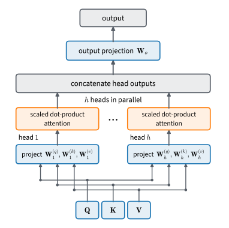
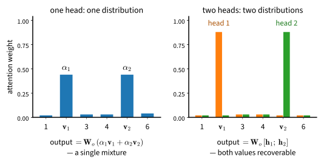
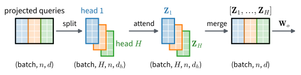
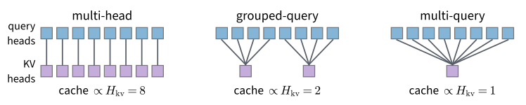

# Multi-Head and Cross-Attention
:label:`sec_multihead-attention`

The attention layer of :numref:`sec_attention-scoring-functions` gives each
query one set of weights over the keys and returns one weighted average of
the values. That suffices when a query needs one thing from its context.
Often it needs several. In the sentence "Alice gave Bob the book", the verb
*gave* needs three other words: who gave, who received, and what was given.
A single weighted average mixes their three value vectors into one vector of
the same width. How can one query read several positions
at once without blending what it reads?

We make the question precise with a small task: one query must report the
values stored at two positions. Any single set of attention weights,
however it is chosen, loses half of the target's variance on this task.
*Multi-head attention*
:cite:`Vaswani.Shazeer.Parmar.ea.2017` gives each query several sets of
weights, each computed in a learned projection of its own, and combines the
resulting averages linearly. With the usual choice of head width it has the
same number of parameters and the same leading FLOP count as one wide head,
and a layer built this way learns to solve the two-value task. The heads do
not all need their own keys and values. Sharing them within groups of heads
keeps the extra weightings and shrinks the memory that text generation needs.
The section ends with self-attention and cross-attention, which are the same
operation applied to different inputs.

```{.python .input #multihead-attention-multi-head-and-cross-attention}
%%tab pytorch
%matplotlib inline
from d2l import torch as d2l
import torch
from torch import nn
```

```{.python .input #multihead-attention-multi-head-and-cross-attention}
%%tab jax
%matplotlib inline
from d2l import jax as d2l
from flax import nnx
import jax
from jax import numpy as jnp
import optax
```

## A One-Mixture Bottleneck with Position-Only Keys
:label:`subsec_one-mixture-bottleneck`

To measure what one weighting per query cannot express, we need a task
whose answer we know and whose best single-head solution we can compute.
Consider the following task. Two source positions hold value vectors
$\mathbf{v}_1, \mathbf{v}_2 \in \mathbb{R}^c$, drawn independently at random
for every example. Their keys mark only the *positions*, not the content. A
query must report **both** values: the target is the concatenation
$\mathbf{t} = [\mathbf{v}_1; \mathbf{v}_2] \in \mathbb{R}^{2c}$.

For this query a single head can only produce softmax weights
$(\alpha_1, \alpha_2)$ with $\alpha_1 + \alpha_2 = 1$, the mixture
$\mathbf{m} = \alpha_1 \mathbf{v}_1 + \alpha_2 \mathbf{v}_2$, and then a
linear readout $\mathbf{W}_o \mathbf{m}$. Since the keys are fixed position
markers, the weights cannot depend on the values. Whatever the head learns,
it applies the *same* mixture to every example. How well can it do?

**Proposition.** Consider one attention head with two fixed, position-only
keys, independent standard Gaussian values in $\mathbb{R}^c$, no residual
path, and a linear readout. For the copy-both task, the best achievable
relative squared error is $1/2$ for every softmax pair
$(\alpha_1,\alpha_2)$.

**Proof.** Given the mixture $\mathbf{m} = \alpha_1 \mathbf{v}_1 + \alpha_2
\mathbf{v}_2$, the best estimate of $\mathbf{v}_1$ is the conditional mean
$\mathbb{E}[\mathbf{v}_1 \mid \mathbf{m}] = \tfrac{\alpha_1}{\alpha_1^2 +
\alpha_2^2}\, \mathbf{m}$, which is linear, so a linear readout attains it.
Its error variance per coordinate is $1 - \tfrac{\alpha_1^2}{\alpha_1^2 +
\alpha_2^2} = \tfrac{\alpha_2^2}{\alpha_1^2 + \alpha_2^2}$, and the error for
$\mathbf{v}_2$ is $\tfrac{\alpha_1^2}{\alpha_1^2 + \alpha_2^2}$. The two
errors sum to $1$ per coordinate, while the target has total variance $2$ per
coordinate. The relative squared error is therefore $1/2$, however the head
splits its attention.
$\blacksquare$

The weights cannot remove the error because the readout receives a single
mixture of the two values, whatever they are. We check the bound by fitting
the best linear readout by least squares for several splits, with values of
width $c = 8$. The code reports the norm of the readout's error divided by
the norm of the target. This relative error is the square root of the
relative squared error, so the bound reads $\sqrt{1/2} \approx 0.707$.

```{.python .input #multihead-attention-one-head-must-average-1}
%%tab pytorch
N, c = 10000, 8
V1, V2 = torch.randn(N, c), torch.randn(N, c)
target = torch.cat([V1, V2], dim=1)

def readout_error(M, target):
    """Best linear readout of target from M, relative error."""
    W = torch.linalg.lstsq(M, target).solution
    return ((M @ W - target).norm() / target.norm()).item()

for a in (0.5, 0.7, 0.9, 1.0):
    M = a * V1 + (1 - a) * V2
    print(f'single head, weights ({a:.1f}, {1 - a:.1f}): '
          f'relative error {readout_error(M, target):.3f}')
print(f'theory: sqrt(1/2) = {0.5 ** 0.5:.3f}')
```

```{.python .input #multihead-attention-one-head-must-average-1}
%%tab jax
N, c = 10000, 8
key1, key2 = jax.random.split(d2l.get_key())
V1, V2 = jax.random.normal(key1, (N, c)), jax.random.normal(key2, (N, c))
target = jnp.concatenate([V1, V2], axis=1)

def readout_error(M, target):
    """Best linear readout of target from M, relative error."""
    W = jnp.linalg.lstsq(M, target)[0]
    return float(jnp.linalg.norm(M @ W - target) / jnp.linalg.norm(target))

for a in (0.5, 0.7, 0.9, 1.0):
    M = a * V1 + (1 - a) * V2
    print(f'single head, weights ({a:.1f}, {1 - a:.1f}): '
          f'relative error {readout_error(M, target):.3f}')
print(f'theory: sqrt(1/2) = {0.5 ** 0.5:.3f}')
```

The error stays at about $0.71$ across the whole range, as the proposition
predicts. Now give the model a second head: two sets of attention weights,
whose outputs are concatenated before the readout.

```{.python .input #multihead-attention-one-head-must-average-2}
%%tab pytorch
for a in (1.0, 0.88):
    M2 = torch.cat([a * V1 + (1 - a) * V2,
                    (1 - a) * V1 + a * V2], dim=1)
    print(f'two heads, weights ({a:.2f}, {1 - a:.2f}) and '
          f'({1 - a:.2f}, {a:.2f}): '
          f'relative error {readout_error(M2, target):.1e}')
```

```{.python .input #multihead-attention-one-head-must-average-2}
%%tab jax
for a in (1.0, 0.88):
    M2 = jnp.concatenate([a * V1 + (1 - a) * V2,
                          (1 - a) * V1 + a * V2], axis=1)
    print(f'two heads, weights ({a:.2f}, {1 - a:.2f}) and '
          f'({1 - a:.2f}, {a:.2f}): '
          f'relative error {readout_error(M2, target):.1e}')
```

Two heads bring the error down to the rounding error of the least-squares
solver, and the second row does so with *soft* weights $(0.88, 0.12)$. The
heads need different weightings, not one-hot ones. They supply two mixtures,
the readout inverts the $2 \times 2$ mixing matrix, and both values come back
exactly. The inversion is well conditioned as long as the two weightings
differ appreciably. Exercise :exref:`ex_multihead-nearly-identical-heads`
follows what happens as they approach each other.
:numref:`fig_one-head-averages` summarizes the two cases.


:label:`fig_one-head-averages`

The bound needs less than this proof used, and it does not depend on the
softmax. It holds whenever a linear readout receives one vector of $c$ numbers
per query and must produce $2c$ independent ones. No vector of $c$ numbers
computed from the values does better, not even a mixture whose weights depend
on the values (Exercise :exref:`ex_multihead-what-the-bound-counts`).
Content-dependent keys, more layers, or a residual connection therefore leave
the bound in place as long as the readout is linear and receives $c$ numbers.
Two heads lift it because they hand the readout $2c$ numbers. A layer that
solves the task must do two things: compute several different weightings
for one query, and leave room in its output for every value it retrieves.

## Multi-Head Attention

### Projected Heads

Rather than hand-design the heads, we learn them. Given a query
$\mathbf{q} \in \mathbb{R}^{d}$ and key--value pairs $(\mathbf{k}_1,
\mathbf{v}_1), \ldots, (\mathbf{k}_m, \mathbf{v}_m)$ with $\mathbf{k}_j,
\mathbf{v}_j \in \mathbb{R}^{d}$, head $i$ ($i = 1, \ldots, H$) first projects
them into its own subspace of width $d_h$ and then runs ordinary scaled
dot-product attention $f$ from :numref:`sec_attention-scoring-functions`:

$$
\mathbf{z}_i = f\big(\mathbf W_i^{(q)}\mathbf q,\; (\mathbf W_i^{(k)}\mathbf k_1, \mathbf W_i^{(v)}\mathbf v_1), \ldots, (\mathbf W_i^{(k)}\mathbf k_m, \mathbf W_i^{(v)}\mathbf v_m)\big) \in \mathbb R^{d_h},
$$
:eqlabel:`eq_multihead-head`

with learnable $\mathbf W_i^{(q)}, \mathbf W_i^{(k)}, \mathbf W_i^{(v)} \in
\mathbb R^{d_h \times d}$. Each head scores with its own projected queries
and keys, so it weights the keys by its own notion of relevance, and it
moves its own projection of the values. These are the separate
mixtures of the construction above, now learned. The layer's output is a
learned linear recombination of the concatenated heads:

$$
\mathbf W_o \begin{bmatrix}\mathbf z_1\\\vdots\\\mathbf z_H\end{bmatrix} \in \mathbb{R}^{d}, \qquad \mathbf W_o \in \mathbb R^{d \times H d_h}.
$$
:eqlabel:`eq_multihead-output`

The output has width $d$ whatever the number of heads, so a layer of width
$d$ returns at most $d$ numbers per query. In the copy-both task it can return
both values only if $2c \le d$. :numref:`fig_multi-head-attention` shows the
layout.


:label:`fig_multi-head-attention`

### Parameter and FLOP Counts

The standard choice of head width makes the heads together no more expensive
than one wide head. Set $d_h = d/H$, so that the $H$ heads produce
$H d_h = d$ numbers per token, as many as a single head of width $d$. For
self-attention, write the inputs of a sequence of length $n$ as
$\mathbf{Q},\mathbf{K},\mathbf{V}\in\mathbb{R}^{n\times d}$. Each of the four
learned projections is then a $d\times d$ matrix, and each head receives
matrices of shape $n\times d_h$. Counting one multiply--add as two FLOPs, the
layer costs

$$
\underbrace{8nd^2}_{\textrm{projections}} \;+\; \underbrace{4n^2 d}_{\textrm{scores and mixing}} \quad \textrm{FLOPs,} \qquad 4d^2 \ \textrm{parameters.}
$$
:eqlabel:`eq_multihead-flops`

Neither count depends on $H$. The four projection matrices are $d \times d$
however their outputs are sliced into heads, and each head's score and mixing
products shrink by the same factor $H$ by which their number grows. The
number of heads changes the representation, not the leading operation count.
Running time is not quite constant, because more heads mean more and
smaller matrix products and softmaxes, which run less efficiently (Exercise
:exref:`ex_multihead-narrow-heads`d). What does change with $H$ is the
attention map. Each query now has $H$ distributions over the $n$ keys
instead of one.

### Implementation

The choice $d_h = d/H$ also gives the standard implementation. We compute
one query projection of width $d$ and reshape its output into $H$ heads of
width $d_h$, with the heads as an explicit axis: queries, keys, and values
become tensors of shape (batch, $H$, length, $d_h$). The scaled dot-product
attention of :numref:`sec_attention-scoring-functions` works over any
leading axes, so it runs all heads of all sequences in one batched matrix
product, with no loop over heads. A mask of shape (batch, queries, keys)
receives a head axis of size one and so applies to every head. The argument
`num_kv_heads` lets groups of heads share keys and values. We return to it in
:numref:`subsec_kv-head-sharing`; until then it equals the number of heads.

:begin_tab:`jax`
The `Linear` class draws its weights and biases uniformly from
$(-1/\sqrt{n_\textrm{in}}, 1/\sqrt{n_\textrm{in}})$, where $n_\textrm{in}$ is
the input width, instead of Flax's default of LeCun-normal weights and zero
biases. The attention and transformer models of this and the next chapter use
this initialization throughout.
:end_tab:

```{.python .input #multihead-attention-linear-init}
%%tab jax
class Linear(nnx.Linear):  #@save
    """nnx.Linear with weights and biases drawn from U(-a, a), where
    a = 1/sqrt(in_features)."""
    def __init__(self, in_features, out_features, *, use_bias=True, rngs,
                 **kwargs):
        a = in_features ** -0.5
        init = lambda key, shape, dtype=jnp.float32: jax.random.uniform(
            key, shape, dtype, -a, a)
        super().__init__(in_features, out_features, use_bias=use_bias,
                         kernel_init=init, bias_init=init, rngs=rngs,
                         **kwargs)
```

```{.python .input #multihead-attention-implementation-1}
%%tab pytorch
class MultiHeadAttention(nn.Module):  #@save
    """Multi-head attention with heads as an explicit axis; num_kv_heads <
    num_heads shares each key-value head across a group of query heads."""
    def __init__(self, num_hiddens, num_heads, dropout=0.0, bias=False,
                 num_kv_heads=None):
        super().__init__()
        assert num_hiddens % num_heads == 0, 'heads must divide num_hiddens'
        self.num_heads = num_heads
        self.num_kv_heads = num_kv_heads or num_heads
        assert num_heads % self.num_kv_heads == 0
        kv_hiddens = self.num_kv_heads * (num_hiddens // num_heads)
        self.attention = d2l.DotProductAttention(dropout)
        self.W_q = nn.Linear(num_hiddens, num_hiddens, bias=bias)
        self.W_k = nn.Linear(num_hiddens, kv_hiddens, bias=bias)
        self.W_v = nn.Linear(num_hiddens, kv_hiddens, bias=bias)
        self.W_o = nn.Linear(num_hiddens, num_hiddens, bias=bias)

    def forward(self, queries, keys, values, mask=None):
        # queries: (batch, no. of queries, num_hiddens); keys and values:
        # (batch, no. of key-value pairs, num_hiddens). mask: boolean,
        # broadcastable to (batch, no. of queries, no. of keys), shared by
        # all heads, or to (batch, num_heads, no. of queries, no. of keys)
        q = self.split_heads(self.W_q(queries), self.num_heads)
        k = self.split_heads(self.W_k(keys), self.num_kv_heads)
        v = self.split_heads(self.W_v(values), self.num_kv_heads)
        group = self.num_heads // self.num_kv_heads
        k, v = k.repeat_interleave(group, 1), v.repeat_interleave(group, 1)
        if mask is not None and mask.dim() == 3:
            mask = mask[:, None]           # The same mask for every head
        # Shape of Y: (batch, num_heads, no. of queries, head width)
        Y = self.attention(q, k, v, mask)
        return self.W_o(self.merge_heads(Y))

    @property
    def attention_weights(self):
        """Weights of the last call: (batch, num_heads, queries, keys)."""
        return self.attention.attention_weights
```

```{.python .input #multihead-attention-implementation-1}
%%tab jax
class MultiHeadAttention(nnx.Module):  #@save
    """Multi-head attention with heads as an explicit axis; num_kv_heads <
    num_heads shares each key-value head across a group of query heads."""
    def __init__(self, num_hiddens, num_heads, dropout=0.0, bias=False,
                 num_kv_heads=None, *, rngs):
        assert num_hiddens % num_heads == 0, 'heads must divide num_hiddens'
        self.num_heads = num_heads
        self.num_kv_heads = num_kv_heads or num_heads
        assert num_heads % self.num_kv_heads == 0
        kv_hiddens = self.num_kv_heads * (num_hiddens // num_heads)
        self.attention = d2l.DotProductAttention(dropout, rngs=rngs)
        self.W_q = Linear(num_hiddens, num_hiddens, use_bias=bias, rngs=rngs)
        self.W_k = Linear(num_hiddens, kv_hiddens, use_bias=bias, rngs=rngs)
        self.W_v = Linear(num_hiddens, kv_hiddens, use_bias=bias, rngs=rngs)
        self.W_o = Linear(num_hiddens, num_hiddens, use_bias=bias, rngs=rngs)

    def __call__(self, queries, keys, values, mask=None):
        # queries: (batch, no. of queries, num_hiddens); keys and values:
        # (batch, no. of key-value pairs, num_hiddens). mask: boolean,
        # broadcastable to (batch, no. of queries, no. of keys), shared by
        # all heads, or to (batch, num_heads, no. of queries, no. of keys)
        q = self.split_heads(self.W_q(queries), self.num_heads)
        k = self.split_heads(self.W_k(keys), self.num_kv_heads)
        v = self.split_heads(self.W_v(values), self.num_kv_heads)
        group = self.num_heads // self.num_kv_heads
        k, v = jnp.repeat(k, group, axis=1), jnp.repeat(v, group, axis=1)
        if mask is not None and mask.ndim == 3:
            mask = mask[:, None]           # The same mask for every head
        # Shape of Y: (batch, num_heads, no. of queries, head width)
        Y = self.attention(q, k, v, mask)
        return self.W_o(self.merge_heads(Y))

    @property
    def attention_weights(self):
        """Weights of the last call: (batch, num_heads, queries, keys)."""
        return self.attention.attention_weights
```

Two reshapes do the work of splitting and merging, as
:numref:`fig_head-split` shows. `split_heads` cuts the last axis of width
$H d_h$ into $H$ slices of width $d_h$ and moves the head axis in front of the
length axis. `merge_heads` reverses both steps, so the output projection sees
the head outputs side by side, as in :eqref:`eq_multihead-output`. Head $i$
therefore owns columns $(i-1)d_h + 1$ to $i d_h$ of each projection's output.


:label:`fig_head-split`

```{.python .input #multihead-attention-implementation-2}
%%tab pytorch
@d2l.add_to_class(MultiHeadAttention)  #@save
def split_heads(self, X, num_heads):
    """(batch, length, num_heads * width) -> (batch, num_heads, length,
    width)."""
    return X.reshape(X.shape[0], X.shape[1], num_heads, -1).transpose(1, 2)

@d2l.add_to_class(MultiHeadAttention)  #@save
def merge_heads(self, X):
    """Reverse split_heads: (batch, num_heads, length, width) -> (batch,
    length, num_heads * width)."""
    return X.transpose(1, 2).reshape(X.shape[0], X.shape[2], -1)
```

```{.python .input #multihead-attention-implementation-2}
%%tab jax
@d2l.add_to_class(MultiHeadAttention)  #@save
def split_heads(self, X, num_heads):
    """(batch, length, num_heads * width) -> (batch, num_heads, length,
    width)."""
    return X.reshape(X.shape[0], X.shape[1], num_heads, -1).swapaxes(1, 2)

@d2l.add_to_class(MultiHeadAttention)  #@save
def merge_heads(self, X):
    """Reverse split_heads: (batch, num_heads, length, width) -> (batch,
    length, num_heads * width)."""
    return X.swapaxes(1, 2).reshape(X.shape[0], X.shape[2], -1)
```

The parameter count of :eqref:`eq_multihead-flops` can be checked directly.
`d2l.num_params` counts the trainable parameters of a model, and for a layer
of width 256 it should give $4 \cdot 256^2 = 262{,}144$ for every number of
heads.

```{.python .input #multihead-attention-implementation-4}
%%tab pytorch
for num_heads in (1, 2, 4, 8):
    attention = MultiHeadAttention(num_hiddens=256, num_heads=num_heads)
    print(f'H = {num_heads}: {d2l.num_params(attention)} parameters')
```

```{.python .input #multihead-attention-implementation-4}
%%tab jax
for num_heads in (1, 2, 4, 8):
    attention = MultiHeadAttention(num_hiddens=256, num_heads=num_heads,
                                   rngs=nnx.Rngs(d2l.get_key()))
    print(f'H = {num_heads}: {d2l.num_params(attention)} parameters')
```

### Learned Heads on the Copy-Both Task
:label:`subsec_copy-both-learned`

We now return to the task of :numref:`subsec_one-mixture-bottleneck` with
the layer itself instead of hand-built mixtures. A layer of width $d = 16$
receives one query and two key--value pairs. The keys are the standard basis
vectors $\mathbf{e}_1$ and $\mathbf{e}_2$, so they mark position only, and the
query is $\mathbf{e}_3$ in every example. The values carry the content:
$\mathbf{v}_1, \mathbf{v}_2 \in \mathbb{R}^8$, drawn afresh for every example
and padded with zeros to width 16. The target $[\mathbf{v}_1; \mathbf{v}_2]$
is the layer's entire output, so the output has room for exactly two values
($2c = d$). The data function draws a minibatch, and the training function
fits a layer with Adam on the squared error, drawing a fresh minibatch at
every step.

```{.python .input #multihead-attention-learned-heads-on-the-copy-both-task-1}
%%tab pytorch
def copy_both_data(n, d=16, c=8):
    """One query, two position-only keys, values of width c padded to d."""
    V = torch.randn(n, 2, c)
    keys = torch.eye(d)[:2].expand(n, 2, d)    # e_1, e_2 mark the positions
    query = torch.eye(d)[2].expand(n, 1, d)    # e_3 asks for both values
    values = nn.functional.pad(V, (0, d - c))
    return query, keys, values, V.reshape(n, 1, 2 * c)

def train_copy_both(num_heads, num_steps=2000):
    model = MultiHeadAttention(16, num_heads)
    optimizer = torch.optim.Adam(model.parameters(), lr=1e-2)
    for _ in range(num_steps):
        query, keys, values, target = copy_both_data(256)
        loss = ((model(query, keys, values) - target) ** 2).mean()
        optimizer.zero_grad()
        loss.backward()
        optimizer.step()
    return model
```

```{.python .input #multihead-attention-learned-heads-on-the-copy-both-task-1}
%%tab jax
def copy_both_data(key, n, d=16, c=8):
    """One query, two position-only keys, values of width c padded to d."""
    V = jax.random.normal(key, (n, 2, c))
    keys = jnp.broadcast_to(jnp.eye(d)[:2], (n, 2, d))  # e_1, e_2: positions
    query = jnp.broadcast_to(jnp.eye(d)[2], (n, 1, d))  # e_3 asks for both
    values = jnp.pad(V, ((0, 0), (0, 0), (0, d - c)))
    return query, keys, values, V.reshape(n, 1, 2 * c)

@nnx.jit
def copy_both_step(model, optimizer, key):
    query, keys, values, target = copy_both_data(key, 256)
    loss = lambda model: ((model(query, keys, values) - target) ** 2).mean()
    optimizer.update(model, nnx.grad(loss)(model))

def train_copy_both(num_heads, num_steps=2000):
    model = MultiHeadAttention(16, num_heads, rngs=nnx.Rngs(d2l.get_key()))
    optimizer = nnx.Optimizer(model, optax.adam(1e-2), wrt=nnx.Param)
    for key in jax.random.split(d2l.get_key(), num_steps):
        copy_both_step(model, optimizer, key)
    return model
```

We train layers with one, two, and four heads and evaluate each on 10,000
fresh examples, printing the relative error and the weights that each head
gives to the two positions.

```{.python .input #multihead-attention-learned-heads-on-the-copy-both-task-2}
%%tab pytorch
query, keys, values, target = copy_both_data(10000)
for num_heads in (1, 2, 4):
    model = train_copy_both(num_heads)
    with torch.inference_mode():
        err = (model(query, keys, values) - target).norm() / target.norm()
    weights = ' '.join(f'({a:.2f}, {b:.2f})'
                       for a, b in model.attention_weights[0, :, 0].tolist())
    print(f'H = {num_heads}: error {err:.2g}; weights {weights}')
```

```{.python .input #multihead-attention-learned-heads-on-the-copy-both-task-2}
%%tab jax
query, keys, values, target = copy_both_data(d2l.get_key(), 10000)
for num_heads in (1, 2, 4):
    model = train_copy_both(num_heads)
    Y = model(query, keys, values)
    err = jnp.linalg.norm(Y - target) / jnp.linalg.norm(target)
    weights = ' '.join(f'({a:.2f}, {b:.2f})'
                       for a, b in model.attention_weights[0, :, 0].tolist())
    print(f'H = {num_heads}: error {err:.2g}; weights {weights}')
```

With one head the relative error stays near $\sqrt{1/2} \approx 0.71$, the
bound of the proposition: all 16 outputs of a single head are linear
functions of the 8 numbers in one mixture $\alpha_1\mathbf{v}_1 +
\alpha_2\mathbf{v}_2$. With two or four heads the error falls by more
than two orders of magnitude, and the layer returns both values almost
exactly. The printed weights show how. The heads learn clearly different
weightings of the two positions, and these need not be one-hot. As
in the hand-built construction, two different mixtures are all that the
output projection needs.

### Shared Keys and Values
:label:`subsec_kv-head-sharing`

In the copy-both layer the heads had to differ in how they weight the
positions, and that difference can come from their query projections alone.
Their keys could have been the same, and so could their values, as long as
the shared value heads together still carry all $c$ coordinates of each
value. With two heads of width $d/2 = c$, a single key--value head suffices.
With four heads of width $d/4$, a single shared value head would carry only
half of each value, and the bound of
:numref:`subsec_one-mixture-bottleneck` returns (Exercise
:exref:`ex_multihead-sharing-keys-and-values`).

Sharing matters when a model generates text one token at a time. The model
stores the keys and values of all earlier tokens, in every layer and every
head, so that it need not recompute them, and it reads all of them again for
each new token. :numref:`sec_kv-cache` builds this *KV cache* and measures its cost. For GPT-2 small, with 12 layers of 12
heads of width 64, the cache holds $2 \cdot 12 \cdot 12 \cdot 64 = 18{,}432$
numbers per token, or 36 KiB in 16-bit floats, so a context of 1,024 tokens
occupies 36 MiB per sequence.

*Grouped-query attention* (GQA) keeps $H$ query heads but computes only
$H_\textrm{kv}$ key--value heads, each shared by a group of $H/H_\textrm{kv}$
consecutive query heads :cite:`Ainslie.Lee-Thorp.Jong.ea.2023`. Counting from
zero, query head $i$ reads key--value head
$g(i) = \lfloor i H_\textrm{kv} / H \rfloor$:

$$
\mathbf{z}_i = f\big(\mathbf W_i^{(q)}\mathbf q,\; (\mathbf W_{g(i)}^{(k)}\mathbf k_1, \mathbf W_{g(i)}^{(v)}\mathbf v_1), \ldots, (\mathbf W_{g(i)}^{(k)}\mathbf k_m, \mathbf W_{g(i)}^{(v)}\mathbf v_m)\big).
$$
:eqlabel:`eq_gqa-head`

Each head still computes its own weights, from its own queries, but the
heads of a group read the same keys and mix the same values. With
$H_\textrm{kv} = H$ this is multi-head attention; with $H_\textrm{kv} = 1$
all heads share one key head and one value head, which is *multi-query
attention* (MQA) :cite:`Shazeer.2019`. The key and value projections shrink
from $d \times d$ to $H_\textrm{kv} d_h \times d$, and the cache per token
shrinks by the factor $H/H_\textrm{kv}$. The score and mixing FLOPs do not
change, because every query head still scores every key.

In `MultiHeadAttention`, `num_kv_heads` sets $H_\textrm{kv}$: `W_k` and `W_v`
produce $H_\textrm{kv}$ heads, and the forward pass repeats each of them for
the query heads of its group. A grouped layer is therefore a multi-head layer
whose key and value projections are tied within each group. We check this by
copying the weights of a layer with 8 query heads and 2 key--value heads into
a full 8-head layer, repeating each key or value projection for the 4 query
heads of its group.

```{.python .input #multihead-attention-shared-keys-and-values}
%%tab pytorch
d, H, H_kv = 256, 8, 2
d_h, group = d // H, H // H_kv
gqa = MultiHeadAttention(num_hiddens=d, num_heads=H, num_kv_heads=H_kv)
mha = MultiHeadAttention(num_hiddens=d, num_heads=H)
with torch.no_grad():
    mha.W_q.weight.copy_(gqa.W_q.weight)
    mha.W_o.weight.copy_(gqa.W_o.weight)
    for W_gqa, W_mha in ((gqa.W_k, mha.W_k), (gqa.W_v, mha.W_v)):
        W = W_gqa.weight.reshape(H_kv, d_h, d)     # One block per kv head
        W_mha.weight.copy_(W.repeat_interleave(group, 0).reshape(d, d))
X = torch.randn(2, 10, d)
print(f'max |GQA - MHA|: {(gqa(X, X, X) - mha(X, X, X)).abs().max():.1e}')
print(f'parameters: GQA {d2l.num_params(gqa)}, MHA {d2l.num_params(mha)}')
```

```{.python .input #multihead-attention-shared-keys-and-values}
%%tab jax
d, H, H_kv = 256, 8, 2
d_h, group = d // H, H // H_kv
gqa = MultiHeadAttention(num_hiddens=d, num_heads=H, num_kv_heads=H_kv,
                         rngs=nnx.Rngs(d2l.get_key()))
mha = MultiHeadAttention(num_hiddens=d, num_heads=H,
                         rngs=nnx.Rngs(d2l.get_key()))
mha.W_q.kernel[...] = gqa.W_q.kernel[...]
mha.W_o.kernel[...] = gqa.W_o.kernel[...]
for W_gqa, W_mha in ((gqa.W_k, mha.W_k), (gqa.W_v, mha.W_v)):
    W = W_gqa.kernel[...].reshape(d, H_kv, d_h)   # One block per kv head
    W_mha.kernel[...] = jnp.repeat(W, group, axis=1).reshape(d, d)
X = jax.random.normal(d2l.get_key(), (2, 10, d))
print(f'max |GQA - MHA|: {jnp.abs(gqa(X, X, X) - mha(X, X, X)).max():.1e}')
print(f'parameters: GQA {d2l.num_params(gqa)}, MHA {d2l.num_params(mha)}')
```

The two layers agree up to floating-point rounding. The grouped layer has
$2 \cdot 256^2 + 2 \cdot 256 \cdot 64 = 163{,}840$ parameters instead of
262,144, and it caches $2 \cdot 2 \cdot 32 = 128$ numbers per token instead
of 512.

Sharing keys and values lowers quality somewhat, and by how much depends on
how the model was trained. Ainslie et al. converted a trained T5-XXL model to 8
key--value groups and continued pretraining for 5% of the original steps.
Averaged over summarization, translation, and question answering, its score
fell from 47.2 to 47.1, and inference time per sample fell from 1.51 s to
0.28 s; with a single key--value head the score was 46.6
:cite:`Ainslie.Lee-Thorp.Jong.ea.2023`. DeepSeek-AI trained 7B-parameter
models from scratch with each layout, at equal parameter count, and measured
larger gaps: MMLU accuracy 45.2 with full heads, 41.2 with 8 groups, and 37.9
with one key--value head :cite:`DeepSeek-AI.2024`. Most large open models
nevertheless use grouped-query attention; gpt-oss, for example, has 64 query
heads and 8 key--value heads :cite:`OpenAI.2025`. The reason is the cache. Its
size bounds the minibatch and the context that fit in memory, and reading it
dominates the time per generated token. DeepSeek-V2's multi-head latent
attention goes further. Per token and layer it caches one low-dimensional
vector, from which the keys and values of all heads are reconstructed, plus a
small key shared by all heads that carries the token's position
:cite:`DeepSeek-AI.2024`.

## Self-Attention and Cross-Attention

`MultiHeadAttention` takes three sequence arguments: queries, keys, and values.
Self-attention and cross-attention differ only in where these arguments come
from.

### Self-Attention

In *self-attention* :cite:`Lin.Feng.Santos.ea.2017,Vaswani.Shazeer.Parmar.ea.2017`,
one sequence supplies all three arguments. Every token emits a query against
every token's key, and each output position is a mixture of values from the
same sequence. Given inputs $\mathbf{x}_1, \ldots, \mathbf{x}_n \in
\mathbb{R}^d$, the layer returns an equally long sequence $\mathbf{y}_1,
\ldots, \mathbf{y}_n$ with

$$
\mathbf{y}_i = f\big(\mathbf{x}_i,\; (\mathbf{x}_1, \mathbf{x}_1), \ldots, (\mathbf{x}_n, \mathbf{x}_n)\big) \in \mathbb{R}^d,
$$
:eqlabel:`eq_self-attention`

where $f$ is now multi-head attention. Each token's new representation
combines information from the whole sequence in a single step. Since the
output has the shape of the input, such layers can be stacked, which is how
transformers are built.

```{.python .input #multihead-attention-one-sequence-querying-itself}
%%tab pytorch
num_hiddens, num_heads = 100, 5
attention = MultiHeadAttention(num_hiddens, num_heads)
batch_size, num_queries = 2, 4
mask = d2l.padding_mask(torch.tensor([3, 2]), num_queries)
X = torch.ones((batch_size, num_queries, num_hiddens))
d2l.check_shape(attention(X, X, X, mask),
                (batch_size, num_queries, num_hiddens))
```

```{.python .input #multihead-attention-one-sequence-querying-itself}
%%tab jax
num_hiddens, num_heads = 100, 5
attention = MultiHeadAttention(num_hiddens, num_heads,
                               rngs=nnx.Rngs(d2l.get_key()))
batch_size, num_queries = 2, 4
mask = d2l.padding_mask(jnp.array([3, 2]), num_queries)
X = jnp.ones((batch_size, num_queries, num_hiddens))
d2l.check_shape(attention(X, X, X, mask),
                (batch_size, num_queries, num_hiddens))
```

### Cross-Attention

In *cross-attention*, the queries come from a sequence $\mathbf{A}$, while
the keys and values come from a sequence $\mathbf{B}$. The output has the
length of $\mathbf{A}$ and gathers information from $\mathbf{B}$. This is the
wiring of the original encoder--decoder transformer, where each position of
the translation queries the source sentence; of vision--language models such
as Flamingo :cite:`alayrac2022flamingo`, where text tokens query features
of an image; and of the alignment models that
introduced learned attention (:numref:`sec_attention-scoring-functions`).
All of them call the same function with different arguments.

```{.python .input #multihead-attention-one-sequence-querying-another}
%%tab pytorch
A = torch.ones((batch_size, 4, num_hiddens))
B = torch.ones((batch_size, 9, num_hiddens))
d2l.check_shape(attention(A, B, B), (batch_size, 4, num_hiddens))
```

```{.python .input #multihead-attention-one-sequence-querying-another}
%%tab jax
A = jnp.ones((batch_size, 4, num_hiddens))
B = jnp.ones((batch_size, 9, num_hiddens))
d2l.check_shape(attention(A, B, B), (batch_size, 4, num_hiddens))
```

### Cross-Attention between Two Words
:label:`subsec_cross-attention-alignment`

To see cross-attention at work, give every letter of the alphabet a random
embedding of width 32, and let the letters of one word query the letters of
another through plain scaled dot-product attention, with no learned
projections. Matching letters share an embedding, so their scaled score is
close to $\sqrt{32} \approx 5.7$, while unrelated pairs score near zero. The
softmax turns this gap into an alignment we can read.

```{.python .input #multihead-attention-an-alignment-you-can-read}
%%tab pytorch
words = 'attention', 'translation'
letters = sorted(set(''.join(words)))
emb = torch.randn(len(letters), 32)
queries, keys = (emb[[letters.index(c) for c in w]][None] for w in words)
attention = d2l.DotProductAttention()
attention(queries, keys, keys)
d2l.show_heatmaps(attention.attention_weights[None], xlabel='keys',
                  ylabel='queries', figsize=(4, 3.5), cmap='Blues',
                  xticklabels=words[1], yticklabels=words[0])
```

```{.python .input #multihead-attention-an-alignment-you-can-read}
%%tab jax
words = 'attention', 'translation'
letters = sorted(set(''.join(words)))
emb = jax.random.normal(d2l.get_key(), (len(letters), 32))
queries, keys = (emb[jnp.array([letters.index(c) for c in w])][None]
                 for w in words)
attention = d2l.DotProductAttention()
attention(queries, keys, keys)
d2l.show_heatmaps(attention.attention_weights[None], xlabel='keys',
                  ylabel='queries', figsize=(4, 3.5), cmap='Blues',
                  xticklabels=words[1], yticklabels=words[0])
```

The map reads row by row. The queries are the letters of "attention", the
keys the letters of "translation". Three patterns appear. The `i` and `o`
queries find their single partners and attend sharply. The `a`, `t`, and `n`
queries find *two* copies each and split their weight between them, because
a head cannot tell identical keys apart. This is the averaging of the
copy-both task on a small scale. The `e` query, whose letter does not occur in
"translation", has no partner. Its weight goes to keys that resemble it only
by chance, and none of them receives the near-certain weight of a real match;
the softmax must distribute all of its probability mass even when no key
matches.
Trained models show all three patterns. Language models often handle the
third case by sending the leftover weight to the first token of the
sequence, which then acts as a sink for attention that has nowhere useful to
go :cite:`Xiao.Tian.Chen.ea.2024`. A row without a match, or a large weight
on such a token, therefore says that no key is relevant, not that the
favored key is, which is one reason why attention maps must be read with
care as explanations.

None of the layers in this section knows where a token sits. Permuting the
keys and values together leaves every output unchanged (Exercise
:exref:`ex_multihead-permuting-the-source`). If "translation" were spelled
backward, every letter of "attention" would retrieve the same mixture, and
only the columns of the map would change places. The next section adds
positional information.

## Summary

A single attention head gives each query one distribution over the keys and
hence one mixture of the values. On the copy-both task, where a query needs
two values, its relative squared error is $1/2$ for every choice of weights.
Multi-head attention computes $H$ weightings in learned projections of width
$d_h = d/H$ and recombines their outputs linearly. Its parameter and leading
FLOP counts do not depend on $H$, and a layer with two heads learns to solve
the copy-both task whenever the two values fit into its output. Grouped-query
attention lets groups of query heads share keys and values, which shrinks the
memory that generation needs by the factor $H/H_\textrm{kv}$ at a quality cost
that depends on the training setup. Self-attention draws queries, keys, and
values from one sequence; cross-attention draws the queries from one sequence
and the keys and values from another.

## Exercises

1. [code] **Narrow heads.** With $d_h = d/H$, the leading count of
   :eqref:`eq_multihead-flops` does not depend on $H$, so the number of heads
   looks free up to $H = d$. Consider one head with scores
   $\mathbf{q}^\top \mathbf{k}_j / \sqrt{d_h}$ over keys $\mathbf{k}_1,
   \ldots, \mathbf{k}_m \in \mathbb{R}^{d_h}$ and no mask. Call a query sharp
   on key $j$ when its weights concentrate on $\mathbf{k}_j$ as the query
   is scaled by a factor that grows without bound.
    1. For $d_h = 1$ and distinct scalar keys, show that every query's weights
       are monotone in $k_j$. Conclude that the queries of such a head can
       be sharp only on the largest or the smallest key.
    1. Show that for $d_h = 2$ the keys and queries can be chosen so that
       each of $n$ queries is sharp on a key of its own choosing, for every
       assignment of queries to keys.
    1. Use these two results to state which attention patterns a layer
       gives up as $H$ approaches $d$.
    1. Time the forward pass of `MultiHeadAttention` with dropout 0 for
       self-attention with $d = 256$ and $n = 512$ on a minibatch of $8$
       sequences for $H \in \{1, 2, 4, 8, 16, 32, 64\}$. Make a warm-up
       call first and wait for the result before stopping the clock.
       Report the ratio of the slowest to the fastest configuration.
       Identify the cost that grows with $H$ and that
       :eqref:`eq_multihead-flops` leaves out, and check that it accounts
       for the trend.
   :exlabel:`ex_multihead-narrow-heads`

1. [code] **Heads as slices.** `MultiHeadAttention` computes one projection
   of width $d$ for each of the queries, keys, and values and splits it
   into heads with `split_heads`.
    1. Head $i$ owns a slice of the output features of `W_q`, `W_k`, and
       `W_v`. Determine which input features of `W_o` receive that head's
       output. Write a forward pass that loops over the heads, applies the
       sliced projections, and calls `d2l.DotProductAttention` once per
       head. Verify on random inputs with a padding mask that it matches
       `MultiHeadAttention` with dropout 0, and extend your loop to
       `num_kv_heads < num_heads`.
    1. Replace the body of `split_heads` by
       `X.reshape(X.shape[0], num_heads, X.shape[1], -1)`, which returns a
       tensor of the same shape. Describe which numbers each "head" now
       holds, show on random inputs that the output changes, and explain why
       no shape check can detect the mistake. Which input lengths and widths,
       if any, make the two versions agree?

1. **Permuting the source.** In cross-attention, the queries come from
   $\mathbf{A} \in \mathbb{R}^{n \times d}$ and the keys and values from
   $\mathbf{B} \in \mathbb{R}^{m \times d}$, neither carrying positional
   information. Let $\boldsymbol{\Pi}$ be an $m \times m$ permutation
   matrix.
    1. Show that replacing $\mathbf{B}$ by $\boldsymbol{\Pi}\mathbf{B}$ in
       both the key and the value argument leaves the output of
       `MultiHeadAttention` unchanged when no mask is applied, and that
       replacing it in the key argument alone changes the output in general.
    1. Now let a padding mask mark only the first $\ell$ rows of
       $\mathbf{B}$ as valid. Which permutations leave the output unchanged
       when the mask stays fixed?
    1. Self-attention without positional information is permutation
       equivariant: permuting the rows of its input permutes the rows of
       its output in the same way. A translation decoder cross-attends to
       the output of an encoder built from such self-attention layers.
       Show that the decoder's outputs are identical for the source
       sentences "dog bites man" and "man bites dog", and state where word
       order must enter the model for cross-attention to use it.
   :exlabel:`ex_multihead-permuting-the-source`

1. [code] **Nonlinear readouts.** ● For Gaussian values, the proof of the
   proposition in :numref:`subsec_one-mixture-bottleneck` shows that the
   conditional mean $\mathbb{E}[\mathbf{v}_1 \mid \mathbf{m}]$ is linear in
   the mixture. Hence no readout, linear or not, improves on the relative
   error $\sqrt{1/2}$ that `readout_error` measures.
    1. Train a small multilayer perceptron to predict `target` from the
       mixture $\mathbf{m} = a\,\mathbf{v}_1 + (1 - a)\,\mathbf{v}_2$
       formed from `V1` and `V2`, for $a = 0.5$ and $a = 0.7$. Compare its
       relative error on held-out samples with that of the linear readout.
    1. Now draw the values uniformly from $\{-1, +1\}^c$. For $a = 0.5$,
       compute $\mathbb{E}[\mathbf{v}_1 \mid \mathbf{m}]$ coordinate by
       coordinate, show that it is again linear in $\mathbf{m}$, and
       conclude that the error stays at $\sqrt{1/2}$ for every readout.
    1. For $a = 0.7$ and the same discrete values, show that the map
       $(v_{1j}, v_{2j}) \mapsto m_j$ is injective. Train the perceptron
       again and report its held-out error. Explain why this escape from
       the bound does not contradict the proposition.

1. [code] **Nearly identical heads.** ● Two heads with weights
   $(0.5 + \epsilon, 0.5 - \epsilon)$ and $(0.5 - \epsilon, 0.5 +
   \epsilon)$ supply two distinct mixtures, so the linear readout inverts
   them exactly for every $\epsilon > 0$.
    1. Write the $2 \times 2$ mixing matrix, compute its eigenvalues and
       eigenvectors, and express its condition number as a function of
       $\epsilon$.
    1. Add independent Gaussian noise of standard deviation $\sigma = 0.01$
       to both mixtures and measure the error with `readout_error` for
       $\epsilon \in \{0.4, 0.1, 0.03, 0.01, 0.003, 0.001\}$. Plot the
       error against $\epsilon$ on logarithmic axes and read off the slope
       where the curve is straight.
    1. Rewrite the two noisy mixtures as noisy observations of
       $\mathbf{v}_1 + \mathbf{v}_2$ and of $\mathbf{v}_1 - \mathbf{v}_2$.
       Use this to explain the slope, to locate the $\epsilon$ below which
       the second head stops helping, and to predict how that point moves
       with $\sigma$. Check the prediction by repeating the sweep at
       $\sigma = 0.001$, extended down to $\epsilon = 10^{-5}$.
    1. Every head of a freshly initialized layer weights the two positions
       of the copy-both task close to $(0.5, 0.5)$. Modify
       `train_copy_both` to record the relative error and the weights of
       each head every 20 steps, and plot both for $H = 2$. Use the
       conditioning of the mixing matrix to explain the shape of the error
       curve in the first few hundred steps. Repeat for $H = 8$ and sort the
       final heads into those that are nearly one-hot, those that are soft
       but distinct, and those that nearly duplicate another head.
   :exlabel:`ex_multihead-nearly-identical-heads`

1. **What the bound counts.** ● The proposition of
   :numref:`subsec_one-mixture-bottleneck` fixes the softmax weights, but
   its error bound rests on a weaker fact: the readout receives a single
   vector $\mathbf{m} \in \mathbb{R}^c$ and must produce the target
   $\mathbf{t} \in \mathbb{R}^{2c}$.
    1. Let $\mathbf{m} \in \mathbb{R}^c$ be any function of $\mathbf{v}_1$
       and $\mathbf{v}_2$, including a mixture whose weights depend on the
       values, and let $\mathbf{W}_o \in \mathbb{R}^{2c \times c}$ be any
       matrix. Show that
       $$\mathbb{E}\,\|\mathbf{W}_o \mathbf{m} - \mathbf{t}\|^2 \geq \tfrac{1}{2}\, \mathbb{E}\,\|\mathbf{t}\|^2.$$
    1. A layer of width $d$ with two heads of width $d_h = d/2$ receives the
       values $\mathbf{v}_1, \mathbf{v}_2 \in \mathbb{R}^c$ padded with zeros
       to width $d$. Find the largest $c$ for which it can solve the task
       exactly. Give the attention weights of each head, value projections
       $\mathbf{W}_i^{(v)}$, and an output projection $\mathbf{W}_o$ that
       do so, and compare your weights with those printed in the
       experiment of :numref:`subsec_copy-both-learned`.
    1. Generalize the proposition to $k$ source positions with independent
       standard Gaussian values $\mathbf{v}_1, \ldots, \mathbf{v}_k \in
       \mathbb{R}^c$ and the target $[\mathbf{v}_1; \ldots;
       \mathbf{v}_k]$. Each of $H$ heads applies fixed weights to the
       values, the weights of head $i$ form row $i$ of a matrix
       $\mathbf{A} \in \mathbb{R}^{H \times k}$, and a linear readout sees
       all $H$ mixtures. Show that the best relative squared error is
       $$1 - \frac{\operatorname{rank}(\mathbf{A})}{k},$$
       and that softmax weights, whose entries are all positive, can attain
       $\operatorname{rank}(\mathbf{A}) = \min(H, k)$.
   :exlabel:`ex_multihead-what-the-bound-counts`

1. [code] **Sharing keys and values on the copy-both task.** ●
    1. Argue that a layer of width $d$ with two query heads and a single
       key--value head ($H_\textrm{kv} = 1$) can still solve the copy-both
       task for values of width $c \le d/2$. Which of its parameters must
       differ between the two heads?
    1. Now let the layer have $H$ query heads of width $d_h = d/H$ and
       $H_\textrm{kv} < H$ key--value heads. Use the counting of Exercise
       :exref:`ex_multihead-what-the-bound-counts` to show that it can solve
       the task only if $H_\textrm{kv} d_h \ge c$, and that this condition
       suffices.
    1. Add an argument `num_kv_heads` to `train_copy_both`. For $d = 16$ and
       $c = 8$, predict which of the layouts $(H, H_\textrm{kv}) = (2, 1)$,
       $(4, 2)$, and $(4, 1)$ solve the task, then train them and compare
       their relative errors with those of the full layers in the experiment
       of :numref:`subsec_copy-both-learned`.
    1. Ainslie et al. convert a trained multi-head model into a grouped one
       by averaging the key and value projections within each group and
       then training for a short while
       :cite:`Ainslie.Lee-Thorp.Jong.ea.2023`. Train a 4-head layer, convert
       it to $H_\textrm{kv} = 2$ by averaging, and record the relative error
       right after the conversion and every 10 steps over 200 further
       training steps. Do the same when you keep the first head of each
       group instead of the average. Repeat both conversions over at least
       three runs. Which difference between them holds in every run, and
       which does not?
    1. For a model with $L$ layers, $H$ query heads of width $d_h$, and
       $H_\textrm{kv}$ key--value heads, write the cache size in bytes for a
       context of $n$ tokens stored in 16-bit floats. Evaluate it for
       GPT-2 small ($L = H = 12$, $d_h = 64$) at $n = 1024$ with
       $H_\textrm{kv} \in \{12, 4, 1\}$, and for a model with 32 layers, 32
       query heads, and 8 key--value heads of width 128 at $n = 32{,}768$.
   :exlabel:`ex_multihead-sharing-keys-and-values`

1. [code] **Averages under key noise.** ● Let $m = 4$ keys
   $\mathbf{k}_i \in \mathbb{R}^8$ be drawn as $\mathbf{k}_i \sim
   \mathcal{N}(\boldsymbol{\mu}_i, \boldsymbol{\Sigma}_i)$ with orthonormal
   means $\boldsymbol{\mu}_i$, let the values $\mathbf{v}_1, \ldots,
   \mathbf{v}_4$ be the standard basis vectors of $\mathbb{R}^4$, and let
   the score be $\mathbf{q}^\top \mathbf{k}_i$. When every covariance is
   $\beta \mathbf{I}$ with vanishingly small $\beta$, the keys are nearly
   orthonormal, so by Exercise
   :exref:`ex_queries-keys-values-average-two-values`a
   of :numref:`sec_queries-keys-values` the query
   $s\,(\boldsymbol{\mu}_a + \boldsymbol{\mu}_b)$ with a large scale $s$
   returns an output $\mathbf{o}$ close to $\tfrac{1}{2}(\mathbf{v}_a +
   \mathbf{v}_b)$.
    1. Now let $\boldsymbol{\Sigma}_a = \beta \mathbf{I} + \tfrac{1}{2}
       \boldsymbol{\mu}_a \boldsymbol{\mu}_a^\top$, so that
       $\mathbf{k}_a \approx (1 + \gamma)\, \boldsymbol{\mu}_a$ with
       $\gamma \sim \mathcal{N}(0, \tfrac{1}{2})$, and leave the other
       covariances at $\beta \mathbf{I}$. Each draw of the keys then gives
       $\mathbf{k}_a$ and $\mathbf{k}_b$ different norms, the case of
       Exercise
       :exref:`ex_queries-keys-values-average-two-values`c
       of :numref:`sec_queries-keys-values`: as $\beta \to 0$, the weights
       on $\mathbf{k}_a$ and $\mathbf{k}_b$ stand in the ratio
       $e^{s\gamma}$, and the other two weights are negligible at large
       $s$. Derive from this the probability, over resamples of the keys,
       that $\|\mathbf{o} - \tfrac{1}{2}(\mathbf{v}_a + \mathbf{v}_b)\|$
       exceeds $0.1$, and evaluate it for $s = 10$ and $s = 100$. What
       does the probability tend to as $s \to \infty$?
    1. Replace the single query by two queries $\mathbf{q}_1$ and
       $\mathbf{q}_2$, each with its own softmax and output
       $\mathbf{o}_1$ or $\mathbf{o}_2$, and return $\tfrac{1}{2}
       (\mathbf{o}_1 + \mathbf{o}_2)$. Choose the queries so that the
       output tends to $\tfrac{1}{2}(\mathbf{v}_a + \mathbf{v}_b)$ as
       $s \to \infty$ for most values of $\gamma$, and identify the values
       of $\gamma$ for which it does not.
    1. Simulate three settings: isotropic covariances with the query
       $s\,(\boldsymbol{\mu}_a + \boldsymbol{\mu}_b)$, the anisotropic
       $\mathbf{k}_a$ with that query, and the anisotropic $\mathbf{k}_a$
       with the two queries. Use $\beta = 10^{-4}$,
       $s \in \{10, 100\}$, and $1000$ resamples of the keys. Report the
       median of $\|\mathbf{o} - \tfrac{1}{2}(\mathbf{v}_a +
       \mathbf{v}_b)\|$ and the fraction of resamples on which it exceeds
       $0.1$. Compare that fraction for the anisotropic $\mathbf{k}_a$ and
       the single query with the probability from (a). Explain why raising
       $s$ from $10$ to $100$ hurts the single query even when the
       covariances are isotropic.
    1. Repeat the two single-query settings with the query
       $-s \sum_{i \notin \{a, b\}} \boldsymbol{\mu}_i$, which lowers the
       scores of the other keys instead of raising those of $\mathbf{k}_a$
       and $\mathbf{k}_b$. Show that its output does not depend on
       $\gamma$, and determine which failure of the query
       $s\,(\boldsymbol{\mu}_a + \boldsymbol{\mu}_b)$ remains. Explain why
       the two queries avoid it.

    *Adapted from Stanford CS224N,
    [Assignment 4](https://web.stanford.edu/class/cs224n/assignments_w25/a4.pdf),
    Problem 1(c) and 1(d).*

[Discussions](https://d2l.discourse.group/t/36770)

<!-- slides -->

::: {.slide}
::: {.cover}
[Dive into Deep Learning · §10.3]{.kicker}

Multi-Head and Cross-Attention<br>
**one-mixture bottleneck · projected heads · shared keys and values · self- and cross-attention**
:::
:::

::: {.slide title="One Softmax Average Loses Half of Two Requested Values"}
[The problem]{.kicker}

Two positions hold random values $\mathbf{v}_1, \mathbf{v}_2 \in
\mathbb{R}^c$; their keys mark positions only. One query must return
**both**: target $\mathbf{t} = [\mathbf{v}_1; \mathbf{v}_2]$.

- A head returns $\alpha_1 \mathbf{v}_1 + \alpha_2 \mathbf{v}_2$: one mixture.
- Best linear readout: relative squared error $1/2$, for **every**
  $(\alpha_1, \alpha_2)$.

::: {.d2l-note}
How can one query retrieve several things at once, at no extra cost?
:::
:::

::: {.slide title="By the End of This Deck You Can"}
[Goals]{.kicker}

- prove the one-head bound and say what lifts it;
- write multi-head attention and count its FLOPs and parameters;
- implement it with heads as an explicit tensor axis;
- size the key-value cache and shrink it by sharing keys and values;
- tell self-attention from cross-attention by their inputs.

**Running example:** one attention layer of GPT-2 small: $d = 768$, 12
heads of width 64, 12 layers, contexts of 1,024 tokens.
:::

::: {.slide title="Multi-Head Attention Gives Each Query Several Weightings"}
[Where this fits]{.kicker}

::: {.cols .vc}
::: {.col}
| section | adds |
|---|---|
| Queries, Keys, and Values | attention as a soft lookup |
| Attention Scoring and Masking | scaled dot products, masks |
| **Multi-Head and Cross-Attention** | **several heads, shared keys and values** |
| Positional Information | where a token sits |
| The Cost of Attention | quadratic cost, fused kernels |
| Attention Circuits | what trained heads compute |
:::

::: {.col .narrow}
- **Uses:** scaled dot-product attention, padding masks, least squares.
- **Skips:** the KV cache in full (next chapter), latent KV compression.
:::
:::
:::

::: {.slide title="Any Single Head Has Relative Squared Error at Best 1/2"}
[The one-mixture bound]{.kicker}

Mixture $\mathbf{m} = \alpha_1 \mathbf{v}_1 + \alpha_2 \mathbf{v}_2$,
values standard Gaussian. Best estimate is linear:

$$\mathbb{E}[\mathbf{v}_1 \mid \mathbf{m}] = \frac{\alpha_1}{\alpha_1^2 + \alpha_2^2}\,\mathbf{m}.$$

- Error per coordinate: $\frac{\alpha_2^2}{\alpha_1^2 + \alpha_2^2}$ for
  $\mathbf{v}_1$, $\frac{\alpha_1^2}{\alpha_1^2 + \alpha_2^2}$ for
  $\mathbf{v}_2$: sum $1$.
- Target variance $2$ per coordinate $\Rightarrow$ relative error $1/2$.

::: {.d2l-note}
The weights move the error between $\mathbf{v}_1$ and $\mathbf{v}_2$; they
cannot remove it.
:::
:::

::: {.slide title="Least Squares Confirms the Bound for Every Split"}
[The one-mixture bound]{.kicker}

@!multihead-attention-one-head-must-average-1

- Values of width $c = 8$, 10,000 examples, best linear readout.
- Relative error $\|\mathbf{M}\mathbf{W} - \mathbf{T}\| / \|\mathbf{T}\|
  \approx \sqrt{1/2}$ at every split.
:::

::: {.slide title="Two Different Mixtures Recover Both Values"}
[The one-mixture bound]{.kicker}

@!multihead-attention-one-head-must-average-2

- Concatenate two mixtures: the readout inverts the $2 \times 2$ mixing
  matrix.
- Soft weights $(0.88, 0.12)$ work as well as one-hot ones.
:::

::: {.slide title="Two Weightings Instead of One"}
[The one-mixture bound]{.kicker}

{width=78%}

The readout needs $2c$ numbers per query, not just a better choice of
weights.
:::

::: {.slide title="Check: Does a Residual Connection Lift the Bound?"}
[Check]{.kicker}

Add the query to the head's output, or stack a second attention layer, and
keep the linear readout of $c$ numbers. Can the error drop below $1/2$?

::: {.fragment .fade-up}
::: {.d2l-note}
**Answer.** No. The query is the same in every example, so it carries no
information about the values, and any vector of $c$ numbers read out linearly
leaves error $1/2$. Only more numbers (more heads, a wider output) or a
nonlinear readout of an injective encoding help.
:::
:::
:::

::: {.slide title="Each Head Attends in Its Own Projection"}
[Multi-head attention]{.kicker}

$$\mathbf{z}_i = f\big(\mathbf W_i^{(q)}\mathbf q, (\mathbf W_i^{(k)}\mathbf k_j, \mathbf W_i^{(v)}\mathbf v_j)_{j=1}^{m}\big) \in \mathbb{R}^{d_h}, \qquad \textrm{output} = \mathbf W_o [\mathbf z_1; \ldots; \mathbf z_H].$$

{width=36%}

$H$ heads, $f$ = scaled dot-product attention; all heads read the same inputs.
:::

::: {.slide title="Heads Change the Attention Map, Not the Cost"}
[Multi-head attention]{.kicker}

Head width $d_h = d/H$, sequence length $n$:

$$\underbrace{8nd^2}_{\textrm{projections}} + \underbrace{4n^2 d}_{\textrm{scores, mixing}} \ \textrm{FLOPs}, \qquad 4d^2 \ \textrm{parameters.}$$

GPT-2 small layer, $n = 1024$: 4.8 GFLOP projections, 3.2 GFLOP scores
and mixing, 2.4M parameters, for 1 head or 12.

::: {.d2l-note}
More heads: more, smaller matrix products. Same count, slightly lower
kernel efficiency.
:::
:::

::: {.slide title="Heads Are One More Tensor Axis"}
[Implementation]{.kicker}

{width=92%}

- `split_heads`: reshape to `(batch, n, H, d_h)`, move the head axis
  forward; `merge_heads` undoes both.
- Attention runs over the last two axes: all heads in one batched product.
- A `(batch, queries, keys)` mask gets a head axis of size 1.
:::

::: {.slide title="The Parameter Count Is the Same for Every Head Count"}
[Implementation]{.kicker}

@!multihead-attention-implementation-4

- $d = 256$: four $256 \times 256$ projections, $4 \cdot 256^2 = 262{,}144$.
- Heads slice the same projections differently.
:::

::: {.slide title="A Learned Layer Faces the Copy-Both Task"}
[Learned heads]{.kicker}

- Width $d = 16$; keys $\mathbf{e}_1, \mathbf{e}_2$ (position only);
  query $\mathbf{e}_3$.
- Values $\mathbf{v}_1, \mathbf{v}_2 \in \mathbb{R}^8$, fresh per example,
  zero-padded to 16.
- Target $[\mathbf{v}_1; \mathbf{v}_2]$ = the whole output: room for
  exactly two values.
- Adam, learning rate 0.01, 2,000 steps of 256 fresh examples.

::: {.d2l-note}
Prediction: one head stays at $\sqrt{1/2}$; two heads can reach zero.
:::
:::

::: {.slide title="One Head Stays at 0.71; Two Heads Drive the Error to Near Zero"}
[Learned heads]{.kicker}

@!multihead-attention-learned-heads-on-the-copy-both-task-2

- Each head learns a different weighting of the two positions.
- Weightings are often soft: different mixtures suffice.
:::

::: {.slide title="Check: Must Every Head Have Its Own Keys and Values?"}
[Check]{.kicker}

Two query heads share **one** key head and **one** value head. Can the
layer still solve copy-both with $c = d/2$?

::: {.fragment .fade-up}
::: {.d2l-note}
**Answer.** Yes. The heads weight the positions differently through their
own query projections, and the shared value head is $d/2 = c$ wide, so it
carries every value coordinate. With four heads of width $d/4$, one shared
value head carries half of each value: the bound returns.
:::
:::
:::

::: {.slide title="Generation Rereads Every Cached Key and Value"}
[Shared keys and values]{.kicker}

A model generating token by token stores the keys and values of all earlier
tokens: per token, $2 \cdot L \cdot H_\textrm{kv} \cdot d_h$ numbers.

| GPT-2 small, 16-bit | per token | 1,024 tokens |
|---|--:|--:|
| 12 key-value heads | 36 KiB | 36 MiB |
| 4 key-value heads | 12 KiB | 12 MiB |
| 1 key-value head | 3 KiB | 3 MiB |

Every new token reads the whole cache.
:::

::: {.slide title="Grouped-Query Attention Shares Keys and Values within Groups"}
[Shared keys and values]{.kicker}

$$\mathbf{z}_i = f\big(\mathbf W_i^{(q)}\mathbf q, (\mathbf W_{g(i)}^{(k)}\mathbf k_j, \mathbf W_{g(i)}^{(v)}\mathbf v_j)_{j=1}^{m}\big), \qquad g(i) = \lfloor i H_\textrm{kv}/H \rfloor$$

{width=80%}

$H_\textrm{kv} = H$: multi-head; $1 < H_\textrm{kv} < H$: grouped-query
(GQA); $H_\textrm{kv} = 1$: multi-query (MQA).
:::

::: {.slide title="A Grouped Layer Is a Multi-Head Layer with Tied Projections"}
[Shared keys and values]{.kicker}

@!multihead-attention-shared-keys-and-values

- Copy each key-value projection to the 4 query heads of its group: same
  output.
- 8 query heads, 2 key-value heads: 128 cached numbers per token, not 512.
:::

::: {.slide title="Sharing Costs Little after Uptraining, More from Scratch"}
[Shared keys and values]{.kicker}

| setting | full heads | 8 groups | 1 key-value head |
|---|--:|--:|--:|
| T5-XXL, uptrained 5%: avg. score | 47.2 | 47.1 | 46.6 |
| T5-XXL: inference s/sample | 1.51 | 0.28 | 0.24 |
| 7B from scratch: MMLU | 45.2 | 41.2 | 37.9 |

Most large open models use GQA anyway (gpt-oss: 64 query heads, 8
key-value heads): the cache bounds minibatch and context, and reading it
dominates the time per token.

[Ainslie et al. 2023; DeepSeek-AI 2024; OpenAI 2025]{.small}
:::

::: {.slide title="Self- and Cross-Attention Differ Only in Their Inputs"}
[Self- and cross-attention]{.kicker}

- **Self-attention:** `attention(X, X, X)`. One sequence queries itself;
  output shape = input shape, so layers stack.
- **Cross-attention:** `attention(A, B, B)`. Sequence A asks, sequence B
  answers; output length = length of A.

@multihead-attention-one-sequence-querying-another

Translation decoders, some vision–language models, and the first alignment
models all use cross-attention.
:::

::: {.slide title="Letters of 'attention' Query Letters of 'translation'"}
[Self- and cross-attention]{.kicker}

@!multihead-attention-an-alignment-you-can-read

Random letter embeddings of width 32, no learned projections: a matching
letter scores about $\sqrt{32} \approx 5.7$, others about 0.
:::

::: {.slide title="Unique, Repeated, and Missing Keys Give Three Patterns"}
[Self- and cross-attention]{.kicker}

- `i`, `o`: one partner → **sharp** row.
- `a`, `t`, `n`: two copies → weight **splits**: the copy-both averaging.
- `e`: no partner → weight on **chance** resemblances, none near-certain:
  softmax must place all its mass.

::: {.d2l-note}
Trained language models often dump such leftover weight on the first token
(an attention sink). Such a row says "nothing relevant", not "this key is
relevant".
:::
:::

::: {.slide title="Several Weightings per Query, Shared Keys, One Code Path"}
[Wrap-up]{.kicker}

- One head, one mixture: relative squared error $1/2$ on copy-both, for any
  weights.
- $H$ projected heads, $d_h = d/H$: $8nd^2 + 4n^2d$ FLOPs and $4d^2$
  parameters for every $H$; two learned heads solve copy-both.
- GQA/MQA share keys and values within groups: GPT-2 small's 36 KiB per
  token drop to 12 KiB with 4 key-value heads.
- Self- and cross-attention: the same layer, different inputs.

**Next:** attention ignores order; positional information restores it.
:::
