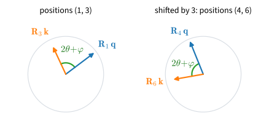

# Positional Information
:label:`sec_positional-information`

The sentences *"dog bites man"* and *"man bites dog"* contain the same three
words. Passed through the unmasked self-attention layer of
:numref:`sec_multihead-attention`, they produce the exact same output vectors
in permuted order, because attention weights depend solely on token content.
To distinguish word order, positional information must be injected into the
representation or the scoring rule.

Positional schemes fall into three main families: adding a position vector
$\mathbf{p}_i$ to each token embedding, rotating queries and keys by
position-dependent angles (*rotary position embeddings*, RoPE), or
subtracting a distance penalty from the attention scores (*ALiBi*). While all
three distinguish positions within the training context length, they behave
very differently when asked to extrapolate to longer sequences. We first
formalize the permutation symmetry of self-attention, then construct and
compare five positional schemes on a two-layer attention-only byte language
model (`TinyCharLM`) trained at length $128$ and evaluated up to length $512$.

```{.python .input #positional-information}
%%tab pytorch
import math
import numpy as np
import torch
from torch import nn
from torch.nn import functional as F
from d2l import torch as d2l
```

```{.python .input #positional-information}
%%tab jax
import math
import numpy as np
import jax
from jax import numpy as jnp
from flax import nnx
import optax
from d2l import jax as d2l
```

## Permutation Equivariance
:label:`subsec_pos-ignores-order`

Let $\mathbf{X} \in \mathbb{R}^{n \times d}$ hold $n$ token vectors and let
$f(\mathbf{X}) = \mathrm{softmax}(\mathbf{S})\,\mathbf{X}\mathbf{W}_v$ with
$\mathbf{S} = \mathbf{X}\mathbf{W}_q(\mathbf{X}\mathbf{W}_k)^\top/\sqrt{d_h}$
denote unmasked self-attention :eqref:`eq_self-attention` with dropout
disabled. Reordering the $n$ tokens corresponds to multiplying $\mathbf{X}$
from the left by an $n \times n$ permutation matrix $\boldsymbol{\Pi}$.

**Proposition (Permutation Equivariance).** For every permutation matrix
$\boldsymbol{\Pi}$, $f(\boldsymbol{\Pi} \mathbf{X}) = \boldsymbol{\Pi}
f(\mathbf{X})$.

**Proof.** Because linear projections act row-wise,
$(\boldsymbol{\Pi}\mathbf{X})\mathbf{W} = \boldsymbol{\Pi}(\mathbf{X}\mathbf{W})$
for $\mathbf{W}_q, \mathbf{W}_k, \mathbf{W}_v$. The score matrix becomes
$\boldsymbol{\Pi} \mathbf{S} \boldsymbol{\Pi}^\top$. Because row-wise softmax
commutes with row and column permutations,
$\mathrm{softmax}(\boldsymbol{\Pi} \mathbf{S} \boldsymbol{\Pi}^\top) =
\boldsymbol{\Pi}\, \mathrm{softmax}(\mathbf{S})\, \boldsymbol{\Pi}^\top$.
Multiplying by the permuted values $\boldsymbol{\Pi}\mathbf{X}\mathbf{W}_v$
and using $\boldsymbol{\Pi}^\top \boldsymbol{\Pi} = \mathbf{I}$ yields
$\boldsymbol{\Pi} f(\mathbf{X})$. Concatenating heads and applying
$\mathbf{W}_o$ row-wise preserves equivariance. $\blacksquare$

We verify permutation equivariance numerically on a four-head
`MultiHeadAttention` layer:

```{.python .input #positional-information-attention-ignores-order}
%%tab pytorch
attention = d2l.MultiHeadAttention(num_hiddens=64, num_heads=4)
X = torch.randn(1, 8, 64)
perm = torch.randperm(8)
Y = attention(X, X, X)
Y_perm = attention(X[:, perm], X[:, perm], X[:, perm])
print(f'max |Y[perm] - Y_perm|: {(Y[:, perm] - Y_perm).abs().max():.2e}')
```

```{.python .input #positional-information-attention-ignores-order}
%%tab jax
attention = d2l.MultiHeadAttention(num_hiddens=64, num_heads=4,
                                   rngs=nnx.Rngs(d2l.get_key()))
key_X, key_perm = jax.random.split(d2l.get_key())
X = jax.random.normal(key_X, (1, 8, 64))
perm = jax.random.permutation(key_perm, 8)
Y = attention(X, X, X)
Y_perm = attention(X[:, perm], X[:, perm], X[:, perm])
print(f'max |Y[perm] - Y_perm|: {jnp.abs(Y[:, perm] - Y_perm).max():.2e}')
```

Stacking equivariant layers or token-wise MLPs preserves equivariance. Note,
however, that a *causal mask* breaks permutation symmetry because position
$i$ attends over $i+1$ predecessors—an asymmetry exploited by *NoPE* below.

## Absolute Position Embeddings

The original Transformer :cite:`Vaswani.Shazeer.Parmar.ea.2017` breaks
permutation symmetry at the input by adding a position vector $\mathbf{p}_i
\in \mathbb{R}^d$ (row $i$ of $\mathbf{P}$) to each token embedding
$\mathbf{x}_i$: shuffling tokens maps $\mathbf{X} + \mathbf{P}$ to
$\boldsymbol{\Pi}\mathbf{X} + \mathbf{P} \neq
\boldsymbol{\Pi}(\mathbf{X} + \mathbf{P})$.

### Learned Positions

Models such as BERT :cite:`Devlin.Chang.Lee.ea.2018` and GPT-2
:cite:`Radford.Wu.Child.ea.2019` treat $\mathbf{P} \in \mathbb{R}^{L_{\max}
\times d}$ as a trainable embedding table with one parameter row per position
up to a fixed maximum length $L_{\max}$. Because rows beyond the training
context length never receive gradients, a learned table cannot extrapolate to
unseen positions (Exercise :exref:`ex_positional-information-untrained-rows`).

### Sinusoidal Encodings
:label:`subsec_pos-sinusoidal`

To define position vectors for arbitrary lengths without learned parameters,
:citet:`Vaswani.Shazeer.Parmar.ea.2017` populate row $i$ of $\mathbf{P}$ with
sines and cosines at $d/2$ geometrically spaced frequencies $\omega_m =
10000^{-2m/d}$:

$$
p_{i, 2m} = \sin\left(\frac{i}{10000^{2m/d}}\right), \qquad p_{i, 2m+1} = \cos\left(\frac{i}{10000^{2m/d}}\right).
$$
:eqlabel:`eq_sinusoidal-def`

As $\omega_m$ decreases from $1$ radian per token ($m = 0$) toward $10^{-4}$
($m = d/2 - 1$), the column pairs act as a continuous analog of a binary
counter: low-index columns oscillate rapidly to separate neighboring
positions, while high-index columns vary slowly across broad regions.

```{.python .input #positional-information-sinusoidal-encodings-1}
%%tab pytorch
def sinusoidal_encoding(max_len, num_hiddens):  #@save
    """The (max_len, num_hiddens) table of sinusoidal position codes."""
    theta = torch.arange(max_len)[:, None] / 10000 ** (
        torch.arange(0, num_hiddens, 2) / num_hiddens)
    return torch.stack([torch.sin(theta), torch.cos(theta)],
                       -1).reshape(max_len, num_hiddens)

P = sinusoidal_encoding(60, 32)
d2l.plot(torch.arange(60), P[:, 6:10].T, xlabel='position',
         figsize=(6, 2.5), legend=[f'column {d}' for d in range(6, 10)])
```

```{.python .input #positional-information-sinusoidal-encodings-1}
%%tab jax
def sinusoidal_encoding(max_len, num_hiddens):  #@save
    """The (max_len, num_hiddens) table of sinusoidal position codes."""
    theta = jnp.arange(max_len)[:, None] / 10000 ** (
        jnp.arange(0, num_hiddens, 2) / num_hiddens)
    return jnp.stack([jnp.sin(theta), jnp.cos(theta)],
                     -1).reshape(max_len, num_hiddens)

P = sinusoidal_encoding(60, 32)
d2l.plot(jnp.arange(60), P[:, 6:10].T, xlabel='position',
         figsize=(6, 2.5), legend=[f'column {d}' for d in range(6, 10)])
```

```{.python .input #positional-information-sinusoidal-encodings-3}
%%tab pytorch, jax
d2l.show_heatmaps(P[None, None], xlabel='column (encoding dimension)',
                  ylabel='row (position)', figsize=(3.5, 4), cmap='Blues')
```

### Sinusoidal Encodings as Rotations

By the trigonometric angle-addition identities, shifting position $i$ by an
offset $\delta$ applies a $2 \times 2$ rotation depending only on $\delta$ to
each frequency pair $(2m, 2m+1)$:

$$
\begin{bmatrix} \cos(\delta \omega_m) & \sin(\delta \omega_m) \\ -\sin(\delta \omega_m) & \cos(\delta \omega_m) \end{bmatrix}
\begin{bmatrix} p_{i, 2m} \\ p_{i, 2m+1} \end{bmatrix}
= \begin{bmatrix} \sin\left((i+\delta) \omega_m\right) \\ \cos\left((i+\delta) \omega_m\right) \end{bmatrix}
= \begin{bmatrix} p_{i+\delta, 2m} \\ p_{i+\delta, 2m+1} \end{bmatrix}.
$$
:eqlabel:`eq_sinusoidal-rotation`

However, because $\mathbf{p}_i$ is *added* to $\mathbf{x}_i$, the bilinear
attention score with $\mathbf{A} = \mathbf{W}_q \mathbf{W}_k^\top /
\sqrt{d_h}$ expands into four terms:

$$
(\mathbf{x}_i + \mathbf{p}_i)^\top \mathbf{A}\, (\mathbf{x}_j + \mathbf{p}_j)
= \underbrace{\mathbf{x}_i^\top \mathbf{A}\, \mathbf{x}_j}_{\textrm{content--content}}
+ \underbrace{\mathbf{x}_i^\top \mathbf{A}\, \mathbf{p}_j}_{\textrm{content--position}}
+ \underbrace{\mathbf{p}_i^\top \mathbf{A}\, \mathbf{x}_j}_{\textrm{position--content}}
+ \underbrace{\mathbf{p}_i^\top \mathbf{A}\, \mathbf{p}_j}_{\textrm{position--position}}.
$$
:eqlabel:`eq_pos-four-terms`

The two cross terms couple content with *absolute* position (varying when $i$
and $j$ shift together), and even $\mathbf{p}_i^\top \mathbf{A}\,
\mathbf{p}_j$ depends purely on $j - i$ only if $\mathbf{A}$ is block-diagonal
with $2 \times 2$ scaled-rotation blocks (Exercise
:exref:`ex_positional-information-additive-codes`).

## Rotary Position Embeddings
:label:`subsec_pos-rope`

*Rotary position embeddings* (RoPE) :cite:`Su.Lu.Pan.ea.2021` apply position
transformations *multiplicatively* to queries and keys so that every score
depends only on the relative offset $j - i$:

$$
(\mathbf{R}_i \mathbf{q})^\top (\mathbf{R}_j \mathbf{k}) = \mathbf{q}^\top \mathbf{R}_i^\top \mathbf{R}_j \mathbf{k} = \mathbf{q}^\top \mathbf{R}_{j-i} \mathbf{k} \quad \textrm{for all } i, j.
$$
:eqlabel:`eq_rope-goal`

Requiring $\mathbf{R}_i^\top \mathbf{R}_j = \mathbf{R}_{j-i}$ with full-rank
$\mathbf{R}_0$ implies: (1) $\mathbf{R}_0 = \mathbf{I}$ (from $\mathbf{R}_0^\top
\mathbf{R}_0 = \mathbf{R}_0$); (2) $\mathbf{R}_i^\top \mathbf{R}_i =
\mathbf{I}$, so every $\mathbf{R}_i$ is orthogonal and norm-preserving; and
(3) $\mathbf{R}_{i+j} = \mathbf{R}_i \mathbf{R}_j$, so $\mathbf{R}_i =
\mathbf{R}_1^i$. In an appropriate orthonormal basis (absorbable into
$\mathbf{W}_q, \mathbf{W}_k$), any orthogonal matrix $\mathbf{R}_1$ decomposes
into $2 \times 2$ planar rotations. RoPE partitions the $d_h$ coordinates of
each query and key into $d_h/2$ pairs and rotates pair $m$ at position $i$ by
$i\omega_m$ with $\omega_m = 10000^{-2m/d_h}$ (:numref:`fig_rope-rotation`):

$$
\mathbf{R}_i = \begin{bmatrix} R(i\omega_0) & & \\ & \ddots & \\ & & R(i\omega_{d_h/2-1}) \end{bmatrix}, \qquad R(\alpha) = \begin{bmatrix} \cos\alpha & -\sin\alpha \\ \sin\alpha & \cos\alpha \end{bmatrix}.
$$
:eqlabel:`eq_rope-def`

Values are not rotated, ensuring that the layer's output remains invariant to
global position shifts. RoPE is the standard positional encoding in modern
open-weights language models.


:label:`fig_rope-rotation`

```{.python .input #positional-information-rotary-position-embeddings-1}
%%tab pytorch
def rope_tables(n, d, offset=0, base=10000.0, scale=None,  #@save
                device=None):
    """Cosines and sines, each (n, d/2), of the angles of the positions
    offset, ..., offset + n - 1."""
    pos = torch.arange(n, dtype=torch.float32, device=device) + offset
    omega = base ** (-torch.arange(0, d, 2, device=device) / d)
    if scale is not None:  # One angle factor per pair, shape (d/2,)
        omega = omega * scale
    theta = pos[:, None] * omega[None, :]
    return torch.cos(theta), torch.sin(theta)

def rope(x, offset=0, base=10000.0, scale=None, tables=None):  #@save
    """Rotate feature pairs of x (..., num_steps, d) by position angles;
    tables from rope_tables take the place of offset, base, and scale."""
    if tables is None:
        tables = rope_tables(*x.shape[-2:], offset, base, scale, x.device)
    # Angles in fp32, tables in the dtype of x: bf16 queries stay bf16
    cos, sin = (u.to(x.dtype) for u in tables)
    x1, x2 = x[..., 0::2], x[..., 1::2]
    return torch.stack([x1 * cos - x2 * sin,
                        x1 * sin + x2 * cos], -1).flatten(-2)
```

```{.python .input #positional-information-rotary-position-embeddings-1}
%%tab jax
def rope_tables(n, d, offset=0, base=10000.0, scale=None):  #@save
    """Cosines and sines, each (n, d/2), of the angles of the positions
    offset, ..., offset + n - 1."""
    pos = jnp.arange(n, dtype=jnp.float32) + offset
    omega = base ** (-jnp.arange(0, d, 2) / d)
    if scale is not None:  # One angle factor per pair, shape (d/2,)
        omega = omega * scale
    theta = pos[:, None] * omega[None, :]
    return jnp.cos(theta), jnp.sin(theta)

def rope(x, offset=0, base=10000.0, scale=None, tables=None):  #@save
    """Rotate feature pairs of x (..., num_steps, d) by position angles;
    tables from rope_tables take the place of offset, base, and scale."""
    if tables is None:
        tables = rope_tables(*x.shape[-2:], offset, base, scale)
    # Angles in fp32, tables in the dtype of x: bf16 queries stay bf16
    cos, sin = (u.astype(x.dtype) for u in tables)
    x1, x2 = x[..., 0::2], x[..., 1::2]
    return jnp.stack([x1 * cos - x2 * sin,
                      x1 * sin + x2 * cos], -1).reshape(x.shape)
```

Shifting all positions by an arbitrary offset leaves RoPE scores identical up
to float32 rounding, whereas additive sinusoidal scores change by $O(1)$ due
to the content--position cross terms of :eqref:`eq_pos-four-terms`:

```{.python .input #positional-information-rotary-position-embeddings-2}
%%tab pytorch
T, d = 32, 64
q, k = torch.randn(T, d), torch.randn(T, d)

scores = lambda off: rope(q, off) @ rope(k, off).T / math.sqrt(d)
for off in (1, 17, 480):
    print(f'RoPE, all positions shifted by {off:>3}: max score change '
          f'{(scores(off) - scores(0)).abs().max():.1e}')

P = sinusoidal_encoding(600, d)
added = lambda off: (q + P[off:off+T]) @ (k + P[off:off+T]).T / math.sqrt(d)
print(f'additive sinusoidal, shifted by  17: max score change '
      f'{(added(17) - added(0)).abs().max():.1e}')
```

```{.python .input #positional-information-rotary-position-embeddings-2}
%%tab jax
T, d = 32, 64
key_q, key_k = jax.random.split(d2l.get_key())
q, k = jax.random.normal(key_q, (T, d)), jax.random.normal(key_k, (T, d))
# Full float32 matmuls: GPU default (TF32) round-off would hide the check
dot = lambda a, b: jnp.matmul(a, b.T, precision='highest') / math.sqrt(d)

scores = lambda off: dot(rope(q, off), rope(k, off))
for off in (1, 17, 480):
    print(f'RoPE, all positions shifted by {off:>3}: max score change '
          f'{jnp.abs(scores(off) - scores(0)).max():.1e}')

P = sinusoidal_encoding(600, d)
added = lambda off: dot(q + P[off:off+T], k + P[off:off+T])
print(f'additive sinusoidal, shifted by  17: max score change '
      f'{jnp.abs(added(17) - added(0)).max():.1e}')
```

## Distance Penalties and No Encoding

Two additional schemes leave token, query, and key vectors untouched:

* **ALiBi** (*Attention with Linear Biases*, :cite:`Press.Smith.Lewis.2022`)
  subtracts a linear distance penalty directly from the causal attention
  scores in head $h \in \{1, \ldots, H\}$:

  $$
  \mathrm{score}_{ij} = \frac{\mathbf{q}_i^\top \mathbf{k}_j}{\sqrt{d_h}} - m_h\,(i - j), \qquad m_h = 2^{-8h/H}.
  $$
  :eqlabel:`eq_alibi-def`

  The geometric slopes $m_h$ (e.g., $1/4, 1/16, 1/64, 1/256$ for $H = 4$)
  equip different heads with different recency horizons and require no fixed
  table size.
* **NoPE** (*No Positional Encoding*,
  :cite:`Kazemnejad.Padhi.Ramamurthy.ea.2023`) adds no positional signal at
  all, relying solely on the causal mask (which exposes $i + 1$ keys at
  position $i$) to break permutation symmetry.

## Extrapolation Beyond the Training Length

To compare how these five schemes perform in-distribution and when
extrapolating to longer contexts, we train at length $L = 128$ bytes and
evaluate perplexity at lengths $128$, $256$, and $512$.

### The Language Model TinyCharLM
:label:`subsec_tinycharlm`

`TinyCharLM` embeds 256 byte values into width $d = 128$, applies two causal
self-attention blocks ($H = 4$ heads of width $d_h = 32$, with no MLP or
normalization layers so position enters exclusively through `pos`), and
projects back to byte logits via tied embedding weights
:cite:`Press.Wolf.2017`.

```{.python .input #positional-information-an-attention-only-language-model}
%%tab pytorch
class TinyCharLM(nn.Module):  #@save
    """Attention-only language model."""
    def __init__(self, vocab_size, num_hiddens=128, num_heads=4, num_blks=2,
                 pos='rope', max_len=512, bias=False):
        super().__init__()
        assert pos in ('learned', 'sinusoidal', 'rope', 'alibi', 'none')
        self.num_heads, self.pos = num_heads, pos
        self.token_emb = nn.Embedding(vocab_size, num_hiddens)
        nn.init.normal_(self.token_emb.weight, std=0.02)
        if pos == 'learned':
            self.pos_emb = nn.Embedding(max_len, num_hiddens)
            nn.init.normal_(self.pos_emb.weight, std=0.02)
        if pos == 'sinusoidal':
            self.register_buffer('P', sinusoidal_encoding(max_len,
                                                          num_hiddens))
        if pos == 'rope':  # Base and per-pair angle factors of the rotation
            self.rope_base = 10000.0
            self.register_buffer('rope_scale',
                                 torch.ones(num_hiddens // num_heads // 2))
        self.blks = nn.ModuleList([nn.ModuleDict(dict(
            qkv=nn.Linear(num_hiddens, 3 * num_hiddens, bias=bias),
            proj=nn.Linear(num_hiddens, num_hiddens, bias=bias)))
            for _ in range(num_blks)])

    def stream(self, X, num_blks=None):
        """Residual stream after the first num_blks blocks (default: all),
        and the attention weights of those blocks."""
        H, maps = self.embed(X), []
        for blk in self.blks[:num_blks]:
            out, weights = self.attend(blk, H)
            H, maps = H + out, maps + [weights]
        return H, maps

    def forward(self, X):
        return F.linear(self.stream(X)[0], self.token_emb.weight)  # Tied

    def attention_weights(self, X):
        """Per-block attention maps, each (batch, num_heads, T, T)."""
        return self.stream(X)[1]
```

```{.python .input #positional-information-an-attention-only-language-model}
%%tab jax
class TinyCharLM(nnx.Module):  #@save
    """Attention-only language model."""
    def __init__(self, vocab_size, num_hiddens=128, num_heads=4, num_blks=2,
                 pos='rope', max_len=512, bias=False, *, rngs):
        assert pos in ('learned', 'sinusoidal', 'rope', 'alibi', 'none')
        self.num_heads, self.pos = num_heads, pos
        init = nnx.initializers.normal(0.02)
        self.token_emb = d2l.Embed(vocab_size, num_hiddens,
                                   embedding_init=init, rngs=rngs)
        if pos == 'learned':
            self.pos_emb = nnx.Embed(max_len, num_hiddens,
                                     embedding_init=init, rngs=rngs)
        if pos == 'sinusoidal':
            self.P = nnx.Cache(sinusoidal_encoding(max_len, num_hiddens))
        if pos == 'rope':  # Base and per-pair angle factors of the rotation
            self.rope_base = 10000.0
            self.rope_scale = nnx.Cache(
                jnp.ones(num_hiddens // num_heads // 2))
        self.blks = nnx.List([nnx.Dict(
            qkv=d2l.Linear(num_hiddens, 3 * num_hiddens, use_bias=bias,
                           rngs=rngs),
            proj=d2l.Linear(num_hiddens, num_hiddens, use_bias=bias,
                            rngs=rngs))
            for _ in range(num_blks)])

    def stream(self, X, num_blks=None):
        """Residual stream after the first num_blks blocks (default: all),
        and the attention weights of those blocks."""
        H, maps = self.embed(X), []
        for blk in self.blks[:num_blks]:
            out, weights = self.attend(blk, H)
            H, maps = H + out, maps + [weights]
        return H, maps

    def __call__(self, X):
        return self.token_emb.attend(self.stream(X)[0])  # Tied output head

    def attention_weights(self, X):
        """Per-block attention maps, each (batch, num_heads, T, T)."""
        return self.stream(X)[1]
```

In `embed`, the sinusoidal table is scaled by $1/\sqrt{d}$ so its entries
match the scale of the $\mathcal{N}(0, 0.02^2)$ token embeddings without
altering the tied output logits:

```{.python .input #positional-information-an-attention-only-language-model-1}
%%tab pytorch
@d2l.add_to_class(TinyCharLM)  #@save
def embed(self, X):
    """Token embeddings plus the absolute position code, if any."""
    H = self.token_emb(X)
    if self.pos == 'learned':
        H = H + self.pos_emb(torch.arange(X.shape[1], device=X.device))
    if self.pos == 'sinusoidal':  # Table scaled to the token embeddings
        H = H + self.P[:X.shape[1]] / math.sqrt(H.shape[-1])
    return H
```

```{.python .input #positional-information-an-attention-only-language-model-1}
%%tab jax
@d2l.add_to_class(TinyCharLM)  #@save
def embed(self, X):
    """Token embeddings plus the absolute position code, if any."""
    H = self.token_emb(X)
    if self.pos == 'learned':
        H = H + self.pos_emb(jnp.arange(X.shape[1]))
    if self.pos == 'sinusoidal':  # Table scaled to the token embeddings
        H = H + self.P[:X.shape[1]] / math.sqrt(H.shape[-1])
    return H
```

In `attend`, RoPE rotates queries and keys, whereas ALiBi adds the distance
bias $-m_h(i - j)$ to the pre-softmax scores:

```{.python .input #positional-information-an-attention-only-language-model-2}
%%tab pytorch
@d2l.add_to_class(TinyCharLM)  #@save
def alibi(self, T, device):
    """ALiBi bias -m_h (i - j) of every head, (num_heads, T, T)."""
    h = torch.arange(1, self.num_heads + 1, device=device)
    slopes = 2.0 ** (-8.0 * h / self.num_heads)
    pos = torch.arange(T, device=device, dtype=torch.float32)
    return slopes[:, None, None] * (pos[None, :] - pos[:, None])

@d2l.add_to_class(TinyCharLM)  #@save
def attend(self, blk, H):
    """Output of attention block blk on the stream H, and its weights."""
    B, T, D = H.shape
    q, k, v = blk['qkv'](H).chunk(3, -1)
    q, k, v = (u.reshape(B, T, self.num_heads, -1).transpose(1, 2)
               for u in (q, k, v))
    if self.pos == 'rope':
        q = rope(q, base=self.rope_base, scale=self.rope_scale)
        k = rope(k, base=self.rope_base, scale=self.rope_scale)
    scores = q @ k.transpose(-2, -1) / math.sqrt(q.shape[-1])
    if self.pos == 'alibi':
        scores = scores + self.alibi(T, H.device)
    weights = d2l.masked_softmax(scores, d2l.causal_mask(T, device=H.device))
    out = (weights @ v).transpose(1, 2).reshape(B, T, D)
    return blk['proj'](out), weights
```

```{.python .input #positional-information-an-attention-only-language-model-2}
%%tab jax
@d2l.add_to_class(TinyCharLM)  #@save
def alibi(self, T):
    """ALiBi bias -m_h (i - j) of every head, (num_heads, T, T)."""
    h = jnp.arange(1, self.num_heads + 1)
    slopes = 2.0 ** (-8.0 * h / self.num_heads)
    pos = jnp.arange(T, dtype=jnp.float32)
    return slopes[:, None, None] * (pos[None, :] - pos[:, None])

@d2l.add_to_class(TinyCharLM)  #@save
def attend(self, blk, H):
    """Output of attention block blk on the stream H, and its weights."""
    B, T, D = H.shape
    q, k, v = jnp.split(blk['qkv'](H), 3, axis=-1)
    q, k, v = (u.reshape(B, T, self.num_heads, -1).swapaxes(1, 2)
               for u in (q, k, v))
    if self.pos == 'rope':
        q = rope(q, base=self.rope_base, scale=self.rope_scale[...])
        k = rope(k, base=self.rope_base, scale=self.rope_scale[...])
    scores = q @ k.swapaxes(-2, -1) / math.sqrt(q.shape[-1])
    if self.pos == 'alibi':
        scores = scores + self.alibi(T)
    weights = d2l.masked_softmax(scores, d2l.causal_mask(T))
    out = (weights @ v).swapaxes(1, 2).reshape(B, T, D)
    return blk['proj'](out), weights
```

### The Experiment
:label:`subsec_pos-experiment`

We train three seeds of each scheme for $3{,}000$ AdamW steps on 128-byte
windows of `d2l.WikiText103` (:numref:`subsec_tinylm`).

```{.python .input #positional-information-the-experiment-1}
%%tab pytorch
data = d2l.WikiText103(batch_size=64, num_steps=128)
schemes = ('learned', 'sinusoidal', 'rope', 'alibi', 'none')

def train_tiny(**kwargs):
    """A TinyCharLM after 3000 steps, and its final training loss."""
    model = TinyCharLM(len(data.vocab), **kwargs)
    optimizer = torch.optim.AdamW(model.parameters(), lr=1e-3,
                                  weight_decay=0.0)
    return model, d2l.final_loss(d2l.train_steps(model, data, optimizer,
                                                 3000))

runs = {}  # Three independently initialized models per scheme
for pos in schemes:
    trained = [train_tiny(pos=pos) for _ in range(3)]
    runs[pos] = [model for model, _ in trained]
    print(f'{pos:>10}: final training loss '
          + ', '.join(f'{loss:.2f}' for _, loss in trained))
models = {pos: ms[0] for pos, ms in runs.items()}  # The first run of each
```

```{.python .input #positional-information-the-experiment-1}
%%tab jax
data = d2l.WikiText103(batch_size=64, num_steps=128)
schemes = ('learned', 'sinusoidal', 'rope', 'alibi', 'none')

def train_tiny(**kwargs):
    """A TinyCharLM after 3000 steps, and its final training loss."""
    model = TinyCharLM(len(data.vocab), **kwargs,
                       rngs=nnx.Rngs(d2l.get_key()))
    optimizer = nnx.Optimizer(model, optax.adamw(1e-3, weight_decay=0.0),
                              wrt=nnx.Param)
    return model, d2l.final_loss(d2l.train_steps(model, data, optimizer,
                                                 3000))

runs = {}  # Three independently initialized models per scheme
for pos in schemes:
    trained = [train_tiny(pos=pos) for _ in range(3)]
    runs[pos] = [model for model, _ in trained]
    print(f'{pos:>10}: final training loss '
          + ', '.join(f'{loss:.2f}' for _, loss in trained))
models = {pos: ms[0] for pos, ms in runs.items()}  # The first run of each
```

We evaluate validation perplexity on identical validation bytes regrouped
into windows of $n \in \{128, 256, 512\}$, alongside a closed-form byte-bigram
baseline.

```{.python .input #positional-information-the-experiment-3}
%%tab pytorch, jax
train_len, batch = data.num_steps, 16
contexts = (train_len, 2 * train_len, 4 * train_len)
block = batch * max(contexts)  # Whole minibatches at every context
num_bytes = (len(data.val) - 1) // block * block
X, Y = data.windows(data.val, range(0, num_bytes, train_len))
eval_sets = {}
for n in contexts:  # The same bytes, regrouped into windows of n
    Xn, Yn = X.reshape(-1, n), Y.reshape(-1, n)
    eval_sets[n] = [(Xn[i:i + batch], Yn[i:i + batch])
                    for i in range(0, len(Xn), batch)]

def perplexities(model):
    return [d2l.lm_perplexity(model, eval_sets[n]) for n in contexts]

def mean_range(values):
    """Mean and (min-max) of the runs, one column of the table."""
    return f'{np.mean(values):5.1f} ({min(values):.1f}-{max(values):.1f})'

ppls = {pos: [perplexities(model) for model in ms] for pos, ms in runs.items()}
print(f'{num_bytes:,} validation bytes, mean (min-max) of three runs')
print(f'{"context":>10}: ' + ''.join(f'{n:>18}' for n in contexts))
for pos in schemes:  # zip(*...) turns runs x contexts into contexts x runs
    print(f'{pos:>10}: '
          + ''.join(f'{mean_range(col):>18}' for col in zip(*ppls[pos])))
```

```{.python .input #positional-information-byte-bigram-baseline}
%%tab pytorch, jax
V = len(data.vocab)
counts = np.ones((V, V))  # Byte pair counts, plus one for unseen pairs
for s in range(0, len(data.train) - 1, 10**7):  # Chunks of 10^7 bytes
    a = data.train[s:s + 10**7 + 1].astype(np.int64)
    counts += np.bincount(a[:-1] * V + a[1:], minlength=V * V).reshape(V, V)
bigram = counts / counts.sum(1, keepdims=True)  # P(next byte | this byte)
x, y = np.asarray(X).reshape(-1), np.asarray(Y).reshape(-1)
print(f'byte bigram: perplexity {np.exp(-np.log(bigram[x, y]).mean()):.1f}')
```

At the training length ($n = 128$), RoPE achieves the lowest perplexity
($7.3$), ahead of learned ($9.3$), sinusoidal ($9.6$), and ALiBi ($9.7$), all
of which improve on the byte-bigram baseline ($11.6$); NoPE remains at the
bigram level in this small two-block model.

At $n = 512$, the three schemes whose representations encounter out-of-range
values degrade sharply: learned embeddings hit untrained rows ($128$--$511$),
sinusoidal slow columns take unseen values, and RoPE's low-frequency pairs
rotate to angles never seen during training. ALiBi's perplexity remains flat
at $9.7$. To see why, we measure the fraction of attention weight that ALiBi's
four heads place on keys at distance $\ge 128$, and compare against
masking out all keys at distance $\ge 128$:

```{.python .input #positional-information-alibi-weight-beyond-the-window}
%%tab pytorch
alibi_model, T = models['alibi'], max(contexts)
device = next(alibi_model.parameters()).device
X_eval = eval_sets[T][0][0].to(device)  # 16 windows of 512 bytes
i = torch.arange(T, device=device)
far = i[:, None] - i[None, :] >= train_len  # Offsets never trained on

def far_weight(weights):
    """Per head: mean weight on far keys, over queries from train_len on."""
    return (weights * far).sum(-1)[..., train_len:].mean((0, -1)).tolist()

with torch.inference_mode():
    maps = alibi_model.attention_weights(X_eval)
    bias_only = d2l.masked_softmax(alibi_model.alibi(T, device)[None],
                                   d2l.causal_mask(T, device=device))
print(f'{"head":>10}: ' + ''.join(f'{h:>9}' for h in range(1, 5)))
for name, weights in [('bias alone', bias_only)] + [
        (f'block {b}', w) for b, w in enumerate(maps, 1)]:
    print(f'{name:>10}: ' + ''.join(f'{w:9.3f}' for w in far_weight(weights)))
```

```{.python .input #positional-information-alibi-weight-beyond-the-window}
%%tab jax
alibi_model, T = models['alibi'], max(contexts)
X_eval = eval_sets[T][0][0]  # 16 windows of 512 bytes
i = jnp.arange(T)
far = i[:, None] - i[None, :] >= train_len  # Offsets never trained on

def far_weight(weights):
    """Per head: mean weight on far keys, over queries from train_len on."""
    return (weights * far).sum(-1)[..., train_len:].mean((0, -1)).tolist()

maps = alibi_model.attention_weights(X_eval)
bias_only = d2l.masked_softmax(alibi_model.alibi(T)[None], d2l.causal_mask(T))
print(f'{"head":>10}: ' + ''.join(f'{h:>9}' for h in range(1, 5)))
for name, weights in [('bias alone', bias_only)] + [
        (f'block {b}', w) for b, w in enumerate(maps, 1)]:
    print(f'{name:>10}: ' + ''.join(f'{w:9.3f}' for w in far_weight(weights)))
```

```{.python .input #positional-information-alibi-without-far-keys}
%%tab pytorch
class WindowedALiBi(TinyCharLM):
    """ALiBi whose queries see only the window most recent keys."""
    def __init__(self, *args, window, **kwargs):
        super().__init__(*args, **kwargs)
        self.window = window

    def alibi(self, T, device):
        i = torch.arange(T, device=device)
        return super().alibi(T, device).masked_fill(
            i[:, None] - i[None, :] >= self.window, -math.inf)

full, windowed = [], []
for model in runs['alibi']:
    model_w = WindowedALiBi(len(data.vocab), pos='alibi',
                            window=train_len).to(device)
    model_w.load_state_dict(model.state_dict())  # Same trained weights
    full.append(d2l.lm_perplexity(model, eval_sets[T]))
    windowed.append(d2l.lm_perplexity(model_w, eval_sets[T]))
for name, ppl in ('all keys', full), (f'keys < {train_len} back', windowed):
    print(f'{name:>16}: perplexity at {T} {mean_range(ppl)}')
```

```{.python .input #positional-information-alibi-without-far-keys}
%%tab jax
class WindowedALiBi(TinyCharLM):
    """ALiBi whose queries see only the window most recent keys."""
    def __init__(self, *args, window, **kwargs):
        super().__init__(*args, **kwargs)
        self.window = window

    def alibi(self, T):
        i = jnp.arange(T)
        return jnp.where(i[:, None] - i[None, :] >= self.window, -jnp.inf,
                         super().alibi(T))

full, windowed = [], []
for model in runs['alibi']:
    model_w = WindowedALiBi(len(data.vocab), pos='alibi', window=train_len,
                            rngs=nnx.Rngs(d2l.get_key()))
    nnx.update(model_w, nnx.state(model))  # Same trained weights
    full.append(d2l.lm_perplexity(model, eval_sets[T]))
    windowed.append(d2l.lm_perplexity(model_w, eval_sets[T]))
for name, ppl in ('all keys', full), (f'keys < {train_len} back', windowed):
    print(f'{name:>16}: perplexity at {T} {mean_range(ppl)}')
```

Removing all keys at distance $\ge 128$ leaves ALiBi's perplexity unchanged:
its steep heads already ignore distant keys, and its gentle heads compute a
broad recency-weighted average that gains nothing from bytes beyond 128. Thus
a flat extrapolation curve indicates that a scheme avoids breaking on distant
keys, not necessarily that it extracts long-range information from them.

### Extending a Trained Model's Context
:label:`subsec_pos-context-extension`

Why does RoPE break beyond the training length $L = 128$, and how can we
repair it? For head width $d_h = 32$, the $16$ coordinate pairs have periods
$2\pi / \omega_m = 2\pi \cdot 10000^{m/16}$. The first $6$ *fast* pairs have
periods $\le 112 < 128$ and already complete full rotations within the
training window; the remaining $10$ *slow* pairs have periods from $199$ to
$35{,}000$ and rotate into unseen angular regions at $n = 512$.

*Position interpolation* :cite:`Chen.Wong.Chen.ea.2023` scales all angles by
$128 / 512 = 1/4$ to map the new context range back into the trained interval
$[0, 128)$. However, scaling the fast pairs without fine-tuning destroys the
local phase differences used to distinguish neighboring bytes. Leaving the
fast pairs untouched and scaling *only* the slow pairs—the core idea behind
*YaRN* :cite:`Peng.Quesnelle.Fan.ea.2024` and *NTK-aware scaling* (which
increases the base $b \mapsto b\, s^{d_h/(d_h - 2)}$)—recovers most of the
extrapolation perplexity at zero training cost:

```{.python .input #positional-information-extending-a-trained-model-s-context}
%%tab pytorch
rope_model = models['rope']
d_head = 2 * rope_model.rope_scale.numel()
periods = (2 * math.pi
           * rope_model.rope_base ** (torch.arange(0, d_head, 2) / d_head))
slow = periods > train_len
print(f'{int(slow.sum())} of {d_head // 2} pairs have periods above '
      f'{train_len}')
ones = torch.ones(d_head // 2)
shrink = train_len / max(contexts)  # Longest context into the trained one
factors = {'unscaled': ones, 'all pairs': ones * shrink,
           'slow pairs': torch.where(slow, ones * shrink, ones)}
print(f'{"context":>10}: ' + ''.join(f'{n:>18}' for n in contexts))
for name, factor in factors.items():  # Each of the three trained RoPE runs
    ppl = []
    for rope_model in runs['rope']:
        rope_model.rope_scale.copy_(factor)
        ppl.append(perplexities(rope_model))
        rope_model.rope_scale.copy_(ones)
    print(f'{name:>10}: ' + ''.join(f'{mean_range(col):>18}'
                                    for col in zip(*ppl)))
```

```{.python .input #positional-information-extending-a-trained-model-s-context}
%%tab jax
rope_model = models['rope']
d_head = 2 * rope_model.rope_scale.shape[0]
periods = (2 * math.pi
           * rope_model.rope_base ** (jnp.arange(0, d_head, 2) / d_head))
slow = periods > train_len
print(f'{int(slow.sum())} of {d_head // 2} pairs have periods above '
      f'{train_len}')
ones = jnp.ones(d_head // 2)
shrink = train_len / max(contexts)  # Longest context into the trained one
factors = {'unscaled': ones, 'all pairs': ones * shrink,
           'slow pairs': jnp.where(slow, ones * shrink, ones)}
print(f'{"context":>10}: ' + ''.join(f'{n:>18}' for n in contexts))
for name, factor in factors.items():  # Each of the three trained RoPE runs
    ppl = []
    for rope_model in runs['rope']:
        rope_model.rope_scale[...] = factor
        ppl.append(perplexities(rope_model))
        rope_model.rope_scale[...] = ones
    print(f'{name:>10}: ' + ''.join(f'{mean_range(col):>18}'
                                    for col in zip(*ppl)))
```

Rescaling only the slow pairs cuts length-512 perplexity from $27.7$ down to
$9.0$ without updating a single weight, and a brief fine-tune at the target
length eliminates the remaining gap (Exercise
:exref:`ex_positional-information-position-interpolation`).

## Summary

* Unmasked self-attention is permutation equivariant: $f(\boldsymbol{\Pi}
  \mathbf{X}) = \boldsymbol{\Pi} f(\mathbf{X})$.
* Additive position embeddings (learned or sinusoidal) break symmetry at the
  input, but introduce content--position cross terms tied to absolute
  positions and fail beyond the training length.
* Requiring attention scores to depend solely on relative offset $j - i$
  forces orthogonal planar rotations on queries and keys (*RoPE*), while
  *ALiBi* subtracts a per-head linear distance penalty $-m_h(i - j)$.
* Beyond the training window, RoPE fails only in low-frequency pairs whose
  wavelengths exceed the training length; interpolating those slow pairs
  while preserving high-frequency pairs restores long-context performance.

## Exercises

1. **Distinct positions, distinct codes.** Let $\mathbf{p}_i$ be row $i$ of
   the sinusoidal table :eqref:`eq_sinusoidal-def` of width $d$, with the
   frequencies $\omega_m = 1/10000^{2m/d}$.
    1. Show that
       $$\mathbf{p}_i^\top \mathbf{p}_{i+\delta} = \sum_{m=0}^{d/2-1} \cos(\delta\,\omega_m),$$
       derive $\|\mathbf{p}_i - \mathbf{p}_{i+\delta}\|^2$ from it, and
       conclude that both quantities depend on the offset $\delta$ alone.
    1. Conclude that $\mathbf{p}_i = \mathbf{p}_{i'}$ only if
       $(i - i')\,\omega_m$ is a multiple of $2\pi$ for every $m$, and that
       no two distinct integer positions share a row, whatever the value of
       `max_len`.
    1. The fastest pair has period $2\pi$, so it nearly repeats at integer
       offsets close to multiples of $2\pi$. Find the offset $\delta < 512$
       at which its angle comes closest to a multiple of $2\pi$, and give
       the residual angle. For $d = 32$, compare
       $\|\mathbf{p}_i - \mathbf{p}_{i+\delta}\|$ at this offset with its
       value at $\delta = 1$, say which pairs keep the two positions of the
       near repeat apart, and relate the answer to the binary counting
       of :numref:`subsec_pos-sinusoidal`.
   :exlabel:`ex_positional-information-distinct-positions-distinct-codes`

1. [code] **Untrained rows.** The table `pos_emb` of `models['learned']`
   has `max_len = 512` rows, of which training at context 128 used only the
   first 128.
    1. Construct a new `TinyCharLM` with `pos='learned'`, copy its table
       `pos_emb` before training, and train it as in the experiment
       of :numref:`subsec_pos-experiment`. Explain from Adam's two moment
       estimates why rows 128 to 511 of the trained table are bitwise equal
       to the copy, and check the claim. By
       what factor would decoupled weight decay with coefficient $0.1$ at
       the learning rate $10^{-3}$ have shrunk these rows over the 3000
       training steps?
    1. Compute the cosine similarities between all 512 rows of the trained
       table and display them with `d2l.show_heatmaps`. Describe the three
       blocks of the result: trained rows against trained rows, untrained
       against untrained, and trained against untrained.
   :exlabel:`ex_positional-information-untrained-rows`

1. **Additive codes in the score.** With the additive encoding of
   :numref:`subsec_pos-sinusoidal`, a first-layer head scores the inputs at
   positions $i$ and $j$ by the four terms of :eqref:`eq_pos-four-terms`,
   with $\mathbf{A} = \mathbf{W}_q \mathbf{W}_k^\top / \sqrt{d_h}$.
    1. Let $\mathbf{J}$ be the rotation of the plane by $\pi/2$. Using
       :eqref:`eq_sinusoidal-rotation`, show that the position--position
       term $\mathbf{p}_i^\top \mathbf{A}\, \mathbf{p}_j$ depends only on
       $j - i$ when $\mathbf{A}$ is block diagonal with $2 \times 2$ blocks
       $a_m \mathbf{I} + b_m \mathbf{J}$, one per frequency pair. Exercise :exref:`ex_positional-information-distinct-positions-distinct-codes`
       treats $\mathbf{A} = \mathbf{I}$. Then show that a single nonzero
       entry of $\mathbf{A}$ that couples two different frequency pairs
       destroys this property.
    1. Determine when the content--position term
       $\mathbf{x}_i^\top \mathbf{A}\, \mathbf{p}_j$ is unchanged for every
       shift of $j$. Use the answer to explain the score change of the
       additive encoding in the shift test of :numref:`subsec_pos-rope`,
       and why RoPE has no content--position term.
   :exlabel:`ex_positional-information-additive-codes`

1. [code] **Where extrapolation fails.** The perplexities of
   :numref:`subsec_pos-experiment` at context 512 average the loss over all
   positions of each sequence.
    1. Check numerically that in each of the five models the logits at
       positions 0 to 127 of a length-512 sequence agree, up to
       floating-point round-off, with those computed from its first 128
       tokens alone. Which two properties of `TinyCharLM` guarantee this
       for every scheme?
    1. Compute the validation loss at every position of the length-512
       sequences for the five models, average it over windows of 16
       positions, and plot it against position. For each scheme, where does
       the curve leave the level it holds below position 128, and does the
       loss jump at position 128 or grow gradually?
    1. Restrict every query of `models['rope']` to the 128 most recent
       keys, itself included, by adding a band constraint to the causal
       mask in a subclass that overrides `attend`, copy the trained
       weights into it, and repeat the measurement. Compare the windowed
       curve beyond position 128 with the unwindowed curve below it. Do
       offsets beyond 127 account for the degradation of RoPE at context
       512?
   :exlabel:`ex_positional-information-where-extrapolation-fails`

1. **Biases that keep the symmetry.** ● Suppose that a fixed matrix
   $\mathbf{B} \in \mathbb{R}^{n \times n}$ is added to the score matrix
   $\mathbf{S}$ of the proof before the softmax, so that the layer
   :eqref:`eq_self-attention` computes $\mathrm{softmax}(\mathbf{S} +
   \mathbf{B})\, \mathbf{X}\mathbf{W}_v$.
    1. Show that the proposition still holds for every permutation matrix
       $\boldsymbol{\Pi}$ with $\boldsymbol{\Pi}^\top \mathbf{B}
       \boldsymbol{\Pi} = \mathbf{B}$.
    1. Find all matrices $\mathbf{B}$ that satisfy this condition for every
       permutation, and describe how each of them changes the attention
       weights.
    1. Without the causal mask, the ALiBi bias of :eqref:`eq_alibi-def`
       extends symmetrically to $B_{ij} = -m_h\,|i - j|$. Determine the
       permutations that preserve this matrix, and state what the result
       implies for an unmasked layer that receives this bias and no other
       positional signal. Explain why the causal ALiBi of
       :eqref:`eq_alibi-def` does not share this symmetry.

1. **Offset preference in RoPE.** ● Split a query $\mathbf{q}$ and a key
   $\mathbf{k}$ into the $d_h/2$ two-dimensional pairs $\mathbf{q}^{(m)},
   \mathbf{k}^{(m)} \in \mathbb{R}^2$ on which :eqref:`eq_rope-def` acts,
   and let $\delta = j - i$ be the offset of the key position $j$ from the
   query position $i$.
    1. Show that the RoPE score :eqref:`eq_rope-goal` equals
       $$\sum_{m=0}^{d_h/2-1} \|\mathbf{q}^{(m)}\|\, \|\mathbf{k}^{(m)}\| \cos(\delta\,\omega_m - \psi_m),$$
       where $\psi_m$ is the angle from $\mathbf{k}^{(m)}$ to
       $\mathbf{q}^{(m)}$ (the $\varphi$ of :numref:`fig_rope-rotation`
       with the opposite sign).
    1. Choose the angles $\psi_m$ so that every pair contributes its
       maximum at the offset $\delta = -1$, the previous token. With all
       products $\|\mathbf{q}^{(m)}\|\, \|\mathbf{k}^{(m)}\|$ equal to $c$,
       show that the score, as a function of $\delta$, is $c$ times a
       shifted copy of the dot product $\mathbf{p}_i^\top
       \mathbf{p}_{i+\delta}$ of Exercise :exref:`ex_positional-information-distinct-positions-distinct-codes` for a sinusoidal table of width
       $d_h$.
    1. Take $d_h = 32$ and the query at position 127, which attends to the
       offsets $\delta = -127, \ldots, 0$. Let the attention logits equal
       these scores, with the factor $1/\sqrt{d_h}$ absorbed into $c$. Find
       the $c$ at which the offset $-1$ receives half of the softmax
       weight, and identify the offsets that compete most with it. Which
       pairs set the gap between the score at $-1$ and the scores at its
       neighbors?
   :exlabel:`ex_positional-information-offset-preference-rope`

1. [code] **The RoPE base.** ● In :eqref:`eq_rope-def` the frequencies are
   $\omega_m = 10000^{-2m/d_h}$, and the constant $10000$ is a choice.
    1. For the head width $d_h = 32$ of `TinyCharLM`, compute the periods
       $2\pi/\omega_m$ of the 16 pairs for the bases $100$, $10^4$, and
       $10^6$, and count the pairs that complete at least one full rotation
       within 128 positions. Which period does not depend on the base?
    1. Retrain the `'rope'` variant of `TinyCharLM` with bases $100$ and
       $10^6$ by setting its attribute `rope_base` after construction.
       Train three models with each of the two bases, and compare them with
       the three base-$10^4$ models of the experiment, so that differences
       between bases can be set against the variation across runs. Compare
       perplexity at 128, 256, and 512.
    1. Explain from the counts why the base is expected to matter more at
       length 512 than at 128, and check the expectation against your
       results.
   :exlabel:`ex_positional-information-rope-base`

1. [extended] **Position interpolation.** ● The last cell of
   :numref:`subsec_pos-context-extension` rescales the angles of the
   trained RoPE models without any training. This problem explains its
   result, adds the base change of NTK-aware scaling, and completes the
   recipe with a fine-tune.
    1. Show that a pair that completes a full rotation within the training
       offsets 0 to 127 has already met, to within $\omega_m/2$ modulo
       $2\pi$, every angle that a longer offset produces. Compute the gap
       of Exercise :exref:`ex_positional-information-offset-preference-rope`
       between the score at offset $-1$ and the scores at its neighbors for
       $d_h = 32$, before the rescaling, after the uniform rescaling by
       $128/512$, and after the rescaling of only the pairs whose period
       exceeds 128 positions. Relate the result to the perplexities at
       context 128 in the cell.
    1. Show that the base $b' = b\, s^{d_h/(d_h-2)}$ leaves $\omega_0$
       unchanged and divides $\omega_{d_h/2-1}$ by $s$. Set `rope_base` of
       `models['rope']` to this base for $s = 4$, evaluate at 128, 256,
       and 512 without training, and compare with the two rescalings of
       the cell.
    1. Fine-tune for a few hundred steps at context 512, on
       `d2l.WikiText103(batch_size=16, num_steps=512)`, with each of the two
       rescalings of the cell, each starting from a copy of the trained
       `models['rope']`. Re-evaluate at 128, 256, and 512, and compare with
       the unscaled model and with the ALiBi model of the experiment in
       :numref:`subsec_pos-experiment` at the same lengths.
   :exlabel:`ex_positional-information-position-interpolation`

[Discussions](https://d2l.discourse.group/t/36771)

<!-- slides -->

::: {.slide}
::: {.cover}
[Dive into Deep Learning · §10.4]{.kicker}

Positional Information<br>
**permutation equivariance · learned and sinusoidal tables · RoPE · train short, test long**
:::
:::

::: {.slide title="Attention Alone Cannot Tell “Dog Bites Man” from “Man Bites Dog”"}
[The problem]{.kicker}

- Self-attention maps a shuffled sentence to the **same outputs,
  shuffled**.
- A classifier that pools the outputs cannot tell who bit whom.
- GPT-2 small learns a table of **1,024** position vectors: token 1,025
  has no position at all.

::: {.d2l-note}
How do we give attention a sense of position, and what happens beyond the
length it was trained on?
:::
:::

::: {.slide title="By the End of This Deck You Can"}
[Goals]{.kicker}

- prove that unmasked attention is permutation equivariant;
- read a shift of the sinusoidal table as a rotation, and see why adding
  it leaves absolute position in the score;
- derive RoPE from "scores depend only on the offset";
- predict which schemes break at four times the training length, and
  test the prediction;
- repair a trained RoPE model at four times its context by rescaling
  angles.

**Running example:** `TinyCharLM`, an attention-only byte model (width 128,
two blocks of four heads of width 32), trained at context 128, tested at
512.
:::

::: {.slide title="Positional Information Lets Attention See Order"}
[Where this fits]{.kicker}

::: {.cols .vc}
::: {.col}
| section | adds |
|---|---|
| Queries, Keys, and Values | attention as a soft lookup |
| Attention Scoring and Masking | scaled dot products, masks |
| Self-Attention and Multiple Heads | a sequence reads itself; several heads |
| **Positional Information** | **where a token sits** |
| The Cost of Attention | quadratic cost, fused kernels |
| Windowed and Linear Attention | linear cost, and what it gives up |
| Attention Circuits | what trained heads compute |
:::

::: {.col .narrow}
- **Uses:** self-attention, causal masks, the byte data and training
  loop of `TinyLM`.
- **Skips:** learned relative-position vectors, long-context training.
:::
:::
:::

::: {.slide title="Unmasked Self-Attention Is Permutation Equivariant"}
[Permutation equivariance]{.kicker}

**Proposition.** $f(\boldsymbol{\Pi}\mathbf{X}) = \boldsymbol{\Pi}
f(\mathbf{X})$ for every permutation matrix $\boldsymbol{\Pi}$, where
$f(\mathbf{X}) = \mathrm{softmax}\big(\mathbf{X}\mathbf{W}_q
(\mathbf{X}\mathbf{W}_k)^\top/\sqrt{d_h}\big)\, \mathbf{X}\mathbf{W}_v$
and $d_h$ is the head width.

**Proof sketch.** Projections act row-wise; scores become
$\boldsymbol{\Pi}\mathbf{S}\boldsymbol{\Pi}^\top$; row-softmax commutes with
permutations; $\boldsymbol{\Pi}^\top\boldsymbol{\Pi} = \mathbf{I}$. $\blacksquare$

. . .

- Stacking equivariant layers stays equivariant: depth does not help.
:::

::: {.slide title="Shuffled Tokens Give Shuffled Outputs"}
[Permutation equivariance]{.kicker}

Eight random tokens through a four-head layer, then shuffled; the outputs
agree up to float32 round-off:

@!positional-information-attention-ignores-order

::: {.d2l-note}
A **causal mask** breaks the symmetry: position $i$ attends over $i+1$
tokens.
:::
:::

::: {.slide title="A Learned Table Knows Only the Positions It Was Trained On"}
[Absolute embeddings]{.kicker}

- Add a vector $\mathbf{p}_i$ to the token at position $i$: a shuffle
  gives $\boldsymbol{\Pi}\mathbf{X} + \mathbf{P} \neq
  \boldsymbol{\Pi}(\mathbf{X} + \mathbf{P})$, and the symmetry breaks.
- **Learned** (BERT, GPT-2): one free vector per position.
- A row that no training example used keeps its random initialization.

::: {.d2l-note}
Trained at context 128, rows 128 to 511 of a 512-row table never
receive a gradient.
:::
:::

::: {.slide title="Sinusoids Give Each Position a Code at Every Frequency"}
[Absolute embeddings]{.kicker}

Pair $m$ of the $d$ columns turns at $\omega_m = 10000^{-2m/d}$ radians
per position (Vaswani et al., 2017):

$$p_{i, 2m} = \sin(i\,\omega_m), \qquad p_{i, 2m+1} = \cos(i\,\omega_m)$$

@!positional-information-sinusoidal-encodings-1
:::

::: {.slide title="Sinusoids Are a Continuous Binary Counter"}
[Absolute embeddings]{.kicker}

Counting in binary, the lowest bit flips every step, the next every two,
the next every four. The table does the same, smoothly:

@!positional-information-sinusoidal-encodings-3

Fast columns separate neighbors; slow columns separate regions.
:::

::: {.slide title="Check: Which of These Break the Symmetry?"}
[Check]{.kicker}

1. a second attention layer on top of the first;
2. the same learned vector added to every token;
3. a causal mask;
4. a different vector $\mathbf{p}_i$ added at each position.

::: {.fragment .fade-up}
::: {.d2l-note}
**Answer.** 3 and 4. A stack of equivariant layers is equivariant, and a
vector shared by all rows moves with any shuffle.
:::
:::
:::

::: {.slide title="A Shift Rotates Every Column Pair by an Angle Set by the Offset"}
[Absolute embeddings]{.kicker}

$$\begin{bmatrix} \cos(\delta\omega_m) & \sin(\delta\omega_m) \\ -\sin(\delta\omega_m) & \cos(\delta\omega_m) \end{bmatrix}\begin{bmatrix} p_{i, 2m} \\ p_{i, 2m+1} \end{bmatrix} = \begin{bmatrix} p_{i+\delta, 2m} \\ p_{i+\delta, 2m+1} \end{bmatrix}$$

- The angle $\delta\omega_m$ depends on the offset $\delta$, never on $i$.

::: {.d2l-note}
The table contains relative position. Does attention see it?
:::
:::

::: {.slide title="An Added Code Ties the Score to Absolute Positions"}
[Absolute embeddings]{.kicker}

With $\mathbf{A} = \mathbf{W}_q\mathbf{W}_k^\top/\sqrt{d_h}$, the score of
positions $i$ and $j$ has four terms:

$$(\mathbf{x}_i + \mathbf{p}_i)^\top \mathbf{A} (\mathbf{x}_j + \mathbf{p}_j) = \mathbf{x}_i^\top\mathbf{A}\mathbf{x}_j + \mathbf{x}_i^\top\mathbf{A}\mathbf{p}_j + \mathbf{p}_i^\top\mathbf{A}\mathbf{x}_j + \mathbf{p}_i^\top\mathbf{A}\mathbf{p}_j$$

- content–content: no position;
- the two cross terms: content of one token, **absolute** position of the
  other;
- position–position: offset only if $\mathbf{A}$ acts on each frequency
  pair as a scaled rotation and never mixes two pairs.
:::

::: {.slide title="Requiring Offset-Only Scores Forces Rotations"}
[Rotary embeddings]{.kicker}

Require $(\mathbf{R}_i \mathbf{q})^\top(\mathbf{R}_j \mathbf{k}) =
\mathbf{q}^\top \mathbf{R}_{j-i}\, \mathbf{k}$ for queries at $i$, keys
at $j$:

- I. $i = j = 0$: $\mathbf{R}_0$ is a projection; keep every direction,
  so $\mathbf{R}_0 = \mathbf{I}$.
- II. $i = j$: $\mathbf{R}_i^\top \mathbf{R}_i = \mathbf{I}$, each
  $\mathbf{R}_i$ is orthogonal.
- III. $j = 0$: $\mathbf{R}_{-i} = \mathbf{R}_i^\top$, so
  $\mathbf{R}_i = \mathbf{R}_1^i$.
- IV. An orthogonal $\mathbf{R}_1$ rotates coordinate pairs (in a basis the
  projections absorb).

::: {.d2l-note}
**RoPE:** rotate pair $m$ of every query and key at position $i$ by
$i\,\omega_m$, with $\omega_m = 10000^{-2m/d_h}$.
:::
:::

::: {.slide title="Shifting Both Positions Rotates q and k Together"}
[Rotary embeddings]{.kicker}

{width=80%}

$\theta = \omega_m$ per position; $\varphi$ is the angle between the
unrotated $\mathbf{q}$ and $\mathbf{k}$. After any common shift the angle
between the two vectors, and the score, stay the same. Values are not
rotated.
:::

::: {.slide title="Check: How Far Apart Are the Query and the Key?"}
[Check]{.kicker}

Pair 0 turns one radian per position. Before rotation, the pair-0 parts of
a query and a key point the same way. The query sits at position 3, the
key at position 5. What angle separates them after RoPE? And at positions
103 and 105?

::: {.fragment .fade-up}
::: {.d2l-note}
**Answer.** Two radians in both cases: the query turns by 3 or 103
radians, the key by 5 or 105, and only the offset of 2 survives.
:::
:::
:::

::: {.slide title="RoPE Rotates Even/Odd Pairs by Position Angles" only="pytorch"}
[Rotary embeddings]{.kicker}

~~~python
def rope(x, offset=0, base=10000.0):
    n, d = x.shape[-2:]
    pos = torch.arange(n, dtype=torch.float32) + offset
    omega = base ** (-torch.arange(0, d, 2) / d)
    theta = pos[:, None] * omega[None, :]      # (n, d/2) angles
    cos, sin = torch.cos(theta), torch.sin(theta)
    x1, x2 = x[..., 0::2], x[..., 1::2]       # even/odd pairs
    return torch.stack([x1 * cos - x2 * sin,
                        x1 * sin + x2 * cos], -1).flatten(-2)
~~~

`d2l.rope` adds per-pair `scale` factors for context extension.
:::

::: {.slide title="RoPE Rotates Even/Odd Pairs by Position Angles" only="jax"}
[Rotary embeddings]{.kicker}

~~~python
def rope(x, offset=0, base=10000.0):
    n, d = x.shape[-2:]
    pos = jnp.arange(n, dtype=jnp.float32) + offset
    omega = base ** (-jnp.arange(0, d, 2) / d)
    theta = pos[:, None] * omega[None, :]      # (n, d/2) angles
    cos, sin = jnp.cos(theta), jnp.sin(theta)
    x1, x2 = x[..., 0::2], x[..., 1::2]       # even/odd pairs
    return jnp.stack([x1 * cos - x2 * sin,
                      x1 * sin + x2 * cos], -1).reshape(x.shape)
~~~

`d2l.rope` adds per-pair `scale` factors for context extension.
:::

::: {.slide title="Shifting All Positions Leaves RoPE Scores Unchanged"}
[Rotary embeddings]{.kicker}

32 random queries and keys of width 64, all positions shifted together:

@!positional-information-rotary-position-embeddings-2

::: {.d2l-note}
RoPE changes only at round-off, even at shift 480. The additive code's
cross terms move the scores by almost 3, as much as the scores vary.
:::
:::

::: {.slide title="ALiBi Penalizes Distance; NoPE Uses Only the Mask"}
[Two more schemes]{.kicker}

- **ALiBi** (Press et al., 2022): no position vectors; subtract a
  per-head penalty,
  $\mathrm{score}_{ij} = \mathbf{q}_i^\top\mathbf{k}_j/\sqrt{d_h} - m_h\,(i-j)$,
  with $m_h = 2^{-8h/H}$; for $H = 4$: $1/4, 1/16, 1/64, 1/256$.
- Slope $1/4$: a key 40 back loses a factor $e^{-10}$. A formula in the
  distance, not a table, so nothing can break.
- **NoPE** (Kazemnejad et al., 2023): no encoding; a causal model can
  read position from how many keys each query sees.
:::

::: {.slide title="Position Enters TinyCharLM in One of Three Places"}
[The experiment]{.kicker}

| scheme | acts on | how | in the code |
|---|---|---|---|
| learned, sinusoidal | the input | add $\mathbf{p}_i$ to the token embedding | `embed`, once |
| RoPE | queries and keys | rotate them | `attend`, every block |
| ALiBi | the scores | subtract $m_h\,(i - j)$ | `attend`, every block |
| NoPE | nothing | only the causal mask | — |

- Tied output head, no feed-forward layer, no normalization.
- WikiText-103 bytes; 3,000 AdamW steps at context 128; three runs per
  scheme.
:::

::: {.slide title="Trained at 128: RoPE Is Lowest, NoPE Sits at Bigram Level"}
[The experiment]{.kicker}

Validation perplexity per byte, mean (min–max) of three runs:

@!positional-information-the-experiment-3

@!positional-information-byte-bigram-baseline

::: {.d2l-note}
At 128: RoPE lowest at 7.3; learned, sinusoidal, and ALiBi all about 15%
below the bigram; NoPE at the bigram, whose current byte is already in the
residual stream.
:::
:::

::: {.slide title="Check: Which Logits Change Between Context 128 and 512?"}
[Check]{.kicker}

The same models read the first 128 bytes of a validation sequence,
then the first 512. At which positions can the logits differ?

::: {.fragment .fade-up}
::: {.d2l-note}
**Answer.** Only at positions 128 to 511. Causal attention lets position
$i$ see only positions $0, \ldots, i$, so positions 0 to 127 compute the
same logits in both runs. The whole change in perplexity comes from the
positions beyond the training length.
:::
:::
:::

::: {.slide title="Each Scheme Holds or Fails Beyond 128 for Its Own Reason"}
[The experiment]{.kicker}

- **Learned:** rows 128 to 511 never trained; doubles or worse.
- **Sinusoidal:** slow columns take new values, smoothly; about 60%
  worse, the mildest.
- **RoPE:** slow pairs reach unseen angles; nearly 4× worse on average.
- **ALiBi:** a formula in the distance, nothing to run out of; flat.
- **NoPE:** flat too, but at bigram level: no position learned, none to
  lose.

::: {.d2l-note}
The model that used position best in range has the most to lose out of
range.
:::
:::

::: {.slide title="ALiBi Stays Flat Because Far Keys Contribute Nothing"}
[The experiment]{.kicker}

Share of each head's weight on keys 128 or more back, then perplexity at
512 with those keys removed:

@!positional-information-alibi-weight-beyond-the-window

@!positional-information-alibi-without-far-keys

::: {.d2l-note}
Heads 3 and 4 read far keys, as the bias dictates; removing them changes
nothing. They average broadly, and the last 128 bytes say as much as the
last 512. Flat perplexity does not mean the model uses the longer context.
:::
:::

::: {.slide title="Only the Slow Pairs Meet New Angles Beyond 128"}
[Context extension]{.kicker}

- Head width 32, base $10^4$: periods $2\pi \cdot 10^{4m/16}$ are 6.3,
  11, 20, 35, 63, 112 (fast) and 199 to 35,000 (slow).
- A fast pair completes a turn within 128 positions: every angle at offset
  400 was already seen in training.
- A slow pair meets new angles. Rescale them so that 512 maps into 128.
- **Position interpolation** (Chen et al., 2023) multiplies *all* angles by
  $128/512$. All pairs, or only the slow ones?
:::

::: {.slide title="Rescaling Only the Slow Pairs Repairs Context 512 Without Training"}
[Context extension]{.kicker}

The three trained RoPE models, angle factors changed, no weight updated:

@!positional-information-extending-a-trained-model-s-context

::: {.d2l-note}
All pairs: about 40 everywhere, worse than the bigram. Slow pairs: about 9
at 512, a third of unscaled, at a cost of about 0.7 to 0.8 at 128. A short
fine-tune completes the recipe.
:::
:::

::: {.slide title="YaRN and NTK-Aware Scaling Spare the Fast Pairs"}
[Context extension]{.kicker}

- **YaRN** (Peng et al., 2024): interpolate only the slow pairs, ramp
  between the groups, add a softmax temperature.
- **NTK-aware base** $b' = b\, s^{d_h/(d_h-2)}$: pair $m$ slows by
  $s^{2m/(d_h-2)}$, from 1 for the fastest pair to $s$ for the slowest.
- Training with a larger base is the trained form of the same idea.
:::

::: {.slide title="Check: Which Base Grows the Context Fourfold?"}
[Check]{.kicker}

Head width $d_h = 32$, base $b = 10^4$, growth $s = 4$. Compute the
NTK-aware base $b' = b\, s^{d_h/(d_h-2)}$. Which pair keeps its frequency?

::: {.fragment .fade-up}
::: {.d2l-note}
**Answer.** $b' = 10^4 \cdot 4^{32/30} \approx 4.4 \times 10^4$. Pair 0
turns one radian per position for every base; the slowest pair turns four
times slower.
:::
:::
:::

::: {.slide title="Recap"}
[Wrap-up]{.kicker}

- Unmasked attention is permutation equivariant: shuffled inputs give
  shuffled outputs.
- Added codes (learned, sinusoidal) leave absolute position in the score;
  RoPE's rotations make it depend on the offset alone.
- Trained at 128: RoPE 7.3, NoPE at the bigram's 11.6. At 512: learned,
  sinusoidal, and RoPE degrade; ALiBi stays flat but reads nothing useful
  beyond 128.
- Rescaling RoPE's slow pairs brings 512 to about 9 without training.

**Next:** attention scores every pair of positions. What does that cost,
and how much of it can be avoided without changing the result?
:::
