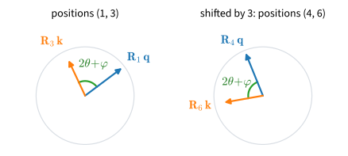

# Positional Information
:label:`sec_positional-information`

The sentences "dog bites man" and "man bites dog" contain the same three
tokens. Fed to the self-attention layer of
:numref:`sec_multihead-attention`, they produce the same three output
vectors, only listed in a different order. Each output averages value
vectors with weights computed from content alone, and nothing in that
computation records where a token stands. A classifier that pools these
outputs cannot tell who bit whom. Attention must therefore be told where
each token stands.

There are several ways to do so. Absolute embeddings, designed or learned,
add a position vector to each token. Rotary embeddings (RoPE) rotate queries
and keys so that every score depends on the offset between two positions.
Linear biases (ALiBi) penalize distant keys, and a causal model can even
work without any explicit encoding (NoPE). All of them work at the sequence
lengths a model was trained on; beyond those lengths they behave very
differently. We first prove the symmetry that has to be broken and build
each scheme. A small attention-only language model, trained at context 128,
then shows what each scheme does at context 512 and how a trained RoPE model
can be stretched to the longer context.

```{.python .input #positional-information}
%%tab pytorch
%matplotlib inline
from d2l import torch as d2l
import math
import torch
from torch import nn
from torch.nn import functional as F
```

```{.python .input #positional-information}
%%tab jax
%matplotlib inline
from d2l import jax as d2l
from flax import nnx
import jax
from jax import numpy as jnp
import math
import optax
```

## Permutation Equivariance
:label:`subsec_pos-ignores-order`

Before choosing a remedy, we state the symmetry precisely, since every
scheme in this section is a way of breaking it. Let
$\mathbf{X} \in \mathbb{R}^{n \times d}$ hold a sequence of $n$ token
representations. At evaluation time, with dropout disabled and with no mask
or position-dependent bias, let $f$ be the self-attention layer

$$
f(\mathbf{X}) = \mathrm{softmax}\!\left(\frac{\mathbf{X}\mathbf{W}_q (\mathbf{X}\mathbf{W}_k)^\top}{\sqrt{d}}\right) \mathbf{X}\mathbf{W}_v.
$$
:eqlabel:`eq_pos-selfattn`

**Proposition (permutation equivariance).** For every permutation matrix
$\boldsymbol{\Pi}$, $\;f(\boldsymbol{\Pi} \mathbf{X}) = \boldsymbol{\Pi}
f(\mathbf{X})$.

**Proof.** The projections act on each row separately, so
$(\boldsymbol{\Pi}\mathbf{X})\mathbf{W} = \boldsymbol{\Pi}(\mathbf{X}\mathbf{W})$
for each of $\mathbf{W}_q, \mathbf{W}_k, \mathbf{W}_v$. The score matrix
becomes $\boldsymbol{\Pi} \mathbf{S} \boldsymbol{\Pi}^\top$, and since softmax
normalizes each row by itself, it commutes with row and column permutations:
$\mathrm{softmax}(\boldsymbol{\Pi} \mathbf{S} \boldsymbol{\Pi}^\top) =
\boldsymbol{\Pi}\, \mathrm{softmax}(\mathbf{S})\, \boldsymbol{\Pi}^\top$.
Multiplying by the permuted values,
$\boldsymbol{\Pi}\, \mathrm{softmax}(\mathbf{S})\, \boldsymbol{\Pi}^\top
\boldsymbol{\Pi} \mathbf{X}\mathbf{W}_v = \boldsymbol{\Pi} f(\mathbf{X})$
because $\boldsymbol{\Pi}^\top \boldsymbol{\Pi} = \mathbf{I}$. Concatenating
heads and applying $\mathbf{W}_o$ row-wise preserves the property, so it
holds for multi-head attention too. $\blacksquare$

Permuting the input applies the same permutation to the output: each token's
output is unchanged except for its row index. Thus the layer does not use a
token's position in the sequence. We check the proposition on the
multi-head layer of :numref:`sec_multihead-attention` by shuffling eight
random tokens and comparing the outputs:

```{.python .input #positional-information-attention-ignores-order}
%%tab pytorch
attention = d2l.MultiHeadAttention(num_hiddens=64, num_heads=4)
X = torch.randn(1, 8, 64)
perm = torch.randperm(8)
Y = attention(X, X, X)
Y_perm = attention(X[:, perm], X[:, perm], X[:, perm])
print(f'max |Y[perm] - Y_perm|: {(Y[:, perm] - Y_perm).abs().max():.2e}')
```

```{.python .input #positional-information-attention-ignores-order}
%%tab jax
attention = d2l.MultiHeadAttention(num_hiddens=64, num_heads=4,
                                   rngs=nnx.Rngs(d2l.get_key()))
key_X, key_perm = jax.random.split(d2l.get_key())
X = jax.random.normal(key_X, (1, 8, 64))
perm = jax.random.permutation(key_perm, 8)
Y = attention(X, X, X)
Y_perm = attention(X[:, perm], X[:, perm], X[:, perm])
print(f'max |Y[perm] - Y_perm|: {jnp.abs(Y[:, perm] - Y_perm).max():.2e}')
```

The two outputs differ only by float32 round-off: the shuffled input
produced the shuffled output. Two caveats qualify this result. First,
equivariance is a property of the *layer*. Stacking equivariant layers and
reading out per token leaves the model equivariant, so depth does not help.
Second, the proposition is about unmasked attention. A causal mask singles
out each position by how many predecessors it may see, which breaks the
symmetry. NoPE, near the end of the section, relies on this asymmetry. The
other schemes give each token explicit positional information.

## Absolute Position Embeddings

The original transformer attaches a *position vector* $\mathbf{p}_i \in
\mathbb{R}^d$ to each position $i$ and feeds $\mathbf{x}_i + \mathbf{p}_i$
into the first layer :cite:`Vaswani.Shazeer.Parmar.ea.2017`. Two tokens with
identical embeddings at different positions now enter attention as different
vectors, and the equivariance proof fails at its first step. The two classic
choices of these vectors differ in whether they are designed or learned.

### Sinusoidal Encodings
:label:`subsec_pos-sinusoidal`

The designed choice fills row $i$ of $\mathbf{P} \in \mathbb{R}^{n \times d}$
with sines and cosines of geometrically spaced frequencies,

$$
p_{i, 2m} = \sin\left(\frac{i}{10000^{2m/d}}\right), \qquad p_{i, 2m+1} = \cos\left(\frac{i}{10000^{2m/d}}\right).
$$
:eqlabel:`eq_sinusoidal-def`

The design looks arbitrary until we plot it. We implement the table as a
small function and look at four adjacent columns.

```{.python .input #positional-information-sinusoidal-encodings-1}
%%tab pytorch
def sinusoidal_encoding(max_len, num_hiddens):  #@save
    """The (max_len, num_hiddens) table of sinusoidal position codes."""
    theta = torch.arange(max_len)[:, None] / 10000 ** (
        torch.arange(0, num_hiddens, 2) / num_hiddens)
    return torch.stack([torch.sin(theta), torch.cos(theta)],
                       -1).reshape(max_len, num_hiddens)

P = sinusoidal_encoding(60, 32)
d2l.plot(torch.arange(60), P[:, 6:10].T, xlabel='position',
         figsize=(6, 2.5), legend=[f'column {d}' for d in range(6, 10)])
```

```{.python .input #positional-information-sinusoidal-encodings-1}
%%tab jax
def sinusoidal_encoding(max_len, num_hiddens):  #@save
    """The (max_len, num_hiddens) table of sinusoidal position codes."""
    theta = jnp.arange(max_len)[:, None] / 10000 ** (
        jnp.arange(0, num_hiddens, 2) / num_hiddens)
    return jnp.stack([jnp.sin(theta), jnp.cos(theta)],
                     -1).reshape(max_len, num_hiddens)

P = sinusoidal_encoding(60, 32)
d2l.plot(jnp.arange(60), P[:, 6:10].T, xlabel='position',
         figsize=(6, 2.5), legend=[f'column {d}' for d in range(6, 10)])
```

Adjacent column pairs share a frequency (one sine, one cosine), and the
frequency falls as the column index grows. This is a continuous version of
binary counting. In the binary representations below, the
lowest bit flips every number, the next every two numbers, the next every
four. Fast dimensions distinguish neighboring positions, whereas slow
dimensions distinguish broader regions.

```{.python .input #positional-information-sinusoidal-encodings-2}
for i in range(8):
    print(f'{i} in binary is {i:>03b}')
```

The heatmap of the whole table shows the same structure in continuous form.
Each row is a unique multi-frequency fingerprint of its position. Unlike
bits, the values vary smoothly, so nearby positions get nearby encodings.

```{.python .input #positional-information-sinusoidal-encodings-3}
%%tab pytorch
d2l.show_heatmaps(P[None, None], xlabel='column (encoding dimension)',
                  ylabel='row (position)', figsize=(3.5, 4), cmap='Blues')
```

```{.python .input #positional-information-sinusoidal-encodings-3}
%%tab jax
d2l.show_heatmaps(P[None, None], xlabel='column (encoding dimension)',
                  ylabel='row (position)', figsize=(3.5, 4), cmap='Blues')
```

### Learned Positions

The alternative is to make $\mathbf{P}$ a trainable embedding table, one
free vector per position, as in BERT and GPT-2
:cite:`Devlin.Chang.Lee.ea.2018,Radford.Wu.Child.ea.2019`. It concedes that
we do not know the right encoding and lets gradient descent find one. Its
limitation is visible before any training. The table has one row for each
position up to some maximum length, and a row that no training example ever
used still holds its random initialization. To such a table, position 500 is
not "a bit beyond position 128". Its row carries no information at all.

### Sinusoidal Encodings as Rotations

Designed sinusoids have a relative-position structure absent from a learned
table. The original paper chose them because, for every fixed offset
$\delta$, the row $\mathbf{p}_{i+\delta}$ is a linear function of the row
$\mathbf{p}_i$. The linear map can be written explicitly. Write
$\omega_m = 1/10000^{2m/d}$ for the frequency shared by columns $2m$ and
$2m{+}1$. Then

$$
\begin{bmatrix} \cos(\delta \omega_m) & \sin(\delta \omega_m) \\  -\sin(\delta \omega_m) & \cos(\delta \omega_m) \\ \end{bmatrix}
\begin{bmatrix} p_{i, 2m} \\  p_{i, 2m+1} \\ \end{bmatrix}
= \begin{bmatrix} \sin\left((i+\delta) \omega_m\right) \\  \cos\left((i+\delta) \omega_m\right) \\ \end{bmatrix}
= \begin{bmatrix} p_{i+\delta, 2m} \\  p_{i+\delta, 2m+1} \\ \end{bmatrix},
$$
:eqlabel:`eq_sinusoidal-rotation`

by the angle-addition identities. The map from position $i$ to position
$i + \delta$ is a *rotation* of each two-column pair, by an angle $\delta
\omega_m$ that depends only on the offset $\delta$, never on $i$. The
encoding thus contains relative position, but only implicitly. The model
receives $\mathbf{x}_i + \mathbf{p}_i$ and must learn projections
that exploit the rotations. Moreover, a query--key product of two such sums
expands into four terms, and only the position--position term retains the
rotation directly. RoPE instead builds the relative rotation into the
query--key comparison itself.

## Rotary Position Embeddings
:label:`subsec_pos-rope`

*Rotary position embeddings* (RoPE) :cite:`Su.Lu.Pan.ea.2021` skip the
addition and act on queries and keys at the point where they meet, the
score. We want a transformation $\mathbf{R}_i$, applied to the query at
position $i$ and the key at position $j$, such that the score depends only
on the content vectors and the offset $j - i$:

$$
(\mathbf{R}_i \mathbf{q})^\top (\mathbf{R}_j \mathbf{k}) = \mathbf{q}^\top \mathbf{R}_i^\top \mathbf{R}_j \mathbf{k} \overset{!}{=} \mathbf{q}^\top \mathbf{R}_{j-i} \mathbf{k}.
$$
:eqlabel:`eq_rope-goal`

The requirement $\mathbf{R}_i^\top \mathbf{R}_j = \mathbf{R}_{j-i}$ pins down
the kind of map we need. With $i = j$ it reads $\mathbf{R}_i^\top
\mathbf{R}_i = \mathbf{R}_0 = \mathbf{I}$ (position 0 is left as it is),
so every $\mathbf{R}_i$ is orthogonal. With $j = 0$ it gives
$\mathbf{R}_{-i} = \mathbf{R}_i^\top$, and substituting this back yields
$\mathbf{R}_i \mathbf{R}_j = \mathbf{R}_{i+j}$. The $\mathbf{R}_i$ form a
one-parameter group of orthogonal maps, and planar rotations are the
simplest such group. RoPE therefore reuses the sinusoidal frequencies
$\omega_m$, now *multiplicatively*. It splits the $d$ dimensions of each
query into $d/2$ pairs, where $d$ is now the width of one attention head,
and rotates pair $m$ of the query at position $i$ by the angle $i\,\omega_m$
(and likewise for keys),

$$
\mathbf{R}_i = \begin{bmatrix} R(i\omega_0) & & \\ & \ddots & \\ & & R(i\omega_{d/2-1}) \end{bmatrix}, \qquad R(\alpha) = \begin{bmatrix} \cos\alpha & -\sin\alpha \\ \sin\alpha & \cos\alpha \end{bmatrix}.
$$
:eqlabel:`eq_rope-def`

:numref:`fig_rope-rotation` shows one pair plane. Shifting both positions by
the same amount rotates query and key together, preserving their angle and
their dot product. The score therefore depends on position only through the
offset. Rotations also preserve norms, so RoPE never inflates or shrinks a
token's content. The geometric spacing of the frequencies sets how fast
position turns each pair. The fast pairs separate neighboring positions
sharply, while the slow pairs barely move across a sentence and carry
content largely unchanged. Only queries and keys are rotated; values pass through untouched.
RoPE is the positional scheme of most open-weights language models released
since 2023.


:label:`fig_rope-rotation`

The implementation rotates the even/odd feature pairs with sines and cosines
of the angles. The argument `offset` shifts every position by the same
amount, which we use to test the invariance. Two optional arguments change
the angles themselves: `base` replaces the constant $10000$ in the
frequencies, and `scale` multiplies the angle of each pair by its own factor.
Both keep their defaults until :numref:`subsec_pos-context-extension`
stretches a trained model to longer contexts.

```{.python .input #positional-information-rotary-position-embeddings-1}
%%tab pytorch
def rope(x, offset=0, base=10000.0, scale=None):  #@save
    """Rotate feature pairs of x (..., num_steps, d) by position angles."""
    n, d = x.shape[-2:]
    key = (n, d, offset, base, x.device, x.dtype)
    reuse = scale is None and not torch.is_grad_enabled()
    if reuse and key in rope_cache:  # Same angles as the previous call
        cos, sin = rope_cache[key]
    else:
        pos = torch.arange(n, dtype=torch.float32, device=x.device) + offset
        omega = base ** (-torch.arange(0, d, 2, device=x.device) / d)
        if scale is not None:  # One angle factor per pair, shape (d/2,)
            omega = omega * scale
        theta = pos[:, None] * omega[None, :]
        # Angles in fp32, tables in the dtype of x: bf16 queries stay bf16
        cos, sin = torch.cos(theta).to(x.dtype), torch.sin(theta).to(x.dtype)
        if reuse:  # Keep only the newest tables
            rope_cache.clear()
            rope_cache[key] = cos, sin
    x1, x2 = x[..., 0::2], x[..., 1::2]
    return torch.stack([x1 * cos - x2 * sin,
                        x1 * sin + x2 * cos], -1).flatten(-2)

rope_cache = {}  #@save
```

```{.python .input #positional-information-rotary-position-embeddings-1}
%%tab jax
def rope(x, offset=0, base=10000.0, scale=None):  #@save
    """Rotate feature pairs of x (..., num_steps, d) by position angles."""
    d = x.shape[-1]
    pos = jnp.arange(x.shape[-2], dtype=jnp.float32) + offset
    omega = base ** (-jnp.arange(0, d, 2) / d)
    if scale is not None:  # One angle factor per pair, shape (d/2,)
        omega = omega * scale
    theta = pos[:, None] * omega[None, :]
    # Angles in fp32, tables in the dtype of x: bf16 queries stay bf16
    cos, sin = jnp.cos(theta).astype(x.dtype), jnp.sin(theta).astype(x.dtype)
    x1, x2 = x[..., 0::2], x[..., 1::2]
    return jnp.stack([x1 * cos - x2 * sin,
                      x1 * sin + x2 * cos], -1).reshape(x.shape)
```

:begin_tab:`pytorch`
The cosines and sines depend on the length, the width, the offset,
`base`, and the dtype, but not on the entries of `x`. A model calls `rope` for the queries
and the keys of every block with the same arguments. When it generates
text, one token at a time and without gradients, building the tables takes
about as many small kernel launches as the rotation itself, at every block of
every step. `rope` therefore keeps the tables of its latest call in
`rope_cache` and reuses them as long as no gradients are recorded. During
training it builds them afresh: tables made under `torch.inference_mode`
cannot enter a backward pass. A `scale` is never cached, since a model may
change it in place, as :numref:`subsec_pos-context-extension` does.
:end_tab:

To check :eqref:`eq_rope-goal` numerically, we shift all positions jointly;
the full RoPE score matrix should not change. For contrast, we run the
same test on the additive sinusoidal encoding, where the four-term expansion
leaves absolute position in the score.

```{.python .input #positional-information-rotary-position-embeddings-2}
%%tab pytorch
T, d = 32, 64
q, k = torch.randn(T, d), torch.randn(T, d)

scores = lambda off: rope(q, off) @ rope(k, off).T / math.sqrt(d)
for off in (1, 17, 480):
    print(f'RoPE, all positions shifted by {off:>3}: max score change '
          f'{(scores(off) - scores(0)).abs().max():.1e}')

P = sinusoidal_encoding(600, d)
added = lambda off: (q + P[off:off+T]) @ (k + P[off:off+T]).T / math.sqrt(d)
print(f'additive sinusoidal, shifted by  17: max score change '
      f'{(added(17) - added(0)).abs().max():.1e}')
```

```{.python .input #positional-information-rotary-position-embeddings-2}
%%tab jax
T, d = 32, 64
key_q, key_k = jax.random.split(d2l.get_key())
q, k = jax.random.normal(key_q, (T, d)), jax.random.normal(key_k, (T, d))
# Full float32 matmuls: GPU default (TF32) round-off would hide the check
dot = lambda a, b: jnp.matmul(a, b.T, precision='highest') / math.sqrt(d)

scores = lambda off: dot(rope(q, off), rope(k, off))
for off in (1, 17, 480):
    print(f'RoPE, all positions shifted by {off:>3}: max score change '
          f'{jnp.abs(scores(off) - scores(0)).max():.1e}')

P = sinusoidal_encoding(600, d)
added = lambda off: dot(q + P[off:off+T], k + P[off:off+T])
print(f'additive sinusoidal, shifted by  17: max score change '
      f'{jnp.abs(added(17) - added(0)).max():.1e}')
```

At every shift, RoPE's scores change only by float32 round-off, several
orders of magnitude below the scores themselves. This holds even for a
shift far beyond where any additive table would end. The additive encoding,
in contrast, moves the scores by an amount comparable to the scores
themselves. With RoPE, relative position is built into the architecture
rather than learned from data. This property does not guarantee accurate
predictions at offsets absent from the training data; the next experiment
tests such predictions.

## Extrapolation Beyond the Training Length

Every scheme above breaks the permutation symmetry on sequences as long as
those seen in training. The schemes differ on longer ones. A length-extrapolation
test trains at context $L$ and compares perplexity at $L$ with perplexity at,
for example, $4L$. Two more schemes were designed for this setting.

### ALiBi and NoPE

*ALiBi* (attention with linear biases) :cite:`Press.Smith.Lewis.2022`
encodes no positions at all. It instead subtracts a distance penalty from
every attention score. For query position $i$ and key position $j \leq i$
in head $h$ of $H$,

$$
\mathrm{score}_{ij} = \frac{\mathbf{q}_i^\top \mathbf{k}_j}{\sqrt{d}} - m_h\,(i - j), \qquad m_h = 2^{-8h/H}.
$$
:eqlabel:`eq_alibi-def`

Each head discounts distant tokens at its own geometric rate. Head 1 uses a
steep penalty and head $H$ a much smaller one. For $H = 4$ the slopes are
$1/4, 1/16, 1/64, 1/256$. The formula $2^{-8h/H}$ is the paper's choice for
head counts that are powers of two, and the paper gives a separate rule for
other $H$. The bias depends only on distance, so it is defined for every
context length. A distance of 400 is a valid input to the bias, not an
unallocated table index. The drawback is a recency prior built into every
score, which large content scores can offset but training cannot remove.
With slope $1/4$, a key 40 positions back already loses a
factor $e^{-10}$ of its weight, so the steep heads see only a short window
whatever the context length.

*NoPE* (no positional encoding) uses the asymmetry that the proposition
leaves out :cite:`Kazemnejad.Padhi.Ramamurthy.ea.2023`. A causal model can
do without explicit position representations, because the mask already
breaks the symmetry. Position 0 attends over one token, position 100 over a
hundred and one. The number of tokens competing in each softmax is itself
positional information, and a decoder can in principle recover relative
order from it.
Because it uses neither a table nor a rotation, NoPE has no explicit
position range. Its effectiveness depends on how much usable positional
signal the mask supplies.

### An Attention-Only Language Model

To compare extrapolation, we train a deliberately minimal model that the
chapter analyzes again later: a token embedding, a stack of residual
causal attention blocks, and an output head tied to the embedding
:cite:`Press.Wolf.2017`. There is no feed-forward network and no
normalization layer, and the attention projections carry no bias terms by
default (a `bias` switch restores them). Only attention mixes information
across positions, which makes the model easy to analyze in
:numref:`sec_what-attention-computes`. It is the attention-only cousin of
the `TinyLM` of :numref:`subsec_tinylm`.

The positional scheme is the one constructor argument that the experiment
varies. `pos` takes `'learned'`, `'sinusoidal'`, `'rope'`, `'alibi'`, or
`'none'`, each implemented as in the equations above. Two details need
explaining. With the sinusoidal table, the token embeddings are multiplied
by $\sqrt{d}$ before the table is added, as in the original transformer. Without this factor the table, whose
entries have magnitude about $0.7$, would outweigh embeddings that start
with entries of about $0.02$ by a factor of 35. With it, the factor is
about 3. With RoPE, the model keeps the base and the per-pair angle factors
of `rope` as attributes, `rope_base` and `rope_scale`, so that they can be
changed after training.

```{.python .input #positional-information-an-attention-only-language-model}
%%tab pytorch
class TinyCharLM(nn.Module):  #@save
    """Attention-only language model."""
    def __init__(self, vocab_size, num_hiddens=128, num_heads=4, num_blks=2,
                 pos='rope', max_len=512, bias=False):
        super().__init__()
        assert pos in ('learned', 'sinusoidal', 'rope', 'alibi', 'none')
        self.num_heads, self.pos = num_heads, pos
        self.token_emb = nn.Embedding(vocab_size, num_hiddens)
        nn.init.normal_(self.token_emb.weight, std=0.02)
        if pos == 'learned':
            self.pos_emb = nn.Embedding(max_len, num_hiddens)
            nn.init.normal_(self.pos_emb.weight, std=0.02)
        if pos == 'sinusoidal':
            self.register_buffer('P', sinusoidal_encoding(max_len,
                                                          num_hiddens))
        if pos == 'rope':  # Base and per-pair angle factors of the rotation
            self.rope_base = 10000.0
            self.register_buffer('rope_scale',
                                 torch.ones(num_hiddens // num_heads // 2))
        self.blks = nn.ModuleList([nn.ModuleDict(dict(
            qkv=nn.Linear(num_hiddens, 3 * num_hiddens, bias=bias),
            proj=nn.Linear(num_hiddens, num_hiddens, bias=bias)))
            for _ in range(num_blks)])

    def _alibi(self, T, device):
        h = torch.arange(1, self.num_heads + 1, device=device)
        slopes = 2.0 ** (-8.0 * h / self.num_heads)
        pos = torch.arange(T, device=device, dtype=torch.float32)
        return slopes[:, None, None] * (pos[None, :] - pos[:, None])

    def _attend(self, blk, H):
        B, T, D = H.shape
        q, k, v = blk['qkv'](H).chunk(3, -1)
        q, k, v = (u.reshape(B, T, self.num_heads, -1).transpose(1, 2)
                   for u in (q, k, v))
        if self.pos == 'rope':
            q = rope(q, base=self.rope_base, scale=self.rope_scale)
            k = rope(k, base=self.rope_base, scale=self.rope_scale)
        scores = q @ k.transpose(-2, -1) / math.sqrt(q.shape[-1])
        if self.pos == 'alibi':
            scores = scores + self._alibi(T, H.device)
        weights = d2l.masked_softmax(scores,
                                     d2l.causal_mask(T, device=H.device))
        out = (weights @ v).transpose(1, 2).reshape(B, T, D)
        return blk['proj'](out), weights

    def _embed(self, X):
        H = self.token_emb(X)
        if self.pos == 'learned':
            H = H + self.pos_emb(torch.arange(X.shape[1], device=X.device))
        if self.pos == 'sinusoidal':  # Scale tokens up to the table
            H = H * math.sqrt(H.shape[-1]) + self.P[:X.shape[1]]
        return H

    def forward(self, X):
        H = self._embed(X)
        for blk in self.blks:
            out, _ = self._attend(blk, H)
            H = H + out
        return F.linear(H, self.token_emb.weight)  # Tied output head

    def attention_weights(self, X):
        """Per-block attention maps, each (batch, num_heads, T, T)."""
        H, maps = self._embed(X), []
        for blk in self.blks:
            out, weights = self._attend(blk, H)
            maps.append(weights)
            H = H + out
        return maps
```

```{.python .input #positional-information-an-attention-only-language-model}
%%tab jax
class TinyCharLM(nnx.Module):  #@save
    """Attention-only language model."""
    def __init__(self, vocab_size, num_hiddens=128, num_heads=4, num_blks=2,
                 pos='rope', max_len=512, bias=False, *, rngs):
        assert pos in ('learned', 'sinusoidal', 'rope', 'alibi', 'none')
        self.num_heads, self.pos = num_heads, pos
        init = nnx.initializers.normal(0.02)
        self.token_emb = d2l.Embed(vocab_size, num_hiddens,
                                   embedding_init=init, rngs=rngs)
        if pos == 'learned':
            self.pos_emb = nnx.Embed(max_len, num_hiddens,
                                     embedding_init=init, rngs=rngs)
        if pos == 'sinusoidal':
            self.P = nnx.Cache(sinusoidal_encoding(max_len, num_hiddens))
        if pos == 'rope':  # Base and per-pair angle factors of the rotation
            self.rope_base = 10000.0
            self.rope_scale = nnx.Cache(
                jnp.ones(num_hiddens // num_heads // 2))
        self.blks = nnx.List([nnx.Dict(
            qkv=d2l.Linear(num_hiddens, 3 * num_hiddens, use_bias=bias,
                           rngs=rngs),
            proj=d2l.Linear(num_hiddens, num_hiddens, use_bias=bias,
                            rngs=rngs))
            for _ in range(num_blks)])

    def _alibi(self, T):
        h = jnp.arange(1, self.num_heads + 1)
        slopes = 2.0 ** (-8.0 * h / self.num_heads)
        pos = jnp.arange(T, dtype=jnp.float32)
        return slopes[:, None, None] * (pos[None, :] - pos[:, None])

    def _attend(self, blk, H):
        B, T, D = H.shape
        q, k, v = jnp.split(blk['qkv'](H), 3, axis=-1)
        q, k, v = (u.reshape(B, T, self.num_heads, -1).swapaxes(1, 2)
                   for u in (q, k, v))
        if self.pos == 'rope':
            q = rope(q, base=self.rope_base, scale=self.rope_scale[...])
            k = rope(k, base=self.rope_base, scale=self.rope_scale[...])
        scores = q @ k.swapaxes(-2, -1) / math.sqrt(q.shape[-1])
        if self.pos == 'alibi':
            scores = scores + self._alibi(T)
        weights = d2l.masked_softmax(scores, d2l.causal_mask(T))
        out = (weights @ v).swapaxes(1, 2).reshape(B, T, D)
        return blk['proj'](out), weights

    def _embed(self, X):
        H = self.token_emb(X)
        if self.pos == 'learned':
            H = H + self.pos_emb(jnp.arange(X.shape[1]))
        if self.pos == 'sinusoidal':  # Scale tokens up to the table
            H = H * math.sqrt(H.shape[-1]) + self.P[:X.shape[1]]
        return H

    def __call__(self, X):
        H = self._embed(X)
        for blk in self.blks:
            out, _ = self._attend(blk, H)
            H = H + out
        return self.token_emb.attend(H)  # Tied output head

    def attention_weights(self, X):
        """Per-block attention maps, each (batch, num_heads, T, T)."""
        H, maps = self._embed(X), []
        for blk in self.blks:
            out, weights = self._attend(blk, H)
            maps.append(weights)
            H = H + out
        return maps
```

:begin_tab:`jax`
The token table is `d2l.Embed` of :numref:`subsec_tinylm`: on bytes of text,
whose frequencies are skewed, it computes the gradient of the lookup faster
than `nnx.Embed`.
:end_tab:

### The Experiment
:label:`subsec_pos-experiment`

We train one model per scheme on `d2l.WikiText103`, the bytes of Wikipedia
articles that :numref:`subsec_tinylm` introduced. Each model trains at
context length 128 for 3000 steps of `d2l.train_lm`, the fixed-step training
loop of :numref:`sec_adam`. The tokens are bytes, so each model has an embedding
table of 256 rows. The learned and sinusoidal tables are allocated out to
`max_len` $= 512$ positions so that the models can be evaluated on longer
sequences, but only the first 128 rows of the learned table receive
gradients.

```{.python .input #positional-information-the-experiment-1}
%%tab pytorch
data = d2l.WikiText103(batch_size=64, num_steps=128)
schemes = ('learned', 'sinusoidal', 'rope', 'alibi', 'none')
models = {}
for pos in schemes:
    model = TinyCharLM(len(data.vocab), pos=pos)
    losses = d2l.train_lm(model, data,
                          torch.optim.AdamW(model.parameters(), lr=1e-3,
                                            weight_decay=0.0), 3000)
    models[pos] = model
    print(f'{pos:>10}: final training loss {sum(losses[-100:]) / 100:.2f}')
```

```{.python .input #positional-information-the-experiment-1}
%%tab jax
data = d2l.WikiText103(batch_size=64, num_steps=128)
schemes = ('learned', 'sinusoidal', 'rope', 'alibi', 'none')
models = {}
for pos in schemes:
    model = TinyCharLM(len(data.vocab), pos=pos,
                       rngs=nnx.Rngs(d2l.get_key()))
    optimizer = nnx.Optimizer(model, optax.adamw(1e-3, weight_decay=0.0),
                              wrt=nnx.Param)
    losses = d2l.train_lm(model, data, optimizer, 3000)
    models[pos] = model
    print(f'{pos:>10}: final training loss {sum(losses[-100:]) / 100:.2f}')
```

Every model was trained on length-128 sequences. We evaluate validation
perplexity at that training context, $n = 128$, and at two and four times
this length ($n = 256$ and $512$). The first point is in range; the other
two measure extrapolation. All three read the same 1.1 million bytes of the
validation split. We cut it into consecutive windows of 128 bytes with
`data.windows` and regroup them into windows of 256 and 512, so that only
the context available to each prediction changes. `d2l.lm_perplexity`
(:numref:`sec_adam`) sums the cross-entropy over all predicted tokens and
converts it to a perplexity once at the end.

The table lists the perplexity of each model at the three context lengths.

```{.python .input #positional-information-the-experiment-3}
%%tab pytorch, jax
contexts = (128, 256, 512)
num_bytes = (len(data.val) - 1) // 8192 * 8192  # Batches of 16 x 512 bytes
X, Y = data.windows(data.val, range(0, num_bytes, 128))
eval_sets = {}
for n in contexts:  # The same bytes, regrouped into windows of n
    Xn, Yn = X.reshape(-1, n), Y.reshape(-1, n)
    eval_sets[n] = [(Xn[i:i + 16], Yn[i:i + 16])
                    for i in range(0, len(Xn), 16)]
ppls = {pos: [d2l.lm_perplexity(models[pos], eval_sets[n]) for n in contexts]
        for pos in schemes}
print(f'{"context":>10}: ' + ''.join(f'{n:>8}' for n in contexts))
for pos in schemes:
    print(f'{pos:>10}: ' + ''.join(f'{p:8.1f}' for p in ppls[pos]))
```

At the training length, every explicit scheme gives a lower perplexity than
NoPE, and the sinusoidal table and RoPE give the lowest. Beyond the training
length the schemes split into two groups. The learned table, the
sinusoidal table, and RoPE all degrade at context 512, by up to
several-fold, each for its own reason. The learned
table reaches rows beyond position 127 that still hold their random
initialization. The sinusoidal table supplies rows whose slow columns take
values never seen in training. RoPE adds no position vector, but its slow
pairs have periods longer than 128 positions. At offsets beyond 127 they
turn through angles they never reached during training, and the
projections were never fit to scores computed from those angles.

The other two schemes hold their level. ALiBi stays nearly flat because its
bias depends only on distance. NoPE, which has no table and no angles to
run out of, stays flat from a higher starting point. A flat curve, however,
does not mean that a model *uses* the longer context.
ALiBi's steep heads hardly look past the training window at all, as
Exercise :exref:`ex_positional-information-where-extrapolation-fails`
measures.

### Extending a Trained Model's Context
:label:`subsec_pos-context-extension`

Only some of RoPE's pairs meet anything new beyond the training length. A
pair whose period $2\pi/\omega_m$ is at most 128 positions completes a
full turn within the training offsets, so every angle it produces at offset
400 lies within $\omega_m/2$ of an angle it already took during training.
For the head width 32 of `TinyCharLM`, six of the 16 pairs are fast in this
sense, with periods from 6 to 112 positions. The other ten pairs, whose
periods exceed the training length, reach angles at long offsets that they
never took during training. Because the angles vary continuously, they can
be *rescaled* so that the deployed range maps into the trained one.
Multiplying every angle by $128/512$ makes the offset $4\delta$ look like the
familiar $\delta$, so the model interpolates instead of extrapolating.
This is *position interpolation* :cite:`Chen.Wong.Chen.ea.2023`, which
extended Llama models from 2,048 to 32,768 tokens with at most 1000
fine-tuning steps.

Uniform rescaling also compresses the fast pairs, which had already seen
every angle, and blurs the angles they use to tell neighbors apart. YaRN
:cite:`Peng.Quesnelle.Fan.ea.2024` therefore interpolates only the slow
pairs, leaves the fast ones as trained, ramps between the two groups, and
adds a softmax temperature. NTK-aware scaling, which the YaRN paper also
describes, reaches a similar split by changing only the base $b = 10^4$.
To grow the context by a factor $s$ (here $s = 4$), it replaces $b$ by
$b' = b\, s^{d/(d-2)}$, which leaves the fastest pair unchanged and divides
the frequency of the slowest pair by exactly $s$. Training with a larger base
from the outset is the trained form of the same idea. Llama 2 Long, for
example, raised the base from $10^4$ to $5 \times 10^5$ in continued
pretraining on long sequences :cite:`Xiong.Liu.Molybog.ea.2024`.

The attributes `rope_base` and `rope_scale` of `TinyCharLM` let us try two
of these rescalings on the trained RoPE model without any training: a
uniform factor $128/512$ for all pairs, and the same factor for the slow
pairs only.

```{.python .input #positional-information-extending-a-trained-model-s-context}
%%tab pytorch
rope_model = models['rope']
d_head = 2 * rope_model.rope_scale.numel()
periods = 2 * math.pi * 10000 ** (torch.arange(0, d_head, 2) / d_head)
slow = periods > 128
print(f'{int(slow.sum())} of {d_head // 2} pairs have periods above 128')
ones = torch.ones(d_head // 2)
factors = {'unscaled': ones, 'all pairs': ones * 128 / 512,
           'slow pairs': torch.where(slow, ones * 128 / 512, ones)}
for name, factor in factors.items():
    rope_model.rope_scale.copy_(factor)
    ppl = [d2l.lm_perplexity(rope_model, eval_sets[n]) for n in contexts]
    print(f'{name:>10}: ' + ''.join(f'{p:8.1f}' for p in ppl))
rope_model.rope_scale.copy_(ones);
```

```{.python .input #positional-information-extending-a-trained-model-s-context}
%%tab jax
rope_model = models['rope']
d_head = 2 * rope_model.rope_scale.shape[0]
periods = 2 * math.pi * 10000 ** (jnp.arange(0, d_head, 2) / d_head)
slow = periods > 128
print(f'{int(slow.sum())} of {d_head // 2} pairs have periods above 128')
ones = jnp.ones(d_head // 2)
factors = {'unscaled': ones, 'all pairs': ones * 128 / 512,
           'slow pairs': jnp.where(slow, ones * 128 / 512, ones)}
for name, factor in factors.items():
    rope_model.rope_scale[...] = factor
    ppl = [d2l.lm_perplexity(rope_model, eval_sets[n]) for n in contexts]
    print(f'{name:>10}: ' + ''.join(f'{p:8.1f}' for p in ppl))
rope_model.rope_scale[...] = ones
```

Rescaling only the slow pairs brings the perplexity at context 512 far
below that of the unscaled model, and close to its level at the training
length. The uniform factor fails on this model. It compresses the fast
pairs too, blurs the distinctions between neighboring bytes that they were
trained to make. The perplexity jumps already at the training length and
stays at that high level at every context, so at 512 it gains nothing
reliable over leaving the angles alone and remains far above the rescaling
of the slow pairs. This is the defect
that YaRN's split into fast and slow pairs removes. Even so, at context
512 neither rescaled model reaches the perplexity that the unscaled model
has at the training length, because no weight was trained on compressed
angles. The published recipes therefore pair the rescaling with a short
fine-tune at the new length, which Exercise
:exref:`ex_positional-information-position-interpolation` carries out on
this model.

## Summary

Unmasked attention is permutation equivariant, so a model built from it
cannot tell where a token stands unless it is told. Absolute embeddings add
a position vector to each token. The vector comes from a designed
sinusoidal table, whose shifts are rotations of column pairs, or from a
learned table, whose rows are trained only at the positions seen in
training. RoPE rotates query and key pairs so
that every score depends on the offset alone, ALiBi subtracts a per-head
linear distance penalty, and NoPE relies on the asymmetry of the causal
mask. Trained at context 128, all explicit schemes beat NoPE in range, but
the learned table, the sinusoidal table, and RoPE degrade at four times
that length, while ALiBi and NoPE stay flat. For RoPE only the slow pairs
reach unseen angles at long offsets, and rescaling the angles
(position interpolation, YaRN, a larger base) maps a longer context back
into the trained range.

## Exercises

1. **Distinct positions, distinct codes.** Let $\mathbf{p}_i$ be row $i$ of
   the sinusoidal table :eqref:`eq_sinusoidal-def` of width $d$, with the
   frequencies $\omega_m = 1/10000^{2m/d}$
   of :eqref:`eq_sinusoidal-rotation`.
    1. Show that
       $$\mathbf{p}_i^\top \mathbf{p}_{i+\delta} = \sum_{m=0}^{d/2-1} \cos(\delta\,\omega_m),$$
       derive $\|\mathbf{p}_i - \mathbf{p}_{i+\delta}\|^2$ from it, and
       conclude that both quantities depend on the offset $\delta$ alone.
    1. Conclude that $\mathbf{p}_i = \mathbf{p}_{i'}$ only if
       $(i - i')\,\omega_m$ is a multiple of $2\pi$ for every $m$, and that
       no two distinct integer positions share a row, whatever the value of
       `max_len`.
    1. The fastest pair has period $2\pi$, so it nearly repeats at integer
       offsets close to multiples of $2\pi$. Find the offset $\delta < 512$
       at which its angle comes closest to a multiple of $2\pi$, and give
       the residual angle.
    1. For $d = 32$, evaluate $\|\mathbf{p}_i - \mathbf{p}_{i+\delta}\|$ at
       this offset and at $\delta = 1$, and find the offset between $1$ and
       $511$ at which the distance is smallest. Which pairs keep the two
       positions of the near repeat apart? Relate the answer to the binary
       counting of :numref:`subsec_pos-sinusoidal`.
   :exlabel:`ex_positional-information-distinct-positions-distinct-codes`

1. [code] **Untrained rows.** The table `pos_emb` of `models['learned']`
   has `max_len = 512` rows, of which training at context 128 used only the
   first 128.
    1. Construct a new `TinyCharLM` with `pos='learned'`, copy its table
       `pos_emb` before training, and train it as in the experiment
       of :numref:`subsec_pos-experiment`. Explain why rows 128 to 511 of the
       trained table are bitwise equal to the copy, and check the claim. By
       what factor would decoupled weight decay with coefficient $0.1$ at
       the learning rate $10^{-3}$ have shrunk these rows over the 3000
       training steps?
    1. Compute the cosine similarities between all 512 rows of the trained
       table and display them with `d2l.show_heatmaps`. Describe the three
       blocks of the result: trained rows against trained rows, untrained
       against untrained, and trained against untrained.
    1. By Exercise :exref:`ex_positional-information-distinct-positions-distinct-codes`, the dot products of the sinusoidal rows depend only on
       $i - j$, so the sinusoidal similarity matrix is constant along each
       diagonal $i - j = \textrm{const}$. For the trained rows 0 to 127,
       compute the standard deviation of the cosine similarities along each
       diagonal and average it over the diagonals. Compare the average with
       the standard deviation of the diagonal means across diagonals, and
       decide whether training produced a code whose similarities are
       approximately invariant to shifts.
   :exlabel:`ex_positional-information-untrained-rows`

1. **Additive codes in the score.** With the additive encoding of
   :numref:`subsec_pos-sinusoidal`, a first-layer head of
   :eqref:`eq_pos-selfattn` scores the inputs at positions $i$ and $j$ as

   $$\mathrm{score}_{ij} = (\mathbf{x}_i + \mathbf{p}_i)^\top \mathbf{A}\, (\mathbf{x}_j + \mathbf{p}_j), \qquad \mathbf{A} = \mathbf{W}_q \mathbf{W}_k^\top / \sqrt{d}.$$

    1. Expand the score into its four terms, and state which of them
       depend on $i$, which on $j$, and which on both.
    1. Let $\mathbf{J}$ be the rotation of the plane by $\pi/2$. Using
       :eqref:`eq_sinusoidal-rotation`, show that the position--position
       term $\mathbf{p}_i^\top \mathbf{A}\, \mathbf{p}_j$ depends only on
       $j - i$ when $\mathbf{A}$ is block diagonal with $2 \times 2$ blocks
       $a_m \mathbf{I} + b_m \mathbf{J}$, one per frequency pair. Exercise :exref:`ex_positional-information-distinct-positions-distinct-codes`
       treats $\mathbf{A} = \mathbf{I}$. Then show that a single nonzero
       entry of $\mathbf{A}$ that couples two different frequency pairs
       destroys this property.
    1. Determine when the content--position term
       $\mathbf{x}_i^\top \mathbf{A}\, \mathbf{p}_j$ is unchanged for every
       shift of $j$. Use the answer to explain the score change of the
       additive encoding in the shift test of :numref:`subsec_pos-rope`,
       and why RoPE has no content--position term.

1. [code] **Where extrapolation fails.** The perplexities of
   :numref:`subsec_pos-experiment` at context 512 average the loss over all
   positions of each sequence.
    1. Show that in each of the five models the logits at positions 0 to
       127 of a length-512 sequence agree, up to floating-point round-off,
       with those computed from its first 128 tokens alone. What does this
       imply about the positions at which the perplexity changes between
       context 128 and context 512?
    1. Compute the validation loss at every position of the length-512
       sequences for the five models, average it over windows of 16
       positions, and plot it against position. For each scheme, where does
       the curve leave the level it holds below position 128, and does the
       loss jump at position 128 or grow gradually?
    1. Restrict every query of `models['rope']` to the 128 most recent
       keys, itself included, by adding a band constraint to the causal
       mask in a subclass that overrides `_attend`, copy the trained
       weights into it, and repeat the measurement. Compare the windowed
       curve beyond position 128 with the unwindowed curve below it. Do
       offsets beyond 127 account for the degradation of RoPE at context
       512?
    1. ALiBi stays approximately flat at context 512. For the query at
       position 511 and equal content scores for all keys, compute the
       fraction of the weight that each of the slopes of
       :eqref:`eq_alibi-def` with $H = 4$ leaves on the distances
       $i - j \geq 128$, none of which occurred in training. Measure the
       same fraction for the four heads of each block of
       `models['alibi']` at context 512, and decide whether the stability
       of ALiBi at that length comes from never attending beyond the
       training range.
   :exlabel:`ex_positional-information-where-extrapolation-fails`

1. **Biases that keep the symmetry.** ● Suppose that a fixed matrix
   $\mathbf{B} \in \mathbb{R}^{n \times n}$ is added to the score matrix
   $\mathbf{S}$ of the proof before the softmax, so that the layer
   :eqref:`eq_pos-selfattn` computes $\mathrm{softmax}(\mathbf{S} +
   \mathbf{B})\, \mathbf{X}\mathbf{W}_v$.
    1. Show that the proposition still holds for every permutation matrix
       $\boldsymbol{\Pi}$ with $\boldsymbol{\Pi}^\top \mathbf{B}
       \boldsymbol{\Pi} = \mathbf{B}$.
    1. Find all matrices $\mathbf{B}$ that satisfy this condition for every
       permutation, and describe how each of them changes the attention
       weights.
    1. Without the causal mask, the ALiBi bias of :eqref:`eq_alibi-def`
       extends symmetrically to $B_{ij} = -m_h\,|i - j|$. Determine the
       permutations that preserve this matrix, and state what the result
       implies for an unmasked layer that receives this bias and no other
       positional signal. Explain why the causal ALiBi of
       :eqref:`eq_alibi-def` does not share this symmetry.

1. **Offset preference in RoPE.** ● Split a query $\mathbf{q}$ and a key
   $\mathbf{k}$ into the $d/2$ two-dimensional pairs $\mathbf{q}^{(m)},
   \mathbf{k}^{(m)} \in \mathbb{R}^2$ on which :eqref:`eq_rope-def` acts,
   and let $\delta = j - i$ be the offset of the key position $j$ from the
   query position $i$.
    1. Show that the RoPE score :eqref:`eq_rope-goal` equals
       $$\sum_{m=0}^{d/2-1} \|\mathbf{q}^{(m)}\|\, \|\mathbf{k}^{(m)}\| \cos(\delta\,\omega_m - \varphi_m),$$
       where $\varphi_m$ is the angle from $\mathbf{k}^{(m)}$ to
       $\mathbf{q}^{(m)}$.
    1. Choose the angles $\varphi_m$ so that every pair contributes its
       maximum at the offset $\delta = -1$, the previous token. With all
       products $\|\mathbf{q}^{(m)}\|\, \|\mathbf{k}^{(m)}\|$ equal to $c$,
       show that the score, as a function of $\delta$, is $c$ times a
       shifted copy of the dot product $\mathbf{p}_i^\top
       \mathbf{p}_{i+\delta}$ of Exercise :exref:`ex_positional-information-distinct-positions-distinct-codes` for a sinusoidal table of width
       $d$.
    1. Take $d = 32$ and the query at position 127, which attends to the
       offsets $\delta = -127, \ldots, 0$. Let the attention logits equal
       these scores, with the factor $1/\sqrt{d}$ absorbed into $c$. Find
       the $c$ at which the offset $-1$ receives half of the softmax
       weight, and identify the offsets that compete most with it. Which
       pairs set the gap between the score at $-1$ and the scores at its
       neighbors?
   :exlabel:`ex_positional-information-offset-preference-rope`

1. [code] **The RoPE base.** ● In :eqref:`eq_rope-def` the frequencies are
   $\omega_m = 10000^{-2m/d}$, and the constant $10000$ is a choice.
    1. For the head width 32 of `TinyCharLM`, compute the periods
       $2\pi/\omega_m$ of the 16 pairs for the bases $100$, $10^4$, and
       $10^6$, and count the pairs that complete at least one full rotation
       within 128 positions. Which period does not depend on the base?
    1. Retrain the `'rope'` variant of `TinyCharLM` with bases $100$ and
       $10^6$ by setting its attribute `rope_base` after construction. Train
       two models for each base and one more for base $10^4$, so that
       differences between bases can be compared with the variation across
       runs. Compare perplexity at 128, 256, and 512.
    1. Explain from the counts why the base is expected to matter more at
       length 512 than at 128, and check the expectation against your
       results.
   :exlabel:`ex_positional-information-rope-base`

1. [extended] **Position interpolation.** ● The last cell of
   :numref:`subsec_pos-context-extension` rescales the angles of
   `models['rope']` without any training. This problem explains its
   result, adds the base change of NTK-aware scaling, and completes the
   recipe with a fine-tune.
    1. Show that a pair that completes a full rotation within the training
       offsets 0 to 127 has already met, to within $\omega_m/2$ modulo
       $2\pi$, every angle that a longer offset produces. Compute the gap
       of Exercise :exref:`ex_positional-information-offset-preference-rope`
       between the score at offset $-1$ and the scores at its neighbors for
       $d = 32$, before the rescaling, after the uniform rescaling by
       $128/512$, and after the rescaling of only the pairs whose period
       exceeds 128 positions. Relate the result to the perplexities at
       context 128 in the cell.
    1. Show that the base $b' = b\, s^{d/(d-2)}$ leaves $\omega_0$
       unchanged and divides $\omega_{d/2-1}$ by $s$. Set `rope_base` of
       `models['rope']` to this base for $s = 4$, evaluate at 128, 256,
       and 512 without training, and compare with the two rescalings of
       the cell.
    1. Fine-tune for a few hundred steps at context 512, on
       `d2l.WikiText103(batch_size=16, num_steps=512)`, with each of the two
       rescalings of the cell, each starting from a copy of the trained
       `models['rope']`. Re-evaluate at 128, 256, and 512, and compare with
       the unscaled model and with the ALiBi model of the experiment in
       :numref:`subsec_pos-experiment` at the same lengths.
   :exlabel:`ex_positional-information-position-interpolation`

[Discussions](https://d2l.discourse.group/t/36771)

<!-- slides -->

::: {.slide}
::: {.cover}
[Dive into Deep Learning · §10.4]{.kicker}

Positional Information<br>
**permutation equivariance · sinusoids and tables · RoPE · train short, test long**
:::
:::

::: {.slide title="Attention Alone Cannot Tell “Dog Bites Man” from “Man Bites Dog”"}
[The problem]{.kicker}

- Self-attention maps a shuffled sentence to the **same outputs,
  shuffled**: measured difference at float32 round-off (about $10^{-7}$).
- A classifier that pools the outputs cannot tell who bit whom.
- GPT-2 small adds a learned table of **1,024** position vectors: token
  1,025 has no position at all.

::: {.d2l-note}
How do we give attention a sense of position that still works beyond the
training length?
:::
:::

::: {.slide title="By the End of This Deck You Can"}
[Goals]{.kicker}

- prove that unmasked attention is permutation equivariant;
- build sinusoidal and learned position tables, and read a sinusoidal shift
  as a rotation;
- derive RoPE from "scores depend only on the offset" and check it;
- predict where each scheme fails beyond the training length, and why;
- stretch a trained RoPE model to four times its context by rescaling
  angles.

**Running example:** `TinyCharLM`, an attention-only byte-level model with
heads of width 32, trained at context 128 and evaluated at 512.
:::

::: {.slide title="Positional Information Lets Attention See Order"}
[Where this fits]{.kicker}

::: {.cols .vc}
::: {.col}
| section | adds |
|---|---|
| Queries, Keys, and Values | attention as a soft lookup |
| Attention Scoring and Masking | scaled dot products, masks |
| Multi-Head and Cross-Attention | several heads, shared keys and values |
| **Positional Information** | **where a token sits** |
| The Cost of Attention | quadratic cost, fused kernels |
| Attention Circuits | what trained heads compute |
:::

::: {.col .narrow}
- **Uses:** multi-head attention, causal masks, the fixed-step training
  loop.
- **Skips:** learned relative-position embeddings, long-context training.
:::
:::
:::

::: {.slide title="Unmasked Self-Attention Is Permutation Equivariant"}
[Permutation equivariance]{.kicker}

**Proposition.** $f(\boldsymbol{\Pi}\mathbf{X}) = \boldsymbol{\Pi}
f(\mathbf{X})$ for every permutation matrix $\boldsymbol{\Pi}$, where
$f(\mathbf{X}) = \mathrm{softmax}\big(\mathbf{X}\mathbf{W}_q
(\mathbf{X}\mathbf{W}_k)^\top/\sqrt{d}\big)\, \mathbf{X}\mathbf{W}_v$.

**Proof sketch.** Projections act row-wise; scores become
$\boldsymbol{\Pi}\mathbf{S}\boldsymbol{\Pi}^\top$; row-softmax commutes with
permutations; $\boldsymbol{\Pi}^\top\boldsymbol{\Pi} = \mathbf{I}$. $\blacksquare$

. . .

- Stacking equivariant layers stays equivariant: depth does not help.
:::

::: {.slide title="Shuffled Tokens Give Shuffled Outputs"}
[Permutation equivariance]{.kicker}

Eight random tokens through a four-head layer, then shuffled:

@!positional-information-attention-ignores-order

::: {.d2l-note}
A **causal mask** breaks the symmetry: position $i$ attends over $i+1$
tokens. NoPE relies on this asymmetry.
:::
:::

::: {.slide title="Sinusoids Give Each Position a Multi-Frequency Code"}
[Absolute embeddings]{.kicker}

Add $\mathbf{p}_i$ to the token at position $i$ (Vaswani et al., 2017);
pair $m$ of the $d$ columns turns at frequency $\omega_m = 10000^{-2m/d}$:

$$p_{i, 2m} = \sin(i\,\omega_m), \qquad p_{i, 2m+1} = \cos(i\,\omega_m)$$

@!positional-information-sinusoidal-encodings-1
:::

::: {.slide title="Sinusoids Are a Continuous Binary Counter"}
[Absolute embeddings]{.kicker}

Low bits flip quickly and high bits slowly; the table does the same,
smoothly:

@!positional-information-sinusoidal-encodings-3

A **learned table** (BERT, GPT-2) trains one free vector per position;
rows beyond the training length keep their random initialization.
:::

::: {.slide title="A Shift Rotates Every Column Pair by an Angle Set by the Offset"}
[Absolute embeddings]{.kicker}

$$\begin{bmatrix} \cos(\delta\omega_m) & \sin(\delta\omega_m) \\ -\sin(\delta\omega_m) & \cos(\delta\omega_m) \end{bmatrix}\begin{bmatrix} p_{i, 2m} \\ p_{i, 2m+1} \end{bmatrix} = \begin{bmatrix} p_{i+\delta, 2m} \\ p_{i+\delta, 2m+1} \end{bmatrix}$$

- The rotation angle depends on the offset $\delta$, never on $i$.
- But the model sees $\mathbf{x}_i + \mathbf{p}_i$: a query--key product of
  two sums has four terms, and only one of them carries the rotation.

::: {.d2l-note}
RoPE puts the rotation directly into the score.
:::
:::

::: {.slide title="RoPE Makes Every Score Depend Only on the Offset"}
[Rotary embeddings]{.kicker}

Demand $(\mathbf{R}_i \mathbf{q})^\top(\mathbf{R}_j \mathbf{k}) =
\mathbf{q}^\top \mathbf{R}_{j-i}\, \mathbf{k}$ for queries at $i$ and keys
at $j$:

- $i = j$: $\mathbf{R}_i^\top \mathbf{R}_i = \mathbf{I}$, so each
  $\mathbf{R}_i$ is orthogonal;
- $j = 0$: $\mathbf{R}_{-i} = \mathbf{R}_i^\top$, hence
  $\mathbf{R}_i\mathbf{R}_j = \mathbf{R}_{i+j}$: a rotation group.

**RoPE** (Su et al., 2021): rotate pair $m$ of every query and key at
position $i$ by the angle $i\,\omega_m$; $d$ is now the head width.
:::

::: {.slide title="Shifting Both Positions Rotates q and k Together"}
[Rotary embeddings]{.kicker}

{width=80%}

$\theta = \omega_m$ per position: the angle between the two vectors, and
the score, stay the same.
:::

::: {.slide title="RoPE Rotates Even/Odd Pairs by Position Angles" only="pytorch"}
[Rotary embeddings]{.kicker}

~~~python
def rope(x, offset=0, base=10000.0):
    n, d = x.shape[-2:]
    pos = torch.arange(n, dtype=torch.float32) + offset
    omega = base ** (-torch.arange(0, d, 2) / d)
    theta = pos[:, None] * omega[None, :]      # (n, d/2) angles
    cos, sin = torch.cos(theta), torch.sin(theta)
    x1, x2 = x[..., 0::2], x[..., 1::2]       # even/odd pairs
    return torch.stack([x1 * cos - x2 * sin,
                        x1 * sin + x2 * cos], -1).flatten(-2)
~~~

`d2l.rope` adds per-pair `scale` factors and, during generation, reuses
the tables of its previous call.
:::

::: {.slide title="RoPE Rotates Even/Odd Pairs by Position Angles" only="jax"}
[Rotary embeddings]{.kicker}

~~~python
def rope(x, offset=0, base=10000.0):
    n, d = x.shape[-2:]
    pos = jnp.arange(n, dtype=jnp.float32) + offset
    omega = base ** (-jnp.arange(0, d, 2) / d)
    theta = pos[:, None] * omega[None, :]      # (n, d/2) angles
    cos, sin = jnp.cos(theta), jnp.sin(theta)
    x1, x2 = x[..., 0::2], x[..., 1::2]       # even/odd pairs
    return jnp.stack([x1 * cos - x2 * sin,
                      x1 * sin + x2 * cos], -1).reshape(x.shape)
~~~

`d2l.rope` adds per-pair `scale` factors for context extension.
:::

::: {.slide title="Shifting All Positions Leaves RoPE Scores Unchanged"}
[Rotary embeddings]{.kicker}

32 random queries and keys of width 64, all positions shifted together:

@!positional-information-rotary-position-embeddings-2

::: {.d2l-note}
RoPE changes only at round-off, even at shift 480; the additive code moves
the scores by as much as the scores themselves.
:::
:::

::: {.slide title="Check: Which Pairs Complete a Turn Within 128 Positions?"}
[Check]{.kicker}

Heads of width $d = 32$, base $10^4$: pair $m$ has period
$2\pi/\omega_m = 2\pi \cdot 10^{4 \cdot 2m/32}$. How many of the 16 pairs
complete a full turn within 128 positions? Which period does not depend on
the base?

::: {.fragment .fade-up}
::: {.d2l-note}
**Answer.** Six: periods $6.3, 11, 20, 35, 63, 112$. The next is $199$. Pair
0 has period $2\pi$ for every base.
:::
:::
:::

::: {.slide title="ALiBi and NoPE Need No Position Range"}
[Extrapolation]{.kicker}

- **ALiBi** (Press et al., 2022): no encoding; subtract a per-head distance
  penalty,
  $\mathrm{score}_{ij} = \mathbf{q}_i^\top\mathbf{k}_j/\sqrt{d} - m_h\,(i-j)$,
  with slopes $m_h = 2^{-8h/H}$; for $H = 4$: $1/4, 1/16, 1/64, 1/256$.
- With slope $1/4$, a key 40 positions back loses a factor $e^{-10}$:
  a built-in recency window.
- **NoPE** (Kazemnejad et al., 2023): no explicit positions; a causal
  model reads position from the mask.
:::

::: {.slide title="TinyCharLM: Only Attention Mixes Positions"}
[The experiment]{.kicker}

- Token embedding, two residual causal attention blocks of four heads,
  output head tied to the embedding.
- No feed-forward network, no normalization, no projection biases.
- `pos` selects `'learned'`, `'sinusoidal'`, `'rope'`, `'alibi'`, or
  `'none'`.
- Sinusoidal: tokens scaled by $\sqrt{d}$ before the table is added, as in
  the original transformer.
- RoPE: base and per-pair angle factors stored as `rope_base`,
  `rope_scale`.
:::

::: {.slide title="One Block: Rotate, Score, Bias, Mask, Average" only="pytorch"}
[The experiment]{.kicker}

~~~python
def _attend(self, blk, H):
    B, T, D = H.shape
    q, k, v = blk['qkv'](H).chunk(3, -1)
    q, k, v = (u.reshape(B, T, self.num_heads, -1).transpose(1, 2)
               for u in (q, k, v))
    if self.pos == 'rope':
        q = rope(q, base=self.rope_base, scale=self.rope_scale)
        k = rope(k, base=self.rope_base, scale=self.rope_scale)
    scores = q @ k.transpose(-2, -1) / math.sqrt(q.shape[-1])
    if self.pos == 'alibi':
        scores = scores + self._alibi(T, H.device)
    weights = d2l.masked_softmax(scores,
                                 d2l.causal_mask(T, device=H.device))
    out = (weights @ v).transpose(1, 2).reshape(B, T, D)
    return blk['proj'](out), weights
~~~
:::

::: {.slide title="One Block: Rotate, Score, Bias, Mask, Average" only="jax"}
[The experiment]{.kicker}

~~~python
def _attend(self, blk, H):
    B, T, D = H.shape
    q, k, v = jnp.split(blk['qkv'](H), 3, axis=-1)
    q, k, v = (u.reshape(B, T, self.num_heads, -1).swapaxes(1, 2)
               for u in (q, k, v))
    if self.pos == 'rope':
        q = rope(q, base=self.rope_base, scale=self.rope_scale[...])
        k = rope(k, base=self.rope_base, scale=self.rope_scale[...])
    scores = q @ k.swapaxes(-2, -1) / math.sqrt(q.shape[-1])
    if self.pos == 'alibi':
        scores = scores + self._alibi(T)
    weights = d2l.masked_softmax(scores, d2l.causal_mask(T))
    out = (weights @ v).swapaxes(1, 2).reshape(B, T, D)
    return blk['proj'](out), weights
~~~
:::

::: {.slide title="Three Schemes Degrade at Four Times the Training Length"}
[The experiment]{.kicker}

Validation perplexity per byte on WikiText-103, trained at context 128 for
3000 steps, one run per scheme:

@!positional-information-the-experiment-3

::: {.d2l-note}
In range, every explicit scheme beats NoPE; sinusoidal and RoPE are
lowest. At 512, learned, sinusoidal, and RoPE degrade; ALiBi and NoPE stay
flat.
:::
:::

::: {.slide title="Each Scheme Holds or Fails Beyond 128 for Its Own Reason"}
[The experiment]{.kicker}

- **Learned:** rows 128 to 511 still hold their random initialization.
- **Sinusoidal:** the slow columns take values never seen in training.
- **RoPE:** at offsets beyond 127 the slow pairs reach unseen angles.
- **ALiBi:** the bias depends only on distance, and the steep heads see a
  short window anyway.
- **NoPE:** no table and no angles to run out of; flat, from a weaker
  start.

::: {.d2l-note}
Flat perplexity does not mean the model *uses* the longer context.
:::
:::

::: {.slide title="Check: Which Logits Change Between Context 128 and 512?"}
[Check]{.kicker}

The same models read the first 128 bytes of a validation sequence,
then the first 512. At which positions can the logits differ?

::: {.fragment .fade-up}
::: {.d2l-note}
**Answer.** Only at positions 128 to 511. Causal attention lets position
$i$ see only positions $0, \ldots, i$, so positions 0 to 127 compute the
same logits in both runs. The whole change in perplexity comes from the
positions beyond the training length.
:::
:::
:::

::: {.slide title="Fast Pairs Have Seen Every Angle; Slow Pairs Have Not"}
[Context extension]{.kicker}

- Periods $\leq 128$ (6 pairs): every angle at offset 400 is within
  $\omega_m/2$ of a trained one. Periods $> 128$ (10 pairs): new angles.
- **Position interpolation** (Chen et al., 2023): multiply all angles by
  $128/512$, then fine-tune briefly.
- **YaRN** (Peng et al., 2024): interpolate only the slow pairs, add a
  softmax temperature.
- **NTK-aware base** $b' = b\, s^{d/(d-2)}$: fastest pair unchanged,
  slowest slowed by exactly $s$.
:::

::: {.slide title="Rescaling Slow Pairs Lowers Perplexity at 512 Without Training"}
[Context extension]{.kicker}

The trained RoPE model, angle factors changed, no weight updated:

@!positional-information-extending-a-trained-model-s-context

::: {.d2l-note}
Rescaling all pairs blurs neighbors and costs already at the training
length; leaving the fast pairs alone keeps them apart. A short fine-tune at the new length
completes the recipe.
:::
:::

::: {.slide title="Recap"}
[Wrap-up]{.kicker}

- Unmasked attention is permutation equivariant; shuffled inputs give
  shuffled outputs to round-off.
- Absolute tables add position: sinusoids (shifts are rotations) or
  learned rows (trained only in range).
- RoPE rotates query and key pairs: scores depend only on the offset.
- Trained at 128 and tested at 512: learned, sinusoidal, and RoPE degrade;
  ALiBi and NoPE stay flat.
- RoPE fails only in its slow pairs; rescaling their angles maps 512 back
  into the trained range.

**Next:** attention reads all $n^2$ query--key pairs. What does that cost,
and how do fused kernels and sparse patterns cut it?
:::
