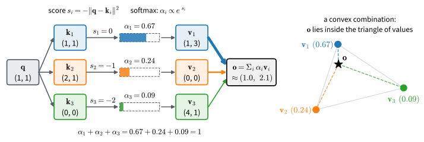

# Queries, Keys, and Values
:label:`sec_queries-keys-values`

A recurrent neural network (:numref:`sec_rnn`) compresses everything it has
read into a fixed-size state vector before knowing which details a later
prediction will require. For example, a recurrent model with hidden dimension
768 reading 1,024 tokens must summarize all 1,024 positions in 768 numbers.

A database avoids premature compression by storing records verbatim and
deciding what to retrieve only when a query arrives. However, an exact
database lookup is discontinuous: given key--value pairs
$\mathcal{D}=\{(2,10),(5,20)\}$, the exact query $q=5$ returns $20$, whereas
$q=4$ matches no key. To train with gradient descent, we replace hard lookup
with a *soft* lookup that scores every key—say, by negative squared distance
$a(q,k)=-(q-k)^2$—and converts the scores into convex weights via a softmax.
At $q=4$, the scores for keys $2$ and $5$ are $-4$ and $-1$, giving weights
$e^{-4}/(e^{-4}+e^{-1}) \approx 0.05$ and $0.95$, and a weighted value
$0.05 \cdot 10 + 0.95 \cdot 20 \approx 19.5$. The output varies smoothly
with the query, scales to any number of stored records, and requires no
fixed-size bottleneck prior to querying.

This differentiable key--value lookup is the *attention mechanism*
:cite:`Bahdanau.Cho.Bengio.2014`. We first formulate attention pooling for
vector queries, keys, and values, and then examine its classical
nonparametric precursor, Nadaraya--Watson kernel regression, where a single
bandwidth parameter controls the sharpness of the lookup.

```{.python .input #queries-keys-values-queries-keys-and-values}
%%tab pytorch
import math
import numpy as np
import torch
from torch import nn
from torch.nn import functional as F
from d2l import torch as d2l
```

```{.python .input #queries-keys-values-queries-keys-and-values}
%%tab jax
import math
import numpy as np
import jax
from jax import numpy as jnp
from flax import nnx
import optax
from d2l import jax as d2l
```

## Attention as Differentiable Lookup

Let $\mathcal{D} \stackrel{\textrm{def}}{=} \{(\mathbf{k}_1, \mathbf{v}_1),
\ldots, (\mathbf{k}_m, \mathbf{v}_m)\}$ be a database of $m$ key--value pairs
with keys $\mathbf{k}_i \in \mathbb{R}^{d}$ and values $\mathbf{v}_i \in
\mathbb{R}^{d_v}$. Given a query $\mathbf{q} \in \mathbb{R}^{d}$, *attention
pooling* returns a weighted sum of the values:

$$\textrm{Attention}(\mathbf{q}, \mathcal{D}) \stackrel{\textrm{def}}{=} \sum_{i=1}^m \alpha(\mathbf{q}, \mathbf{k}_i) \mathbf{v}_i,$$
:eqlabel:`eq_attention_pooling`

where $\alpha(\mathbf{q},\mathbf{k}_i) \ge 0$ and $\sum_{i=1}^m
\alpha(\mathbf{q},\mathbf{k}_i) = 1$. The output is therefore a convex
combination of the values, interpolating between exact lookup (a one-hot
weight vector) and average pooling (uniform weights $1/m$).

To map arbitrary real-valued compatibility scores $a(\mathbf{q},
\mathbf{k}_i)$ to convex weights, we apply the softmax function
(:numref:`sec_softmax`):

$$\alpha(\mathbf{q}, \mathbf{k}_i) = \frac{\exp(a(\mathbf{q}, \mathbf{k}_i))}{\sum_j \exp(a(\mathbf{q}, \mathbf{k}_j))}.$$
:eqlabel:`eq_softmax_attention`

Because $\alpha_i = 1 / \big(1 + \sum_{j \neq i} e^{a_j - a_i}\big)$, the
weights depend only on score differences $a_j - a_i$ and are invariant to
adding a constant across all keys. Both the softmax and the linear
combination are differentiable with respect to $\mathbf{q}$, $\mathbf{k}_i$,
and $\mathbf{v}_i$.

As a concrete vector example, take $a(\mathbf{q}, \mathbf{k}) = -\|\mathbf{q}
- \mathbf{k}\|^2$ with query $\mathbf{q} = (1, 1)$, keys $\mathbf{k}_1 = (1,
1)$, $\mathbf{k}_2 = (2, 1)$, $\mathbf{k}_3 = (0, 0)$, and values
$\mathbf{v}_1 = (1, 3)$, $\mathbf{v}_2 = (0, 0)$, $\mathbf{v}_3 = (4, 1)$.
The scores are $0$, $-1$, and $-2$, yielding softmax weights
$(1, e^{-1}, e^{-2}) / (1 + e^{-1} + e^{-2}) \approx (0.67, 0.24, 0.09)$ and
output

$$\mathbf{o} = 0.67\,(1, 3) + 0.24\,(0, 0) + 0.09\,(4, 1) \approx (1.0, 2.1).$$

Notice two properties illustrated in :numref:`fig_qkv`. First, even though
$\mathbf{k}_1$ matches $\mathbf{q}$ exactly, it receives only two-thirds of
the weight; scaling the scores by a factor of $10$ (to $0, -10, -20$)
concentrates $99.995\%$ of the weight on $\mathbf{k}_1$. Thus the magnitude
of the scores governs how sharply the softmax commits. Second, although
$\mathbf{v}_2 = (0, 0)$ adds zero to the sum, its $0.24$ weight still pulls
the output toward the origin by diluting the other values.


:label:`fig_qkv`

The attention rule :eqref:`eq_attention_pooling` applies unchanged to any
number of records $m$, allowing a single layer to process sequences of
arbitrary length without compressing them into a fixed-size state. The cost
shifts to memory: whereas a recurrent layer of width 768 keeps 768 numbers,
one 12-head attention layer of GPT-2 small ($d = 64$ per head) over 1,024
tokens stores $2 \times 1{,}024 \times 64 = 131{,}072$ key and value entries
per head, or roughly $1.6 \times 10^6$ numbers across all 12 heads.

## Attention Pooling with Fixed Kernels
:label:`sec_attention-pooling`

Long before deep learning, *Nadaraya--Watson kernel regression*
:cite:`Nadaraya.1964,Watson.1964` used :eqref:`eq_attention_pooling` for
nonparametric regression, treating training inputs as keys, training labels
as values, and a fixed similarity kernel as the scoring rule.

### Kernels and the Nadaraya--Watson Estimator

Given a nonnegative similarity kernel $K(\mathbf{q}, \mathbf{k})$, such as
the Gaussian kernel with *bandwidth* $\sigma > 0$,

$$K(\mathbf{q}, \mathbf{k}) = \exp\left(-\frac{\|\mathbf{q} - \mathbf{k}\|^2}{2\sigma^2}\right),$$

normalizing across keys yields the *Nadaraya--Watson estimator*:

$$f(\mathbf{q}) = \sum_i \mathbf{v}_i \frac{K(\mathbf{q}, \mathbf{k}_i)}{\sum_j K(\mathbf{q}, \mathbf{k}_j)}.$$
:eqlabel:`eq_nadaraya-watson`

For any strictly positive kernel, :eqref:`eq_nadaraya-watson` is softmax
attention :eqref:`eq_softmax_attention` with score $a(\mathbf{q}, \mathbf{k})
= \log K(\mathbf{q}, \mathbf{k})$. For the Gaussian kernel, $a(\mathbf{q},
\mathbf{k}) = -\|\mathbf{q} - \mathbf{k}\|^2 / (2\sigma^2)$, which recovers
our opening example when $2\sigma^2 = 1$. Under regularity conditions on the
density and target function, as $m \to \infty$ and $\sigma \to 0$ at an
appropriate rate, $f(\mathbf{q})$ converges to the conditional expectation
$\mathbb{E}[y \mid \mathbf{q}]$ :cite:`mack1982weak`.

### The Bandwidth

To see how the bandwidth $\sigma$ controls the estimator, we draw $n = 40$
noisy training observations from $y = 2\sin(x) + x + \epsilon$ with $\epsilon
\sim \mathcal{N}(0, 1)$ on $[0, 5)$ and evaluate predictions on a dense grid.

```{.python .input #queries-keys-values-nadaraya-watson-regression-in-action-1}
%%tab pytorch
n = 40
x_train, _ = torch.sort(torch.rand(n) * 5)
y_train = 2 * torch.sin(x_train) + x_train + torch.randn(n)
x_val = torch.arange(0, 5, 0.1)
y_val = 2 * torch.sin(x_val) + x_val
```

```{.python .input #queries-keys-values-nadaraya-watson-regression-in-action-1}
%%tab jax
n = 40
x_train = jnp.sort(jax.random.uniform(d2l.get_key(), (n,)) * 5)
y_train = (2 * jnp.sin(x_train) + x_train
           + jax.random.normal(d2l.get_key(), (n,)))
x_val = jnp.arange(0, 5, 0.1)
y_val = 2 * jnp.sin(x_val) + x_val
```

The implementation computes all pairwise query--key distances, evaluates the
Gaussian kernel, normalizes each query row, and multiplies by `y_train`.

```{.python .input #queries-keys-values-nadaraya-watson-regression-in-action-2}
%%tab pytorch, jax
def nadaraya_watson(x_train, y_train, x_val, sigma):
    dists = x_val[:, None] - x_train[None, :]  # (queries, keys)
    k = d2l.exp(-dists**2 / (2 * sigma**2))
    attention_w = k / k.sum(1, keepdims=True)  # Normalize over the keys
    return attention_w @ y_train, attention_w
```

As $\sigma \to 0$, all weight concentrates on the nearest training point
(1-nearest-neighbor interpolation); as $\sigma \to \infty$, all weights
approach $1/n$ (the global sample mean). We plot $\sigma \in \{0.1, 0.5,
2.0\}$ below.

```{.python .input #queries-keys-values-nadaraya-watson-regression-1}
%%tab pytorch, jax
sigmas = (0.1, 0.5, 2.0)
estimates = [nadaraya_watson(x_train, y_train, x_val, s)[0] for s in sigmas]
d2l.plot([x_val] * 4 + [x_train], estimates + [y_val, y_train], 'x', 'y',
         legend=[rf'$\sigma$ = {s:g}' for s in sigmas] + ['truth'],
         fmts=('-', 'm--', 'g-.', 'k:', 'C7o'), ylim=(-2.5, 9),
         figsize=(5, 3), legend_loc='upper left')
```

A narrow bandwidth ($\sigma = 0.1$) overfits individual noisy labels, while a
wide bandwidth ($\sigma = 2.0$) oversmooths toward a horizontal line. The
intermediate value $\sigma = 0.5$ tracks the true curve closely except near
the boundaries, where all neighbors lie on one side. In practice $\sigma$ can
be chosen by leave-one-out cross-validation, which requires only zeroing the
diagonal of the weight matrix and renormalizing its rows (Exercise
:exref:`ex_queries-keys-values-learned-metric`).

More broadly, $1/\sigma^2$ acts as an inverse temperature multiplying the
raw scores $-\tfrac{1}{2}(q - k)^2$ before the softmax. Scaling scores up
stretches pairwise gaps and drives the softmax toward a one-hot lookup;
scaling scores down compresses gaps and drives the softmax toward uniform
averaging. We will see this same temperature scaling in dot-product attention
(:numref:`sec_attention-scoring-functions`).

## Attention Weights as a Diagnostic

Because each row of the attention matrix $\mathbf{A}$ is a probability
distribution over keys, plotting $\mathbf{A}$ as a heatmap shows which keys
each query consults.

```{.python .input #queries-keys-values-nadaraya-watson-regression-in-action-3}
%%tab pytorch, jax
w_narrow, w_wide = (nadaraya_watson(x_train, y_train, x_val, s)[1]
                    for s in (0.1, 2.0))
# show_heatmaps takes (rows of panels, columns of panels, queries, keys)
d2l.show_heatmaps(d2l.stack([w_narrow, w_wide])[None],
                  xlabel='training inputs (keys)',
                  ylabel='test inputs (queries)',
                  titles=[r'$\sigma$ = 0.1', r'$\sigma$ = 2'],
                  figsize=(7, 3), cbar='each')
```

At $\sigma = 0.1$, weight concentrates in a narrow diagonal band around the
nearest training inputs; at $\sigma = 2.0$, weight spreads broadly across the
dataset (peaking near $1/40 = 0.025$).

Two caveats apply when inspecting attention heatmaps in deep networks:

1. **Weights show where a layer looks, not what it transmits:** A key can
   receive a large attention weight even if its value vector is zero (as with
   $\mathbf{v}_2 = (0, 0)$ in our vector example) or lies in the null space
   of downstream projections. Verifying a head's causal role requires
   interventional experiments (:numref:`sec_what-attention-computes`).
2. **Fixed kernels enforce a static similarity metric:** In
   :eqref:`eq_nadaraya-watson`, every query uses the same Euclidean distance
   in input space. In sequence modeling, however, relevance is context- and
   task-dependent—a verb may need its syntactic subject several tokens away.
   Learned attention layers therefore project inputs into trainable query,
   key, and value spaces before scoring.

## Summary

* Attention pooling computes a convex combination of value vectors
  $\sum_i \alpha(\mathbf{q}, \mathbf{k}_i)\mathbf{v}_i$, where softmax
  weights $\alpha(\mathbf{q}, \mathbf{k}_i)$ interpolate smoothly between
  exact lookup and average pooling.
* Unlike a fixed-size recurrent state, attention accesses all stored
  key--value pairs directly; the rule is independent of the number of pairs
  $m$, while memory scales linearly with $m$.
* Nadaraya--Watson kernel regression is attention pooling with a fixed
  similarity kernel; its bandwidth $\sigma$ acts as a softmax temperature
  controlling the bias--variance and sharpness trade-off.
* Attention heatmaps visualize query--key alignments, but learned projections
  and scoring functions are required to go beyond fixed input-space distance.

## Exercises

1. **An average of two values.** Let the keys $\mathbf{k}_1, \ldots,
   \mathbf{k}_m$ be orthonormal and let the score be $a(\mathbf{q},
   \mathbf{k}) = \mathbf{q}^\top \mathbf{k}$ with the weights
   of :eqref:`eq_softmax_attention`.
    1. For the query $\mathbf{q} = c\,(\mathbf{k}_a + \mathbf{k}_b)$ with
       $c > 0$, compute all $m$ weights and show that the output tends to
       $\tfrac{1}{2}(\mathbf{v}_a + \mathbf{v}_b)$ as $c \to \infty$.
    1. How large must $c$ be for the two selected keys to receive at least
       99% of the total weight when $m = 10$?
    1. Now let the keys be orthogonal with $\|\mathbf{k}_b\| =
       2\,\|\mathbf{k}_a\|$. Find a query that again averages
       $\mathbf{v}_a$ and $\mathbf{v}_b$, and state what
       $\mathbf{q} = c\,(\mathbf{k}_a + \mathbf{k}_b)$ returns instead as
       $c \to \infty$.

    *Adapted from Stanford CS224N,
    [Assignment 4](https://web.stanford.edu/class/cs224n/assignments_w25/a4.pdf),
    Problems 1(b) and 1(c).*
   :exlabel:`ex_queries-keys-values-average-two-values`

1. [code] **Effective number of keys.** For the weights $\alpha_i(q)$ of
   one query, define the effective number of keys
   $n_{\textrm{eff}}(q) = 1 / \sum_i \alpha_i(q)^2$.
    1. Let the values be $y_i = g(x_i) + \epsilon_i$ with independent noise
       of variance $s^2$, and hold the keys fixed. Show that the variance of
       the estimate :eqref:`eq_nadaraya-watson` at $q$ is
       $s^2 / n_{\textrm{eff}}(q)$.
    1. Compute $n_{\textrm{eff}}$ at every query in `x_val` from the weights
       that `nadaraya_watson` returns, for each bandwidth in `sigmas`, and
       plot the three curves. Then redraw the noise in `y_train` 200 times
       with `x_train` fixed, and compare the standard deviation of the
       estimate at each query with $1 / \sqrt{n_{\textrm{eff}}(q)}$.

1. [code] **The gradient of attention.** ● Suppose that $a(\mathbf{q},
   \mathbf{k}_i) = \mathbf{q}^\top \mathbf{k}_i$ and that $\mathbf{k}_i =
   \mathbf{v}_i$ for $i = 1, \ldots, m$. Denote by $p(\mathbf{k}_i;
   \mathbf{q})$ the distribution over keys defined by the softmax
   normalization :eqref:`eq_softmax_attention`.
    1. Prove that
       $$\nabla_{\mathbf{q}} \mathop{\textrm{Attention}}(\mathbf{q}, \mathcal{D}) = \textrm{Cov}_{p(\mathbf{k}_i; \mathbf{q})}[\mathbf{k}_i].$$
    1. Conclude that this Jacobian is positive semidefinite, and determine
       for which databases it is the zero matrix.
    1. Let $\mathbf{q} = c\,\mathbf{u}$ for a fixed direction $\mathbf{u}$
       for which exactly one key attains the largest score
       $\mathbf{u}^\top \mathbf{k}_i$. Find the limit of the Jacobian as
       $c \to \infty$, and state what it implies for training the query by
       gradient descent.
    1. Verify the identity and the limit with automatic differentiation on
       a random database with $m = 8$ and $d = 4$.

1. [code] **Soft lookup as retrieval.** ● Build a database of $m$ keys
   drawn uniformly from the unit sphere in $\mathbb{R}^{16}$, with value
   $\mathbf{v}_i$ the one-hot indicator of index $i$, and weight them with
   the Gaussian kernel of bandwidth $\sigma$ normalized as
   in :eqref:`eq_nadaraya-watson`, so that the output is the vector of
   weights. Query with a noisy copy $\mathbf{q} = \mathbf{k}_i +
   \boldsymbol{\epsilon}$ of a stored key, with $\boldsymbol{\epsilon} \sim
   \mathcal{N}(\mathbf{0}, \tau^2 \mathbf{I})$.
    1. Show that the largest weight goes to the key nearest the query for
       every $\sigma > 0$, so the bandwidth does not affect which index
       wins. It does affect how much of the weight the winner takes.
    1. Without noise, the weight on the correct key is
       $$\alpha_i = \frac{1}{1 + \sum_{j \neq i} \exp\big(-\|\mathbf{k}_i - \mathbf{k}_j\|^2 / 2\sigma^2\big)}.$$
       Approximate $\mathbf{k}_i^\top \mathbf{k}_j \approx 0$ for random
       unit vectors, so that $\|\mathbf{k}_i - \mathbf{k}_j\|^2 \approx 2$,
       and derive the bandwidth at which $\alpha_i$ falls to $0.9$ for
       $m = 20$ and for $m = 200$. How must $\sigma$ shrink as $m$ grows?
    1. A lookup whose output the next layer can use needs most of the
       weight on one key, not merely the largest share. Call the query
       retrieved when $\alpha_i \geq 0.5$. Sweep $\tau$ from $0$ to $1$ at
       $m = 20$ and $m = 200$, with the bandwidth from (b) for each $m$,
       and plot the retrieval accuracy against $\tau$. Compute the weights as the softmax
       :eqref:`eq_softmax_attention` of the scores
       $-\|\mathbf{q} - \mathbf{k}_j\|^2 / 2\sigma^2$. Explain why a larger
       $m$ lowers the accuracy at fixed $\tau$ although the distance from
       the query to the correct key is unchanged.

1. [extended] **A learned metric.** ● Kernel regression with a learned
   distance :cite:`Weinberger.Tesauro.2007` replaces the fixed similarity
   of :eqref:`eq_nadaraya-watson` by a learned one. Draw $n = 200$ inputs
   $\mathbf{x}_i$ uniformly from $[0, 5]^5$ and labels $y_i =
   2\sin(x_{i1}) + x_{i1} + \epsilon_i$ with standard Gaussian noise, so
   that only the first coordinate matters. Score a query against a key by
   $$a(\mathbf{q}, \mathbf{k}) = -\tfrac{1}{2} \|\mathbf{W}(\mathbf{q} - \mathbf{k})\|^2, \qquad \mathbf{W} = \textrm{diag}(w_1, \ldots, w_5),$$
   normalize as in :eqref:`eq_softmax_attention`, and fit $\mathbf{W}$ to
   the leave-one-out error, in which the estimate at $\mathbf{x}_i$
   excludes the pair $(\mathbf{x}_i, y_i)$. Measure the test error on
   $1000$ fresh inputs against the noise-free function.
    1. Fit the isotropic kernel $w_1 = \cdots = w_5 = 1/\sigma$ by a grid
       search over $\sigma$.
    1. Starting from the isotropic solution, fit the five scales by gradient
       descent. Compare the learned scales with the relevance of each
       coordinate, and the test error with that of the isotropic kernel and
       of an oracle that uses only the first coordinate at its best
       bandwidth.
    1. Compare the leave-one-out errors of the learned and the oracle
       metrics with their test errors, and repeat the comparison at
       $n = 1000$. What does the result say about learning a similarity from
       a finite sample?
    1. A full matrix $\mathbf{W} \in \mathbb{R}^{5 \times 5}$ maps queries
       and keys by the same linear map, whereas learned attention maps them
       by separate matrices $\mathbf{W}_q$ and $\mathbf{W}_k$. State two
       properties of the score $a$ that the shared map guarantees and
       separate maps lose.
   :exlabel:`ex_queries-keys-values-learned-metric`

[Discussions](https://d2l.discourse.group/t/36768)

<!-- slides -->

::: {.slide}
::: {.cover}
[Dive into Deep Learning · §10.1]{.kicker}

Queries, Keys, and Values: From Nonparametric Smoothing to Attention<br>**differentiable lookup · convex combinations · Nadaraya–Watson kernel regression · bandwidth as temperature**
:::
:::

::: {.slide title="Why Fixed-Size Recurrent States Lose Early Context"}
[Motivation]{.kicker}

::: {.cols .vc}
::: {.col}
- **Concrete Capacity Gap:** In a GPT-2 small scale model ($d = 768$) reading $n = 1{,}024$ tokens, the token representations hold $1{,}024 \times 768 = 786{,}432$ numbers, whereas a recurrent state keeps only $768$ numbers.
- **Premature Summarization:** An RNN writes $\mathbf{h}_t$ at step $t$ without knowing whether token $t$ will be needed $900$ steps later.
- **The Database Alternative:** Store all $m$ records verbatim in $O(md)$ memory and retrieve relevant values only when a **query** arrives.
:::

::: {.col .fig .big}
@fig:ch10-attn-qkv-state-vs-db
:::
:::
:::

::: {.slide title="Why Exact Database Lookup Cannot Be Trained"}
[From Hard to Soft Lookup]{.kicker}

::: {.cols .vc}
::: {.col}
- **Discontinuous Hard Lookup:** Given $\mathcal{D} = \{(2, 10), (5, 20)\}$, exact query $q = 5$ returns $20$, whereas $q = 4$ finds no match (or jumps abruptly at midpoint $q = 3.5$).
- **Zero Gradient Everywhere:** Because a piecewise-constant step function is flat away from jumps, its derivative with respect to queries and keys is zero almost everywhere.
- **Differentiable Relaxation:** Score *every* key against the query and return a smooth softmax-weighted average of all stored values.
:::

::: {.col .fig .big}
@fig:ch10-attn-qkv-hard-vs-soft
:::
:::
:::

::: {.slide title="Worked Example: Soft Lookup on Two Scalar Records"}
[Scalar Soft Lookup]{.kicker}

::: {.cols .vc}
::: {.col}
- **Score with Negative Squared Distance:** At query $q = 4$, keys $k_1 = 2$ and $k_2 = 5$ score $a_1 = -(4-2)^2 = -4$ and $a_2 = -(4-5)^2 = -1$.
- **Normalize via Softmax:** Exponentiating and dividing by $e^{-4} + e^{-1}$ yields weights $\alpha_1 \approx 0.047$ and $\alpha_2 \approx 0.953$.
- **Convex Value Sum:**
  $$\textrm{Attention}(q=4, \mathcal{D}) = 0.047(10) + 0.953(20) \approx 19.53$$
:::

::: {.col .fig}
@fig:ch10-attn-qkv-scalar-trace
:::
:::
:::

::: {.slide title="Formalizing Attention Pooling Over Vector Records"}
[Mathematical Formulation]{.kicker}

::: {.cols .vc}
::: {.col}
- **Attention Pooling:** Over $m$ records $\mathcal{D} = \{(\mathbf{k}_i, \mathbf{v}_i)\}_{i=1}^m$ with $\mathbf{q}, \mathbf{k}_i \in \mathbb{R}^d$ and $\mathbf{v}_i \in \mathbb{R}^{d_v}$:
  $$\textrm{Attention}(\mathbf{q}, \mathcal{D}) \stackrel{\textrm{def}}{=} \sum_{i=1}^m \alpha(\mathbf{q}, \mathbf{k}_i)\,\mathbf{v}_i \in \mathbb{R}^{d_v}$$
- **Simplex Constraint:** $\alpha(\mathbf{q}, \mathbf{k}_i) \ge 0$ and $\sum_{i=1}^m \alpha(\mathbf{q}, \mathbf{k}_i) = 1$, confining the output to the convex hull of $\{\mathbf{v}_i\}$.
- **Interpolation Spectrum:** One-hot weights $\mathbf{e}_{i^*}$ recover exact lookup; uniform weights $1/m$ recover average pooling.
:::

::: {.col .fig}
@fig:ch10-attn-qkv-simplex-spectrum
:::
:::
:::

::: {.slide title="From Compatibility Scores to Softmax Weights"}
[Softmax Normalization]{.kicker}

::: {.cols .vc}
::: {.col}
- **Softmax Map:** Any real compatibility score $a(\mathbf{q}, \mathbf{k}_i) \in \mathbb{R}$ maps to the simplex via:
  $$\alpha(\mathbf{q}, \mathbf{k}_i) = \frac{\exp(a(\mathbf{q}, \mathbf{k}_i))}{\sum_{j=1}^m \exp(a(\mathbf{q}, \mathbf{k}_j))}$$
- **Shift Invariance:** Adding any key-independent constant $c(\mathbf{q})$ to all scores cancels out, so weights depend only on differences $a_j - a_i$.
- **Numerical Stability:** Subtracting $M = \max_j a_j$ bounds all exponents by $0$, preventing overflow or $0/0$ underflow.
:::

::: {.col .fig}
@fig:ch10-attn-qkv-shift-invariance
:::
:::
:::

::: {.slide title="Worked Example: Vector Soft Lookup in the Plane"}
[2D Vector Lookup]{.kicker}

::: {.cols .vc}
::: {.col}
- **Query $\mathbf{q} = (1, 1)$ over 3 Records:** Under $s_i = -\|\mathbf{q} - \mathbf{k}_i\|^2$, keys $(1,1)$, $(2,1)$, and $(0,0)$ score $0, -1, -2$ and receive weights $(0.67, 0.24, 0.09)$.
- **Imperfect Commitment:** Even exact match $\mathbf{k}_1 = \mathbf{q}$ captures only $67\%$ of the weight unless scores are scaled up.
- **Zero-Value Dilution:** Record 2 has value $\mathbf{v}_2 = (0, 0)$, which adds zero to the sum yet absorbs $24\%$ of the weight and pulls $\mathbf{o} \approx (1.03, 2.09)$ toward the origin.
:::

::: {.col .fig .big}
@fig:ch10-attn-qkv-vector-trace
:::
:::
:::

::: {.slide title="Geometric View: Convex Hull of Stored Values"}
[Geometry of Attention]{.kicker}

::: {.cols .vc}
::: {.col}
- **Convex Hull Invariant:** Because $\alpha_i \ge 0$ and $\sum_{i=1}^m \alpha_i = 1$, the output $\mathbf{o}$ is strictly confined to the convex hull of $\{\mathbf{v}_1, \ldots, \mathbf{v}_m\}$ (the triangle with corners $(1,3)$, $(0,0)$, and $(4,1)$).
- **Score Scaling Sharpens Commitment:** Multiplying all scores by $10$ (to $0, -10, -20$) concentrates $99.995\%$ of the weight on $\mathbf{k}_1$, pulling $\mathbf{o}$ onto the vertex $\mathbf{v}_1 = (1, 3)$.
- **No Extrapolation:** Softmax attention interpolates among stored values; it can never output a point outside their convex hull.
:::

::: {.col .fig}
{.nostretch width=100%}
:::
:::
:::

::: {.slide title="Length Independence vs. Linear Memory Scaling"}
[Systems Scaling]{.kicker}

::: {.cols .vc}
::: {.col}
- **Length-Independent Rule:** The attention pooling operator $\sum_{i=1}^m \alpha(\mathbf{q}, \mathbf{k}_i)\mathbf{v}_i$ has no parameters tied to the context length $m$.
- **Linear Key–Value Memory:** At $m = 1{,}024$ in GPT-2 small ($d = 768, H = 12, d_h = 64$), one head stores $2 \times 1{,}024 \times 64 = 131{,}072$ floats ($1.57\text{M}$ floats across $12$ heads, vs. $768$ in an RNN).
- **Direct 1-Hop Access:** Token $m$ scores token $1$ directly via $\alpha(\mathbf{q}_m, \mathbf{k}_1)$ without recurrent compression.
:::

::: {.col .fig .big}
@fig:ch10-attn-qkv-memory-scaling
:::
:::
:::

::: {.slide title="Classical Precursor: Nadaraya–Watson Regression"}
[Nonparametric Statistics (1964)]{.kicker}

Long before deep learning, Nadaraya (1964) and Watson (1964) formulated nonparametric regression as attention pooling over a training dataset $\{(x_i, y_i)\}_{i=1}^n$:

$$f(q) = \sum_{i=1}^n y_i \, \frac{K(q, x_i)}{\sum_{j=1}^n K(q, x_j)}, \qquad K(q, k) = \exp\!\left(-\frac{\|q - k\|^2}{2\sigma^2}\right)$$

- **Database Identification:** Training inputs $x_i$ act as **keys**, training labels $y_i$ act as **values**, and the test location $q$ acts as the **query**.
- **Equivalence to Softmax Attention:** For any strictly positive kernel $K(q, k) > 0$, normalizing $K(q, x_i)$ across keys is identical to softmax attention with score $a(q, k) = \log K(q, k) = -\|q - k\|^2 / (2\sigma^2)$.
- **Statistical Consistency:** As $n \to \infty$ and bandwidth $\sigma \to 0$ at an appropriate rate, $f(q)$ converges to the true conditional expectation $\mathbb{E}[y \mid x = q]$.
:::

::: {.slide title="Synthetic Benchmark and Vectorized Implementation"}
[Code Implementation]{.kicker}

We draw $n = 40$ noisy observations from $y = 2\sin(x) + x + \epsilon$ with $\epsilon \sim \mathcal{N}(0, 1)$ on $[0, 5)$ and compute all query–key distances via broadcasting:

::: {.cols .vc}
::: {.col}
- **Broadcasted Distance Matrix:** `x_val[:, None] - x_train[None, :]` broadcasts `(50, 1)` against `(1, 40)` to form the `(50, 40)` matrix of pairwise differences $q - k_i$.
- **Row-Wise Normalization:** `k / k.sum(1, keepdims=True)` normalizes each query row over all $40$ keys, and `attention_w @ y_train` computes all $50$ predictions in one matrix–vector product.
:::

::: {.col .fig}
@queries-keys-values-nadaraya-watson-regression-in-action-2
:::
:::
:::

::: {.slide title="How Bandwidth Controls the Bias–Variance Trade-Off"}
[Visualizing the Estimator]{.kicker}

::: {.cols .vc}
::: {.col}
- **Narrow Bandwidth ($\sigma = 0.1$):** Low bias, high variance; weight concentrates on the closest training point ($\to$ 1-NN interpolation as $\sigma \to 0$), chasing individual noise spikes.
- **Intermediate ($\sigma = 0.5$):** Tracks the true curve $2\sin(x) + x$ closely across the interior, lagging only near the boundaries where all neighbors lie on one side.
- **Wide Bandwidth ($\sigma = 2.0$):** High bias, low variance; weights flatten toward $1/n$, oversmoothing toward the global sample mean $\bar{y}$.
:::

::: {.col .fig}
@!queries-keys-values-nadaraya-watson-regression-1
:::
:::
:::

::: {.slide title="Bandwidth as Inverse Softmax Temperature"}
[The Sharpness Dial]{.kicker}

::: {.cols .vc}
::: {.col}
- **Inverse Variance as Temperature ($\beta = 1/\sigma^2$):**
  $$\alpha_i(q) = \mathrm{softmax}_i\!\left(\frac{1}{\sigma^2} \cdot \left(-\frac{1}{2}\|q - k_i\|^2\right)\right)$$
- **Low Temperature ($\sigma \to 0$, large $1/\sigma^2$):** Stretches pairwise score gaps $\Delta a / \sigma^2 \to \infty$, driving the softmax toward a **one-hot argmax** lookup.
- **High Temperature ($\sigma \to \infty$, small $1/\sigma^2$):** Compresses score gaps toward zero, driving weights toward **uniform $1/n$** averaging (moving $\sigma: 2.0 \to 0.1$ multiplies score gaps by $400\times$).
:::

::: {.col .fig}
@fig:ch10-attn-qkv-temperature-dial
:::
:::
:::

::: {.slide title="Effective Number of Keys and Estimator Variance"}
[Statistical Diagnostics]{.kicker}

How many keys effectively contribute to a query's prediction? If $y_i = g(x_i) + \epsilon_i$ with independent observation noise $\textrm{Var}(\epsilon_i) = s^2$, the conditional variance of the attention estimate is:

$$\textrm{Var}\!\left(\sum_{i=1}^n \alpha_i(q)\, y_i \,\middle|\, \mathbf{x}\right) = s^2 \sum_{i=1}^n \alpha_i(q)^2 = \frac{s^2}{n_{\textrm{eff}}(q)}, \qquad n_{\textrm{eff}}(q) \stackrel{\textrm{def}}{=} \frac{1}{\sum_{i=1}^n \alpha_i(q)^2}$$

- **Effective Sample Size $n_{\textrm{eff}}(q) \in [1, n]$:** Measures how many training values are effectively averaged at query $q$.
- **One-Hot Limit ($\sigma \to 0$):** $\sum_i \alpha_i^2 = 1$ $\to$ $n_{\textrm{eff}}(q) = 1$, leaving the full single-observation noise variance $s^2$.
- **Uniform Limit ($\sigma \to \infty$):** $\alpha_i = 1/n$ $\to$ $\sum_i \alpha_i^2 = 1/n$ $\to$ $n_{\textrm{eff}}(q) = n$, reducing noise variance to $s^2/n$.
:::

::: {.slide title="Inspecting Attention Weight Heatmaps"}
[Visual Diagnostics]{.kicker}

::: {.cols .vc}
::: {.col}
- **Row-Stochastic Matrix:** Each row of $\mathbf{A} \in \mathbb{R}^{n_q \times n_k}$ is a probability distribution over keys for one query.
- **Diagonal Band at $\sigma = 0.1$:** Sorted queries and keys form a thin diagonal ridge where each query consults only $2$–$3$ local keys.
- **Diffuse Sheet at $\sigma = 2.0$:** Probability mass spreads across almost all $40$ keys, peaking near the uniform baseline $1/40 = 0.025$.
:::

::: {.col .fig}
@!queries-keys-values-nadaraya-watson-regression-in-action-3
:::
:::
:::

::: {.slide title="Pitfall 1: Out-of-Range Queries and Underflow"}
[Numerical & Statistical Pitfalls]{.kicker}

::: {.cols .vc}
::: {.col}
- **Convex-Hull Clamping:** As $q \to \infty$ beyond $[0, 5)$, the closest boundary key $x_{\max}$ dominates all others, so $f(q) \to y_{\max}$ (a flat asymptote that cannot follow a linear trend).
- **Float32 Underflow to `NaN`:** At $q = 15, \sigma = 0.5$, exponent $-(q - x_i)^2/(2\sigma^2) < -200$ underflows `float32` $\exp(-200) \to 0.0$, so `k / k.sum()` evaluates `0.0 / 0.0 = NaN`!
- **Fix:** Pass log-scores $-(q - k_i)^2/(2\sigma^2)$ directly to a max-subtracted `softmax`.
:::

::: {.col .fig .big}
@fig:ch10-attn-qkv-underflow-pitfall
:::
:::
:::

::: {.slide title="Pitfall 2: Why Fixed Kernels and Heatmaps Mislead"}
[Interpretability & Modeling Limits]{.kicker}

Before building deep attention layers, keep two fundamental limitations of fixed-kernel pooling in mind:

- **1. Attention Weights Show *Where* a Layer Looks, Not *What* It Transmits:** In our 2D vector example, key $\mathbf{k}_2 = (2, 1)$ captured $24\%$ of the attention weight even though its value $\mathbf{v}_2 = (0, 0)$ transmitted nothing. In deep networks, a heavily attended token whose value lies in the null space of downstream projections has zero causal effect.
- **2. Fixed Input-Space Metrics Cannot Capture Syntactic or Task Relevance:** Nadaraya–Watson measures Euclidean distance $\|q - k\|^2$ in raw input coordinates with a single isotropic bandwidth $\sigma$.
- **Why Deep Networks Learn Projections:** In language or vision, a verb seeking its subject or a pronoun seeking its antecedent needs **learned query, key, and value projections** ($\mathbf{W}_q, \mathbf{W}_k, \mathbf{W}_v$) so the task defines similarity.
:::

::: {.slide title="Concept Check: Soft Lookup, Bandwidth, and Scaling"}
[Check Your Understanding]{.kicker}

Work out these three questions from the softmax attention equations:

1. **Bandwidth Halving:** At bandwidth $\sigma$, two keys receive attention weights in the ratio $\alpha_1 / \alpha_2 = 2 : 1$. If we halve the bandwidth to $\sigma / 2$, what is the new weight ratio $\alpha_1' / \alpha_2'$?
2. **Orthonormal Key Averaging:** Let $\mathbf{k}_1, \ldots, \mathbf{k}_m$ be orthonormal with dot-product score $a(\mathbf{q}, \mathbf{k}_i) = \mathbf{q}^\top \mathbf{k}_i$. What happens to the attention output for query $\mathbf{q} = c\,(\mathbf{k}_1 + \mathbf{k}_2)$ as $c \to \infty$?
3. **Vanishing Query Gradient:** As $c \to \infty$ and $\boldsymbol{\alpha}$ converges to a one-hot vector on a single winning key, what happens to the gradient $\nabla_{\mathbf{q}} \textrm{Attention}(\mathbf{q}, \mathcal{D})$?

::: {.d2l-note .fragment .fade-up}
**Answers:**

1. **$16 : 1$.** Halving $\sigma$ multiplies $1/\sigma^2$ by $4$, so the score difference $\Delta$ becomes $4\Delta$ and $e^{4\Delta} = (e^\Delta)^4 = 2^4 = 16$.
2. **It converges to $\frac{1}{2}(\mathbf{v}_1 + \mathbf{v}_2)$.** Keys $1$ and $2$ tie with score $c$ while all other keys score $0$, so their weights each approach $e^c / (2e^c + m - 2) \to 1/2$.
3. **It vanishes ($\to \mathbf{0}$).** Once a single key holds weight $1$, small perturbations to $\mathbf{q}$ barely alter the weights, saturating the softmax Jacobian.
:::
:::

::: {.slide title="Summary: Differentiable Key–Value Lookup"}
[Key Takeaways]{.kicker}

::: {.cols .vc}
::: {.col}
- **Soft Convex Pooling:** $\textrm{Attention}(\mathbf{q}, \mathcal{D}) = \sum_{i=1}^m \alpha(\mathbf{q}, \mathbf{k}_i)\,\mathbf{v}_i$ where $\boldsymbol{\alpha} \in \Delta^{m-1}$.
- **Temperature & Effective Keys:** Bandwidth $\sigma$ interpolates from nearest-neighbor ($\sigma \to 0, n_{\textrm{eff}} \to 1$) to uniform mean ($\sigma \to \infty, n_{\textrm{eff}} \to m$).
- **Max-Subtract Stability:** Subtracting $m(\mathbf{q}) = \max_j a(\mathbf{q}, \mathbf{k}_j)$ prevents `0/0 = NaN` underflow.
:::

::: {.col .fig .big}
@fig:ch10-attn-qkv-summary
:::
:::
:::
