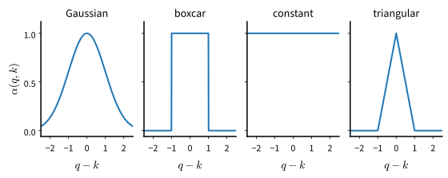
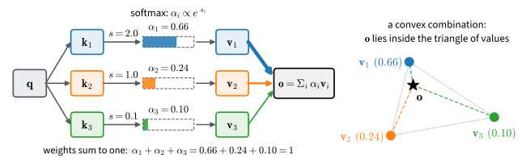

# Queries, Keys, and Values
:label:`sec_queries-keys-values`

A recurrent language model that has read 1,024 tokens holds everything it
knows about them in its state. If that state has 768 numbers, the width of
GPT-2 small, then a question about the 17th token must be answered from 768
numbers that were written before anyone knew the question would be asked.
RNNs (:numref:`sec_rnn`) and convolutions over sequences
:cite:`Kalchbrenner.Grefenstette.Blunsom.2014` both work this way, and on
long inputs the fixed-size summary loses information that a later
prediction needs.

A database avoids the problem. It stores its records as they are and
answers each query by comparing it with the stored keys. Consider the
scalar database $\mathcal{D}=\{(2,10),(5,20)\}$ of (key, value) pairs. The
exact query $q=5$ returns the value 20, and the query $q=4$ returns nothing
at all, because no key matches. A *soft* query instead scores every key,
for example by $a(q,k)=-(q-k)^2$, and turns the scores into weights that
sum to one. For $q=4$ the scores are $-4$ for key 2 and $-1$ for key 5. The
softmax turns them into the weights $e^{-4}/(e^{-4}+e^{-1}) \approx 0.05$
and $0.95$, so the answer is $0.05 \cdot 10 + 0.95 \cdot 20 \approx 19.5$.
The answer moves smoothly with the query, the same rule works for a
database of any size, and nothing has to be compressed before the query
arrives.

The *attention mechanism* :cite:`Bahdanau.Cho.Bengio.2014` is this soft
lookup, used as a layer of a neural network. This section defines it and
studies it in its oldest form, kernel regression, where the weights come
from a fixed similarity function rather than from learning. The next
section makes the scores learnable.

```{.python .input #queries-keys-values-queries-keys-and-values}
%%tab pytorch
%matplotlib inline
from d2l import torch as d2l
import torch
```

```{.python .input #queries-keys-values-queries-keys-and-values}
%%tab jax
%matplotlib inline
from d2l import jax as d2l
import jax
from jax import numpy as jnp
```

## Attention as Differentiable Lookup

Let the query and the keys be vectors $\mathbf{q},\mathbf{k}_i \in
\mathbb{R}^{d}$ and the values $\mathbf{v}_i \in \mathbb{R}^{d_v}$, and let
$\mathcal{D} \stackrel{\textrm{def}}{=} \{(\mathbf{k}_1, \mathbf{v}_1),
\ldots, (\mathbf{k}_m, \mathbf{v}_m)\}$ be a database of $m$ key--value
pairs. The attention output is the weighted sum of the values

$$\textrm{Attention}(\mathbf{q}, \mathcal{D}) \stackrel{\textrm{def}}{=} \sum_{i=1}^m \alpha(\mathbf{q}, \mathbf{k}_i) \mathbf{v}_i,$$
:eqlabel:`eq_attention_pooling`

where the scalar weight $\alpha(\mathbf{q},\mathbf{k}_i)$ says how much
value $i$ contributes. In every softmax attention layer of this book the
weights are nonnegative and sum to one, so the output is a convex
combination of the values: it lies inside their convex hull. Exact lookup
is the special case in which one weight is $1$ and the others are $0$. Uniform
weights $1/m$ give the plain average of the values, *average pooling*.

Weights with these two properties come from any scoring function
$a(\mathbf{q}, \mathbf{k})$ by exponentiating the scores, which makes them
positive, and dividing by their sum. This is the softmax operation of
multinomial logistic regression (:numref:`sec_softmax`):

$$\alpha(\mathbf{q}, \mathbf{k}_i) = \frac{\exp(a(\mathbf{q}, \mathbf{k}_i))}{\sum_j \exp(a(\mathbf{q}, \mathbf{k}_j))}.$$
:eqlabel:`eq_softmax_attention`

The softmax is differentiable, so gradients reach the query, the keys, and
the values. For finite scores and at least two keys its Jacobian is never
the zero matrix, although its entries become very small when one score
dominates the others. Attention can also make hard, nondifferentiable
choices. It must then be trained with reinforcement learning
:cite:`Mnih.Heess.Graves.ea.2014` and is harder to optimize, so this book
uses the differentiable form throughout. :numref:`fig_qkv` works one lookup
through with three keys.


:label:`fig_qkv`

The scoring function has a fixed number of parameters, however many
key--value pairs the database holds. One attention layer therefore serves
inputs of every length, and it reads all of them directly instead of a
compressed summary. What grows instead is memory. A recurrent network
keeps one state, while attention keeps a key and a value for every
position it may need to read.

## Attention Pooling with Fixed Kernels
:label:`sec_attention-pooling`

The weights in :eqref:`eq_attention_pooling` need not be learned. Long
before deep learning, statisticians used the same weighted sum with a
weight function chosen by hand, in Nadaraya--Watson kernel regression
:cite:`Nadaraya.1964,Watson.1964`. On a problem small enough to plot, this
classical setting shows what the weights do. Its limits show why the rest
of the chapter learns them.

### Similarity Kernels

A *kernel* $\alpha(\mathbf{q}, \mathbf{k})$ measures the similarity of a
query and a key, typically as a decreasing function of their distance.
Common choices are

$$
\begin{aligned}
\alpha(\mathbf{q}, \mathbf{k}) & = \exp\left(-\tfrac{1}{2} \|\mathbf{q} - \mathbf{k}\|^2 \right) && \textrm{Gaussian;} \\
\alpha(\mathbf{q}, \mathbf{k}) & = 1 \textrm{ if } \|\mathbf{q} - \mathbf{k}\| \leq 1 && \textrm{boxcar;} \\
\alpha(\mathbf{q}, \mathbf{k}) & = \mathop{\mathrm{max}}\left(0, 1 - \|\mathbf{q} - \mathbf{k}\|\right) && \textrm{triangular,}
\end{aligned}
$$
:eqlabel:`eq_similarity-kernels`

and the degenerate constant kernel $\alpha(\mathbf{q}, \mathbf{k}) = 1$,
which ignores the query. :numref:`fig_attention_kernels` plots them. Each
can be widened or narrowed by dividing the distance by a *bandwidth*
$\sigma$. The same kernels estimate densities, where they are known as
*Parzen windows* :cite:`parzen1957consistent`.


:label:`fig_attention_kernels`

Normalizing a kernel over the keys, as in :eqref:`eq_softmax_attention` but
without the exponential because kernels are already nonnegative, gives the
*Nadaraya--Watson estimator*

$$f(\mathbf{q}) = \sum_i \mathbf{v}_i \frac{\alpha(\mathbf{q}, \mathbf{k}_i)}{\sum_j \alpha(\mathbf{q}, \mathbf{k}_j)}.$$
:eqlabel:`eq_nadaraya-watson`

For scalar regression with observations $(x_i, y_i)$, the keys are the
training inputs $x_i$, the values are the labels $y_i$, and the query is
the input at which we want a prediction. The estimate is a weighted
average of the labels of the training inputs near the query, which is
attention pooling term for term. It needs no training. If the bandwidth
shrinks at a suitable rate as data accumulate, the estimate converges to
the best possible predictor :cite:`mack1982weak`.

### Nadaraya--Watson Regression

We draw $40$ training inputs uniformly from $[0, 5)$, label them by $y =
2\sin(x) + x + \epsilon$ with standard Gaussian noise $\epsilon$, and keep
a grid of noise-free points for comparison.

```{.python .input #queries-keys-values-nadaraya-watson-regression-in-action-1}
%%tab pytorch
n = 40
x_train, _ = torch.sort(torch.rand(n) * 5)
y_train = 2 * torch.sin(x_train) + x_train + torch.randn(n)
x_val = torch.arange(0, 5, 0.1)
y_val = 2 * torch.sin(x_val) + x_val
```

```{.python .input #queries-keys-values-nadaraya-watson-regression-in-action-1}
%%tab jax
n = 40
x_train = jnp.sort(jax.random.uniform(d2l.get_key(), (n,)) * 5)
y_train = (2 * jnp.sin(x_train) + x_train
           + jax.random.normal(d2l.get_key(), (n,)))
x_val = jnp.arange(0, 5, 0.1)
y_val = 2 * jnp.sin(x_val) + x_val
```

The estimator computes all query--key distances, applies a Gaussian kernel
of bandwidth $\sigma$, normalizes over the keys, and takes the weighted sum
of the labels. The normalized kernel matrix is the matrix of attention
weights, with one column per query, so we return it as well.

```{.python .input #queries-keys-values-nadaraya-watson-regression-in-action-2}
%%tab pytorch
def nadaraya_watson(x_train, y_train, x_val, sigma):
    dists = x_train[:, None] - x_val[None, :]  # (keys, queries)
    k = torch.exp(-dists**2 / (2 * sigma**2))
    attention_w = k / k.sum(0)  # Normalize over the keys of each query
    return y_train @ attention_w, attention_w
```

```{.python .input #queries-keys-values-nadaraya-watson-regression-in-action-2}
%%tab jax
def nadaraya_watson(x_train, y_train, x_val, sigma):
    dists = x_train[:, None] - x_val[None, :]  # (keys, queries)
    k = jnp.exp(-dists**2 / (2 * sigma**2))
    attention_w = k / k.sum(0)  # Normalize over the keys of each query
    return y_train @ attention_w, attention_w
```

How much does the bandwidth matter? We compare three bandwidths, a factor
of four or five apart, against the noise-free function; the dots are the
training data.

```{.python .input #queries-keys-values-nadaraya-watson-regression-1}
%%tab pytorch, jax
sigmas = (0.1, 0.5, 2.0)
estimates = [nadaraya_watson(x_train, y_train, x_val, s)[0] for s in sigmas]
d2l.plot([x_val] * 4 + [x_train], estimates + [y_val, y_train], 'x', 'y',
         legend=[rf'$\sigma$ = {s:g}' for s in sigmas] + ['truth'],
         fmts=('-', 'm--', 'g-.', 'k:', 'C7o'), ylim=(-2.5, 9),
         figsize=(5, 3))
```

The bandwidth decides the fit. With $\sigma = 0.1$ the estimate chases the
noise of individual observations. With $\sigma = 2$ it averages over most
of the data and flattens toward the global mean, missing both the bump and
the dip of the curve. The middle bandwidth, $\sigma = 0.5$, follows the
noise-free function closely except near the ends of the interval, where
all its neighbors lie on one side of the query and pull the estimate
toward them. We keep the kernel Gaussian and vary only $\sigma$; the
other shapes of :numref:`fig_attention_kernels` can be rescaled in the
same way.

## Attention Weights as a Diagnostic

Because the weights are nonnegative and sum to one, a row of them reads as
a distribution over keys. It tells us which stored pairs a query drew on.
Plotting the weight matrix over (query, key) pairs is therefore the
standard first look at any attention layer, and we will do it throughout
the chapter with `d2l.show_heatmaps`. The helper takes an array of shape
(rows of panels, columns of panels, queries, keys) and draws a grid of
heatmaps that share one colorbar.

The narrow and the wide kernel put weights of very different sizes on
their keys, so we draw each in a figure of its own, with its own color
scale. The queries are the test inputs and the keys are the training
inputs, both in increasing order. We start with the narrow kernel.

```{.python .input #queries-keys-values-nadaraya-watson-regression-in-action-3}
%%tab pytorch, jax
_, w_narrow = nadaraya_watson(x_train, y_train, x_val, 0.1)
d2l.show_heatmaps(w_narrow.T[None, None], xlabel='Training inputs (keys)',
                  ylabel='Test inputs (queries)',
                  titles=[r'$\sigma$ = 0.1'], figsize=(4, 3))
```

Each query puts nearly all of its weight on the few keys nearest to it, so
the map is a thin diagonal band and the estimate copies a few noisy
labels. The wide kernel spreads its weight out.

```{.python .input #queries-keys-values-attention-weights-as-a-diagnostic-1}
%%tab pytorch, jax
_, w_wide = nadaraya_watson(x_train, y_train, x_val, 2.0)
d2l.show_heatmaps(w_wide.T[None, None], xlabel='Training inputs (keys)',
                  ylabel='Test inputs (queries)',
                  titles=[r'$\sigma$ = 2'], figsize=(4, 3))
```

Its largest weight is a few hundredths, spread over a broad band of keys,
so neighboring queries see nearly the same average. In both maps the
diagonal appears only because queries and keys are sorted inputs on the
same axis. In a trained network, such a heatmap is a hypothesis about what
the layer does, not a proof. A large weight on a key whose value the next
layer ignores explains nothing. :numref:`sec_what-attention-computes`
returns to this question with tools that test such hypotheses.

A heatmap also shows what Nadaraya--Watson regression cannot do. Its
kernel fixes the shape, the bandwidth, and the space in which distances
are measured, so every query uses the same prescribed notion of
similarity. A query cannot ask for the key three positions back, or for
the key with the same grammatical role, because neither is a matter of
distance in the input space. A learned attention layer instead computes
queries and keys from the data with trainable maps, so that the weights
they induce serve the task. The next section develops the scoring function
that makes this practical.

## Summary

Attention pooling :eqref:`eq_attention_pooling` answers a query with a
weighted sum of stored values, where each weight measures how well the
query matches the value's key. It reads every stored pair directly, so it
needs no fixed-size summary of its input, and its parameters do not depend
on how many pairs there are. The softmax turns any scoring function into
nonnegative weights that sum to one; exact lookup and average pooling are
the two extremes. Nadaraya--Watson regression is attention with a fixed
kernel, and its bandwidth trades noise against bias. Heatmaps of the
weights show which keys each query uses, and learned attention replaces the
fixed kernel by learned queries and keys.

## Exercises

1. **An average of two values.** Let the keys $\mathbf{k}_1, \ldots,
   \mathbf{k}_m$ be orthonormal and let the score be $a(\mathbf{q},
   \mathbf{k}) = \mathbf{q}^\top \mathbf{k}$ with the weights
   of :eqref:`eq_softmax_attention`.
    1. For the query $\mathbf{q} = c\,(\mathbf{k}_a + \mathbf{k}_b)$ with
       $c > 0$, compute all $m$ weights and show that the output tends to
       $\tfrac{1}{2}(\mathbf{v}_a + \mathbf{v}_b)$ as $c \to \infty$.
    1. How large must $c$ be for the two selected keys to receive at least
       99% of the total weight when $m = 10$?
    1. Now let the keys be orthogonal with $\|\mathbf{k}_b\| =
       2\,\|\mathbf{k}_a\|$. Find a query that again averages
       $\mathbf{v}_a$ and $\mathbf{v}_b$, and state what
       $\mathbf{q} = c\,(\mathbf{k}_a + \mathbf{k}_b)$ returns instead as
       $c \to \infty$.

    *Adapted from Stanford CS224N,
    [Assignment 4](https://web.stanford.edu/class/cs224n/assignments_w25/a4.pdf),
    Problem 1(b).*
   :exlabel:`ex_queries-keys-values-average-two-values`

1. [code] **Effective number of keys.** For the weights $\alpha_i(q)$ of
   one query, define the effective number of keys
   $n_{\textrm{eff}}(q) = 1 / \sum_i \alpha_i(q)^2$.
    1. Let the values be $y_i = g(x_i) + \epsilon_i$ with independent noise
       of variance $s^2$, and hold the keys fixed. Show that the variance of
       the estimate :eqref:`eq_nadaraya-watson` at $q$ is
       $s^2 / n_{\textrm{eff}}(q)$.
    1. Compute $n_{\textrm{eff}}$ at every query in `x_val` from the weights
       that `nadaraya_watson` returns, for each bandwidth in `sigmas`, and
       plot the three curves. Then redraw the noise in `y_train` 200 times
       with `x_train` fixed, and compare the standard deviation of the
       estimate at each query with $1 / \sqrt{n_{\textrm{eff}}(q)}$.

1. [code] **Queries beyond the data.** The estimate
   :eqref:`eq_nadaraya-watson` is a convex combination of the values, and
   the inputs `x_train` lie in the interval $[0, 5)$.
    1. For distinct scalar keys and a Gaussian kernel of fixed bandwidth,
       find the limit of the estimate as $q \to \infty$. Find the same limit
       for the constant kernel.
    1. Evaluate `nadaraya_watson` with $\sigma = 0.5$ at the queries $5,
       5.5, \ldots, 10$ and plot the estimate against $y = 2\sin(x) + x$.
       Explain why no nonnegative kernel and no bandwidth let the estimate
       follow the trend of the truth.
    1. With $\sigma = 0.5$, `nadaraya_watson` returns NaN at the query
       $q = 15$. Explain why in single precision, and compute the weights
       instead as the softmax :eqref:`eq_softmax_attention` of the scores
       $-(q - x_i)^2 / (2\sigma^2)$, so that the estimate is finite at
       every query and every bandwidth.

1. [code] **A learned bandwidth.** Treat $\sigma$ in `nadaraya_watson`
   as a parameter and fit it by gradient descent on `x_train` and
   `y_train`.
    1. Before running, predict the minimizer of the training error
       $\sum_i (f(x_i) - y_i)^2$, given that $y_i$ enters the computation of
       $f(x_i)$ through its own kernel weight.
    1. Run the optimization from $\sigma = 1$, report where $\sigma$ goes,
       and compare the fitted curve with the estimates for the bandwidths in
       `sigmas`.
    1. Exclude $(x_i, y_i)$ from the estimate at $x_i$ by zeroing the
       diagonal of the kernel matrix and refit. Compare the learned
       $\sigma$ with $\sigma = 0.5$, the best of the bandwidths in `sigmas`,
       and compute the mean squared error against `y_val` for both.
   :exlabel:`ex_queries-keys-values-learned-bandwidth`

1. [code] **The gradient of attention.** ● Suppose that $a(\mathbf{q},
   \mathbf{k}_i) = \mathbf{q}^\top \mathbf{k}_i$ and that $\mathbf{k}_i =
   \mathbf{v}_i$ for $i = 1, \ldots, m$. Denote by $p(\mathbf{k}_i;
   \mathbf{q})$ the distribution over keys defined by the softmax
   normalization :eqref:`eq_softmax_attention`.
    1. Prove that
       $$\nabla_{\mathbf{q}} \mathop{\textrm{Attention}}(\mathbf{q}, \mathcal{D}) = \textrm{Cov}_{p(\mathbf{k}_i; \mathbf{q})}[\mathbf{k}_i].$$
    1. Conclude that this Jacobian is positive semidefinite, and determine
       for which databases it is the zero matrix.
    1. Let $\mathbf{q} = c\,\mathbf{u}$ for a fixed direction $\mathbf{u}$
       for which exactly one key attains the largest score
       $\mathbf{u}^\top \mathbf{k}_i$. Find the limit of the Jacobian as
       $c \to \infty$, and state what it implies for training the query by
       gradient descent.
    1. Verify the identity and the limit with automatic differentiation on
       a random database with $m = 8$ and $d = 4$.

1. [code] **Soft lookup as retrieval.** ● Build a database of $m$ keys
   drawn uniformly from the unit sphere in $\mathbb{R}^{16}$, with value
   $\mathbf{v}_i$ the one-hot indicator of index $i$, and weight them with
   the Gaussian kernel of bandwidth $\sigma$ normalized as
   in :eqref:`eq_nadaraya-watson`. A query $\mathbf{q} = \mathbf{k}_i +
   \boldsymbol{\epsilon}$ with $\boldsymbol{\epsilon} \sim
   \mathcal{N}(\mathbf{0}, \tau^2 \mathbf{I})$ is retrieved correctly when
   the largest entry of the output is entry $i$.
    1. Show that the retrieved index is the index of the nearest key for
       every $\sigma > 0$, so the bandwidth does not affect which index is
       retrieved.
    1. Without noise, the weight on the correct key is
       $$\alpha_i = \frac{1}{1 + \sum_{j \neq i} \exp\big(-\|\mathbf{k}_i - \mathbf{k}_j\|^2 / 2\sigma^2\big)}.$$
       Approximate $\mathbf{k}_i^\top \mathbf{k}_j \approx 0$ for random
       unit vectors, so that $\|\mathbf{k}_i - \mathbf{k}_j\|^2 \approx 2$,
       and derive the bandwidth at which $\alpha_i$ falls to $0.9$ for
       $m = 20$ and for $m = 200$. How must $\sigma$ shrink as $m$ grows?
    1. Measure $\alpha_i$ at these two bandwidths, averaged over random
       databases, and explain the direction of its discrepancy from $0.9$.
    1. Sweep $\tau$ from $0$ to $1$ at $m = 20$ and $m = 200$, with the
       bandwidth from (b) for each $m$, and plot the retrieval accuracy
       against $\tau$. Compute the weights as the softmax
       :eqref:`eq_softmax_attention` of the scores
       $-\|\mathbf{q} - \mathbf{k}_j\|^2 / 2\sigma^2$. Explain why a larger
       $m$ lowers the accuracy at fixed $\tau$ although the distance from
       the query to the correct key is unchanged.

1. [extended] **A learned metric.** ● Kernel regression with a learned
   distance :cite:`Weinberger.Tesauro.2007` replaces the fixed similarity
   of :eqref:`eq_nadaraya-watson` by a learned one. Draw $n = 200$ inputs
   $\mathbf{x}_i$ uniformly from $[0, 5]^5$ and labels $y_i =
   2\sin(x_{i1}) + x_{i1} + \epsilon_i$ with standard Gaussian noise, so
   that only the first coordinate matters. Score a query against a key by
   $$a(\mathbf{q}, \mathbf{k}) = -\tfrac{1}{2} \|\mathbf{W}(\mathbf{q} - \mathbf{k})\|^2, \qquad \mathbf{W} = \textrm{diag}(w_1, \ldots, w_5),$$
   normalize as in :eqref:`eq_softmax_attention`, and fit $\mathbf{W}$ to
   the leave-one-out error, in which the estimate at $\mathbf{x}_i$
   excludes the pair $(\mathbf{x}_i, y_i)$. Measure the test error on
   $1000$ fresh inputs against the noise-free function.
    1. Fit the isotropic kernel $w_1 = \cdots = w_5 = 1/\sigma$ by a grid
       search over $\sigma$.
    1. Starting from the isotropic solution, fit the five scales by gradient
       descent. Compare the learned scales with the relevance of each
       coordinate, and the test error with that of the isotropic kernel and
       of an oracle that uses only the first coordinate at its best
       bandwidth.
    1. Compare the leave-one-out errors of the learned and the oracle
       metrics with their test errors, and repeat the comparison at
       $n = 1000$. What does the result say about learning a similarity from
       a finite sample?
    1. A full matrix $\mathbf{W} \in \mathbb{R}^{5 \times 5}$ maps queries
       and keys by the same linear map, whereas learned attention maps them
       by separate matrices $\mathbf{W}_q$ and $\mathbf{W}_k$. State two
       properties of the score $a$ that the shared map guarantees and
       separate maps lose.

[Discussions](https://d2l.discourse.group/t/36768)

<!-- slides -->

::: {.slide}
::: {.cover}
[Dive into Deep Learning · §10.1]{.kicker}

Queries, Keys, and Values<br>
**soft lookup · softmax weights · Nadaraya–Watson regression · attention heatmaps**
:::
:::

::: {.slide title="A 768-Number State Must Answer for 1,024 Tokens"}
[The problem]{.kicker}

A recurrent language model with the width of GPT-2 small reads 1,024
tokens.

- Everything it knows about them sits in a state of 768 numbers.
- The state is written before the model knows which question comes next.
- The token representations themselves hold $1{,}024 \times 768 \approx
  786{,}000$ numbers.

::: {.d2l-note .warn}
Can a layer keep every position and read what it needs, by content, when
it needs it?
:::
:::

::: {.slide title="By the End of This Deck You Can"}
[Goals]{.kicker}

- compute a soft lookup by hand: scores, softmax weights, output;
- explain why its parameters do not grow with the number of stored pairs;
- recognize Nadaraya–Watson regression as attention with a fixed kernel;
- predict what the bandwidth does to the fit and to the weight heatmap.

**Running example:** one attention head of GPT-2 small, with queries and
keys of width 64 and up to 1,024 stored key–value pairs.
:::

::: {.slide title="Attention Looks Up Values by Content"}
[Where this fits]{.kicker}

::: {.cols .vc}
::: {.col}
| section | adds |
|---|---|
| **Queries, Keys, and Values** | **attention as a soft lookup** |
| Attention Scoring and Masking | scaled dot products, masks |
| Multi-Head and Cross-Attention | several heads, shared keys and values |
| Positional Information | where a token sits |
| The Cost of Attention | quadratic cost, fused kernels |
| Attention Circuits | what trained heads compute |
:::

::: {.col .narrow}
- **Uses:** softmax, the fixed-size RNN state.
- **Skips:** learned scores (next deck), heads, positions.
:::
:::
:::

::: {.slide title="An Exact Query Either Matches a Key or Returns Nothing"}
The scalar database $\mathcal{D} = \{(2, 10), (5, 20)\}$ of
(key, value) pairs:

- query $q = 5$ matches key 5 and returns 20;
- query $q = 4$ matches no key and returns nothing;
- a small change of the query changes the answer abruptly, so there is
  no gradient to learn from.

::: {.d2l-note}
We want an answer that moves smoothly with the query.
:::
:::

::: {.slide title="Soft Lookup Answers q = 4 with 19.5"}
[Worked example]{.kicker}

Score every key by $a(q, k) = -(q - k)^2$, then normalize with a softmax.

| key $k$ | value | score | weight |
|---|---|---|---|
| 2 | 10 | $-4$ | $e^{-4}/(e^{-4}+e^{-1}) \approx 0.05$ |
| 5 | 20 | $-1$ | $\approx 0.95$ |

Answer: $0.05 \cdot 10 + 0.95 \cdot 20 \approx 19.5$.

::: {.d2l-note .rule}
Every value contributes; the nearest key contributes most.
:::
:::

::: {.slide title="Attention Is a Weighted Sum of Values"}
Over $m$ pairs $(\mathbf{k}_i, \mathbf{v}_i)$, with $\mathbf{q},
\mathbf{k}_i \in \mathbb{R}^d$ and $\mathbf{v}_i \in \mathbb{R}^{d_v}$:

$$\textrm{Attention}(\mathbf{q}, \mathcal{D}) = \sum_{i=1}^m \alpha(\mathbf{q}, \mathbf{k}_i)\, \mathbf{v}_i.$$

{width=78%}
:::

::: {.slide title="Softmax Turns Any Score into Weights"}
$$\alpha(\mathbf{q}, \mathbf{k}_i) = \frac{\exp(a(\mathbf{q}, \mathbf{k}_i))}{\sum_j \exp(a(\mathbf{q}, \mathbf{k}_j))}$$

- Nonnegative and summing to one: the output is a convex combination of
  the values.
- One weight 1, the rest 0: exact lookup. All weights $1/m$: average
  pooling.
- Differentiable: gradients reach the query, the keys, and the values.
:::

::: {.slide title="Check: q = 3.5"}
[Check]{.kicker}

Same database $\{(2, 10), (5, 20)\}$, same score $-(q - k)^2$. What does
the soft lookup return for $q = 3.5$?

::: {.fragment .fade-up}
::: {.d2l-note}
**Answer.** Both scores are $-2.25$, so both weights are $0.5$ and the
answer is $15$, the average. A query halfway between two keys cannot
prefer either one.
:::
:::
:::

::: {.slide title="The Lookup Has No Parameters per Stored Pair"}
One GPT-2-small head at a context of 1,024 tokens:

- query width 64; 1,024 keys of width 64, 1,024 values of width 64;
- the softmax and the weighted sum work for any number of pairs $m$;
- the output always has width 64.

::: {.d2l-note .rule}
The parameters are fixed; the memory is not. Attention stores
$2 \times 1{,}024 \times 64 = 131{,}072$ numbers for this head, where an
RNN stores one state.
:::
:::

::: {.slide title="Nadaraya–Watson Regression Is Attention with a Fixed Kernel"}
[1964]{.kicker}

$$f(\mathbf{q}) = \sum_i \mathbf{v}_i \frac{\alpha(\mathbf{q}, \mathbf{k}_i)}{\sum_j \alpha(\mathbf{q}, \mathbf{k}_j)}$$

- keys = training inputs $x_i$, values = labels $y_i$, query = where to
  predict;
- no training; consistent if the bandwidth shrinks suitably as data grow.

{width=70%}
:::

::: {.slide title="The Estimator Is Five Lines"}
Distances → Gaussian kernel of bandwidth $\sigma$ → normalize over the
keys → weighted sum of the labels.

@queries-keys-values-nadaraya-watson-regression-in-action-2

The normalized kernel matrix is the attention-weight matrix.
:::

::: {.slide title="The Bandwidth Decides the Fit"}
40 noisy points from $y = 2\sin(x) + x + \epsilon$:

@!queries-keys-values-nadaraya-watson-regression-1

- $\sigma = 0.1$ chases the noise; $\sigma = 2$ flattens toward the mean;
  $\sigma = 0.5$ follows the curve except near the ends.
:::

::: {.slide title="Narrow Kernels Read a Few Keys, Wide Kernels Read Many"}
Rows: test inputs (queries). Columns: training inputs (keys), sorted.
Each map has its own color scale.

::: {.cols}
::: {.col}
@!queries-keys-values-nadaraya-watson-regression-in-action-3

$\sigma = 0.1$: a thin band; weights near 1 on a few keys.
:::

::: {.col}
@!queries-keys-values-attention-weights-as-a-diagnostic-1

$\sigma = 2$: broad rows of weights of a few hundredths.
:::
:::
:::

::: {.slide title="Check: A Query Far from the Data"}
[Check]{.kicker}

With $\sigma = 0.5$ and training inputs in $[0, 5)$, the estimator above
returns NaN at $q = 15$ in single precision. Why, and what fixes it?

::: {.fragment .fade-up}
::: {.d2l-note}
**Answer.** Every kernel value is below $e^{-200}$, which underflows to
0 (float32 stops near $e^{-103}$), so the normalization computes $0/0$.
Computing the weights as a softmax of the scores $-(q - x_i)^2/2\sigma^2$
subtracts the largest score first and stays finite.
:::
:::
:::

::: {.slide title="Heatmaps Suggest, They Do Not Prove"}
- A row of weights is a distribution over keys: which pairs did the
  query use?
- In a trained network a large weight on a value that later layers
  ignore explains nothing.
- The last deck of this chapter tests such readings by intervention.
:::

::: {.slide title="A Fixed Kernel Gives Every Query the Same Similarity"}
Nadaraya–Watson fixes the kernel shape, the bandwidth, and the space in
which distances are measured.

- It cannot ask for "the token three positions back" or "the subject of
  this verb": neither is a distance between inputs.
- Learned attention computes queries and keys with trainable maps, so the
  task decides what counts as similar.
:::

::: {.slide title="Wrap-up"}
- Attention answers a query with $\sum_i \alpha(\mathbf{q},
  \mathbf{k}_i)\, \mathbf{v}_i$; softmax weights are nonnegative and sum
  to one.
- Soft lookup in $\{(2, 10), (5, 20)\}$ answers $q = 4$ with 19.5 and
  $q = 3.5$ with 15.
- Parameters do not depend on the number of pairs; memory does: 131,072
  numbers for one GPT-2-small head at 1,024 tokens.
- Nadaraya–Watson is attention with a fixed kernel; the bandwidth trades
  noise against bias.

**Next:** learned scores, masks, and attention for a whole minibatch.
:::
