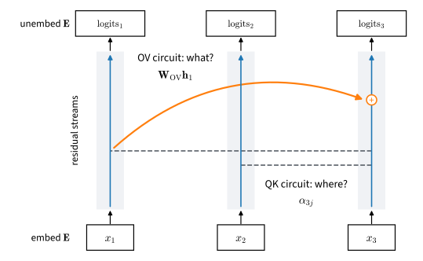

# Attention Circuits
:label:`sec_what-attention-computes`

Since :numref:`sec_queries-keys-values` we have drawn attention weights as
heatmaps, and that section warned that such a map is a hypothesis about
what a layer does, not a proof. The warning is easy to forget, because a
map invites a simple story: the model predicted *B* because it attended to
*B*. The map shows only half of a head. What the head adds to its output
also depends on its value and output projections, so a head that attends
sharply to a token may pass on the token's identity, one feature of it, or
nothing at all. To say what a trained model computes, we need both halves
of every head, and experiments that tell a mechanism apart from a pattern
that merely looks like one.

The two sections before this one asked what attention costs. This one asks
what a trained head computes, and answers it for one complete case, in a
model small enough to read from its weights. We first write down exactly
what an attention-only model adds to a token's representation. That account
splits every head into two matrices, one that decides where the head looks
and one that decides what it passes on
:cite:`Elhage.Nanda.Olsson.ea.2021`, and it tells us what one layer can and
cannot compute. Continuing a pattern seen earlier in the context, for
instance, takes two layers working together. We then train the
attention-only `TinyCharLM` of :numref:`sec_positional-information` on a
task that only such a two-layer mechanism solves, find the mechanism in the
trained model, and then try to prove our reading of it wrong. Some of the
attempts partly succeed. The same mechanism appears in large language
models, where it has been tied to their ability to learn from the context
:cite:`Olsson.Elhage.Nanda.ea.2022`.

```{.python .input #what-attention-computes}
%%tab pytorch
import math
import numpy as np
import torch
from torch import nn
from torch.nn import functional as F
from d2l import torch as d2l
```

```{.python .input #what-attention-computes}
%%tab jax
import math
import numpy as np
import jax
from jax import numpy as jnp
from flax import nnx
import optax
from d2l import jax as d2l
```

```{.python .input #what-attention-computes-attention-circuits-1}
%%tab pytorch
import copy
```

## Circuits and the Residual Stream

### QK and OV Circuits

Reading a head from its weights requires an exact account of what each
layer adds to a token's representation, so we write it down for the model
we will train. `TinyCharLM` (:numref:`sec_positional-information`) has the
simplest architecture that still counts as a transformer. A token embedding
of width $d = 128$ feeds a stack of blocks. Each block is a single layer of
$H = 4$ causal attention heads whose output is added to the block's input,
and nothing else: there are no feed-forward layers, no normalization, and
by default no biases. The output head reuses the embedding matrix
$\mathbf{E}$, whose rows are the token embeddings. Write $\mathbf{e}_{x_i}
\in \mathbb{R}^d$ for the embedding of token $x_i$.

Let us start from one head of the multi-head layer of
:numref:`sec_multihead-attention` and drop its index for a moment. In this
section vectors are columns, unlike the rows $\mathbf{X}\mathbf{W}_q$ of
the earlier sections, because then a product of matrices reads from right to
left, from what a head reads to what it writes. At position $i$ the head
projects the vector $\mathbf{h}_j$ of every visible position $j \leq i$
with its value map $\mathbf{W}_v \in \mathbb{R}^{d_h \times d}$, where
$d_h = d/H = 32$ is the head width. It then averages the projections with
its attention weights $\alpha_{ij}$.

The layer concatenates the averages of all $H$ heads and multiplies the
result by one $d \times d$ output matrix. Split that matrix into $H$
slices of $d_h$ columns each. Slice $m$ multiplies only the output of head
$m$, so the product of the matrix with the concatenation is a sum over
heads, each head's output multiplied by its own slice. If $\mathbf{W}_o \in
\mathbb{R}^{d \times d_h}$ is the slice of our head, the head adds

$$
\mathbf{W}_o \sum_{j \leq i} \alpha_{ij}\, \mathbf{W}_v \mathbf{h}_j = \sum_{j \leq i} \alpha_{ij}\, \mathbf{W}_o \mathbf{W}_v\, \mathbf{h}_j
$$

to position $i$, and the layer adds up these terms over its heads.
Concatenating the heads and then projecting is the same computation as
projecting each head on its own and summing.

The value and output maps enter only through their product. The query and
key maps $\mathbf{W}_q, \mathbf{W}_k \in \mathbb{R}^{d_h \times d}$ also
enter only through theirs, since the head scores key $j$ for the query at
$i$ by $(\mathbf{W}_q \mathbf{h}_i)^\top (\mathbf{W}_k \mathbf{h}_j) /
\sqrt{d_h}$. Collecting the two products,

$$
s_{ij} = \frac{\mathbf{h}_i^\top \mathbf{W}_{\mathrm{QK}}\, \mathbf{h}_j}{\sqrt{d_h}}, \qquad \mathbf{W}_{\mathrm{QK}} = \mathbf{W}_q^\top \mathbf{W}_k, \qquad \mathbf{W}_{\mathrm{OV}} = \mathbf{W}_o \mathbf{W}_v.
$$
:eqlabel:`eq_qkov`

The *QK circuit* $\mathbf{W}_{\mathrm{QK}}$ is a bilinear form that scores
a query position against a key position, so it decides where the head
attends. The *OV circuit* $\mathbf{W}_{\mathrm{OV}}$ maps an attended
vector to what the head writes. Both are $d \times d$ matrices, and the
names come from :citet:`Elhage.Nanda.Olsson.ea.2021`, whose reading of
transformers this section follows.

Why study the two products rather than the four projections? The
projections are not identifiable. Without rotary embeddings, replacing
$\mathbf{W}_q$ by $\mathbf{G}\mathbf{W}_q$ and $\mathbf{W}_k$ by
$\mathbf{G}^{-\top}\mathbf{W}_k$, for any invertible $d_h \times d_h$
matrix $\mathbf{G}$, changes nothing the model computes and leaves
$\mathbf{W}_{\mathrm{QK}}$ as it was. Two trained models can thus have
quite different query maps and the same QK circuit, and only the circuit
can be compared between them. Both circuits also pass through the head's
width, so each has rank at most $d_h$: a head reads a $d_h$-dimensional
subspace of the stream and writes into another. Every head of `TinyCharLM`
works through a rank-32 bottleneck in a 128-dimensional stream, and we will
see this bound limit how well a single head can copy.

Rotary embeddings add position to the QK circuit and nowhere else. RoPE
rotates the query at position $i$ by an orthogonal matrix $\mathbf{R}_i$
and the key at position $j$ by $\mathbf{R}_j$, and the rotations are built
so that $\mathbf{R}_i^\top \mathbf{R}_j = \mathbf{R}_{j-i}$
(:numref:`subsec_pos-rope`). The score therefore becomes
$\mathbf{h}_i^\top \mathbf{W}_q^\top \mathbf{R}_{j-i} \mathbf{W}_k
\mathbf{h}_j / \sqrt{d_h}$, with the relative rotation $\mathbf{R}_{j-i}$
between the two projections. The values are not rotated, so the OV circuit
does not depend on position. Apart from this rotation, the embeddings and
the two circuits of every head describe the model completely. We use
`pos='rope'` throughout, because rotary embeddings are the positional
scheme of most current language models.

### Residual Representations Across Layers

Now we stack the blocks. Set $\mathbf{h}_i^{(0)} = \mathbf{e}_{x_i}$.
Block $\ell$ computes, for every position $i$,

$$
\mathbf{h}_i^{(\ell)} = \mathbf{h}_i^{(\ell-1)} + \sum_{m=1}^{H} \sum_{j \leq i} \alpha_{ij}^{\ell m}\, \mathbf{W}_{\mathrm{OV}}^{\ell m}\, \mathbf{h}_j^{(\ell-1)},
$$
:eqlabel:`eq_stream-update`

where $\alpha_{ij}^{\ell m}$ is the weight with which head $m$ of block
$\ell$ attends from position $i$ to position $j$, and
$\mathbf{W}_{\mathrm{OV}}^{\ell m}$ is the OV circuit of that head. After
the last of the $N$ blocks, the output head scores the final vector
against every embedding, $\mathbf{z}_i = \mathbf{E}\, \mathbf{h}_i^{(N)}$. The sequence
$\mathbf{h}_i^{(0)}, \ldots, \mathbf{h}_i^{(N)}$ is the *residual stream*
of position $i$ (:numref:`fig_residual-stream`). Each block adds to this
vector rather than replacing it. A head reads the streams at earlier
positions, transforms what it reads linearly, and adds the result to the
stream at the current position. Information that one block writes
therefore stays available to every later block and to the output head.


:label:`fig_residual-stream`

Once the attention weights $\alpha$ are fixed, the map from embeddings to
logits in :eqref:`eq_stream-update` is linear, and expanding the recursion
writes it as a sum of matrix products along paths through the network.
This decomposition is exact for attention-only transformers
:cite:`Elhage.Nanda.Olsson.ea.2021`, which is why we use the attention-only
`TinyCharLM` here. The weights $\alpha$ themselves depend on the stream,
however, so even here the algebra says what the model *can* compute. What
it does compute is a question for experiments.

### Bigrams, Skip-Trigrams, and the Limits of One Layer

Expanding the residual stream shows how the class of functions a model can
represent grows with depth. With *zero* blocks,
$\mathbf{z}_i = \mathbf{E}\,\mathbf{e}_{x_i}$: the logits depend on the
current token only, which makes the model a bigram model of a constrained
kind. Because the output head is tied to the embedding, the logit of token
$b$ after token $a$ is $\mathbf{e}_b^\top \mathbf{e}_a$. These logits form
the Gram matrix of the embeddings, which is symmetric, positive
semidefinite, and of rank at most $d$, not an arbitrary $|\mathcal{V}|
\times |\mathcal{V}|$ lookup table. Training on text fills it with as much
of the bigram statistics as that form can hold. With *one* block,

$$
\mathbf{z}_i = \mathbf{E}\,\mathbf{e}_{x_i} + \sum_{m=1}^{H} \sum_{j \leq i} \alpha_{ij}^{m}\; \mathbf{E}\,\mathbf{W}_{\mathrm{OV}}^{m}\,\mathbf{e}_{x_j}.
$$
:eqlabel:`eq_one-layer-paths`

Each new term reads as an if--then rule. If the QK circuit sends attention
from the current token to an earlier token $x_j$, the OV circuit adds
$\mathbf{E}\,\mathbf{W}_{\mathrm{OV}}\,\mathbf{e}_{x_j}$ to the logits.
Rules of this shape, "when $[\mathrm{A}]$ appears somewhere before
$[\mathrm{B}]$, boost token $[\mathrm{C}]$", are called *skip-trigrams*,
and every term that one layer adds to the bigrams has this shape. The rules
are not independent, though. The softmax normalizes the weights over the
whole context, so how strongly one rule fires depends on everything else
the head can see. In an example of :citet:`Elhage.Nanda.Olsson.ea.2021`, a
head of a model that reads words attends from *in* back to an earlier
*keep* and raises the logit of *mind*. The QK circuit supplies the pair
(*in*, *keep*), and the OV circuit the step from *keep* to *mind*. The
split also limits what one head can do. What a head writes depends on the
attended token alone, so if the same head also attends from *at* to
*keep*, it raises *mind* there too, where *bay* belongs. A useful special
case is *copying*: the head raises the logit of the very token it attends
to, so that tokens already in the context become more likely to appear
again.

One task needs more, and it is the one this section is about. Suppose the
sequence contains $[\mathrm{A}][\mathrm{B}] \ldots [\mathrm{A}]$, and at
the second $[\mathrm{A}]$ the model should predict $[\mathrm{B}]$,
continuing the pattern by looking up what followed last time. A copying
head would produce $[\mathrm{B}]$ if it attended to $[\mathrm{B}]$'s
position, but it cannot find that position. In
:eqref:`eq_one-layer-paths` the score $s_{ij}$ that sets $\alpha_{ij}$
sees only $\mathbf{e}_{x_i}$, $\mathbf{e}_{x_j}$, and the offset, so it can
find the earlier $[\mathrm{A}]$ but not the token after it. The key at
position $j$ carries no information about its neighbor at $j - 1$.

A second layer can supply that information. A head in layer 1
attends to the previous token and writes its identity into the stream, so
the key at $[\mathrm{B}]$'s position now also says "follows
$[\mathrm{A}]$". A head in layer 2 matches the query $[\mathrm{A}]$
against these enriched keys, attends to position $j$, and its OV circuit
copies $x_j = [\mathrm{B}]$ into the destination stream
(:numref:`fig_induction-circuit`). This two-step circuit is the *induction
head*: a previous-token head composed with a match-and-copy head through
the residual stream. The argument shows that two layers can express
induction and one layer cannot, apart from a position-only shortcut we will
meet shortly. Whether gradient descent finds the circuit is a separate,
empirical question, and the rest of the section answers it by experiment.


:label:`fig_induction-circuit`

## Copying and Induction

### A Repeated-Sequence Task

To see whether a model learns induction, we need a task that only
induction solves. Real text mixes induction with memorized statistics, so
we train on sequences of *repeated random tokens* instead: draw a pattern
of tokens uniformly from a vocabulary of 64, then tile it until the
sequence is full. Within one sequence the pattern repeats; across
sequences nothing does, and every bigram is equally likely on average. The
first pass over a pattern is therefore unpredictable, while every later
pass is predictable from the context alone. The gap between the loss on
the first copy and the loss on later copies measures how much the model
retrieves from its context. The function `repeated_batch` draws a
minibatch of such sequences, with pattern lengths uniform between `Lmin`
and `Lmax`.

```{.python .input #what-attention-computes-repetition-as-a-task-1}
%%tab pytorch
def repeated_batch(batch_size, num_steps, vocab, Lmin, Lmax, device=None):
    """Random patterns of length Lmin..Lmax, tiled to num_steps tokens."""
    L = torch.randint(Lmin, Lmax + 1, (batch_size,), device=device)
    s = torch.randint(0, vocab, (batch_size, num_steps), device=device)
    pos = torch.arange(num_steps, device=device)
    return torch.gather(s, 1, pos[None, :] % L[:, None]), L

x, L = repeated_batch(batch_size=2, num_steps=16, vocab=10, Lmin=5, Lmax=8)
print(f'pattern lengths: {L.tolist()}')
print(x)
```

```{.python .input #what-attention-computes-repetition-as-a-task-1}
%%tab jax
def repeated_batch(key, batch_size, num_steps, vocab, Lmin, Lmax):
    """Random patterns of length Lmin..Lmax, tiled to num_steps tokens."""
    key_L, key_s = jax.random.split(key)
    L = jax.random.randint(key_L, (batch_size,), Lmin, Lmax + 1)
    s = jax.random.randint(key_s, (batch_size, num_steps), 0, vocab)
    pos = jnp.arange(num_steps)
    return jnp.take_along_axis(s, pos[None, :] % L[:, None], axis=1), L

x, L = repeated_batch(d2l.get_key(), batch_size=2, num_steps=16,
                      vocab=10, Lmin=5, Lmax=8)
print(f'pattern lengths: {L.tolist()}')
print(x)
```

Each row repeats its first $L$ tokens. Training uses `d2l.train_steps` from
:numref:`sec_test_models`, which takes a fixed number of optimizer steps on the
mean next-token cross-entropy, here with Adam at learning rate $10^{-3}$. A
small data module supplies it with an endless stream of fresh 64-token
minibatches, so the model never sees the same pattern twice. Every 50
steps, training pauses for a measurement on a fresh batch: `eval_copy`
returns the loss on the first copy (targets before position $L$), the loss
on later copies, and the accuracy on later copies.

```{.python .input #what-attention-computes-repetition-as-a-task-2}
%%tab pytorch
@torch.inference_mode()
def eval_copy(model, x, L):
    """First-copy loss, later-copy loss, and later-copy accuracy."""
    logits, Y = model(x[:, :-1]), x[:, 1:]
    ce = F.cross_entropy(logits.transpose(1, 2), Y, reduction='none')
    later = torch.arange(1, Y.shape[1] + 1, device=Y.device) >= L[:, None]
    acc = (logits.argmax(-1) == Y)[later].float().mean()
    return torch.stack((ce[~later].mean(), ce[later].mean(), acc)).tolist()

class RepeatedTokens(d2l.DataModule):
    """An endless stream of fresh repeated-token minibatches."""
    def __init__(self, Lmin, Lmax, batch_size=128, num_steps=64, vocab=64):
        super().__init__()
        self.save_hyperparameters()

    def train_dataloader(self):
        while True:
            x, _ = repeated_batch(self.batch_size, self.num_steps,
                                  self.vocab, self.Lmin, self.Lmax)
            yield x[:, :-1], x[:, 1:]

def train_repeat(model, num_steps, Lmin, Lmax, eval_every=50):
    """Train with Adam; return (first, later) copy losses per round."""
    data, device = RepeatedTokens(Lmin, Lmax), d2l.try_gpu()
    optimizer = torch.optim.Adam(model.parameters(), lr=1e-3)
    history = []
    for _ in range(num_steps // eval_every):
        d2l.train_steps(model, data, optimizer, eval_every)
        x, L = repeated_batch(256, 64, 64, Lmin, Lmax, device)
        history.append(eval_copy(model, x, L)[:2])
    return history

def drop_step(hist, eval_every=50):
    """First step at which the later-copy loss is below 1 nat, or None."""
    return next((eval_every * (k + 1) for k, (_, rep) in enumerate(hist)
                 if rep < 1), None)
```

```{.python .input #what-attention-computes-repetition-as-a-task-2}
%%tab jax
def eval_copy(model, x, L):
    """First-copy loss, later-copy loss, and later-copy accuracy."""
    logits, Y = model(x[:, :-1]), x[:, 1:]
    ce = optax.softmax_cross_entropy_with_integer_labels(logits, Y)
    later = jnp.arange(1, Y.shape[1] + 1)[None, :] >= L[:, None]
    acc = ((logits.argmax(-1) == Y) * later).sum() / later.sum()
    first = (ce * ~later).sum() / (~later).sum()
    rep = (ce * later).sum() / later.sum()
    return [float(v) for v in jax.device_get((first, rep, acc))]

class RepeatedTokens(d2l.DataModule):
    """An endless stream of fresh repeated-token minibatches."""
    def __init__(self, Lmin, Lmax, batch_size=128, num_steps=64, vocab=64):
        super().__init__()
        self.save_hyperparameters()

    def train_dataloader(self):
        while True:
            x, _ = repeated_batch(d2l.get_key(), self.batch_size,
                                  self.num_steps, self.vocab, self.Lmin,
                                  self.Lmax)
            yield x[:, :-1], x[:, 1:]

def train_repeat(model, num_steps, Lmin, Lmax, eval_every=50):
    """Train with Adam; return (first, later) copy losses per round."""
    data = RepeatedTokens(Lmin, Lmax)
    optimizer = nnx.Optimizer(model, optax.adam(1e-3), wrt=nnx.Param)
    history = []
    for _ in range(num_steps // eval_every):
        d2l.train_steps(model, data, optimizer, eval_every)
        x, L = repeated_batch(d2l.get_key(), 256, 64, 64, Lmin, Lmax)
        history.append(eval_copy(model, x, L)[:2])
    return history

def drop_step(hist, eval_every=50):
    """First step at which the later-copy loss is below 1 nat, or None."""
    return next((eval_every * (k + 1) for k, (_, rep) in enumerate(hist)
                 if rep < 1), None)
```

### A Fixed-Offset Solution
:label:`subsec_fixed-offset-shortcut`

We start with the simplest version of the task: every pattern has length
32, so each sequence is one pattern followed by a copy of it. The analysis
above rules out a one-layer solution that matches content. We train a
one-block model on this task anyway, to see what it does instead. For this
experiment alone, the projections have biases (`bias=True`); their role
becomes clear below.

```{.python .input #what-attention-computes-the-positional-shortcut-1}
%%tab pytorch
model_shortcut = d2l.TinyCharLM(vocab_size=64, num_blks=1, pos='rope',
                                bias=True)
train_repeat(model_shortcut, 800, Lmin=32, Lmax=32)
first, rep, acc = eval_copy(model_shortcut, *repeated_batch(
    256, 64, 64, 32, 32, d2l.try_gpu()))
print(f'first copy {first:.2f} nats, second copy {rep:.2f} nats, '
      f'second-copy accuracy {acc:.2f}')
```

```{.python .input #what-attention-computes-the-positional-shortcut-1}
%%tab jax
model_shortcut = d2l.TinyCharLM(vocab_size=64, num_blks=1, pos='rope',
                                bias=True, rngs=nnx.Rngs(d2l.get_key()))
train_repeat(model_shortcut, 800, Lmin=32, Lmax=32)
first, rep, acc = eval_copy(model_shortcut, *repeated_batch(
    d2l.get_key(), 256, 64, 64, 32, 32))
print(f'first copy {first:.2f} nats, second copy {rep:.2f} nats, '
      f'second-copy accuracy {acc:.2f}')
```

The one-block model predicts the second copy almost perfectly, but it
cannot be running the content-based circuit. When the period is always 32,
the source of every prediction in the second copy lies 31 positions back,
and a RoPE head can attend to a fixed relative offset without comparing
any content (:numref:`sec_positional-information`). If the model matched
content, a different period would not matter. The following probe tests
this. It evaluates the same model on patterns of length 24, where the
source lies 23 positions back, and measures each head's average attention
weight at offsets 31 and 23.

```{.python .input #what-attention-computes-the-positional-shortcut-2}
%%tab pytorch
x, L = repeated_batch(256, 64, 64, 24, 24, d2l.try_gpu())
first, rep, acc = eval_copy(model_shortcut, x, L)
with torch.inference_mode():
    m = model_shortcut.attention_weights(x[:, :-1])[0]
print(f'patterns of length 24: second-copy accuracy {acc:.2f}')
for offset in (31, 23):
    mass = m.diagonal(-offset, dim1=2, dim2=3).mean((0, 2))
    print(f'mass at offset {offset}, per head: '
          + ' '.join(f'{v:.2f}' for v in mass.tolist()))
```

```{.python .input #what-attention-computes-the-positional-shortcut-2}
%%tab jax
x, L = repeated_batch(d2l.get_key(), 256, 64, 64, 24, 24)
first, rep, acc = eval_copy(model_shortcut, x, L)
m = model_shortcut.attention_weights(x[:, :-1])[0]
print(f'patterns of length 24: second-copy accuracy {acc:.2f}')
for offset in (31, 23):
    mass = jnp.diagonal(m, -offset, axis1=2, axis2=3).mean((0, 2))
    print(f'mass at offset {offset}, per head: '
          + ' '.join(f'{v:.2f}' for v in mass.tolist()))
```

Accuracy falls to about chance, $1/64$, because the heads keep their
attention at offset 31 and almost none of it moves to offset 23, where the
new period puts the source. The model has learned a fixed-offset rule, not
induction. The `qkv` bias makes this rule easy to express. It adds the same
vector to every query and to every key, and the RoPE score of a constant
query--key pair depends only on the offset. A single bias pair can
therefore place a peak at a fixed distance whatever the tokens are
(Exercise :exref:`ex_what-attention-computes-shortcut-bias` removes the
bias). Every model analyzed below has no biases, so the circuit algebra
above holds for it without correction.

The general point is that a synthetic benchmark can admit a simpler
solution than the mechanism it was designed to test. We therefore draw the
pattern length uniformly from 16 to 32. No fixed offset then works, and
predicting the later copies requires matching content against an earlier
occurrence.

### A Two-Block Induction Circuit
:label:`subsec_two-block-induction`

With pattern lengths drawn from 16 to 32, the composition argument makes a
prediction. A two-block model, the smallest that can express induction,
should bring the loss on later copies far below the chance level of
$\log 64 \approx 4.16$ nats, and a one-block model should not. We train
three two-block models with identical settings and a one-block control,
5,000 steps each, and evaluate all four on the same fresh batch. Besides
the two losses and the accuracy on later copies, the last column gives the
first step at which a model's later-copy loss fell below 1 nat. The first
two-block run, `model_two`, is the one we take apart in the rest of the
section, whatever it shows.

```{.python .input #what-attention-computes-two-blocks-learn-to-look-things-up-1}
%%tab pytorch
runs = []  # (blocks, model, history): three two-block runs, one control
for num_blks in (2, 2, 2, 1):
    model = d2l.TinyCharLM(vocab_size=64, num_blks=num_blks, pos='rope')
    runs.append((num_blks, model, train_repeat(model, 5000, 16, 32)))
models_two = [model for _, model, _ in runs[:3]]
_, model_two, hist_two = runs[0]   # Run 1: maps and curves shown for it
_, model_one, hist_one = runs[3]
x, L = repeated_batch(256, 64, 64, 16, 32, d2l.try_gpu())
print('blocks  first copy  later copies  accuracy  below 1 nat at step')
for num_blks, model, hist in runs:
    first, rep, acc = eval_copy(model, x, L)
    print(f'{num_blks:6d}{first:12.2f}{rep:14.2f}{acc:10.2f}'
          f'{drop_step(hist) or "never":>21}')
```

```{.python .input #what-attention-computes-two-blocks-learn-to-look-things-up-1}
%%tab jax
runs = []  # (blocks, model, history): three two-block runs, one control
for num_blks in (2, 2, 2, 1):
    model = d2l.TinyCharLM(vocab_size=64, num_blks=num_blks, pos='rope',
                           rngs=nnx.Rngs(d2l.get_key()))
    runs.append((num_blks, model, train_repeat(model, 5000, 16, 32)))
models_two = [model for _, model, _ in runs[:3]]
_, model_two, hist_two = runs[0]   # Run 1: maps and curves shown for it
_, model_one, hist_one = runs[3]
x, L = repeated_batch(d2l.get_key(), 256, 64, 64, 16, 32)
print('blocks  first copy  later copies  accuracy  below 1 nat at step')
for num_blks, model, hist in runs:
    first, rep, acc = eval_copy(model, x, L)
    print(f'{num_blks:6d}{first:12.2f}{rep:14.2f}{acc:10.2f}'
          f'{drop_step(hist) or "never":>21}')
```

The prediction holds in every run. The three two-block models bring the
later-copy loss down to a few tenths of a nat and predict about nine in ten
repeated tokens. The one-block model stays above three nats and predicts
about one in ten. That is better than chance, because copying heads can
concentrate probability on the tokens present in the context, but it is
far from retrieval. On the first copy, all four models stay somewhat above
the chance loss; the training curves below show why.

The last column shows that the runs do not learn on the same schedule.
Each crosses 1 nat after one to three thousand steps, and runs with
identical settings differ by several hundred steps. The training curves of
`model_two` and the control show how the gap opens.

```{.python .input #what-attention-computes-two-blocks-learn-to-look-things-up-2}
%%tab pytorch, jax
steps = list(range(50, 5001, 50))
d2l.plot(steps, [[h[1] for h in hist_two], [h[1] for h in hist_one],
                 [h[0] for h in hist_two], [math.log(64)] * len(steps)],
         'step', 'loss (nats)',
         legend=['later copies, 2 blocks', 'later copies, 1 block',
                 'first copy, 2 blocks', 'log 64'], figsize=(5, 3))
```

For a long stretch of training, the later-copy curve of the two-block
model stays close to that of the one-block model, as if the second block
were not there. Then it falls by about three nats within about a thousand
steps; in the run shown, the fall comes in two steep stages with a slower
stretch between them. Nothing about the data changes at that moment; the
computation the model performs does. The first-copy curve shows the other
side of the change. At each stage of the drop it rises by a few tenths of
a nat and then slowly decays. The model has begun to expect repetition. It
puts probability on the tokens of its context, and on the first copy,
where nothing has repeated yet, that probability is wasted.

## Evidence for the Circuit

The loss shows that two blocks solve the task; it does not show how. A low
loss is consistent with the circuit of :numref:`fig_induction-circuit`, and
equally with mechanisms we have not thought of. We therefore look inside
`model_two` in three ways: at its attention maps, at its weights, and at
what breaks when heads are removed.

### Attention Patterns of the Learned Heads

`TinyCharLM.attention_weights` returns the attention map of every head in
every block. We feed one sequence with pattern length 24 and display all
eight heads. If the model has learned the circuit, some head of block 1
should draw a line one step below the diagonal, and the heads of block 2 a
line $L - 1 = 23$ steps below it, starting where the second copy starts.

```{.python .input #what-attention-computes-the-heads-caught-in-the-act-1}
%%tab pytorch
x, L = repeated_batch(1, 64, 64, 24, 24, d2l.try_gpu())
with torch.inference_mode():
    maps = torch.stack(model_two.attention_weights(x[:, :-1]))
d2l.show_heatmaps(maps[:, 0], xlabel='key position',
                  ylabel='query position',
                  titles=[f'head {h}' for h in range(4)],
                  figsize=(9, 4.5), cmap='Blues')
```

```{.python .input #what-attention-computes-the-heads-caught-in-the-act-1}
%%tab jax
x, L = repeated_batch(d2l.get_key(), 1, 64, 64, 24, 24)
maps = jnp.stack(model_two.attention_weights(x[:, :-1]))
d2l.show_heatmaps(maps[:, 0], xlabel='key position',
                  ylabel='query position',
                  titles=[f'head {h}' for h in range(4)],
                  figsize=(9, 4.5), cmap='Blues')
```

The top row shows block 1 and the bottom row block 2, and both halves of
the predicted circuit are there. In block 1, at least one head draws the
line one step below the diagonal, a previous-token head. The other heads of
block 1 attend mostly to their own position or spread their attention over
early positions. In block 2, the heads draw the stripe 23 steps below the
diagonal from the start of the second copy on: each query attends to the
token after the previous occurrence of its own token. One sequence from one
run is a weak measurement, though. The function `head_scores` measures
the two patterns over a batch with pattern lengths from 16 to 32. For every
head it computes the average attention on the previous token and on the
induction target $j = i + 1 - L$, and the cell does so for each of the
three two-block runs. The target score averages over the queries whose
token has occurred before, $i \geq L$.

```{.python .input #what-attention-computes-the-heads-caught-in-the-act-2}
%%tab pytorch
@torch.inference_mode()
def head_scores(model, x, L):
    """Mean attention on the previous token and on the induction target:
    shape (blocks, 2, heads)."""
    maps = torch.stack(model.attention_weights(x[:, :-1]))
    i = torch.arange(maps.shape[-1], device=x.device)
    tgt = i + 1 - L[:, None]               # Induction target of query i
    is_tgt = i == tgt[..., None]           # (batch, query, key)
    valid = tgt >= 1                       # Query token occurred before
    prev = maps.diagonal(-1, dim1=3, dim2=4).mean((1, 3))
    ind = (maps * is_tgt[:, None]).sum(-1)  # (blocks, batch, heads, query)
    ind = (ind * valid[:, None]).sum((1, 3)) / valid.sum()
    return torch.stack((prev, ind), 1)

x, L = repeated_batch(256, 64, 64, 16, 32, d2l.try_gpu())
all_scores = [head_scores(model, x, L) for model in models_two]
scores = all_scores[0]  # Run 1, whose maps are shown above
for r, run_scores in enumerate(all_scores):
    for b, rows in enumerate(run_scores.tolist()):
        for name, row in zip(('previous', 'induction'), rows):
            print(f'run {r + 1}, block {b + 1}, {name:<9}: '
                  + ' '.join(f'{v:.2f}' for v in row))
```

```{.python .input #what-attention-computes-the-heads-caught-in-the-act-2}
%%tab jax
def head_scores(model, x, L):
    """Mean attention on the previous token and on the induction target:
    shape (blocks, 2, heads)."""
    maps = jnp.stack(model.attention_weights(x[:, :-1]))
    i = jnp.arange(maps.shape[-1])
    tgt = i + 1 - L[:, None]               # Induction target of query i
    is_tgt = i == tgt[..., None]           # (batch, query, key)
    valid = tgt >= 1                       # Query token occurred before
    prev = jnp.diagonal(maps, -1, axis1=3, axis2=4).mean((1, 3))
    ind = (maps * is_tgt[:, None]).sum(-1)  # (blocks, batch, heads, query)
    ind = (ind * valid[:, None]).sum((1, 3)) / valid.sum()
    return jnp.stack((prev, ind), 1)

x, L = repeated_batch(d2l.get_key(), 256, 64, 64, 16, 32)
all_scores = [head_scores(model, x, L) for model in models_two]
scores = all_scores[0]  # Run 1, whose maps are shown above
for r, run_scores in enumerate(all_scores):
    for b, rows in enumerate(run_scores.tolist()):
        for name, row in zip(('previous', 'induction'), rows):
            print(f'run {r + 1}, block {b + 1}, {name:<9}: '
                  + ' '.join(f'{v:.2f}' for v in row))
```

Each line lists the four heads of one block of one run. In block 1, either
one head takes the previous-token role or two heads share it, each putting
a large part of its attention on the previous token and almost none on the
induction target. The other heads of the block do neither. Block 2's heads
do the reverse. All four share the induction pattern, and the strongest
head of each run puts more than a third of its attention, in most runs over
half, on the single position the algorithm calls for, out of up to 63
candidates. A uniform weighting would give that position about one
fortieth. Which heads take which role changes from run to run; that both
roles appear does not.

### The Copy Matrix

A head that attends to the right position helps only if it writes the
right thing there. The induction head of :numref:`fig_induction-circuit`
should copy: if block 2's heads attend to token $a$, they should raise the
logit of $a$ itself. Write

$$
C_{ab} = \mathbf{e}_b^\top \mathbf{W}_{\mathrm{OV}}\, \bar{\mathbf{h}}_a
$$
:eqlabel:`eq_copy-matrix`

for the boost that attending to token $a$ gives to the logit of token $b$.
Here $\bar{\mathbf{h}}_a$ is what the head reads at a position that holds
token $a$: the stream vector entering the block, averaged over the
positions of $a$ in a batch. In the first block it is the embedding
$\mathbf{e}_a$; in block 2 it also holds what block 1 wrote. Copying means
that every row of the $64 \times 64$ matrix $\mathbf{C}$ is largest on its
diagonal.

Could a single head copy perfectly? A perfect copy raises the logit of the
attended token and leaves the other 63 equal, and a $64 \times 64$ matrix
of that form has rank at least 63. One head's $\mathbf{C}$ has rank at most
$d_h = 32$, so the most a head can do is make each diagonal entry the
largest in its row. We therefore sum the OV circuits of block 2's heads and
count the rows whose largest entry is the diagonal. If the entries were
unrelated to copying, a row would peak on the diagonal with probability
$1/64$. The same count for the one-block model serves as a control, since
that model cannot retrieve.

`TinyCharLM` stores its projections in two fused layers without biases:
`qkv` stacks the query, key, and value maps of all heads, and `proj` holds
the output maps of the heads side by side. Reshaping the two weight
matrices to expose a head axis gives the circuits of every head of a block
at once, which is what `circuits` does. The function `copy_matrix`
evaluates :eqref:`eq_copy-matrix` for a block, with the mean stream vectors
of a batch or, when no batch is given, with the raw embeddings, and
`diagonal_share` counts the rows that peak on the diagonal.

```{.python .input #what-attention-computes-copy-matrix-definitions}
%%tab pytorch
def circuits(model, blk):
    """W_QK and W_OV of every head of block blk, each (heads, D, D)."""
    # nn.Linear stores its weight as (output, input), the orientation of the
    # column-vector equations, so no transpose is needed
    W_qkv = model.blks[blk]['qkv'].weight           # (3D, D): W_q; W_k; W_v
    W_o = model.blks[blk]['proj'].weight            # (D, D): heads in columns
    H, D = model.num_heads, W_o.shape[0]
    W_q, W_k, W_v = W_qkv.reshape(3, H, D // H, D)  # Each (H, d_h, D)
    W_QK = W_q.mT @ W_k
    W_OV = W_o.reshape(D, H, D // H).transpose(0, 1) @ W_v
    return W_QK, W_OV

@torch.inference_mode()
def copy_matrix(model, blk, X=None):
    """C[a, b] = e_b^T W_OV h_a: W_OV summed over the heads of blk, h_a the
    mean stream vector entering blk at the positions of token a in X, or the
    embedding e_a if X is None."""
    E = h = model.token_emb.weight
    if X is not None:
        S = model.stream(X, blk)[0]            # The stream entering blk
        h = torch.zeros_like(E).index_add_(0, X.flatten(), S.flatten(0, 1))
        h = h / torch.bincount(X.flatten(), minlength=len(E))[:, None]
    W_OV = circuits(model, blk)[1].sum(0)
    return h @ W_OV.T @ E.T

def diagonal_share(C):
    """Fraction of the rows of C whose largest entry is on the diagonal."""
    rows = torch.arange(len(C), device=C.device)
    return float((C.argmax(-1) == rows).float().mean())
```

```{.python .input #what-attention-computes-the-circuit-is-in-the-weights}
%%tab pytorch
x, L = repeated_batch(256, 64, 64, 16, 32, d2l.try_gpu())
print('rows whose largest entry is the diagonal (chance 1/64)')
print(f'{"":<32}   run 1   run 2   run 3')
for name, X in (('2 blocks, block 2, mean stream', x),
                ('2 blocks, block 2, embeddings', None)):
    shares = [diagonal_share(copy_matrix(m, 1, X)) for m in models_two]
    print(f'{name:<32}' + ''.join(f'{v:8.2f}' for v in shares))
print(f'{"1 block, mean stream":<32}'
      f'{diagonal_share(copy_matrix(model_one, 0, x)):8.2f}')
d2l.show_heatmaps(copy_matrix(model_two, 1, x)[None, None].cpu(),
                  xlabel='logit boosted', ylabel='token attended to',
                  figsize=(3.6, 3.6), cmap='Blues')
```

```{.python .input #what-attention-computes-copy-matrix-definitions}
%%tab jax
def circuits(model, blk):
    """W_QK and W_OV of every head of block blk, each (heads, D, D)."""
    # nnx.Linear stores its kernel as (input, output), the transpose of the
    # column-vector equations, so both kernels are transposed first
    W_qkv = model.blks[blk]['qkv'].kernel[...].T    # (3D, D): W_q; W_k; W_v
    W_o = model.blks[blk]['proj'].kernel[...].T     # (D, D): heads in columns
    H, D = model.num_heads, W_o.shape[0]
    W_q, W_k, W_v = W_qkv.reshape(3, H, D // H, D)  # Each (H, d_h, D)
    W_QK = W_q.mT @ W_k
    W_OV = W_o.reshape(D, H, D // H).swapaxes(0, 1) @ W_v
    return W_QK, W_OV

def copy_matrix(model, blk, X=None):
    """C[a, b] = e_b^T W_OV h_a: W_OV summed over the heads of blk, h_a the
    mean stream vector entering blk at the positions of token a in X, or the
    embedding e_a if X is None."""
    E = h = model.token_emb.embedding[...]
    if X is not None:
        S = model.stream(X, blk)[0]            # The stream entering blk
        h = jnp.zeros_like(E).at[X.flatten()].add(S.reshape(-1, E.shape[1]))
        h = h / jnp.bincount(X.flatten(), length=len(E))[:, None]
    W_OV = circuits(model, blk)[1].sum(0)
    return h @ W_OV.T @ E.T

def diagonal_share(C):
    """Fraction of the rows of C whose largest entry is on the diagonal."""
    return float((C.argmax(-1) == jnp.arange(len(C))).mean())
```

```{.python .input #what-attention-computes-the-circuit-is-in-the-weights}
%%tab jax
x, L = repeated_batch(d2l.get_key(), 256, 64, 64, 16, 32)
print('rows whose largest entry is the diagonal (chance 1/64)')
print(f'{"":<32}   run 1   run 2   run 3')
for name, X in (('2 blocks, block 2, mean stream', x),
                ('2 blocks, block 2, embeddings', None)):
    shares = [diagonal_share(copy_matrix(m, 1, X)) for m in models_two]
    print(f'{name:<32}' + ''.join(f'{v:8.2f}' for v in shares))
print(f'{"1 block, mean stream":<32}'
      f'{diagonal_share(copy_matrix(model_one, 0, x)):8.2f}')
d2l.show_heatmaps(copy_matrix(model_two, 1, x)[None, None],
                  xlabel='logit boosted', ylabel='token attended to',
                  figsize=(3.6, 3.6), cmap='Blues')
```

In block 2 of every two-block run, the largest entry of nearly every row
lies on the diagonal, where an unrelated matrix would manage about one row
in 64. Attending to a token raises that token's own logit more than any
other, and the heatmap of `model_two` shows it as a bright diagonal. The
second line holds a surprise. With the raw embeddings $\mathbf{e}_a$ in
place of $\bar{\mathbf{h}}_a$, the count drops in every run and varies
widely from run to run. Block 2 copies reliably only what it actually
reads, the embedding together with whatever block 1 has written at that
position. We return to this after the ablations.

The control copies too. The one-block model's heads also raise the logit of
the token they attend to, which is why its later-copy loss falls below
chance, yet the model cannot retrieve. Copying OV circuits alone therefore
do not explain retrieval. What the two-block model adds is the match on the
QK side, which tells its copying heads where to look (Exercise
:exref:`ex_what-attention-computes-k-composition` reads this match from
the weights).

### Head Ablation
:label:`subsec_head-ablation`

A head with the right pattern and the right OV circuit may still be one the
model does not rely on. The direct test removes the head and measures what
breaks. Since `proj` is the only path from a head into the stream, zeroing
the head's columns of `proj` deletes its term from
:eqref:`eq_stream-update` and leaves every other head in that block
unchanged. The function `ablate` returns a copy of the model with the
given heads of one block removed.

```{.python .input #what-attention-computes-head-ablation-1}
%%tab pytorch
def ablate(model, blk, heads):
    """Copy of model with the given heads of block blk removed."""
    model = copy.deepcopy(model)
    W_o = model.blks[blk]['proj'].weight   # (D, D): heads side by side
    with torch.no_grad():
        W_o.view(W_o.shape[0], model.num_heads, -1)[:, heads] = 0
    return model
```

```{.python .input #what-attention-computes-head-ablation-1}
%%tab jax
def ablate(model, blk, heads):
    """Copy of model with the given heads of block blk removed."""
    model = nnx.clone(model)
    W_o = model.blks[blk]['proj'].kernel   # (D, D): heads stacked in rows
    W = W_o[...].reshape(model.num_heads, -1, W_o.shape[1])
    W_o[...] = W.at[jnp.array(heads, dtype=int)].set(0).reshape(W_o.shape)
    return model
```

The head scores pick the candidates, run by run. In block 1 we count every
head whose previous-token score exceeds 0.2 as a previous-token head; in
every run the threshold falls in a wide gap between the heads that take the
role and the others. We remove the previous-token heads together and, as a
control, all the other heads of block 1 together. In block 2 we remove the
heads cumulatively, in order of their induction scores: one, two, three,
and all four. The one-block model is listed for reference, and every
variant is evaluated on the same fresh batch. If the circuit is as drawn,
the first removal should break retrieval and the control should not.

```{.python .input #what-attention-computes-head-ablation-2}
%%tab pytorch
x, L = repeated_batch(256, 64, 64, 16, 32, d2l.try_gpu())
H, table = model_two.num_heads, {}  # Variant: (loss, accuracy) per run
for r, (model, s) in enumerate(zip(models_two, all_scores)):
    prev = [h for h in range(H) if s[0, 0, h] > 0.2]  # Previous-token heads
    rest = [h for h in range(H) if h not in prev]
    order = s[1, 1].argsort(descending=True).tolist()  # Strongest first
    print(f'run {r + 1}: block 1 previous-token heads {prev}, others {rest}')
    variants = {'none': model,
                'block 1, previous-token heads': ablate(model, 0, prev),
                'block 1, all other heads': ablate(model, 0, rest)}
    for k in range(1, H + 1):
        variants[f'block 2, top {k} induction'] = ablate(model, 1, order[:k])
    for name, variant in variants.items():
        table.setdefault(name, []).append(eval_copy(variant, x, L)[1:])
table['one-block model'] = [eval_copy(model_one, x, L)[1:]]
print(f'{"heads removed":<31}later-copy loss / accuracy: run 1, 2, 3')
for name, cols in table.items():
    print(f'{name:<31}'
          + ''.join(f'{rep:7.2f} /{acc:5.2f}' for rep, acc in cols))
```

```{.python .input #what-attention-computes-head-ablation-2}
%%tab jax
x, L = repeated_batch(d2l.get_key(), 256, 64, 64, 16, 32)
H, table = model_two.num_heads, {}  # Variant: (loss, accuracy) per run
for r, (model, s) in enumerate(zip(models_two, all_scores)):
    prev = [h for h in range(H) if s[0, 0, h] > 0.2]  # Previous-token heads
    rest = [h for h in range(H) if h not in prev]
    order = jnp.argsort(-s[1, 1]).tolist()  # Strongest first
    print(f'run {r + 1}: block 1 previous-token heads {prev}, others {rest}')
    variants = {'none': model,
                'block 1, previous-token heads': ablate(model, 0, prev),
                'block 1, all other heads': ablate(model, 0, rest)}
    for k in range(1, H + 1):
        variants[f'block 2, top {k} induction'] = ablate(model, 1, order[:k])
    for name, variant in variants.items():
        table.setdefault(name, []).append(eval_copy(variant, x, L)[1:])
table['one-block model'] = [eval_copy(model_one, x, L)[1:]]
print(f'{"heads removed":<31}later-copy loss / accuracy: run 1, 2, 3')
for name, cols in table.items():
    print(f'{name:<31}'
          + ''.join(f'{rep:7.2f} /{acc:5.2f}' for rep, acc in cols))
```

Removing block 1's previous-token heads breaks retrieval, as predicted. In
every run the accuracy on later copies falls to about one in ten or less,
because block 2 has nothing left to match against. The later-copy loss
rises by several nats, in most runs above $\log 64$, the loss of a uniform
guess. A model that does worse than guessing is confident about the wrong
tokens. Block 2's OV circuits are intact, so it likely still copies, now
from the wrong positions. The control does not behave as predicted. Removing the other
heads of block 1 breaks retrieval about as badly, although their maps
looked irrelevant. The maps had no way to show this; only the intervention
did.

Why are these heads needed? In the run whose maps we showed, they attend
to their own position or spread over early positions. A head that attends
to its own position writes a transformed copy of the current token into
the stream. The copy matrix suggests that block 2 reads that copy: block
2 copies reliably from the stream it reads and much less reliably from the
raw embedding. There is a second reading, and the ablation alone cannot
tell the two apart. `TinyCharLM` has no normalization, so zeroing two or
three of the four heads of block 1 changes the scale and the mean of the
stream that block 2 was trained on, and block 2 may fail for that reason
alone. Exercise :exref:`ex_what-attention-computes-circuit-ablation`
replaces zeroing by an ablation that keeps the stream on its usual scale
and separates the two.

Block 2's heads share the work. In every run, accuracy falls with each
induction head removed. The strongest head alone costs only part of it,
and a second and a third cost more. With all four removed, accuracy is at
chance and the later-copy loss lies above even that of the one-block
model. The loss need not rise at every step, since a head left in place
can copy confidently from the wrong position. Each induction head can
partly stand in for the others, so removing any single one underestimates
how much the group matters. As far as zero ablation can tell, then, the
model needs all of block 1 and the induction heads of block 2 to predict
later copies.

## In-Context Learning

### Generalization to Unseen Patterns
:label:`subsec_unseen-patterns`

Every test sequence is sampled at evaluation time. There are at least
$64^{16}$ patterns, so the one a test sequence completes has almost surely
never occurred in training. Across training sequences, moreover, every
pair of adjacent tokens is equally frequent. The parameters therefore
cannot store which token follows which in this pattern. The match-and-copy
circuit instead binds each token to its successor at inference time, inside the
context window. This is *in-context learning* in miniature. The model
learns each new pattern from a single exposure, without a gradient step.
Accuracy per position on patterns of period 24 shows the single exposure
directly. On the first copy it can only be at chance; from the second copy
on, it should be high.

```{.python .input #what-attention-computes-completing-patterns-it-has-never-seen}
%%tab pytorch
x, L = repeated_batch(512, 64, 64, 24, 24, d2l.try_gpu())
with torch.inference_mode():
    acc = (model_two(x[:, :-1]).argmax(-1) == x[:, 1:]).float().mean(0)
d2l.plot([torch.arange(1, 64), [24, 24]], [acc.cpu(), [0, 1]],
         'target position', 'accuracy', fmts=('-', 'k:'))
```

```{.python .input #what-attention-computes-completing-patterns-it-has-never-seen}
%%tab jax
x, L = repeated_batch(d2l.get_key(), 512, 64, 64, 24, 24)
acc = (model_two(x[:, :-1]).argmax(-1) == x[:, 1:]).mean(0)
d2l.plot([jnp.arange(1, 64), [24, 24]], [acc, [0, 1]],
         'target position', 'accuracy', fmts=('-', 'k:'))
```

Accuracy is near chance across the first copy and stays low at target
position 24, where the dotted line marks the restart. Is that low point
forced by the task? No. Training drew pattern lengths from 16 to 32, and
after 24 tokens without a repeat the nine lengths from 24 to 32 remain
equally likely. Only length 24 makes the next token a repeat of the first,
so the best possible predictor gives the first token probability $1/9 +
(8/9)/64 = 1/8$ (Exercise :exref:`ex_what-attention-computes-bayes`
derives it). That is small, but larger than the probability of any other
token. The best predictor is not confident at the restart, and yet its top
guess is right. The match-and-copy circuit cannot make that guess, because
it finds a source by matching content, and at the restart nothing has
repeated yet.

From the next position on, accuracy is high, about 0.9 or more, and it
stays there for the rest of the sequence. One exposure to a pattern
suffices to complete its second occurrence.

What limits the accuracy after the restart? Let us consider a token that
occurs twice in its pattern, with different successors. A match on the
current token alone finds both earlier occurrences and cannot tell which
successor is due. If the current token occurs $K$ times in its pattern, a
circuit that matches on it and chooses uniformly among the $K$ occurrences
is right with probability $1/K$. (The context of a later copy holds further
matches; Exercise :exref:`ex_what-attention-computes-repeated-tokens`
takes them up.) For a pattern of $L = 24$ tokens drawn uniformly from 64,
a given token occurs elsewhere in the pattern with probability $1 -
(63/64)^{23} \approx 0.30$, and the expected accuracy of the uniform
choice is

$$
\mathbb{E}\left[\frac{1}{K}\right] = \frac{1 - (1 - p)^L}{L p} \approx 0.84, \qquad p = \frac{1}{64},
$$

or about 0.47 on the repeated tokens alone (Exercise
:exref:`ex_what-attention-computes-repeated-tokens` derives both). The
cell below splits the targets after the restart by whether the current
token is unique in its pattern or repeated. For each part it prints the
share of the targets, the accuracy of the uniform choice (the average of
$1/K$, in the row labeled single-token match), and the accuracy of each of
the three two-block runs.

```{.python .input #what-attention-computes-generalization-to-unseen-patterns-1}
%%tab pytorch
period, num_steps = 24, 64
x, _ = repeated_batch(512, num_steps, 64, period, period, d2l.try_gpu())
pattern = x[:, :period]
K = (pattern[:, :, None] == pattern[:, None, :]).sum(-1)  # Count in pattern
K = K[:, torch.arange(period, num_steps - 1) % period]  # Current token
parts = (K == 1, K > 1, K > 0)           # Unique, repeated, all
rows = {'share of targets': [p.float().mean() for p in parts],
        'single-token match': [(1 / K[p]).mean() for p in parts]}
for r, model in enumerate(models_two):
    with torch.inference_mode():
        hit = (model(x[:, :-1]).argmax(-1) == x[:, 1:])[:, period:]
    rows[f'run {r + 1} accuracy'] = [hit[p].float().mean() for p in parts]
print(f'{"current token":<18}   unique repeated      all')
for name, row in rows.items():
    print(f'{name:<18}' + ''.join(f'{v:9.2f}' for v in row))
```

```{.python .input #what-attention-computes-generalization-to-unseen-patterns-1}
%%tab jax
period, num_steps = 24, 64
x, _ = repeated_batch(d2l.get_key(), 512, num_steps, 64, period, period)
pattern = x[:, :period]
K = (pattern[:, :, None] == pattern[:, None, :]).sum(-1)  # Count in pattern
K = K[:, jnp.arange(period, num_steps - 1) % period]  # Current token
parts = (K == 1, K > 1, K > 0)           # Unique, repeated, all
rows = {'share of targets': [p.mean() for p in parts],
        'single-token match': [(1 / K[p]).mean() for p in parts]}
for r, model in enumerate(models_two):
    hit = (model(x[:, :-1]).argmax(-1) == x[:, 1:])[:, period:]
    rows[f'run {r + 1} accuracy'] = [hit[p].mean() for p in parts]
print(f'{"current token":<18}   unique repeated      all')
for name, row in rows.items():
    print(f'{name:<18}' + ''.join(f'{v:9.2f}' for v in row))
```

The shares and the single-token row agree with the prediction. On tokens
that are unique in their pattern, every run is nearly perfect, so the
errors concentrate on repeated tokens, as the argument says. On the
repeated tokens, however, every run does far better than the 0.47 of a
uniform choice, between about 0.7 and 0.9, and its overall accuracy lies
above 0.84. The model therefore uses more than the identity of the current
token, and two candidates are near at hand. Block 2 could also match the
token before it, which two blocks can do when block 1 has a head that
attends two positions back (Exercise
:exref:`ex_what-attention-computes-paths`). Or block 2 could prefer
matches by where they sit. The correct source always lies $L - 1$
positions back, between 15 and 31, since training periods run from 16 to
32. With RoPE a head can favor that range of offsets, and some of the
wrong matches fall outside it. How the model does it we have not traced;
Exercise
:exref:`ex_what-attention-computes-repeated-tokens` separates the two.

### Induction Heads in Larger Models
:label:`subsec_induction-larger-models`

The same circuit appears far beyond this 64-token model.
:citet:`Olsson.Elhage.Nanda.ea.2022` found induction heads in transformer
language models of many sizes, with the probe of this section: score each
head by its attention from the current token to the token after that
token's previous occurrence, on repeated random sequences. One of their
observations matches our training curves: induction heads form abruptly,
and their formation coincides with a visible change in the loss curve.
Two others go further. Models gain most of their ability to use context
in the same window of training, measured as the drop in loss from early to
late positions of the context. In small models, removing the induction
heads after training removes much of that gain (Exercise
:exref:`ex_what-attention-computes-text` tests this on text). Heads found
on repeated random tokens also complete looser patterns and copy fragments
of text, so they do more than complete exact repetition.

Large models also learn from the context when nothing can be copied, for
instance a linear rule from a few labeled examples. A head without a
softmax can do this by taking one gradient step on the examples (Exercise
:exref:`ex_what-attention-computes-in-context-regression`), and
linear-attention models trained on such tasks learn this solution
:cite:`Oswald.Niklasson.Randazzo.ea.2023`. Whether pretrained language
models do the same is disputed :cite:`Shen.Mishra.Khashabi.2024`; the
induction head remains the best-established mechanism of in-context
learning in them.

## Attention Weights as Explanations

The experiments bear out the section's first claim. The heads of block 1
whose maps looked irrelevant turned out to matter. A diffuse map can also
implement a precise computation: in :numref:`sec_multihead-attention`, two
heads blend the same two values with different weights, neither of them
one-hot, and a linear readout of the two mixtures recovers both values
exactly.

The opposite case, a sharp map with little effect, is common in trained
language models. Many of their heads put most of their attention on the
first token of the sequence, whatever that token is
:cite:`Xiao.Tian.Chen.ea.2024`.
The softmax forces every row of weights to sum to one, so a head with
nothing to retrieve must put its weight somewhere, and the first token,
visible to every query, becomes the place. This *attention sink* has a
value vector of small norm, so the weight placed on it adds almost nothing
to the stream :cite:`Gu.Pang.Du.ea.2025`. Read alone, the map says the
first token matters most. Read with the OV circuit, it says the head is
mostly idle.

A claim about what a head computes therefore needs more than its map.
:numref:`tab_induction-evidence` lists the checks of this section by the
kind of evidence each gives, what it supports, and what it leaves open.
Only the last row intervenes on the components themselves, and only that
row shows that the prediction depends on them.

:Evidence for the induction-head interpretation, by level.
:label:`tab_induction-evidence`

| check in this section | evidence level | supported conclusion | remaining limitation |
|:--|:--|:--|:--|
| later-copy loss | behavioral | two blocks solve the repeated-token task, one does not | identifies no component |
| period change | input intervention | the fixed-period model uses position, not content | changes the task as well as the input |
| head scores | activation | heads attend with the predicted offsets | omits the value transformation |
| copy matrix | weights and mean activations | block 2's OV circuits copy tokens | also present in a model that does not retrieve |
| head ablation | component intervention | later-copy prediction needs all of block 1, not only its previous-token heads, and block 2's induction heads | zeroing moves the stream off its training distribution |

In an attention-only model these tests are comparatively direct, because
fixing the attention patterns makes the stream update linear and the
circuits can be read from the weights. :numref:`chap_transformers` adds a
feed-forward layer and normalization to every block, and that directness
goes. A head's output passes through nonlinear maps before any later head
reads it, and a path through two heads is no longer a product of their
circuits. Maps will still show where the heads of such a model look. What
the heads do there has to be established by intervention, and doing so for
a model with billions of parameters is a problem the field has only begun
to solve.

## Summary

An attention head consists of a QK circuit $\mathbf{W}_q^\top
\mathbf{W}_k$, which decides where it attends, and an OV circuit
$\mathbf{W}_o\mathbf{W}_v$, which decides what it writes to the residual
stream. In an attention-only model both can be read from the weights.
Expanding the stream shows that one layer adds only skip-trigrams, such as
copying, to the bigrams of the embeddings, while continuing a pattern seen
earlier in the context takes two layers. Trained on repeated random tokens
of varying period, a two-block `TinyCharLM` learns this induction circuit
abruptly and completes patterns it has never seen, whereas with a fixed
period one block finds a positional shortcut. Attention maps located the
candidate heads and the copy matrix showed that they copy, but only
ablation showed which heads the model needs, among them block-1 heads
whose maps looked irrelevant.

## Exercises

1. **Tied bigrams.** With zero blocks, the logit of token $b$ after token
   $a$ is $\mathbf{e}_b^\top \mathbf{e}_a$, so the geometry of the
   embeddings alone fixes which successor the model prefers. Call $b$ the
   *top successor* of $a$ when $\mathbf{e}_b^\top \mathbf{e}_a$ is the
   largest logit of that row, and assume that there are no ties.
    1. Show that if all embeddings have the same norm, the top successor of
       every token is the token itself.
    1. Drop the equal-norm assumption. Show that a token $b \neq a$ can be
       the top successor of $a$ only if $\|\mathbf{e}_b\| >
       \|\mathbf{e}_a\|$, and conclude that the top successors cannot form a
       cycle $a_1 \to a_2 \to \cdots \to a_k \to a_1$ with $k \geq 2$.
    1. Suppose that in a corpus the most frequent successor of the
       character `t` is `h`, that of `h` is `e`, that of `e` is the space,
       and that of the space is `t`. Show that no zero-block model
       reproduces all four as top successors, however long it is trained.
    1. In a one-block model, every head at the first position attends only
       to that position. Write the logits there as $\mathbf{E}\mathbf{M}
       \mathbf{e}_{x_0}$ for a matrix $\mathbf{M}$ built from the OV
       circuits, and explain why neither constraint of the previous parts
       applies to $\mathbf{E}\mathbf{M}\mathbf{E}^\top$.

1. **Paths through two blocks.** Fix the attention patterns of a model with
   $N$ blocks of $H$ heads on a sequence of $T$ tokens, and write
   $\mathbf{A}^{\ell m}$ for the $T \times T$ matrix with entries
   $\alpha_{ij}^{\ell m}$.
    1. Expand the logits of :eqref:`eq_stream-update` for $N = 2$ into a
       sum of path terms. Show that the path through head $m$ of block 1 and
       head $m'$ of block 2 acts like a single head with pattern
       $\mathbf{A}^{2m'}\mathbf{A}^{1m}$ and OV circuit
       $\mathbf{W}_{\mathrm{OV}}^{2m'}\mathbf{W}_{\mathrm{OV}}^{1m}$, and
       bound the rank of that circuit.
    1. Count the path terms for $N$ blocks, and evaluate the count for
       `model_two`.
    1. In a trained model the patterns of block 2 are not fixed: they depend
       on $\mathbf{h}^{(1)}$ through the QK circuit of block 2. Substitute
       $\mathbf{h}_i^{(1)}$ and $\mathbf{h}_j^{(1)}$ into the score of
       :eqref:`eq_qkov` and sort the terms by whether the query side, the
       key side, or both contain the output of a block-1 head. These terms
       are called *Q-composition* and *K-composition*, and the path of the
       first part is *V-composition* :cite:`Elhage.Nanda.Olsson.ea.2021`.
       Which kind of term does the induction circuit of
       :numref:`fig_induction-circuit` rely on?
    1. Show that two blocks can match on the two-token prefix
       $(x_{i-1}, x_i)$ when block 1 contains heads that attend to offsets
       $-1$ and $-2$, and name the composition term that carries each half
       of the match.
   :exlabel:`ex_what-attention-computes-paths`

1. [code] **The shortcut without biases.** The fixed-offset model of
   :numref:`subsec_fixed-offset-shortcut` has projection biases.
    1. Let a head's query and key before rotation be the same constant
       vectors $\mathbf{q}$ and $\mathbf{k}$ at every position. Show with
       $\mathbf{R}_i^\top \mathbf{R}_j = \mathbf{R}_{j-i}$ that the score
       depends only on the offset $j - i$, and explain how $\mathbf{q}$ and $\mathbf{k}$ can be chosen
       so that the score is largest at offset $-31$.
    1. Without biases, every query and key is a linear function of the
       stream. What must the token embeddings contain for a head to produce
       nearly constant queries and keys?
    1. Train the one-block model of the text with `bias=False` three times
       and report the second-copy accuracy and each head's attention at
       offset 31. How reliably does the shortcut form without biases, and
       does it survive the period-24 probe?
   :exlabel:`ex_what-attention-computes-shortcut-bias`

1. **Weights that change nothing.** The output of a head at query $i$ is
   $\mathbf{W}_{\mathrm{OV}} \sum_j \alpha_{ij}\, \mathbf{h}_j$ by
   :eqref:`eq_stream-update`, and the softmax makes every weight
   $\alpha_{ij}$ on an unmasked key positive. :citet:`Jain.Wallace.2019`
   found that in trained text classifiers quite different attention
   distributions often leave the prediction unchanged, and concluded that
   attention weights do not explain predictions.
    1. Show that the attention distributions over $n$ keys that give the
       same head output as $\boldsymbol{\alpha}_i$ contain, around
       $\boldsymbol{\alpha}_i$, a piece of an affine subspace of dimension
       at least $n - 1 - d_h$. Evaluate the bound for the last query of a
       63-token input to `model_two`.
    1. The alternatives of the first part are constructed for one input at
       a time, as are those of :citet:`Jain.Wallace.2019`.
       :citet:`Wiegreffe.Pinter.2019` argued that an alternative counts
       against an explanation only if a single trained model produces such
       alternatives on every input while making nearly the same
       predictions. Explain why the dimension count of the first part says
       nothing about whether such a model exists, and describe an
       experiment that would decide it for `model_two`.

1. [code] **Zero and mean ablation.** The ablations of
   :numref:`subsec_head-ablation` set a head's output to zero.
    1. Explain why zeroing a head's columns of `proj` removes exactly that
       head's contribution to the residual stream. When a block-1 head is
       removed, which attention patterns stay unchanged and which can
       change?
    1. A head's output is never zero in training, so zeroing moves the
       stream to states the model has not seen. *Mean ablation* replaces
       the output $\mathbf{o}_m$ of head $m$ by its average
       $\bar{\mathbf{o}}_m$ over positions and sequences instead. Implement
       it: build a `TinyCharLM` with `bias=True`, copy the weights of
       `model_two` into it with zero `qkv` biases, zero head $m$'s columns
       of `proj`, and set the bias of `proj` to the product of these
       columns, before zeroing, with $\bar{\mathbf{o}}_m$. Repeat the
       ablations of the text. Does removing the heads of block 1 that are
       not previous-token heads still break retrieval, and which of the
       two readings of :numref:`subsec_head-ablation` does the answer
       support?
    1. Remove the second-strongest induction head of block 2 on its own.
       Compare the sum of the two single-head increases in later-copy loss
       with the increase when both heads are removed together. What does
       the comparison say about how the heads share the work?
    1. Which limitations in :numref:`tab_induction-evidence` does mean
       ablation remove, and which remain?
   :exlabel:`ex_what-attention-computes-circuit-ablation`

1. [code] **The Bayes-optimal predictor.** ● In the task of
   :numref:`subsec_two-block-induction`, the pattern length $L$ is uniform
   on $\{16, \ldots, 32\}$ and the pattern tokens are uniform over 64
   values. The Bayes-optimal prediction of $x_t$ from $x_0, \ldots,
   x_{t-1}$ averages the predictions of all pattern lengths $L'$, weighted
   by their posterior probabilities, and no model achieves a lower
   expected loss.
    1. Show that the prefix $x_0, \ldots, x_{t-1}$ has probability
       $64^{-\min(L', t)}$ under every length $L'$ with which it is
       consistent. Neglecting shorter lengths that are consistent by chance,
       derive the posterior weight of the true length at $t = L$ and at
       $t = L + 1$.
    1. At $16 \leq t < L$ the true distribution of $x_t$ is uniform. Show
       that the predictor's distribution there is not, and conclude that its
       first-copy loss exceeds $\log 64$.
    1. Simulate the predictor and report its first-copy loss, later-copy
       loss, and later-copy accuracy, pooled over positions as `eval_copy`
       pools them. Compare the results with `model_two`.
    1. :numref:`subsec_unseen-patterns` states that at target position
       24 of a period-24 pattern the Bayes-optimal predictor gives the
       first token of the pattern probability $1/8$, more than it gives
       any other token. Derive both statements from the first part. What
       is the predictor's accuracy at that position, and what is that of
       `model_two`?
   :exlabel:`ex_what-attention-computes-bayes`

1. [code] **Repeated tokens within a pattern.** ●
   :numref:`subsec_unseen-patterns` found that the errors after the
   restart concentrate on tokens that occur more than once in their
   pattern, and that the trained models nevertheless beat a uniform choice
   among the occurrences of the current token.
    1. For a pattern of $L$ tokens drawn uniformly from 64 values, compute
       the probability that the token at a given position occurs elsewhere
       in the pattern. A circuit that picks one of the $K$ successors of the
       current token uniformly, when that token occurs $K$ times in the
       pattern, is correct with probability $1/K$. Show that its expected
       accuracy is $\mathbb{E}[1/K] = (1 - (1-p)^L)/(Lp)$ with $p = 1/64$,
       and derive its accuracy on repeated tokens alone. Check the three
       values that the text gives for $L = 24$, and evaluate them for
       $L = 21$.
    1. Patterns of length 21 tile to three copies within 64 tokens.
       Evaluate `model_two` on them and report its accuracy on repeated
       tokens separately for the second and for the third copy.
    1. Explain the results through the single-token match. What does an
       additional earlier occurrence with the same successor do to the
       attention pattern and to the output, and what does one with a
       different successor do?
    1. The text names two ways to beat the uniform choice: a match on the
       two-token prefix $(x_{i-1}, x_i)$, which Exercise
       :exref:`ex_what-attention-computes-paths` shows two blocks can
       express, and a preference of block 2 for keys 15 to 31 positions
       back. Measure the attention mass that each block-1 head of
       `model_two` places at offset $-2$. Then split the repeated tokens of
       the period-24 evaluation by whether a wrong match lies inside or
       outside offsets 15 to 31, and compare block 2's accuracy and its
       attention on the correct key in the two groups. Which mechanism
       does `model_two` use?
   :exlabel:`ex_what-attention-computes-repeated-tokens`

1. [code] **K-composition in the weights.** ● The match of the induction
   head works because the QK circuit of block 2 reads what the OV circuit
   of block 1 wrote into the stream.
    1. For every pair of head $m$ of block 1 and head $m'$ of block 2 of
       `model_two`, compute the $64 \times 64$ matrix
       $$\mathbf{E}\, \mathbf{W}_{\mathrm{QK}}^{2m'}\, \mathbf{W}_{\mathrm{OV}}^{1m}\, \mathbf{E}^\top,$$
       whose entry $(a, b)$ scores a query token $a$ against a key whose
       predecessor was $b$. Measure the fraction of rows whose largest
       entry lies on the diagonal, as the copy test of
       :eqref:`eq_copy-matrix` does for copying.
    1. Compare with the direct path $\mathbf{E}\,
       \mathbf{W}_{\mathrm{QK}}^{2m'}\, \mathbf{E}^\top$ of the same block-2
       heads. Which pairs of heads carry the match, and do they agree with
       the attention-based scores of `head_scores`?
    1. The computation ignores the rotation that RoPE applies inside the QK
       circuit. Include the relative rotation $\mathbf{R}_{j-i}$ for a
       fixed offset, and check whether doing so at offset $-23$ changes
       the ranking of the pairs.
   :exlabel:`ex_what-attention-computes-k-composition`

1. [code] **A head that takes a gradient step.** ● Induction heads learn
   from the context by copying. A model can also infer a rule from labeled
   examples in its context. Let a sequence hold pairs $(\mathbf{x}_i,
   y_i)$, $i = 1, \ldots, n$, with standard normal $\mathbf{x}_i \in
   \mathbb{R}^p$ and $y_i = \mathbf{w}^\top \mathbf{x}_i$ for a vector
   $\mathbf{w}$ drawn afresh for every sequence, followed by a query
   $\mathbf{x}_q$ whose label is to be predicted.
    1. Show that one step of gradient descent on $\frac{1}{2}\sum_i (y_i -
       \mathbf{w}^\top \mathbf{x}_i)^2$, started at $\mathbf{w} =
       \mathbf{0}$ with learning rate $\eta$, predicts $\hat{y}_q = \eta
       \sum_i y_i\, \mathbf{x}_i^\top \mathbf{x}_q$. Read this as
       attention without a softmax: what plays the query, the keys, and the
       values? Compare it with the linear attention of
       :numref:`sec_windowed-linear-attention` with feature map
       $\phi(\mathbf{x}) = \mathbf{x}$.
    1. Give each example the token $\mathbf{z}_i = [\mathbf{x}_i; y_i] \in
       \mathbb{R}^{p+1}$ and the query the token $\mathbf{z}_q =
       [\mathbf{x}_q; 0]$. Choose the query, key, and value maps of one
       head without a softmax so that its output at the query token is
       $\hat{y}_q$. Why does it not matter that the query token also
       attends to itself? Implement the head and check it against the
       gradient step. Do the head's weights depend on $\mathbf{w}$?
    1. With $\eta = 1/n$, show that the step gives $\mathbf{w}_1 =
       \big(\frac{1}{n}\sum_i \mathbf{x}_i \mathbf{x}_i^\top\big)
       \mathbf{w}$ and that $\mathbb{E}\,\|\mathbf{w}_1 - \mathbf{w}\|^2 =
       \frac{p+1}{n}\|\mathbf{w}\|^2$. Hint: for a standard normal
       $\mathbf{x}$, $\mathbb{E}[(\mathbf{x}^\top \mathbf{w})^2
       \|\mathbf{x}\|^2] = (p+2)\|\mathbf{w}\|^2$. Conclude that the
       expected squared error of $\hat{y}_q$, relative to the variance of
       $y_q$, is $(p+1)/n$.
    1. For $p = 8$, measure the relative error over 500 sequences at $n =
       10$, 100, and 1000 and compare it with the prediction $9/n$. At $n =
       10$, how does the head compare with always predicting zero?
   :exlabel:`ex_what-attention-computes-in-context-regression`

1. [extended] **Induction heads in text.** ●●
   :citet:`Olsson.Elhage.Nanda.ea.2022` tie the formation of induction
   heads in language models to an abrupt gain in in-context learning,
   measured as the drop in loss from early to late positions of the
   context. Test this on the byte-level model
   of :numref:`subsec_pos-experiment`.
    1. Train `d2l.TinyCharLM` with `pos='rope'` on the WikiText-103 bytes
       of :numref:`subsec_pos-experiment` in 30 rounds of 100 steps of
       `d2l.train_steps`. After each round, record two quantities. The
       first is the largest induction-target score of a block-2 head on
       repeated random sequences over the text vocabulary with pattern
       lengths 16 to 32, computed with `head_scores`. The second is the
       in-context gain, the validation loss at target positions 0 to 15
       minus that at positions 96 to 127.
    1. Plot both quantities against the training step. Do the induction
       score and the in-context gain rise in the same window?
    1. After training, remove the block-2 heads with the highest induction
       scores with `ablate`, and measure the in-context gain and the
       validation loss again. How much of the gain do these heads carry?
    1. The repeated random sequences contain no structure besides
       repetition, while text repeats words and phrases at irregular
       distances. Which of your results would change if the text contained
       no repeated words, and why?
   :exlabel:`ex_what-attention-computes-text`

[Discussions](https://d2l.discourse.group/t/36773)

<!-- slides -->

::: {.slide}
::: {.cover}
[Dive into Deep Learning · §10.7]{.kicker}

Attention Circuits<br>**the residual stream · QK and OV circuits · induction heads · ablation · in-context learning**
:::
:::

::: {.slide title="A Model Can Copy Perfectly Without Retrieving Anything"}
[The problem]{.kicker}

A one-block attention model, trained on 64-token sequences that repeat a
random 32-token pattern:

- predicts the second copy with accuracy 1.00;
- on patterns of period 24, its accuracy drops to 0.01, chance is 1/64;
- its heads still put about 0.9 of their weight 31 positions back.

::: {.d2l-note .warn}
The map looked like copying. Which measurements tell a mechanism from a
shortcut?
:::
:::

::: {.slide title="By the End of This Deck You Can"}
[Goals]{.kicker}

- read a head as a QK circuit (where it looks) and an OV circuit (what it
  writes), from its weights;
- say what zero, one, and two attention layers can express;
- recognize the induction circuit and a fixed-offset shortcut;
- weigh four kinds of evidence: loss, maps, weights, ablation.

**Idea:** a map shows half of a head; a claim needs an intervention.

**Running example:** `TinyCharLM`, attention only, width $d = 128$, four
heads per block, trained on repeated random tokens from 64.
:::

::: {.slide title="Reading What Trained Heads Compute Closes the Chapter"}
[Where this fits]{.kicker}

::: {.cols .vc}
::: {.col}
| section | adds |
|---|---|
| Queries, Keys, and Values | attention as a soft lookup |
| Attention Scoring and Masking | scaled dot products, masks |
| Self-Attention and Multiple Heads | a sequence queries itself; heads |
| Positional Information | where a token sits; RoPE |
| The Cost of Attention | quadratic cost, fused kernels |
| Windowed and Linear Attention | linear cost, and what it gives up |
| **Attention Circuits** | **what trained heads compute** |
:::

::: {.col .narrow}
- **Uses:** `TinyCharLM`, RoPE, causal masks.
- **Skips:** feed-forward layers and normalization (next chapter);
  circuits in large models.
:::
:::
:::

::: {.slide title="Concatenate-Then-Project Is a Sum Over Heads"}
[The residual stream]{.kicker}

Split the output matrix into one column slice $\mathbf{W}_o^m$
($d \times d_h$) per head:

$$\mathbf{W}_o\begin{bmatrix}\mathbf{u}_1\\ \vdots\\ \mathbf{u}_H\end{bmatrix} = \sum_{m=1}^{H} \mathbf{W}_o^m \mathbf{u}_m, \qquad \mathbf{u}_m = \sum_{j \le i} \alpha_{ij}^m\, \mathbf{W}_v^m \mathbf{h}_j$$

- $\mathbf{h}_j$: vector at position $j$; $\alpha_{ij}^m$: weight of head
  $m$ from $i$ to $j$; $d_h = d/H = 32$.
- Each head adds $\sum_j \alpha_{ij}^m\, \mathbf{W}_o^m \mathbf{W}_v^m
  \mathbf{h}_j$: value and output maps act only through their product.
:::

::: {.slide title="A Head Is Two Matrices: QK Decides Where, OV Decides What"}
$$s_{ij} = \frac{\mathbf{h}_i^\top \mathbf{W}_{\mathrm{QK}} \mathbf{h}_j}{\sqrt{d_h}}, \qquad \mathbf{W}_{\mathrm{QK}} = \mathbf{W}_q^\top \mathbf{W}_k, \qquad \mathbf{W}_{\mathrm{OV}} = \mathbf{W}_o \mathbf{W}_v$$

- Query and key maps $\mathbf{W}_q, \mathbf{W}_k$ are $d_h \times d$.
- Only the products are identifiable: $\mathbf{G}\mathbf{W}_q$ with
  $\mathbf{G}^{-\top}\mathbf{W}_k$ gives the same scores for any
  invertible $\mathbf{G}$ (without RoPE).
- Both are $128 \times 128$ with rank at most $d_h = 32$: one head cannot
  raise the attended token's logit and leave the other 63 equal.
- RoPE puts the rotation $\mathbf{R}_{j-i}$ inside the QK circuit; the OV
  circuit ignores position.

[Elhage et al., 2021]{.small}
:::

::: {.slide title="Every Block Adds to a Residual Stream"}
$$\mathbf{h}_i^{(\ell)} = \mathbf{h}_i^{(\ell-1)} + \sum_{m=1}^{H} \sum_{j \leq i} \alpha_{ij}^{\ell m}\, \mathbf{W}_{\mathrm{OV}}^{\ell m}\, \mathbf{h}_j^{(\ell-1)}$$

- $\mathbf{h}_i^{(\ell)}$: the stream of position $i$ after block $\ell$,
  from $\mathbf{h}_i^{(0)} = \mathbf{e}_{x_i}$ (token embedding) to the
  logits $\mathbf{E}\,\mathbf{h}_i^{(N)}$ (tied output head, $N$ blocks).
- Blocks only **add**: what one block writes, every later block can read.
- With the $\alpha$ fixed, the whole map is linear and expands exactly.
:::

::: {.slide title="A Head Reads Earlier Streams and Writes to the Current One"}
{width=62%}

The QK circuit sets the weights $\alpha_{3j}$; the OV circuit sets what
each attended stream contributes.
:::

::: {.slide title="One Layer Adds Skip-Trigrams to Bigrams"}
[What depth can express]{.kicker}

$$\mathbf{z}_i = \underbrace{\mathbf{E}\,\mathbf{e}_{x_i}}_{\textrm{bigram}} + \sum_{m}\sum_{j \leq i} \alpha_{ij}^{m}\; \underbrace{\mathbf{E}\,\mathbf{W}_{\mathrm{OV}}^{m}\,\mathbf{e}_{x_j}}_{\textrm{skip-trigram}}$$

- Zero layers: logit of $b$ after $a$ is $\mathbf{e}_b^\top
  \mathbf{e}_a$, a symmetric, positive semidefinite table.
- One layer: "*keep* earlier, *in* now → boost *mind*"; copying is the case
  that boosts the attended token itself. The softmax couples the rules.
- **Not expressible:** attend to the token *after* an earlier
  $[\mathrm{A}]$. The key at $j$ knows nothing about the token at $j-1$.

[Elhage et al., 2021]{.small}
:::

::: {.slide title="Induction Needs Two Layers"}
{width=68%}

Layer 1 writes each token's predecessor into its stream. Layer 2 matches
the current $[\mathrm{A}]$ against "follows $[\mathrm{A}]$" and copies
$[\mathrm{B}]$.
:::

::: {.slide title="Check: Which Composition Does the Induction Head Use?"}
[Check]{.kicker}

Block 2's score is $\mathbf{h}_i^{(1)\top} \mathbf{W}_{\mathrm{QK}}
\mathbf{h}_j^{(1)}$. A block-1 head's output can enter on the query side
(Q-composition), on the key side (K-composition), or through the values
(V-composition). Which one does induction need?

::: {.fragment .fade-up}
::: {.d2l-note}
**Answer.** K-composition. The query is the current token itself; the
*key* at position $j$ must carry "my predecessor was $[\mathrm{A}]$",
which only block 1's previous-token head can write there.
:::
:::
:::

::: {.slide title="Repeated Random Tokens Isolate Retrieval"}
[Copying and induction]{.kicker}

Draw a pattern of $L$ tokens uniformly from 64, tile it to 64 tokens;
fresh patterns in every minibatch.

@!what-attention-computes-repetition-as-a-task-1

- First copy: unpredictable, chance loss $\log 64 \approx 4.16$ nats.
- Later copies: predictable only from the context.
:::

::: {.slide title="With a Fixed Period of 32, One Block Copies by Looking 31 Back"}
One block, projection biases on, 800 steps, $L = 32$; then the same model
on period 24:

@!what-attention-computes-the-positional-shortcut-1

@!what-attention-computes-the-positional-shortcut-2

::: {.d2l-note .rule}
A synthetic task can admit a simpler solution than the one it was built to
test. Drawing $L$ from 16 to 32 removes this one.
:::
:::

::: {.slide title="Variable Periods: Two Blocks Retrieve, One Block Cannot"}
No biases, $L$ uniform on 16 to 32, 5,000 steps; three two-block runs:

@!what-attention-computes-two-blocks-learn-to-look-things-up-1

- Two blocks: later copies at a few tenths of a nat, about 9 in 10 right.
- One block: above three nats, about 1 in 10; copying without retrieval.
- Crossing 1 nat: after one to three thousand steps, several hundred
  apart.
:::

::: {.slide title="The Two-Block Model Learns Abruptly"}
@!what-attention-computes-two-blocks-learn-to-look-things-up-2

- Later copies: close to the one-block curve, then about three nats down
  within about a thousand steps (here in two stages).
- First copy rises at each stage: the model starts to expect repetition,
  and on the first copy nothing repeats.
:::

::: {.slide title="Block 1 Looks One Back; Block 2 Looks Past the Last Match"}
[Evidence for the circuit]{.kicker}

@!what-attention-computes-the-heads-caught-in-the-act-1

Top, block 1: a line one below the diagonal (previous token). Bottom,
block 2: a stripe 23 below it from the second copy on (induction).
:::

::: {.slide title="Head Scores Separate the Two Roles in Every Run"}
Mean attention on the previous token and on the induction target
$j = i + 1 - L$, per head, three runs:

@!what-attention-computes-the-heads-caught-in-the-act-2

- Block 1: one or two heads on the previous token, none on the target.
- Block 2: every head on the target; the strongest over a third, on 1 of
  up to 63 keys (uniform: about 1/40).
:::

::: {.slide title="OV Circuits Copy, With or Without Retrieval"}
::: {.cols .vc}
::: {.col}
$C_{ab} = \mathbf{e}_b^\top \mathbf{W}_{\mathrm{OV}} \bar{\mathbf{h}}_a$:
boost to the logit of $b$ from attending to $a$; $\bar{\mathbf{h}}_a$ is
the stream where $a$ sits. Copying: rows peak on the diagonal.

- On raw embeddings $\mathbf{e}_a$: weaker, varies by run.
- The one-block control copies too, yet cannot retrieve.
:::

::: {.col .narrow}
@!what-attention-computes-the-circuit-is-in-the-weights
:::
:::
:::

::: {.slide title="Removing Block 1's Other Heads Breaks Retrieval Too"}
@!what-attention-computes-head-ablation-2

- Zero a head's columns of the output projection: its term leaves the
  stream.
- Predicted: previous-token heads matter. Found: the other block-1 heads
  matter as much.
- Most losses land above $\log 64$: worse than a uniform guess, so the
  damaged model is confident about wrong tokens.
- Block 2: accuracy falls as induction heads go; all four gone, chance.
:::

::: {.slide title="Check: Why Does One Head Matter So Little?"}
[Check]{.kicker}

Removing block 2's strongest induction head costs only part of the
later-copy accuracy; removing all four lifts the loss past the one-block
level. What does that say about the heads?

::: {.fragment .fade-up}
::: {.d2l-note}
**Answer.** They share the work: the remaining heads partly make up for
any one that is removed, so single-head ablation underestimates how much
the group matters. Remove two or three and accuracy falls steeply.
:::
:::
:::

::: {.slide title="One Exposure Suffices on Patterns Never Seen in Training"}
[In-context learning]{.kicker}

::: {.cols .vc}
::: {.col}
@!what-attention-computes-completing-patterns-it-has-never-seen
:::

::: {.col .narrow}
- Period 24: chance on the first copy, then about 0.9 or more.
- At the restart (dotted), nine periods (24 to 32) are still possible
  and only 24 repeats now. The best predictor gives the repeat
  $\tfrac{1}{9} + \tfrac{8}{9}\cdot\tfrac{1}{64} = \tfrac{1}{8}$: unsure,
  yet its top guess is right. Matching content cannot find it.
:::
:::
:::

::: {.slide title="Errors Sit on Tokens That Repeat Inside Their Pattern"}
Targets after the restart, split by how often the current token occurs in
its pattern ($K$):

@!what-attention-computes-generalization-to-unseen-patterns-1

- A uniform choice among the $K$ occurrences is right with probability
  $1/K$: 0.84 overall, 0.47 on repeated tokens.
- Every run beats it: the model uses more than the current token.
  Candidates: the token before it, or where the match sits (15 to 31
  back).
:::

::: {.slide title="Attention Maps Locate Candidates; Interventions Test Them"}
[Attention weights as explanations]{.kicker}

| check | evidence | shows | leaves open |
|---|---|---|---|
| later-copy loss | behavioral | two blocks solve the task | which component |
| period change | input intervention | position vs content | changes the task too |
| head scores | activation | the predicted offsets | what is written |
| copy matrix | weights | block 2 copies | control copies too |
| head ablation | intervention | the model needs these heads | stream off-distribution |
:::

::: {.slide title="Check: Is a Head That Stares at the First Token Important?"}
[Check]{.kicker}

In a trained language model, a head puts 0.8 of its weight on the first
token of every sequence. What would you measure before calling that token
important?

::: {.fragment .fade-up}
::: {.d2l-note}
**Answer.** What the head writes: the OV output of that token, often of
small norm (an *attention sink*), and the loss when the head is removed.
A sharp map can come from a head with nothing to do.
:::
:::

[Xiao et al., 2024; Gu et al., 2025]{.small}
:::

::: {.slide title="Wrap-up"}
- A head is a QK circuit (where) and an OV circuit (what), each of rank at
  most $d_h = 32$ here.
- One layer: bigrams and skip-trigrams. Induction needs two: a
  previous-token head, then match and copy.
- Fixed period: one block finds a 31-back shortcut. Variable period: two
  blocks reach a few tenths of a nat; one block stays above three.
- In context: one exposure completes an unseen pattern (about 0.9 or more
  after the restart); on repeated tokens every run beats a uniform choice
  (0.47).
- Maps located the heads; ablation showed which the model needs, including
  "irrelevant" ones.

**Next:** the full transformer block, which adds feed-forward layers and
normalization to attention.
:::
