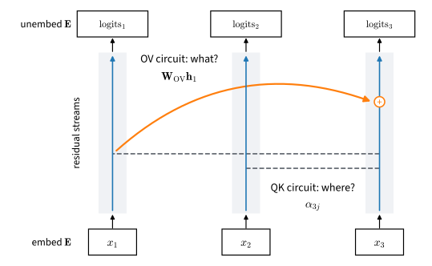
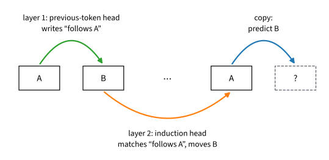

# Attention Circuits
:label:`sec_what-attention-computes`

An attention map shows where each query looks, and it invites a simple
reading: the model predicted *B* because it attended to *B*. The map shows
only half of a head. What the head adds to its output also depends on its
value and output projections, so a head that attends sharply to a token may
pass on the token's identity, one feature of it, or nothing at all.
Explaining what a trained model computes therefore takes both halves of
every head, and experiments that tell a mechanism apart from a pattern that
merely looks like one.

This section works through one complete case. In a transformer built from
attention layers alone, each head factors into two matrices that can be read
from its weights: a *QK circuit* that decides where the head attends and an
*OV circuit* that decides what it moves
:cite:`Elhage.Nanda.Olsson.ea.2021`. Expanding the layers algebraically
shows which functions one and two layers can express. We then train the
attention-only `TinyCharLM` of :numref:`sec_positional-information` on
sequences that repeat a random pattern, find the two-layer *induction head*
that completes the repetition, and test it four ways: through the loss, the
attention maps, the weights, and the removal of heads. The same circuit
appears in large language models, where it has been tied to their ability
to learn from the context :cite:`Olsson.Elhage.Nanda.ea.2022`.

```{.python .input #what-attention-computes}
%%tab pytorch
%matplotlib inline
from d2l import torch as d2l
import copy
import math
import torch
from torch.nn import functional as F
```

```{.python .input #what-attention-computes}
%%tab jax
%matplotlib inline
from d2l import jax as d2l
from flax import nnx
import jax
from jax import numpy as jnp
import math
import optax
```

## The Residual Stream

### Residual Representations Across Layers

`TinyCharLM` has the simplest architecture that still counts as a
transformer. Each of its $L$ blocks adds the output of $H$ causal attention
heads to its input, and nothing else: there are no feed-forward layers and
no normalization. The output head reuses the embedding matrix
$\mathbf{E}$, whose rows are the token embeddings. Write
$\mathbf{e}_{x_i} \in \mathbb{R}^d$ for the embedding of token $x_i$ and
set $\mathbf{h}_i^{(0)} = \mathbf{e}_{x_i}$.
Block $\ell$ computes, for every position $i$,

$$
\mathbf{h}_i^{(\ell)} = \mathbf{h}_i^{(\ell-1)} + \sum_{m=1}^{H} \sum_{j \leq i} \alpha_{ij}^{\ell m}\, \mathbf{W}_{\mathrm{OV}}^{\ell m}\, \mathbf{h}_j^{(\ell-1)},
$$
:eqlabel:`eq_stream-update`

where $\alpha_{ij}^{\ell m}$ is the weight with which head $m$ of block
$\ell$ attends from position $i$ to position $j$, and
$\mathbf{W}_{\mathrm{OV}}^{\ell m}$ is a $d \times d$ matrix, defined
below, that combines the head's value and output projections. The output
head scores the final vector against every embedding,
$\mathbf{z}_i = \mathbf{E}\, \mathbf{h}_i^{(L)}$. The sequence
$\mathbf{h}_i^{(0)}, \ldots, \mathbf{h}_i^{(L)}$ is the *residual stream*
of position $i$ (:numref:`fig_residual-stream`). Each block adds to this
vector rather than replacing it. A head reads the streams at earlier
positions, transforms what it reads linearly, and adds the result to the
stream at the current position. Information that one block writes
therefore stays available to every later block and to the output head.


:label:`fig_residual-stream`

Once the attention weights $\alpha$ are fixed, the map from embeddings to
logits in :eqref:`eq_stream-update` is linear, and expanding the recursion
writes it as a sum of matrix products along paths through the network.
This decomposition is exact for attention-only transformers
:cite:`Elhage.Nanda.Olsson.ea.2021`, which is why `TinyCharLM` has no
feed-forward layers or normalization. Full transformers have both, and
claims about them need the experiments developed below, not algebra alone.

### QK and OV Circuits

Each head's term in :eqref:`eq_stream-update` splits into two parts. Its
attention weights come from a softmax over scores that involve the query
and key projections only through their product, and what it adds depends
only on the value and output projections:

$$
s_{ij} = \frac{\mathbf{h}_i^\top \mathbf{W}_{\mathrm{QK}}\, \mathbf{h}_j}{\sqrt{d_h}}, \qquad \mathbf{W}_{\mathrm{QK}} = \mathbf{W}_q^\top \mathbf{W}_k, \qquad \mathbf{W}_{\mathrm{OV}} = \mathbf{W}_o \mathbf{W}_v.
$$
:eqlabel:`eq_qkov`

Vectors are columns here: $\mathbf{W}_q, \mathbf{W}_k, \mathbf{W}_v \in
\mathbb{R}^{d_h \times d}$ map the stream into a head of width $d_h$, and
$\mathbf{W}_o \in \mathbb{R}^{d \times d_h}$ maps the head's output back.
The *QK circuit* $\mathbf{W}_{\mathrm{QK}}$ is a bilinear form that scores
a query position against a key position. The *OV circuit*
$\mathbf{W}_{\mathrm{OV}}$ maps an attended stream vector to what the head
writes. The products, not the four projections, are the right objects to
study, because the projections are not identifiable. Without rotary
embeddings, replacing $\mathbf{W}_q$ by $\mathbf{R}\mathbf{W}_q$ and
$\mathbf{W}_k$ by $\mathbf{R}^{-\top}\mathbf{W}_k$, for any invertible
$d_h \times d_h$ matrix $\mathbf{R}$, changes nothing the model computes
and leaves $\mathbf{W}_{\mathrm{QK}}$ as it was. With rotary embeddings the
same holds for every $\mathbf{R}$ that commutes with the rotations, such as
a rotation and scaling of each frequency pair.

Both circuits are $d \times d$ matrices of rank at most $d_h = d/H$, so a
head reads and writes only a $d_h$-dimensional slice of the stream. With
$d = 128$ and four heads, each head works through a rank-32 bottleneck. In
`TinyCharLM` the four projections live in two fused layers: `qkv` stacks
the query, key, and value maps, and `proj` holds the output maps of the
heads side by side. Neither layer has a bias by default, so slicing the two
weight matrices gives the circuits of each head. The cell below forms them
for head 0 of block 1 of a freshly initialized model.

```{.python .input #what-attention-computes-where-and-what-the-qk-and-ov-circuits}
%%tab pytorch
model = d2l.TinyCharLM(vocab_size=64, pos='rope')
D = model.token_emb.weight.shape[1]
d_h = D // model.num_heads
W = model.blks[0]['qkv'].weight        # Rows stack W_q, W_k, W_v
W_q, W_k, W_v = W[:D], W[D:2 * D], W[2 * D:]
W_o = model.blks[0]['proj'].weight     # Columns split by head
h = 0
W_QK = W_q[h * d_h:(h + 1) * d_h].T @ W_k[h * d_h:(h + 1) * d_h]
W_OV = W_o[:, h * d_h:(h + 1) * d_h] @ W_v[h * d_h:(h + 1) * d_h]
for name, M in (('W_QK', W_QK), ('W_OV', W_OV)):
    print(f'{name}: shape {tuple(M.shape)}, '
          f'rank {torch.linalg.matrix_rank(M).item()}')
```

```{.python .input #what-attention-computes-where-and-what-the-qk-and-ov-circuits}
%%tab jax
model = d2l.TinyCharLM(vocab_size=64, pos='rope',
                       rngs=nnx.Rngs(d2l.get_key()))
D = model.token_emb.embedding[...].shape[1]
d_h = D // model.num_heads
W = model.blks[0]['qkv'].kernel[...]   # Columns stack W_q, W_k, W_v
W_q, W_k, W_v = W[:, :D], W[:, D:2 * D], W[:, 2 * D:]
W_o = model.blks[0]['proj'].kernel[...]  # Rows split by head
h = 0
W_QK = W_q[:, h * d_h:(h + 1) * d_h] @ W_k[:, h * d_h:(h + 1) * d_h].T
W_OV = W_v[:, h * d_h:(h + 1) * d_h] @ W_o[h * d_h:(h + 1) * d_h]
for name, M in (('W_QK', W_QK), ('W_OV', W_OV)):
    print(f'{name}: shape {tuple(M.shape)}, '
          f'rank {jnp.linalg.matrix_rank(M)}')
```

:begin_tab:`pytorch`
`nn.Linear` stores its weight with shape (output, input), the orientation
of the column-vector equations above. The rows of `qkv.weight` therefore
stack $\mathbf{W}_q$, $\mathbf{W}_k$, and $\mathbf{W}_v$, and the columns of
`proj.weight` split by head.
:end_tab:

:begin_tab:`jax`
`nnx.Linear` stores its kernel with shape (input, output), the transpose of
the column-vector equations above. The columns of `qkv.kernel` therefore
stack $\mathbf{W}_q^\top$, $\mathbf{W}_k^\top$, and $\mathbf{W}_v^\top$,
the rows of `proj.kernel` split by head, and the cell forms the transposed
circuits $\mathbf{W}_{\mathrm{QK}}^\top$ and $\mathbf{W}_{\mathrm{OV}}^\top$,
which have the same rank.
:end_tab:

Both circuits are $128 \times 128$ and have rank 32, the head width.
Rotary embeddings add position to the QK circuit and nowhere else. RoPE
rotates the query at position $i$ and the key at position $j$ by angles
proportional to their positions, so by :eqref:`eq_rope-goal` the score
becomes $\mathbf{h}_i^\top \mathbf{W}_q^\top \mathbf{R}_{j-i}
\mathbf{W}_k \mathbf{h}_j / \sqrt{d_h}$, with the relative rotation
$\mathbf{R}_{j-i}$ between the two projections. The values are not
rotated, so the OV circuit does not depend on position. We use
`pos='rope'` throughout because rotary embeddings are the positional scheme
of most current language models, including the GPT of :numref:`sec_gpt`.

### Bigrams, Skip-Trigrams, and the Limits of One Layer

Expanding the residual stream shows how the class of functions a model can
represent grows with depth. With *zero* blocks,
$\mathbf{z}_i = \mathbf{E}\,\mathbf{e}_{x_i}$: the logits depend on the
current token only, which makes the model a bigram model of a constrained
kind. Because the output head is tied to the embedding, the logit of token
$b$ after token $a$ is $\mathbf{e}_b^\top \mathbf{e}_a$. These logits form
the Gram matrix of the embeddings, which is symmetric and of rank at most
$d$, not an arbitrary $|\mathcal{V}| \times |\mathcal{V}|$ lookup table.
Training on text fills it with as much of the bigram statistics as that
form can hold. With *one* block,

$$
\mathbf{z}_i = \mathbf{E}\,\mathbf{e}_{x_i} + \sum_{m=1}^{H} \sum_{j \leq i} \alpha_{ij}^{m}\; \mathbf{E}\,\mathbf{W}_{\mathrm{OV}}^{m}\,\mathbf{e}_{x_j}.
$$
:eqlabel:`eq_one-layer-paths`

Each new term reads as an if--then rule. If the QK circuit sends attention
from the current token to an earlier token $x_j$, the OV circuit adds
$\mathbf{E}\,\mathbf{W}_{\mathrm{OV}}\,\mathbf{e}_{x_j}$ to the logits.
Rules of this shape, "when $[\mathrm{A}]$ appears somewhere before
$[\mathrm{B}]$, boost token $[\mathrm{C}]$", are called *skip-trigrams*,
and they are all that one layer adds to bigrams. A useful special case is
*copying*: attend to earlier occurrences of the current token and boost
that same token's logit, so that a word that has appeared becomes more
likely to appear again.

One task needs more. Suppose the sequence contains
$[\mathrm{A}][\mathrm{B}] \ldots [\mathrm{A}]$, and at the second
$[\mathrm{A}]$ the model should predict $[\mathrm{B}]$, continuing the
pattern by looking up what followed last time. No skip-trigram expresses
this. The head would have to attend from the second $[\mathrm{A}]$ to the
token *after* the first one, but in :eqref:`eq_one-layer-paths` the score
$\alpha_{ij}$ sees only $\mathbf{e}_{x_i}$, $\mathbf{e}_{x_j}$, and the
offset. The key at position $j$ carries no information about its neighbor
at $j - 1$. A second layer can supply that information. A head in layer 1
attends to the previous token and writes its identity into the stream, so
the key at $[\mathrm{B}]$'s position now also says "follows
$[\mathrm{A}]$". A head in layer 2 matches the query $[\mathrm{A}]$
against these enriched keys, attends to position $j$, and its OV circuit
copies $x_j = [\mathrm{B}]$ into the destination stream
(:numref:`fig_induction-circuit`). This two-step circuit is the *induction
head*: a previous-token head composed with a match-and-copy head through
the residual stream. The argument shows that two layers can express
induction and one layer cannot, apart from a position-only shortcut we will
meet shortly. Whether gradient descent finds the circuit is a separate,
empirical question, and the rest of the section answers it by experiment.


:label:`fig_induction-circuit`

## Copying and Induction

### A Repeated-Sequence Task

To see whether a model learns induction, we need a task that only
induction solves. Real text mixes induction with memorized statistics, so
we train on sequences of *repeated random tokens* instead: draw a pattern
of tokens uniformly from a vocabulary of 64, then tile it until the
sequence is full. Within one sequence the pattern repeats; across
sequences nothing does, and every bigram is equally likely on average. The
first pass over a pattern is therefore unpredictable, while every later
pass is predictable from the context alone. The gap between the loss on
the first copy and the loss on later copies measures how much the model
retrieves from its context. The function `repeated_batch` draws a
minibatch of such sequences, with pattern lengths uniform between `Lmin`
and `Lmax`.

```{.python .input #what-attention-computes-repetition-as-a-task-1}
%%tab pytorch
def repeated_batch(batch_size, num_steps, vocab, Lmin, Lmax, device=None):
    """Random patterns of length Lmin..Lmax, tiled to num_steps tokens."""
    L = torch.randint(Lmin, Lmax + 1, (batch_size,), device=device)
    s = torch.randint(0, vocab, (batch_size, num_steps), device=device)
    pos = torch.arange(num_steps, device=device)
    return torch.gather(s, 1, pos[None, :] % L[:, None]), L

device = d2l.try_gpu()
x, L = repeated_batch(batch_size=2, num_steps=16, vocab=10, Lmin=5, Lmax=8)
print(f'pattern lengths: {L.tolist()}')
print(x)
```

```{.python .input #what-attention-computes-repetition-as-a-task-1}
%%tab jax
def repeated_batch(key, batch_size, num_steps, vocab, Lmin, Lmax):
    """Random patterns of length Lmin..Lmax, tiled to num_steps tokens."""
    key_L, key_s = jax.random.split(key)
    L = jax.random.randint(key_L, (batch_size,), Lmin, Lmax + 1)
    s = jax.random.randint(key_s, (batch_size, num_steps), 0, vocab)
    pos = jnp.arange(num_steps)
    return jnp.take_along_axis(s, pos[None, :] % L[:, None], axis=1), L

x, L = repeated_batch(d2l.get_key(), batch_size=2, num_steps=16,
                      vocab=10, Lmin=5, Lmax=8)
print(f'pattern lengths: {L.tolist()}')
print(x)
```

Each row repeats its first $L$ tokens. Training uses `d2l.train_lm` from
:numref:`sec_adam`, which takes a fixed number of optimizer steps on the
mean next-token cross-entropy, here with Adam at learning rate $10^{-3}$. A
small data module supplies it with an endless stream of fresh 64-token
minibatches, so the model never sees the same pattern twice. Every 50
steps, training pauses for a measurement on a fresh batch: `eval_copy`
returns the loss on the first copy (targets before position $L$), the loss
on later copies, and the accuracy on later copies.

```{.python .input #what-attention-computes-repetition-as-a-task-2}
%%tab pytorch
@torch.inference_mode()
def eval_copy(model, x, L):
    """First-copy loss, later-copy loss, and later-copy accuracy."""
    logits, Y = model(x[:, :-1]), x[:, 1:]
    ce = F.cross_entropy(logits.transpose(1, 2), Y, reduction='none')
    later = torch.arange(1, Y.shape[1] + 1, device=Y.device) >= L[:, None]
    acc = (logits.argmax(-1) == Y)[later].float().mean()
    return torch.stack((ce[~later].mean(), ce[later].mean(), acc)).tolist()

class RepeatedTokens(d2l.DataModule):
    """An endless stream of fresh repeated-token minibatches."""
    def __init__(self, Lmin, Lmax, batch_size=128, num_steps=64, vocab=64):
        super().__init__()
        self.save_hyperparameters()

    def train_dataloader(self):
        while True:
            x, _ = repeated_batch(self.batch_size, self.num_steps,
                                  self.vocab, self.Lmin, self.Lmax)
            yield x[:, :-1], x[:, 1:]

def train_repeat(model, num_steps, Lmin, Lmax, eval_every=50):
    """Train with Adam; return (first, later) copy losses per round."""
    data, device = RepeatedTokens(Lmin, Lmax), d2l.try_gpu()
    optimizer = torch.optim.Adam(model.parameters(), lr=1e-3)
    history = []
    for _ in range(num_steps // eval_every):
        d2l.train_lm(model, data, optimizer, eval_every)
        x, L = repeated_batch(256, 64, 64, Lmin, Lmax, device)
        history.append(eval_copy(model, x, L)[:2])
    return history
```

```{.python .input #what-attention-computes-repetition-as-a-task-2}
%%tab jax
def eval_copy(model, x, L):
    """First-copy loss, later-copy loss, and later-copy accuracy."""
    logits, Y = model(x[:, :-1]), x[:, 1:]
    ce = optax.softmax_cross_entropy_with_integer_labels(logits, Y)
    later = jnp.arange(1, Y.shape[1] + 1)[None, :] >= L[:, None]
    acc = ((logits.argmax(-1) == Y) * later).sum() / later.sum()
    first = (ce * ~later).sum() / (~later).sum()
    rep = (ce * later).sum() / later.sum()
    return [float(v) for v in jax.device_get((first, rep, acc))]

class RepeatedTokens(d2l.DataModule):
    """An endless stream of fresh repeated-token minibatches."""
    def __init__(self, Lmin, Lmax, batch_size=128, num_steps=64, vocab=64):
        super().__init__()
        self.save_hyperparameters()

    def train_dataloader(self):
        while True:
            x, _ = repeated_batch(d2l.get_key(), self.batch_size,
                                  self.num_steps, self.vocab, self.Lmin,
                                  self.Lmax)
            yield x[:, :-1], x[:, 1:]

def train_repeat(model, num_steps, Lmin, Lmax, eval_every=50):
    """Train with Adam; return (first, later) copy losses per round."""
    data = RepeatedTokens(Lmin, Lmax)
    optimizer = nnx.Optimizer(model, optax.adam(1e-3), wrt=nnx.Param)
    history = []
    for _ in range(num_steps // eval_every):
        d2l.train_lm(model, data, optimizer, eval_every)
        x, L = repeated_batch(d2l.get_key(), 256, 64, 64, Lmin, Lmax)
        history.append(eval_copy(model, x, L)[:2])
    return history
```

### A Fixed-Offset Solution
:label:`subsec_fixed-offset-shortcut`

We start with the simplest version of the task: every pattern has length
32, so each sequence is one pattern followed by a copy of it. The analysis
above rules out a one-layer solution that matches content. We train a
one-block model on this task anyway and test it. For this experiment alone,
the projections have biases (`bias=True`); their role becomes clear below.

```{.python .input #what-attention-computes-the-positional-shortcut-1}
%%tab pytorch
model_shortcut = d2l.TinyCharLM(vocab_size=64, num_blks=1, pos='rope',
                                bias=True)
train_repeat(model_shortcut, 800, Lmin=32, Lmax=32)
first, rep, acc = eval_copy(model_shortcut,
                            *repeated_batch(256, 64, 64, 32, 32, device))
print(f'first copy {first:.2f} nats, second copy {rep:.2f} nats, '
      f'second-copy accuracy {acc:.2f}')
```

```{.python .input #what-attention-computes-the-positional-shortcut-1}
%%tab jax
model_shortcut = d2l.TinyCharLM(vocab_size=64, num_blks=1, pos='rope',
                                bias=True, rngs=nnx.Rngs(d2l.get_key()))
train_repeat(model_shortcut, 800, Lmin=32, Lmax=32)
first, rep, acc = eval_copy(model_shortcut, *repeated_batch(
    d2l.get_key(), 256, 64, 64, 32, 32))
print(f'first copy {first:.2f} nats, second copy {rep:.2f} nats, '
      f'second-copy accuracy {acc:.2f}')
```

The one-block model predicts the second copy almost perfectly, but it
cannot be running the content-based circuit. When the period is always 32,
the source of every prediction in the second copy lies 31 positions back,
and a RoPE head can attend to a fixed relative offset without comparing
any content (:numref:`sec_positional-information`). The following probe
tests this. It evaluates the same model on patterns of length 24, where the
source lies 23 positions back, and measures each head's average attention
weight at offsets 31 and 23.

```{.python .input #what-attention-computes-the-positional-shortcut-2}
%%tab pytorch
x, L = repeated_batch(256, 64, 64, 24, 24, device)
first, rep, acc = eval_copy(model_shortcut, x, L)
with torch.inference_mode():
    m = model_shortcut.attention_weights(x[:, :-1])[0]
print(f'patterns of length 24: second-copy accuracy {acc:.2f}')
for offset in (31, 23):
    mass = m.diagonal(-offset, dim1=2, dim2=3).mean((0, 2))
    print(f'mass at offset {offset}, per head: '
          + ' '.join(f'{v:.2f}' for v in mass.tolist()))
```

```{.python .input #what-attention-computes-the-positional-shortcut-2}
%%tab jax
x, L = repeated_batch(d2l.get_key(), 256, 64, 64, 24, 24)
first, rep, acc = eval_copy(model_shortcut, x, L)
m = model_shortcut.attention_weights(x[:, :-1])[0]
print(f'patterns of length 24: second-copy accuracy {acc:.2f}')
for offset in (31, 23):
    mass = jnp.diagonal(m, -offset, axis1=2, axis2=3).mean((0, 2))
    print(f'mass at offset {offset}, per head: '
          + ' '.join(f'{v:.2f}' for v in mass.tolist()))
```

Accuracy falls to about chance, $1/64$, because the heads keep their
attention at offset 31 and almost none of it moves to offset 23, where the
new period puts the source. The model has learned a fixed-offset rule, not
induction. The `qkv` bias makes this rule easy to express. It adds the same
vector to every query and to every key, and the RoPE score of a constant
query--key pair depends only on the offset. A single bias pair can
therefore place a peak at a fixed distance whatever the tokens are
(Exercise :exref:`ex_what-attention-computes-shortcut-bias` removes the
bias). Every model analyzed below has no biases, so the circuit algebra
above holds for it without correction.

The general point is that a synthetic benchmark can admit a simpler
solution than the mechanism it was designed to test. We therefore draw the
pattern length uniformly from 16 to 32. No fixed offset then works, and
predicting the later copies requires matching content against an earlier
occurrence.

### A Two-Block Induction Circuit
:label:`subsec_two-block-induction`

With variable pattern lengths, we train two models for 5,000 steps each: a
two-block model, the smallest that can express induction, and a one-block
control. Both are then evaluated on the same fresh batch.

```{.python .input #what-attention-computes-two-blocks-learn-to-look-things-up-1}
%%tab pytorch
model_two = d2l.TinyCharLM(vocab_size=64, num_blks=2, pos='rope')
hist_two = train_repeat(model_two, 5000, Lmin=16, Lmax=32)
model_one = d2l.TinyCharLM(vocab_size=64, num_blks=1, pos='rope')
hist_one = train_repeat(model_one, 5000, Lmin=16, Lmax=32)
x, L = repeated_batch(256, 64, 64, 16, 32, device)
for name, model in (('2 blocks', model_two), ('1 block', model_one)):
    first, rep, acc = eval_copy(model, x, L)
    print(f'{name}: first copy {first:.2f}, later copies {rep:.2f}, '
          f'accuracy {acc:.2f}')
```

```{.python .input #what-attention-computes-two-blocks-learn-to-look-things-up-1}
%%tab jax
model_two = d2l.TinyCharLM(vocab_size=64, num_blks=2, pos='rope',
                           rngs=nnx.Rngs(d2l.get_key()))
hist_two = train_repeat(model_two, 5000, Lmin=16, Lmax=32)
model_one = d2l.TinyCharLM(vocab_size=64, num_blks=1, pos='rope',
                           rngs=nnx.Rngs(d2l.get_key()))
hist_one = train_repeat(model_one, 5000, Lmin=16, Lmax=32)
x, L = repeated_batch(d2l.get_key(), 256, 64, 64, 16, 32)
for name, model in (('2 blocks', model_two), ('1 block', model_one)):
    first, rep, acc = eval_copy(model, x, L)
    print(f'{name}: first copy {first:.2f}, later copies {rep:.2f}, '
          f'accuracy {acc:.2f}')
```

The results agree with the composition argument. The two-block model
brings the later-copy loss down to a few tenths of a nat in a typical run
and predicts about nine in ten repeated tokens; an occasional run stalls
near one nat. The one-block model stays above three nats and predicts
fewer than one in five. That is better than chance, because copying heads
can concentrate probability on the tokens present in the context, but it
is far from retrieval. On the first copy, both models stay at or somewhat
above the chance loss of $\log 64 \approx 4.16$ nats. A model that
expects repetition assigns some probability to the context's tokens, and
that probability is wasted whenever a newly sampled token does not repeat.
The training curves show when the gap opens.

```{.python .input #what-attention-computes-two-blocks-learn-to-look-things-up-2}
%%tab pytorch, jax
steps = list(range(50, 5001, 50))
d2l.plot(steps, [[h[1] for h in hist_two], [h[1] for h in hist_one],
                 [h[0] for h in hist_two], [math.log(64)] * len(steps)],
         'step', 'loss (nats)',
         legend=['later copies, 2 blocks', 'later copies, 1 block',
                 'first copy, 2 blocks', 'log 64'], figsize=(5, 3))
```

For a long stretch of training, the later-copy curve of the two-block model
stays at or slightly above that of the one-block model. It then drops by several nats, most of
the way within a few hundred steps and sometimes in two stages, as the
computation the model performs changes abruptly. The point at which the drop
happens varies from run to run by up to a thousand steps. Larger language
models show a similar abrupt change in their training loss, and it coincides
with the formation of induction heads :cite:`Olsson.Elhage.Nanda.ea.2022`.

## Evidence for the Circuit

The loss shows that two blocks solve the task; it does not show how. Three
tests look inside the trained model. The attention maps show where each
head looks, the OV circuits show what the heads move, and removing heads
shows which of them the predictions need.

### Attention Patterns of the Learned Heads

`TinyCharLM.attention_weights` returns the attention map of every head in
every block. We feed one sequence with pattern length 24 and display all
eight heads.

```{.python .input #what-attention-computes-the-heads-caught-in-the-act-1}
%%tab pytorch
x, L = repeated_batch(1, 64, 64, 24, 24, device)
with torch.inference_mode():
    maps = torch.stack(model_two.attention_weights(x[:, :-1]))
d2l.show_heatmaps(maps[:, 0], xlabel='key position',
                  ylabel='query position',
                  titles=[f'head {h}' for h in range(4)],
                  figsize=(9, 4.5), cmap='Blues')
```

```{.python .input #what-attention-computes-the-heads-caught-in-the-act-1}
%%tab jax
x, L = repeated_batch(d2l.get_key(), 1, 64, 64, 24, 24)
maps = jnp.stack(model_two.attention_weights(x[:, :-1]))
d2l.show_heatmaps(maps[:, 0], xlabel='key position',
                  ylabel='query position',
                  titles=[f'head {h}' for h in range(4)],
                  figsize=(9, 4.5), cmap='Blues')
```

The top row shows block 1 and the bottom row block 2, and both halves of
the predicted circuit are visible. In block 1, at least one head draws a
line one step below the diagonal: a previous-token head. The others draw
mostly the diagonal itself, attending to their own position. In block 2,
heads draw a line 23 steps below the diagonal, starting where the second
copy starts. Each query there attends to the token *after* the previous
occurrence of the query's own token, which for a period of 24 lies 23
positions back. This is the induction stripe. To measure it, `head_scores`
computes, for every head, the average attention on the previous token and
on the induction target $j = i + 1 - L$, over a batch with pattern lengths
from 16 to 32. The target score averages over the queries whose token has
occurred before, $i \geq L$.

```{.python .input #what-attention-computes-the-heads-caught-in-the-act-2}
%%tab pytorch
@torch.inference_mode()
def head_scores(model, x, L):
    """Mean attention on the previous token and on the induction target:
    shape (blocks, 2, heads)."""
    maps, T = model.attention_weights(x[:, :-1]), x.shape[1] - 1
    tgt = torch.arange(T, device=x.device)[None, :] + 1 - L[:, None]
    valid = (tgt >= 1)[:, None, :]         # Query token occurred before
    scores = []
    for m in maps:                         # m: (batch, heads, T, T)
        prev = m.diagonal(-1, dim1=2, dim2=3).mean((0, 2))
        idx = tgt.clamp(min=0)[:, None, :, None].expand(*m.shape[:3], 1)
        ind = (m.gather(3, idx)[..., 0] * valid).sum((0, 2)) / valid.sum()
        scores.append(torch.stack((prev, ind)))
    return torch.stack(scores)

scores = head_scores(model_two, *repeated_batch(256, 64, 64, 16, 32, device))
for b, rows in enumerate(scores.tolist()):
    for name, row in zip(('previous', 'induction'), rows):
        print(f'block {b + 1}, {name:<9}: '
              + ' '.join(f'{v:.2f}' for v in row))
```

```{.python .input #what-attention-computes-the-heads-caught-in-the-act-2}
%%tab jax
def head_scores(model, x, L):
    """Mean attention on the previous token and on the induction target:
    shape (blocks, 2, heads)."""
    maps, T = model.attention_weights(x[:, :-1]), x.shape[1] - 1
    tgt = jnp.arange(T)[None, :] + 1 - L[:, None]
    valid = (tgt >= 1)[:, None, :]         # Query token occurred before
    scores = []
    for m in maps:                         # m: (batch, heads, T, T)
        prev = jnp.diagonal(m, -1, axis1=2, axis2=3).mean((0, 2))
        idx = jnp.broadcast_to(jnp.clip(tgt, 0)[:, None, :, None],
                               (*m.shape[:3], 1))
        mass = jnp.take_along_axis(m, idx, axis=3)[..., 0]
        ind = (mass * valid).sum((0, 2)) / valid.sum()
        scores.append(jnp.stack((prev, ind)))
    return jnp.stack(scores)

scores = head_scores(model_two, *repeated_batch(d2l.get_key(), 256, 64, 64,
                                                16, 32))
for b, rows in enumerate(scores.tolist()):
    for name, row in zip(('previous', 'induction'), rows):
        print(f'block {b + 1}, {name:<9}: '
              + ' '.join(f'{v:.2f}' for v in row))
```

Each line lists the four heads of one block. In block 1, one head, or in
many runs two that split the role, puts much of its attention on the
previous token and almost none on the induction target. The other heads of
the block do neither. Block 2's heads do the reverse. They share the induction pattern,
and the strongest puts more than a quarter of its attention, in many runs
over half, on the single position the algorithm calls for, out of up to 63
candidates. A uniform weighting would give that position about one fortieth.

### The Copy Matrix

The attention maps show where the heads look; the OV circuits show what
they move. If block 2's heads copy, attending to token $a$ should raise the
logit of token $a$ itself. Write

$$
C_{ab} = \mathbf{e}_b^\top \mathbf{W}_{\mathrm{OV}}\, \bar{\mathbf{h}}_a
$$
:eqlabel:`eq_copy-matrix`

for the boost that attending to token $a$ gives to the logit of token $b$.
Here $\bar{\mathbf{h}}_a$ is what the head reads at a position that holds
token $a$: the stream vector entering the block, averaged over the
positions of $a$ in a batch. In the first block it is the embedding
$\mathbf{e}_a$; in block 2 it also holds what block 1 wrote. Copying means
that every row of the $64 \times 64$ matrix $\mathbf{C}$ is largest on its
diagonal. Because block 2's heads share the copying, we sum their OV
circuits and count the rows whose largest entry is the diagonal. The same
count for the one-block model serves as a control, since that model cannot
retrieve.

```{.python .input #what-attention-computes-the-circuit-is-in-the-weights}
%%tab pytorch
@torch.no_grad()
def copy_matrix(model, blk, X):
    """C[a, b] = e_b^T W_OV h_a: W_OV summed over the heads of blk, h_a the
    mean stream vector entering blk at the positions of token a in X."""
    E = model.token_emb.weight
    D, H = E.shape[1], model.num_heads
    d_h = D // H
    S = model._embed(X)
    for b in range(blk):                       # The stream entering blk
        S = S + model._attend(model.blks[b], S)[0]
    h = torch.zeros_like(E).index_add_(0, X.flatten(), S.reshape(-1, D))
    h = h / torch.bincount(X.flatten(), minlength=len(E))[:, None]
    W_qkv = model.blks[blk]['qkv'].weight
    W_o = model.blks[blk]['proj'].weight
    W_OV = sum(W_o[:, m * d_h:(m + 1) * d_h]
               @ W_qkv[2 * D + m * d_h:2 * D + (m + 1) * d_h]
               for m in range(H))
    return h @ W_OV.T @ E.T

x, L = repeated_batch(256, 64, 64, 16, 32, device)
for name, model, blk in (('2 blocks, block 2', model_two, 1),
                         ('1 block', model_one, 0)):
    C = copy_matrix(model, blk, x)
    frac = (C.argmax(-1) == torch.arange(len(C), device=C.device)).float()
    print(f'{name}: rows whose largest entry is the diagonal '
          f'{frac.mean():.2f} (chance 1/64)')
d2l.show_heatmaps(copy_matrix(model_two, 1, x)[None, None].cpu(),
                  xlabel='logit boosted', ylabel='token attended to',
                  figsize=(3.6, 3.6), cmap='Blues')
```

```{.python .input #what-attention-computes-the-circuit-is-in-the-weights}
%%tab jax
def copy_matrix(model, blk, X):
    """C[a, b] = e_b^T W_OV h_a: W_OV summed over the heads of blk, h_a the
    mean stream vector entering blk at the positions of token a in X."""
    E = model.token_emb.embedding[...]
    D, H = E.shape[1], model.num_heads
    d_h = D // H
    S = model._embed(X)
    for b in range(blk):                       # The stream entering blk
        S = S + model._attend(model.blks[b], S)[0]
    h = jnp.zeros_like(E).at[X.flatten()].add(S.reshape(-1, D))
    h = h / jnp.bincount(X.flatten(), length=len(E))[:, None]
    W_qkv = model.blks[blk]['qkv'].kernel[...]
    W_o = model.blks[blk]['proj'].kernel[...]
    W_OV = sum(W_qkv[:, 2 * D + m * d_h:2 * D + (m + 1) * d_h]
               @ W_o[m * d_h:(m + 1) * d_h] for m in range(H))  # W_OV^T
    return h @ W_OV @ E.T

x, L = repeated_batch(d2l.get_key(), 256, 64, 64, 16, 32)
for name, model, blk in (('2 blocks, block 2', model_two, 1),
                         ('1 block', model_one, 0)):
    C = copy_matrix(model, blk, x)
    frac = (C.argmax(-1) == jnp.arange(len(C))).mean()
    print(f'{name}: rows whose largest entry is the diagonal '
          f'{frac:.2f} (chance 1/64)')
d2l.show_heatmaps(copy_matrix(model_two, 1, x)[None, None],
                  xlabel='logit boosted', ylabel='token attended to',
                  figsize=(3.6, 3.6), cmap='Blues')
```

In block 2 of the two-block model, the largest entry of the great majority
of rows lies on the diagonal, whereas a random argmax would hit the diagonal
in one row out of 64. Attending to a token raises that token's own logit
more than any other. The heatmap shows the same thing as a bright diagonal.
The average over the stream matters. With the raw embeddings $\mathbf{e}_a$
in place of $\bar{\mathbf{h}}_a$, the same count for block 2 varies widely
from run to run, because block 1 adds to each position a transformed copy of
its own token, and block 2 has learned to read that copy. The control copies
too. The one-block model's heads also raise the logit of the token they
attend to, which is why its later-copy loss falls below chance, yet the
model cannot retrieve. Copying OV circuits alone therefore do not explain
retrieval. What the two-block model adds is the match on the QK side, which
tells its copying heads where to look (Exercise
:exref:`ex_what-attention-computes-k-composition` composes block 1's OV
circuit into block 2's QK circuit). Neither the attention pattern nor the
copy matrix shows that the model needs these heads. That is a separate
question.

### Head Ablation
:label:`subsec_head-ablation`

A head with the right pattern and the right OV circuit may still be one the
model does not rely on. The direct test removes the head and measures what
breaks. Since `proj` is the only path from a head into the stream, zeroing
the head's columns of `proj` deletes its term from
:eqref:`eq_stream-update` and leaves every other head in that block
unchanged. The function `ablate` returns a copy of the model with the
given heads of one block removed.

```{.python .input #what-attention-computes-head-ablation-1}
%%tab pytorch
def ablate(model, blk, heads):
    """Copy of model with the given heads of block blk removed."""
    model = copy.deepcopy(model)
    W_o = model.blks[blk]['proj'].weight   # Columns split by head
    d_h = W_o.shape[1] // model.num_heads
    with torch.no_grad():
        for h in heads:
            W_o[:, h * d_h:(h + 1) * d_h] = 0
    return model
```

```{.python .input #what-attention-computes-head-ablation-1}
%%tab jax
def ablate(model, blk, heads):
    """Copy of model with the given heads of block blk removed."""
    model = nnx.clone(model)
    W_o = model.blks[blk]['proj'].kernel   # Rows split by head
    d_h = W_o.shape[0] // model.num_heads
    for h in heads:
        W_o[...] = W_o[...].at[h * d_h:(h + 1) * d_h].set(0)
    return model
```

The head scores pick the candidates. In block 1 we count every head whose
previous-token score exceeds 0.2 as a previous-token head, which catches
both heads when two split the role; the threshold falls in the wide gap
between their scores and those of the heads that attend to their own
position. We remove the previous-token heads together and, as a control,
all the other heads of block 1 together. In block 2 we remove the heads
cumulatively, in order of their induction scores, one, two, three, and all
four. The one-block model is listed for reference, and every variant is
evaluated on the same fresh batch.

```{.python .input #what-attention-computes-head-ablation-2}
%%tab pytorch
H = model_two.num_heads
prev = [h for h in range(H) if scores[0, 0, h] > 0.2]  # Previous-token heads
rest = [h for h in range(H) if h not in prev]
order = scores[1, 1].argsort(descending=True).tolist()  # Strongest first
variants = {'none': model_two,
            'block 1, previous-token heads': ablate(model_two, 0, prev),
            'block 1, all other heads': ablate(model_two, 0, rest)}
for k in range(1, H + 1):
    variants[f'block 2, top {k} induction'] = ablate(model_two, 1, order[:k])
variants['one-block model'] = model_one
x, L = repeated_batch(256, 64, 64, 16, 32, device)
print(f'block 1, previous-token heads: {prev}, others: {rest}')
print(f'{"heads removed":<31}later-copy loss  accuracy')
for name, model in variants.items():
    first, rep, acc = eval_copy(model, x, L)
    print(f'{name:<31}{rep:15.2f}{acc:10.2f}')
```

```{.python .input #what-attention-computes-head-ablation-2}
%%tab jax
H = model_two.num_heads
prev = [h for h in range(H) if scores[0, 0, h] > 0.2]  # Previous-token heads
rest = [h for h in range(H) if h not in prev]
order = jnp.argsort(-scores[1, 1]).tolist()  # Strongest first
variants = {'none': model_two,
            'block 1, previous-token heads': ablate(model_two, 0, prev),
            'block 1, all other heads': ablate(model_two, 0, rest)}
for k in range(1, H + 1):
    variants[f'block 2, top {k} induction'] = ablate(model_two, 1, order[:k])
variants['one-block model'] = model_one
x, L = repeated_batch(d2l.get_key(), 256, 64, 64, 16, 32)
print(f'block 1, previous-token heads: {prev}, others: {rest}')
print(f'{"heads removed":<31}later-copy loss  accuracy')
for name, model in variants.items():
    first, rep, acc = eval_copy(model, x, L)
    print(f'{name:<31}{rep:15.2f}{acc:10.2f}')
```

Removing block 1's previous-token heads breaks retrieval. The later-copy
loss rises by several nats and the accuracy falls far below that of the
intact model, because block 2 has nothing left to match against. Removing
the other heads of block 1, which attend to their own position, costs far
less: the loss rises by a fraction of that amount and most of the accuracy
survives. Block 2's heads share the work. Removing the strongest alone
raises the loss by roughly a nat or less, removing more raises it further,
and with all four removed it lies above even that of the one-block model.
Each induction head can partly stand in for the others, so removing any
single one underestimates how much the group matters. The ablations give the causal evidence that the maps could
not give. To predict later copies, the model needs the previous-token heads
of block 1 and the induction heads of block 2, the two halves of the
circuit.

## In-Context Learning

### Generalization to Unseen Patterns
:label:`subsec_unseen-patterns`

Every test sequence is sampled at evaluation time, so the pattern it
completes has almost surely never occurred in training, since there are at
least $64^{16}$ patterns. Across training sequences, moreover, every pair of
adjacent tokens is equally frequent. The parameters therefore cannot store
which token follows which in this pattern. The match-and-copy circuit
instead binds each token to its successor at inference time, inside the
context window. This is *in-context learning* in miniature. The model
learns each new pattern from a single exposure, without a gradient step.
Accuracy per position on patterns of period 24 shows the single exposure
directly.

```{.python .input #what-attention-computes-completing-patterns-it-has-never-seen}
%%tab pytorch
x, L = repeated_batch(512, 64, 64, 24, 24, device)
with torch.inference_mode():
    acc = (model_two(x[:, :-1]).argmax(-1) == x[:, 1:]).float().mean(0)
d2l.plot(torch.arange(1, 64), [acc.cpu()], 'target position', 'accuracy')
d2l.plt.axvline(24, color='k', ls=':');
```

```{.python .input #what-attention-computes-completing-patterns-it-has-never-seen}
%%tab jax
x, L = repeated_batch(d2l.get_key(), 512, 64, 64, 24, 24)
acc = (model_two(x[:, :-1]).argmax(-1) == x[:, 1:]).mean(0)
d2l.plot(jnp.arange(1, 64), [acc], 'target position', 'accuracy')
d2l.plt.axvline(24, color='k', ls=':');
```

Accuracy is near zero across the first copy and stays low at position 24
itself, where the dotted line marks the restart. Nothing in the context yet
announces that repetition has begun, so no predictor can be confident of
the restart there. The low accuracy is still a shortfall of `model_two`
rather than a limit set by the context (Exercise
:exref:`ex_what-attention-computes-bayes` computes the limit). From the
next position on, accuracy is high, about 0.9 in a typical run, and it
stays there for the rest of
the sequence. One exposure to a pattern suffices to complete its second
occurrence. The remaining errors have a cause that follows from the
circuit. When a token occurs twice inside one pattern with different
successors, a match on a single token is ambiguous, and our two-block
circuit matches on exactly one preceding token. Disambiguating would
require matching a longer prefix, through more block-1 heads at fixed
offsets or through more layers.

### Induction Heads in Larger Models

The same circuit appears far beyond this 64-token model.
:citet:`Olsson.Elhage.Nanda.ea.2022` found induction heads in transformer
language models of many sizes, using the probe of this section: score each
head by its attention from the current token to the token after that
token's previous occurrence, on repeated random sequences. One of their
observations matches what we measured: induction heads form abruptly, and
their formation coincides with a visible change in the loss curve. Two
others go beyond our experiment. Models gain most of their ability to use context in the same
window, measured as the drop in loss from early to late positions of the
context, and removing induction heads after training removes much of that
gain in small models (Exercise :exref:`ex_what-attention-computes-text`
tests this on text). And heads found on repeated random tokens also
complete structured patterns and copy fragments of text, so prefix
matching is a general algorithm, not a trick for exact repetition. In models with
feed-forward layers and normalization, the attribution of behavior to
single components is less direct, but the circuit found in `TinyCharLM`
remains a small, explicit model of how earlier context shapes later
predictions.

### In-Context Regression

Induction heads learn from the context by copying. Large models also learn
from the context when nothing is copied, for instance by inferring a rule
from a few labeled examples. The simplest such task is linear regression in
context. The sequence holds pairs $(\mathbf{x}_i, y_i)$ with
$y_i = \mathbf{w}^\top \mathbf{x}_i$ for a weight vector $\mathbf{w}$
drawn afresh for every sequence, followed by a query $\mathbf{x}_q$ whose
label the model must predict. One step of gradient descent on the squared
loss $\frac{1}{2}\sum_{i=1}^n (y_i - \mathbf{w}^\top \mathbf{x}_i)^2$,
started at $\mathbf{w} = \mathbf{0}$ with learning rate $\eta$, gives
$\mathbf{w}_1 = \eta \sum_i y_i \mathbf{x}_i$ and the prediction

$$
\hat{y}_q = \mathbf{w}_1^\top \mathbf{x}_q = \eta \sum_{i=1}^n y_i\, \mathbf{x}_i^\top \mathbf{x}_q.
$$
:eqlabel:`eq_icl-gd-step`

The right-hand side has the form of attention without a softmax: the query
$\mathbf{x}_q$ is compared with the keys $\mathbf{x}_i$ by inner products,
and the scores weight the values $y_i$. It is the numerator of the linear
attention :eqref:`eq_linear-attn` of :numref:`sec_attention-at-scale` with
$\phi(\mathbf{x}) = \mathbf{x}$ and no normalizer. A single head computes
it from a sequence of tokens. Give each example the token
$\mathbf{z}_i = [\mathbf{x}_i; y_i] \in \mathbb{R}^{p+1}$ and the query the
token $\mathbf{z}_q = [\mathbf{x}_q; 0]$. Let the head's query and key maps
both be $[\mathbf{I}_p\ \mathbf{0}]$, which read the input part of a token,
let its value map $[\mathbf{0}^\top\ 1]$ read the label, and drop the
softmax. Its output at the query token is then
$\eta \sum_i (\mathbf{x}_q^\top \mathbf{x}_i)\, y_i$, which is
:eqref:`eq_icl-gd-step`. The query token also attends to itself, but its
value is zero. The function `gd_head` builds the tokens and runs this head,
and the cell compares its output with the prediction of one gradient step.

```{.python .input #what-attention-computes-in-context-regression}
%%tab pytorch
def gd_head(X, y, x_q, eta):
    """Softmax-free head on tokens [x_i; y_i] and the query token [x_q; 0]."""
    p = X.shape[-1]
    z_q = torch.cat((x_q, torch.zeros_like(x_q[..., :1])), -1)
    Z = torch.cat((torch.cat((X, y[..., None]), -1), z_q[..., None, :]), -2)
    W_Q = W_K = torch.eye(p, p + 1)        # Queries and keys read x
    W_V = torch.eye(p + 1)[p:]             # Values read y
    Q, K, V = Z @ W_Q.T, Z @ W_K.T, Z @ W_V.T
    return eta * (Q[..., -1:, :] @ K.mT @ V)[..., 0, 0]  # At the query

n, p, eta = 32, 8, 0.1
X, w, x_q = torch.randn(n, p), torch.randn(p), torch.randn(p)
y = X @ w                              # Context labels
w_1 = eta * X.T @ y                    # One gradient step from w = 0
print(f'one gradient step: {x_q @ w_1:.4f}, '
      f'attention head: {gd_head(X, y, x_q, eta):.4f}')
```

```{.python .input #what-attention-computes-in-context-regression}
%%tab jax
def gd_head(X, y, x_q, eta):
    """Softmax-free head on tokens [x_i; y_i] and the query token [x_q; 0]."""
    p = X.shape[-1]
    z_q = jnp.concatenate((x_q, jnp.zeros_like(x_q[..., :1])), -1)
    Z = jnp.concatenate((jnp.concatenate((X, y[..., None]), -1),
                         z_q[..., None, :]), -2)
    W_Q = W_K = jnp.eye(p, p + 1)          # Queries and keys read x
    W_V = jnp.eye(p + 1)[p:]               # Values read y
    Q, K, V = Z @ W_Q.T, Z @ W_K.T, Z @ W_V.T
    return eta * (Q[..., -1:, :] @ K.swapaxes(-1, -2) @ V)[..., 0, 0]

n, p, eta = 32, 8, 0.1
k_X, k_w, k_q = jax.random.split(d2l.get_key(), 3)
X, w = jax.random.normal(k_X, (n, p)), jax.random.normal(k_w, (p,))
x_q = jax.random.normal(k_q, (p,))
y = X @ w                              # Context labels
w_1 = eta * X.T @ y                    # One gradient step from w = 0
print(f'one gradient step: {x_q @ w_1:.4f}, '
      f'attention head: {gd_head(X, y, x_q, eta):.4f}')
```

The two predictions agree to rounding error. The head's weights contain no
information about $\mathbf{w}$. The rule comes from the examples in its
context. With $\eta = 1/n$ the step gives $\mathbf{w}_1 = \frac{1}{n}
\sum_i \mathbf{x}_i \mathbf{x}_i^\top \mathbf{w}$, and for standard normal
inputs the average $\frac{1}{n}\sum_i \mathbf{x}_i \mathbf{x}_i^\top$
tends to the identity as $n$ grows. A longer context should therefore give
a better prediction, with the same weights. The cell measures the error
relative to the variance of the label, averaged over 500 sequences.

```{.python .input #what-attention-computes-in-context-regression-1}
%%tab pytorch
for n in (10, 100, 1000):
    X = torch.randn(500, n, p)
    w, x_q = torch.randn(500, p), torch.randn(500, p)
    y, y_q = (X @ w[..., None])[..., 0], (x_q * w).sum(-1)
    err = ((gd_head(X, y, x_q, 1 / n) - y_q) ** 2).mean() / (y_q ** 2).mean()
    print(f'{n:4d} examples in context: relative squared error {err:.3f}')
```

```{.python .input #what-attention-computes-in-context-regression-1}
%%tab jax
for n in (10, 100, 1000):
    k_X, k_w, k_q = jax.random.split(d2l.get_key(), 3)
    X = jax.random.normal(k_X, (500, n, p))
    w, x_q = jax.random.normal(k_w, (500, p)), jax.random.normal(k_q, (500, p))
    y, y_q = (X @ w[..., None])[..., 0], (x_q * w).sum(-1)
    err = ((gd_head(X, y, x_q, 1 / n) - y_q) ** 2).mean() / (y_q ** 2).mean()
    print(f'{n:4d} examples in context: relative squared error {err:.3f}')
```

The error falls about tenfold for every tenfold increase of $n$. The head
learns the regression from its context, and more examples teach it more.
:citet:`Oswald.Niklasson.Randazzo.ea.2023` built such layers by hand and
found that linear-attention transformers trained on in-context regression
learn this solution, with deeper models learning refinements of it.
Whether pretrained language models learn in context the same way is
disputed :cite:`Shen.Mishra.Khashabi.2024`. The induction head remains the
best-established mechanism.

## Attention Weights as Explanations

An attention map fixes the mixture $\alpha_{ij}$, but the head's effect
runs through its OV circuit. A head that attends sharply to a token might
move the token's identity, some feature of it, or, if
$\mathbf{W}_{\mathrm{OV}}$ annihilates the relevant directions, nothing at
all. Conversely, diffuse maps can implement a precise computation. In
:numref:`sec_multihead-attention`, two heads blend the same two values with
different weights, neither of them sharp, and a linear readout of the two
mixtures recovers both values exactly.

Trained language models offer a common example of a sharp map with little
effect. Many of their heads put most of their attention on the first token
of the sequence, whatever that token is :cite:`Xiao.Tian.Chen.ea.2024`.
The softmax forces every row of weights to sum to one, so a head with
nothing to retrieve must put its weight somewhere, and the first token,
visible to every query, becomes the place. This *attention sink* has a
value vector of small norm, so the weight placed on it adds almost nothing
to the stream :cite:`Gu.Pang.Du.ea.2025`. Read alone, the map says the
first token matters most. Read with the OV circuit, it says the head is
mostly idle. :numref:`sec_kv-cache` shows why a model's sinks must be kept when its
memory of the context is truncated.

The same mismatch between weights and effect appears in trained
classifiers. :citet:`Jain.Wallace.2019` showed that, on many
text-classification tasks, quite different attention distributions leave a
model's predictions unchanged. :citet:`Wiegreffe.Pinter.2019` replied that
adversarially chosen alternatives do not refute every explanatory use of
attention, and the debate sharpened rather than settled. As an unqualified
claim, "the attention weights explain the prediction" is false. A useful
interpretation includes the value transformation that follows the weights,
and a test of whether the model uses the computation at all.

The evidence for the induction circuit in this section comes in levels of
increasing strength, summarized in :numref:`tab_induction-evidence`. The
lower loss of the deeper model is *behavioral* evidence that depth enables
the task, but it identifies no component. Changing the period is an
intervention on the input, which separated content matching from a
positional shortcut. The attention pattern and the copy matrix are evidence
from activations and weights. They show that candidate heads have the
right form, not that the prediction depends on them. Ablation intervenes on
the components themselves and shows that it does.

:Evidence for the induction-head interpretation, by level.
:label:`tab_induction-evidence`

| check in this section | evidence level | supported conclusion | remaining limitation |
|:--|:--|:--|:--|
| later-copy loss | behavioral | two blocks solve the repeated-token task, one does not | identifies no component |
| period change | input intervention | the fixed-period model uses position, not content | changes the task as well as the input |
| head scores | activation | heads attend with the predicted offsets | omits the value transformation |
| copy matrix | weights and mean activations | block 2's OV circuits copy tokens | also present in a model that does not retrieve |
| head ablation | component intervention | later-copy prediction needs block 1's previous-token heads and block 2's induction heads, not block 1's other heads | zeroing moves the stream off its training distribution |

Ablation asks whether a component is necessary. *Activation patching* asks
what a component carries. It copies the component's output from a run on
one input into a run on another and measures how much of the first run's
behavior follows :cite:`Meng.Bau.Andonian.ea.2022`. With such
interventions, :citet:`Wang.Variengien.Conmy.ea.2023` traced the circuit
by which GPT-2 small finds the indirect object of a sentence, a circuit
that includes induction heads.

In an attention-only model these tests are comparatively direct, because
fixing the attention patterns makes the stream update linear. The next
chapter adds feed-forward layers and normalization to every block
(:numref:`chap_transformers`), which removes that simplification. Large
models also represent more features than the stream has dimensions, so
features share directions (*superposition*) and a head rarely reads one
clean feature. Analyzing them takes the same three kinds of evidence, from
behavior, from weights, and from interventions, at a much larger scale.

## Summary

An attention head consists of two circuits: a QK circuit $\mathbf{W}_q^\top
\mathbf{W}_k$ that decides where it attends and an OV circuit $\mathbf{W}_o
\mathbf{W}_v$ that decides what it adds to the residual stream, both of
rank at most $d_h$ and both readable from the weights. In an attention-only
transformer, expanding the stream shows that one layer adds skip-trigrams
such as copying to the bigram statistics of the embeddings, while
predicting what followed the previous occurrence of the current token takes
two layers: a previous-token head composed with a match-and-copy induction
head. Trained on repeated random tokens with a variable period, a two-block
`TinyCharLM` learns this circuit after an abrupt drop in loss and completes
patterns it has never seen, a small instance of in-context learning. With a
fixed period, a one-block model finds a positional shortcut instead.
Attention maps located the candidate heads, the copy matrix showed that
they copy, as even the one-block model's heads do, and ablation showed that
the model needs them, while the other heads of block 1 matter far less.
Attention weights alone explain little until the value transformation and an
intervention are added.

## Exercises

1. **Tied bigrams.** With zero blocks, the logit of token $b$ after token
   $a$ is $\mathbf{e}_b^\top \mathbf{e}_a$, so the geometry of the
   embeddings alone fixes which successor the model prefers. Call $b$ the
   *top successor* of $a$ when $\mathbf{e}_b^\top \mathbf{e}_a$ is the
   largest logit of that row, and assume that there are no ties.
    1. Show that if all embeddings have the same norm, the top successor of
       every token is the token itself.
    1. Drop the equal-norm assumption. Show that a token $b \neq a$ can be
       the top successor of $a$ only if $\|\mathbf{e}_b\| >
       \|\mathbf{e}_a\|$, and conclude that the top successors cannot form a
       cycle $a_1 \to a_2 \to \cdots \to a_k \to a_1$ with $k \geq 2$.
    1. Suppose that in a corpus the most frequent successor of the
       character `t` is `h`, that of `h` is `e`, that of `e` is the space,
       and that of the space is `t`. Show that no zero-block model
       reproduces all four as top successors, however long it is trained.
    1. In a one-block model, every head at the first position attends only
       to that position. Write the logits there as $\mathbf{E}\mathbf{M}
       \mathbf{e}_{x_0}$ for a matrix $\mathbf{M}$ built from the OV
       circuits, and explain why neither constraint of the previous parts
       applies to $\mathbf{E}\mathbf{M}\mathbf{E}^\top$.

1. **Paths through two blocks.** Fix the attention patterns of a model with
   $L$ blocks of $H$ heads on a sequence of $T$ tokens, and write
   $\mathbf{A}^{\ell m}$ for the $T \times T$ matrix with entries
   $\alpha_{ij}^{\ell m}$.
    1. Expand the logits of :eqref:`eq_stream-update` for $L = 2$ into a
       sum of path terms. Show that the path through head $m$ of block 1 and
       head $m'$ of block 2 acts like a single head with pattern
       $\mathbf{A}^{2m'}\mathbf{A}^{1m}$ and OV circuit
       $\mathbf{W}_{\mathrm{OV}}^{2m'}\mathbf{W}_{\mathrm{OV}}^{1m}$, and
       bound the rank of that circuit.
    1. Count the path terms for $L$ blocks, and evaluate the count for
       `model_two`.
    1. In a trained model the patterns of block 2 are not fixed: they depend
       on $\mathbf{h}^{(1)}$ through the QK circuit of block 2. Substitute
       $\mathbf{h}_i^{(1)}$ and $\mathbf{h}_j^{(1)}$ into the score of
       :eqref:`eq_qkov` and sort the terms by whether the query side, the
       key side, or both contain the output of a block-1 head. These terms
       are called *Q-composition* and *K-composition*, and the path of the
       first part is *V-composition* :cite:`Elhage.Nanda.Olsson.ea.2021`.
       Which kind of term does the induction circuit of
       :numref:`fig_induction-circuit` rely on?
    1. Show that two blocks can match on the two-token prefix
       $(x_{i-1}, x_i)$ when block 1 contains heads that attend to offsets
       $-1$ and $-2$, and name the composition term that carries each half
       of the match.

1. [code] **A copying head by hand.** The skip-trigram
   "$[\mathrm{A}] \ldots [\mathrm{A}] \to [\mathrm{A}]$" of
   :eqref:`eq_one-layer-paths` can be built without training. Instantiate
   `d2l.TinyCharLM(64, num_blks=1, pos='none')` and overwrite the slices of
   head 0 in the fused `qkv` weight and in `proj`: set both the query and
   the key map to $c\mathbf{Q}$ for a random $d_h \times d$ matrix
   $\mathbf{Q}$ and a constant $c$, set the value map to a second random
   matrix $\mathbf{V}$ and the head's output map to $\mathbf{V}^\top$, and
   zero the output maps of the other heads.
    1. Explain why the score $\mathbf{e}_a^\top \mathbf{W}_{\mathrm{QK}}
       \mathbf{e}_b$ is large exactly when $a = b$, and why
       $\mathbf{W}_{\mathrm{OV}} = \mathbf{V}^\top \mathbf{V}$ raises the
       logit of the attended token more than any other logit.
    1. Choose $c$ so that the keys holding the query's token receive more
       than $0.9$ of the weight at every position of random 63-token
       sequences, and verify that the head's contribution to the logits is
       largest at the current token.
    1. Predict the later-copy accuracy of this head on the
       repeated-sequence task, then measure it with `eval_copy`.
    1. With $c = 0$ the head weights all positions $j \leq i$ equally, so
       it raises the logit of each context token roughly in proportion to
       the token's count. As a reference for this behavior, compute the
       later-copy loss and accuracy of a predictor proportional to the token
       counts of the context, pooled over pattern lengths uniform in 16 to
       32 as `eval_copy` pools them. Compare both numbers with
       `eval_copy` of `model_one`, and name the information that the trained
       one-block RoPE model can use and this head cannot.

1. [code] **The shortcut without biases.** The fixed-offset model of
   :numref:`subsec_fixed-offset-shortcut` has projection biases.
    1. Let a head's query and key before rotation be the same constant
       vectors $\mathbf{q}$ and $\mathbf{k}$ at every position. Show with
       :eqref:`eq_rope-goal` that the score depends only on the offset
       $j - i$, and explain how $\mathbf{q}$ and $\mathbf{k}$ can be chosen
       so that the score is largest at offset $-31$.
    1. Without biases, every query and key is a linear function of the
       stream. What must the token embeddings contain for a head to produce
       nearly constant queries and keys?
    1. Train the one-block model of the text with `bias=False` three times
       and report the second-copy accuracy and each head's attention at
       offset 31. How reliably does the shortcut form without biases, and
       does it survive the period-24 probe?
   :exlabel:`ex_what-attention-computes-shortcut-bias`

1. **Weights that change nothing.** The output of a head at query $i$ is
   $\mathbf{W}_{\mathrm{OV}} \sum_j \alpha_{ij}\, \mathbf{h}_j$ by
   :eqref:`eq_stream-update`, and the softmax makes every weight
   $\alpha_{ij}$ on an unmasked key positive.
    1. Show that the attention distributions over $n$ keys that give the
       same head output as $\boldsymbol{\alpha}_i$ contain, around
       $\boldsymbol{\alpha}_i$, a piece of an affine subspace of dimension
       at least $n - 1 - d_h$. Evaluate the bound for the last query of a
       63-token input to `model_two`.
    1. The alternatives of the first part are constructed for one input at
       a time, as are those of :citet:`Jain.Wallace.2019`. State the
       condition under which a family of alternatives can be the attention
       patterns of one head with other QK weights on every input at once.
       Explain why this condition, raised by
       :citet:`Wiegreffe.Pinter.2019`, weakens the argument that the
       existence of alternative distributions disqualifies attention
       weights as explanations.

1. [code] **Zero and mean ablation.** The ablations of
   :numref:`subsec_head-ablation` set a head's output to zero.
    1. Explain why zeroing a head's columns of `proj` removes exactly that
       head's contribution to the residual stream. When a block-1 head is
       removed, which attention patterns stay unchanged and which can
       change?
    1. A head's output is never zero in training, so zeroing moves the
       stream to states the model has not seen. *Mean ablation* replaces
       the output $\mathbf{o}_m$ of head $m$ by its average
       $\bar{\mathbf{o}}_m$ over positions and sequences instead. Implement
       it: build a `TinyCharLM` with `bias=True`, copy the weights of
       `model_two` into it with zero `qkv` biases, zero head $m$'s columns
       of `proj`, and set the bias of `proj` to the product of these
       columns, before zeroing, with $\bar{\mathbf{o}}_m$. Repeat the
       ablations of the text. Do the conclusions change?
    1. Remove the second-strongest induction head of block 2 on its own.
       Compare the sum of the two single-head increases in later-copy loss
       with the increase when both heads are removed together. What does
       the comparison say about how the heads share the work?
    1. Which limitations in :numref:`tab_induction-evidence` does mean
       ablation remove, and which remain?
   :exlabel:`ex_what-attention-computes-circuit-ablation`

1. [code] **The Bayes-optimal predictor.** ● In the task of
   :numref:`subsec_two-block-induction`, the pattern length $L$ is uniform
   on $\{16, \ldots, 32\}$ and the pattern tokens are uniform over 64
   values. The Bayes-optimal prediction of $x_t$ from $x_0, \ldots,
   x_{t-1}$ averages the predictions of all pattern lengths $L'$, weighted
   by their posterior probabilities, and no model achieves a lower
   expected loss.
    1. Show that the prefix $x_0, \ldots, x_{t-1}$ has probability
       $64^{-\min(L', t)}$ under every length $L'$ with which it is
       consistent. Neglecting shorter lengths that are consistent by chance,
       derive the posterior weight of the true length at $t = L$ and at
       $t = L + 1$.
    1. At $16 \leq t < L$ the true distribution of $x_t$ is uniform. Show
       that the predictor's distribution there is not, and conclude that its
       first-copy loss exceeds $\log 64$.
    1. Simulate the predictor and report its first-copy loss, later-copy
       loss, and later-copy accuracy, pooled over positions as `eval_copy`
       pools them. Compare the results with `model_two`.
    1. :numref:`subsec_unseen-patterns` states that no predictor can be
       confident of the restart at position 24 of a period-24 pattern, and
       that the low accuracy of `model_two` there is a shortfall of the
       model. Compute the probability that the Bayes-optimal predictor
       assigns to the correct token there, and determine whether its most
       probable token is correct. Why does the match-and-copy circuit of
       `model_two` not predict that token?
   :exlabel:`ex_what-attention-computes-bayes`

1. [code] **Repeated tokens within a pattern.** ●
   :numref:`subsec_unseen-patterns` attributes the remaining errors of
   `model_two` to tokens that occur more than once in a pattern with
   different successors, which a match on a single token cannot tell
   apart.
    1. For a pattern of $L$ tokens drawn uniformly from 64 values, compute
       the probability that the token at a given position occurs elsewhere
       in the pattern. A circuit that picks one of the $K$ successors of the
       current token uniformly, when that token occurs $K$ times in the
       pattern, is correct with probability $1/K$. Compute its expected
       accuracy $\mathbb{E}[1/K]$ in closed form, and evaluate both
       quantities for $L = 21$.
    1. Evaluate `model_two` on patterns of length 21, which
       `repeated_batch` tiles to three copies within 64 tokens. Split the
       later-copy targets by whether the current token is unique in the
       pattern, and report the accuracy of each group on the second and on
       the third copy. Compare the overall accuracy with
       $\mathbb{E}[1/K]$.
    1. Explain the results through the single-token match. What does an
       additional earlier occurrence with the same successor do to the
       attention pattern and to the output, and what does one with a
       different successor do?
    1. Two blocks can match on the two-token prefix $(x_{i-1}, x_i)$ when
       block 1 contains heads that attend to offsets $-1$ and $-2$. Measure
       the attention mass that each block-1 head of `model_two` places at
       offset $-2$, and decide from this and your earlier measurements
       whether `model_two` matches on more than one token.

1. [code] **K-composition in the weights.** ● The match of the induction
   head works because the QK circuit of block 2 reads what the OV circuit
   of block 1 wrote into the stream.
    1. For every pair of head $m$ of block 1 and head $m'$ of block 2 of
       `model_two`, compute the $64 \times 64$ matrix
       $$\mathbf{E}\, \mathbf{W}_{\mathrm{QK}}^{2m'}\, \mathbf{W}_{\mathrm{OV}}^{1m}\, \mathbf{E}^\top,$$
       whose entry $(a, b)$ scores a query token $a$ against a key whose
       predecessor was $b$. Measure the fraction of rows whose largest
       entry lies on the diagonal, as the copy test of
       :eqref:`eq_copy-matrix` does for copying.
    1. Compare with the direct path $\mathbf{E}\,
       \mathbf{W}_{\mathrm{QK}}^{2m'}\, \mathbf{E}^\top$ of the same block-2
       heads. Which pairs of heads carry the match, and do they agree with
       the attention-based scores of `head_scores`?
    1. The computation ignores the rotation that RoPE applies inside the QK
       circuit. Include it for a fixed offset with :eqref:`eq_rope-goal`,
       and check whether doing so at offset $-23$ changes the ranking of the
       pairs.
   :exlabel:`ex_what-attention-computes-k-composition`

1. [extended] **Induction heads in text.** ●●
   :citet:`Olsson.Elhage.Nanda.ea.2022` tie the formation of induction
   heads in language models to an abrupt gain in in-context learning,
   measured as the drop in loss from early to late positions of the
   context. Test this on the byte-level model
   of :numref:`subsec_pos-experiment`.
    1. Train `d2l.TinyCharLM` with `pos='rope'` on the WikiText-103 bytes
       of :numref:`subsec_pos-experiment` in 30 rounds of 100 steps of
       `d2l.train_lm`. After each round, record two quantities. The
       first is the largest induction-target score of a block-2 head on
       repeated random sequences over the text vocabulary with pattern
       lengths 16 to 32, computed with `head_scores`. The second is the
       in-context gain, the validation loss at target positions 0 to 15
       minus that at positions 96 to 127.
    1. Plot both quantities against the training step. Do the induction
       score and the in-context gain rise in the same window?
    1. After training, remove the block-2 heads with the highest induction
       scores with `ablate`, and measure the in-context gain and the
       validation loss again. How much of the gain do these heads carry?
    1. The repeated random sequences contain no structure besides
       repetition, while text repeats words and phrases at irregular
       distances. Which of your results would change if the text contained
       no repeated words, and why?
   :exlabel:`ex_what-attention-computes-text`

[Discussions](https://d2l.discourse.group/t/36773)

<!-- slides -->

::: {.slide}
::: {.cover}
[Dive into Deep Learning · §10.6]{.kicker}

Attention Circuits<br>**the residual stream · QK and OV circuits · induction heads · ablation · in-context learning**
:::
:::

::: {.slide title="A Model Can Copy Perfectly Without Retrieving Anything"}
[The problem]{.kicker}

A one-block attention model, trained on 64-token sequences that repeat a
random 32-token pattern:

- predicts the second copy with accuracy about 1.0;
- on patterns of period 24, its accuracy drops to chance, 1/64;
- its heads still attend 31 positions back.

::: {.d2l-note .warn}
The attention map looked like copying. Which measurements tell a mechanism
from a shortcut?
:::
:::

::: {.slide title="By the End of This Deck You Can"}
[Goals]{.kicker}

- read a head as a QK circuit (where) and an OV circuit (what), from its
  weights;
- say what zero, one, and two attention layers can express;
- recognize the induction circuit and the fixed-offset shortcut;
- weigh five kinds of evidence: loss, period change, attention maps,
  weights, ablation.

**Running example:** `TinyCharLM`, an attention-only model with two
blocks of four heads, width $d = 128$, trained on repeated random tokens
from a vocabulary of 64.
:::

::: {.slide title="Reading What Trained Heads Compute"}
[Where this fits]{.kicker}

::: {.cols .vc}
::: {.col}
| section | adds |
|---|---|
| Queries, Keys, and Values | attention as a soft lookup |
| Attention Scoring and Masking | scaled dot products, masks |
| Multi-Head and Cross-Attention | several heads, shared keys and values |
| Positional Information | where a token sits |
| The Cost of Attention | quadratic cost, fused kernels |
| **Attention Circuits** | **what trained heads compute** |
:::

::: {.col .narrow}
- **Uses:** `TinyCharLM`, RoPE, causal masks.
- **Skips:** feed-forward layers and normalization (next chapter);
  interpretability of large models.
:::
:::
:::

::: {.slide title="Every Block Adds to a Residual Stream"}
[The residual stream]{.kicker}

$$\mathbf{h}_i^{(\ell)} = \mathbf{h}_i^{(\ell-1)} + \sum_{m=1}^{H} \sum_{j \leq i} \alpha_{ij}^{\ell m}\, \mathbf{W}_{\mathrm{OV}}^{\ell m}\, \mathbf{h}_j^{(\ell-1)}$$

- $\mathbf{h}_i^{(\ell)}$: the stream of position $i$ after block $\ell$,
  from $\mathbf{h}_i^{(0)} = \mathbf{e}_{x_i}$ (token embedding) to the
  logits $\mathbf{E}\,\mathbf{h}_i^{(L)}$ (tied output head).
- $\alpha_{ij}^{\ell m}$: weight of head $m$ in block $\ell$ from $i$ to
  $j$.
- Blocks only **add**: what one block writes, every later block can read.
:::

::: {.slide title="A Head Reads Earlier Streams and Writes to the Current One"}
{width=62%}

The QK circuit sets the weights $\alpha_{3j}$; the OV circuit sets what
each attended stream contributes. With the $\alpha$ fixed, the whole map
is linear and expands exactly (Elhage et al., 2021).
:::

::: {.slide title="A Head Is Two Matrices: QK Decides Where, OV Decides What"}
$$s_{ij} = \frac{\mathbf{h}_i^\top \mathbf{W}_{\mathrm{QK}} \mathbf{h}_j}{\sqrt{d_h}}, \qquad \mathbf{W}_{\mathrm{QK}} = \mathbf{W}_q^\top \mathbf{W}_k, \qquad \mathbf{W}_{\mathrm{OV}} = \mathbf{W}_o \mathbf{W}_v$$

- Only the products are identifiable: $\mathbf{R}\mathbf{W}_q$ with
  $\mathbf{R}^{-\top}\mathbf{W}_k$ computes the same scores (without RoPE).
- Both are $d \times d$ with rank at most $d_h = d/H$:

@!what-attention-computes-where-and-what-the-qk-and-ov-circuits

- RoPE puts the rotation $\mathbf{R}_{j-i}$ inside the QK circuit; the OV
  circuit ignores position.
:::

::: {.slide title="One Layer Adds Skip-Trigrams to Bigrams"}
[What depth can express]{.kicker}

$$\mathbf{z}_i = \underbrace{\mathbf{E}\,\mathbf{e}_{x_i}}_{\textrm{bigram}} + \sum_{m}\sum_{j \leq i} \alpha_{ij}^{m}\; \underbrace{\mathbf{E}\,\mathbf{W}_{\mathrm{OV}}^{m}\,\mathbf{e}_{x_j}}_{\textrm{skip-trigram}}$$

- Zero layers: the logit of $b$ after $a$ is $\mathbf{e}_b^\top
  \mathbf{e}_a$, a symmetric rank-$d$ bigram table.
- One layer: "$[\mathrm{A}]$ somewhere before $[\mathrm{B}]$ → boost
  $[\mathrm{C}]$", including copying ($[\mathrm{C}] = [\mathrm{A}]$).
- **Not expressible:** attend to the token *after* an earlier
  $[\mathrm{A}]$. The key at $j$ carries nothing about the token at $j-1$.
:::

::: {.slide title="Induction Needs Two Layers"}
{width=68%}

Layer 1 writes each token's predecessor into its stream. Layer 2 matches
the current $[\mathrm{A}]$ against "follows $[\mathrm{A}]$" and copies
$[\mathrm{B}]$.
:::

::: {.slide title="Check: Which Composition Does the Induction Head Use?"}
[Check]{.kicker}

Block 2's score is $\mathbf{h}_i^{(1)\top} \mathbf{W}_{\mathrm{QK}}
\mathbf{h}_j^{(1)}$. A block-1 head's output can enter on the query side
(Q-composition), on the key side (K-composition), or through the values
(V-composition). Which one does induction need?

::: {.fragment .fade-up}
::: {.d2l-note}
**Answer.** K-composition. The query is the current token itself; the
*key* at position $j$ must carry "my predecessor was $[\mathrm{A}]$",
which only block 1's previous-token head can write there.
:::
:::
:::

::: {.slide title="Repeated Random Tokens Isolate Retrieval"}
[Copying and induction]{.kicker}

Draw a pattern of $L$ tokens uniformly from 64, tile it to 64 tokens;
fresh patterns in every minibatch.

@!what-attention-computes-repetition-as-a-task-1

- First copy: unpredictable, chance loss $\log 64 \approx 4.16$ nats.
- Later copies: predictable only from the context.
:::

::: {.slide title="With a Fixed Period of 32, One Block Copies Perfectly"}
One block, four heads, projection biases on, 800 steps, $L = 32$:

@!what-attention-computes-the-positional-shortcut-1

The analysis says one layer cannot match content against an earlier
occurrence. So what did it learn?
:::

::: {.slide title="The Shortcut Attends 31 Back Whatever the Period"}
Probe: the same model on patterns of period 24 (source 23 back).

@!what-attention-computes-the-positional-shortcut-2

- A RoPE head attends to a fixed offset with no content comparison.
- The `qkv` bias makes it easy: a constant query–key pair whose rotated
  score depends only on the offset.

::: {.d2l-note .rule}
A synthetic task can admit a simpler solution than the one it was built to
test. Drawing $L$ from 16 to 32 removes this one.
:::
:::

::: {.slide title="Variable Periods: Two Blocks Retrieve, One Block Cannot"}
No biases, $L$ uniform on 16 to 32, 5,000 steps each:

@!what-attention-computes-two-blocks-learn-to-look-things-up-1

- Two blocks: later copies typically at a few tenths of a nat, about 9 in
  10 tokens right.
- One block: above three nats; copying heads help, retrieval is missing.
:::

::: {.slide title="The Two-Block Model Learns Abruptly"}
@!what-attention-computes-two-blocks-learn-to-look-things-up-2

- Two blocks track one block, then drop by several nats in one or two
  steep stages of a few hundred steps.
- Large models show such a drop as induction heads form (Olsson et al., 2022).
:::

::: {.slide title="Block 1 Looks One Back; Block 2 Looks Past the Last Match"}
[Evidence for the circuit]{.kicker}

@!what-attention-computes-the-heads-caught-in-the-act-1

Top, block 1: a line one below the diagonal (previous token). Bottom,
block 2: a stripe 23 below it from the second copy on (induction).
:::

::: {.slide title="Head Scores Separate the Two Roles"}
Mean attention on the previous token and on the induction target
$j = i + 1 - L$, per head, $L$ from 16 to 32:

@!what-attention-computes-the-heads-caught-in-the-act-2

- Block 1: one head, often two, on the previous token, none on the
  target.
- Block 2: every head on the target, the strongest with over a quarter of
  its weight, often over half, on 1 of up to 63 keys.
:::

::: {.slide title="OV Circuits Copy, With or Without Retrieval"}
$C_{ab} = \mathbf{e}_b^\top \mathbf{W}_{\mathrm{OV}} \bar{\mathbf{h}}_a$: the
boost that attending to $a$ gives the logit of $b$, with
$\bar{\mathbf{h}}_a$ the stream the block reads where $a$ sits. Copying
means each row peaks on the diagonal.

@!what-attention-computes-the-circuit-is-in-the-weights

The one-block control copies too, yet cannot retrieve: copying alone does
not explain retrieval; the match on the QK side does.
:::

::: {.slide title="Removing the Heads Removes Retrieval"}
@!what-attention-computes-head-ablation-2

- Zero a head's columns of `proj`: its term leaves the stream.
- Block 1: heads with previous-token score above 0.2 (one, or two that
  split the role). Removing them breaks retrieval; removing the rest costs
  far less.
- Block 2's loss rises as induction heads go, past the one-block level.
:::

::: {.slide title="Check: Why Does One Head Matter So Little?"}
[Check]{.kicker}

Removing block 2's strongest induction head raises the later-copy loss by
roughly a nat or less; removing all four lifts it past the one-block level.
What does that say about the heads?

::: {.fragment .fade-up}
::: {.d2l-note}
**Answer.** They are redundant: each finds the target on its own, so the
others stand in for any one that is removed. Single-head ablation
underestimates how much a group of heads matters.
:::
:::
:::

::: {.slide title="One Exposure Suffices on Patterns Never Seen in Training"}
[In-context learning]{.kicker}

@!what-attention-computes-completing-patterns-it-has-never-seen

- Period 24, fresh patterns: near zero up to the restart (dotted), then
  about 0.9.
- No weight update: the circuit binds tokens to successors in context.
:::

::: {.slide title="A Softmax-Free Head Takes One Gradient Step"}
Context $(\mathbf{x}_i, y_i)$, query $\mathbf{x}_q$; one gradient step on
$\frac{1}{2}\sum_i (y_i - \mathbf{w}^\top\mathbf{x}_i)^2$ from
$\mathbf{w} = \mathbf{0}$:

$$\hat{y}_q = \eta \sum_i y_i\, \mathbf{x}_i^\top \mathbf{x}_q$$

Tokens $[\mathbf{x}_i; y_i]$ and $[\mathbf{x}_q; 0]$; queries and keys read
$\mathbf{x}$, values read $y$, no softmax:

@!what-attention-computes-in-context-regression
:::

::: {.slide title="More Context Gives Better Predictions, With the Same Weights"}
With $\eta = 1/n$, $\mathbf{w}_1 = \frac{1}{n}\sum_i \mathbf{x}_i
\mathbf{x}_i^\top \mathbf{w} \to \mathbf{w}$ as $n$ grows:

@!what-attention-computes-in-context-regression-1

- The error falls about tenfold per tenfold more examples.
- Trained linear-attention models learn this solution (von Oswald et al.,
  2023); whether large pretrained models do is disputed.
:::

::: {.slide title="Attention Maps Locate Candidates; Interventions Test Them"}
[Attention weights as explanations]{.kicker}

| check | evidence | shows |
|---|---|---|
| later-copy loss | behavioral | two blocks solve the task |
| period change | input intervention | position vs content |
| head scores | activation | heads with the predicted offsets |
| copy matrix | weights, mean stream | block 2 copies |
| head ablation | component intervention | the model needs these heads |

::: {.d2l-note}
Attention sinks: heads in large models put most weight on the first token,
whose value vector has small norm (Xiao et al., 2024; Gu et al., 2025). A
sharp map, no effect.
:::
:::

::: {.slide title="Wrap-up"}
- A head is a QK circuit (where) and an OV circuit (what), each of rank at
  most $d_h = 32$ here.
- One layer: bigrams and skip-trigrams. Induction needs two: a
  previous-token head, then match and copy.
- Fixed period: one block finds a 31-back shortcut. Variable period: two
  blocks reach a few tenths of a nat; one block stays above three.
- Maps locate the heads; ablation shows the model needs them. Copying
  alone, which even one block has, does not retrieve.

**Next:** the full transformer block, which adds feed-forward layers and
normalization to attention.
:::
