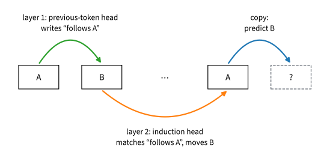

# Attention Circuits
:label:`sec_what-attention-computes`

As noted in :numref:`sec_queries-keys-values`, an attention heatmap is a
hypothesis about what a layer computes, not a proof. The heatmap shows where
a head looks, which is only half of its computation; what the head actually
writes to the output depends on its value and output projections. A head that
attends sharply to a token may copy that token's identity, extract a single
subspace feature, or contribute a negligible vector.

To understand what trained attention heads compute, we adopt the mechanistic
circuit formulation of :citet:`Elhage.Nanda.Olsson.ea.2021` on the
attention-only language model `TinyCharLM` (:numref:`sec_positional-information`).
Each head factors into two rank-$d_h$ bilinear/linear operators on the
*residual stream*: a *QK circuit* that determines which positions are
attended to, and an *OV circuit* that determines how attended vectors alter
output logits. Using this decomposition, we show why a one-layer model can
express bigrams and skip-trigrams (including single-token copying) but cannot
perform in-context pattern completion ($[\mathrm{A}][\mathrm{B}] \ldots
[\mathrm{A}] \to [\mathrm{B}]$), whereas a two-layer model can compose a
*previous-token head* with a *match-and-copy head* to form an *induction
head* :cite:`Olsson.Elhage.Nanda.ea.2022`. Finally, we test this circuit
hypothesis via weight inspection and causal head ablations.

```{.python .input #what-attention-computes}
%%tab pytorch
import math
import numpy as np
import torch
from torch import nn
from torch.nn import functional as F
from d2l import torch as d2l
```

```{.python .input #what-attention-computes}
%%tab jax
import math
import numpy as np
import jax
from jax import numpy as jnp
from flax import nnx
import optax
from d2l import jax as d2l
```

```{.python .input #what-attention-computes-attention-circuits-1}
%%tab pytorch
import copy
```

## Circuits and the Residual Stream

### QK and OV Circuits

In `TinyCharLM` (:numref:`subsec_tinycharlm`), token embeddings
$\mathbf{e}_{x_i} \in \mathbb{R}^d$ ($d = 128$) pass through $N$ residual
blocks, each consisting of $H = 4$ causal attention heads of width $d_h =
d/H = 32$ with no MLP, normalization, or bias terms, followed by a tied
unembedding projection $\mathbf{E} \in \mathbb{R}^{|\mathcal{V}| \times d}$.

Writing token vectors as column vectors $\mathbf{h}_j \in \mathbb{R}^d$, each
head projects $\mathbf{h}_j$ via $\mathbf{W}_v \in \mathbb{R}^{d_h \times d}$
and forms the weighted sum $\sum_{j \le i} \alpha_{ij} \mathbf{W}_v
\mathbf{h}_j$. Partitioning the block's output matrix into $H$ column slices
$\mathbf{W}_o \in \mathbb{R}^{d \times d_h}$ (one per head) expresses the
concatenation-and-projection step as a sum of independent head contributions:

$$
\mathbf{W}_o \sum_{j \leq i} \alpha_{ij}\, \mathbf{W}_v \mathbf{h}_j = \sum_{j \leq i} \alpha_{ij}\, \mathbf{W}_o \mathbf{W}_v\, \mathbf{h}_j.
$$

Similarly, the pre-softmax score between query position $i$ and key position
$j$ is $(\mathbf{W}_q \mathbf{h}_i)^\top (\mathbf{W}_k \mathbf{h}_j) /
\sqrt{d_h}$ with $\mathbf{W}_q, \mathbf{W}_k \in \mathbb{R}^{d_h \times d}$.
Each head is therefore completely characterized by two $d \times d$ matrices
of rank at most $d_h$ :cite:`Elhage.Nanda.Olsson.ea.2021`:

$$
s_{ij} = \frac{\mathbf{h}_i^\top \mathbf{W}_{\mathrm{QK}}\, \mathbf{h}_j}{\sqrt{d_h}}, \qquad \mathbf{W}_{\mathrm{QK}} = \mathbf{W}_q^\top \mathbf{W}_k, \qquad \mathbf{W}_{\mathrm{OV}} = \mathbf{W}_o \mathbf{W}_v.
$$
:eqlabel:`eq_qkov`

* The **QK circuit** $\mathbf{W}_{\mathrm{QK}}$ (or $\mathbf{W}_q^\top
  \mathbf{R}_{j-i} \mathbf{W}_k$ under RoPE, :numref:`subsec_pos-rope`)
  governs *where* the head attends.
* The **OV circuit** $\mathbf{W}_{\mathrm{OV}}$ governs *what* vector the
  head writes into the destination position when a source position is
  attended to.

Studying the products $\mathbf{W}_{\mathrm{QK}}$ and
$\mathbf{W}_{\mathrm{OV}}$ rather than the individual factors eliminates
gauge freedom ($\mathbf{W}_o \mathbf{G}^{-1}$ and $\mathbf{G}\mathbf{W}_v$
yield the exact same $\mathbf{W}_{\mathrm{OV}}$ for any invertible
$\mathbf{G} \in \mathbb{R}^{d_h \times d_h}$) and makes the rank-$d_h$
subspace bottleneck explicit.

### Residual Representations Across Layers

Setting $\mathbf{h}_i^{(0)} = \mathbf{e}_{x_i}$, block $\ell \in \{1, \ldots,
N\}$ updates the representation at position $i$ additively:

$$
\mathbf{h}_i^{(\ell)} = \mathbf{h}_i^{(\ell-1)} + \sum_{m=1}^{H} \sum_{j \leq i} \alpha_{ij}^{\ell m}\, \mathbf{W}_{\mathrm{OV}}^{\ell m}\, \mathbf{h}_j^{(\ell-1)},
$$
:eqlabel:`eq_stream-update`

and the tied output head produces logits $\mathbf{z}_i = \mathbf{E}\,
\mathbf{h}_i^{(N)}$. The sequence $\mathbf{h}_i^{(0)}, \ldots,
\mathbf{h}_i^{(N)}$ is the *residual stream* at position $i$
(:numref:`fig_residual-stream`): a shared communication channel into which
every head reads and writes additively.


:label:`fig_residual-stream`

### Bigrams, Skip-Trigrams, and the Limits of One Layer

Expanding :eqref:`eq_stream-update` by depth reveals what functions $N$
attention layers can express:

* **Zero blocks ($N = 0$):** $\mathbf{z}_i = \mathbf{E}\,\mathbf{e}_{x_i}$,
  modeling only constrained token-bigram logits via the symmetric, positive
  semidefinite Gram matrix $\mathbf{E}\mathbf{E}^\top$ (Exercise 1).
* **One block ($N = 1$):**

  $$
  \mathbf{z}_i = \mathbf{E}\,\mathbf{e}_{x_i} + \sum_{m=1}^{H} \sum_{j \leq i} \alpha_{ij}^{m}\; \mathbf{E}\,\mathbf{W}_{\mathrm{OV}}^{m}\,\mathbf{e}_{x_j}.
  $$
  :eqlabel:`eq_one-layer-paths`

  Each head term implements a *skip-trigram* rule of the form $x_j \ldots
  x_i \to x_{\textrm{next}}$ (e.g., attending from *"in"* to an earlier
  *"keep"* and boosting *"mind"*, or *copying* by boosting $x_j$ itself).
* **Two blocks ($N = 2$) and the induction head:** Suppose a context contains
  $[\mathrm{A}][\mathrm{B}] \ldots [\mathrm{A}]$ and the model must predict
  $[\mathrm{B}]$ by in-context lookup. A one-block model cannot do this by
  content matching: to copy $[\mathrm{B}]$ from position $j$, a head must
  attend to position $j$, but in :eqref:`eq_one-layer-paths` the key at
  position $j$ depends only on $\mathbf{e}_{x_j} = \mathbf{e}_{[\mathrm{B}]}$
  and knows nothing about its predecessor $x_{j-1} = [\mathrm{A}]$.

  Two blocks solve this via *K-composition* (:numref:`fig_induction-circuit`,
  Exercise :exref:`ex_what-attention-computes-paths`): in block 1, a
  *previous-token head* attends to offset $-1$ and writes $x_{j-1} =
  [\mathrm{A}]$ into the residual stream $\mathbf{h}_j^{(1)}$ at position $j$;
  in block 2, an *induction head* matches its query $[\mathrm{A}]$ against
  that key feature in $\mathbf{h}_j^{(1)}$ and uses its OV circuit to copy
  $x_j = [\mathrm{B}]$ into the prediction logits.


:label:`fig_induction-circuit`

## Copying and Induction

### A Repeated-Sequence Task

To test whether gradient descent discovers this two-layer circuit, we train on
synthetic sequences of *repeated random tokens*: each sequence draws a random
pattern of length $L \in [L_{\min}, L_{\max}]$ uniformly from a vocabulary of
size $64$ and tiles it to length $64$. Because every pattern is drawn fresh,
the first copy ($t < L$) is unpredictable (chance cross-entropy $\log 64
\approx 4.16$ nats), whereas later copies ($t \ge L$) can be predicted
perfectly by in-context lookup.

```{.python .input #what-attention-computes-repetition-as-a-task-1}
%%tab pytorch
def repeated_batch(batch_size, num_steps, vocab, Lmin, Lmax, device=None):
    """Random patterns of length Lmin..Lmax, tiled to num_steps tokens."""
    L = torch.randint(Lmin, Lmax + 1, (batch_size,), device=device)
    s = torch.randint(0, vocab, (batch_size, num_steps), device=device)
    pos = torch.arange(num_steps, device=device)
    return torch.gather(s, 1, pos[None, :] % L[:, None]), L

x, L = repeated_batch(batch_size=2, num_steps=16, vocab=10, Lmin=5, Lmax=8)
print(f'pattern lengths: {L.tolist()}')
print(x)
```

```{.python .input #what-attention-computes-repetition-as-a-task-1}
%%tab jax
def repeated_batch(key, batch_size, num_steps, vocab, Lmin, Lmax):
    """Random patterns of length Lmin..Lmax, tiled to num_steps tokens."""
    key_L, key_s = jax.random.split(key)
    L = jax.random.randint(key_L, (batch_size,), Lmin, Lmax + 1)
    s = jax.random.randint(key_s, (batch_size, num_steps), 0, vocab)
    pos = jnp.arange(num_steps)
    return jnp.take_along_axis(s, pos[None, :] % L[:, None], axis=1), L

x, L = repeated_batch(d2l.get_key(), batch_size=2, num_steps=16,
                      vocab=10, Lmin=5, Lmax=8)
print(f'pattern lengths: {L.tolist()}')
print(x)
```

`eval_copy` measures the cross-entropy on the first copy ($t < L$), the
cross-entropy on later copies ($t \ge L$), and the top-1 accuracy on later
copies:

```{.python .input #what-attention-computes-repetition-as-a-task-2}
%%tab pytorch
@torch.inference_mode()
def eval_copy(model, x, L):
    """First-copy loss, later-copy loss, and later-copy accuracy."""
    logits, Y = model(x[:, :-1]), x[:, 1:]
    ce = F.cross_entropy(logits.transpose(1, 2), Y, reduction='none')
    later = torch.arange(1, Y.shape[1] + 1, device=Y.device) >= L[:, None]
    acc = (logits.argmax(-1) == Y)[later].float().mean()
    return torch.stack((ce[~later].mean(), ce[later].mean(), acc)).tolist()

class RepeatedTokens(d2l.DataModule):
    """An endless stream of fresh repeated-token minibatches."""
    def __init__(self, Lmin, Lmax, batch_size=128, num_steps=64, vocab=64):
        super().__init__()
        self.save_hyperparameters()

    def train_dataloader(self):
        while True:
            x, _ = repeated_batch(self.batch_size, self.num_steps,
                                  self.vocab, self.Lmin, self.Lmax)
            yield x[:, :-1], x[:, 1:]

def train_repeat(model, num_steps, Lmin, Lmax, eval_every=50):
    """Train with Adam; return (first, later) copy losses per round."""
    data, device = RepeatedTokens(Lmin, Lmax), d2l.try_gpu()
    optimizer = torch.optim.Adam(model.parameters(), lr=1e-3)
    history = []
    for _ in range(num_steps // eval_every):
        d2l.train_steps(model, data, optimizer, eval_every)
        x, L = repeated_batch(256, 64, 64, Lmin, Lmax, device)
        history.append(eval_copy(model, x, L)[:2])
    return history

def drop_step(hist, eval_every=50):
    """First step at which the later-copy loss is below 1 nat, or None."""
    return next((eval_every * (k + 1) for k, (_, rep) in enumerate(hist)
                 if rep < 1), None)
```

```{.python .input #what-attention-computes-repetition-as-a-task-2}
%%tab jax
def eval_copy(model, x, L):
    """First-copy loss, later-copy loss, and later-copy accuracy."""
    logits, Y = model(x[:, :-1]), x[:, 1:]
    ce = optax.softmax_cross_entropy_with_integer_labels(logits, Y)
    later = jnp.arange(1, Y.shape[1] + 1)[None, :] >= L[:, None]
    acc = ((logits.argmax(-1) == Y) * later).sum() / later.sum()
    first = (ce * ~later).sum() / (~later).sum()
    rep = (ce * later).sum() / later.sum()
    return [float(v) for v in jax.device_get((first, rep, acc))]

class RepeatedTokens(d2l.DataModule):
    """An endless stream of fresh repeated-token minibatches."""
    def __init__(self, Lmin, Lmax, batch_size=128, num_steps=64, vocab=64):
        super().__init__()
        self.save_hyperparameters()

    def train_dataloader(self):
        while True:
            x, _ = repeated_batch(d2l.get_key(), self.batch_size,
                                  self.num_steps, self.vocab, self.Lmin,
                                  self.Lmax)
            yield x[:, :-1], x[:, 1:]

def train_repeat(model, num_steps, Lmin, Lmax, eval_every=50):
    """Train with Adam; return (first, later) copy losses per round."""
    data = RepeatedTokens(Lmin, Lmax)
    optimizer = nnx.Optimizer(model, optax.adam(1e-3), wrt=nnx.Param)
    history = []
    for _ in range(num_steps // eval_every):
        d2l.train_steps(model, data, optimizer, eval_every)
        x, L = repeated_batch(d2l.get_key(), 256, 64, 64, Lmin, Lmax)
        history.append(eval_copy(model, x, L)[:2])
    return history

def drop_step(hist, eval_every=50):
    """First step at which the later-copy loss is below 1 nat, or None."""
    return next((eval_every * (k + 1) for k, (_, rep) in enumerate(hist)
                 if rep < 1), None)
```

### A Fixed-Offset Solution
:label:`subsec_fixed-offset-shortcut`

Before testing variable periods, suppose the pattern period is fixed at
$L = 32$. A *one-block* model (`num_blks=1, bias=True`) easily achieves $100\%$
second-copy accuracy:

```{.python .input #what-attention-computes-the-positional-shortcut-1}
%%tab pytorch
model_shortcut = d2l.TinyCharLM(vocab_size=64, num_blks=1, pos='rope',
                                bias=True)
train_repeat(model_shortcut, 800, Lmin=32, Lmax=32)
first, rep, acc = eval_copy(model_shortcut, *repeated_batch(
    256, 64, 64, 32, 32, d2l.try_gpu()))
print(f'first copy {first:.2f} nats, second copy {rep:.2f} nats, '
      f'second-copy accuracy {acc:.2f}')
```

```{.python .input #what-attention-computes-the-positional-shortcut-1}
%%tab jax
model_shortcut = d2l.TinyCharLM(vocab_size=64, num_blks=1, pos='rope',
                                bias=True, rngs=nnx.Rngs(d2l.get_key()))
train_repeat(model_shortcut, 800, Lmin=32, Lmax=32)
first, rep, acc = eval_copy(model_shortcut, *repeated_batch(
    d2l.get_key(), 256, 64, 64, 32, 32))
print(f'first copy {first:.2f} nats, second copy {rep:.2f} nats, '
      f'second-copy accuracy {acc:.2f}')
```

How can a single layer copy the successor when our circuit analysis proved
that content-based induction requires two layers? When $L = 32$ is constant,
the target token at position $i + 1$ always equals the token at fixed offset
$j = i - 31$. A single RoPE head with constant bias queries and keys can
attend purely by relative offset $-31$ without matching content at all
(Exercise :exref:`ex_what-attention-computes-shortcut-bias`). Evaluating
`model_shortcut` on patterns of period $L = 24$ (where the target lies at
offset $-23$) immediately exposes the shortcut: attention remains locked at
offset $-31$ and accuracy collapses to chance ($1/64 \approx 0.02$):

```{.python .input #what-attention-computes-the-positional-shortcut-2}
%%tab pytorch
x, L = repeated_batch(256, 64, 64, 24, 24, d2l.try_gpu())
first, rep, acc = eval_copy(model_shortcut, x, L)
with torch.inference_mode():
    m = model_shortcut.attention_weights(x[:, :-1])[0]
print(f'patterns of length 24: second-copy accuracy {acc:.2f}')
for offset in (31, 23):
    mass = m.diagonal(-offset, dim1=2, dim2=3).mean((0, 2))
    print(f'mass at offset {offset}, per head: '
          + ' '.join(f'{v:.2f}' for v in mass.tolist()))
```

```{.python .input #what-attention-computes-the-positional-shortcut-2}
%%tab jax
x, L = repeated_batch(d2l.get_key(), 256, 64, 64, 24, 24)
first, rep, acc = eval_copy(model_shortcut, x, L)
m = model_shortcut.attention_weights(x[:, :-1])[0]
print(f'patterns of length 24: second-copy accuracy {acc:.2f}')
for offset in (31, 23):
    mass = jnp.diagonal(m, -offset, axis1=2, axis2=3).mean((0, 2))
    print(f'mass at offset {offset}, per head: '
          + ' '.join(f'{v:.2f}' for v in mass.tolist()))
```

### A Two-Block Induction Circuit
:label:`subsec_two-block-induction`

Sampling the pattern period uniformly from $L \in \{16, \ldots, 32\}$
eliminates any fixed-offset shortcut. We train three independent two-block
models and a one-block control (all with `bias=False`) for $5{,}000$ steps:

```{.python .input #what-attention-computes-two-blocks-learn-to-look-things-up-1}
%%tab pytorch
runs = []  # (blocks, model, history): three two-block runs, one control
for num_blks in (2, 2, 2, 1):
    model = d2l.TinyCharLM(vocab_size=64, num_blks=num_blks, pos='rope')
    runs.append((num_blks, model, train_repeat(model, 5000, 16, 32)))
models_two = [model for _, model, _ in runs[:3]]
_, model_two, hist_two = runs[0]   # Run 1: maps and curves shown for it
_, model_one, hist_one = runs[3]
x, L = repeated_batch(256, 64, 64, 16, 32, d2l.try_gpu())
print('blocks  first copy  later copies  accuracy  below 1 nat at step')
for num_blks, model, hist in runs:
    first, rep, acc = eval_copy(model, x, L)
    print(f'{num_blks:6d}{first:12.2f}{rep:14.2f}{acc:10.2f}'
          f'{drop_step(hist) or "never":>21}')
```

```{.python .input #what-attention-computes-two-blocks-learn-to-look-things-up-1}
%%tab jax
runs = []  # (blocks, model, history): three two-block runs, one control
for num_blks in (2, 2, 2, 1):
    model = d2l.TinyCharLM(vocab_size=64, num_blks=num_blks, pos='rope',
                           rngs=nnx.Rngs(d2l.get_key()))
    runs.append((num_blks, model, train_repeat(model, 5000, 16, 32)))
models_two = [model for _, model, _ in runs[:3]]
_, model_two, hist_two = runs[0]   # Run 1: maps and curves shown for it
_, model_one, hist_one = runs[3]
x, L = repeated_batch(d2l.get_key(), 256, 64, 64, 16, 32)
print('blocks  first copy  later copies  accuracy  below 1 nat at step')
for num_blks, model, hist in runs:
    first, rep, acc = eval_copy(model, x, L)
    print(f'{num_blks:6d}{first:12.2f}{rep:14.2f}{acc:10.2f}'
          f'{drop_step(hist) or "never":>21}')
```

All three two-block runs achieve $\sim 90\%$ later-copy accuracy (losses
$0.3$--$0.4$ nats), whereas the one-block model stalls above $3$ nats ($\sim
10\%$ accuracy, only boosting the unigram set of tokens present in the
context). Furthermore, the training curve exhibits an abrupt phase transition
after an initial plateau:

```{.python .input #what-attention-computes-two-blocks-learn-to-look-things-up-2}
%%tab pytorch, jax
steps = list(range(50, 5001, 50))
d2l.plot(steps, [[h[1] for h in hist_two], [h[1] for h in hist_one],
                 [h[0] for h in hist_two], [math.log(64)] * len(steps)],
         'step', 'loss (nats)',
         legend=['later copies, 2 blocks', 'later copies, 1 block',
                 'first copy, 2 blocks', 'log 64'], figsize=(5, 3))
```

## Evidence for the Circuit

To verify whether `model_two` actually implements the two-step induction
circuit of :numref:`fig_induction-circuit`, we inspect (1) its attention maps,
(2) its OV copy matrices, and (3) head ablations.

### Attention Patterns of the Learned Heads

On a test sequence of period $L = 24$, our circuit predicts that at least one
block-1 head should attend one position back ($j = i - 1$), and block-2 heads
should attend to the induction target $j = i + 1 - L = i - 23$ once $i \ge
24$:

```{.python .input #what-attention-computes-the-heads-caught-in-the-act-1}
%%tab pytorch
x, L = repeated_batch(1, 64, 64, 24, 24, d2l.try_gpu())
with torch.inference_mode():
    maps = torch.stack(model_two.attention_weights(x[:, :-1]))
d2l.show_heatmaps(maps[:, 0], xlabel='key position',
                  ylabel='query position',
                  titles=[f'head {h}' for h in range(4)],
                  figsize=(9, 4.5), cmap='Blues')
```

```{.python .input #what-attention-computes-the-heads-caught-in-the-act-1}
%%tab jax
x, L = repeated_batch(d2l.get_key(), 1, 64, 64, 24, 24)
maps = jnp.stack(model_two.attention_weights(x[:, :-1]))
d2l.show_heatmaps(maps[:, 0], xlabel='key position',
                  ylabel='query position',
                  titles=[f'head {h}' for h in range(4)],
                  figsize=(9, 4.5), cmap='Blues')
```

To quantify both roles across variable pattern lengths $L \in \{16, \ldots,
32\}$ and across all three runs, `head_scores` computes each head's mean
attention weight on the previous token ($j = i - 1$) and on the induction
target ($j = i + 1 - L$ for $i \ge L$):

```{.python .input #what-attention-computes-the-heads-caught-in-the-act-2}
%%tab pytorch
@torch.inference_mode()
def head_scores(model, x, L):
    """Mean attention on the previous token and on the induction target:
    shape (blocks, 2, heads)."""
    maps = torch.stack(model.attention_weights(x[:, :-1]))
    i = torch.arange(maps.shape[-1], device=x.device)
    tgt = i + 1 - L[:, None]               # Induction target of query i
    is_tgt = i == tgt[..., None]           # (batch, query, key)
    valid = tgt >= 1                       # Query token occurred before
    prev = maps.diagonal(-1, dim1=3, dim2=4).mean((1, 3))
    ind = (maps * is_tgt[:, None]).sum(-1)  # (blocks, batch, heads, query)
    ind = (ind * valid[:, None]).sum((1, 3)) / valid.sum()
    return torch.stack((prev, ind), 1)

x, L = repeated_batch(256, 64, 64, 16, 32, d2l.try_gpu())
all_scores = [head_scores(model, x, L) for model in models_two]
scores = all_scores[0]  # Run 1, whose maps are shown above
for r, run_scores in enumerate(all_scores):
    for b, rows in enumerate(run_scores.tolist()):
        for name, row in zip(('previous', 'induction'), rows):
            print(f'run {r + 1}, block {b + 1}, {name:<9}: '
                  + ' '.join(f'{v:.2f}' for v in row))
```

```{.python .input #what-attention-computes-the-heads-caught-in-the-act-2}
%%tab jax
def head_scores(model, x, L):
    """Mean attention on the previous token and on the induction target:
    shape (blocks, 2, heads)."""
    maps = jnp.stack(model.attention_weights(x[:, :-1]))
    i = jnp.arange(maps.shape[-1])
    tgt = i + 1 - L[:, None]               # Induction target of query i
    is_tgt = i == tgt[..., None]           # (batch, query, key)
    valid = tgt >= 1                       # Query token occurred before
    prev = jnp.diagonal(maps, -1, axis1=3, axis2=4).mean((1, 3))
    ind = (maps * is_tgt[:, None]).sum(-1)  # (blocks, batch, heads, query)
    ind = (ind * valid[:, None]).sum((1, 3)) / valid.sum()
    return jnp.stack((prev, ind), 1)

x, L = repeated_batch(d2l.get_key(), 256, 64, 64, 16, 32)
all_scores = [head_scores(model, x, L) for model in models_two]
scores = all_scores[0]  # Run 1, whose maps are shown above
for r, run_scores in enumerate(all_scores):
    for b, rows in enumerate(run_scores.tolist()):
        for name, row in zip(('previous', 'induction'), rows):
            print(f'run {r + 1}, block {b + 1}, {name:<9}: '
                  + ' '.join(f'{v:.2f}' for v in row))
```

In every run, one or two block-1 heads specialize as previous-token heads,
while block-2 heads concentrate attention on the induction target $j = i + 1
- L$.

### The Copy Matrix

Attending to position $j$ predicts $x_j$ only if block 2's OV circuit boosts
the logit of token $x_j$. Let

$$
C_{ab} = \mathbf{e}_b^\top \mathbf{W}_{\mathrm{OV}}\, \bar{\mathbf{h}}_a
$$
:eqlabel:`eq_copy-matrix`

denote the logit boost assigned to token $b$ when the summed OV circuit of a
block reads the mean residual-stream vector $\bar{\mathbf{h}}_a$ at positions
holding token $a$ (or the raw embedding $\mathbf{e}_a$). A copying OV circuit
has its row maximum on the diagonal ($b = a$) across nearly all $64$ rows
(versus $1/64 \approx 0.02$ by chance):

```{.python .input #what-attention-computes-copy-matrix-definitions}
%%tab pytorch
def circuits(model, blk):
    """W_QK and W_OV of every head of block blk, each (heads, D, D)."""
    # nn.Linear stores its weight as (output, input), the orientation of the
    # column-vector equations, so no transpose is needed
    W_qkv = model.blks[blk]['qkv'].weight           # (3D, D): W_q; W_k; W_v
    W_o = model.blks[blk]['proj'].weight            # (D, D): heads in columns
    H, D = model.num_heads, W_o.shape[0]
    W_q, W_k, W_v = W_qkv.reshape(3, H, D // H, D)  # Each (H, d_h, D)
    W_QK = W_q.mT @ W_k
    W_OV = W_o.reshape(D, H, D // H).transpose(0, 1) @ W_v
    return W_QK, W_OV

@torch.inference_mode()
def copy_matrix(model, blk, X=None):
    """C[a, b] = e_b^T W_OV h_a: W_OV summed over the heads of blk, h_a the
    mean stream vector entering blk at the positions of token a in X, or the
    embedding e_a if X is None."""
    E = h = model.token_emb.weight
    if X is not None:
        S = model.stream(X, blk)[0]            # The stream entering blk
        h = torch.zeros_like(E).index_add_(0, X.flatten(), S.flatten(0, 1))
        h = h / torch.bincount(X.flatten(), minlength=len(E))[:, None]
    W_OV = circuits(model, blk)[1].sum(0)
    return h @ W_OV.T @ E.T

def diagonal_share(C):
    """Fraction of the rows of C whose largest entry is on the diagonal."""
    rows = torch.arange(len(C), device=C.device)
    return float((C.argmax(-1) == rows).float().mean())
```

```{.python .input #what-attention-computes-the-circuit-is-in-the-weights}
%%tab pytorch
x, L = repeated_batch(256, 64, 64, 16, 32, d2l.try_gpu())
print('rows whose largest entry is the diagonal (chance 1/64)')
print(f'{"":<32}   run 1   run 2   run 3')
for name, X in (('2 blocks, block 2, mean stream', x),
                ('2 blocks, block 2, embeddings', None)):
    shares = [diagonal_share(copy_matrix(m, 1, X)) for m in models_two]
    print(f'{name:<32}' + ''.join(f'{v:8.2f}' for v in shares))
print(f'{"1 block, mean stream":<32}'
      f'{diagonal_share(copy_matrix(model_one, 0, x)):8.2f}')
d2l.show_heatmaps(copy_matrix(model_two, 1, x)[None, None].cpu(),
                  xlabel='logit boosted', ylabel='token attended to',
                  figsize=(3.6, 3.6), cmap='Blues')
```

```{.python .input #what-attention-computes-copy-matrix-definitions}
%%tab jax
def circuits(model, blk):
    """W_QK and W_OV of every head of block blk, each (heads, D, D)."""
    # nnx.Linear stores its kernel as (input, output), the transpose of the
    # column-vector equations, so both kernels are transposed first
    W_qkv = model.blks[blk]['qkv'].kernel[...].T    # (3D, D): W_q; W_k; W_v
    W_o = model.blks[blk]['proj'].kernel[...].T     # (D, D): heads in columns
    H, D = model.num_heads, W_o.shape[0]
    W_q, W_k, W_v = W_qkv.reshape(3, H, D // H, D)  # Each (H, d_h, D)
    W_QK = W_q.mT @ W_k
    W_OV = W_o.reshape(D, H, D // H).swapaxes(0, 1) @ W_v
    return W_QK, W_OV

def copy_matrix(model, blk, X=None):
    """C[a, b] = e_b^T W_OV h_a: W_OV summed over the heads of blk, h_a the
    mean stream vector entering blk at the positions of token a in X, or the
    embedding e_a if X is None."""
    E = h = model.token_emb.embedding[...]
    if X is not None:
        S = model.stream(X, blk)[0]            # The stream entering blk
        h = jnp.zeros_like(E).at[X.flatten()].add(S.reshape(-1, E.shape[1]))
        h = h / jnp.bincount(X.flatten(), length=len(E))[:, None]
    W_OV = circuits(model, blk)[1].sum(0)
    return h @ W_OV.T @ E.T

def diagonal_share(C):
    """Fraction of the rows of C whose largest entry is on the diagonal."""
    return float((C.argmax(-1) == jnp.arange(len(C))).mean())
```

```{.python .input #what-attention-computes-the-circuit-is-in-the-weights}
%%tab jax
x, L = repeated_batch(d2l.get_key(), 256, 64, 64, 16, 32)
print('rows whose largest entry is the diagonal (chance 1/64)')
print(f'{"":<32}   run 1   run 2   run 3')
for name, X in (('2 blocks, block 2, mean stream', x),
                ('2 blocks, block 2, embeddings', None)):
    shares = [diagonal_share(copy_matrix(m, 1, X)) for m in models_two]
    print(f'{name:<32}' + ''.join(f'{v:8.2f}' for v in shares))
print(f'{"1 block, mean stream":<32}'
      f'{diagonal_share(copy_matrix(model_one, 0, x)):8.2f}')
d2l.show_heatmaps(copy_matrix(model_two, 1, x)[None, None],
                  xlabel='logit boosted', ylabel='token attended to',
                  figsize=(3.6, 3.6), cmap='Blues')
```

Notice two instructive subtleties: (1) the one-block control *also* learns a
diagonal OV copy matrix, proving that OV copying without QK K-composition
cannot retrieve in-context successors (see Exercise
:exref:`ex_what-attention-computes-k-composition`); and (2) block 2 copies
much more reliably from the block-1 stream $\bar{\mathbf{h}}_a$ than from raw
embeddings $\mathbf{e}_a$ alone.

### Head Ablation
:label:`subsec_head-ablation`

To test causal necessity, `ablate` zeroes out the output-projection slice
$\mathbf{W}_o^m$ of selected heads in a block. We compare removing block 1's
previous-token heads (score $> 0.2$), removing block 1's remaining heads, and
cumulatively removing block 2's induction heads from strongest to weakest:

```{.python .input #what-attention-computes-head-ablation-1}
%%tab pytorch
def ablate(model, blk, heads):
    """Copy of model with the given heads of block blk removed."""
    model = copy.deepcopy(model)
    W_o = model.blks[blk]['proj'].weight   # (D, D): heads side by side
    with torch.no_grad():
        W_o.view(W_o.shape[0], model.num_heads, -1)[:, heads] = 0
    return model
```

```{.python .input #what-attention-computes-head-ablation-1}
%%tab jax
def ablate(model, blk, heads):
    """Copy of model with the given heads of block blk removed."""
    model = nnx.clone(model)
    W_o = model.blks[blk]['proj'].kernel   # (D, D): heads stacked in rows
    W = W_o[...].reshape(model.num_heads, -1, W_o.shape[1])
    W_o[...] = W.at[jnp.array(heads, dtype=int)].set(0).reshape(W_o.shape)
    return model
```

```{.python .input #what-attention-computes-head-ablation-2}
%%tab pytorch
x, L = repeated_batch(256, 64, 64, 16, 32, d2l.try_gpu())
H, table = model_two.num_heads, {}  # Variant: (loss, accuracy) per run
for r, (model, s) in enumerate(zip(models_two, all_scores)):
    prev = [h for h in range(H) if s[0, 0, h] > 0.2]  # Previous-token heads
    rest = [h for h in range(H) if h not in prev]
    order = s[1, 1].argsort(descending=True).tolist()  # Strongest first
    print(f'run {r + 1}: block 1 previous-token heads {prev}, others {rest}')
    variants = {'none': model,
                'block 1, previous-token heads': ablate(model, 0, prev),
                'block 1, all other heads': ablate(model, 0, rest)}
    for k in range(1, H + 1):
        variants[f'block 2, top {k} induction'] = ablate(model, 1, order[:k])
    for name, variant in variants.items():
        table.setdefault(name, []).append(eval_copy(variant, x, L)[1:])
table['one-block model'] = [eval_copy(model_one, x, L)[1:]]
print(f'{"heads removed":<31}later-copy loss / accuracy: run 1, 2, 3')
for name, cols in table.items():
    print(f'{name:<31}'
          + ''.join(f'{rep:7.2f} /{acc:5.2f}' for rep, acc in cols))
```

```{.python .input #what-attention-computes-head-ablation-2}
%%tab jax
x, L = repeated_batch(d2l.get_key(), 256, 64, 64, 16, 32)
H, table = model_two.num_heads, {}  # Variant: (loss, accuracy) per run
for r, (model, s) in enumerate(zip(models_two, all_scores)):
    prev = [h for h in range(H) if s[0, 0, h] > 0.2]  # Previous-token heads
    rest = [h for h in range(H) if h not in prev]
    order = jnp.argsort(-s[1, 1]).tolist()  # Strongest first
    print(f'run {r + 1}: block 1 previous-token heads {prev}, others {rest}')
    variants = {'none': model,
                'block 1, previous-token heads': ablate(model, 0, prev),
                'block 1, all other heads': ablate(model, 0, rest)}
    for k in range(1, H + 1):
        variants[f'block 2, top {k} induction'] = ablate(model, 1, order[:k])
    for name, variant in variants.items():
        table.setdefault(name, []).append(eval_copy(variant, x, L)[1:])
table['one-block model'] = [eval_copy(model_one, x, L)[1:]]
print(f'{"heads removed":<31}later-copy loss / accuracy: run 1, 2, 3')
for name, cols in table.items():
    print(f'{name:<31}'
          + ''.join(f'{rep:7.2f} /{acc:5.2f}' for rep, acc in cols))
```

Ablating block 1's previous-token heads collapses later-copy accuracy to
$\le 0.10$, confirming their necessity. Interestingly, ablating block 1's
*other* heads also breaks retrieval: because `copy_matrix` relied on block 1's
transformed stream (and zero-ablation shifts stream norms in an unnormalized
network; see Exercise :exref:`ex_what-attention-computes-circuit-ablation` on
mean ablation), block 2 depends on those heads as well. In block 2, the four
heads share the induction workload redundantly, requiring multiple heads to
be ablated before accuracy drops to chance.

## In-Context Learning

### Generalization to Unseen Patterns
:label:`subsec_unseen-patterns`

Because $64^{16} \approx 8 \times 10^{28}$ possible patterns exist, every test
sequence is novel and all token pairs are equally likely across the training
distribution. The induction circuit binds each token to its successor on the
fly from a single exposure in the context window—a minimal instance of
*in-context learning*:

```{.python .input #what-attention-computes-completing-patterns-it-has-never-seen}
%%tab pytorch
x, L = repeated_batch(512, 64, 64, 24, 24, d2l.try_gpu())
with torch.inference_mode():
    acc = (model_two(x[:, :-1]).argmax(-1) == x[:, 1:]).float().mean(0)
d2l.plot([torch.arange(1, 64), [24, 24]], [acc.cpu(), [0, 1]],
         'target position', 'accuracy', fmts=('-', 'k:'))
```

```{.python .input #what-attention-computes-completing-patterns-it-has-never-seen}
%%tab jax
x, L = repeated_batch(d2l.get_key(), 512, 64, 64, 24, 24)
acc = (model_two(x[:, :-1]).argmax(-1) == x[:, 1:]).mean(0)
d2l.plot([jnp.arange(1, 64), [24, 24]], [acc, [0, 1]],
         'target position', 'accuracy', fmts=('-', 'k:'))
```

Accuracy jumps from $1/64$ on the first copy (and at the restart boundary
$t = 24$, where content matching has not yet seen a repeated token) to
$> 0.90$ from position $25$ onward.

What accounts for the remaining $\sim 10\%$ error after the restart? When a
token appears $K > 1$ times within the $L$-token pattern with different
successors, matching on the current token alone is ambiguous: choosing
uniformly among the $K$ occurrences succeeds with probability $1/K$. For
$L = 24$ and $p = 1/64$, a token repeats in the pattern with probability
$1 - (63/64)^{23} \approx 0.30$, and uniform single-token matching predicts
an overall accuracy of

$$
\mathbb{E}\left[\frac{1}{K}\right] = \frac{1 - (1 - p)^L}{L p} \approx 0.84, \qquad p = \frac{1}{64},
$$

and $\approx 0.47$ on repeated tokens alone. Splitting test positions by
$K = 1$ (unique) versus $K > 1$ (repeated) shows that `model_two` reaches
$\sim 0.99$ on unique tokens and $0.70$--$0.90$ on repeated tokens—exceeding
the $0.47$ single-token baseline by combining longer $n$-gram context and
RoPE offset preferences:

```{.python .input #what-attention-computes-generalization-to-unseen-patterns-1}
%%tab pytorch
period, num_steps = 24, 64
x, _ = repeated_batch(512, num_steps, 64, period, period, d2l.try_gpu())
pattern = x[:, :period]
K = (pattern[:, :, None] == pattern[:, None, :]).sum(-1)  # Count in pattern
K = K[:, torch.arange(period, num_steps - 1) % period]  # Current token
parts = (K == 1, K > 1, K > 0)           # Unique, repeated, all
rows = {'share of targets': [p.float().mean() for p in parts],
        'single-token match': [(1 / K[p]).mean() for p in parts]}
for r, model in enumerate(models_two):
    with torch.inference_mode():
        hit = (model(x[:, :-1]).argmax(-1) == x[:, 1:])[:, period:]
    rows[f'run {r + 1} accuracy'] = [hit[p].float().mean() for p in parts]
print(f'{"current token":<18}   unique repeated      all')
for name, row in rows.items():
    print(f'{name:<18}' + ''.join(f'{v:9.2f}' for v in row))
```

```{.python .input #what-attention-computes-generalization-to-unseen-patterns-1}
%%tab jax
period, num_steps = 24, 64
x, _ = repeated_batch(d2l.get_key(), 512, num_steps, 64, period, period)
pattern = x[:, :period]
K = (pattern[:, :, None] == pattern[:, None, :]).sum(-1)  # Count in pattern
K = K[:, jnp.arange(period, num_steps - 1) % period]  # Current token
parts = (K == 1, K > 1, K > 0)           # Unique, repeated, all
rows = {'share of targets': [p.mean() for p in parts],
        'single-token match': [(1 / K[p]).mean() for p in parts]}
for r, model in enumerate(models_two):
    hit = (model(x[:, :-1]).argmax(-1) == x[:, 1:])[:, period:]
    rows[f'run {r + 1} accuracy'] = [hit[p].mean() for p in parts]
print(f'{"current token":<18}   unique repeated      all')
for name, row in rows.items():
    print(f'{name:<18}' + ''.join(f'{v:9.2f}' for v in row))
```

### Induction Heads in Larger Models
:label:`subsec_induction-larger-models`

:citet:`Olsson.Elhage.Nanda.ea.2022` demonstrated that induction heads form
during an abrupt phase transition in language models across scales, coinciding
with the emergence of general in-context learning (Exercise
:exref:`ex_what-attention-computes-text`). Beyond copying and fuzzy pattern
completion, attention layers can also implement in-context gradient steps on
regression tasks (Exercise
:exref:`ex_what-attention-computes-in-context-regression`,
:cite:`Oswald.Niklasson.Randazzo.ea.2023,Shen.Mishra.Khashabi.2024`).

## Attention Weights as Explanations

Our investigation illustrates why attention heatmaps alone are insufficient as
mechanistic explanations:

* **Important heads can have unremarkable maps:** Block 1's non-previous-token
  heads looked inert in the heatmaps, yet ablating them broke block 2's
  retrieval.
* **Sharp maps can have negligible effect:** In pretrained language models,
  idle heads frequently place most of their weight on the first token (an
  *attention sink*), whose OV vector has near-zero norm
  :cite:`Xiao.Tian.Chen.ea.2024,Gu.Pang.Du.ea.2025`.

:numref:`tab_induction-evidence` summarizes the hierarchy of evidence used to
validate the induction circuit.

:Evidence for the induction-head interpretation, by level.
:label:`tab_induction-evidence`

| check in this section | evidence level | supported conclusion | remaining limitation |
|:--|:--|:--|:--|
| later-copy loss | behavioral | two blocks solve the repeated-token task, one does not | identifies no component |
| period change | input intervention | the fixed-period model uses position, not content | changes the task as well as the input |
| head scores | activation | heads attend with the predicted offsets | omits the value transformation |
| copy matrix | weights and mean activations | block 2's OV circuits copy tokens | also present in a model that does not retrieve |
| head ablation | component intervention | later-copy prediction needs all of block 1, not only its previous-token heads, and block 2's induction heads | zeroing moves the stream off its training distribution |

## Summary

* Each attention head decomposes into a rank-$d_h$ **QK circuit**
  $\mathbf{W}_q^\top \mathbf{W}_k$ (where it attends) and a rank-$d_h$ **OV
  circuit** $\mathbf{W}_o \mathbf{W}_v$ (what it writes to the residual
  stream).
* A one-layer attention-only model can represent bigrams and skip-trigrams
  (including single-token copying), whereas continuing an in-context pattern
  $[\mathrm{A}][\mathrm{B}] \ldots [\mathrm{A}] \to [\mathrm{B}]$ requires a
  two-layer **induction circuit** composing a previous-token head with a
  match-and-copy head.
* On repeated random patterns of variable period, a two-block model undergoes
  a sharp training phase transition to $\sim 90\%$ in-context accuracy, while
  a fixed period allows a one-block model to exploit a positional shortcut.
* Establishing what a head computes requires combining attention-pattern
  probes, OV weight analysis, and causal interventions (ablations).

## Exercises

1. **Tied bigrams.** With zero blocks, the logit of token $b$ after token
   $a$ is $\mathbf{e}_b^\top \mathbf{e}_a$, so the geometry of the
   embeddings alone fixes which successor the model prefers. Call $b$ the
   *top successor* of $a$ when $\mathbf{e}_b^\top \mathbf{e}_a$ is the
   largest logit of that row, and assume that there are no ties.
    1. Show that if all embeddings have the same norm, the top successor of
       every token is the token itself.
    1. Drop the equal-norm assumption. Show that a token $b \neq a$ can be
       the top successor of $a$ only if $\|\mathbf{e}_b\| >
       \|\mathbf{e}_a\|$, and conclude that the top successors cannot form a
       cycle $a_1 \to a_2 \to \cdots \to a_k \to a_1$ with $k \geq 2$.
    1. Suppose that in a corpus the most frequent successor of the
       character `t` is `h`, that of `h` is `e`, that of `e` is the space,
       and that of the space is `t`. Show that no zero-block model
       reproduces all four as top successors, however long it is trained.
    1. In a one-block model, every head at the first position attends only
       to that position. Write the logits there as $\mathbf{E}\mathbf{M}
       \mathbf{e}_{x_0}$ for a matrix $\mathbf{M}$ built from the OV
       circuits, and explain why neither constraint of the previous parts
       applies to $\mathbf{E}\mathbf{M}\mathbf{E}^\top$.

1. **Paths through two blocks.** Fix the attention patterns of a model with
   $N$ blocks of $H$ heads on a sequence of $T$ tokens, and write
   $\mathbf{A}^{\ell m}$ for the $T \times T$ matrix with entries
   $\alpha_{ij}^{\ell m}$.
    1. Expand the logits of :eqref:`eq_stream-update` for $N = 2$ into a
       sum of path terms. Show that the path through head $m$ of block 1 and
       head $m'$ of block 2 acts like a single head with pattern
       $\mathbf{A}^{2m'}\mathbf{A}^{1m}$ and OV circuit
       $\mathbf{W}_{\mathrm{OV}}^{2m'}\mathbf{W}_{\mathrm{OV}}^{1m}$, and
       bound the rank of that circuit.
    1. Count the path terms for $N$ blocks, and evaluate the count for
       `model_two`.
    1. In a trained model the patterns of block 2 are not fixed: they depend
       on $\mathbf{h}^{(1)}$ through the QK circuit of block 2. Substitute
       $\mathbf{h}_i^{(1)}$ and $\mathbf{h}_j^{(1)}$ into the score of
       :eqref:`eq_qkov` and sort the terms by whether the query side, the
       key side, or both contain the output of a block-1 head. These terms
       are called *Q-composition* and *K-composition*, and the path of the
       first part is *V-composition* :cite:`Elhage.Nanda.Olsson.ea.2021`.
       Which kind of term does the induction circuit of
       :numref:`fig_induction-circuit` rely on?
    1. Show that two blocks can match on the two-token prefix
       $(x_{i-1}, x_i)$ when block 1 contains heads that attend to offsets
       $-1$ and $-2$, and name the composition term that carries each half
       of the match.
   :exlabel:`ex_what-attention-computes-paths`

1. [code] **The shortcut without biases.** The fixed-offset model of
   :numref:`subsec_fixed-offset-shortcut` has projection biases.
    1. Let a head's query and key before rotation be the same constant
       vectors $\mathbf{q}$ and $\mathbf{k}$ at every position. Show with
       $\mathbf{R}_i^\top \mathbf{R}_j = \mathbf{R}_{j-i}$ that the score
       depends only on the offset $j - i$, and explain how $\mathbf{q}$ and $\mathbf{k}$ can be chosen
       so that the score is largest at offset $-31$.
    1. Without biases, every query and key is a linear function of the
       stream. What must the token embeddings contain for a head to produce
       nearly constant queries and keys?
    1. Train the one-block model of the text with `bias=False` three times
       and report the second-copy accuracy and each head's attention at
       offset 31. How reliably does the shortcut form without biases, and
       does it survive the period-24 probe?
   :exlabel:`ex_what-attention-computes-shortcut-bias`

1. **Weights that change nothing.** The output of a head at query $i$ is
   $\mathbf{W}_{\mathrm{OV}} \sum_j \alpha_{ij}\, \mathbf{h}_j$ by
   :eqref:`eq_stream-update`, and the softmax makes every weight
   $\alpha_{ij}$ on an unmasked key positive. :citet:`Jain.Wallace.2019`
   found that in trained text classifiers quite different attention
   distributions often leave the prediction unchanged, and concluded that
   attention weights do not explain predictions.
    1. Show that the attention distributions over $n$ keys that give the
       same head output as $\boldsymbol{\alpha}_i$ contain, around
       $\boldsymbol{\alpha}_i$, a piece of an affine subspace of dimension
       at least $n - 1 - d_h$. Evaluate the bound for the last query of a
       63-token input to `model_two`.
    1. The alternatives of the first part are constructed for one input at
       a time, as are those of :citet:`Jain.Wallace.2019`.
       :citet:`Wiegreffe.Pinter.2019` argued that an alternative counts
       against an explanation only if a single trained model produces such
       alternatives on every input while making nearly the same
       predictions. Explain why the dimension count of the first part says
       nothing about whether such a model exists, and describe an
       experiment that would decide it for `model_two`.

1. [code] **Zero and mean ablation.** The ablations of
   :numref:`subsec_head-ablation` set a head's output to zero.
    1. Explain why zeroing a head's columns of `proj` removes exactly that
       head's contribution to the residual stream. When a block-1 head is
       removed, which attention patterns stay unchanged and which can
       change?
    1. A head's output is never zero in training, so zeroing moves the
       stream to states the model has not seen. *Mean ablation* replaces
       the output $\mathbf{o}_m$ of head $m$ by its average
       $\bar{\mathbf{o}}_m$ over positions and sequences instead. Implement
       it: build a `TinyCharLM` with `bias=True`, copy the weights of
       `model_two` into it with zero `qkv` biases, zero head $m$'s columns
       of `proj`, and set the bias of `proj` to the product of these
       columns, before zeroing, with $\bar{\mathbf{o}}_m$. Repeat the
       ablations of the text. Does removing the heads of block 1 that are
       not previous-token heads still break retrieval, and which of the
       two readings of :numref:`subsec_head-ablation` does the answer
       support?
    1. Remove the second-strongest induction head of block 2 on its own.
       Compare the sum of the two single-head increases in later-copy loss
       with the increase when both heads are removed together. What does
       the comparison say about how the heads share the work?
    1. Which limitations in :numref:`tab_induction-evidence` does mean
       ablation remove, and which remain?
   :exlabel:`ex_what-attention-computes-circuit-ablation`

1. [code] **K-composition in the weights.** ● The match of the induction
   head works because the QK circuit of block 2 reads what the OV circuit
   of block 1 wrote into the stream.
    1. For every pair of head $m$ of block 1 and head $m'$ of block 2 of
       `model_two`, compute the $64 \times 64$ matrix
       $$\mathbf{E}\, \mathbf{W}_{\mathrm{QK}}^{2m'}\, \mathbf{W}_{\mathrm{OV}}^{1m}\, \mathbf{E}^\top,$$
       whose entry $(a, b)$ scores a query token $a$ against a key whose
       predecessor was $b$. Measure the fraction of rows whose largest
       entry lies on the diagonal, as the copy test of
       :eqref:`eq_copy-matrix` does for copying.
    1. Compare with the direct path $\mathbf{E}\,
       \mathbf{W}_{\mathrm{QK}}^{2m'}\, \mathbf{E}^\top$ of the same block-2
       heads. Which pairs of heads carry the match, and do they agree with
       the attention-based scores of `head_scores`?
    1. The computation ignores the rotation that RoPE applies inside the QK
       circuit. Include the relative rotation $\mathbf{R}_{j-i}$ for a
       fixed offset, and check whether doing so at offset $-23$ changes
       the ranking of the pairs.
   :exlabel:`ex_what-attention-computes-k-composition`

1. [code] **A head that takes a gradient step.** ● Induction heads learn
   from the context by copying. A model can also infer a rule from labeled
   examples in its context. Let a sequence hold pairs $(\mathbf{x}_i,
   y_i)$, $i = 1, \ldots, n$, with standard normal $\mathbf{x}_i \in
   \mathbb{R}^p$ and $y_i = \mathbf{w}^\top \mathbf{x}_i$ for a vector
   $\mathbf{w}$ drawn afresh for every sequence, followed by a query
   $\mathbf{x}_q$ whose label is to be predicted.
    1. Show that one step of gradient descent on $\frac{1}{2}\sum_i (y_i -
       \mathbf{w}^\top \mathbf{x}_i)^2$, started at $\mathbf{w} =
       \mathbf{0}$ with learning rate $\eta$, predicts $\hat{y}_q = \eta
       \sum_i y_i\, \mathbf{x}_i^\top \mathbf{x}_q$. Read this as
       attention without a softmax: what plays the query, the keys, and the
       values? Compare it with the linear attention of
       :numref:`sec_windowed-linear-attention` with feature map
       $\phi(\mathbf{x}) = \mathbf{x}$.
    1. Give each example the token $\mathbf{z}_i = [\mathbf{x}_i; y_i] \in
       \mathbb{R}^{p+1}$ and the query the token $\mathbf{z}_q =
       [\mathbf{x}_q; 0]$. Choose the query, key, and value maps of one
       head without a softmax so that its output at the query token is
       $\hat{y}_q$. Why does it not matter that the query token also
       attends to itself? Implement the head and check it against the
       gradient step. Do the head's weights depend on $\mathbf{w}$?
    1. With $\eta = 1/n$, show that the step gives $\mathbf{w}_1 =
       \big(\frac{1}{n}\sum_i \mathbf{x}_i \mathbf{x}_i^\top\big)
       \mathbf{w}$ and that $\mathbb{E}\,\|\mathbf{w}_1 - \mathbf{w}\|^2 =
       \frac{p+1}{n}\|\mathbf{w}\|^2$. Hint: for a standard normal
       $\mathbf{x}$, $\mathbb{E}[(\mathbf{x}^\top \mathbf{w})^2
       \|\mathbf{x}\|^2] = (p+2)\|\mathbf{w}\|^2$. Conclude that the
       expected squared error of $\hat{y}_q$, relative to the variance of
       $y_q$, is $(p+1)/n$.
    1. For $p = 8$, measure the relative error over 500 sequences at $n =
       10$, 100, and 1000 and compare it with the prediction $9/n$. At $n =
       10$, how does the head compare with always predicting zero?
   :exlabel:`ex_what-attention-computes-in-context-regression`

1. [extended] **Induction heads in text.** ●●
   :citet:`Olsson.Elhage.Nanda.ea.2022` tie the formation of induction
   heads in language models to an abrupt gain in in-context learning,
   measured as the drop in loss from early to late positions of the
   context. Test this on the byte-level model
   of :numref:`subsec_pos-experiment`.
    1. Train `d2l.TinyCharLM` with `pos='rope'` on the WikiText-103 bytes
       of :numref:`subsec_pos-experiment` in 30 rounds of 100 steps of
       `d2l.train_steps`. After each round, record two quantities. The
       first is the largest induction-target score of a block-2 head on
       repeated random sequences over the text vocabulary with pattern
       lengths 16 to 32, computed with `head_scores`. The second is the
       in-context gain, the validation loss at target positions 0 to 15
       minus that at positions 96 to 127.
    1. Plot both quantities against the training step. Do the induction
       score and the in-context gain rise in the same window?
    1. After training, remove the block-2 heads with the highest induction
       scores with `ablate`, and measure the in-context gain and the
       validation loss again. How much of the gain do these heads carry?
    1. The repeated random sequences contain no structure besides
       repetition, while text repeats words and phrases at irregular
       distances. Which of your results would change if the text contained
       no repeated words, and why?
   :exlabel:`ex_what-attention-computes-text`

[Discussions](https://d2l.discourse.group/t/36773)

<!-- slides -->

::: {.slide}
::: {.cover}
[Dive into Deep Learning · §10.7]{.kicker}

Attention Circuits<br>**the residual stream · QK and OV circuits · induction heads · ablation · in-context learning**
:::
:::

::: {.slide title="A Model Can Copy Perfectly Without Retrieving Anything"}
[The problem]{.kicker}

A one-block attention model, trained on 64-token sequences that repeat a
random 32-token pattern:

- predicts the second copy with accuracy 1.00;
- on patterns of period 24, its accuracy drops to 0.01, chance is 1/64;
- its heads still put about 0.9 of their weight 31 positions back.

::: {.d2l-note .warn}
The map looked like copying. Which measurements tell a mechanism from a
shortcut?
:::
:::

::: {.slide title="By the End of This Deck You Can"}
[Goals]{.kicker}

- read a head as a QK circuit (where it looks) and an OV circuit (what it
  writes), from its weights;
- say what zero, one, and two attention layers can express;
- recognize the induction circuit and a fixed-offset shortcut;
- weigh four kinds of evidence: loss, maps, weights, ablation.

**Idea:** a map shows half of a head; a claim needs an intervention.

**Running example:** `TinyCharLM`, attention only, width $d = 128$, four
heads per block, trained on repeated random tokens from 64.
:::

::: {.slide title="Reading What Trained Heads Compute Closes the Chapter"}
[Where this fits]{.kicker}

::: {.cols .vc}
::: {.col}
| section | adds |
|---|---|
| Queries, Keys, and Values | attention as a soft lookup |
| Attention Scoring and Masking | scaled dot products, masks |
| Self-Attention and Multiple Heads | a sequence reads itself; several heads |
| Positional Information | where a token sits |
| The Cost of Attention | quadratic cost, fused kernels |
| Windowed and Linear Attention | linear cost, and what it gives up |
| **Attention Circuits** | **what trained heads compute** |
:::

::: {.col .narrow}
- **Uses:** `TinyCharLM`, RoPE, causal masks.
- **Skips:** feed-forward layers and normalization (next chapter);
  circuits in large models.
:::
:::
:::

::: {.slide title="Concatenate-Then-Project Is a Sum Over Heads"}
[The residual stream]{.kicker}

Split the output matrix into one column slice $\mathbf{W}_o^m$
($d \times d_h$) per head:

$$\mathbf{W}_o\begin{bmatrix}\mathbf{u}_1\\ \vdots\\ \mathbf{u}_H\end{bmatrix} = \sum_{m=1}^{H} \mathbf{W}_o^m \mathbf{u}_m, \qquad \mathbf{u}_m = \sum_{j \le i} \alpha_{ij}^m\, \mathbf{W}_v^m \mathbf{h}_j$$

- $\mathbf{h}_j$: vector at position $j$; $\alpha_{ij}^m$: weight of head
  $m$ from $i$ to $j$; $d_h = d/H = 32$.
- Each head adds $\sum_j \alpha_{ij}^m\, \mathbf{W}_o^m \mathbf{W}_v^m
  \mathbf{h}_j$: value and output maps act only through their product.
:::

::: {.slide title="A Head Is Two Matrices: QK Decides Where, OV Decides What"}
$$s_{ij} = \frac{\mathbf{h}_i^\top \mathbf{W}_{\mathrm{QK}} \mathbf{h}_j}{\sqrt{d_h}}, \qquad \mathbf{W}_{\mathrm{QK}} = \mathbf{W}_q^\top \mathbf{W}_k, \qquad \mathbf{W}_{\mathrm{OV}} = \mathbf{W}_o \mathbf{W}_v$$

- Query and key maps $\mathbf{W}_q, \mathbf{W}_k$ are $d_h \times d$.
- Only the products are identifiable: $\mathbf{G}\mathbf{W}_q$ with
  $\mathbf{G}^{-\top}\mathbf{W}_k$ gives the same scores for any
  invertible $\mathbf{G}$ (without RoPE).
- Both are $128 \times 128$ with rank at most $d_h = 32$: one head cannot
  raise the attended token's logit and leave the other 63 equal.
- RoPE puts the rotation $\mathbf{R}_{j-i}$ inside the QK circuit; the OV
  circuit ignores position.

[Elhage et al., 2021]{.small}
:::

::: {.slide title="Every Block Adds to a Residual Stream"}
$$\mathbf{h}_i^{(\ell)} = \mathbf{h}_i^{(\ell-1)} + \sum_{m=1}^{H} \sum_{j \leq i} \alpha_{ij}^{\ell m}\, \mathbf{W}_{\mathrm{OV}}^{\ell m}\, \mathbf{h}_j^{(\ell-1)}$$

- $\mathbf{h}_i^{(\ell)}$: the stream of position $i$ after block $\ell$,
  from $\mathbf{h}_i^{(0)} = \mathbf{e}_{x_i}$ (token embedding) to the
  logits $\mathbf{E}\,\mathbf{h}_i^{(N)}$ (tied output head, $N$ blocks).
- Blocks only **add**: what one block writes, every later block can read.
- With the $\alpha$ fixed, the whole map is linear and expands exactly.
:::

::: {.slide title="A Head Reads Earlier Streams and Writes to the Current One"}
{width=62%}

The QK circuit sets the weights $\alpha_{3j}$; the OV circuit sets what
each attended stream contributes.
:::

::: {.slide title="One Layer Adds Skip-Trigrams to Bigrams"}
[What depth can express]{.kicker}

$$\mathbf{z}_i = \underbrace{\mathbf{E}\,\mathbf{e}_{x_i}}_{\textrm{bigram}} + \sum_{m}\sum_{j \leq i} \alpha_{ij}^{m}\; \underbrace{\mathbf{E}\,\mathbf{W}_{\mathrm{OV}}^{m}\,\mathbf{e}_{x_j}}_{\textrm{skip-trigram}}$$

- Zero layers: logit of $b$ after $a$ is $\mathbf{e}_b^\top
  \mathbf{e}_a$, a symmetric, positive semidefinite table.
- One layer: "*keep* earlier, *in* now → boost *mind*"; copying is the case
  that boosts the attended token itself. The softmax couples the rules.
- **Not expressible:** attend to the token *after* an earlier
  $[\mathrm{A}]$. The key at $j$ knows nothing about the token at $j-1$.

[Elhage et al., 2021]{.small}
:::

::: {.slide title="Induction Needs Two Layers"}
{width=68%}

Layer 1 writes each token's predecessor into its stream. Layer 2 matches
the current $[\mathrm{A}]$ against "follows $[\mathrm{A}]$" and copies
$[\mathrm{B}]$.
:::

::: {.slide title="Check: Which Composition Does the Induction Head Use?"}
[Check]{.kicker}

Block 2's score is $\mathbf{h}_i^{(1)\top} \mathbf{W}_{\mathrm{QK}}
\mathbf{h}_j^{(1)}$. A block-1 head's output can enter on the query side
(Q-composition), on the key side (K-composition), or through the values
(V-composition). Which one does induction need?

::: {.fragment .fade-up}
::: {.d2l-note}
**Answer.** K-composition. The query is the current token itself; the
*key* at position $j$ must carry "my predecessor was $[\mathrm{A}]$",
which only block 1's previous-token head can write there.
:::
:::
:::

::: {.slide title="Repeated Random Tokens Isolate Retrieval"}
[Copying and induction]{.kicker}

Draw a pattern of $L$ tokens uniformly from 64, tile it to 64 tokens;
fresh patterns in every minibatch.

@!what-attention-computes-repetition-as-a-task-1

- First copy: unpredictable, chance loss $\log 64 \approx 4.16$ nats.
- Later copies: predictable only from the context.
:::

::: {.slide title="With a Fixed Period of 32, One Block Copies by Looking 31 Back"}
One block, projection biases on, 800 steps, $L = 32$; then the same model
on period 24:

@!what-attention-computes-the-positional-shortcut-1

@!what-attention-computes-the-positional-shortcut-2

::: {.d2l-note .rule}
A synthetic task can admit a simpler solution than the one it was built to
test. Drawing $L$ from 16 to 32 removes this one.
:::
:::

::: {.slide title="Variable Periods: Two Blocks Retrieve, One Block Cannot"}
No biases, $L$ uniform on 16 to 32, 5,000 steps; three two-block runs:

@!what-attention-computes-two-blocks-learn-to-look-things-up-1

- Two blocks: later copies at a few tenths of a nat, about 9 in 10 right.
- One block: above three nats, about 1 in 10; copying without retrieval.
- Crossing 1 nat: after one to three thousand steps, several hundred
  apart.
:::

::: {.slide title="The Two-Block Model Learns Abruptly"}
@!what-attention-computes-two-blocks-learn-to-look-things-up-2

- Later copies: close to the one-block curve, then about three nats down
  within about a thousand steps (here in two stages).
- First copy rises at each stage: the model starts to expect repetition,
  and on the first copy nothing repeats.
:::

::: {.slide title="Block 1 Looks One Back; Block 2 Looks Past the Last Match"}
[Evidence for the circuit]{.kicker}

@!what-attention-computes-the-heads-caught-in-the-act-1

Top, block 1: a line one below the diagonal (previous token). Bottom,
block 2: a stripe 23 below it from the second copy on (induction).
:::

::: {.slide title="Head Scores Separate the Two Roles in Every Run"}
Mean attention per head on the previous token and on the target
$j = i + 1 - L$:

@!what-attention-computes-the-heads-caught-in-the-act-2

- Block 1: one or two heads on the previous token, none on the target.
- Block 2: every head on the target; the strongest over a third, against
  about 1/40 for uniform.
:::

::: {.slide title="OV Circuits Copy, With or Without Retrieval"}
::: {.cols .vc}
::: {.col .narrow}
$C_{ab} = \mathbf{e}_b^\top \mathbf{W}_{\mathrm{OV}} \bar{\mathbf{h}}_a$:
boost to the logit of $b$ from attending to $a$; $\bar{\mathbf{h}}_a$ is
the stream where $a$ sits. Copying: rows peak on the diagonal.

- On raw embeddings $\mathbf{e}_a$: weaker, varies by run.
- The one-block control copies too, yet cannot retrieve.
:::

::: {.col}
@!what-attention-computes-the-circuit-is-in-the-weights
:::
:::
:::

::: {.slide title="Removing Block 1's Other Heads Breaks Retrieval Too"}
@!what-attention-computes-head-ablation-2

- Zero a head's columns of the output projection: its term leaves the
  stream.
- Predicted: previous-token heads matter. Found: the other block-1 heads
  matter as much.
- Most losses exceed $\log 64$, worse than a uniform guess: confidently
  wrong.
- Block 2: accuracy falls as induction heads go; all four gone, chance.
:::

::: {.slide title="Check: Why Does One Head Matter So Little?"}
[Check]{.kicker}

Removing block 2's strongest induction head costs only part of the
later-copy accuracy; removing all four lifts the loss past the one-block
level. What does that say about the heads?

::: {.fragment .fade-up}
::: {.d2l-note}
**Answer.** They share the work: the remaining heads partly make up for
any one that is removed, so single-head ablation underestimates how much
the group matters. Remove two or three and accuracy falls steeply.
:::
:::
:::

::: {.slide title="One Exposure Suffices on Patterns Never Seen in Training"}
[In-context learning]{.kicker}

::: {.cols .vc}
::: {.col}
@!what-attention-computes-completing-patterns-it-has-never-seen
:::

::: {.col .narrow}
- Period 24: chance on the first copy, then about 0.9 or more.
- At the restart (dotted), nine periods (24 to 32) are still possible
  and only 24 repeats now. The best predictor gives the repeat
  $\tfrac{1}{9} + \tfrac{8}{9}\cdot\tfrac{1}{64} = \tfrac{1}{8}$: unsure,
  yet its top guess is right. Matching content cannot find it.
:::
:::
:::

::: {.slide title="Errors Sit on Tokens That Repeat Inside Their Pattern"}
Targets after the restart, split by how often the current token occurs in
its pattern ($K$):

@!what-attention-computes-generalization-to-unseen-patterns-1

- A uniform choice among the $K$ occurrences is right with probability
  $1/K$: 0.84 overall, 0.47 on repeated tokens.
- Every run beats it: the model uses more than the current token.
  Candidates: the token before it, or where the match sits (15 to 31
  back).
:::

::: {.slide title="Attention Maps Locate Candidates; Interventions Test Them"}
[Attention weights as explanations]{.kicker}

| check | evidence | shows | leaves open |
|---|---|---|---|
| later-copy loss | behavioral | two blocks solve the task | which component |
| period change | input intervention | position vs content | changes the task too |
| head scores | activation | the predicted offsets | what is written |
| copy matrix | weights | block 2 copies | control copies too |
| head ablation | intervention | the model needs these heads | stream off-distribution |
:::

::: {.slide title="Check: Is a Head That Stares at the First Token Important?"}
[Check]{.kicker}

In a trained language model, a head puts 0.8 of its weight on the first
token of every sequence. What would you measure before calling that token
important?

::: {.fragment .fade-up}
::: {.d2l-note}
**Answer.** What the head writes: the OV output of that token, often of
small norm (an *attention sink*), and the loss when the head is removed.
A sharp map can come from a head with nothing to do.
:::
:::

[Xiao et al., 2024; Gu et al., 2025]{.small}
:::

::: {.slide title="Two Blocks Learn Induction; Only Ablation Shows Which Heads Matter"}
[Wrap-up]{.kicker}

- A head is a QK circuit (where) and an OV circuit (what), each of rank at
  most $d_h = 32$ here.
- One layer: bigrams and skip-trigrams. Induction needs two: a
  previous-token head, then match and copy.
- Fixed period: one block finds a 31-back shortcut. Variable period: two
  blocks reach a few tenths of a nat; one block stays above three.
- In context: one exposure completes an unseen pattern (about 0.9 or more
  after the restart); on repeated tokens every run beats a uniform choice
  (0.47).
- Maps located the heads; ablation showed which the model needs, including
  "irrelevant" ones.

**Next:** the full transformer block, which adds feed-forward layers and
normalization to attention.
:::
