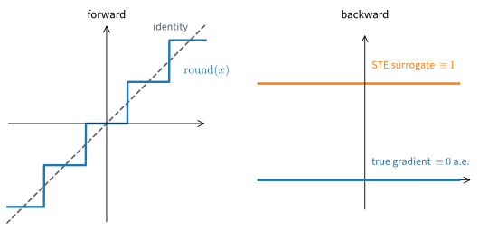
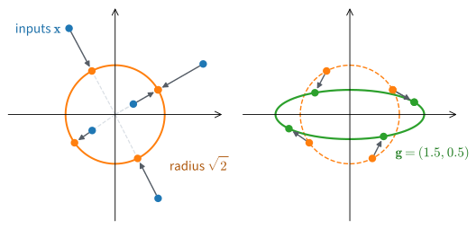

```{.python .input}
%load_ext d2lbook.tab
tab.interact_select('mxnet', 'pytorch', 'tensorflow', 'jax')
```

# Custom Layers and Functions
:label:`sec_custom_layer`

A framework's library holds the layers that many people needed yesterday:
fully connected layers, activation functions, dropout. Research moves
faster than libraries, and a layer that a paper proposes can be missing
from them for years. RMSNorm, a layer that rescales each activation
vector to a fixed size, is an example. It was published in 2019
:cite:`Zhang.Sennrich.2019`, and PyTorch added it to its library of layers
in 2024. Until then, each PyTorch codebase that used it carried its own
implementation or borrowed one from another package. How do we write such a
layer ourselves, so that it behaves like a built-in one? Its parameters must
reach the optimizer, its state must be saved and moved to the GPU, and it
must fit into containers next to other layers.

Sometimes the trouble lies with the derivative instead. To fit a large
model into a small memory, its weights are often stored as 4-bit integers:
the weights of the 8B model of :numref:`sec_model_construction` then take
4 GB, a quarter of what 16-bit floating-point numbers need. Storing
integers means rounding, and rounding has derivative zero almost
everywhere, so a weight that is rounded in the forward pass receives no
gradient and never learns.

This section writes both kinds of extension. A custom layer is a subclass
of the module class of :numref:`sec_model_construction`. Everything the
framework does to a whole model, from collecting parameters for the
optimizer to saving a checkpoint, walks the registered state, so a layer
that registers its state needs no further code to take part. The ideas
here are few. Most of the section shows the form in which each framework
expects them. We start with a layer without state, then write RMSNorm with
a learned parameter, then a layer with fixed state that must be saved but
never trained. Finally we replace the derivative of an operation with a
rule of our own, which lets gradients pass through rounding.

```{.python .input #custom-layers-custom-layers-and-functions}
%%tab mxnet
import math
import numpy as np
from mxnet import autograd, gluon, init, np as mnp, npx
from mxnet.gluon import nn
from d2l import mxnet as d2l
npx.set_np()
```

```{.python .input #custom-layers-custom-layers-and-functions}
%%tab pytorch
import math
import numpy as np
import torch
from torch import nn
from torch.nn import functional as F
from d2l import torch as d2l
```

```{.python .input #custom-layers-custom-layers-and-functions}
%%tab tensorflow
import math
import numpy as np
import tensorflow as tf
from d2l import tensorflow as d2l
```

```{.python .input #custom-layers-custom-layers-and-functions}
%%tab jax
import math
import numpy as np
import jax
from jax import numpy as jnp
from flax import nnx
import optax
from d2l import jax as d2l
```

```{.python .input #custom-layers-custom-layers-and-functions-1}
%%tab mxnet
import os
import tempfile
```

```{.python .input #custom-layers-custom-layers-and-functions-1}
%%tab jax
from flax import serialization
```

## Layers without Parameters

Let us start with the smallest custom layer, one with no state at all.
`CenteredLayer` subtracts from its input the mean over all of its entries,
the batch axis included (an exercise asks what that implies). It inherits
from the module class and supplies only the forward method; there is
nothing to set up.

```{.python .input #custom-layers-layers-without-parameters-1}
%%tab mxnet
class CenteredLayer(nn.Block):
    def __init__(self):
        super().__init__()

    def forward(self, X):
        return X - X.mean()
```

```{.python .input #custom-layers-layers-without-parameters-1}
%%tab pytorch
class CenteredLayer(nn.Module):
    def __init__(self):
        super().__init__()

    def forward(self, X):
        return X - X.mean()
```

```{.python .input #custom-layers-layers-without-parameters-1}
%%tab tensorflow
class CenteredLayer(tf.keras.layers.Layer):
    def __init__(self):
        super().__init__()

    def call(self, X):
        return X - tf.reduce_mean(X)
```

```{.python .input #custom-layers-layers-without-parameters-1}
%%tab jax
class CenteredLayer(nnx.Module):
    def __call__(self, X):
        return X - X.mean()
```

The inputs 1 to 5 have mean 3, so the output should run from $-2$ to $2$:

```{.python .input #custom-layers-layers-without-parameters-2}
%%tab mxnet
layer = CenteredLayer()
layer(mnp.array([1.0, 2, 3, 4, 5]))
```

```{.python .input #custom-layers-layers-without-parameters-2}
%%tab pytorch
layer = CenteredLayer()
layer(torch.tensor([1.0, 2, 3, 4, 5]))
```

```{.python .input #custom-layers-layers-without-parameters-2}
%%tab tensorflow
layer = CenteredLayer()
layer(tf.constant([1.0, 2, 3, 4, 5]))
```

```{.python .input #custom-layers-layers-without-parameters-2}
%%tab jax
layer = CenteredLayer()
layer(jnp.array([1.0, 2, 3, 4, 5]))
```

The class has the same interface as a built-in layer, so a sequential
container can call it like any other child. Placed after a linear layer, it
centers the linear layer's outputs. Their mean should be zero. In
floating-point arithmetic it comes out as exactly zero only by luck; a
number of size $10^{-8}$ or smaller is rounding error and no cause for
alarm.

:begin_tab:`mxnet`
The `Dense` layer next to ours has parameters, so the container needs
`initialize()` before its first call.
:end_tab:

:begin_tab:`jax`
NNX creates the `Linear` parameters in its constructor, so we give both
widths there.
:end_tab:

```{.python .input #custom-layers-layers-without-parameters-3}
%%tab mxnet
net = nn.Sequential()
net.add(nn.Dense(128, in_units=8), CenteredLayer())
net.initialize()
Y = net(mnp.random.uniform(size=(4, 8)))
Y.mean()
```

```{.python .input #custom-layers-layers-without-parameters-3}
%%tab pytorch
net = nn.Sequential(nn.Linear(8, 128), CenteredLayer())
Y = net(torch.rand(4, 8))
Y.mean()
```

```{.python .input #custom-layers-layers-without-parameters-3}
%%tab tensorflow
net = tf.keras.Sequential([tf.keras.layers.Dense(128), CenteredLayer()])
Y = net(tf.random.uniform((4, 8)))
tf.reduce_mean(Y)
```

```{.python .input #custom-layers-layers-without-parameters-3}
%%tab jax
net = nnx.Sequential(nnx.Linear(8, 128, rngs=nnx.Rngs(d2l.get_key())),
                     CenteredLayer())
Y = net(jax.random.uniform(d2l.get_key(), (4, 8)))
Y.mean()
```

## Layers with Parameters

In :numref:`sec_numerical_stability` we saw that the scale of the
activations can grow or shrink from one layer to the next, by a factor that
depends on the weights. A *normalization layer* removes this dependence: it
rescales each input vector to a fixed size and lets a learned parameter set
the size instead. Such layers form a family that we study from
:numref:`sec_batch_norm` onwards. Here we implement its simplest member,
*RMSNorm*.

### RMSNorm

The root mean square of a vector $\mathbf{x} \in \mathbb{R}^d$ is
$\sqrt{\frac{1}{d}\sum_{i=1}^d x_i^2}$. RMSNorm divides each example's
vector by it and multiplies the result elementwise by a learned *gain*
$\mathbf{g} \in \mathbb{R}^d$:

$$
\textrm{RMSNorm}(\mathbf{x}) = \frac{\mathbf{x}}{\sqrt{\frac{1}{d} \sum_{i=1}^{d} x_i^2 + \epsilon}} \odot \mathbf{g}.
$$

The small constant $\epsilon$, such as $10^{-6}$, keeps the denominator away
from zero. With the gain at its initial value $\mathbf{g} = \mathbf{1}$, the
output has root mean square close to 1, whatever the scale of the input.
For $\mathbf{x} = (3, 4)$ the mean square is $(9 + 16)/2 = 12.5$, the root
mean square is $3.536$, and the output is $(0.849, 1.131)$, whose mean
square is 1. The input $(300, 400)$ gives the same output.
:numref:`fig_bg_rmsnorm` shows the geometry: RMSNorm keeps the direction of
$\mathbf{x}$, discards its length by moving it onto the sphere of radius
$\sqrt{d}$, and the gain then stretches each coordinate.


:label:`fig_bg_rmsnorm`

RMSNorm simplifies *layer normalization* :cite:`Ba.Kiros.Hinton.2016`,
which first subtracts the mean of the entries of each example's vector,
as a per-example `CenteredLayer` would, and then adds a learned shift after
the gain. Zhang and Sennrich found that the centering contributes little to
training, and many recent language models use RMSNorm, among them Llama 3
8B :cite:`Grattafiori.Dubey.Jauhri.ea.2024`, the 8B model of
:numref:`sec_model_construction`.

The gain is to be learned, so the layer must register it as a parameter
(:numref:`sec_parameters`). Apart from that, the code below follows the
formula.

:begin_tab:`mxnet`
In Gluon, assigning a `gluon.Parameter` to an attribute registers it. The
parameter is declared with a name, a shape, and an initializer; its array
is created when `initialize()` runs, and the forward pass fetches the copy
on the input's device with `data(X.device)`.
:end_tab:

:begin_tab:`pytorch`
In PyTorch, assigning a tensor wrapped in `nn.Parameter` to an attribute
registers it.
:end_tab:

:begin_tab:`tensorflow`
In Keras, `add_weight` creates and registers a variable. We call it in the
method `build`, which runs on the first call once the input shape is known,
so our layer need not be told its width.
:end_tab:

:begin_tab:`jax`
In NNX, assigning an array wrapped in `nnx.Param` to an attribute makes it
a parameter of the module.
:end_tab:

```{.python .input #custom-layers-layers-with-parameters-rmsnorm-1}
%%tab mxnet
class RMSNorm(nn.Block):
    def __init__(self, d, eps=1e-6):
        super().__init__()
        self.gain = gluon.Parameter('gain', shape=(d,), init=init.One())
        self.eps = eps

    def forward(self, X):
        rms = mnp.sqrt((X ** 2).mean(-1, keepdims=True) + self.eps)
        return self.gain.data(X.device) * X / rms
```

```{.python .input #custom-layers-layers-with-parameters-rmsnorm-1}
%%tab pytorch
class RMSNorm(nn.Module):
    def __init__(self, d, eps=1e-6):
        super().__init__()
        self.gain = nn.Parameter(torch.ones(d))
        self.eps = eps

    def forward(self, X):
        rms = X.pow(2).mean(-1, keepdim=True).add(self.eps).sqrt()
        return self.gain * X / rms
```

```{.python .input #custom-layers-layers-with-parameters-rmsnorm-1}
%%tab tensorflow
class RMSNorm(tf.keras.layers.Layer):
    def __init__(self, eps=1e-6):
        super().__init__()
        self.eps = eps

    def build(self, X_shape):
        self.gain = self.add_weight(name='gain', shape=[X_shape[-1]],
                                    initializer='ones')

    def call(self, X):
        rms = tf.sqrt(
            tf.reduce_mean(X ** 2, axis=-1, keepdims=True) + self.eps)
        return self.gain * X / rms
```

```{.python .input #custom-layers-layers-with-parameters-rmsnorm-1}
%%tab jax
class RMSNorm(nnx.Module):
    def __init__(self, d, eps=1e-6):
        self.gain = nnx.Param(jnp.ones(d))
        self.eps = eps

    def __call__(self, X):
        rms = jnp.sqrt((X ** 2).mean(-1, keepdims=True) + self.eps)
        return self.gain * X / rms
```

We try the layer on the worked example and on the same vector scaled by
100. Both rows should read $(0.849, 1.131)$:

```{.python .input #custom-layers-layers-with-parameters-rmsnorm-2}
%%tab mxnet
norm = RMSNorm(2)
norm.initialize()
norm(mnp.array([[3.0, 4.0], [300.0, 400.0]]))
```

```{.python .input #custom-layers-layers-with-parameters-rmsnorm-2}
%%tab pytorch
norm = RMSNorm(2)
norm(torch.tensor([[3.0, 4.0], [300.0, 400.0]]))
```

```{.python .input #custom-layers-layers-with-parameters-rmsnorm-2}
%%tab tensorflow
norm = RMSNorm()
norm(tf.constant([[3.0, 4.0], [300.0, 400.0]]))
```

```{.python .input #custom-layers-layers-with-parameters-rmsnorm-2}
%%tab jax
norm = RMSNorm(2)
norm(jnp.array([[3.0, 4.0], [300.0, 400.0]]))
```

### Registration

Why did we write RMSNorm as a module and not as a function with a gain
tensor kept beside it? Because registration makes a custom layer behave
like a built-in one in four ways: its parameters are found, it works inside
containers, its state is saved and loaded, and it moves between devices.
None of this is new. :numref:`sec_model_construction` and
:numref:`sec_parameters` showed all four for the library's layers, so one
check on a layer of our own suffices. We place RMSNorm between two linear
layers, take one optimizer step, which moves the gain away from its initial
ones, and copy the state of the model into a second model with the same
structure and its own random initial weights. Afterwards the two compute the
same outputs (:numref:`sec_read_write` writes such state to disk).

:begin_tab:`mxnet`
A `Trainer` given `net.collect_params()` finds the gain and updates it.
`save_parameters` writes every parameter, the gain included, to a file, and
`load_parameters` reads the file into the clone. `initialize(device=...)`
places the gain like any other parameter and `reset_device` moves it later
(:numref:`sec_use_gpu`); the forward pass fetches the copy that lives where
the input does, which is what `self.gain.data(X.device)` is for.
:end_tab:

:begin_tab:`pytorch`
An optimizer given `net.parameters()` finds the gain and updates it.
`state_dict` returns every registered tensor, the gain included, keyed by
its path in the module tree, and `load_state_dict` copies them into the
clone. `.to(device)` would move the gain with the rest of the model.
:end_tab:

:begin_tab:`tensorflow`
An optimizer given `net.trainable_variables` finds the gain and updates it.
`get_weights` returns the model's weights, the gain included, as a list of
arrays, and `set_weights` loads the list into the clone once a first call
has built it. Keras places the gain where `add_weight` creates it, on a GPU
if one is visible, like any built-in weight (:numref:`sec_use_gpu`).
:end_tab:

:begin_tab:`jax`
An `nnx.Optimizer` built with `wrt=nnx.Param` finds the gain and updates
it. `nnx.to_pure_dict` turns the state of the model, the gain included,
into a nested dictionary of arrays keyed by path, and `flax.serialization`
turns that into bytes and back. `nnx.replace_by_pure_dict` and `nnx.update`
write the restored values into the clone. `jax.device_put` would move the
state, the gain included, like any other tree of arrays.
:end_tab:

```{.python .input #custom-layers-the-composability-guarantee-3}
%%tab mxnet
net = nn.Sequential()
net.add(nn.Dense(8, in_units=20), RMSNorm(8), nn.Dense(2, in_units=8))
net.initialize()
X = mnp.random.randn(4, 20)
trainer = gluon.Trainer(net.collect_params(), 'sgd', {'learning_rate': 0.1})
with autograd.record():
    loss = (net(X) ** 2).sum()
loss.backward()
trainer.step(1)
with tempfile.TemporaryDirectory() as tmp:
    path = os.path.join(tmp, 'net.params')
    net.save_parameters(path)
    clone = nn.Sequential()
    clone.add(nn.Dense(8, in_units=20), RMSNorm(8), nn.Dense(2, in_units=8))
    clone.load_parameters(path)
net[1].gain.data(), bool((net(X) == clone(X)).all())
```

```{.python .input #custom-layers-the-composability-guarantee-3}
%%tab pytorch
net = nn.Sequential(nn.Linear(20, 8), RMSNorm(8), nn.Linear(8, 2))
X = torch.randn(4, 20)
optimizer = torch.optim.SGD(net.parameters(), lr=0.1)
net(X).pow(2).sum().backward()
optimizer.step()
clone = nn.Sequential(nn.Linear(20, 8), RMSNorm(8), nn.Linear(8, 2))
clone.load_state_dict(net.state_dict())
net[1].gain.data, torch.equal(net(X), clone(X))
```

```{.python .input #custom-layers-the-composability-guarantee-3}
%%tab tensorflow
net = tf.keras.Sequential([tf.keras.layers.Dense(8), RMSNorm(),
                           tf.keras.layers.Dense(2)])
X = tf.random.normal((4, 20))
with tf.GradientTape() as tape:
    loss = tf.reduce_sum(net(X) ** 2)
grads = tape.gradient(loss, net.trainable_variables)
tf.keras.optimizers.SGD(0.1).apply_gradients(
    zip(grads, net.trainable_variables))
clone = tf.keras.Sequential([tf.keras.layers.Dense(8), RMSNorm(),
                             tf.keras.layers.Dense(2)])
clone(X)  # A first call builds the clone so its weights exist
clone.set_weights(net.get_weights())
net.layers[1].gain.numpy(), bool(tf.reduce_all(net(X) == clone(X)))
```

```{.python .input #custom-layers-the-composability-guarantee-3}
%%tab jax
rngs = nnx.Rngs(d2l.get_key())
net = nnx.Sequential(nnx.Linear(20, 8, rngs=rngs), RMSNorm(8),
                     nnx.Linear(8, 2, rngs=rngs))
X = jax.random.normal(d2l.get_key(), (4, 20))
optimizer = nnx.Optimizer(net, optax.sgd(0.1), wrt=nnx.Param)
optimizer.update(net, nnx.grad(lambda net: (net(X) ** 2).sum())(net))
raw = serialization.to_bytes(nnx.to_pure_dict(nnx.state(net)))
clone = nnx.Sequential(nnx.Linear(20, 8, rngs=rngs), RMSNorm(8),
                       nnx.Linear(8, 2, rngs=rngs))
state = nnx.state(clone)
nnx.replace_by_pure_dict(
    state, serialization.from_bytes(nnx.to_pure_dict(state), raw))
nnx.update(clone, state)
net.layers[1].gain[...], bool(jnp.array_equal(net(X), clone(X)))
```

The gain is no longer all ones, and the clone computes exactly the outputs
of the trained model. None of this required any code in `RMSNorm` beyond the
registration of its gain.

### Comparison with Framework Implementations

The checks so far say that the layer is a good citizen of the framework.
They do not say that it computes the right thing. Where the library
provides the same layer, we can find out by comparing the outputs of the
two implementations.

:begin_tab:`mxnet`
Gluon provides `nn.LayerNorm` but no RMSNorm, so this tab has no library
implementation to compare with. Where the library lacks a layer, the custom
layer is the implementation, and the checks above are its tests.
:end_tab:

:begin_tab:`pytorch`
PyTorch's `nn.RMSNorm` calls its gain `weight`. We give both
implementations the same gain, other than all ones, and compare their
outputs.
:end_tab:

:begin_tab:`tensorflow`
Keras's `RMSNormalization` calls its gain `scale` and its divisor guard
`epsilon`. We give both implementations the same gain, other than all ones,
and compare their outputs; once both layers are built, `get_weights` and
`set_weights` copy the gain across.
:end_tab:

:begin_tab:`jax`
NNX's `nnx.RMSNorm` calls its gain `scale` and its divisor guard `epsilon`.
Parameters are mutable NNX variables, so we assign the same gain, other
than all ones, to both implementations and compare their outputs.
:end_tab:

```{.python .input #custom-layers-checking-against-the-built-in}
%%tab pytorch
ours, native = RMSNorm(8), nn.RMSNorm(8, eps=1e-6)
with torch.no_grad():
    ours.gain.copy_(torch.linspace(0.5, 1.5, 8))
    native.weight.copy_(ours.gain)
X = torch.randn(16, 8)
torch.allclose(ours(X), native(X))
```

```{.python .input #custom-layers-checking-against-the-built-in}
%%tab tensorflow
ours, native = RMSNorm(), tf.keras.layers.RMSNormalization(epsilon=1e-6)
X = tf.random.normal((16, 8))
ours(X)  # Build both so the weights exist
native.build(X.shape)
ours.gain.assign(tf.linspace(0.5, 1.5, 8))
native.set_weights(ours.get_weights())
bool(tf.experimental.numpy.allclose(ours(X), native(X)))
```

```{.python .input #custom-layers-checking-against-the-built-in}
%%tab jax
ours = RMSNorm(8)
native = nnx.RMSNorm(8, epsilon=1e-6, rngs=nnx.Rngs(d2l.get_key()))
gain = jnp.linspace(0.5, 1.5, 8)
X = jax.random.normal(d2l.get_key(), (16, 8))
ours.gain[...] = gain
native.scale[...] = gain
bool(jnp.allclose(ours(X), native(X)))
```

:begin_tab:`pytorch, tensorflow, jax`
The two agree to floating-point precision. Having written the layer,
should we now use it? Not when the library's layer computes what we need:
that one is maintained with the library and may run faster, for example by
combining several operations into one. A custom layer is the right choice
for a new layer, a modification of an existing one, or a layer the library
lacks, and then its values, gradients, and saved state need tests like the
ones above.
:end_tab:

## Layers with Fixed State

Some layers hold arrays that are neither learned nor recomputed: they are
fixed when the layer is built and must stay the same for the life of the
model. An example is a layer of *random features*
:cite:`Rahimi.Recht.2007`. It multiplies a minibatch $\mathbf{X}$ by a
random matrix $\mathbf{W} \in \mathbb{R}^{d \times D}$ with standard normal
entries, adds a random offset $\mathbf{b} \in \mathbb{R}^D$ with entries
uniform on $[0, 2\pi]$, and applies the cosine elementwise:

$$\mathbf{Z} = \sqrt{2/D}\, \cos(\mathbf{X}\mathbf{W} + \mathbf{b}).$$

Each row of $\mathbf{Z}$ holds $D$ nonlinear features of the corresponding
example. Surprisingly, these features need no training: a linear layer on
top of them can fit nonlinear functions of the input while only the linear
layer is trained.

What matters for us is the state. $\mathbf{W}$ and $\mathbf{b}$ are drawn
once and must then not change, so they are not parameters. Yet they must be
saved with the model, since the linear layer on top is trained for these
features and no others. Arrays of this kind are the *buffers* of
:numref:`subsec_params_buffers`, saved and moved with the model but never
trained.

:begin_tab:`mxnet`
In Gluon a buffer is a `gluon.Constant`, a parameter that receives no
gradient and that no `Trainer` updates.
:end_tab:

:begin_tab:`pytorch`
In PyTorch, `register_buffer` registers a tensor as a buffer.
:end_tab:

:begin_tab:`tensorflow`
In Keras a buffer is a variable created with `add_weight(trainable=False)`.
Each `add_weight` gets an initializer of its own, because one Keras
initializer object returns the same values every time it is called.
:end_tab:

:begin_tab:`jax`
As in :numref:`subsec_params_buffers`, we define a `Buffer` subclass of
`nnx.Variable` for fixed arrays; an optimizer that updates `nnx.Param`
skips it.
:end_tab:

```{.python .input #custom-layers-precomputed-state-buffers-1}
%%tab mxnet
class RandomFeatures(nn.Block):
    def __init__(self, d, num_features):
        super().__init__()
        self.W = gluon.Constant(mnp.random.normal(size=(d, num_features)))
        self.b = gluon.Constant(
            2 * math.pi * mnp.random.uniform(size=num_features))

    def forward(self, X):
        W, b = self.W.data(X.device), self.b.data(X.device)
        return math.sqrt(2 / b.shape[0]) * mnp.cos(X @ W + b)
```

```{.python .input #custom-layers-precomputed-state-buffers-1}
%%tab pytorch
class RandomFeatures(nn.Module):
    def __init__(self, d, num_features):
        super().__init__()
        self.register_buffer('W', torch.randn(d, num_features))
        self.register_buffer('b', 2 * torch.pi * torch.rand(num_features))

    def forward(self, X):
        return (2 / self.b.numel()) ** 0.5 * torch.cos(X @ self.W + self.b)
```

```{.python .input #custom-layers-precomputed-state-buffers-1}
%%tab tensorflow
class RandomFeatures(tf.keras.layers.Layer):
    def __init__(self, d, num_features):
        super().__init__()
        normal = tf.keras.initializers.RandomNormal(stddev=1.0)
        uniform = tf.keras.initializers.RandomUniform(0, 2 * math.pi)
        self.W = self.add_weight(name='W', shape=(d, num_features),
                                 initializer=normal, trainable=False)
        self.b = self.add_weight(name='b', shape=(num_features,),
                                 initializer=uniform, trainable=False)

    def call(self, X):
        return math.sqrt(2 / self.b.shape[0]) * tf.cos(X @ self.W + self.b)
```

```{.python .input #custom-layers-precomputed-state-buffers-1}
%%tab jax
class Buffer(nnx.Variable):
    pass

class RandomFeatures(nnx.Module):
    def __init__(self, d, num_features, *, rngs):
        self.W = Buffer(jax.random.normal(rngs.params(), (d, num_features)))
        self.b = Buffer(
            2 * jnp.pi * jax.random.uniform(rngs.params(), (num_features,)))

    def __call__(self, X):
        return jnp.sqrt(2 / self.b.shape[0]) * jnp.cos(X @ self.W + self.b)
```

Let us see the features at work. We fit $y = \sin(3x)$ at 100 points evenly
spaced in $[-2, 2]$ with a model of two layers, 500 random features followed
by a linear layer, and train it by Adam on the mean squared error. The
optimizer receives the parameters of the whole model, and the buffers are
not among them, so only the linear layer learns:

```{.python .input #custom-layers-layers-with-fixed-state-1}
%%tab mxnet
x = mnp.linspace(-2, 2, 100)
X, y = x.reshape(-1, 1), mnp.sin(3 * x)

def mse(net, X, y):
    return ((net(X)[:, 0] - y) ** 2).mean()

net = nn.Sequential()
net.add(RandomFeatures(1, 500), nn.Dense(1, in_units=500))
net.initialize()
trainer = gluon.Trainer(net.collect_params(), 'adam', {'learning_rate': 0.05})
for _ in range(500):
    with autograd.record():
        loss = mse(net, X, y)
    loss.backward()
    trainer.step(1)
print(f'mean squared error {float(mse(net, X, y)):.2g}')
d2l.plot(x.asnumpy(), [y.asnumpy(), net(X)[:, 0].asnumpy()], 'x', 'y',
         legend=['sin(3x)', 'fit'], figsize=(4.5, 2.5))
```

```{.python .input #custom-layers-layers-with-fixed-state-1}
%%tab pytorch
x = torch.linspace(-2, 2, 100)
X, y = x.reshape(-1, 1), torch.sin(3 * x)

def mse(net, X, y):
    return ((net(X)[:, 0] - y) ** 2).mean()

net = nn.Sequential(RandomFeatures(1, 500), nn.Linear(500, 1))
optimizer = torch.optim.Adam(net.parameters(), lr=0.05)
for _ in range(500):
    optimizer.zero_grad()
    mse(net, X, y).backward()
    optimizer.step()
print(f'mean squared error {mse(net, X, y):.2g}')
d2l.plot(x, [y, net(X)[:, 0].detach()], 'x', 'y',
         legend=['sin(3x)', 'fit'], figsize=(4.5, 2.5))
```

```{.python .input #custom-layers-layers-with-fixed-state-1}
%%tab tensorflow
x = tf.linspace(-2.0, 2.0, 100)
X, y = tf.reshape(x, (-1, 1)), tf.sin(3 * x)

def mse(net, X, y):
    return tf.reduce_mean((net(X)[:, 0] - y) ** 2)

net = tf.keras.Sequential([RandomFeatures(1, 500), tf.keras.layers.Dense(1)])
optimizer = tf.keras.optimizers.Adam(0.05)
for _ in range(500):
    with tf.GradientTape() as tape:
        loss = mse(net, X, y)
    grads = tape.gradient(loss, net.trainable_variables)
    optimizer.apply_gradients(zip(grads, net.trainable_variables))
print(f'mean squared error {float(mse(net, X, y)):.2g}')
d2l.plot(x, [y, net(X)[:, 0]], 'x', 'y',
         legend=['sin(3x)', 'fit'], figsize=(4.5, 2.5))
```

```{.python .input #custom-layers-layers-with-fixed-state-1}
%%tab jax
x = jnp.linspace(-2, 2, 100)
X, y = x.reshape(-1, 1), jnp.sin(3 * x)

def mse(net, X, y):
    return ((net(X)[:, 0] - y) ** 2).mean()

@nnx.jit
def train_step(net, optimizer, X, y):
    optimizer.update(net, nnx.grad(mse)(net, X, y))

rngs = nnx.Rngs(d2l.get_key())
net = nnx.Sequential(RandomFeatures(1, 500, rngs=rngs),
                     nnx.Linear(500, 1, rngs=rngs))
optimizer = nnx.Optimizer(net, optax.adam(0.05), wrt=nnx.Param)
for _ in range(500):
    train_step(net, optimizer, X, y)
print(f'mean squared error {mse(net, X, y):.2g}')
d2l.plot(x, [y, net(X)[:, 0]], 'x', 'y',
         legend=['sin(3x)', 'fit'], figsize=(4.5, 2.5))
```

The fit follows the sine closely. Its mean squared error ends below 0.01,
against 0.5 for predicting zero everywhere, the mean square of $\sin(3x)$
over the interval.

Now suppose that the checkpoint held only the trained linear layer. A model
rebuilt from it draws a new $\mathbf{W}$ and a new $\mathbf{b}$, and the
linear layer receives features it was never trained on. We load the linear
layer alone into a fresh model, and then the full state, buffers included:

```{.python .input #custom-layers-precomputed-state-buffers-2}
%%tab mxnet
fresh = nn.Sequential()
fresh.add(RandomFeatures(1, 500), nn.Dense(1, in_units=500))
fresh.initialize()
with tempfile.TemporaryDirectory() as tmp:
    net[1].save_parameters(os.path.join(tmp, 'linear.params'))
    net.save_parameters(os.path.join(tmp, 'net.params'))
    fresh[1].load_parameters(os.path.join(tmp, 'linear.params'))
    print(f'linear layer only: mean squared error '
          f'{float(mse(fresh, X, y)):.2g}')
    fresh.load_parameters(os.path.join(tmp, 'net.params'))
    print(f'full state:        mean squared error '
          f'{float(mse(fresh, X, y)):.2g}')
```

```{.python .input #custom-layers-precomputed-state-buffers-2}
%%tab pytorch
fresh = nn.Sequential(RandomFeatures(1, 500), nn.Linear(500, 1))
fresh[1].load_state_dict(net[1].state_dict())
print(f'linear layer only: mean squared error {mse(fresh, X, y):.2g}')
fresh.load_state_dict(net.state_dict())
print(f'full state:        mean squared error {mse(fresh, X, y):.2g}')
```

```{.python .input #custom-layers-precomputed-state-buffers-2}
%%tab tensorflow
fresh = tf.keras.Sequential([RandomFeatures(1, 500),
                             tf.keras.layers.Dense(1)])
fresh(X)  # A first call builds the linear layer so its weights exist
fresh.layers[1].set_weights(net.layers[1].get_weights())
print(f'linear layer only: mean squared error '
      f'{float(mse(fresh, X, y)):.2g}')
fresh.set_weights(net.get_weights())
print(f'full state:        mean squared error '
      f'{float(mse(fresh, X, y)):.2g}')
```

```{.python .input #custom-layers-precomputed-state-buffers-2}
%%tab jax
fresh = nnx.Sequential(RandomFeatures(1, 500, rngs=rngs),
                       nnx.Linear(500, 1, rngs=rngs))
nnx.update(fresh.layers[1], nnx.state(net.layers[1]))
print(f'linear layer only: mean squared error {mse(fresh, X, y):.2g}')
nnx.update(fresh, nnx.state(net))
print(f'full state:        mean squared error {mse(fresh, X, y):.2g}')
```

With new random features the error of the trained linear layer rises a
hundredfold or more, to the level of predicting zero or worse. With the
buffers loaded, it is again the error of the trained model.

:begin_tab:`mxnet`
`collect_params` of the model lists the two constants next to the weight and
bias of the dense layer, and `save_parameters` writes all four to the file.
Plain array attributes would be missing from it.
:end_tab:

:begin_tab:`pytorch`
`net.state_dict()` holds `0.W` and `0.b` next to the weight and bias of the
linear layer. Plain tensor attributes would be missing from it.
:end_tab:

:begin_tab:`tensorflow`
`net.get_weights()` holds `W` and `b` next to the kernel and bias of the
dense layer, while `net.trainable_variables`, which the optimizer received,
holds only the latter two. Plain tensor attributes would be missing from
both.
:end_tab:

:begin_tab:`jax`
`nnx.state(net)` holds the buffers next to the parameters, while the
optimizer, built with `wrt=nnx.Param`, skips them. NNX also treats an array
stored as a plain attribute as part of the state, but without a kind; the
`Variable` subclass is what lets filters such as `nnx.state(net, Buffer)`
select the buffers.
:end_tab:

The same mechanism holds the fixed tables and running averages of layers in
later chapters, such as the running statistics of batch normalization in
:numref:`sec_batch_norm`.

## Functions with Custom Gradients

So far we wrote forward computations and let automatic differentiation
derive the backward pass. It differentiates the operations we ran,
faithfully, and occasionally that is the problem. Recall the model that is
trained to work with weights stored as 4-bit integers. It rounds its
weights in the forward pass. Rounding is constant between integers, so its
derivative is zero almost everywhere, and any weight behind a rounding
operation receives a zero gradient:

```{.python .input #custom-layers-custom-gradients-1}
%%tab mxnet
w = mnp.array([0.9, 1.4, 2.6])
w.attach_grad()
with autograd.record():
    y = mnp.round(w).sum()
y.backward()
w.grad
```

```{.python .input #custom-layers-custom-gradients-1}
%%tab pytorch
w = torch.tensor([0.9, 1.4, 2.6], requires_grad=True)
w.round().sum().backward()
w.grad
```

```{.python .input #custom-layers-custom-gradients-1}
%%tab tensorflow
w = tf.Variable([0.9, 1.4, 2.6])
with tf.GradientTape() as tape:
    y = tf.reduce_sum(tf.round(w))
tape.gradient(y, w, unconnected_gradients=tf.UnconnectedGradients.ZERO)
```

```{.python .input #custom-layers-custom-gradients-1}
%%tab jax
w = jnp.array([0.9, 1.4, 2.6])
jax.grad(lambda w: jnp.round(w).sum())(w)
```

:begin_tab:`tensorflow`
TensorFlow declares rounding non-differentiable, so without the argument
`unconnected_gradients` the tape returns `None`; the argument asks for the
zeros that calculus gives.
:end_tab:

The gradient is zero, as calculus says, and useless for training. The
*straight-through estimator* :cite:`Bengio.Leonard.Courville.2013` replaces
it: the forward pass still rounds, and the backward pass treats the
rounding as if it were the identity, whose derivative is 1. This is
deliberately not the true derivative. Its justification is that the
staircase never strays more than $1/2$ from the identity, as
:numref:`fig_bg_ste` shows. Automatic differentiation cannot produce such a
rule, because it is not the derivative of what the forward pass computes,
so we supply the backward pass ourselves.


:label:`fig_bg_ste`

:begin_tab:`mxnet`
In Gluon the tool is a subclass of `autograd.Function` with the two
directions as methods:
:end_tab:

:begin_tab:`pytorch`
In PyTorch the tool is a subclass of `torch.autograd.Function` with the two
directions as static methods:
:end_tab:

:begin_tab:`tensorflow`
In TensorFlow the tool is the decorator `@tf.custom_gradient`: the
decorated function returns its output together with its backward rule:
:end_tab:

:begin_tab:`jax`
In JAX the tool is `jax.custom_vjp`, which attaches a hand-written backward
rule, a vector-Jacobian product, to an ordinary function:
:end_tab:

```{.python .input #custom-layers-custom-gradients-2}
%%tab mxnet
class RoundSTE(autograd.Function):
    def forward(self, X):
        return mnp.round(X)

    def backward(self, grad_output):
        # Treat the forward pass as the identity: pass the gradient on
        return grad_output
```

```{.python .input #custom-layers-custom-gradients-2}
%%tab pytorch
class RoundSTE(torch.autograd.Function):
    @staticmethod
    def forward(ctx, X):
        return X.round()

    @staticmethod
    def backward(ctx, grad_output):
        # Treat the forward pass as the identity: pass the gradient on
        return grad_output
```

```{.python .input #custom-layers-custom-gradients-2}
%%tab tensorflow
@tf.custom_gradient
def round_ste(X):
    def grad(upstream):
        # Treat the forward pass as the identity: pass the gradient on
        return upstream
    return tf.round(X), grad
```

```{.python .input #custom-layers-custom-gradients-2}
%%tab jax
@jax.custom_vjp
def round_ste(X):
    return jnp.round(X)

def round_ste_fwd(X):
    return jnp.round(X), None  # (output, residuals); we need no residuals

def round_ste_bwd(residuals, grad_output):
    # Treat the forward pass as the identity: pass the gradient on
    return (grad_output,)

round_ste.defvjp(round_ste_fwd, round_ste_bwd)
```

:begin_tab:`mxnet`
Two rules govern the class. First, a `Function` object can be used only
once: create a fresh `RoundSTE()` for every application, or the second call
fails with an assertion. Second, `backward` receives the gradient of the
loss with respect to each output of `forward` and returns the gradient with
respect to each input. Ours ignores the input values; a backward pass that
needs them saves them in `forward` with `self.save_for_backward` and reads
them from `self.saved_tensors`.
:end_tab:

:begin_tab:`pytorch`
Two rules govern the class. First, we call it as `RoundSTE.apply(X)`, never
through `forward` directly. `apply` inserts the operation into the graph
that autograd records. A direct call runs `X.round()` as an ordinary
operation, which autograd records with its true derivative, zero; the
custom backward pass never runs, and no error says so. Second, `backward`
receives the gradient of the loss with respect to the output and returns
the gradient with respect to each input. Ours ignores the input values; a
backward pass that needs them saves them in `forward` with
`ctx.save_for_backward` and reads them from `ctx`.
:end_tab:

:begin_tab:`tensorflow`
Two rules govern the decorator. First, the decorated function returns a
pair: the output and the gradient function. The gradient function is
defined inside the forward pass, so it can use any value that the forward
pass computed, such as the input. Second, `grad` receives the gradient of
the loss with respect to the output and returns one gradient per argument
of the decorated function. A function that reads a `tf.Variable` must also
return gradients for the variables, through a keyword argument `variables`
of `grad`; TensorFlow raises an error that names this requirement if it is
missing.
:end_tab:

:begin_tab:`jax`
Two rules govern the definition. First, the forward rule returns a pair:
the output and the *residuals*, the values that the backward rule will
need. Ours needs none and returns `None`; returning the output alone causes
a `TypeError` asking for a pair. Second, the backward rule receives
the residuals and the gradient of the loss with respect to the output, and
returns a tuple with one gradient per argument of the function, hence
`(grad_output,)`.
:end_tab:

To check the rule, we multiply the rounded values by known weights
$(1, 2, 3)$ and sum. The straight-through estimator should deliver these
weights, untouched, as the gradient at $\mathbf{w}$:

```{.python .input #custom-layers-custom-gradients-3}
%%tab mxnet
with autograd.record():
    y = (RoundSTE()(w) * mnp.array([1.0, 2.0, 3.0])).sum()
y.backward()
w.grad
```

```{.python .input #custom-layers-custom-gradients-3}
%%tab pytorch
w.grad = None
y = (RoundSTE.apply(w) * torch.tensor([1.0, 2.0, 3.0])).sum()
y.backward()
w.grad
```

```{.python .input #custom-layers-custom-gradients-3}
%%tab tensorflow
with tf.GradientTape() as tape:
    y = tf.reduce_sum(round_ste(w) * tf.constant([1.0, 2.0, 3.0]))
tape.gradient(y, w)
```

```{.python .input #custom-layers-custom-gradients-3}
%%tab jax
jax.grad(lambda w: (round_ste(w) * jnp.array([1.0, 2.0, 3.0])).sum())(w)
```

The gradient arrives at $\mathbf{w}$ unchanged, as if the rounding were the
identity, while the forward pass computed with the rounded values. Does a
weight then learn through the rounding? We fit a linear model whose eight
weights are rounded to integers in the forward pass to data generated by
weights drawn uniformly from $[-7, 7]$, the range of 4-bit integers. Gradient
descent starts from $\mathbf{w} = \mathbf{0}$, once with plain rounding and
once with the straight-through estimator. For comparison we also print the
loss at the start and the loss of the generating weights rounded to the
nearest integers:

```{.python .input #custom-layers-custom-gradients-5}
%%tab mxnet
X = mnp.random.normal(size=(256, 8))
w_true = mnp.random.uniform(-7, 7, size=8)
y = X @ w_true

def fit(rnd, X, y, num_steps=100, lr=0.05):
    w = mnp.zeros(8)
    w.attach_grad()
    for _ in range(num_steps):
        with autograd.record():
            loss = ((X @ rnd(w) - y) ** 2).mean()
        loss.backward()
        w -= lr * w.grad
    return float(loss)

print(f'start {float((y ** 2).mean()):.3g}, '
      f'rounding {fit(mnp.round, X, y):.3g}, '
      f'straight-through {fit(lambda w: RoundSTE()(w), X, y):.3g}, '
      f'rounded target {float(((X @ mnp.round(w_true) - y) ** 2).mean()):.3g}')
```

```{.python .input #custom-layers-custom-gradients-5}
%%tab pytorch
X = torch.randn(256, 8)
w_true = torch.empty(8).uniform_(-7, 7)
y = X @ w_true

def fit(rnd, X, y, num_steps=100, lr=0.05):
    w = torch.zeros(8, requires_grad=True)
    optimizer = torch.optim.SGD([w], lr=lr)
    for _ in range(num_steps):
        loss = ((X @ rnd(w) - y) ** 2).mean()
        optimizer.zero_grad()
        loss.backward()
        optimizer.step()
    return loss.item()

print(f'start {(y ** 2).mean():.3g}, '
      f'rounding {fit(torch.round, X, y):.3g}, '
      f'straight-through {fit(RoundSTE.apply, X, y):.3g}, '
      f'rounded target {((X @ w_true.round() - y) ** 2).mean():.3g}')
```

```{.python .input #custom-layers-custom-gradients-5}
%%tab tensorflow
X = tf.random.normal((256, 8))
w_true = tf.random.uniform((8,), -7, 7)
y = tf.linalg.matvec(X, w_true)

def fit(rnd, X, y, num_steps=100, lr=0.05):
    w = tf.Variable(tf.zeros(8))
    for _ in range(num_steps):
        with tf.GradientTape() as tape:
            loss = tf.reduce_mean((tf.linalg.matvec(X, rnd(w)) - y) ** 2)
        w.assign_sub(lr * tape.gradient(
            loss, w, unconnected_gradients=tf.UnconnectedGradients.ZERO))
    return float(loss)

rounded_loss = tf.reduce_mean((tf.linalg.matvec(X, tf.round(w_true)) - y) ** 2)
print(f'start {float(tf.reduce_mean(y ** 2)):.3g}, '
      f'rounding {fit(tf.round, X, y):.3g}, '
      f'straight-through {fit(round_ste, X, y):.3g}, '
      f'rounded target {float(rounded_loss):.3g}')
```

```{.python .input #custom-layers-custom-gradients-5}
%%tab jax
key_X, key_w = jax.random.split(d2l.get_key())
X = jax.random.normal(key_X, (256, 8))
w_true = jax.random.uniform(key_w, (8,), minval=-7, maxval=7)
y = X @ w_true

def fit(rnd, X, y, num_steps=100, lr=0.05):
    loss = lambda w: ((X @ rnd(w) - y) ** 2).mean()
    step = lambda _, w: w - lr * jax.grad(loss)(w)
    return loss(jax.lax.fori_loop(0, num_steps, step, jnp.zeros(8)))

print(f'start {(y ** 2).mean():.3g}, '
      f'rounding {fit(jnp.round, X, y):.3g}, '
      f'straight-through {fit(round_ste, X, y):.3g}, '
      f'rounded target {((X @ jnp.round(w_true) - y) ** 2).mean():.3g}')
```

With plain rounding the loss never leaves its starting value, since every
gradient is zero. With the straight-through estimator it falls from tens or
hundreds to about 1, within a small factor of the loss of the rounded
generating weights, which is the error that rounding them would cause. A
gradient that is deliberately wrong has trained the model.

The identity is one choice of surrogate among several. A quantizer to
4-bit integers also clips its input to the representable range, $-8$ to
$7$, and a common variant of the estimator passes the gradient only inside
that range and sets it to zero outside, where the clipped output does not
change (an exercise implements such a rule). The surrogate is a modeling
choice, and the right one depends on the quantizer it stands in for.

For the identity there is a shortcut without a hand-written backward pass.
The papers that introduced the estimator describe it in words; this
shortcut is the form one usually meets in code. A *stop-gradient* operation
is the identity in the forward pass and has derivative zero in the backward
pass, so $X + \textrm{stop}(\textrm{round}(X) - X)$ computes
$\textrm{round}(X)$ in the forward pass while the backward pass sees only
the leading $X$. The general mechanism is still needed when the surrogate
is not the identity, as in the clipped variant. The two definitions agree
in value and in gradient:

:begin_tab:`mxnet`
In MXNet the stop-gradient operation is `npx.stop_gradient`.
:end_tab:

:begin_tab:`pytorch`
In PyTorch the stop-gradient operation is the method `detach()`, which
returns a tensor with the same values that autograd treats as a constant.
:end_tab:

:begin_tab:`tensorflow`
In TensorFlow the stop-gradient operation is `tf.stop_gradient`.
:end_tab:

:begin_tab:`jax`
In JAX the stop-gradient operation is `jax.lax.stop_gradient`.
:end_tab:

```{.python .input #custom-layers-custom-gradients-4}
%%tab mxnet
def round_ste2(X):
    return X + npx.stop_gradient(mnp.round(X) - X)

def grad_of(f):
    with autograd.record():
        y = (f(w) * mnp.array([1.0, 2.0, 3.0])).sum()
    y.backward()
    return w.grad.copy()

def close(a, b):  # mnp.allclose would fall back to NumPy with a warning
    return bool(mnp.abs(a - b).max() < 1e-6)

(close(RoundSTE()(w), round_ste2(w)),
 close(grad_of(lambda X: RoundSTE()(X)), grad_of(round_ste2)))
```

```{.python .input #custom-layers-custom-gradients-4}
%%tab pytorch
def round_ste2(X):
    return X + (X.round() - X).detach()

def grad_of(f):
    w.grad = None
    (f(w) * torch.tensor([1.0, 2.0, 3.0])).sum().backward()
    return w.grad

(torch.allclose(RoundSTE.apply(w), round_ste2(w)),
 torch.allclose(grad_of(RoundSTE.apply), grad_of(round_ste2)))
```

```{.python .input #custom-layers-custom-gradients-4}
%%tab tensorflow
def round_ste2(X):
    return X + tf.stop_gradient(tf.round(X) - X)

def grad_of(f):
    with tf.GradientTape() as tape:
        y = tf.reduce_sum(f(w) * tf.constant([1.0, 2.0, 3.0]))
    return tape.gradient(y, w)

allclose = tf.experimental.numpy.allclose
(bool(allclose(round_ste(w), round_ste2(w))),
 bool(allclose(grad_of(round_ste), grad_of(round_ste2))))
```

```{.python .input #custom-layers-custom-gradients-4}
%%tab jax
def round_ste2(X):
    return X + jax.lax.stop_gradient(jnp.round(X) - X)

def loss(f, w):
    return (f(w) * jnp.array([1.0, 2.0, 3.0])).sum()

(bool(jnp.allclose(round_ste(w), round_ste2(w))),
 bool(jnp.allclose(jax.grad(loss, 1)(round_ste, w),
                   jax.grad(loss, 1)(round_ste2, w))))
```

A custom gradient changes the derivative of a computation built from
existing tensor operations; it does not create new operations. Writing new
low-level operations for the GPU is a separate craft that this book does
not cover. :numref:`chap_performance` shows how to get performance out of
the operations that the libraries already provide.

What we have not asked of any of these layers is whether their arithmetic
is accurate. RMSNorm squares its inputs, and the sum of squares can
overflow in low precision. :numref:`sec_numerics` takes up the number
formats themselves.

## Summary

A custom layer is a subclass of the module class with a forward method.
Registration does the rest: a learned parameter registered with the module
is found by the optimizer, saved, loaded, and moved like the parameters of
built-in layers, as we checked for the gain of RMSNorm. State that is fixed,
such as the random matrix of a random-feature layer, is registered as a
buffer, which is saved and moved but never trained. When the derivative of
an operation is useless, as for rounding, a custom backward rule such as
the straight-through estimator replaces it. A library implementation is
preferable when it computes the same thing.

:begin_tab:`mxnet`
In Gluon, `gluon.Parameter` holds learned state, `gluon.Constant` holds
buffers, and `autograd.Function` supplies a backward rule, with one fresh
instance per call; `npx.stop_gradient` covers the straight-through case in
one expression.
:end_tab:

:begin_tab:`pytorch`
In PyTorch, `nn.Parameter` holds learned state, `register_buffer` registers
buffers, and `torch.autograd.Function` supplies a backward rule, invoked
through `apply`; `detach()` covers the straight-through case in one
expression.
:end_tab:

:begin_tab:`tensorflow`
In Keras, `add_weight` creates learned state, `add_weight(trainable=False)`
creates buffers, and `@tf.custom_gradient` lets a function return its own
backward rule; `tf.stop_gradient` covers the straight-through case in one
expression.
:end_tab:

:begin_tab:`jax`
In NNX, `nnx.Param` holds learned state, other `nnx.Variable` subclasses
hold buffers, and `jax.custom_vjp` attaches a backward rule to a function;
`jax.lax.stop_gradient` covers the straight-through case in one expression.
:end_tab:

## Exercises

1. **Centering over the batch.** `CenteredLayer` subtracts the mean over
   every entry of its input, the batch axis included. Consider the network
   of this section, a linear layer with bias $\mathbf{b}$ followed by
   `CenteredLayer`.
    1. Show that the output for one example depends on the other examples
       in the minibatch. State when evaluating the network on one example
       at a time gives the same outputs as evaluating it on the whole
       minibatch at once.
    1. Show that adding the same constant to every entry of $\mathbf{b}$
       leaves the output unchanged, and conclude which direction in the
       space of biases receives zero gradient.
    1. A per-example variant subtracts from each row its own mean over the
       feature axis, as layer normalization does. State which of the two
       properties above this variant keeps.

2. [code] **Scale invariance of RMSNorm.** ● Set $\epsilon = 0$.
    1. Show that $\textrm{RMSNorm}(c\mathbf{x}) = \textrm{RMSNorm}(\mathbf{x})$
       for every $c > 0$.
    1. Differentiate both sides with respect to $c$ at $c = 1$ and conclude
       that the Jacobian $\mathbf{J}$ of RMSNorm at $\mathbf{x}$ satisfies
       $\mathbf{J}\mathbf{x} = \mathbf{0}$.
    1. Conclude that the gradient of any loss with respect to the input
       $\mathbf{x}$ of RMSNorm is orthogonal to $\mathbf{x}$, and check
       this with automatic differentiation for a random $\mathbf{x}$ and a
       random linear loss. What does a small gradient step do to the
       length of $\mathbf{x}$?

:begin_tab:`mxnet`
3. [code] **RMSNorm bias.** Add an optional learned bias $\mathbf{b}$ to
   `RMSNorm` (a shift applied after the gain, restoring part of what layer
   normalization had), and verify that the file written by
   `save_parameters` for a model containing it grows by the expected entry.
   Then place the layer directly before a linear layer with weight
   $\mathbf{W}$ and bias $\mathbf{c}$, and show that $\mathbf{b}$ can be
   folded into $\mathbf{c}$ without changing the outputs. What is the
   folded bias?
:end_tab:

:begin_tab:`pytorch`
3. [code] **RMSNorm bias.** Add an optional learned bias $\mathbf{b}$ to
   `RMSNorm` (a shift applied after the gain, restoring part of what layer
   normalization had), and verify that the state dict of a model containing
   it grows by the expected entry. Then place the layer directly before a
   linear layer with weight $\mathbf{W}$ and bias $\mathbf{c}$, and show
   that $\mathbf{b}$ can be folded into $\mathbf{c}$ without changing the
   outputs. What is the folded bias?
:end_tab:

:begin_tab:`tensorflow`
3. [code] **RMSNorm bias.** Add an optional learned bias $\mathbf{b}$ to
   `RMSNorm` (a shift applied after the gain, restoring part of what layer
   normalization had), and verify that `get_weights` on a model containing
   it grows by the expected entry. Then place the layer directly before a
   linear layer with weight $\mathbf{W}$ and bias $\mathbf{c}$, and show
   that $\mathbf{b}$ can be folded into $\mathbf{c}$ without changing the
   outputs. What is the folded bias?
:end_tab:

:begin_tab:`jax`
3. [code] **RMSNorm bias.** Add an optional learned bias $\mathbf{b}$ to
   `RMSNorm` (a shift applied after the gain, restoring part of what layer
   normalization had), and verify that the parameter state of a model
   containing it grows by the expected entry. Then place the layer directly
   before a linear layer with weight $\mathbf{W}$ and bias $\mathbf{c}$,
   and show that $\mathbf{b}$ can be folded into $\mathbf{c}$ without
   changing the outputs. What is the folded bias?
:end_tab:

4. [code] **Random features approximate a kernel.** Let $\mathbf{w}$ have
   independent standard normal entries and $b$ be uniform on $[0, 2\pi]$.
    1. Using
       $\cos\alpha\cos\beta = \frac{1}{2}(\cos(\alpha - \beta) + \cos(\alpha + \beta))$
       and $\mathbb{E}[\cos(\mathbf{w}^\top\mathbf{u})] = \exp(-\|\mathbf{u}\|^2/2)$,
       show that the features $\mathbf{z}(\mathbf{x})$ of `RandomFeatures`
       satisfy
       $\mathbb{E}[\mathbf{z}(\mathbf{x})^\top \mathbf{z}(\mathbf{x}')] = \exp(-\|\mathbf{x} - \mathbf{x}'\|^2/2)$
       for every number $D$ of features.
    1. Check this numerically for two inputs at distance 1, with $D = 10$,
       100, 1,000, and 10,000, averaging the error over several layers for
       each $D$. How does the error shrink as $D$ grows?
    1. Repeat the fit of $\sin(3x)$ from this section with $D = 5$ and
       $D = 50$ features, and with a linear model on $x$ alone in place of
       the random features. What error does each reach, and why?

    *Adapted from :cite:`Rahimi.Recht.2007`.*

:begin_tab:`mxnet`
5. [code] **A clamp with a custom gradient.** Implement an
   `autograd.Function` whose forward is `mnp.clip(X, lo, hi)` and whose
   backward passes the gradient only where the input lay strictly inside the
   clamp range; `forward` must save `X` with `save_for_backward`. Compare
   its gradients with those of the native `mnp.clip` for inputs inside,
   outside, and exactly on the boundary. Which convention does the native
   operation use at the boundary?

    *Adapted from the PyTorch tutorial
    [Learning PyTorch with Examples](https://docs.pytorch.org/tutorials/beginner/pytorch_with_examples.html)
    and the JAX notebook
    [Custom derivative rules](https://docs.jax.dev/en/latest/notebooks/Custom_derivative_rules_for_Python_code.html).*
:end_tab:

:begin_tab:`pytorch`
5. [code] **A clamp with a custom gradient.** Implement an
   `autograd.Function` whose forward is `X.clamp(lo, hi)` and whose backward
   passes the gradient only where the input lay strictly inside the clamp
   range. Compare its gradients with those of the native `torch.clamp` for
   inputs inside, outside, and exactly on the boundary. Which convention
   does the native operation use at the boundary?

    *Adapted from the PyTorch tutorial
    [Learning PyTorch with Examples](https://docs.pytorch.org/tutorials/beginner/pytorch_with_examples.html)
    and the JAX notebook
    [Custom derivative rules](https://docs.jax.dev/en/latest/notebooks/Custom_derivative_rules_for_Python_code.html).*
:end_tab:

:begin_tab:`tensorflow`
5. [code] **A clamp with a custom gradient.** Implement a
   `@tf.custom_gradient` function whose forward is `tf.clip_by_value(X, lo,
   hi)` and whose backward passes the gradient only where the input lay
   strictly inside the clamp range; the gradient closure must capture `X`.
   Compare its gradients with those of the native `tf.clip_by_value` for
   inputs inside, outside, and exactly on the boundary. Which convention
   does the native operation use at the boundary?

    *Adapted from the PyTorch tutorial
    [Learning PyTorch with Examples](https://docs.pytorch.org/tutorials/beginner/pytorch_with_examples.html)
    and the JAX notebook
    [Custom derivative rules](https://docs.jax.dev/en/latest/notebooks/Custom_derivative_rules_for_Python_code.html).*
:end_tab:

:begin_tab:`jax`
5. [code] **A clamp with a custom gradient.** Implement a `custom_vjp`
   function whose forward is `jnp.clip(X, lo, hi)` and whose backward passes
   the gradient only where the input lay strictly inside the clamp range;
   the forward rule must save `X` as a residual. Compare its gradients with
   those of the native `jnp.clip` for inputs inside, outside, and exactly on
   the boundary. Which convention does the native operation use at the
   boundary?

    *Adapted from the PyTorch tutorial
    [Learning PyTorch with Examples](https://docs.pytorch.org/tutorials/beginner/pytorch_with_examples.html)
    and the JAX notebook
    [Custom derivative rules](https://docs.jax.dev/en/latest/notebooks/Custom_derivative_rules_for_Python_code.html).*
:end_tab:

6. [extended] **Bucketing with a straight-through estimator.** ●
   The experiment of this section rounded the weights themselves. Here the
   rounding sits between two layers, on an activation. Write a layer whose forward pass maps a score $s$ to the
   bucket index $\lfloor K\sigma(s) \rfloor$ and whose backward pass treats
   the floor as the identity. Return the index as a floating-point tensor so
   that gradients can reach $s$. Place the layer with $K = 4$ between two
   linear layers of output width one, and train the network on inputs
   $\mathbf{x} \in \mathbb{R}^{10}$ with targets
   $y = \lfloor 4\sigma(\mathbf{w}^\top \mathbf{x}) \rfloor$ for a fixed
   random $\mathbf{w}$. Compare the final training loss with that of the
   same network in which the floor keeps its true gradient, and explain
   which parameters learn in each case.

[Discussions](https://d2l.discourse.group/t/36755)

<!-- slides -->

::: {.slide}
::: {.cover}
[Dive into Deep Learning · §5.4]{.kicker}

Custom Layers and Functions<br>**a layer without state · RMSNorm · buffers · custom gradients**
:::
:::

::: {.slide title="RMSNorm Took Five Years to Reach the PyTorch Library"}
[The problem]{.kicker}

- RMSNorm was published in 2019; PyTorch added `nn.RMSNorm` in 2024.
  Until then each PyTorch codebase carried its own implementation or
  borrowed one from another package.
- A hand-written layer must still reach the optimizer, the checkpoint, and
  the GPU, like a built-in one.
- Sometimes the derivative is the problem: Llama 3 8B stored in
  4-bit integers takes 4 GB instead of 16 GB in bf16, but rounding has
  derivative 0 almost everywhere.

::: {.d2l-note}
Research moves faster than libraries. Extensions must plug into the same
machinery as the built-in layers.
:::
:::

::: {.slide title="By the End of This Deck You Can"}
[Goals]{.kicker}

- write a layer as a module subclass, with and without parameters;
- compute RMSNorm by hand and explain what its gain does;
- check that a custom layer is found, contained, saved, and moved like a
  built-in one;
- store fixed arrays as buffers: saved and moved, never trained;
- replace the derivative of rounding with the straight-through estimator.

**Running example:** RMSNorm applied to $(3, 4)$, which gives
$(0.849, 1.131)$; in the 8B model, 65 copies of width 4,096.
:::

::: {.slide title="Extending the Module Machinery of the First Two Decks"}
[Where this fits]{.kicker}

::: {.cols .vc}
::: {.col}
| section | adds |
|---|---|
| Modules and Model Construction | a model is a tree of modules, built from a config |
| Parameters, State, and Memory | parameters, buffers, bytes per parameter |
| Initialization | library defaults, custom initializers, residual depth |
| **Custom Layers and Functions** | **new layers, state, and custom gradients** |
| Numerical Formats | dtypes, mixed precision, loss scaling |
| Saving, Loading, and Pretrained Weights | safe files, checkpoints, pretrained weights |
| GPUs, Devices, and Memory | placement, asynchrony, training memory |
| Reproducibility and Inspection | seeds, determinism, hooks |
:::

::: {.col .narrow}
- **Uses:** modules and registration; parameters against buffers;
  autograd.
- **Skips:** new low-level GPU operations (not in this book); overflow in low
  precision (next deck).
:::
:::
:::

::: {.slide title="A Layer without State Is Just a Forward Method"}
[Layers]{.kicker}

@custom-layers-layers-without-parameters-1

@!custom-layers-layers-without-parameters-2

Nothing to register: the module class supplies calling, containers, and
hooks.
:::

::: {.slide}
::: {.divider}
[01]{.dnum}

[RMSNorm]{.dtitle}

[a layer with one parameter vector]{.dsub}
:::
:::

::: {.slide title="RMSNorm Divides Each Vector by Its Root Mean Square"}
[RMSNorm]{.kicker}

$$\textrm{RMSNorm}(\mathbf{x}) = \frac{\mathbf{x}}{\sqrt{\frac{1}{d} \sum_{i=1}^{d} x_i^2 + \epsilon}} \odot \mathbf{g}$$

- $\mathbf{x} \in \mathbb{R}^d$: one example's activations;
  $\epsilon \approx 10^{-6}$ keeps the denominator away from 0.
- $\mathbf{g} \in \mathbb{R}^d$: the learned *gain*, initially all ones.
- Output scale no longer depends on the weights of earlier layers.
- Layer normalization also subtracts the mean and adds a shift; RMSNorm
  drops both.
:::

::: {.slide title="(3, 4) and (300, 400) Give the Same Output"}
[RMSNorm]{.kicker}

- Mean square $(9 + 16)/2 = 12.5$, root mean square $3.536$.
- Output $(3, 4)/3.536 = (0.849, 1.131)$: mean square 1.

@!custom-layers-layers-with-parameters-rmsnorm-2

::: {.d2l-note}
Scaling the input by any $c > 0$ leaves the output unchanged.
:::
:::

::: {.slide title="RMSNorm Keeps the Direction and Discards the Length"}
[RMSNorm]{.kicker}



Left: every input moves to the circle of radius $\sqrt{d} = \sqrt{2}$.
Right: the gain $(1.5, 0.5)$ stretches the circle into an ellipse.
:::

::: {.slide title="The Gain Is Registered by Assigning It to an Attribute" except="tensorflow"}
[RMSNorm]{.kicker}

@-custom-layers-layers-with-parameters-rmsnorm-1

- One parameter vector, one reduction over the last axis.
- No backward method: autograd differentiates the forward computation.
:::

::: {.slide title="The Gain Is Created and Registered by add_weight" only="tensorflow"}
[RMSNorm]{.kicker}

```{.python #custom-layers-exercises-1}
class RMSNorm(tf.keras.layers.Layer):
    def build(self, X_shape):  # runs at the first call
        self.gain = self.add_weight(shape=[X_shape[-1]],
                                    initializer='ones')

    def call(self, X):
        ms = tf.reduce_mean(X ** 2, axis=-1, keepdims=True)
        return self.gain * X / tf.sqrt(ms + 1e-6)
```

- One parameter vector, one reduction over the last axis.
- No backward method: autograd differentiates the forward computation.
:::

::: {.slide title="Check: How Many Parameters Are Gains?"}
[Check]{.kicker}

The 8B model has two RMSNorm layers in each of its 32 blocks and
one before the output, all of width 4,096. How many gain parameters is
that, and what fraction of the model?

::: {.fragment .fade-up}
::: {.d2l-note}
**Answer.** $65 \cdot 4{,}096 = 266{,}240$ gains, about $0.003\%$ of
8 billion. Tiny in memory, yet every block's input passes through one.
:::
:::
:::

::: {.slide title="Registration Makes the Custom Layer Behave Like a Built-in One" only="mxnet"}
[RMSNorm]{.kicker}

Linear, RMSNorm, Linear in a container. One optimizer step, then the state
is copied into a clone. The gain, and whether the two models agree:

@!custom-layers-the-composability-guarantee-3

- **Found:** the step moved the gain off its initial ones.
- **Saved:** the clone computes the same outputs.
- **Moved:** `initialize(device=...)` places the gain, and `reset_device`
  moves it, with the rest of the model.

::: {.d2l-note}
No line of `RMSNorm` handles these tasks. Registering the gain is enough.
:::
:::

::: {.slide title="Registration Makes the Custom Layer Behave Like a Built-in One" only="pytorch"}
[RMSNorm]{.kicker}

Linear, RMSNorm, Linear in a container. One optimizer step, then the state
is copied into a clone. The gain, and whether the two models agree:

@!custom-layers-the-composability-guarantee-3

- **Found:** the step moved the gain off its initial ones.
- **Saved:** the clone computes the same outputs.
- **Moved:** `.to(device)` on the model takes the gain along.

::: {.d2l-note}
No line of `RMSNorm` handles these tasks. Registering the gain is enough.
:::
:::

::: {.slide title="Registration Makes the Custom Layer Behave Like a Built-in One" only="tensorflow"}
[RMSNorm]{.kicker}

Linear, RMSNorm, Linear in a container. One optimizer step, then the state
is copied into a clone. The gain, and whether the two models agree:

@!custom-layers-the-composability-guarantee-3

- **Found:** the step moved the gain off its initial ones.
- **Saved:** the clone computes the same outputs.
- **Placed:** `add_weight` creates the gain on the default device, like a
  built-in weight.

::: {.d2l-note}
No line of `RMSNorm` handles these tasks. Registering the gain is enough.
:::
:::

::: {.slide title="Registration Makes the Custom Layer Behave Like a Built-in One" only="jax"}
[RMSNorm]{.kicker}

Linear, RMSNorm, Linear in a container. One optimizer step, then the state
is copied into a clone. The gain, and whether the two models agree:

@!custom-layers-the-composability-guarantee-3

- **Found:** the step moved the gain off its initial ones.
- **Saved:** the clone computes the same outputs.
- **Moved:** `jax.device_put` of the state takes the gain along.

::: {.d2l-note}
No line of `RMSNorm` handles these tasks. Registering the gain is enough.
:::
:::

::: {.slide title="Our RMSNorm Matches the Library's" except="mxnet"}
[RMSNorm]{.kicker}

Same gain $(0.5, \ldots, 1.5)$ in both, 16 random inputs of width 8:

@!custom-layers-checking-against-the-built-in

- Use the library's layer when it computes the same thing: it is
  maintained, and it may be faster.
- Write your own for a new layer or a missing one, and test it like this.
:::

::: {.slide title="Gluon Has No RMSNorm: the Custom Layer Is the Implementation" only="mxnet"}
[RMSNorm]{.kicker}

- Gluon provides `nn.LayerNorm` but no RMSNorm.
- The check of registration is then the test of the implementation: one
  optimizer step moves the gain, and a clone with the copied state computes
  the same outputs.
- Where a library layer exists and computes the same thing, prefer it: it
  is maintained, and it may be faster.
:::

::: {.slide}
::: {.divider}
[02]{.dnum}

[Buffers]{.dtitle}

[fixed state: saved and moved, never trained]{.dsub}
:::
:::

::: {.slide title="Random Features Are Drawn Once and Must Never Change"}
[Buffers]{.kicker}

$$\mathbf{Z} = \sqrt{2/D}\, \cos(\mathbf{X}\mathbf{W} + \mathbf{b})$$

- $\mathbf{W} \in \mathbb{R}^{d \times D}$ standard normal,
  $\mathbf{b} \in \mathbb{R}^D$ uniform on $[0, 2\pi]$: $D$ nonlinear
  features; a linear layer on top is trained.
- Not parameters: the optimizer must not change them.
- But saved: a reloaded model with a new $\mathbf{W}$ feeds the trained
  layer different features.
:::

::: {.slide title="A Buffer Is Registered State That Receives No Gradient" only="mxnet"}
[Buffers]{.kicker}

@-custom-layers-precomputed-state-buffers-1

`gluon.Constant`: registered with the block, so saved and moved; it
receives no gradient. `forward` computes the cosine features.
:::

::: {.slide title="A Buffer Is Registered State That Receives No Gradient" only="pytorch"}
[Buffers]{.kicker}

@-custom-layers-precomputed-state-buffers-1

`register_buffer`: in the state dict, so saved and moved; not among the
parameters, so never trained. `forward` computes the cosine features.
:::

::: {.slide title="A Buffer Is Registered State That Receives No Gradient" only="tensorflow"}
[Buffers]{.kicker}

```{.python #custom-layers-exercises-2}
def __init__(self, d, num_features):
    super().__init__()
    normal = tf.keras.initializers.RandomNormal(stddev=1.0)
    uniform = tf.keras.initializers.RandomUniform(0, 2 * math.pi)
    self.W = self.add_weight(shape=(d, num_features),
                             initializer=normal, trainable=False)
    self.b = self.add_weight(shape=(num_features,),
                             initializer=uniform, trainable=False)
```

`trainable=False`: among the weights, so saved; not among the trainable
variables, so never updated. `call` computes the cosine features.
:::

::: {.slide title="A Buffer Is Registered State That Receives No Gradient" only="jax"}
[Buffers]{.kicker}

```{.python #custom-layers-exercises-3}
class Buffer(nnx.Variable):
    pass

class RandomFeatures(nnx.Module):
    def __init__(self, d, num_features, *, rngs):
        self.W = Buffer(jax.random.normal(rngs.params(), (d, num_features)))
        self.b = Buffer(
            2 * jnp.pi * jax.random.uniform(rngs.params(), (num_features,)))
```

`Buffer` is part of the state, so saved and moved; an optimizer for
`nnx.Param` skips it. `__call__` computes the cosine features.
:::

::: {.slide title="500 Random Features and One Trained Layer Fit sin(3x)"}
[Buffers]{.kicker}

Random features of $x \in [-2, 2]$, then a linear layer trained by Adam;
the optimizer gets every parameter, and the buffers are not among them:

@!custom-layers-layers-with-fixed-state-1
:::

::: {.slide title="Without Its Random Matrix the Trained Layer Is Useless"}
[Buffers]{.kicker}

Load the trained linear layer onto new random features, then load the full
state, buffers included:

@!custom-layers-precomputed-state-buffers-2

::: {.d2l-note}
The state holds `W` and `b`. As plain attributes they would be missing from
the checkpoint, and the reloaded model would keep its own matrix.
:::
:::

::: {.slide}
::: {.divider}
[03]{.dnum}

[Custom gradients]{.dtitle}

[the straight-through estimator]{.dsub}
:::
:::

::: {.slide title="Rounding Has Derivative 0, So the Weights Behind It Never Learn"}
[Custom gradients]{.kicker}

$\mathbf{w} = (0.9, 1.4, 2.6)$, loss $\sum_i \mathrm{round}(w_i)$:

@custom-layers-custom-gradients-1

Rounding is constant between integers: the exact gradient is 0 almost
everywhere, correct and useless.
:::

::: {.slide title="Straight-Through: Round in the Forward Pass, Identity in the Backward Pass"}
[Custom gradients]{.kicker}


Autograd cannot derive this rule: it is not the derivative of what the
forward pass computes. We write both passes.
:::

::: {.slide title="Forward and Backward, Each Written by Hand" except="jax"}
[Custom gradients]{.kicker}

@-custom-layers-custom-gradients-2

The backward rule receives the gradient with respect to the output and
returns one gradient per input; ours passes it on unchanged.
:::

::: {.slide title="Forward and Backward, Each Written by Hand" only="jax"}
[Custom gradients]{.kicker}

```{.python #custom-layers-exercises-4}
round_ste = jax.custom_vjp(lambda X: jnp.round(X))
round_ste.defvjp(
    lambda X: (jnp.round(X), None),   # forward: output, residuals
    lambda residuals, g: (g,))        # backward: pass g on
```

The backward rule receives the gradient with respect to the output and
returns a tuple with one gradient per input; ours passes it on unchanged.
:::

::: {.slide title="The Gradient Arrives Unchanged: (1, 2, 3)"}
[Custom gradients]{.kicker}

Loss $\sum_i c_i\, \mathrm{round}(w_i)$ with $\mathbf{c} = (1, 2, 3)$:

@custom-layers-custom-gradients-3

::: {.d2l-note}
The forward pass used the rounded values; the backward pass treated the
rounding as the identity.
:::
:::

::: {.slide title="Rounded Weights Learn Only with the Straight-Through Estimator"}
[Custom gradients]{.kicker}

Linear model with 8 weights rounded to integers, fit by gradient descent
from $\mathbf{w} = \mathbf{0}$ to data from weights uniform on $[-7, 7]$:

@!custom-layers-custom-gradients-5

::: {.d2l-note}
Plain rounding: zero gradient, the loss never moves. Straight-through: the
loss falls to within a small factor of that of the rounded generating
weights.
:::
:::

::: {.slide title="Check: What Gradient Does the Square Give?"}
[Check]{.kicker}

With the straight-through rounding, what is the gradient at
$\mathbf{w} = (0.9, 1.4, 2.6)$ of the loss $\sum_i \mathrm{round}(w_i)^2$?

::: {.fragment .fade-up}
::: {.d2l-note}
**Answer.** $2\,\mathrm{round}(\mathbf{w}) = (2, 2, 6)$. The chain rule
uses the rounded values from the forward pass; only the derivative of
rounding, 0, is replaced by 1.
:::
:::
:::

::: {.slide title="Recap"}
[Wrap-up]{.kicker}

- **Custom layer:** a module subclass with a forward method;
  `CenteredLayer` needs nothing else.
- **RMSNorm:** divide by the root mean square, multiply by the gain;
  $(3, 4) \mapsto (0.849, 1.131)$, and so does $(300, 400)$.
- **Registration:** the gain is found, contained, saved, and moved like a
  built-in parameter.
- **Buffers:** fixed arrays such as random features: saved and moved,
  never trained; a trained layer is useless without them.
- **Custom gradients:** straight-through rounding passes the gradient
  $(1, 2, 3)$ on unchanged, and rounded weights learn.

**Next:** number formats, and why RMSNorm can overflow in 16 bits.
:::
