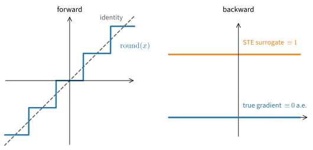
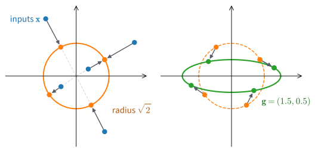

```{.python .input}
%load_ext d2lbook.tab
tab.interact_select('mxnet', 'pytorch', 'tensorflow', 'jax')
```

# Custom Layers and Functions
:label:`sec_custom_layer`

A deep learning framework's built-in library covers the standard layers everyone
needed yesterday: linear projections, activation functions, dropout. Research
moves faster than release cycles, however, and a newly proposed layer can take
years to appear in official libraries. *RMSNorm*—a normalization layer that
rescales each activation vector to unit root-mean-square magnitude—is a case in
point: published in 2019 :cite:`Zhang.Sennrich.2019`, it took years to reach
the standard layer libraries. Until then, every codebase that wanted
RMSNorm either implemented it by hand or imported a third-party version. To
behave like a first-class built-in layer, any custom layer we write must plug
seamlessly into the framework: its parameters must reach the optimizer, its
state must serialize into checkpoints and migrate onto GPUs, and it must slot
into sequential and custom containers alongside built-in layers.

Sometimes the obstacle is not the forward operation at all, but its derivative.
To squeeze an 8-billion-parameter model (:numref:`sec_model_construction`) into
tight memory, practitioners often quantize weights down to 4-bit integers,
cutting storage to just 4 GB—a quarter of 16-bit floating point. Quantizing a
finished model needs no gradients. *Training* with quantized weights in the
forward pass does, and there the rounding is in the way: it has derivative zero
almost everywhere, so any weight quantized inside the forward pass receives zero
gradient and stops learning.

In this section, we build both kinds of extensions. Because every framework
operation—optimization, checkpointing, and device movement—walks registered
state in the module tree (:numref:`sec_model_construction`), subclassing the
base module and registering our tensors is all it takes for a custom layer to
participate automatically. We progress through four concrete examples: a
stateless layer, `RMSNorm` with a learned parameter, a random-features layer
holding fixed non-trainable buffers, and a custom backward pass (the
*straight-through estimator*) that lets gradients flow through rounding.

```{.python .input #custom-layers-custom-layers-and-functions}
%%tab mxnet
import math
import numpy as np
from mxnet import autograd, gluon, init, np as mnp, npx
from mxnet.gluon import nn
from d2l import mxnet as d2l
npx.set_np()
```

```{.python .input #custom-layers-custom-layers-and-functions}
%%tab pytorch
import math
import numpy as np
import torch
from torch import nn
from torch.nn import functional as F
from d2l import torch as d2l
```

```{.python .input #custom-layers-custom-layers-and-functions}
%%tab tensorflow
import math
import numpy as np
import tensorflow as tf
from d2l import tensorflow as d2l
```

```{.python .input #custom-layers-custom-layers-and-functions}
%%tab jax
import math
import numpy as np
import jax
from jax import numpy as jnp
from flax import nnx
import optax
from d2l import jax as d2l
```

```{.python .input #custom-layers-custom-layers-and-functions-1}
%%tab mxnet
import os
import tempfile
```

```{.python .input #custom-layers-custom-layers-and-functions-1}
%%tab jax
from flax import serialization
from jax.test_util import check_grads
```

## Layers without Parameters

We start with the simplest possible custom layer: one that holds no state at
all. `CenteredLayer` subtracts the global mean from its input tensor. To build it,
we subclass the framework's base module and implement only the forward pass.

```{.python .input #custom-layers-layers-without-parameters-1}
%%tab mxnet
class CenteredLayer(nn.Block):
    def __init__(self):
        super().__init__()

    def forward(self, X):
        return X - X.mean()
```

```{.python .input #custom-layers-layers-without-parameters-1}
%%tab pytorch
class CenteredLayer(nn.Module):
    def __init__(self):
        super().__init__()

    def forward(self, X):
        return X - X.mean()
```

```{.python .input #custom-layers-layers-without-parameters-1}
%%tab tensorflow
class CenteredLayer(tf.keras.layers.Layer):
    def __init__(self):
        super().__init__()

    def call(self, X):
        return X - tf.reduce_mean(X)
```

```{.python .input #custom-layers-layers-without-parameters-1}
%%tab jax
class CenteredLayer(nnx.Module):
    def __call__(self, X):
        return X - X.mean()
```

The vector `[1, 2, 3, 4, 5]` has mean 3, so `CenteredLayer` shifts it to run
from $-2$ to $2$:

```{.python .input #custom-layers-layers-without-parameters-2}
%%tab mxnet
layer = CenteredLayer()
layer(mnp.array([1.0, 2, 3, 4, 5]))
```

```{.python .input #custom-layers-layers-without-parameters-2}
%%tab pytorch
layer = CenteredLayer()
layer(torch.tensor([1.0, 2, 3, 4, 5]))
```

```{.python .input #custom-layers-layers-without-parameters-2}
%%tab tensorflow
layer = CenteredLayer()
layer(tf.constant([1.0, 2, 3, 4, 5]))
```

```{.python .input #custom-layers-layers-without-parameters-2}
%%tab jax
layer = CenteredLayer()
layer(jnp.array([1.0, 2, 3, 4, 5]))
```

Because `CenteredLayer` shares the exact same module interface as built-in
layers, we can drop it directly into a sequential container after a linear layer
to center its outputs. The resulting mean should vanish; in floating-point
arithmetic, seeing a tiny residual around $10^{-8}$ or smaller is ordinary
rounding error rather than a bug.

:begin_tab:`mxnet`
The `Dense` layer next to ours has parameters, so the container needs
`initialize()` before its first call.
:end_tab:

:begin_tab:`jax`
NNX creates the `Linear` parameters in its constructor, so we give both
widths there.
:end_tab:

```{.python .input #custom-layers-layers-without-parameters-3}
%%tab mxnet
net = nn.Sequential()
net.add(nn.Dense(128, in_units=8), CenteredLayer())
net.initialize()
Y = net(mnp.random.uniform(size=(4, 8)))
Y.mean()
```

```{.python .input #custom-layers-layers-without-parameters-3}
%%tab pytorch
net = nn.Sequential(nn.Linear(8, 128), CenteredLayer())
Y = net(torch.rand(4, 8))
Y.mean()
```

```{.python .input #custom-layers-layers-without-parameters-3}
%%tab tensorflow
net = tf.keras.Sequential([tf.keras.layers.Dense(128), CenteredLayer()])
Y = net(tf.random.uniform((4, 8)))
tf.reduce_mean(Y)
```

```{.python .input #custom-layers-layers-without-parameters-3}
%%tab jax
net = nnx.Sequential(nnx.Linear(8, 128, rngs=nnx.Rngs(d2l.get_key())),
                     CenteredLayer())
Y = net(jax.random.uniform(d2l.get_key(), (4, 8)))
Y.mean()
```

## Layers with Parameters

In :numref:`sec_numerical_stability`, we saw how activation scales can drift
across depth depending on layer weights. A *normalization layer* removes that
sensitivity by rescaling each activation vector to a controlled magnitude and
giving the network a learned scale parameter to adjust it instead. We explore
this family in depth starting in :numref:`sec_batch_norm`; here, we implement
its cleanest member, *RMSNorm*.

### RMSNorm

Given an input vector $\mathbf{x} \in \mathbb{R}^d$ with root mean square
$\sqrt{\frac{1}{d}\sum_{i=1}^d x_i^2}$, RMSNorm divides $\mathbf{x}$ by its
RMS and scales the result elementwise by a learned *gain* vector
$\mathbf{g} \in \mathbb{R}^d$:

$$
\textrm{RMSNorm}(\mathbf{x}) = \frac{\mathbf{x}}{\sqrt{\frac{1}{d} \sum_{i=1}^{d} x_i^2 + \epsilon}} \odot \mathbf{g}.
$$

A small constant $\epsilon$ (such as $10^{-6}$) guards against division by
zero. With $\mathbf{g}$ initialized to $\mathbf{1}$, the output always has root
mean square close to 1 regardless of the input's scale. For example, for
$\mathbf{x} = (3, 4)$, the mean square is $(9 + 16)/2 = 12.5$ and the RMS is
$3.536$, yielding $(0.849, 1.131)$—and rescaling the input to $(300, 400)$
produces the exact same output. Geometrically (:numref:`fig_bg_rmsnorm`),
RMSNorm preserves the direction of $\mathbf{x}$ while projecting it onto the
sphere of radius $\sqrt{d}$, after which $\mathbf{g}$ stretches each coordinate
axis.


:label:`fig_bg_rmsnorm`

RMSNorm streamlines *layer normalization* :cite:`Ba.Kiros.Hinton.2016`, which
additionally subtracts each example's mean (like a per-row `CenteredLayer`) and
adds a learned bias after rescaling. Zhang and Sennrich showed that dropping
mean-centering rarely hurts performance while cutting computation, which is why
many modern language models—including Llama 3 8B
:cite:`Grattafiori.Dubey.Jauhri.ea.2024` (:numref:`sec_model_construction`)—adopt
RMSNorm throughout.

Because $\mathbf{g}$ must be trained, the layer registers it as a parameter
(:numref:`sec_parameters`); the rest of the implementation mirrors the formula
directly.

:begin_tab:`mxnet`
In Gluon, assigning a `gluon.Parameter` to an attribute registers it. The
parameter is declared with a name, a shape, and an initializer; its array
is created when `initialize()` runs, and the forward pass fetches the copy
on the input's device with `data(X.device)`.
:end_tab:

:begin_tab:`pytorch`
In PyTorch, assigning a tensor wrapped in `nn.Parameter` to an attribute
registers it.
:end_tab:

:begin_tab:`tensorflow`
In Keras, `add_weight` creates and registers a variable. We call it in the
method `build`, which runs on the first call once the input shape is known,
so our layer need not be told its width.
:end_tab:

:begin_tab:`jax`
In NNX, assigning an array wrapped in `nnx.Param` to an attribute makes it
a parameter of the module.
:end_tab:

```{.python .input #custom-layers-layers-with-parameters-rmsnorm-1}
%%tab mxnet
class RMSNorm(nn.Block):
    def __init__(self, d, eps=1e-6):
        super().__init__()
        self.gain = gluon.Parameter('gain', shape=(d,), init=init.One())
        self.eps = eps

    def forward(self, X):
        rms = mnp.sqrt((X ** 2).mean(-1, keepdims=True) + self.eps)
        return self.gain.data(X.device) * X / rms
```

```{.python .input #custom-layers-layers-with-parameters-rmsnorm-1}
%%tab pytorch
class RMSNorm(nn.Module):
    def __init__(self, d, eps=1e-6):
        super().__init__()
        self.gain = nn.Parameter(torch.ones(d))
        self.eps = eps

    def forward(self, X):
        rms = X.pow(2).mean(-1, keepdim=True).add(self.eps).sqrt()
        return self.gain * X / rms
```

```{.python .input #custom-layers-layers-with-parameters-rmsnorm-1}
%%tab tensorflow
class RMSNorm(tf.keras.layers.Layer):
    def __init__(self, eps=1e-6):
        super().__init__()
        self.eps = eps

    def build(self, X_shape):
        self.gain = self.add_weight(name='gain', shape=[X_shape[-1]],
                                    initializer='ones')

    def call(self, X):
        rms = tf.sqrt(
            tf.reduce_mean(X ** 2, axis=-1, keepdims=True) + self.eps)
        return self.gain * X / rms
```

```{.python .input #custom-layers-layers-with-parameters-rmsnorm-1}
%%tab jax
class RMSNorm(nnx.Module):
    def __init__(self, d, eps=1e-6):
        self.gain = nnx.Param(jnp.ones(d))
        self.eps = eps

    def __call__(self, X):
        rms = jnp.sqrt((X ** 2).mean(-1, keepdims=True) + self.eps)
        return self.gain * X / rms
```

Let's test `RMSNorm` on $(3, 4)$ and on the 100-fold rescaled vector
$(300, 400)$; both rows should map to $(0.849, 1.131)$:

```{.python .input #custom-layers-layers-with-parameters-rmsnorm-2}
%%tab mxnet
norm = RMSNorm(2)
norm.initialize()
norm(mnp.array([[3.0, 4.0], [300.0, 400.0]]))
```

```{.python .input #custom-layers-layers-with-parameters-rmsnorm-2}
%%tab pytorch
norm = RMSNorm(2)
norm(torch.tensor([[3.0, 4.0], [300.0, 400.0]]))
```

```{.python .input #custom-layers-layers-with-parameters-rmsnorm-2}
%%tab tensorflow
norm = RMSNorm()
norm(tf.constant([[3.0, 4.0], [300.0, 400.0]]))
```

```{.python .input #custom-layers-layers-with-parameters-rmsnorm-2}
%%tab jax
norm = RMSNorm(2)
norm(jnp.array([[3.0, 4.0], [300.0, 400.0]]))
```

### Registration

Why wrap RMSNorm inside a module subclass rather than calling a plain function
with a standalone gain tensor? Because module registration automatically grants
our custom layer all four capabilities of built-in layers: parameter discovery
by optimizers, composability inside containers, checkpoint serialization, and
device migration (:numref:`sec_model_construction`, :numref:`sec_parameters`).
Let's verify this end to end by sandwiching `RMSNorm` between two linear layers,
taking one gradient step so the gain moves off ones, and copying the full state
into a freshly initialized clone—after which both models should produce
identical outputs (:numref:`sec_read_write` extends this to disk checkpoints).

```{.python .input #custom-layers-the-composability-guarantee-3}
%%tab mxnet
net = nn.Sequential()
net.add(nn.Dense(8, in_units=20), RMSNorm(8), nn.Dense(2, in_units=8))
net.initialize()
X = mnp.random.randn(4, 20)
trainer = gluon.Trainer(net.collect_params(), 'sgd', {'learning_rate': 0.1})
with autograd.record():
    loss = (net(X) ** 2).sum()
loss.backward()
trainer.step(1)
with tempfile.TemporaryDirectory() as tmp:
    path = os.path.join(tmp, 'net.params')
    net.save_parameters(path)
    clone = nn.Sequential()
    clone.add(nn.Dense(8, in_units=20), RMSNorm(8), nn.Dense(2, in_units=8))
    clone.load_parameters(path)
net[1].gain.data(), bool((net(X) == clone(X)).all())
```

```{.python .input #custom-layers-the-composability-guarantee-3}
%%tab pytorch
net = nn.Sequential(nn.Linear(20, 8), RMSNorm(8), nn.Linear(8, 2))
X = torch.randn(4, 20)
optimizer = torch.optim.SGD(net.parameters(), lr=0.1)
net(X).pow(2).sum().backward()
optimizer.step()
clone = nn.Sequential(nn.Linear(20, 8), RMSNorm(8), nn.Linear(8, 2))
clone.load_state_dict(net.state_dict())
net[1].gain.data, torch.equal(net(X), clone(X))
```

```{.python .input #custom-layers-the-composability-guarantee-3}
%%tab tensorflow
net = tf.keras.Sequential([tf.keras.layers.Dense(8), RMSNorm(),
                           tf.keras.layers.Dense(2)])
X = tf.random.normal((4, 20))
with tf.GradientTape() as tape:
    loss = tf.reduce_sum(net(X) ** 2)
grads = tape.gradient(loss, net.trainable_variables)
tf.keras.optimizers.SGD(0.1).apply_gradients(
    zip(grads, net.trainable_variables))
clone = tf.keras.Sequential([tf.keras.layers.Dense(8), RMSNorm(),
                             tf.keras.layers.Dense(2)])
clone(X)  # A first call builds the clone so its weights exist
clone.set_weights(net.get_weights())
net.layers[1].gain.numpy(), bool(tf.reduce_all(net(X) == clone(X)))
```

```{.python .input #custom-layers-the-composability-guarantee-3}
%%tab jax
rngs = nnx.Rngs(d2l.get_key())
net = nnx.Sequential(nnx.Linear(20, 8, rngs=rngs), RMSNorm(8),
                     nnx.Linear(8, 2, rngs=rngs))
X = jax.random.normal(d2l.get_key(), (4, 20))
optimizer = nnx.Optimizer(net, optax.sgd(0.1), wrt=nnx.Param)
optimizer.update(net, nnx.grad(lambda net: (net(X) ** 2).sum())(net))
raw = serialization.to_bytes(nnx.to_pure_dict(nnx.state(net)))
clone = nnx.Sequential(nnx.Linear(20, 8, rngs=rngs), RMSNorm(8),
                       nnx.Linear(8, 2, rngs=rngs))
state = nnx.state(clone)
nnx.replace_by_pure_dict(
    state, serialization.from_bytes(nnx.to_pure_dict(state), raw))
nnx.update(clone, state)
net.layers[1].gain[...], bool(jnp.array_equal(net(X), clone(X)))
```

Sure enough, the gain updates away from ones and the clone matches the trained
model bit for bit—with zero boilerplate inside `RMSNorm` beyond registering
`self.gain`.

### Comparison with Framework Implementations

Passing the integration checks proves our layer plugs into the framework
properly, not that its math is bug-free. Whenever a library offers a native
equivalent, testing our custom implementation against it with non-trivial
weights provides an immediate numerical sanity check.

:begin_tab:`mxnet`
Gluon provides `nn.LayerNorm` but no built-in RMSNorm, so our custom `RMSNorm` is the implementation to use.
:end_tab:

:begin_tab:`pytorch`
We set a non-trivial gain (`linspace(0.5, 1.5, 8)`) on both our custom `RMSNorm` and the native `nn.RMSNorm` and verify that their outputs match:
:end_tab:

:begin_tab:`tensorflow`
We set a non-trivial gain (`linspace(0.5, 1.5, 8)`) on both our custom `RMSNorm` and the native `tf.keras.layers.RMSNormalization` and verify that their outputs match:
:end_tab:

:begin_tab:`jax`
We set a non-trivial gain (`linspace(0.5, 1.5, 8)`) on both our custom `RMSNorm` and the native `nnx.RMSNorm` and verify that their outputs match:
:end_tab:
```{.python .input #custom-layers-checking-against-the-built-in}
%%tab pytorch
ours, native = RMSNorm(8), nn.RMSNorm(8, eps=1e-6)
with torch.no_grad():
    ours.gain.copy_(torch.linspace(0.5, 1.5, 8))
    native.weight.copy_(ours.gain)
X = torch.randn(16, 8)
torch.allclose(ours(X), native(X))
```

```{.python .input #custom-layers-checking-against-the-built-in}
%%tab tensorflow
ours, native = RMSNorm(), tf.keras.layers.RMSNormalization(epsilon=1e-6)
X = tf.random.normal((16, 8))
ours(X)  # Build both so the weights exist
native.build(X.shape)
ours.gain.assign(tf.linspace(0.5, 1.5, 8))
native.set_weights(ours.get_weights())
bool(tf.experimental.numpy.allclose(ours(X), native(X)))
```

```{.python .input #custom-layers-checking-against-the-built-in}
%%tab jax
ours = RMSNorm(8)
native = nnx.RMSNorm(8, epsilon=1e-6, rngs=nnx.Rngs(d2l.get_key()))
gain = jnp.linspace(0.5, 1.5, 8)
X = jax.random.normal(d2l.get_key(), (16, 8))
ours.gain[...] = gain
native.scale[...] = gain
bool(jnp.allclose(ours(X), native(X)))
```

Whenever a built-in library layer matches your specification, prefer it in
production for maintenance and fused-kernel speed; write custom layers for
novel operations or modifications the library lacks.

## Layers with Fixed State

Some layers depend on arrays that are neither learned by gradient descent nor
recomputed from scratch on every call: they are generated once at construction
and must remain fixed for the lifetime of the model. A classic example is a
*random features* layer :cite:`Rahimi.Recht.2007`, which projects a minibatch
$\mathbf{X}$ through a fixed standard-normal matrix
$\mathbf{W} \in \mathbb{R}^{d \times D}$, shifts by random phases
$\mathbf{b} \in \mathbb{R}^D$ drawn uniformly from $[0, 2\pi]$, and applies
cosine elementwise:

$$\mathbf{Z} = \sqrt{2/D}\, \cos(\mathbf{X}\mathbf{W} + \mathbf{b}).$$

Each row of $\mathbf{Z}$ provides $D$ fixed nonlinear features—remarkably, even
without ever updating $\mathbf{W}$ or $\mathbf{b}$, a single trainable linear
layer placed on top can approximate rich nonlinear functions.

Just like the running statistics in `Standardizer` (:numref:`subsec_params_buffers`),
$\mathbf{W}$ and $\mathbf{b}$ must stay fixed during optimization yet travel
with the model in checkpoints and across devices. We therefore register them as
buffers:
```{.python .input #custom-layers-precomputed-state-buffers-1}
%%tab mxnet
class RandomFeatures(nn.Block):
    def __init__(self, d, num_features):
        super().__init__()
        self.W = gluon.Constant(mnp.random.normal(size=(d, num_features)))
        self.b = gluon.Constant(
            2 * math.pi * mnp.random.uniform(size=num_features))

    def forward(self, X):
        W, b = self.W.data(X.device), self.b.data(X.device)
        return math.sqrt(2 / b.shape[0]) * mnp.cos(X @ W + b)
```

```{.python .input #custom-layers-precomputed-state-buffers-1}
%%tab pytorch
class RandomFeatures(nn.Module):
    def __init__(self, d, num_features):
        super().__init__()
        self.register_buffer('W', torch.randn(d, num_features))
        self.register_buffer('b', 2 * torch.pi * torch.rand(num_features))

    def forward(self, X):
        return (2 / self.b.numel()) ** 0.5 * torch.cos(X @ self.W + self.b)
```

```{.python .input #custom-layers-precomputed-state-buffers-1}
%%tab tensorflow
class RandomFeatures(tf.keras.layers.Layer):
    def __init__(self, d, num_features):
        super().__init__()
        normal = tf.keras.initializers.RandomNormal(stddev=1.0)
        uniform = tf.keras.initializers.RandomUniform(0, 2 * math.pi)
        self.W = self.add_weight(name='W', shape=(d, num_features),
                                 initializer=normal, trainable=False)
        self.b = self.add_weight(name='b', shape=(num_features,),
                                 initializer=uniform, trainable=False)

    def call(self, X):
        return math.sqrt(2 / self.b.shape[0]) * tf.cos(X @ self.W + self.b)
```

```{.python .input #custom-layers-precomputed-state-buffers-1}
%%tab jax
class Buffer(nnx.Variable):
    pass

class RandomFeatures(nnx.Module):
    def __init__(self, d, num_features, *, rngs):
        self.W = Buffer(jax.random.normal(rngs.params(), (d, num_features)))
        self.b = Buffer(
            2 * jnp.pi * jax.random.uniform(rngs.params(), (num_features,)))

    def __call__(self, X):
        return jnp.sqrt(2 / self.b.shape[0]) * jnp.cos(X @ self.W + self.b)
```

Let's put `RandomFeatures` to work by fitting $y = \sin(3x)$ across 100 evenly
spaced points in $[-2, 2]$ using 500 random features feeding a single linear
layer trained with Adam. Because $\mathbf{W}$ and $\mathbf{b}$ are registered as
buffers rather than parameters, handing the whole model to the optimizer updates
only the linear head:

```{.python .input #custom-layers-layers-with-fixed-state-1}
%%tab mxnet
x = mnp.linspace(-2, 2, 100)
X, y = x.reshape(-1, 1), mnp.sin(3 * x)

def mse(net, X, y):
    return ((net(X)[:, 0] - y) ** 2).mean()

net = nn.Sequential()
net.add(RandomFeatures(1, 500), nn.Dense(1, in_units=500))
net.initialize()
trainer = gluon.Trainer(net.collect_params(), 'adam', {'learning_rate': 0.05})
for _ in range(500):
    with autograd.record():
        loss = mse(net, X, y)
    loss.backward()
    trainer.step(1)
print(f'mean squared error {float(mse(net, X, y)):.2g}')
d2l.plot(x.asnumpy(), [y.asnumpy(), net(X)[:, 0].asnumpy()], 'x', 'y',
         legend=['sin(3x)', 'fit'], figsize=(4.5, 2.5))
```

```{.python .input #custom-layers-layers-with-fixed-state-1}
%%tab pytorch
x = torch.linspace(-2, 2, 100)
X, y = x.reshape(-1, 1), torch.sin(3 * x)

def mse(net, X, y):
    return ((net(X)[:, 0] - y) ** 2).mean()

net = nn.Sequential(RandomFeatures(1, 500), nn.Linear(500, 1))
optimizer = torch.optim.Adam(net.parameters(), lr=0.05)
for _ in range(500):
    optimizer.zero_grad()
    mse(net, X, y).backward()
    optimizer.step()
print(f'mean squared error {mse(net, X, y):.2g}')
d2l.plot(x, [y, net(X)[:, 0].detach()], 'x', 'y',
         legend=['sin(3x)', 'fit'], figsize=(4.5, 2.5))
```

```{.python .input #custom-layers-layers-with-fixed-state-1}
%%tab tensorflow
x = tf.linspace(-2.0, 2.0, 100)
X, y = tf.reshape(x, (-1, 1)), tf.sin(3 * x)

def mse(net, X, y):
    return tf.reduce_mean((net(X)[:, 0] - y) ** 2)

net = tf.keras.Sequential([RandomFeatures(1, 500), tf.keras.layers.Dense(1)])
optimizer = tf.keras.optimizers.Adam(0.05)
for _ in range(500):
    with tf.GradientTape() as tape:
        loss = mse(net, X, y)
    grads = tape.gradient(loss, net.trainable_variables)
    optimizer.apply_gradients(zip(grads, net.trainable_variables))
print(f'mean squared error {float(mse(net, X, y)):.2g}')
d2l.plot(x, [y, net(X)[:, 0]], 'x', 'y',
         legend=['sin(3x)', 'fit'], figsize=(4.5, 2.5))
```

```{.python .input #custom-layers-layers-with-fixed-state-1}
%%tab jax
x = jnp.linspace(-2, 2, 100)
X, y = x.reshape(-1, 1), jnp.sin(3 * x)

def mse(net, X, y):
    return ((net(X)[:, 0] - y) ** 2).mean()

@nnx.jit
def train_step(net, optimizer, X, y):
    optimizer.update(net, nnx.grad(mse)(net, X, y))

rngs = nnx.Rngs(d2l.get_key())
net = nnx.Sequential(RandomFeatures(1, 500, rngs=rngs),
                     nnx.Linear(500, 1, rngs=rngs))
optimizer = nnx.Optimizer(net, optax.adam(0.05), wrt=nnx.Param)
for _ in range(500):
    train_step(net, optimizer, X, y)
print(f'mean squared error {mse(net, X, y):.2g}')
d2l.plot(x, [y, net(X)[:, 0]], 'x', 'y',
         legend=['sin(3x)', 'fit'], figsize=(4.5, 2.5))
```

The learned combination tracks $\sin(3x)$ closely, driving the mean squared
error below 0.01 (compared with 0.5 for a constant zero baseline).

Now watch what happens if a checkpoint saves only the trained linear head: a
freshly instantiated model draws a completely different $\mathbf{W}$ and
$\mathbf{b}$, feeding the linear layer features it has never seen. Below we
compare restoring just the linear head against restoring the full state,
buffers included:

```{.python .input #custom-layers-precomputed-state-buffers-2}
%%tab mxnet
fresh = nn.Sequential()
fresh.add(RandomFeatures(1, 500), nn.Dense(1, in_units=500))
fresh.initialize()
with tempfile.TemporaryDirectory() as tmp:
    net[1].save_parameters(os.path.join(tmp, 'linear.params'))
    net.save_parameters(os.path.join(tmp, 'net.params'))
    fresh[1].load_parameters(os.path.join(tmp, 'linear.params'))
    print(f'linear layer only: mean squared error '
          f'{float(mse(fresh, X, y)):.2g}')
    fresh.load_parameters(os.path.join(tmp, 'net.params'))
    print(f'full state:        mean squared error '
          f'{float(mse(fresh, X, y)):.2g}')
```

```{.python .input #custom-layers-precomputed-state-buffers-2}
%%tab pytorch
fresh = nn.Sequential(RandomFeatures(1, 500), nn.Linear(500, 1))
fresh[1].load_state_dict(net[1].state_dict())
print(f'linear layer only: mean squared error {mse(fresh, X, y):.2g}')
fresh.load_state_dict(net.state_dict())
print(f'full state:        mean squared error {mse(fresh, X, y):.2g}')
```

```{.python .input #custom-layers-precomputed-state-buffers-2}
%%tab tensorflow
fresh = tf.keras.Sequential([RandomFeatures(1, 500),
                             tf.keras.layers.Dense(1)])
fresh(X)  # A first call builds the linear layer so its weights exist
fresh.layers[1].set_weights(net.layers[1].get_weights())
print(f'linear layer only: mean squared error '
      f'{float(mse(fresh, X, y)):.2g}')
fresh.set_weights(net.get_weights())
print(f'full state:        mean squared error '
      f'{float(mse(fresh, X, y)):.2g}')
```

```{.python .input #custom-layers-precomputed-state-buffers-2}
%%tab jax
fresh = nnx.Sequential(RandomFeatures(1, 500, rngs=rngs),
                       nnx.Linear(500, 1, rngs=rngs))
nnx.update(fresh.layers[1], nnx.state(net.layers[1]))
print(f'linear layer only: mean squared error {mse(fresh, X, y):.2g}')
nnx.update(fresh, nnx.state(net))
print(f'full state:        mean squared error {mse(fresh, X, y):.2g}')
```

Loading only the linear weights causes the MSE to explode by more than two
orders of magnitude—no better than predicting zero—whereas restoring the full
state including the buffers recovers the trained fit exactly.

This exact same buffer mechanism stores non-trainable tables and running
statistics across later chapters, such as the running mean and variance of batch
normalization (:numref:`sec_batch_norm`).

## Functions with Custom Gradients

Up to now we have written forward passes and trusted automatic differentiation
to supply the backward pass. Autograd differentiates every operation faithfully,
which is occasionally the very thing that gets in our way. Return to the 4-bit
quantization example from the opening: rounding weights to integers in the
forward pass is piecewise constant, so its true derivative is zero almost
everywhere—leaving every weight behind a rounding step with zero gradient:

```{.python .input #custom-layers-custom-gradients-1}
%%tab mxnet
w = mnp.array([0.9, 1.4, 2.6])
w.attach_grad()
with autograd.record():
    y = mnp.round(w).sum()
y.backward()
w.grad
```

```{.python .input #custom-layers-custom-gradients-1}
%%tab pytorch
w = torch.tensor([0.9, 1.4, 2.6], requires_grad=True)
w.round().sum().backward()
w.grad
```

```{.python .input #custom-layers-custom-gradients-1}
%%tab tensorflow
w = tf.Variable([0.9, 1.4, 2.6])
with tf.GradientTape() as tape:
    y = tf.reduce_sum(tf.round(w))
tape.gradient(y, w, unconnected_gradients=tf.UnconnectedGradients.ZERO)
```

```{.python .input #custom-layers-custom-gradients-1}
%%tab jax
w = jnp.array([0.9, 1.4, 2.6])
jax.grad(lambda w: jnp.round(w).sum())(w)
```

:begin_tab:`tensorflow`
TensorFlow declares rounding non-differentiable, so without the argument
`unconnected_gradients` the tape returns `None`; the argument asks for the
zeros that calculus gives.
:end_tab:

Mathematically, a zero gradient is exact; practically, it halts learning dead in
its tracks. The *straight-through estimator* (STE)
:cite:`Bengio.Leonard.Courville.2013` sidesteps this by decoupling the two
directions: the forward pass still rounds to integers, while the backward pass
pretends rounding were the identity function and passes the upstream gradient
through unchanged (derivative 1). Although deliberately *not* the true
derivative, it works well in practice because the staircase $\textrm{round}(x)$
never deviates by more than $1/2$ from the identity (:numref:`fig_bg_ste`).
Since autograd cannot invent a surrogate derivative that differs from the
forward function, we supply the backward rule explicitly.


:label:`fig_bg_ste`

:begin_tab:`mxnet`
In Gluon the tool is a subclass of `autograd.Function` with the two
directions as methods:
:end_tab:

:begin_tab:`pytorch`
In PyTorch the tool is a subclass of `torch.autograd.Function` with the two
directions as static methods:
:end_tab:

:begin_tab:`tensorflow`
In TensorFlow the tool is the decorator `@tf.custom_gradient`: the
decorated function returns its output together with its backward rule:
:end_tab:

:begin_tab:`jax`
In JAX the tool is `jax.custom_vjp`, which attaches a hand-written backward
rule, a vector-Jacobian product, to an ordinary function:
:end_tab:

```{.python .input #custom-layers-custom-gradients-2}
%%tab mxnet
class RoundSTE(autograd.Function):
    def forward(self, X):
        return mnp.round(X)

    def backward(self, grad_output):
        # Treat the forward pass as the identity: pass the gradient on
        return grad_output
```

```{.python .input #custom-layers-custom-gradients-2}
%%tab pytorch
class RoundSTE(torch.autograd.Function):
    @staticmethod
    def forward(ctx, X):
        return X.round()

    @staticmethod
    def backward(ctx, grad_output):
        # Treat the forward pass as the identity: pass the gradient on
        return grad_output
```

```{.python .input #custom-layers-custom-gradients-2}
%%tab tensorflow
@tf.custom_gradient
def round_ste(X):
    def grad(upstream):
        # Treat the forward pass as the identity: pass the gradient on
        return upstream
    return tf.round(X), grad
```

```{.python .input #custom-layers-custom-gradients-2}
%%tab jax
@jax.custom_vjp
def round_ste(X):
    return jnp.round(X)

def round_ste_fwd(X):
    return jnp.round(X), None  # (output, residuals); we need no residuals

def round_ste_bwd(residuals, grad_output):
    # Treat the forward pass as the identity: pass the gradient on
    return (grad_output,)

round_ste.defvjp(round_ste_fwd, round_ste_bwd)
```

:begin_tab:`mxnet`
Instantiate a fresh `RoundSTE()` on every call (a `Function` instance is single-use); if `backward` needs forward tensors, save them with `self.save_for_backward`.
:end_tab:

:begin_tab:`pytorch`
Always invoke `RoundSTE.apply(X)` (calling `forward` directly bypasses autograd registration); if `backward` needs forward tensors, save them via `ctx.save_for_backward`.
:end_tab:

:begin_tab:`tensorflow`
`@tf.custom_gradient` returns `(output, grad_fn)`, where the inner `grad(upstream)` closure can capture any forward tensors from its enclosing scope.
:end_tab:

:begin_tab:`jax`
`round_ste_fwd` returns `(output, residuals)` (`None` when no forward values are needed), and `round_ste_bwd(residuals, grad_output)` returns a one-element tuple `(grad_output,)` matching the input arguments.
:end_tab:
Let's verify our custom backward rule by multiplying the rounded weights by
$(1, 2, 3)$ and summing: the straight-through estimator should deliver
$(1, 2, 3)$ directly as the gradient with respect to $\mathbf{w}$:

```{.python .input #custom-layers-custom-gradients-3}
%%tab mxnet
with autograd.record():
    y = (RoundSTE()(w) * mnp.array([1.0, 2.0, 3.0])).sum()
y.backward()
w.grad
```

```{.python .input #custom-layers-custom-gradients-3}
%%tab pytorch
w.grad = None
y = (RoundSTE.apply(w) * torch.tensor([1.0, 2.0, 3.0])).sum()
y.backward()
w.grad
```

```{.python .input #custom-layers-custom-gradients-3}
%%tab tensorflow
with tf.GradientTape() as tape:
    y = tf.reduce_sum(round_ste(w) * tf.constant([1.0, 2.0, 3.0]))
tape.gradient(y, w)
```

```{.python .input #custom-layers-custom-gradients-3}
%%tab jax
jax.grad(lambda w: (round_ste(w) * jnp.array([1.0, 2.0, 3.0])).sum())(w)
```

The gradient passes straight back to $\mathbf{w}$ as if rounding were the
identity, while the forward pass still operates on integer-rounded weights. Can
gradient descent actually learn through this surrogate? Let's fit an eight-weight
linear model whose weights are rounded to integers during the forward pass on
synthetic data generated by weights drawn uniformly from $[-7, 7]$ (the 4-bit
signed range). Starting from $\mathbf{w} = \mathbf{0}$, we compare plain
rounding against the straight-through estimator, alongside the initial loss and
the irreducible rounding floor achieved by rounding the true weights directly:

```{.python .input #custom-layers-custom-gradients-5}
%%tab mxnet
X = mnp.random.normal(size=(256, 8))
w_true = mnp.random.uniform(-7, 7, size=8)
y = X @ w_true

def fit(rnd, X, y, num_steps=100, lr=0.05):
    w = mnp.zeros(8)
    w.attach_grad()
    for _ in range(num_steps):
        with autograd.record():
            loss = ((X @ rnd(w) - y) ** 2).mean()
        loss.backward()
        w -= lr * w.grad
    return float(loss)

print(f'start {float((y ** 2).mean()):.3g}, '
      f'rounding {fit(mnp.round, X, y):.3g}, '
      f'straight-through {fit(lambda w: RoundSTE()(w), X, y):.3g}, '
      f'rounded target {float(((X @ mnp.round(w_true) - y) ** 2).mean()):.3g}')
```

```{.python .input #custom-layers-custom-gradients-5}
%%tab pytorch
X = torch.randn(256, 8)
w_true = torch.empty(8).uniform_(-7, 7)
y = X @ w_true

def fit(rnd, X, y, num_steps=100, lr=0.05):
    w = torch.zeros(8, requires_grad=True)
    optimizer = torch.optim.SGD([w], lr=lr)
    for _ in range(num_steps):
        loss = ((X @ rnd(w) - y) ** 2).mean()
        optimizer.zero_grad()
        loss.backward()
        optimizer.step()
    return loss.item()

print(f'start {(y ** 2).mean():.3g}, '
      f'rounding {fit(torch.round, X, y):.3g}, '
      f'straight-through {fit(RoundSTE.apply, X, y):.3g}, '
      f'rounded target {((X @ w_true.round() - y) ** 2).mean():.3g}')
```

```{.python .input #custom-layers-custom-gradients-5}
%%tab tensorflow
X = tf.random.normal((256, 8))
w_true = tf.random.uniform((8,), -7, 7)
y = tf.linalg.matvec(X, w_true)

def fit(rnd, X, y, num_steps=100, lr=0.05):
    w = tf.Variable(tf.zeros(8))
    for _ in range(num_steps):
        with tf.GradientTape() as tape:
            loss = tf.reduce_mean((tf.linalg.matvec(X, rnd(w)) - y) ** 2)
        w.assign_sub(lr * tape.gradient(
            loss, w, unconnected_gradients=tf.UnconnectedGradients.ZERO))
    return float(loss)

rounded_loss = tf.reduce_mean((tf.linalg.matvec(X, tf.round(w_true)) - y) ** 2)
print(f'start {float(tf.reduce_mean(y ** 2)):.3g}, '
      f'rounding {fit(tf.round, X, y):.3g}, '
      f'straight-through {fit(round_ste, X, y):.3g}, '
      f'rounded target {float(rounded_loss):.3g}')
```

```{.python .input #custom-layers-custom-gradients-5}
%%tab jax
key_X, key_w = jax.random.split(d2l.get_key())
X = jax.random.normal(key_X, (256, 8))
w_true = jax.random.uniform(key_w, (8,), minval=-7, maxval=7)
y = X @ w_true

def fit(rnd, X, y, num_steps=100, lr=0.05):
    loss = lambda w: ((X @ rnd(w) - y) ** 2).mean()
    step = lambda _, w: w - lr * jax.grad(loss)(w)
    return loss(jax.lax.fori_loop(0, num_steps, step, jnp.zeros(8)))

print(f'start {(y ** 2).mean():.3g}, '
      f'rounding {fit(jnp.round, X, y):.3g}, '
      f'straight-through {fit(round_ste, X, y):.3g}, '
      f'rounded target {((X @ jnp.round(w_true) - y) ** 2).mean():.3g}')
```

With plain rounding, every gradient is zero and the loss never budges from its
starting value. With the straight-through estimator, the loss plunges from tens
or hundreds down to around 1—within a small factor of the loss of the rounded
ground-truth weights. A deliberately "wrong" surrogate gradient successfully
trains a quantized model!

The identity is just one possible surrogate. A full 4-bit quantizer also clamps
its inputs to $[-8, 7]$, so practical implementations often pass gradients only
inside the representable range and zero them out in the saturated exterior (see
the exercises). Choosing the right surrogate is a modeling decision tailored to
the operation it approximates.

When the surrogate *is* the identity, there is an elegant one-line trick that
avoids writing a custom autograd function altogether—and is what you will most
often encounter in production code. Using a *stop-gradient* operator (which acts
as the identity in the forward pass and has zero derivative in the backward
pass), writing $X + \textrm{stop}(\textrm{round}(X) - X)$ evaluates to
$\textrm{round}(X)$ forward while differentiating solely through the leading
$X$ backward. We still need the full custom-backward mechanism for non-identity
surrogates like clipped quantizers, but for plain straight-through rounding,
both definitions match identically in values and gradients:

:begin_tab:`mxnet`
In MXNet the stop-gradient operation is `npx.stop_gradient`.
:end_tab:

:begin_tab:`pytorch`
In PyTorch the stop-gradient operation is the method `detach()`, which
returns a tensor with the same values that autograd treats as a constant.
:end_tab:

:begin_tab:`tensorflow`
In TensorFlow the stop-gradient operation is `tf.stop_gradient`.
:end_tab:

:begin_tab:`jax`
In JAX the stop-gradient operation is `jax.lax.stop_gradient`.
:end_tab:

```{.python .input #custom-layers-custom-gradients-4}
%%tab mxnet
def round_ste2(X):
    return X + npx.stop_gradient(mnp.round(X) - X)

def grad_of(f):
    with autograd.record():
        y = (f(w) * mnp.array([1.0, 2.0, 3.0])).sum()
    y.backward()
    return w.grad.copy()

def close(a, b):  # mnp.allclose would fall back to NumPy with a warning
    return bool(mnp.abs(a - b).max() < 1e-6)

(close(RoundSTE()(w), round_ste2(w)),
 close(grad_of(lambda X: RoundSTE()(X)), grad_of(round_ste2)))
```

```{.python .input #custom-layers-custom-gradients-4}
%%tab pytorch
def round_ste2(X):
    return X + (X.round() - X).detach()

def grad_of(f):
    w.grad = None
    (f(w) * torch.tensor([1.0, 2.0, 3.0])).sum().backward()
    return w.grad

(torch.allclose(RoundSTE.apply(w), round_ste2(w)),
 torch.allclose(grad_of(RoundSTE.apply), grad_of(round_ste2)))
```

```{.python .input #custom-layers-custom-gradients-4}
%%tab tensorflow
def round_ste2(X):
    return X + tf.stop_gradient(tf.round(X) - X)

def grad_of(f):
    with tf.GradientTape() as tape:
        y = tf.reduce_sum(f(w) * tf.constant([1.0, 2.0, 3.0]))
    return tape.gradient(y, w)

allclose = tf.experimental.numpy.allclose
(bool(allclose(round_ste(w), round_ste2(w))),
 bool(allclose(grad_of(round_ste), grad_of(round_ste2))))
```

```{.python .input #custom-layers-custom-gradients-4}
%%tab jax
def round_ste2(X):
    return X + jax.lax.stop_gradient(jnp.round(X) - X)

def loss(f, w):
    return (f(w) * jnp.array([1.0, 2.0, 3.0])).sum()

(bool(jnp.allclose(round_ste(w), round_ste2(w))),
 bool(jnp.allclose(jax.grad(loss, 1)(round_ste, w),
                   jax.grad(loss, 1)(round_ste2, w))))
```

A backward rule written by hand can be wrong, and nothing in the forward pass
will show it. The standard test is a *gradient check*: perturb each input by a
small amount, measure how much the output changes, and compare this
finite-difference slope with the gradient that the rule returns. Let's check a
smooth built-in function and our straight-through rule:

```{.python .input #custom-layers-functions-with-custom-gradients-1}
%%tab mxnet
def check(f, eps=1e-6):  # f must act elementwise
    x = mnp.array([0.9, 1.4, 2.6], dtype='float64')
    x.attach_grad()
    with autograd.record():
        y = f(x).sum()
    y.backward()
    numeric = (f(x + eps) - f(x - eps)) / (2 * eps)
    return bool(mnp.abs(x.grad - numeric).max() < 1e-6)

check(mnp.tanh), check(lambda X: RoundSTE()(X))
```

```{.python .input #custom-layers-functions-with-custom-gradients-1}
%%tab pytorch
def check(f):
    x = torch.tensor([0.9, 1.4, 2.6], dtype=torch.float64, requires_grad=True)
    return torch.autograd.gradcheck(f, (x,), raise_exception=False)

check(torch.tanh), check(RoundSTE.apply)
```

```{.python .input #custom-layers-functions-with-custom-gradients-1}
%%tab tensorflow
def check(f):
    x = tf.constant([0.9, 1.4, 2.6], tf.float64)
    analytic, numeric = tf.test.compute_gradient(f, [x])
    return bool(np.allclose(analytic[0], numeric[0]))

check(tf.tanh), check(round_ste)
```

```{.python .input #custom-layers-functions-with-custom-gradients-1}
%%tab jax
def check(f):
    try:
        check_grads(f, (jnp.array([0.9, 1.4, 2.6]),), order=1, modes=['rev'])
        return True
    except AssertionError:
        return False

check(jnp.tanh), check(round_ste)
```

The built-in function passes and the straight-through estimator fails. This
failure is by design. The forward pass is a staircase, whose slope is zero
wherever a finite difference can measure it, while our backward rule reports a
slope of one. A gradient check therefore tells us whether a rule is the
derivative of its forward pass, not whether the rule is useful. Run it on every
rule that is meant to be exact, such as the clamp in the exercises.

Keep in mind that a custom gradient overrides the derivative of an expression
built from existing tensor primitives; writing custom GPU kernels from scratch
is a separate systems discipline outside our scope, though
:numref:`chap_performance` covers how to maximize speed using the primitives
frameworks already supply.

One vital question remains about layers like `RMSNorm`: is their floating-point
arithmetic actually safe? Squaring activations and summing them can easily
overflow in 16-bit formats. In :numref:`sec_numerics`, we examine numerical
formats and mixed-precision training directly.

## Summary

A custom layer is simply a subclass of the framework's base module implementing
a forward pass; registering its tensors handles optimization, containers,
checkpointing, and device placement automatically. Learned weights are
registered as parameters (as with the gain of `RMSNorm`), while fixed
non-trainable tensors (such as the random projections in `RandomFeatures`) are
registered as buffers so checkpoints preserve them without exposing them to the
optimizer. When an operation's true derivative is uninformative—such as
rounding—a custom backward rule like the straight-through estimator (or its
stop-gradient shortcut) lets training proceed. Whenever a built-in library layer
matches your specification, prefer it for maintenance and fused-kernel speed.

## Exercises

1. [code] **Scale invariance of RMSNorm.** ● Set $\epsilon = 0$.
    1. Show that $\textrm{RMSNorm}(c\mathbf{x}) = \textrm{RMSNorm}(\mathbf{x})$
       for every $c > 0$.
    1. Differentiate both sides with respect to $c$ at $c = 1$ and conclude
       that the Jacobian $\mathbf{J}$ of RMSNorm at $\mathbf{x}$ satisfies
       $\mathbf{J}\mathbf{x} = \mathbf{0}$.
    1. Conclude that the gradient of any loss with respect to the input
       $\mathbf{x}$ of RMSNorm is orthogonal to $\mathbf{x}$, and check
       this with automatic differentiation for a random $\mathbf{x}$ and a
       random linear loss. What does a small gradient step do to the
       length of $\mathbf{x}$?

:begin_tab:`mxnet`
2. [code] **RMSNorm bias.** Add an optional learned bias $\mathbf{b}$ to
   `RMSNorm` (a shift applied after the gain, restoring part of what layer
   normalization had), and verify that the file written by
   `save_parameters` for a model containing it grows by the expected entry.
   Then place the layer directly before a linear layer with weight
   $\mathbf{W}$ and bias $\mathbf{c}$, and show that $\mathbf{b}$ can be
   folded into $\mathbf{c}$ without changing the outputs. What is the
   folded bias?
:end_tab:

:begin_tab:`pytorch`
2. [code] **RMSNorm bias.** Add an optional learned bias $\mathbf{b}$ to
   `RMSNorm` (a shift applied after the gain, restoring part of what layer
   normalization had), and verify that the state dict of a model containing
   it grows by the expected entry. Then place the layer directly before a
   linear layer with weight $\mathbf{W}$ and bias $\mathbf{c}$, and show
   that $\mathbf{b}$ can be folded into $\mathbf{c}$ without changing the
   outputs. What is the folded bias?
:end_tab:

:begin_tab:`tensorflow`
2. [code] **RMSNorm bias.** Add an optional learned bias $\mathbf{b}$ to
   `RMSNorm` (a shift applied after the gain, restoring part of what layer
   normalization had), and verify that `get_weights` on a model containing
   it grows by the expected entry. Then place the layer directly before a
   linear layer with weight $\mathbf{W}$ and bias $\mathbf{c}$, and show
   that $\mathbf{b}$ can be folded into $\mathbf{c}$ without changing the
   outputs. What is the folded bias?
:end_tab:

:begin_tab:`jax`
2. [code] **RMSNorm bias.** Add an optional learned bias $\mathbf{b}$ to
   `RMSNorm` (a shift applied after the gain, restoring part of what layer
   normalization had), and verify that the parameter state of a model
   containing it grows by the expected entry. Then place the layer directly
   before a linear layer with weight $\mathbf{W}$ and bias $\mathbf{c}$,
   and show that $\mathbf{b}$ can be folded into $\mathbf{c}$ without
   changing the outputs. What is the folded bias?
:end_tab:

3. [code] **Random features approximate a kernel.** Let $\mathbf{w}$ have
   independent standard normal entries and $b$ be uniform on $[0, 2\pi]$.
    1. Using
       $\cos\alpha\cos\beta = \frac{1}{2}(\cos(\alpha - \beta) + \cos(\alpha + \beta))$
       and $\mathbb{E}[\cos(\mathbf{w}^\top\mathbf{u})] = \exp(-\|\mathbf{u}\|^2/2)$,
       show that the features $\mathbf{z}(\mathbf{x})$ of `RandomFeatures`
       satisfy
       $\mathbb{E}[\mathbf{z}(\mathbf{x})^\top \mathbf{z}(\mathbf{x}')] = \exp(-\|\mathbf{x} - \mathbf{x}'\|^2/2)$
       for every number $D$ of features.
    1. Check this numerically for two inputs at distance 1, with $D = 10$,
       100, 1,000, and 10,000, averaging the error over several layers for
       each $D$. How does the error shrink as $D$ grows?
    1. Repeat the fit of $\sin(3x)$ from this section with $D = 5$ and
       $D = 50$ features, and with a linear model on $x$ alone in place of
       the random features. What error does each reach, and why?

    *Adapted from :cite:`Rahimi.Recht.2007`.*

:begin_tab:`mxnet`
4. [code] **A clamp with a custom gradient.** Implement an
   `autograd.Function` whose forward is `mnp.clip(X, lo, hi)` and whose
   backward passes the gradient only where the input lay strictly inside the
   clamp range; `forward` must save `X` with `save_for_backward`. Compare
   its gradients with those of the native `mnp.clip` for inputs inside,
   outside, and exactly on the boundary. Which convention does the native
   operation use at the boundary?

    *Adapted from the PyTorch tutorial
    [Learning PyTorch with Examples](https://docs.pytorch.org/tutorials/beginner/pytorch_with_examples.html)
    and the JAX notebook
    [Custom derivative rules](https://docs.jax.dev/en/latest/notebooks/Custom_derivative_rules_for_Python_code.html).*
:end_tab:

:begin_tab:`pytorch`
4. [code] **A clamp with a custom gradient.** Implement an
   `autograd.Function` whose forward is `X.clamp(lo, hi)` and whose backward
   passes the gradient only where the input lay strictly inside the clamp
   range. Compare its gradients with those of the native `torch.clamp` for
   inputs inside, outside, and exactly on the boundary. Which convention
   does the native operation use at the boundary?

    *Adapted from the PyTorch tutorial
    [Learning PyTorch with Examples](https://docs.pytorch.org/tutorials/beginner/pytorch_with_examples.html)
    and the JAX notebook
    [Custom derivative rules](https://docs.jax.dev/en/latest/notebooks/Custom_derivative_rules_for_Python_code.html).*
:end_tab:

:begin_tab:`tensorflow`
4. [code] **A clamp with a custom gradient.** Implement a
   `@tf.custom_gradient` function whose forward is `tf.clip_by_value(X, lo,
   hi)` and whose backward passes the gradient only where the input lay
   strictly inside the clamp range; the gradient closure must capture `X`.
   Compare its gradients with those of the native `tf.clip_by_value` for
   inputs inside, outside, and exactly on the boundary. Which convention
   does the native operation use at the boundary?

    *Adapted from the PyTorch tutorial
    [Learning PyTorch with Examples](https://docs.pytorch.org/tutorials/beginner/pytorch_with_examples.html)
    and the JAX notebook
    [Custom derivative rules](https://docs.jax.dev/en/latest/notebooks/Custom_derivative_rules_for_Python_code.html).*
:end_tab:

:begin_tab:`jax`
4. [code] **A clamp with a custom gradient.** Implement a `custom_vjp`
   function whose forward is `jnp.clip(X, lo, hi)` and whose backward passes
   the gradient only where the input lay strictly inside the clamp range;
   the forward rule must save `X` as a residual. Compare its gradients with
   those of the native `jnp.clip` for inputs inside, outside, and exactly on
   the boundary. Which convention does the native operation use at the
   boundary?

    *Adapted from the PyTorch tutorial
    [Learning PyTorch with Examples](https://docs.pytorch.org/tutorials/beginner/pytorch_with_examples.html)
    and the JAX notebook
    [Custom derivative rules](https://docs.jax.dev/en/latest/notebooks/Custom_derivative_rules_for_Python_code.html).*
:end_tab:


[Discussions](https://d2l.discourse.group/t/36755)

<!-- slides -->

::: {.slide}
::: {.cover}
[Dive into Deep Learning · §5.4]{.kicker}

Custom Layers and Functions<br>**stateless modules · RMSNorm · fixed-buffer RandomFeatures · custom backward & Straight-Through Estimator**
:::
:::

::: {.slide title="Why Every Practitioner Must Extend the Library"}
[Beyond Built-In Primitives]{.kicker}

::: {.cols .vc}
::: {.col}
- **Lag between research and libraries:** *RMSNorm* was published in 2019 and used across Llama and Gopher, yet reached some major libraries only years later.
- **First-class composability:** Custom layers must expose learnable weights to optimizers, serialize buffers into checkpoints, and move across devices automatically.
- **Non-differentiable forward ops:** 4-bit weight quantization $\text{round}(w)$ has zero derivative almost everywhere, requiring a custom surrogate backward pass.
:::

::: {.col .fig .big}
@fig:ch05-bg-custom-layer-needs
:::
:::
:::

::: {.slide title="Stateless Custom Layers: Subclassing the Base Module"}
[Layers Without Parameters]{.kicker}

::: {.cols .vc}
::: {.col}
- A layer with no persistent state (`CenteredLayer`) only needs to subclass the base module and define its forward pass:

@custom-layers-layers-without-parameters-1

@custom-layers-layers-without-parameters-2
:::

::: {.col .fig}
@fig:ch05-bg-stateless-centered
:::
:::
:::

::: {.slide title="Stateless Layers Compose Inside Sequential Containers"}
[Container Integration]{.kicker}

::: {.cols .vc}
::: {.col}
- Because `CenteredLayer` inherits the module interface, it slots directly into sequential pipelines (`output.mean() ≈ 10⁻⁸`):

@custom-layers-layers-without-parameters-3
:::

::: {.col .fig}
@fig:ch05-bg-stateless-centered
:::
:::
:::

::: {.slide title="RMSNorm: Root-Mean-Square Layer Normalization"}
[Parameterized Custom Layers]{.kicker}

::: {.cols .vc}
::: {.col}
$$\text{RMSNorm}(\mathbf{x}) = \frac{\mathbf{x}}{\sqrt{\frac{1}{d} \sum_{i=1}^{d} x_i^2 + \epsilon}} \odot \mathbf{g}$$

- **Scale invariance:** Maps both $(3, 4)$ and $(300, 400)$ to $(0.849, 1.131)$ when $\mathbf{g} = \mathbf{1}$.
- **Streamlined LayerNorm:** Omits mean-centering and bias shifting across all 65 normalization sites in Llama 3 8B.
:::

::: {.col .fig}
@fig:ch05-bg-rmsnorm-formula
:::
:::
:::

::: {.slide title="Geometric View of RMSNorm in Two Dimensions"}
[Direction Preservation & Axis Scaling]{.kicker}

{.nostretch width=80%}

- **Projection onto a sphere:** Dividing by $\text{RMS}(\mathbf{x}) = \|\mathbf{x}\|_2 / \sqrt{d}$ projects every ray from the origin onto the sphere of radius $\sqrt{d}$ (left), after which $\mathbf{g}$ stretches the sphere into an axis-aligned ellipsoid (right).
:::

::: {.slide title="Implementing RMSNorm by Registering the Gain Parameter"}
[RMSNorm in Code]{.kicker}

::: {.cols .vc}
::: {.col}
@custom-layers-layers-with-parameters-rmsnorm-1

@custom-layers-layers-with-parameters-rmsnorm-2
:::

::: {.col .fig}
@fig:ch05-bg-rmsnorm-composable
:::
:::
:::

::: {.slide title="Registration Guarantees End-to-End Composability"}
[Verifying Optimization & Serialization]{.kicker}

::: {.cols .vc}
::: {.col}
@-custom-layers-the-composability-guarantee-3
:::

::: {.col .narrow}
- One SGD step moves `gain` off ones; a clone loaded from the saved state reproduces the outputs bit for bit:

@!custom-layers-the-composability-guarantee-3
:::
:::
:::

::: {.slide title="Verifying a Custom Layer Against a Native Implementation" except="mxnet"}
[Numerical Sanity Check]{.kicker}

::: {.cols .vc}
::: {.col}
- Test custom layers against the framework's native version using non-trivial weights (`linspace(0.5, 1.5, 8)`):

@custom-layers-checking-against-the-built-in
:::

::: {.col .fig}
@fig:ch05-bg-custom-layer-checks
:::
:::
:::

::: {.slide title="Testing Custom Layers When No Native Equivalent Exists" only="mxnet"}
[Numerical Sanity Check]{.kicker}

::: {.cols .vc}
::: {.col}
- **Three verification checks for any novel layer:**
  1. **Analytical hand-check:** Verify scale invariance on $(3, 4)$ and $(300, 400) \mapsto (0.849, 1.131)$ with non-unit gain.
  2. **Gradient flow:** Confirm that 1 optimizer step updates every registered parameter away from initialization.
  3. **Serialization round-trip:** Save and reload into a fresh clone and verify exact output equality.
:::

::: {.col .fig .big}
@fig:ch05-bg-custom-layer-checks
:::
:::
:::

::: {.slide title="Layers With Fixed State: Random Fourier Features"}
[Non-Trainable Buffers in Custom Layers]{.kicker}

::: {.cols .vc}
::: {.col}
$$\mathbf{Z} = \sqrt{\frac{2}{D}}\, \cos(\mathbf{X}\mathbf{W} + \mathbf{b})$$

- **Kernel approximation (Rahimi & Recht, 2007):** Fixed $\mathbf{W} \sim \mathcal{N}(0, 1)$ and $\mathbf{b} \sim \mathcal{U}(0, 2\pi)$ approximate the Gaussian RBF kernel so a linear head can fit nonlinear targets.
- **Why $\mathbf{W}, \mathbf{b}$ must be buffers:** The optimizer must never alter them, yet checkpoints must save them.
:::

::: {.col .fig}
@fig:ch05-bg-random-fourier-features
:::
:::
:::

::: {.slide title="Implementing RandomFeatures With Registered Buffers"}
[Buffers in Code]{.kicker}

We register `W` and `b` as non-trainable buffers:

@custom-layers-precomputed-state-buffers-1
:::

::: {.slide title="Fitting sin(3x) With 500 Fixed Random Features"}
[Linear Regression on Nonlinear Features]{.kicker}

Stacking a single trainable linear layer (`500 -> 1`) on top of `RandomFeatures(1, 500)` fits $y = \sin(3x)$ to an MSE below $0.01$ while Adam leaves the random projection buffers untouched:

@!custom-layers-layers-with-fixed-state-1
:::

::: {.slide title="Pitfall: Saving Only the Linear Head Destroys the Fit"}
[Why Buffers Must Be Checkpointed]{.kicker}

::: {.cols .vc}
::: {.col}
- Reloading only the linear head into a fresh `RandomFeatures` layer (with different random $\mathbf{W}', \mathbf{b}'$) is more than $100\times$ worse, whereas loading the full state restores the trained fit:

@custom-layers-precomputed-state-buffers-2
:::

::: {.col .fig}
@fig:ch05-bg-missing-buffer-disaster
:::
:::
:::

::: {.slide title="When True Derivatives Fail: Quantization and Rounding"}
[The Zero-Gradient Obstacle]{.kicker}

::: {.cols .vc}
::: {.col}
- Because $\text{round}(w)$ is a step function, its true derivative is zero everywhere except at half-integers, freezing weights behind rounding:

@custom-layers-custom-gradients-1
:::

::: {.col .fig}
@fig:ch05-bg-quantization-zero-grad
:::
:::
:::

::: {.slide title="The Straight-Through Estimator (STE)"}
[Surrogate Backward Passes]{.kicker}

The **Straight-Through Estimator** (Bengio et al., 2013) decouples the forward and backward passes:

::: {.cols .vc}
::: {.col}
- **Forward pass (discrete):** Evaluates the exact quantized staircase $y = \text{round}(x)$.
- **Backward pass (identity surrogate):** Replaces the zero derivative with the derivative of the identity map ($\frac{\partial y}{\partial x} \gets 1$), passing upstream gradients through unchanged:
  $$\nabla_{\mathbf{x}} L \gets \nabla_{\mathbf{y}} L$$
:::

::: {.col .fig}
{.nostretch width=100%}
:::
:::
:::

::: {.slide title="Defining a Custom Backward Function"}
[Custom Autograd Primitives]{.kicker}

When the backward rule differs from the derivative of the forward pass, we define both directions explicitly:

@custom-layers-custom-gradients-2

@custom-layers-custom-gradients-3
:::

::: {.slide title="Training Quantized Weights With the STE"}
[Quantization-Aware Optimization]{.kicker}

Fitting an 8-weight linear model whose weights are rounded to integers on every forward pass (`w_true` uniform on $[-7, 7]$) shows that STE drives the loss down to the quantization floor while plain rounding stays stuck at step 0:

@!custom-layers-custom-gradients-5

- **The stop-gradient one-liner:** For an identity surrogate, writing `X + stop_gradient(round(X) - X)` evaluates to `round(X)` forward and differentiates through `X` backward without a custom class!
:::

::: {.slide title="The Stop-Gradient Shortcut for Identity Surrogates"}
[One-Line STE Implementation]{.kicker}

::: {.cols .vc}
::: {.col}
- We verify that `X + stop_gradient(round(X) - X)` matches our custom `RoundSTE` function in both forward outputs and backward gradients:

@custom-layers-custom-gradients-4
:::

::: {.col .fig}
@fig:ch05-bg-stop-gradient-trick
:::
:::
:::

::: {.slide title="Concept Check: Custom Layers & Surrogate Gradients"}
[Concept Check]{.kicker}

Answer these three design questions:

1. In Llama 3 8B (32 blocks, hidden width $d = 4096$), each block has two `RMSNorm` layers plus one final `RMSNorm` before the output head. How many total parameters belong to `RMSNorm` gains, and what fraction of the 8B model do they represent?
2. If you store the random matrix `W` as a plain attribute on `RandomFeatures` instead of registering it as a buffer, what two failures occur when you save a checkpoint and move the model to a GPU?
3. Under straight-through rounding `round_ste`, what is the gradient of $L(\mathbf{w}) = \sum_i (\text{round\_ste}(w_i))^2$ at $\mathbf{w} = (0.9, 1.4, 2.6)$?

::: {.d2l-note .fragment .fade-up}
**Answers:**

1. **$65 \times 4096 = 266{,}240$ parameters ($\approx 0.0033\%$ of 8B):** Tiny in memory footprint, yet critical for stabilizing every residual branch.
2. **Checkpoint corruption & GPU crash:** `W` is omitted from the saved state (reloaded models draw a mismatched basis) and stays on the CPU when the model moves to the GPU.
3. **$\nabla_{\mathbf{w}} L = 2\,\text{round}(\mathbf{w}) = (2, 2, 6)$:** The outer square uses the forward rounded values $(1, 1, 3)$, while STE replaces $\text{round}'(w_i) = 0$ with $1$.
:::
:::

::: {.slide title="Summary: Custom Layers and Functions"}
[Key Takeaways]{.kicker}

::: {.cols .vc}
::: {.col}
- **Stateless & parameterized layers:** Subclass `Module` (`CenteredLayer`) and register learnable weights as `Parameter` (`RMSNorm`).
- **Fixed-state buffers:** Register non-trainable tensors as buffers (`RandomFeatures`) so they save in checkpoints and move to GPUs.
- **Surrogate gradients:** Implement custom VJPs (`RoundSTE`) or the one-liner `X + stop_gradient(f(X) - X)` to train through discrete operations.
:::

::: {.col .fig .big}
@fig:ch05-bg-custom-layers-summary
:::
:::
:::
