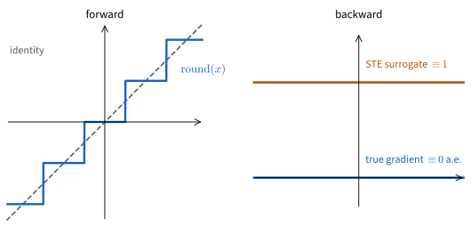
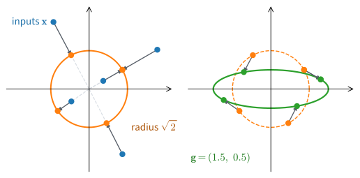

```{.python .input}
%load_ext d2lbook.tab
tab.interact_select('mxnet', 'pytorch', 'tensorflow', 'jax')
```

# Custom Layers and Functions
:label:`sec_custom_layer`

RMSNorm, a layer that rescales each activation vector to a fixed size, was
published in 2019 :cite:`Zhang.Sennrich.2019`, and PyTorch added it to its
library of layers in 2024. Until then, each PyTorch codebase that used it
carried its own implementation or borrowed one from another package. The
same happens with every new layer, because research moves faster than
libraries. A layer written by hand must then behave like
a built-in one: its parameters must reach the optimizer, its state must be
saved and moved to the GPU, and it must fit into containers next to other
layers. Sometimes the problem is the derivative instead. Rounding, which is
needed to store weights as 4-bit integers, has derivative zero almost
everywhere, so a weight that is rounded in the forward pass receives no
gradient and never learns.

This section writes both kinds of extension. A custom layer is a subclass
of the module class of :numref:`sec_model_construction`. Recall that a
module owns registered parameters and child modules and defines a forward
computation, and that everything the framework does to a whole model, from
collecting parameters for the optimizer to saving a checkpoint, walks the
registered state. We write a layer without state, then RMSNorm with a
learned parameter, then a layer with fixed state that must be saved but
never trained. Finally we replace the derivative of an operation with a
rule of our own, which lets gradients pass through rounding.

```{.python .input #custom-layers-custom-layers-and-functions}
%%tab mxnet
import math
import os
import tempfile
from mxnet import autograd, gluon, init, np as mnp, npx
from mxnet.gluon import nn
npx.set_np()
```

```{.python .input #custom-layers-custom-layers-and-functions}
%%tab pytorch
import torch
from torch import nn
```

```{.python .input #custom-layers-custom-layers-and-functions}
%%tab tensorflow
import math
import tensorflow as tf
```

```{.python .input #custom-layers-custom-layers-and-functions}
%%tab jax
import jax
from jax import numpy as jnp
from flax import nnx
from flax import serialization
from d2l import jax as d2l
```

## Layers without Parameters

The smallest custom layer has no state at all. `CenteredLayer` subtracts the
mean from its input. It inherits from the module class and supplies only the
forward method; there is nothing to set up.

```{.python .input #custom-layers-layers-without-parameters-1}
%%tab mxnet
class CenteredLayer(nn.Block):
    def __init__(self):
        super().__init__()

    def forward(self, X):
        return X - X.mean()
```

```{.python .input #custom-layers-layers-without-parameters-1}
%%tab pytorch
class CenteredLayer(nn.Module):
    def __init__(self):
        super().__init__()

    def forward(self, X):
        return X - X.mean()
```

```{.python .input #custom-layers-layers-without-parameters-1}
%%tab tensorflow
class CenteredLayer(tf.keras.layers.Layer):
    def __init__(self):
        super().__init__()

    def call(self, X):
        return X - tf.reduce_mean(X)
```

```{.python .input #custom-layers-layers-without-parameters-1}
%%tab jax
class CenteredLayer(nnx.Module):
    def __call__(self, X):
        return X - X.mean()
```

Feeding data through confirms that it does what it says:

```{.python .input #custom-layers-layers-without-parameters-2}
%%tab mxnet
layer = CenteredLayer()
layer(mnp.array([1.0, 2, 3, 4, 5]))
```

```{.python .input #custom-layers-layers-without-parameters-2}
%%tab pytorch
layer = CenteredLayer()
layer(torch.tensor([1.0, 2, 3, 4, 5]))
```

```{.python .input #custom-layers-layers-without-parameters-2}
%%tab tensorflow
layer = CenteredLayer()
layer(tf.constant([1.0, 2, 3, 4, 5]))
```

```{.python .input #custom-layers-layers-without-parameters-2}
%%tab jax
layer = CenteredLayer()
layer(jnp.array([1.0, 2, 3, 4, 5]))
```

The class has the same interface as a built-in layer, so a sequential
container can call it like any other child. Placed after a linear layer, it
centers the linear layer's outputs. Their mean should be zero; since the
mean is computed in floating-point arithmetic, we see a number of size
$10^{-8}$ or smaller rather than exactly zero, which is rounding error, not a bug.

:begin_tab:`mxnet`
The `Dense` layer next to ours has parameters, so the container needs
`initialize()` before its first call. Our layer contributes nothing to
initialize.
:end_tab:

:begin_tab:`jax`
NNX creates the `Linear` parameters in its constructor, so we give both
widths there. `CenteredLayer` needs neither widths nor random keys.
:end_tab:

```{.python .input #custom-layers-layers-without-parameters-3}
%%tab mxnet
net = nn.Sequential()
net.add(nn.Dense(128), CenteredLayer())
net.initialize()
Y = net(mnp.random.uniform(size=(4, 8)))
Y.mean()
```

```{.python .input #custom-layers-layers-without-parameters-3}
%%tab pytorch
net = nn.Sequential(nn.LazyLinear(128), CenteredLayer())
Y = net(torch.rand(4, 8))
Y.mean()
```

```{.python .input #custom-layers-layers-without-parameters-3}
%%tab tensorflow
net = tf.keras.Sequential([tf.keras.layers.Dense(128), CenteredLayer()])
Y = net(tf.random.uniform((4, 8)))
tf.reduce_mean(Y)
```

```{.python .input #custom-layers-layers-without-parameters-3}
%%tab jax
net = nnx.Sequential(nnx.Linear(8, 128, rngs=nnx.Rngs(d2l.get_key())),
                     CenteredLayer())
Y = net(jax.random.uniform(d2l.get_key(), (4, 8)))
Y.mean()
```

## Layers with Parameters

In :numref:`sec_numerical_stability` we saw that the scale of the
activations can grow or shrink from one layer to the next, by a factor that
depends on the weights. A *normalization layer* removes this dependence: it
rescales each input vector to a fixed size and lets a learned parameter set
the size instead. We implement the simplest one, *RMSNorm*.

### RMSNorm

The root mean square of a vector $\mathbf{x} \in \mathbb{R}^d$ is
$\sqrt{\frac{1}{d}\sum_{i=1}^d x_i^2}$. RMSNorm divides each example's
vector by it and multiplies the result elementwise by a learned *gain*
$\mathbf{g} \in \mathbb{R}^d$:

$$
\textrm{RMSNorm}(\mathbf{x}) = \frac{\mathbf{x}}{\sqrt{\frac{1}{d} \sum_{i=1}^{d} x_i^2 + \epsilon}} \odot \mathbf{g}.
$$

The small constant $\epsilon$, such as $10^{-6}$, keeps the denominator away
from zero. With the gain at its initial value $\mathbf{g} = \mathbf{1}$, the
output has root mean square close to 1, whatever the scale of the input.
For $\mathbf{x} = (3, 4)$ the mean square is $(9 + 16)/2 = 12.5$, the root
mean square is $3.536$, and the output is $(0.849, 1.131)$, whose mean
square is 1. The input $(300, 400)$ gives the same output.
:numref:`fig_bg_rmsnorm` shows the geometry: RMSNorm keeps the direction of
$\mathbf{x}$, discards its length by moving it onto the sphere of radius
$\sqrt{d}$, and the gain then stretches each coordinate.


:label:`fig_bg_rmsnorm`

RMSNorm simplifies *layer normalization* :cite:`Ba.Kiros.Hinton.2016`,
which first subtracts the mean of the entries of each example's vector,
as a per-example `CenteredLayer` would, and then adds a learned shift after
the gain. Zhang and Sennrich found that the centering contributes little to
training, and many recent language models use RMSNorm, among them Llama 3
8B :cite:`Grattafiori.Dubey.Jauhri.ea.2024`, the 8B model of
:numref:`sec_model_construction`.

:begin_tab:`mxnet`
A layer with something to learn must register its parameters. In Gluon,
assigning a `gluon.Parameter` to an attribute registers it
(:numref:`sec_parameters`). The parameter is declared with a name, a shape,
and an initializer; its array is created when `initialize()` runs, and the
forward pass fetches the copy on the input's device with `data(X.device)`.
:end_tab:

:begin_tab:`pytorch`
A layer with something to learn must register its parameters. In PyTorch,
assigning a tensor wrapped in `nn.Parameter` to an attribute registers it
(:numref:`sec_parameters`).
:end_tab:

:begin_tab:`tensorflow`
A layer with something to learn must register its parameters. In Keras,
`add_weight` creates and registers a variable (:numref:`sec_parameters`).
Keras creates variables in the method `build`, which runs on the first call
once the input shape is known, so our layer need not be told its width.
:end_tab:

:begin_tab:`jax`
A layer with something to learn must register its parameters. In NNX,
assigning an array wrapped in `nnx.Param` to an attribute makes it a
parameter of the module (:numref:`sec_parameters`).
:end_tab:

```{.python .input #custom-layers-layers-with-parameters-rmsnorm-1}
%%tab mxnet
class RMSNorm(nn.Block):
    def __init__(self, d, eps=1e-6):
        super().__init__()
        self.gain = gluon.Parameter('gain', shape=(d,), init=init.One())
        self.eps = eps

    def forward(self, X):
        rms = mnp.sqrt((X ** 2).mean(-1, keepdims=True) + self.eps)
        return self.gain.data(X.device) * X / rms
```

```{.python .input #custom-layers-layers-with-parameters-rmsnorm-1}
%%tab pytorch
class RMSNorm(nn.Module):
    def __init__(self, d, eps=1e-6):
        super().__init__()
        self.gain = nn.Parameter(torch.ones(d))
        self.eps = eps

    def forward(self, X):
        rms = X.pow(2).mean(-1, keepdim=True).add(self.eps).sqrt()
        return self.gain * X / rms
```

```{.python .input #custom-layers-layers-with-parameters-rmsnorm-1}
%%tab tensorflow
class RMSNorm(tf.keras.layers.Layer):
    def __init__(self, eps=1e-6):
        super().__init__()
        self.eps = eps

    def build(self, X_shape):
        self.gain = self.add_weight(name='gain', shape=[X_shape[-1]],
                                    initializer='ones')

    def call(self, X):
        rms = tf.sqrt(
            tf.reduce_mean(X ** 2, axis=-1, keepdims=True) + self.eps)
        return self.gain * X / rms
```

```{.python .input #custom-layers-layers-with-parameters-rmsnorm-1}
%%tab jax
class RMSNorm(nnx.Module):
    def __init__(self, d, eps=1e-6):
        self.gain = nnx.Param(jnp.ones(d))
        self.eps = eps

    def __call__(self, X):
        rms = jnp.sqrt((X ** 2).mean(-1, keepdims=True) + self.eps)
        return self.gain * X / rms
```

The worked example, and the same vector scaled by 100, both give
$(0.849, 1.131)$:

```{.python .input #custom-layers-layers-with-parameters-rmsnorm-2}
%%tab mxnet
norm = RMSNorm(2)
norm.initialize()
norm(mnp.array([[3.0, 4.0], [300.0, 400.0]]))
```

```{.python .input #custom-layers-layers-with-parameters-rmsnorm-2}
%%tab pytorch
norm = RMSNorm(2)
norm(torch.tensor([[3.0, 4.0], [300.0, 400.0]]))
```

```{.python .input #custom-layers-layers-with-parameters-rmsnorm-2}
%%tab tensorflow
norm = RMSNorm()
norm(tf.constant([[3.0, 4.0], [300.0, 400.0]]))
```

```{.python .input #custom-layers-layers-with-parameters-rmsnorm-2}
%%tab jax
norm = RMSNorm(2)
norm(jnp.array([[3.0, 4.0], [300.0, 400.0]]))
```

### Registration

We wrote RMSNorm as a module, not as a function with a gain tensor kept
beside it, because registration makes a custom layer behave like a built-in
one in four ways: its parameters are found, it works inside containers, its
state is saved and loaded, and it moves between devices. We check each
once.

:begin_tab:`mxnet`
First, the gain was registered when we assigned it to an attribute. A
`Trainer` given `norm.collect_params()` finds and updates it.
:end_tab:

:begin_tab:`pytorch`
First, the gain was registered when we assigned an `nn.Parameter` to an
attribute. An optimizer given `norm.parameters()` finds and updates it.
:end_tab:

:begin_tab:`tensorflow`
First, the gain was registered when `add_weight` ran inside `build`. An
optimizer given `norm.trainable_variables` finds and updates it.
:end_tab:

:begin_tab:`jax`
First, the gain is an `nnx.Param` of the module. `nnx.state(norm,
nnx.Param)` selects it, and an `nnx.Optimizer` built with `wrt=nnx.Param`
updates it.
:end_tab:

```{.python .input #custom-layers-the-composability-guarantee-1}
%%tab mxnet
norm.collect_params()
```

```{.python .input #custom-layers-the-composability-guarantee-1}
%%tab pytorch
list(norm.named_parameters())
```

```{.python .input #custom-layers-the-composability-guarantee-1}
%%tab tensorflow
norm.trainable_variables
```

```{.python .input #custom-layers-the-composability-guarantee-1}
%%tab jax
nnx.state(norm, nnx.Param)
```

Second, the layer works inside a sequential container, between two linear
layers:

```{.python .input #custom-layers-the-composability-guarantee-2}
%%tab mxnet
net = nn.Sequential()
net.add(nn.Dense(8), RMSNorm(8), nn.Dense(2))
net.initialize()
net(mnp.random.randn(4, 20)).shape
```

```{.python .input #custom-layers-the-composability-guarantee-2}
%%tab pytorch
net = nn.Sequential(nn.LazyLinear(8), RMSNorm(8), nn.LazyLinear(2))
net(torch.randn(4, 20)).shape
```

```{.python .input #custom-layers-the-composability-guarantee-2}
%%tab tensorflow
net = tf.keras.Sequential([tf.keras.layers.Dense(8), RMSNorm(),
                           tf.keras.layers.Dense(2)])
net(tf.random.normal((4, 20))).shape
```

```{.python .input #custom-layers-the-composability-guarantee-2}
%%tab jax
rngs = nnx.Rngs(d2l.get_key())
net = nnx.Sequential(nnx.Linear(20, 8, rngs=rngs), RMSNorm(8),
                     nnx.Linear(8, 2, rngs=rngs))
net(jax.random.normal(d2l.get_key(), (4, 20))).shape
```

Third, its state is saved and loaded with everything else. We copy the
state of `net` into a second model with the same structure and its own
random initial weights; afterwards the two compute the same outputs
(:numref:`sec_read_write` writes such state to disk).

:begin_tab:`mxnet`
`save_parameters` writes every parameter, the gain included, to a file,
keyed by its position in the block tree, and `load_parameters` reads the
file into the clone, filling in the deferred shapes as it goes.
:end_tab:

:begin_tab:`pytorch`
`state_dict` returns every registered tensor, the gain included, keyed by
its path in the module tree, and `load_state_dict` copies them into the
clone.
:end_tab:

:begin_tab:`tensorflow`
`get_weights` returns the model's weights, the gain included, as a list of
arrays, and `set_weights` loads the list into the clone once a first call
has built it.
:end_tab:

:begin_tab:`jax`
`nnx.to_pure_dict` turns the state of the model, the gain included, into a
nested dictionary of arrays keyed by path, and `flax.serialization` turns
that into bytes and back. `nnx.replace_by_pure_dict` and `nnx.update` write
the restored values into the clone.
:end_tab:

```{.python .input #custom-layers-the-composability-guarantee-3}
%%tab mxnet
with tempfile.TemporaryDirectory() as tmp:
    path = os.path.join(tmp, 'net.params')
    net.save_parameters(path)
    clone = nn.Sequential()
    clone.add(nn.Dense(8), RMSNorm(8), nn.Dense(2))
    clone.load_parameters(path)
X = mnp.random.randn(4, 20)
bool((net(X) == clone(X)).all())
```

```{.python .input #custom-layers-the-composability-guarantee-3}
%%tab pytorch
clone = nn.Sequential(nn.LazyLinear(8), RMSNorm(8), nn.LazyLinear(2))
clone.load_state_dict(net.state_dict())
X = torch.randn(4, 20)
torch.equal(net(X), clone(X))
```

```{.python .input #custom-layers-the-composability-guarantee-3}
%%tab tensorflow
clone = tf.keras.Sequential([tf.keras.layers.Dense(8), RMSNorm(),
                             tf.keras.layers.Dense(2)])
X = tf.random.normal((4, 20))
clone(X)  # A first call builds the clone so its weights exist
clone.set_weights(net.get_weights())
bool(tf.reduce_all(net(X) == clone(X)))
```

```{.python .input #custom-layers-the-composability-guarantee-3}
%%tab jax
raw = serialization.to_bytes(nnx.to_pure_dict(nnx.state(net)))
clone = nnx.Sequential(nnx.Linear(20, 8, rngs=rngs), RMSNorm(8),
                       nnx.Linear(8, 2, rngs=rngs))
state = nnx.state(clone)
nnx.replace_by_pure_dict(
    state, serialization.from_bytes(nnx.to_pure_dict(state), raw))
nnx.update(clone, state)
X = jax.random.normal(d2l.get_key(), (4, 20))
bool(jnp.array_equal(net(X), clone(X)))
```

:begin_tab:`mxnet`
Fourth, it moves. Gluon places parameters when they are initialized:
`initialize(device=...)` puts every registered parameter, the gain included,
on the device you name, and `reset_device` moves an initialized block later.
The forward pass then fetches the copy that lives where the input does,
which is what `self.gain.data(X.device)` is for. :numref:`sec_use_gpu`
moves models between devices, so we do not repeat it here.
:end_tab:

:begin_tab:`pytorch`
Fourth, it moves. `.to(device)` walks the module tree and moves every
registered tensor, the gain included. On a machine with a GPU the cell
below reports `cuda:0` twice; on a machine without one it reports `cpu`
twice.
:end_tab:

:begin_tab:`tensorflow`
Fourth, it moves, although Keras places variables when it creates them
instead of moving them later. `add_weight` puts the gain on the default
device, a GPU if one is visible, and an operation runs where its inputs
are; a `tf.device` scope at construction chooses another device
(:numref:`sec_use_gpu`). There is no call to make here: the gain was
created through `add_weight`, so it is placed like any built-in weight.
:end_tab:

:begin_tab:`jax`
Fourth, it moves. The state of an NNX model is a tree of arrays that
`jax.device_put` can place on a device, and `nnx.update` writes the moved
arrays back into the model. On a machine with a GPU, JAX's default device,
the cell below reports a GPU twice; on a machine without one it reports
the CPU twice.
:end_tab:

```{.python .input #custom-layers-the-composability-guarantee-4}
%%tab pytorch
device = torch.device('cuda' if torch.cuda.is_available() else 'cpu')
net.to(device)
net[1].gain.device, net(torch.randn(4, 20, device=device)).device
```

```{.python .input #custom-layers-the-composability-guarantee-4}
%%tab jax
device = jax.devices()[0]
nnx.update(net, jax.device_put(nnx.state(net), device))
net.layers[1].gain.device, net(X).device
```

None of these four checks required code in `RMSNorm` beyond the
registration of its gain. Optimizers, containers, checkpoints, and device
transfers handle the custom layer through the same interface as a built-in
one.

### Comparison with Framework Implementations

:begin_tab:`mxnet`
Gluon provides `nn.LayerNorm` but no RMSNorm, so this tab has no library
implementation to compare with. Where the library lacks a layer, the custom
layer is the implementation, and the checks above are its tests.
:end_tab:

:begin_tab:`pytorch`
PyTorch's `nn.RMSNorm` calls its gain `weight`. We give both
implementations the same gain, other than all ones, and compare their
outputs.
:end_tab:

:begin_tab:`tensorflow`
Keras's `RMSNormalization` calls its gain `scale` and its divisor guard
`epsilon`. We give both implementations the same gain, other than all ones,
and compare their outputs; once both layers are built, `get_weights` and
`set_weights` copy the gain across.
:end_tab:

:begin_tab:`jax`
NNX's `nnx.RMSNorm` calls its gain `scale` and its divisor guard `epsilon`.
Parameters are mutable NNX variables, so we assign the same gain, other
than all ones, to both implementations and compare their outputs.
:end_tab:

```{.python .input #custom-layers-checking-against-the-built-in}
%%tab pytorch
ours, native = RMSNorm(8), nn.RMSNorm(8, eps=1e-6)
with torch.no_grad():
    ours.gain.copy_(torch.linspace(0.5, 1.5, 8))
    native.weight.copy_(ours.gain)
X = torch.randn(16, 8)
torch.allclose(ours(X), native(X))
```

```{.python .input #custom-layers-checking-against-the-built-in}
%%tab tensorflow
ours, native = RMSNorm(), tf.keras.layers.RMSNormalization(epsilon=1e-6)
X = tf.random.normal((16, 8))
ours(X)  # Build both so the weights exist
native.build(X.shape)
ours.gain.assign(tf.linspace(0.5, 1.5, 8))
native.set_weights(ours.get_weights())
bool(tf.experimental.numpy.allclose(ours(X), native(X)))
```

```{.python .input #custom-layers-checking-against-the-built-in}
%%tab jax
ours = RMSNorm(8)
native = nnx.RMSNorm(8, epsilon=1e-6, rngs=nnx.Rngs(d2l.get_key()))
gain = jnp.linspace(0.5, 1.5, 8)
X = jax.random.normal(d2l.get_key(), (16, 8))
ours.gain[...] = gain
native.scale[...] = gain
bool(jnp.allclose(ours(X), native(X)))
```

:begin_tab:`pytorch, tensorflow, jax`
The two agree to floating-point precision. When the library's layer
computes what we need, we use it: it is maintained with the library and
may run faster, for example by combining several operations into one. A
custom layer is the right choice for a new layer, a modification of an
existing one, or a layer the library lacks, and then its values,
gradients, and saved state need tests like the ones above.
:end_tab:

## Layers with Fixed State

Some layers hold arrays that are neither learned nor recomputed: they are
fixed when the layer is built and must stay the same for the life of the
model. A simple example is a layer of *random features*
:cite:`Rahimi.Recht.2007`. It multiplies a minibatch $\mathbf{X}$ by a
random matrix $\mathbf{W} \in \mathbb{R}^{d \times D}$ with standard normal
entries, adds a random offset $\mathbf{b} \in \mathbb{R}^D$ with entries
uniform on $[0, 2\pi]$, and applies the cosine elementwise:

$$\mathbf{Z} = \sqrt{2/D}\, \cos(\mathbf{X}\mathbf{W} + \mathbf{b}).$$

Each row of $\mathbf{Z}$ holds $D$ nonlinear features of the corresponding
example, and a linear layer on top of them can fit nonlinear functions of
the input while only the linear layer is trained.

$\mathbf{W}$ and $\mathbf{b}$ are drawn once and must then not change.
They are not parameters: the optimizer must not update them. Yet they must
be saved with the model. A model rebuilt from a checkpoint that lacked them
would draw a new $\mathbf{W}$, so the trained linear layer on top would
receive different features and its outputs would be meaningless. They must
also move to the GPU with the rest of the model. :numref:`sec_parameters`
called such arrays *buffers*: state that is saved and moved with the model
but receives no gradient. Custom layers are where buffers are created.

:begin_tab:`mxnet`
In Gluon a buffer is a `gluon.Constant`, a `Parameter` whose gradient
requirement is fixed to `'null'`: autograd ignores it and no `Trainer`
updates it, yet it is initialized, saved, and moved with the other
parameters of the block.
:end_tab:

:begin_tab:`pytorch`
In PyTorch, `register_buffer` registers a tensor as a buffer: it appears in
the state dict and moves with `.to(device)`, but not in `parameters()`.
:end_tab:

:begin_tab:`tensorflow`
In Keras a buffer is a variable created with `add_weight(trainable=False)`:
it is among the layer's weights, so `get_weights` saves it, but not among
its trainable variables, so no optimizer updates it. Each `add_weight` gets
an initializer of its own, because one Keras initializer object returns the
same values every time it is called.
:end_tab:

:begin_tab:`jax`
In NNX the kind of each piece of state is its `nnx.Variable` subclass.
`nnx.Param` marks parameters, and we define `Buffer` for fixed arrays. A
`Buffer` is part of the model's state, so it is saved and moved with it,
but an optimizer that updates `nnx.Param` skips it.
:end_tab:

```{.python .input #custom-layers-precomputed-state-buffers-1}
%%tab mxnet
class RandomFeatures(nn.Block):
    def __init__(self, d, num_features):
        super().__init__()
        self.W = gluon.Constant(mnp.random.normal(size=(d, num_features)))
        self.b = gluon.Constant(
            2 * math.pi * mnp.random.uniform(size=num_features))

    def forward(self, X):
        W, b = self.W.data(X.device), self.b.data(X.device)
        return math.sqrt(2 / b.shape[0]) * mnp.cos(X @ W + b)
```

```{.python .input #custom-layers-precomputed-state-buffers-1}
%%tab pytorch
class RandomFeatures(nn.Module):
    def __init__(self, d, num_features):
        super().__init__()
        self.register_buffer('W', torch.randn(d, num_features))
        self.register_buffer('b', 2 * torch.pi * torch.rand(num_features))

    def forward(self, X):
        return (2 / self.b.numel()) ** 0.5 * torch.cos(X @ self.W + self.b)
```

```{.python .input #custom-layers-precomputed-state-buffers-1}
%%tab tensorflow
class RandomFeatures(tf.keras.layers.Layer):
    def __init__(self, d, num_features):
        super().__init__()
        normal = tf.keras.initializers.RandomNormal(stddev=1.0)
        uniform = tf.keras.initializers.RandomUniform(0, 2 * math.pi)
        self.W = self.add_weight(name='W', shape=(d, num_features),
                                 initializer=normal, trainable=False)
        self.b = self.add_weight(name='b', shape=(num_features,),
                                 initializer=uniform, trainable=False)

    def call(self, X):
        return math.sqrt(2 / self.b.shape[0]) * tf.cos(X @ self.W + self.b)
```

```{.python .input #custom-layers-precomputed-state-buffers-1}
%%tab jax
class Buffer(nnx.Variable):
    pass

class RandomFeatures(nnx.Module):
    def __init__(self, d, num_features, *, rngs):
        self.W = Buffer(jax.random.normal(rngs.params(), (d, num_features)))
        self.b = Buffer(
            2 * jnp.pi * jax.random.uniform(rngs.params(), (num_features,)))

    def __call__(self, X):
        return jnp.sqrt(2 / self.b.shape[0]) * jnp.cos(X @ self.W + self.b)
```

Two layers of the same shape draw different matrices, so their features
differ. Copying the state of one into the other copies $\mathbf{W}$ and
$\mathbf{b}$, after which the two agree. The layer has no parameters, and
its state consists of the two buffers:

```{.python .input #custom-layers-precomputed-state-buffers-2}
%%tab mxnet
feats, fresh = RandomFeatures(20, 64), RandomFeatures(20, 64)
feats.initialize()
fresh.initialize()
X = mnp.random.normal(size=(4, 20))
before = bool((feats(X) == fresh(X)).all())
with tempfile.TemporaryDirectory() as tmp:
    path = os.path.join(tmp, 'feats.params')
    feats.save_parameters(path)
    fresh.load_parameters(path)
print(feats.collect_params())
print(before, bool((feats(X) == fresh(X)).all()))
```

```{.python .input #custom-layers-precomputed-state-buffers-2}
%%tab pytorch
feats, fresh = RandomFeatures(20, 64), RandomFeatures(20, 64)
X = torch.randn(4, 20)
before = torch.equal(feats(X), fresh(X))
fresh.load_state_dict(feats.state_dict())
print(list(feats.parameters()), list(feats.state_dict()))
print(before, torch.equal(feats(X), fresh(X)))
```

```{.python .input #custom-layers-precomputed-state-buffers-2}
%%tab tensorflow
feats, fresh = RandomFeatures(20, 64), RandomFeatures(20, 64)
X = tf.random.normal((4, 20))
before = bool(tf.reduce_all(feats(X) == fresh(X)))
fresh.set_weights(feats.get_weights())
print(feats.trainable_weights, [w.name for w in feats.weights])
print(before, bool(tf.reduce_all(feats(X) == fresh(X))))
```

```{.python .input #custom-layers-precomputed-state-buffers-2}
%%tab jax
rngs = nnx.Rngs(d2l.get_key())
feats = RandomFeatures(20, 64, rngs=rngs)
fresh = RandomFeatures(20, 64, rngs=rngs)
X = jax.random.normal(d2l.get_key(), (4, 20))
before = bool(jnp.array_equal(feats(X), fresh(X)))
nnx.update(fresh, nnx.state(feats))
print(nnx.state(feats, nnx.Param), list(nnx.state(feats, Buffer).keys()))
print(before, bool(jnp.array_equal(feats(X), fresh(X))))
```

:begin_tab:`mxnet`
`collect_params` lists the two constants, which `save_parameters` wrote to
the file and `load_parameters` read back. Stored as plain array
attributes, they would be missing from the file, and the loaded layer
would keep its own random matrix.
:end_tab:

:begin_tab:`pytorch`
The parameter list is empty, and the state dict holds `W` and `b`. Stored
as plain tensor attributes, they would be missing from the state dict, and
`load_state_dict` would leave the fresh layer with its own random matrix.
:end_tab:

:begin_tab:`tensorflow`
The trainable weights are empty, and the weights are `W` and `b`. Stored
as plain tensor attributes, they would be missing from `get_weights`, and
the loaded layer would keep its own random matrix.
:end_tab:

:begin_tab:`jax`
The parameter state is empty, and the buffer state holds `W` and `b`. NNX
also treats an array stored as a plain attribute as part of the state, but
without a kind; the `Variable` subclass is what lets filters such as
`nnx.state(feats, Buffer)` select the buffers.
:end_tab:

The same mechanism holds the fixed tables and running averages of layers in
later chapters, such as the running statistics of batch normalization in
:numref:`sec_batch_norm`.

## Functions with Custom Gradients

So far we wrote forward computations and let automatic differentiation
derive the backward pass. It differentiates exactly the operations we ran,
and occasionally that is the problem. A model trained to work with weights
stored as 4-bit integers, which take a quarter of the memory of 16-bit
floating-point numbers, rounds its weights in the forward pass. Rounding is
constant between integers, so its derivative is zero almost everywhere, and
any weight behind a rounding operation receives a zero gradient:

```{.python .input #custom-layers-custom-gradients-1}
%%tab mxnet
w = mnp.array([0.9, 1.4, 2.6])
w.attach_grad()
with autograd.record():
    y = mnp.round(w).sum()
y.backward()
w.grad
```

```{.python .input #custom-layers-custom-gradients-1}
%%tab pytorch
w = torch.tensor([0.9, 1.4, 2.6], requires_grad=True)
w.round().sum().backward()
w.grad
```

```{.python .input #custom-layers-custom-gradients-1}
%%tab tensorflow
w = tf.Variable([0.9, 1.4, 2.6])
with tf.GradientTape() as tape:
    y = tf.reduce_sum(tf.round(w))
tape.gradient(y, w, unconnected_gradients=tf.UnconnectedGradients.ZERO)
```

```{.python .input #custom-layers-custom-gradients-1}
%%tab jax
w = jnp.array([0.9, 1.4, 2.6])
jax.grad(lambda w: jnp.round(w).sum())(w)
```

:begin_tab:`tensorflow`
TensorFlow declares rounding non-differentiable, so without the argument
`unconnected_gradients` the tape returns `None`; the argument asks for the
zeros that calculus gives.
:end_tab:

The gradient is zero, as calculus says, and useless for training. The
*straight-through estimator* :cite:`Bengio.Leonard.Courville.2013` replaces
it: the forward pass still rounds, and the backward pass treats the
rounding as if it were the identity, whose derivative is 1.
:numref:`fig_bg_ste` shows the two passes. Automatic differentiation cannot
produce this rule, because it is not the derivative of what the forward
pass computes, so we supply the backward pass ourselves.


:label:`fig_bg_ste`

:begin_tab:`mxnet`
In Gluon the tool is a subclass of `autograd.Function` with the two
directions as methods:
:end_tab:

:begin_tab:`pytorch`
In PyTorch the tool is a subclass of `torch.autograd.Function` with the two
directions as static methods:
:end_tab:

:begin_tab:`tensorflow`
In TensorFlow the tool is the decorator `@tf.custom_gradient`: the
decorated function returns its output together with its backward rule:
:end_tab:

:begin_tab:`jax`
In JAX the tool is `jax.custom_vjp`, which attaches a hand-written backward
rule, a vector-Jacobian product, to an ordinary function:
:end_tab:

```{.python .input #custom-layers-custom-gradients-2}
%%tab mxnet
class RoundSTE(autograd.Function):
    def forward(self, X):
        return mnp.round(X)

    def backward(self, grad_output):
        # Treat the forward pass as the identity: pass the gradient on
        return grad_output
```

```{.python .input #custom-layers-custom-gradients-2}
%%tab pytorch
class RoundSTE(torch.autograd.Function):
    @staticmethod
    def forward(ctx, X):
        return X.round()

    @staticmethod
    def backward(ctx, grad_output):
        # Treat the forward pass as the identity: pass the gradient on
        return grad_output
```

```{.python .input #custom-layers-custom-gradients-2}
%%tab tensorflow
@tf.custom_gradient
def round_ste(X):
    def grad(upstream):
        # Treat the forward pass as the identity: pass the gradient on
        return upstream
    return tf.round(X), grad
```

```{.python .input #custom-layers-custom-gradients-2}
%%tab jax
@jax.custom_vjp
def round_ste(X):
    return jnp.round(X)

def round_ste_fwd(X):
    return jnp.round(X), None  # (output, residuals); we need no residuals

def round_ste_bwd(residuals, grad_output):
    # Treat the forward pass as the identity: pass the gradient on
    return (grad_output,)

round_ste.defvjp(round_ste_fwd, round_ste_bwd)
```

:begin_tab:`mxnet`
Two rules govern the class. First, a `Function` object can be used only
once: create a fresh `RoundSTE()` for every application, or the second call
fails with an assertion. Second, `backward` receives the gradient of the
loss with respect to each output of `forward` and returns the gradient with
respect to each input. Ours ignores the input values; a backward pass that
needs them saves them in `forward` with `self.save_for_backward` and reads
them from `self.saved_tensors`.
:end_tab:

:begin_tab:`pytorch`
Two rules govern the class. First, we call it as `RoundSTE.apply(X)`, never
through `forward` directly. `apply` inserts the operation into the graph
that autograd records. A direct call runs `X.round()` as an ordinary
operation, which autograd records with its true derivative, zero; the
custom backward pass never runs, and no error says so. Second, `backward` receives the gradient of the loss with respect
to the output and returns the gradient with respect to each input. Ours
ignores the input values; a backward pass that needs them saves them in
`forward` with `ctx.save_for_backward` and reads them from `ctx`.
:end_tab:

:begin_tab:`tensorflow`
Two rules govern the decorator. First, the decorated function returns a
pair: the output and the gradient function. The gradient function is
defined inside the forward pass, so it can use any value that the forward
pass computed, such as the input. Second, `grad` receives the gradient of
the loss with respect to the output and returns one gradient per argument
of the decorated function. A function that reads a `tf.Variable` must also
return gradients for the variables, through a keyword argument `variables`
of `grad`; TensorFlow raises an error that names this requirement if it is
missing.
:end_tab:

:begin_tab:`jax`
Two rules govern the definition. First, the forward rule returns a pair:
the output and the *residuals*, the values that the backward rule will
need. Ours needs none and returns `None`; returning the output alone causes
a `TypeError` asking for a pair. Second, the backward rule receives
the residuals and the gradient of the loss with respect to the output, and
returns a tuple with one gradient per argument of the function, hence
`(grad_output,)`.
:end_tab:

To check the rule, we multiply the rounded values by known weights
$(1, 2, 3)$ and sum. The straight-through estimator should deliver exactly
these weights as the gradient at $\mathbf{w}$:

```{.python .input #custom-layers-custom-gradients-3}
%%tab mxnet
with autograd.record():
    y = (RoundSTE()(w) * mnp.array([1.0, 2.0, 3.0])).sum()
y.backward()
w.grad
```

```{.python .input #custom-layers-custom-gradients-3}
%%tab pytorch
w.grad = None
y = (RoundSTE.apply(w) * torch.tensor([1.0, 2.0, 3.0])).sum()
y.backward()
w.grad
```

```{.python .input #custom-layers-custom-gradients-3}
%%tab tensorflow
with tf.GradientTape() as tape:
    y = tf.reduce_sum(round_ste(w) * tf.constant([1.0, 2.0, 3.0]))
tape.gradient(y, w)
```

```{.python .input #custom-layers-custom-gradients-3}
%%tab jax
jax.grad(lambda w: (round_ste(w) * jnp.array([1.0, 2.0, 3.0])).sum())(w)
```

The gradient arrives at $\mathbf{w}$ unchanged, as if the rounding were the
identity, while the forward pass computed with the rounded values. Other
surrogates are possible. A quantizer to 4-bit integers also clips its input
to the representable range, $-8$ to $7$, and a common variant of the
estimator passes the gradient only inside that range and sets it to zero
outside, where the clipped output does not change. The surrogate is a
modeling choice, and the right one depends on the quantizer it stands in
for.

For this particular rule there is also a shortcut without a hand-written
backward pass. A *stop-gradient* operation is the identity in the forward
pass and has derivative zero in the backward pass, so
$X + \textrm{stop}(\textrm{round}(X) - X)$ computes $\textrm{round}(X)$ in
the forward pass while the backward pass sees only the leading $X$. The
general mechanism is needed when the surrogate is not the identity, such as
the clipping rule above.

:begin_tab:`mxnet`
In MXNet the stop-gradient operation is `npx.stop_gradient`. The two
definitions agree in value and in gradient:
:end_tab:

:begin_tab:`pytorch`
In PyTorch the stop-gradient operation is the method `detach()`, which
returns a tensor with the same values that autograd treats as a constant.
The two definitions agree in value and in gradient:
:end_tab:

:begin_tab:`tensorflow`
In TensorFlow the stop-gradient operation is `tf.stop_gradient`. The two
definitions agree in value and in gradient:
:end_tab:

:begin_tab:`jax`
In JAX the stop-gradient operation is `jax.lax.stop_gradient`. The two
definitions agree in value and in gradient:
:end_tab:

```{.python .input #custom-layers-custom-gradients-4}
%%tab mxnet
def round_ste2(X):
    return X + npx.stop_gradient(mnp.round(X) - X)

def grad_of(f):
    with autograd.record():
        y = (f(w) * mnp.array([1.0, 2.0, 3.0])).sum()
    y.backward()
    return w.grad.copy()

def close(a, b):  # mnp.allclose would fall back to NumPy with a warning
    return bool(mnp.abs(a - b).max() < 1e-6)

(close(RoundSTE()(w), round_ste2(w)),
 close(grad_of(lambda X: RoundSTE()(X)), grad_of(round_ste2)))
```

```{.python .input #custom-layers-custom-gradients-4}
%%tab pytorch
def round_ste2(X):
    return X + (X.round() - X).detach()

def grad_of(f):
    w.grad = None
    (f(w) * torch.tensor([1.0, 2.0, 3.0])).sum().backward()
    return w.grad

(torch.allclose(RoundSTE.apply(w), round_ste2(w)),
 torch.allclose(grad_of(RoundSTE.apply), grad_of(round_ste2)))
```

```{.python .input #custom-layers-custom-gradients-4}
%%tab tensorflow
def round_ste2(X):
    return X + tf.stop_gradient(tf.round(X) - X)

def grad_of(f):
    with tf.GradientTape() as tape:
        y = tf.reduce_sum(f(w) * tf.constant([1.0, 2.0, 3.0]))
    return tape.gradient(y, w)

allclose = tf.experimental.numpy.allclose
(bool(allclose(round_ste(w), round_ste2(w))),
 bool(allclose(grad_of(round_ste), grad_of(round_ste2))))
```

```{.python .input #custom-layers-custom-gradients-4}
%%tab jax
def round_ste2(X):
    return X + jax.lax.stop_gradient(jnp.round(X) - X)

def loss(f, w):
    return (f(w) * jnp.array([1.0, 2.0, 3.0])).sum()

(bool(jnp.allclose(round_ste(w), round_ste2(w))),
 bool(jnp.allclose(jax.grad(loss, 1)(round_ste, w),
                   jax.grad(loss, 1)(round_ste2, w))))
```

A custom gradient changes the derivative of a computation built from
existing tensor operations; it does not create new operations. Writing new
*kernels*, programs that run on the accelerator itself, is a separate craft
that this book does not cover. :numref:`chap_performance` shows how to get
performance out of the operations that the libraries already provide.

We can now add to a model any layer that tensor operations can express,
with parameters, buffers, or a backward rule of our own, and have it
trained, saved, and moved like a built-in one. What we have not asked is
whether its arithmetic is accurate: RMSNorm squares its inputs, and the sum
of squares can overflow in low precision. :numref:`sec_numerics` takes up the
number formats themselves.

## Summary

A custom layer is a subclass of the module class with a forward method.
Registration does the rest: a learned parameter registered with the module
is found by the optimizer, saved, loaded, and moved like the parameters of
built-in layers, as we checked for the gain of RMSNorm. State that is fixed,
such as the random matrix of a random-feature layer, is registered as a
buffer, which is saved and moved but never trained. When the derivative of
an operation is useless, as for rounding, a custom backward rule such as
the straight-through estimator replaces it. A library implementation is
preferable when it computes the same thing; otherwise the custom layer,
tested against its definition, is the implementation.

:begin_tab:`mxnet`
In Gluon, `gluon.Parameter` holds learned state, `gluon.Constant` holds
buffers, and `autograd.Function` supplies a backward rule, with one fresh
instance per call; `npx.stop_gradient` covers the straight-through case in
one expression.
:end_tab:

:begin_tab:`pytorch`
In PyTorch, `nn.Parameter` holds learned state, `register_buffer` registers
buffers, and `torch.autograd.Function` supplies a backward rule, invoked
through `apply`; `detach()` covers the straight-through case in one
expression.
:end_tab:

:begin_tab:`tensorflow`
In Keras, `add_weight` creates learned state, `add_weight(trainable=False)`
creates buffers, and `@tf.custom_gradient` lets a function return its own
backward rule; `tf.stop_gradient` covers the straight-through case in one
expression.
:end_tab:

:begin_tab:`jax`
In NNX, `nnx.Param` holds learned state, other `nnx.Variable` subclasses
hold buffers, and `jax.custom_vjp` attaches a backward rule to a function;
`jax.lax.stop_gradient` covers the straight-through case in one expression.
:end_tab:

## Exercises

1. **Centering over the batch.** `CenteredLayer` subtracts the mean over
   every entry of its input, the batch axis included. Consider the network
   of this section, a linear layer with bias $\mathbf{b}$ followed by
   `CenteredLayer`.
    1. Show that the output for one example depends on the other examples
       in the minibatch. State when evaluating the network on one example
       at a time gives the same outputs as evaluating it on the whole
       minibatch at once.
    1. Show that adding the same constant to every entry of $\mathbf{b}$
       leaves the output unchanged, and conclude which direction in the
       space of biases receives zero gradient.
    1. A per-example variant subtracts from each row its own mean over the
       feature axis, as layer normalization does. State which of the two
       properties above this variant keeps.

2. [code] **Scale invariance of RMSNorm.** ● Set $\epsilon = 0$.
    1. Show that $\textrm{RMSNorm}(c\mathbf{x}) = \textrm{RMSNorm}(\mathbf{x})$
       for every $c > 0$.
    1. Differentiate both sides with respect to $c$ at $c = 1$ and conclude
       that the Jacobian $\mathbf{J}$ of RMSNorm at $\mathbf{x}$ satisfies
       $\mathbf{J}\mathbf{x} = \mathbf{0}$.
    1. Conclude that the gradient of any loss with respect to the input
       $\mathbf{x}$ of RMSNorm is orthogonal to $\mathbf{x}$, and check
       this with automatic differentiation for a random $\mathbf{x}$ and a
       random linear loss. What does a small gradient step do to the
       length of $\mathbf{x}$?

:begin_tab:`mxnet`
3. [code] **RMSNorm bias.** Add an optional learned bias $\mathbf{b}$ to
   `RMSNorm` (a shift applied after the gain, restoring part of what layer
   normalization had), and verify that the file written by
   `save_parameters` for a model containing it grows by the expected entry.
   Then place the layer directly before a linear layer with weight
   $\mathbf{W}$ and bias $\mathbf{c}$, and show that $\mathbf{b}$ can be
   folded into $\mathbf{c}$ without changing the outputs. What is the
   folded bias?
:end_tab:

:begin_tab:`pytorch`
3. [code] **RMSNorm bias.** Add an optional learned bias $\mathbf{b}$ to
   `RMSNorm` (a shift applied after the gain, restoring part of what layer
   normalization had), and verify that the state dict of a model containing
   it grows by the expected entry. Then place the layer directly before a
   linear layer with weight $\mathbf{W}$ and bias $\mathbf{c}$, and show
   that $\mathbf{b}$ can be folded into $\mathbf{c}$ without changing the
   outputs. What is the folded bias?
:end_tab:

:begin_tab:`tensorflow`
3. [code] **RMSNorm bias.** Add an optional learned bias $\mathbf{b}$ to
   `RMSNorm` (a shift applied after the gain, restoring part of what layer
   normalization had), and verify that `get_weights` on a model containing
   it grows by the expected entry. Then place the layer directly before a
   linear layer with weight $\mathbf{W}$ and bias $\mathbf{c}$, and show
   that $\mathbf{b}$ can be folded into $\mathbf{c}$ without changing the
   outputs. What is the folded bias?
:end_tab:

:begin_tab:`jax`
3. [code] **RMSNorm bias.** Add an optional learned bias $\mathbf{b}$ to
   `RMSNorm` (a shift applied after the gain, restoring part of what layer
   normalization had), and verify that the parameter state of a model
   containing it grows by the expected entry. Then place the layer directly
   before a linear layer with weight $\mathbf{W}$ and bias $\mathbf{c}$,
   and show that $\mathbf{b}$ can be folded into $\mathbf{c}$ without
   changing the outputs. What is the folded bias?
:end_tab:

4. [code] **Random features approximate a kernel.** Let $\mathbf{w}$ have
   independent standard normal entries and $b$ be uniform on $[0, 2\pi]$.
    1. Using
       $\cos\alpha\cos\beta = \frac{1}{2}(\cos(\alpha - \beta) + \cos(\alpha + \beta))$
       and $E[\cos(\mathbf{w}^\top\mathbf{u})] = \exp(-\|\mathbf{u}\|^2/2)$,
       show that the features $\mathbf{z}(\mathbf{x})$ of `RandomFeatures`
       satisfy
       $E[\mathbf{z}(\mathbf{x})^\top \mathbf{z}(\mathbf{x}')] = \exp(-\|\mathbf{x} - \mathbf{x}'\|^2/2)$
       for every number $D$ of features.
    1. Check this numerically for two inputs at distance 1, with $D = 10$,
       100, 1,000, and 10,000, averaging the error over several layers for
       each $D$. How does the error shrink as $D$ grows?
    1. Train a linear layer on top of `RandomFeatures` to fit
       $y = \sin(3x)$ for $x$ uniform on $[-2, 2]$, and compare with a
       linear model on $x$ alone.

    *Adapted from :cite:`Rahimi.Recht.2007`.*

:begin_tab:`mxnet`
5. [code] **Custom gradients.**
    1. Implement a clamp with a custom gradient: an `autograd.Function`
       whose forward is `mnp.clip(X, lo, hi)` and whose backward passes the
       gradient only where the input lay strictly inside the clamp range;
       `forward` must save `X` with `save_for_backward`. Compare its
       gradients with those of the native `mnp.clip` for inputs inside,
       outside, and exactly on the boundary. Which convention does the
       native operation use at the boundary?
    1. Implement a second custom operation, GELU or Softplus, with a
       hand-derived backward. Check it numerically against the automatic
       derivative of the equivalent built-in expression and report the
       largest discrepancy.

    *Adapted from the PyTorch tutorial
    [Learning PyTorch with Examples](https://docs.pytorch.org/tutorials/beginner/pytorch_with_examples.html)
    and the JAX notebook
    [Custom derivative rules](https://docs.jax.dev/en/latest/notebooks/Custom_derivative_rules_for_Python_code.html).*
:end_tab:

:begin_tab:`pytorch`
5. [code] **Custom gradients.**
    1. Implement a clamp with a custom gradient: an `autograd.Function`
       whose forward is `X.clamp(lo, hi)` and whose backward passes the
       gradient only where the input lay strictly inside the clamp range.
       Compare its gradients with those of the native `torch.clamp` for
       inputs inside, outside, and exactly on the boundary. Which
       convention does the native operation use at the boundary?
    1. Implement a second custom operation, GELU or Softplus, with a
       hand-derived backward. Check it numerically against the automatic
       derivative of the equivalent built-in expression and report the
       largest discrepancy.

    *Adapted from the PyTorch tutorial
    [Learning PyTorch with Examples](https://docs.pytorch.org/tutorials/beginner/pytorch_with_examples.html)
    and the JAX notebook
    [Custom derivative rules](https://docs.jax.dev/en/latest/notebooks/Custom_derivative_rules_for_Python_code.html).*
:end_tab:

:begin_tab:`tensorflow`
5. [code] **Custom gradients.**
    1. Implement a clamp with a custom gradient: a `@tf.custom_gradient`
       function whose forward is `tf.clip_by_value(X, lo, hi)` and whose
       backward passes the gradient only where the input lay strictly
       inside the clamp range; the gradient closure must capture `X`.
       Compare its gradients with those of the native `tf.clip_by_value`
       for inputs inside, outside, and exactly on the boundary. Which
       convention does the native operation use at the boundary?
    1. Implement a second custom operation, GELU or Softplus, with a
       hand-derived backward. Check it numerically against the automatic
       derivative of the equivalent built-in expression and report the
       largest discrepancy.

    *Adapted from the PyTorch tutorial
    [Learning PyTorch with Examples](https://docs.pytorch.org/tutorials/beginner/pytorch_with_examples.html)
    and the JAX notebook
    [Custom derivative rules](https://docs.jax.dev/en/latest/notebooks/Custom_derivative_rules_for_Python_code.html).*
:end_tab:

:begin_tab:`jax`
5. [code] **Custom gradients.**
    1. Implement a clamp with a custom gradient: a `custom_vjp` function
       whose forward is `jnp.clip(X, lo, hi)` and whose backward passes the
       gradient only where the input lay strictly inside the clamp range;
       the forward rule must save `X` as a residual. Compare its gradients
       with those of the native `jnp.clip` for inputs inside, outside, and
       exactly on the boundary. Which convention does the native operation
       use at the boundary?
    1. Implement a second custom operation, GELU or Softplus, with a
       hand-derived backward. Check it numerically against the automatic
       derivative of the equivalent built-in expression and report the
       largest discrepancy.

    *Adapted from the PyTorch tutorial
    [Learning PyTorch with Examples](https://docs.pytorch.org/tutorials/beginner/pytorch_with_examples.html)
    and the JAX notebook
    [Custom derivative rules](https://docs.jax.dev/en/latest/notebooks/Custom_derivative_rules_for_Python_code.html).*
:end_tab:

6. [extended] **Bucketing with a straight-through estimator.** ●
   :numref:`fig_bg_ste` passes a surrogate gradient through `round(x)`.
   Extend the idea to a layer whose forward pass maps a score $s$ to the
   bucket index $\lfloor K\sigma(s) \rfloor$ and whose backward pass treats
   the floor as the identity. Return the index as a floating-point tensor so
   that gradients can reach $s$. Place the layer with $K = 4$ between two
   linear layers of output width one, and train the network on inputs
   $\mathbf{x} \in \mathbb{R}^{10}$ with targets
   $y = \lfloor 4\sigma(\mathbf{w}^\top \mathbf{x}) \rfloor$ for a fixed
   random $\mathbf{w}$. Compare the final training loss with that of the
   same network in which the floor keeps its true gradient, and explain
   which parameters learn in each case.

<!-- slides -->

::: {.slide}
::: {.cover}
[Dive into Deep Learning · §5.4]{.kicker}

Custom Layers and Functions<br>**a layer without state · RMSNorm · buffers · custom gradients**
:::
:::

::: {.slide title="RMSNorm Took Five Years to Reach the PyTorch Library"}
[The problem]{.kicker}

- RMSNorm was published in 2019; PyTorch added `nn.RMSNorm` in 2024.
  Until then each PyTorch codebase carried its own implementation or
  borrowed one from another package.
- A hand-written layer must still reach the optimizer, the checkpoint, and
  the GPU, like a built-in one.
- Sometimes the derivative is the problem: Llama 3 8B stored in
  4-bit integers takes 4 GB instead of 16 GB in bf16, but rounding has
  derivative 0 almost everywhere.

::: {.d2l-note}
Research moves faster than libraries. Extensions must plug into the same
machinery as the built-in layers.
:::
:::

::: {.slide title="By the End of This Deck You Can"}
[Goals]{.kicker}

- write a layer as a module subclass, with and without parameters;
- compute RMSNorm by hand and explain what its gain does;
- check that a custom layer is found, contained, saved, and moved like a
  built-in one;
- store fixed arrays as buffers: saved and moved, never trained;
- replace the derivative of rounding with the straight-through estimator.

**Running example:** RMSNorm applied to $(3, 4)$, which gives
$(0.849, 1.131)$; in the 8B model, 65 copies of width 4,096.
:::

::: {.slide title="Extending the Module Machinery of the First Two Decks"}
[Where this fits]{.kicker}

::: {.cols .vc}
::: {.col}
| section | adds |
|---|---|
| Modules and Model Construction | a model is a tree of modules, built from a config |
| Parameters, State, and Memory | parameters, buffers, bytes per parameter |
| Initialization | library defaults, custom initializers, residual depth |
| **Custom Layers and Functions** | **new layers, state, and custom gradients** |
| Numerical Formats | dtypes, mixed precision, loss scaling |
| Saving, Loading, and Pretrained Weights | safe files, checkpoints, pretrained weights |
| GPUs, Devices, and Memory | placement, asynchrony, training memory |
| Reproducibility and Inspection | seeds, determinism, hooks |
:::

::: {.col .narrow}
- **Uses:** modules and registration; parameters against buffers;
  autograd.
- **Skips:** writing GPU kernels (not in this book); overflow in low
  precision (next deck).
:::
:::
:::

::: {.slide title="A Layer without State Is Just a Forward Method"}
[Layers]{.kicker}

@custom-layers-layers-without-parameters-1

@!custom-layers-layers-without-parameters-2

Nothing to register: the module class supplies calling, containers, and
hooks.
:::

::: {.slide}
::: {.divider}
[01]{.dnum}

[RMSNorm]{.dtitle}

[a layer with one parameter vector]{.dsub}
:::
:::

::: {.slide title="RMSNorm Divides Each Vector by Its Root Mean Square"}
[RMSNorm]{.kicker}

$$\textrm{RMSNorm}(\mathbf{x}) = \frac{\mathbf{x}}{\sqrt{\frac{1}{d} \sum_{i=1}^{d} x_i^2 + \epsilon}} \odot \mathbf{g}$$

- $\mathbf{x} \in \mathbb{R}^d$: one example's activations;
  $\epsilon \approx 10^{-6}$ keeps the denominator away from 0.
- $\mathbf{g} \in \mathbb{R}^d$: the learned *gain*, initially all ones.
- Output scale no longer depends on the weights of earlier layers.
- Layer normalization also subtracts the mean and adds a shift; RMSNorm
  drops both.
:::

::: {.slide title="(3, 4) and (300, 400) Give the Same Output"}
[RMSNorm]{.kicker}

- Mean square $(9 + 16)/2 = 12.5$, root mean square $3.536$.
- Output $(3, 4)/3.536 = (0.849, 1.131)$: mean square 1.

@!custom-layers-layers-with-parameters-rmsnorm-2

::: {.d2l-note}
Scaling the input by any $c > 0$ leaves the output unchanged.
:::
:::

::: {.slide title="RMSNorm Keeps the Direction and Discards the Length"}
[RMSNorm]{.kicker}



Left: every input moves to the circle of radius $\sqrt{d} = \sqrt{2}$.
Right: the gain $(1.5, 0.5)$ stretches the circle into an ellipse.
:::

::: {.slide title="The Gain Is Registered by Assigning It to an Attribute" except="tensorflow"}
[RMSNorm]{.kicker}

@-custom-layers-layers-with-parameters-rmsnorm-1

- One parameter vector, one reduction over the last axis.
- No backward method: autograd differentiates the forward computation.
:::

::: {.slide title="The Gain Is Created and Registered by add_weight" only="tensorflow"}
[RMSNorm]{.kicker}

```{.python #custom-layers-exercises-1}
class RMSNorm(tf.keras.layers.Layer):
    def build(self, X_shape):  # runs at the first call
        self.gain = self.add_weight(shape=[X_shape[-1]],
                                    initializer='ones')

    def call(self, X):
        ms = tf.reduce_mean(X ** 2, axis=-1, keepdims=True)
        return self.gain * X / tf.sqrt(ms + 1e-6)
```

- One parameter vector, one reduction over the last axis.
- No backward method: autograd differentiates the forward computation.
:::

::: {.slide title="Check: How Many Parameters Are Gains?"}
[Check]{.kicker}

The 8B model has two RMSNorm layers in each of its 32 blocks and
one before the output, all of width 4,096. How many gain parameters is
that, and what fraction of the model?

::: {.fragment .fade-up}
::: {.d2l-note}
**Answer.** $65 \cdot 4{,}096 = 266{,}240$ gains, about $0.003\%$ of
8 billion. Tiny in memory, yet every block's input passes through one.
:::
:::
:::

::: {.slide title="Registration Makes the Custom Layer Behave Like a Built-in One" only="mxnet"}
[RMSNorm]{.kicker}

| check | how | result |
|---|---|---|
| found | list the parameters | the gain |
| contained | Linear, RMSNorm, Linear in a container | output $4 \times 2$ |
| saved | copy the state into a clone | identical outputs |
| moved | `initialize(device=...)` places it; `reset_device` moves it | the gain where the model is |

::: {.d2l-note}
Not one line of `RMSNorm` handles these four tasks: registering the gain
is enough.
:::
:::

::: {.slide title="Registration Makes the Custom Layer Behave Like a Built-in One" only="pytorch"}
[RMSNorm]{.kicker}

| check | how | result |
|---|---|---|
| found | list the parameters | the gain |
| contained | Linear, RMSNorm, Linear in a container | output $4 \times 2$ |
| saved | copy the state into a clone | identical outputs |
| moved | `.to(device)` on the model | gain and output on the GPU |

::: {.d2l-note}
Not one line of `RMSNorm` handles these four tasks: registering the gain
is enough.
:::
:::

::: {.slide title="Registration Makes the Custom Layer Behave Like a Built-in One" only="tensorflow"}
[RMSNorm]{.kicker}

| check | how | result |
|---|---|---|
| found | list the parameters | the gain |
| contained | Linear, RMSNorm, Linear in a container | output $4 \times 2$ |
| saved | copy the state into a clone | identical outputs |
| placed | `add_weight` creates the gain on the default device | placed like a built-in weight |

::: {.d2l-note}
Not one line of `RMSNorm` handles these four tasks: registering the gain
is enough.
:::
:::

::: {.slide title="Registration Makes the Custom Layer Behave Like a Built-in One" only="jax"}
[RMSNorm]{.kicker}

| check | how | result |
|---|---|---|
| found | list the parameters | the gain |
| contained | Linear, RMSNorm, Linear in a container | output $4 \times 2$ |
| saved | copy the state into a clone | identical outputs |
| moved | `jax.device_put` of the state, then `nnx.update` | gain and output on the GPU |

::: {.d2l-note}
Not one line of `RMSNorm` handles these four tasks: registering the gain
is enough.
:::
:::

::: {.slide title="Our RMSNorm Matches the Library's" except="mxnet"}
[RMSNorm]{.kicker}

Same gain $(0.5, \ldots, 1.5)$ in both, 16 random inputs of width 8:

@!custom-layers-checking-against-the-built-in

- Use the library's layer when it computes the same thing: it is
  maintained, and it may be faster.
- Write your own for a new layer or a missing one, and test it like this.
:::

::: {.slide title="Gluon Has No RMSNorm: the Custom Layer Is the Implementation" only="mxnet"}
[RMSNorm]{.kicker}

- Gluon provides `nn.LayerNorm` but no RMSNorm.
- The four checks of registration are then the tests of the
  implementation: parameters found, containers, saved state, devices.
- Where a library layer exists and computes the same thing, prefer it: it
  is maintained, and it may be faster.
:::

::: {.slide}
::: {.divider}
[02]{.dnum}

[Buffers]{.dtitle}

[fixed state: saved and moved, never trained]{.dsub}
:::
:::

::: {.slide title="Random Features Are Drawn Once and Must Never Change"}
[Buffers]{.kicker}

$$\mathbf{Z} = \sqrt{2/D}\, \cos(\mathbf{X}\mathbf{W} + \mathbf{b})$$

- $\mathbf{W} \in \mathbb{R}^{d \times D}$ standard normal,
  $\mathbf{b} \in \mathbb{R}^D$ uniform on $[0, 2\pi]$: $D$ nonlinear
  features; a linear layer on top is trained.
- Not parameters: the optimizer must not change them.
- But saved: a reloaded model with a new $\mathbf{W}$ feeds the trained
  layer different features.
:::

::: {.slide title="A Buffer Is Registered State That Receives No Gradient" only="mxnet"}
[Buffers]{.kicker}

@-custom-layers-precomputed-state-buffers-1

`gluon.Constant`: registered with the block, so saved and moved; it
receives no gradient. `forward` computes the cosine features.
:::

::: {.slide title="A Buffer Is Registered State That Receives No Gradient" only="pytorch"}
[Buffers]{.kicker}

@-custom-layers-precomputed-state-buffers-1

`register_buffer`: in the state dict, so saved and moved; not among the
parameters, so never trained. `forward` computes the cosine features.
:::

::: {.slide title="A Buffer Is Registered State That Receives No Gradient" only="tensorflow"}
[Buffers]{.kicker}

```{.python #custom-layers-exercises-2}
def __init__(self, d, num_features):
    super().__init__()
    normal = tf.keras.initializers.RandomNormal(stddev=1.0)
    uniform = tf.keras.initializers.RandomUniform(0, 2 * math.pi)
    self.W = self.add_weight(shape=(d, num_features),
                             initializer=normal, trainable=False)
    self.b = self.add_weight(shape=(num_features,),
                             initializer=uniform, trainable=False)
```

`trainable=False`: among the weights, so saved; not among the trainable
variables, so never updated. `call` computes the cosine features.
:::

::: {.slide title="A Buffer Is Registered State That Receives No Gradient" only="jax"}
[Buffers]{.kicker}

```{.python #custom-layers-exercises-3}
class Buffer(nnx.Variable):
    pass

class RandomFeatures(nnx.Module):
    def __init__(self, d, num_features, *, rngs):
        self.W = Buffer(jax.random.normal(rngs.params(), (d, num_features)))
        self.b = Buffer(
            2 * jnp.pi * jax.random.uniform(rngs.params(), (num_features,)))
```

`Buffer` is part of the state, so saved and moved; an optimizer for
`nnx.Param` skips it. `__call__` computes the cosine features.
:::

::: {.slide title="Loading the State Copies the Random Matrix"}
[Buffers]{.kicker}

Two layers of the same shape; compare outputs before and after copying the
state of one into the other:

@!custom-layers-precomputed-state-buffers-2

::: {.d2l-note}
No parameters; the state holds `W` and `b`. As plain attributes they would
be missing from the checkpoint, and the copy would keep its own matrix.
:::
:::

::: {.slide}
::: {.divider}
[03]{.dnum}

[Custom gradients]{.dtitle}

[the straight-through estimator]{.dsub}
:::
:::

::: {.slide title="Rounding Has Derivative 0, So the Weights Behind It Never Learn"}
[Custom gradients]{.kicker}

$\mathbf{w} = (0.9, 1.4, 2.6)$, loss $\sum_i \mathrm{round}(w_i)$:

@custom-layers-custom-gradients-1

Rounding is constant between integers: the exact gradient is 0 almost
everywhere, correct and useless.
:::

::: {.slide title="Straight-Through: Round in the Forward Pass, Identity in the Backward Pass"}
[Custom gradients]{.kicker}


Autograd cannot derive this rule: it is not the derivative of what the
forward pass computes. We write both passes.
:::

::: {.slide title="Forward and Backward, Each Written by Hand" except="jax"}
[Custom gradients]{.kicker}

@-custom-layers-custom-gradients-2

The backward rule receives the gradient with respect to the output and
returns one gradient per input; ours passes it on unchanged.
:::

::: {.slide title="Forward and Backward, Each Written by Hand" only="jax"}
[Custom gradients]{.kicker}

```{.python #custom-layers-exercises-4}
round_ste = jax.custom_vjp(lambda X: jnp.round(X))
round_ste.defvjp(
    lambda X: (jnp.round(X), None),   # forward: output, residuals
    lambda residuals, g: (g,))        # backward: pass g on
```

The backward rule receives the gradient with respect to the output and
returns a tuple with one gradient per input; ours passes it on unchanged.
:::

::: {.slide title="The Gradient Arrives Unchanged: (1, 2, 3)"}
[Custom gradients]{.kicker}

Loss $\sum_i c_i\, \mathrm{round}(w_i)$ with $\mathbf{c} = (1, 2, 3)$:

@custom-layers-custom-gradients-3

::: {.d2l-note}
The forward pass used the rounded values; the backward pass treated the
rounding as the identity.
:::
:::

::: {.slide title="Check: What Gradient Does the Square Give?"}
[Check]{.kicker}

With the straight-through rounding, what is the gradient at
$\mathbf{w} = (0.9, 1.4, 2.6)$ of the loss $\sum_i \mathrm{round}(w_i)^2$?

::: {.fragment .fade-up}
::: {.d2l-note}
**Answer.** $2\,\mathrm{round}(\mathbf{w}) = (2, 2, 6)$. The chain rule
uses the rounded values from the forward pass; only the derivative of
rounding, 0, is replaced by 1.
:::
:::
:::

::: {.slide title="Recap"}
[Wrap-up]{.kicker}

- **Custom layer:** a module subclass with a forward method;
  `CenteredLayer` needs nothing else.
- **RMSNorm:** divide by the root mean square, multiply by the gain;
  $(3, 4) \mapsto (0.849, 1.131)$, and so does $(300, 400)$.
- **Registration:** the gain is found, contained, saved, and moved like a
  built-in parameter.
- **Buffers:** fixed arrays such as random features: saved and moved,
  never trained.
- **Custom gradients:** straight-through rounding passes the gradient
  $(1, 2, 3)$ on unchanged.

**Next:** number formats, and why RMSNorm can overflow in 16 bits.
:::
