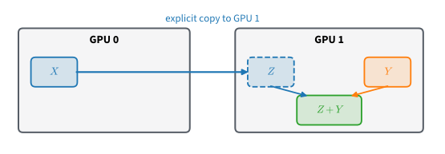
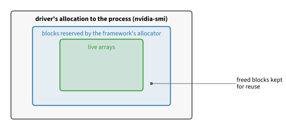
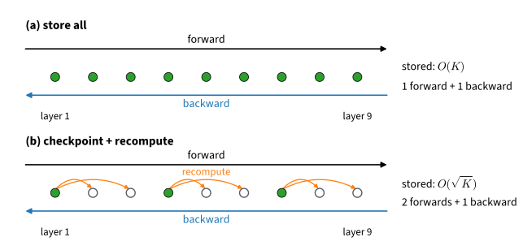

```{.python .input}
%load_ext d2lbook.tab
tab.interact_select('mxnet', 'pytorch', 'tensorflow', 'jax')
```

# GPUs, Devices, and Memory
:label:`sec_use_gpu`

A current desktop GPU multiplies two $4096 \times 4096$ matrices in a few
milliseconds and has 24 GB of memory. A model with 8 billion parameters
needs 16 GB for its weights in bf16, which fits. Training it with Adam in
fp32 needs 128 GB: 16 bytes per parameter for the weights, their
gradients, and the two moment estimates of Adam, before a single activation
is stored. That does not fit. Whether a model fits on a device, and whether
the device computes or waits, is decided by where each array lives and how
many bytes each array takes.

This section answers three questions. Where does an array live, and how does
it move between the CPU and a GPU? When does the CPU wait for the GPU, and
how do we time GPU work correctly? What fills GPU memory during training,
and how can we trade computation for memory? The answers go into the
device-aware `Trainer` that every later chapter uses.
:numref:`sec_parameters` and :numref:`sec_numerics` counted the bytes per
parameter and per number; this section puts those bytes on a device.
Training on several GPUs at once follows in :numref:`chap_performance`. All
examples fall back to the CPU when no GPU is present, and then show that the
code runs, not how fast it runs on a GPU.

```{.python .input #gpus-devices-memory-gpus-devices-and-memory}
%%tab mxnet
import time
from mxnet import init, np as mnp, npx
from mxnet.gluon import nn
from d2l import mxnet as d2l
npx.set_np()
```

```{.python .input #gpus-devices-memory-gpus-devices-and-memory}
%%tab pytorch
import time
import torch
from torch import nn
from torch.nn import functional as F
from torch.utils.checkpoint import checkpoint
from d2l import torch as d2l

torch.set_float32_matmul_precision('high')  # allow tf32 in fp32 matmuls
```

```{.python .input #gpus-devices-memory-gpus-devices-and-memory}
%%tab tensorflow
import os
os.environ['TF_CPP_MIN_LOG_LEVEL'] = '2'
import time
import numpy as np
import tensorflow as tf
from d2l import tensorflow as d2l
```

```{.python .input #gpus-devices-memory-gpus-devices-and-memory}
%%tab jax
import time
import jax
from jax import numpy as jnp
from flax import nnx
import optax
from d2l import jax as d2l
```

## Devices and Placement

### Device Objects

Every array lives on a *device*: the CPU together with main memory, or one
GPU together with its own memory. To see which GPUs a machine has, run
`nvidia-smi` in a shell; it lists every card, its memory, and the processes
using it.

:begin_tab:`mxnet`
The CPU is `npx.cpu()`, and it stands for all CPU cores and all of main
memory. `npx.gpu(i)` is the GPU with index $i$ and its memory, and
`npx.gpu()` is `npx.gpu(0)`. MXNet 1.x called this object a *context*, and
most MXNet code online writes `ctx=`, `.ctx`, and `as_in_ctx`; MXNet 2.0
renamed it to *device*, still accepts the old spellings, most of them with
a deprecation warning, and this book uses the new ones.
:end_tab:

:begin_tab:`pytorch`
The CPU is `torch.device('cpu')`, and it stands for all CPU cores and all of
main memory. `torch.device('cuda:0')` is the first GPU and its memory,
`cuda:1` the second, and plain `'cuda'` is `cuda:0`.
:end_tab:

:begin_tab:`tensorflow`
TensorFlow names devices with strings: `'/CPU:0'` is the CPU, standing for
all CPU cores and all of main memory, and `'/GPU:0'` is the first GPU and its
memory. `tf.device` turns a name into a *scope*: operations executed inside
it run on the named device and store their results there.
:end_tab:

:begin_tab:`jax`
`jax.devices(backend)` returns the device handles of a backend:
`jax.devices('cpu')[0]` is the CPU, standing for all CPU cores and all of
main memory, and `jax.devices('gpu')[i]` is the GPU with index $i$ and its
memory.
:end_tab:

We wrap device construction in two functions that the rest of the book uses.

```{.python .input #gpus-devices-memory-devices-1}
%%tab mxnet
def cpu():  #@save
    """Get the CPU device."""
    return npx.cpu()
def gpu(i=0):  #@save
    """Get a GPU device."""
    return npx.gpu(i)
cpu(), gpu(), gpu(1)
```

```{.python .input #gpus-devices-memory-devices-1}
%%tab pytorch
def cpu():  #@save
    """Get the CPU device."""
    return torch.device('cpu')

def gpu(i=0):  #@save
    """Get a GPU device."""
    return torch.device(f'cuda:{i}')

cpu(), gpu(), gpu(1)
```

```{.python .input #gpus-devices-memory-devices-1}
%%tab tensorflow
def cpu():  #@save
    """Get the CPU device."""
    return tf.device('/CPU:0')
def gpu(i=0):  #@save
    """Get a GPU device."""
    return tf.device(f'/GPU:{i}')
cpu(), gpu(), gpu(1)
```

```{.python .input #gpus-devices-memory-devices-1}
%%tab jax
def cpu():  #@save
    """Get the CPU device."""
    return jax.devices('cpu')[0]

def gpu(i=0):  #@save
    """Get a GPU device."""
    return jax.devices('gpu')[i]

cpu()
```

:begin_tab:`mxnet`
Constructing a device object always succeeds, whether or not the hardware
exists; the check happens only when data is put on the device.
:end_tab:

:begin_tab:`pytorch`
Constructing a device object always succeeds, whether or not the hardware
exists; the check happens only when data is put on the device.
:end_tab:

:begin_tab:`tensorflow`
Constructing a device scope always succeeds, whether or not the hardware
exists. Even an operation inside the scope of a missing GPU does not fail:
TensorFlow's default *soft placement* runs it on the CPU instead. This
fallback can hide a placement mistake, so inspect `x.device` when placement
matters.
:end_tab:

:begin_tab:`jax`
A JAX device object is a handle to hardware that exists: `jax.devices('gpu')`
raises an error when there is no GPU, which is why the cell calls only
`cpu()`.
:end_tab:

We can count the GPUs that are available,

```{.python .input #gpus-devices-memory-devices-2}
%%tab mxnet
def num_gpus():  #@save
    """Get the number of available GPUs."""
    return npx.num_gpus()
num_gpus()
```

```{.python .input #gpus-devices-memory-devices-2}
%%tab pytorch
def num_gpus():  #@save
    """Get the number of available GPUs."""
    return torch.cuda.device_count()

num_gpus()
```

```{.python .input #gpus-devices-memory-devices-2}
%%tab tensorflow
def num_gpus():  #@save
    """Get the number of available GPUs."""
    return len(tf.config.experimental.list_physical_devices('GPU'))
num_gpus()
```

```{.python .input #gpus-devices-memory-devices-2}
%%tab jax
def num_gpus():  #@save
    """Get the number of available GPUs."""
    try:
        return jax.device_count('gpu')
    except:
        return 0  # No GPU backend found

num_gpus()
```

and with the count, write two functions that fall back to the CPU when the
requested GPUs do not exist. They let the same code run on a laptop and on a
GPU server.

```{.python .input #gpus-devices-memory-devices-3}
def try_gpu(i=0):  #@save
    """Return gpu(i) if exists, otherwise return cpu()."""
    if num_gpus() >= i + 1:
        return gpu(i)
    return cpu()

def try_all_gpus():  #@save
    """Return all available GPUs, or [cpu(),] if no GPU exists."""
    devices = [gpu(i) for i in range(num_gpus())]
    return devices if devices else [cpu()]

try_gpu(), try_gpu(10), try_all_gpus()
```

Other accelerators, such as the GPUs of Apple-silicon Macs and Google's TPUs,
have device names of their own. This book uses the CPU and CUDA GPUs, and the
placement rules below carry over to the others.

### Arrays on Devices

:begin_tab:`mxnet`
By default, arrays are created on the CPU. The property `device` tells where
an array lives.
:end_tab:

:begin_tab:`pytorch`
By default, tensors are created on the CPU. The property `device` tells where
a tensor lives.
:end_tab:

:begin_tab:`tensorflow`
By default, eager TensorFlow creates tensors on the first GPU if there is one
and on the CPU otherwise. The property `device` tells where a tensor lives.
:end_tab:

:begin_tab:`jax`
By default, arrays are created on the *default device*, the first GPU if there
is one and the CPU otherwise. The property `device` tells where an array
lives.
:end_tab:

```{.python .input #gpus-devices-memory-tensors-models-and-devices-1}
%%tab mxnet
x = mnp.array([1, 2, 3])
x.device
```

```{.python .input #gpus-devices-memory-tensors-models-and-devices-1}
%%tab pytorch
x = torch.tensor([1, 2, 3])
x.device
```

```{.python .input #gpus-devices-memory-tensors-models-and-devices-1}
%%tab tensorflow
x = tf.constant([1.0, 2.0, 3.0])
x.device
```

```{.python .input #gpus-devices-memory-tensors-models-and-devices-1}
%%tab jax
x = jnp.array([1, 2, 3])
x.device
```

:begin_tab:`mxnet`
To create an array on another device, pass the argument `device`. Creating data
directly on the device where it is used is better than creating it on the
CPU and copying it: the array then never occupies main memory or crosses the
bus between CPU and GPU.
:end_tab:

:begin_tab:`pytorch`
To create a tensor on another device, pass the argument `device`. Creating
data directly on the device where it is used is better than creating it on
the CPU and copying it: the tensor then never occupies main memory or crosses
the bus between CPU and GPU.
:end_tab:

:begin_tab:`tensorflow`
To create a tensor on a particular device, create it inside that device's
scope. Creating data directly on the device where it is used is better than
creating it on the CPU and copying it: the tensor then never occupies main
memory or crosses the bus between CPU and GPU.
:end_tab:

:begin_tab:`jax`
`jax.device_put(x, device)` copies an array to a device, and the result is
*committed* to that device: JAX keeps it, and every computation on it, where
we put it. Arrays created without an explicit placement, like `x` above, are
*uncommitted*: they live on the default device, but JAX may move them when
they meet committed arrays.
:end_tab:

```{.python .input #gpus-devices-memory-tensors-models-and-devices-2}
%%tab mxnet
X = mnp.ones((2, 3), device=try_gpu())
X
```

```{.python .input #gpus-devices-memory-tensors-models-and-devices-2}
%%tab pytorch
X = torch.ones(2, 3, device=try_gpu())
X
```

```{.python .input #gpus-devices-memory-tensors-models-and-devices-2}
%%tab tensorflow
with try_gpu():
    X = tf.ones((2, 3))
X
```

```{.python .input #gpus-devices-memory-tensors-models-and-devices-2}
%%tab jax
X = jax.device_put(jnp.ones((2, 3)), try_gpu())
X
```

On a machine with two GPUs, we put a second array on the second GPU. On a
machine with fewer, `try_gpu(1)` returns the CPU, and the examples below run
without the second device.

```{.python .input #gpus-devices-memory-tensors-models-and-devices-3}
%%tab mxnet
Y = mnp.random.uniform(size=(2, 3), device=try_gpu(1))
Y
```

```{.python .input #gpus-devices-memory-tensors-models-and-devices-3}
%%tab pytorch
Y = torch.rand(2, 3, device=try_gpu(1))
Y
```

```{.python .input #gpus-devices-memory-tensors-models-and-devices-3}
%%tab tensorflow
with try_gpu(1):
    Y = tf.random.uniform((2, 3))
Y
```

```{.python .input #gpus-devices-memory-tensors-models-and-devices-3}
%%tab jax
Y = jax.device_put(jax.random.uniform(d2l.get_key(), (2, 3)), try_gpu(1))
Y
```

### Copying Between Devices

`X` lives on the first GPU and `Y` on the second. What happens when we add
them?

```{.python .input #gpus-devices-memory-copying-between-devices-4}
%%tab mxnet
try:
    print(X + Y)
except Exception as e:
    print(str(e).splitlines()[0])
```

```{.python .input #gpus-devices-memory-copying-between-devices-4}
%%tab pytorch
try:
    print(X + Y)
except RuntimeError as e:
    print(e)
```

```{.python .input #gpus-devices-memory-copying-between-devices-4}
%%tab tensorflow
print((X + Y).device)
```

```{.python .input #gpus-devices-memory-copying-between-devices-4}
%%tab jax
try:
    print(X + Y)
except ValueError as e:
    print(str(e).splitlines()[0])
```

:begin_tab:`mxnet`
The addition fails: MXNet's execution engine does not find both operands on
one device and refuses to choose where the result should live.
:end_tab:

:begin_tab:`pytorch`
The addition fails: PyTorch requires the operands of an operation to be on
the same device.
:end_tab:

:begin_tab:`tensorflow`
The addition succeeds. TensorFlow's default *device policy* copies one
operand to the device of the other and computes there, without a warning.
`tf.config.experimental.set_device_policy('explicit')` turns such silent
copies into errors.
:end_tab:

:begin_tab:`jax`
The addition fails: the two operands are committed to different devices, and
JAX does not choose between two explicit placements.
:end_tab:

A transfer between devices is slow compared with arithmetic on either of
them, so a framework that copied silently would hide a cost at the place where
it occurs. We copy explicitly instead, as in :numref:`fig_copyto`, and then
add.


:label:`fig_copyto`

```{.python .input #gpus-devices-memory-copying-between-devices-1}
%%tab mxnet
Z = X.copyto(try_gpu(1))
print(X)
print(Z)
```

```{.python .input #gpus-devices-memory-copying-between-devices-1}
%%tab pytorch
Z = X.to(try_gpu(1))
print(X)
print(Z)
```

```{.python .input #gpus-devices-memory-copying-between-devices-1}
%%tab tensorflow
with try_gpu(1):
    Z = tf.identity(X)
print(X)
print(Z)
```

```{.python .input #gpus-devices-memory-copying-between-devices-1}
%%tab jax
Z = jax.device_put(X, try_gpu(1))
print(X)
print(Z)
```

:begin_tab:`tensorflow`
The explicit copy in TensorFlow is `tf.identity` inside the scope of the
target device.
:end_tab:

Now that `Z` and `Y` live on the same device, we can add them.

```{.python .input #gpus-devices-memory-copying-between-devices-2}
%%tab mxnet
Y + Z
```

```{.python .input #gpus-devices-memory-copying-between-devices-2}
%%tab pytorch
Y + Z
```

```{.python .input #gpus-devices-memory-copying-between-devices-2}
%%tab tensorflow
Y + Z
```

```{.python .input #gpus-devices-memory-copying-between-devices-2}
%%tab jax
Y + Z
```

:begin_tab:`mxnet`
What if `Z` already lives on the target device? `copyto` copies anyway, into
fresh memory on the same device. The method `to_device` returns the array
itself in that case, so calling it defensively costs nothing:
:end_tab:

:begin_tab:`pytorch`
What if `Z` already lives on the target device? Then `.to` returns `Z`
itself rather than a copy, so calling it defensively costs nothing:
:end_tab:

:begin_tab:`tensorflow`
What if `Z` already lives on the target device? Then `tf.identity` under the
scope of that device moves nothing across the bus; it costs one small
operation.
:end_tab:

:begin_tab:`jax`
What if `Z` already lives on the target device? Then `device_put` returns an
array that shares `Z`'s memory, so calling it defensively costs nothing.
Comparing the memory addresses confirms that no copy was made:
:end_tab:

```{.python .input #gpus-devices-memory-copying-between-devices-3}
%%tab mxnet
Z.to_device(try_gpu(1)) is Z
```

```{.python .input #gpus-devices-memory-copying-between-devices-3}
%%tab pytorch
Z.to(try_gpu(1)) is Z
```

```{.python .input #gpus-devices-memory-copying-between-devices-3}
%%tab jax
Z2 = jax.device_put(Z, try_gpu(1))
Z2.unsafe_buffer_pointer() == Z.unsafe_buffer_pointer()
```

The rule that follows is to move data to the device at the boundary of a
computation, once, and to keep the operations inside a training loop on one
device.

### Models on a Device

:begin_tab:`mxnet`
A Gluon model allocates its parameters at the first forward pass, when the
input shapes are known, and `initialize(device=...)` names the device on which
they are then created. One call therefore places the whole model.
:end_tab:

:begin_tab:`pytorch`
A model is a tree of parameter tensors, and `net.to(device)` moves the whole
tree in one call.
:end_tab:

:begin_tab:`tensorflow`
A Keras model has no method to move it: its layers create their variables at
the first call, on the device where that call runs. So we run the first
forward pass inside a device scope, and the variables stay there.
:end_tab:

:begin_tab:`jax`
An NNX model owns a tree of state, and `jax.device_put` accepts the whole
tree. Updating the model with the placed state moves all its parameters
together.
:end_tab:

```{.python .input #gpus-devices-memory-models-on-a-device-1}
%%tab mxnet
net = nn.Sequential()
net.add(nn.Dense(1))
net.initialize(device=try_gpu())
net(X)
```

```{.python .input #gpus-devices-memory-models-on-a-device-1}
%%tab pytorch
net = nn.Sequential(nn.LazyLinear(1))
net = net.to(device=try_gpu())
net(X)
```

```{.python .input #gpus-devices-memory-models-on-a-device-1}
%%tab tensorflow
net = tf.keras.Sequential([tf.keras.layers.Dense(1)])
with try_gpu():
    Y_hat = net(X)  # The first call creates the variables inside the scope
Y_hat
```

```{.python .input #gpus-devices-memory-models-on-a-device-1}
%%tab jax
net = nnx.Sequential(nnx.Linear(X.shape[-1], 1, rngs=nnx.Rngs(d2l.get_key())))
nnx.update(net, jax.device_put(nnx.state(net), try_gpu()))
net(X)
```

The input and the parameters are on the same device, so the output is
computed and stored there too. The parameters report where they live:

```{.python .input #gpus-devices-memory-models-on-a-device-2}
%%tab mxnet
net[0].weight.data().device
```

```{.python .input #gpus-devices-memory-models-on-a-device-2}
%%tab pytorch
net[0].weight.device
```

```{.python .input #gpus-devices-memory-models-on-a-device-2}
%%tab tensorflow
net.layers[0].kernel.value.device
```

```{.python .input #gpus-devices-memory-models-on-a-device-2}
%%tab jax
jax.tree_util.tree_map(lambda p: p.device, nnx.state(net))
```

:begin_tab:`mxnet`
Two rules keep a model on its device. Create the `gluon.Trainer` after
`initialize`, so that the optimizer state is created next to the parameters
it updates. And when `forward` needs a new array, create it on the input's
device (`mnp.zeros(n, device=X.device)`) rather than on the CPU. To move a
model that is already initialized, `net.reset_device(device)` reassigns
every parameter.
:end_tab:

:begin_tab:`pytorch`
Two rules keep a model on its device. Move the model *before* creating the
optimizer, so that the optimizer state is created next to the parameters it
updates. And when `forward` needs a new tensor, create it on the input's
device (`torch.zeros(n, device=X.device)`) rather than on the CPU; state that
belongs to the model but is not a parameter goes into a buffer
(:numref:`sec_parameters`), which `.to(device)` moves with the parameters.
:end_tab:

:begin_tab:`tensorflow`
Placement in TensorFlow follows execution. A tensor created during the
forward pass lives where the surrounding operations run, and a Keras
optimizer creates its state at the first `apply_gradients`, next to the
variables it updates. The one rule is the first-call rule above: build the
variables under the device scope you intend, because moving them afterwards
means rebuilding the model.
:end_tab:

:begin_tab:`jax`
In JAX all state is explicit, so there is little to remember. The optimizer
state is built from the parameters and lives where they live, and a compiled
function runs where its inputs are. Keep the parameters and each minibatch on
one device, and everything else follows.
:end_tab:

## Asynchronous Execution

### The Execution Queue
:label:`subsec_async_dispatch`

A GPU does not execute operations at the moment Python calls them. Python
places each operation in a queue on the device and moves on, while the GPU
works through the queue in order. This lets Python prepare the next operation
while the GPU computes, but it also means that the time a Python statement
takes says nothing about the time its computation takes. We queue 32 products
of $4096 \times 4096$ matrices and read the clock twice: when Python has
issued them, and when the device has finished them.

```{.python .input #gpus-devices-memory-don-t-break-the-pipeline-1}
%%tab mxnet
A = mnp.random.normal(size=(4096, 4096), device=try_gpu())
mnp.dot(A, A)
npx.waitall()  # Warm up and wait
t = time.perf_counter()
for _ in range(32):
    B = mnp.dot(A, A)
print(f'time to queue 32 matrix products: {time.perf_counter() - t:.4f} sec')
npx.waitall()
print(f'time until they all finished:     {time.perf_counter() - t:.4f} sec')
```

```{.python .input #gpus-devices-memory-don-t-break-the-pipeline-1}
%%tab pytorch
if torch.cuda.is_available():
    A = torch.randn(4096, 4096, device=gpu())
    A @ A
    torch.cuda.synchronize()  # Warm up and wait
    t = time.perf_counter()
    for _ in range(32):
        B = A @ A
    print(f'time to queue 32 matrix products: {time.perf_counter() - t:.4f} sec')
    torch.cuda.synchronize()
    print(f'time until they all finished:     {time.perf_counter() - t:.4f} sec')
else:
    print('No CUDA device: operations on the CPU run synchronously.')
```

```{.python .input #gpus-devices-memory-don-t-break-the-pipeline-1}
%%tab tensorflow
if num_gpus() > 0:
    with gpu():
        A = tf.random.normal((4096, 4096))
        A @ A
    tf.test.experimental.sync_devices()  # Warm up and wait
    t = time.perf_counter()
    with gpu():
        for _ in range(32):
            B = A @ A
    print(f'time to queue 32 matrix products: {time.perf_counter() - t:.4f} sec')
    tf.test.experimental.sync_devices()
    print(f'time until they all finished:     {time.perf_counter() - t:.4f} sec')
else:
    print('No GPU: eager operations on the CPU run synchronously.')
```

```{.python .input #gpus-devices-memory-don-t-break-the-pipeline-1}
%%tab jax
A = jax.random.normal(d2l.get_key(), (4096, 4096))
(A @ A).block_until_ready()  # Warm up and wait
t = time.perf_counter()
for _ in range(32):
    B = A @ A
print(f'time to queue 32 matrix products: {time.perf_counter() - t:.4f} sec')
B.block_until_ready()  # The device runs the products in order
print(f'time until they all finished:     {time.perf_counter() - t:.4f} sec')
```

:begin_tab:`mxnet`
MXNet's execution engine is asynchronous on the CPU as well as on a GPU, and
`npx.waitall()` waits until every queued operation has finished.
:end_tab:

:begin_tab:`pytorch`
CUDA operations are asynchronous, and `torch.cuda.synchronize()` waits until
every queued operation on the GPU has finished. Operations on the CPU run
synchronously, which is why the cell needs a GPU. The imports cell allows
tf32 for fp32 matrix products (:numref:`sec_numerics`), so that the matrix
products timed in this section run on the tensor cores.
:end_tab:

:begin_tab:`tensorflow`
GPU operations are asynchronous, and `tf.test.experimental.sync_devices()`
waits until every queued operation has finished. Eager operations on the CPU
run synchronously, which is why the cell needs a GPU.
:end_tab:

:begin_tab:`jax`
JAX dispatches asynchronously on the CPU as well as on a GPU.
`block_until_ready()` waits until the array it is called on has been
computed; since a device runs its queue in order, the last product finishing
means that all of them have.
:end_tab:

Python issued the 32 products in a small fraction of the time the device
needed to compute them. Python waits only when it needs a value: converting
a result to a Python number or a NumPy array, printing it, or branching on
it in an `if`. Each such *synchronization point* blocks Python until the
queue up to that value has drained, and then the device sits idle until
Python sends more work, as :numref:`fig_bg_async_queue` shows. A training
loop that prints `loss.item()` after every step synchronizes once per step.
This is why the steps of the book's `Trainer` return their losses as arrays:
`fit_epoch` adds them up on the device in a `d2l.Averager` and converts the
sums into Python numbers once per epoch (:numref:`sec_linear_scratch`).


:label:`fig_bg_async_queue`

Asynchronous execution also dictates how to time GPU code. Run the
computation once before timing it, so that one-time costs such as memory
allocation, library initialization, and compilation are excluded. Wait for
the device before starting and before stopping the clock. Time several
repetitions and divide, and read the clock with `time.perf_counter`, whose
resolution is far finer than a millisecond. The cell above follows the first
three rules; the memory measurements below follow all of them.

### Transfers from the Host

Copies from main memory to a GPU can overlap with computation too, if the
data sit in the right kind of memory. An ordinary copy first moves the data
into *pinned* (page-locked) memory, which the GPU's copy engine can read
directly, and only then transfers them; Python waits throughout.

:begin_tab:`mxnet`
MXNet treats pinned memory as a device of its own: an array created with
`device=npx.cpu_pinned()` lives in pinned memory, so its copy to the GPU skips
the extra step, and `gluon.data.DataLoader(..., pin_memory=True)` places every
minibatch there. `copyto` is queued like any other operation, so Python can
prepare the next minibatch while the copy runs.
:end_tab:

:begin_tab:`pytorch`
If a tensor already sits in pinned memory, its copy can be issued with
`non_blocking=True`: Python continues at once, and the copy runs while the
GPU works on what is already queued. We compare the copy of a minibatch of
16 images of size $224 \times 224$ from ordinary memory and from pinned
memory:
:end_tab:

:begin_tab:`tensorflow`
In TensorFlow the overlap belongs to the input pipeline: ending a `tf.data`
pipeline with `.prefetch(tf.data.AUTOTUNE)` prepares the next minibatches in
the background while the device computes. The book's data loaders are
`tf.data.Dataset`s, so this is one additional call.
:end_tab:

:begin_tab:`jax`
In JAX, `device_put` queues the transfer and returns at once, so Python can
prepare the next minibatch while the copy runs.
:end_tab:

```{.python .input #gpus-devices-memory-don-t-break-the-pipeline-2}
%%tab pytorch
if torch.cuda.is_available():
    x = torch.randn(16, 3, 224, 224)
    x_pinned = x.pin_memory()
    def copy_time(src, non_blocking=False, n=100):
        src.to(gpu(), non_blocking=non_blocking)  # Warm up
        torch.cuda.synchronize()
        t = time.perf_counter()
        for _ in range(n):
            src.to(gpu(), non_blocking=non_blocking)
        torch.cuda.synchronize()
        return (time.perf_counter() - t) / n * 1e3
    print(f'pageable copy:             {copy_time(x):.3f} ms')
    print(f'pinned, non-blocking copy: {copy_time(x_pinned, True):.3f} ms')
else:
    print('No CUDA device: there is no copy to a GPU.')
```

:begin_tab:`pytorch`
The copy from pinned memory is faster. Pinning itself is expensive, though, so pinning a tensor on the training
thread just before copying it would cancel the gain.
`DataLoader(pin_memory=True)` pins the minibatches in the loader's workers,
and `non_blocking=True` then lets the training loop issue the copy without
waiting; the two are used together. A non-blocking copy may still be in
progress when the call returns, so the source tensor must not be modified
until the copy has finished.
:end_tab:

The full treatment of streams, overlap, and several devices is in
:numref:`chap_performance`.

## Training Memory

### Three Views of Memory

How much memory does a program use on a GPU? The answer depends on who is
asked. A GPU *allocator* requests memory from the CUDA driver in large
blocks and hands out pieces of them, and when an array is freed, it keeps the
block for the next array instead of returning it, because requests to the
driver are slow. There are therefore three nested views of memory,
:numref:`fig_bg_allocator`: the bytes held by live arrays, the bytes the
allocator has reserved, and the bytes the driver has given to the process,
which `nvidia-smi` reports.


:label:`fig_bg_allocator`

:begin_tab:`mxnet`
MXNet keeps a *memory pool* per device and has no counter of live bytes. Its
only memory query is `npx.gpu_memory_info(i)`, which returns the free and
total bytes of the whole device, the outermost view, as `nvidia-smi` does.
That count includes other processes on the same GPU, so we report the
*difference* from a reading at the start, after returning the pool's unused
blocks to the driver with `gpu().empty_cache()`. Because execution is
asynchronous, `npx.waitall()` precedes every reading.
:end_tab:

:begin_tab:`pytorch`
`torch.cuda.memory_allocated()` counts the bytes held by live tensors, and
`torch.cuda.memory_reserved()` counts those bytes plus the blocks that
PyTorch's *caching allocator* keeps for reuse.
:end_tab:

:begin_tab:`tensorflow`
TensorFlow reserves GPU memory for its own allocator.
`tf.config.experimental.get_memory_info('GPU:0')` returns a dictionary whose
entry `'current'` counts the bytes of live tensors and whose entry `'peak'`
is their largest value so far. On the CPU there is no such allocator, and the
call raises an error.
:end_tab:

:begin_tab:`jax`
On its first use of a GPU, JAX *preallocates* a large fraction of its memory
for its allocator, so `nvidia-smi` shows that whole block no matter how much
of it is used. The method `memory_stats()` of a GPU device returns a
dictionary whose entry `bytes_in_use` counts the bytes of live arrays and
whose entry `peak_bytes_in_use` is their largest value so far. On the CPU it
returns `None`.
:end_tab:

We create an array of 1 GiB and delete it again:

```{.python .input #gpus-devices-memory-gpu-memory}
%%tab mxnet
if num_gpus() > 0:
    gpu().empty_cache()
    npx.waitall()
    free_start, _ = npx.gpu_memory_info(0)
    def report(tag):
        npx.waitall()
        free, _ = npx.gpu_memory_info(0)
        print(f'{tag}: {(free_start - free) / 2**20:7.1f} MiB more used')
    big = mnp.zeros((256, 1024, 1024), device=gpu())  # 1 GiB of float32
    report('after creating big')
    del big
    report('after deleting it ')
    gpu().empty_cache()
    report('after empty_cache ')
else:
    print('No GPU: gpu_memory_info() queries the CUDA driver.')
```

```{.python .input #gpus-devices-memory-gpu-memory}
%%tab pytorch
if torch.cuda.is_available():
    def report(tag):
        print(f'{tag}: {torch.cuda.memory_allocated() / 2**20:7.1f} MiB '
              f'allocated, {torch.cuda.memory_reserved() / 2**20:7.1f} MiB '
              'reserved')
    big = torch.zeros(256, 1024, 1024, device=gpu())  # 1 GiB of float32
    report('after creating big')
    del big
    report('after deleting it ')
else:
    print('No CUDA device: both counters read 0 on the CPU.')
```

```{.python .input #gpus-devices-memory-gpu-memory}
%%tab tensorflow
if num_gpus() > 0:
    def report(tag):
        info = tf.config.experimental.get_memory_info('GPU:0')
        print(f'{tag}: {info["current"] / 2**20:7.1f} MiB in use, '
              f'{info["peak"] / 2**20:7.1f} MiB peak')
    with gpu():
        big = tf.zeros((256, 1024, 1024))  # 1 GiB of float32
    report('after creating big')
    del big
    report('after deleting it ')
else:
    print('No GPU: get_memory_info() tracks only GPU and TPU allocators.')
```

```{.python .input #gpus-devices-memory-gpu-memory}
%%tab jax
if num_gpus() > 0:
    def report(tag):
        s = gpu().memory_stats()
        print(f'{tag}: {s["bytes_in_use"] / 2**20:7.1f} MiB in use, '
              f'{s["peak_bytes_in_use"] / 2**20:7.1f} MiB peak')
    big = jnp.zeros((256, 1024, 1024))  # 1 GiB of float32
    big.block_until_ready()
    report('after creating big')
    del big
    report('after deleting it ')
else:
    print('No GPU: memory_stats() returns None on the CPU backend.')
```

:begin_tab:`mxnet`
Creating `big` takes a gibibyte from the driver, and deleting it gives
nothing back: the block returns to MXNet's pool, which still holds it. Only
`empty_cache()` returns it to the driver. Do not call `empty_cache` inside a
training loop, since the pool would then have to request the memory from the
driver again at every step.
:end_tab:

:begin_tab:`pytorch`
After the deletion, `memory_allocated()` falls by a gibibyte while
`memory_reserved()` does not move: the block went back to the cache, and
`nvidia-smi` still counts it. `torch.cuda.empty_cache()` returns cached blocks
to the driver, which helps when another process needs the GPU. Do not call it
inside a training loop, since the allocator would then have to request the
memory from the driver again at every step.
:end_tab:

:begin_tab:`tensorflow`
The count of live bytes falls by a gibibyte when `big` is deleted, while
`nvidia-smi` does not move: the block returns to TensorFlow's allocator, not
to the driver, and TensorFlow keeps its reservation until the process ends.
To share a GPU with another process, call
`tf.config.experimental.set_memory_growth(gpu, True)`, which grows the
reservation on demand instead, before the first computation.
:end_tab:

:begin_tab:`jax`
The count of live bytes falls by a gibibyte when `big` is deleted, while
`nvidia-smi` does not move: the block returns to the preallocated pool. To
share a GPU with another process, set the environment variable
`XLA_PYTHON_CLIENT_PREALLOCATE=false` before the first computation; JAX then
requests memory from the driver as it needs it.
:end_tab:

The memory that limits what fits is the outermost view, since the driver
cannot give a process more than the device has. The counts of live bytes are
what we use to find out where the memory goes.

### What Fills Memory During Training
:label:`subsec_memory_during_training`

A model with $N$ parameters that trains with Adam in fp32 holds $4N$ bytes of
weights, $4N$ bytes of gradients, and $8N$ bytes for the two moment estimates
of Adam, $16N$ bytes in all, as :numref:`sec_parameters` counted. The
remaining term, the *activations*, is of a different kind. Backpropagation
needs the intermediate results of the forward pass to compute the gradients,
so it stores them until the backward pass has used them. Their size grows
with the minibatch size and with the width of every layer, while $16N$ does
not. We measure the terms for an MLP with three hidden layers of width 4096
on inputs of width 1024, $N \approx 3.8 \times 10^7$ parameters, so that
$4N \approx 144$ MiB, at a minibatch size of 4096. The activations that
backpropagation keeps are mainly the outputs of the three hidden layers,
each a $4096 \times 4096$ array of fp32 numbers, 64 MiB apiece: 192 MiB in
all, about a third more than the weights.

:begin_tab:`mxnet`
MXNet has no counter of live bytes, and its pool keeps freed blocks, so the
device-wide count cannot separate the terms, and this tab measures nothing
here. The accounting itself holds, with one point of timing: Gluon
allocates the gradient of each parameter at `initialize`, so the $4N$ bytes
of gradients are there from the start.
:end_tab:

:begin_tab:`pytorch`
We read `memory_allocated()` at four points of one training step.
:end_tab:

:begin_tab:`tensorflow`
We read `'current'` at four points of one training step. `tf.GradientTape`
records the forward pass and holds its intermediate results until we ask it
for the gradients, so the activations appear in the second reading.
:end_tab:

:begin_tab:`jax`
We read `bytes_in_use` after each piece of a training step. The activations
exist only while `nnx.grad` runs, so no reading afterwards shows them.
Instead we ask the compiler: XLA plans the memory of a compiled function in
advance, and `memory_analysis()` of the compiled gradient function reports
the temporary memory it needs, which here is the activations.
:end_tab:

```{.python .input #gpus-devices-memory-what-fills-memory-during-training}
%%tab pytorch
if torch.cuda.is_available():
    start = torch.cuda.memory_allocated()
    def allocated():  # Memory in use beyond that at the start of the cell
        return f'{(torch.cuda.memory_allocated() - start) / 2**20:7.1f} MiB'
    net = nn.Sequential(nn.Linear(1024, 4096), nn.ReLU(),
                        nn.Linear(4096, 4096), nn.ReLU(),
                        nn.Linear(4096, 4096), nn.ReLU(),
                        nn.Linear(4096, 10)).to(gpu())
    optimizer = torch.optim.Adam(net.parameters())
    X = torch.randn(4096, 1024, device=gpu())
    y = torch.randint(0, 10, (4096,), device=gpu())
    print('weights           ', allocated())
    loss = F.cross_entropy(net(X), y)
    print('+ activations     ', allocated())
    loss.backward()
    print('+ gradients       ', allocated())
    optimizer.step()
    print('+ optimizer state ', allocated())
else:
    print('No CUDA device: run this cell on a GPU to see the four readings.')
```

```{.python .input #gpus-devices-memory-what-fills-memory-during-training}
%%tab tensorflow
if num_gpus() > 0:
    start = tf.config.experimental.get_memory_info('GPU:0')['current']
    def in_use():  # Memory in use beyond that at the start of the cell
        info = tf.config.experimental.get_memory_info('GPU:0')
        return f'{(info["current"] - start) / 2**20:7.1f} MiB'
    with gpu():
        net = tf.keras.Sequential(
            [tf.keras.layers.Dense(4096, activation='relu'),
             tf.keras.layers.Dense(4096, activation='relu'),
             tf.keras.layers.Dense(4096, activation='relu'),
             tf.keras.layers.Dense(10)])
        X = tf.random.normal((4096, 1024))
        y = tf.random.uniform((4096,), 0, 10, dtype=tf.int32)
        net(X)  # The first call creates the variables
    optimizer = tf.keras.optimizers.Adam()
    loss_fn = tf.keras.losses.SparseCategoricalCrossentropy(from_logits=True)
    print('weights           ', in_use())
    with tf.GradientTape() as tape:
        loss = loss_fn(y, net(X, training=True))
    print('+ activations     ', in_use())
    grads = tape.gradient(loss, net.trainable_variables)
    print('+ gradients       ', in_use())
    optimizer.apply_gradients(zip(grads, net.trainable_variables))
    print('+ optimizer state ', in_use())
else:
    print('No GPU: run this cell on a GPU to see the four readings.')
```

```{.python .input #gpus-devices-memory-what-fills-memory-during-training}
%%tab jax
if num_gpus() > 0:
    start = gpu().memory_stats()['bytes_in_use']
    def in_use():  # Memory in use beyond that at the start of the cell
        s = gpu().memory_stats()
        return f'{(s["bytes_in_use"] - start) / 2**20:7.1f} MiB'
    rngs = nnx.Rngs(d2l.get_key())
    net = nnx.Sequential(nnx.Linear(1024, 4096, rngs=rngs), nnx.relu,
                         nnx.Linear(4096, 4096, rngs=rngs), nnx.relu,
                         nnx.Linear(4096, 4096, rngs=rngs), nnx.relu,
                         nnx.Linear(4096, 10, rngs=rngs))
    key1, key2 = jax.random.split(d2l.get_key())
    X = jax.random.normal(key1, (4096, 1024))
    y = jax.random.randint(key2, (4096,), 0, 10)
    def loss(model):
        logits = model(X)
        return optax.softmax_cross_entropy_with_integer_labels(
            logits, y).mean()
    jax.block_until_ready(nnx.state(net))
    print('weights                ', in_use())
    grads = jax.block_until_ready(nnx.grad(loss)(net))
    print('+ gradients            ', in_use())
    optimizer = nnx.Optimizer(net, optax.adam(1e-3), wrt=nnx.Param)
    jax.block_until_ready(optimizer.opt_state)
    print('+ optimizer state      ', in_use())
    graphdef, params = nnx.split(net)
    grad_fn = jax.jit(jax.grad(lambda params: loss(nnx.merge(graphdef, params))))
    plan = grad_fn.lower(params).compile().memory_analysis()
    print(f'activations (planned)  {plan.temp_size_in_bytes / 2**20:7.1f} MiB')
else:
    print('No GPU: run this cell on a GPU to see the terms arrive.')
```

:begin_tab:`pytorch`
The first reading is the weights, about $4N$ bytes, plus the input
minibatch. The second adds the stored activations, here about a third more
than the weights. The third *falls*: `backward` frees the activations as it
uses them and leaves gradients of the same size as the weights. The fourth
adds about $8N$ at the first `optimizer.step()`, when Adam creates its two
moment estimates. From then on every step rises to the second reading and
falls back to the third; weights, gradients, and optimizer state stay.
:end_tab:

:begin_tab:`tensorflow`
The first reading is the weights, about $4N$ bytes, plus the input
minibatch. The second adds the activations that the tape holds, here about a
third more than the weights. The third *falls*: `tape.gradient` frees the
recorded forward pass and leaves gradients of the same size as the weights.
The fourth adds about $8N$ at the first `apply_gradients`, when Adam creates
its two moment estimates. From then on every step rises to the second
reading and falls back to the third; weights, gradients, and optimizer state
stay.
:end_tab:

:begin_tab:`jax`
The first reading is the weights, about $4N$ bytes, plus the input
minibatch. The second adds gradients of the same size as the weights: in JAX
a gradient is not attached to a parameter but is a second tree of arrays,
returned by `nnx.grad`. The third adds about $8N$ when `optax.adam` creates
its two moment estimates. The activations, about a third more than the
weights, exist only during the gradient computation.
:end_tab:

The minibatch size is the first memory control to try, because it scales the
activations without changing the model. If memory instead grows from one
step to the next, something keeps the arrays of earlier steps alive; a
common cause is appending the loss array itself, rather than its value, to a
Python list.

### Activation Checkpointing
:label:`subsec_activation_checkpointing`

The activations have a second control. Backpropagation stores every
intermediate result only to read it once, on the way back. *Activation
checkpointing* :cite:`Chen.Xu.Zhang.ea.2016` stores less: it keeps only the
inputs of selected segments of the network, and during the backward pass it
reruns the forward computation of each segment to regenerate the
activations that segment needs. For a stack of $K$ equally sized layers cut
into segments of $s$ layers, the backward pass holds the $K/s$ segment inputs
plus the activations of one segment, about $K/s + s$ layer activations
instead of $K$. The sum is smallest at $s = \sqrt{K}$, where stored
activations fall from $O(K)$ to $O(\sqrt{K})$. The price is a second forward
pass through every segment, :numref:`fig_bg_activation_checkpoint`. Since a
backward pass costs about twice a forward pass, a step then costs about four
forward passes instead of three, a third more, although the exact overhead
depends on the layers and the hardware.


:label:`fig_bg_activation_checkpoint`

Checkpointing suits deep stacks of identical blocks, such as the residual
stack of :numref:`sec_model_construction` and the transformers of later
chapters. We use the residual block of :numref:`sec_model_construction`,
$\mathbf{X} + \textrm{Linear}(\textrm{ReLU}(\textrm{Linear}(\mathbf{X})))$,
with its weights drawn from $\mathcal{N}(0, 0.01^2)$ and zero biases in every
framework, so that all tabs build the same model. A function runs a stack of
blocks in segments, with or without checkpointing.

```{.python .input #gpus-devices-memory-trading-compute-for-memory-activation-checkpointing-1}
%%tab pytorch
class ResidualBlock(nn.Module):
    def __init__(self, num_hiddens):
        super().__init__()
        self.body = nn.Sequential(
            nn.Linear(num_hiddens, num_hiddens), nn.ReLU(),
            nn.Linear(num_hiddens, num_hiddens))
        for layer in self.body[0], self.body[2]:
            nn.init.normal_(layer.weight, std=0.01)
            nn.init.zeros_(layer.bias)

    def forward(self, X):
        return X + self.body(X)

def run_stack(blocks, X, use_checkpoint=False, segment_size=4):
    for start in range(0, len(blocks), segment_size):
        stop = min(start + segment_size, len(blocks))
        def segment(X, start=start, stop=stop):
            for i in range(start, stop):
                X = blocks[i](X)
            return X
        X = checkpoint(segment, X, use_reentrant=False) \
            if use_checkpoint else segment(X)
    return X
```

```{.python .input #gpus-devices-memory-trading-compute-for-memory-activation-checkpointing-1}
%%tab tensorflow
class ResidualBlock(tf.keras.layers.Layer):
    def __init__(self, num_hiddens, **kwargs):
        super().__init__(**kwargs)
        normal = tf.keras.initializers.RandomNormal  # One instance per layer
        self.body = tf.keras.Sequential([
            tf.keras.layers.Dense(num_hiddens, activation='relu',
                                  kernel_initializer=normal(stddev=0.01)),
            tf.keras.layers.Dense(num_hiddens,
                                  kernel_initializer=normal(stddev=0.01))])

    def call(self, X):
        return X + self.body(X)

def run_stack(blocks, X, use_checkpoint=False, segment_size=4):
    for start in range(0, len(blocks), segment_size):
        # Bind this segment's blocks now: the backward pass calls segment
        # again after the loop has moved on
        def segment(X, segment_blocks=blocks[start:start + segment_size]):
            for blk in segment_blocks:
                X = blk(X)
            return X
        f = tf.recompute_grad(segment) if use_checkpoint else segment
        X = f(X)
    return X
```

```{.python .input #gpus-devices-memory-trading-compute-for-memory-activation-checkpointing-1}
%%tab jax
class ResidualBlock(nnx.Module):
    def __init__(self, num_hiddens, *, rngs):
        normal = nnx.initializers.normal(0.01)
        self.body = nnx.Sequential(
            nnx.Linear(num_hiddens, num_hiddens, kernel_init=normal,
                       rngs=rngs), nnx.relu,
            nnx.Linear(num_hiddens, num_hiddens, kernel_init=normal,
                       rngs=rngs))

    def __call__(self, X):
        return X + self.body(X)

def run_stack(graphdef, states, X, use_checkpoint=False, segment_size=4):
    def segment(segment_states, X):
        for state in segment_states:
            X = nnx.merge(graphdef, state)(X)
        return X
    f = jax.checkpoint(segment) if use_checkpoint else segment
    for start in range(0, len(states), segment_size):
        X = f(states[start:start + segment_size], X)
    return X
```

:begin_tab:`mxnet`
MXNet has no per-segment activation checkpointing: neither `mxnet.autograd`
nor Gluon offers a transformation that recomputes the forward pass of a
chosen segment during the backward pass. There is only a global switch: the
environment variable `MXNET_BACKWARD_DO_MIRROR=1`, read when the process
starts, lets MXNet drop some intermediate results of a hybridized graph and
recompute them during the backward pass, with no control over which ones.
This tab therefore has no code in this subsection, and the minibatch size
remains the control over activation memory.
:end_tab:

:begin_tab:`pytorch`
`checkpoint(segment, X)` runs a segment without storing its intermediate
results and keeps what it needs to rerun it. Since that rerun happens after
the loop in `run_stack` has finished, `segment` receives its range of blocks
as default arguments, which are evaluated when the function is defined; a
plain closure would look up `start` and `stop` at the time of the call and
rerun the last segment for every segment. The recomputation must reproduce
the original forward pass exactly, so `checkpoint` also saves and restores the
state of the random number generator, which keeps segments with dropout
correct.
:end_tab:

:begin_tab:`tensorflow`
`tf.recompute_grad(segment)` returns a function that computes the same values
as `segment` but tells the tape to store only its input, and reruns
`segment` during the backward pass. Since that rerun happens after the loop
in `run_stack` has finished, `segment` receives its blocks as a default
argument, which is evaluated when the function is defined; a plain closure
would look up the loop variable at the time of the call and rerun the last
segment's blocks for every segment. `tf.recompute_grad` does not save the
state of the random number generator,
so a segment with stateful dropout can draw a different mask when it is
recomputed.
:end_tab:

:begin_tab:`jax`
`jax.checkpoint` (also called `jax.remat`) is a function transformation like
`grad` and `jit`. `jax.checkpoint(f)` computes the same values as `f`, but
when it is differentiated, it saves only the inputs of `f` and recomputes
the rest during the backward pass. JAX functions receive their random keys as
arguments, so a recomputed segment with dropout draws the same mask by
construction. The NNX model is split into its structure, `graphdef`, and its
parameters, `states`, so that the segments are pure functions of the
parameters.
:end_tab:

Recomputation must not change the result. We check that the gradients
through a stack of eight blocks, run as two checkpointed segments, equal the
ordinary ones.

```{.python .input #gpus-devices-memory-trading-compute-for-memory-activation-checkpointing-2}
%%tab pytorch
blocks = nn.Sequential(*[ResidualBlock(64) for _ in range(8)])
X = torch.randn(32, 64)

def stack_grads(use_checkpoint):
    blocks.zero_grad(set_to_none=True)
    run_stack(blocks, X, use_checkpoint).sum().backward()
    return [p.grad.clone() for p in blocks.parameters()]

for g, g_ckpt in zip(stack_grads(False), stack_grads(True)):
    assert torch.allclose(g, g_ckpt)
print('checkpointed gradients match the ordinary ones')
```

```{.python .input #gpus-devices-memory-trading-compute-for-memory-activation-checkpointing-2}
%%tab tensorflow
blocks = [ResidualBlock(64) for _ in range(8)]
X = tf.random.normal((32, 64))

def stack_grads(use_checkpoint):
    with tf.GradientTape() as tape:
        loss = tf.reduce_sum(run_stack(blocks, X, use_checkpoint))
    params = [v for blk in blocks for v in blk.trainable_variables]
    return tape.gradient(loss, params)

for g, g_ckpt in zip(stack_grads(False), stack_grads(True)):
    assert np.allclose(g, g_ckpt)
print('checkpointed gradients match the ordinary ones')
```

```{.python .input #gpus-devices-memory-trading-compute-for-memory-activation-checkpointing-2}
%%tab jax
X = jax.random.normal(d2l.get_key(), (32, 64))
blocks = [ResidualBlock(64, rngs=nnx.Rngs(d2l.get_key())) for _ in range(8)]
split_blocks = [nnx.split(block) for block in blocks]
graphdef = split_blocks[0][0]
states = [state for _, state in split_blocks]

def stack_grads(use_checkpoint):
    loss = lambda states: run_stack(graphdef, states, X,
                                    use_checkpoint).sum()
    return jax.tree_util.tree_leaves(jax.grad(loss)(states))

for g, g_ckpt in zip(stack_grads(False), stack_grads(True)):
    assert jnp.allclose(g, g_ckpt)
print('checkpointed gradients match the ordinary ones')
```

The check runs on the CPU too. The memory effect needs a GPU and a stack deep
enough for a clear difference: sixteen blocks of width 1024 at a minibatch
size of 8192, in segments of four blocks. We report the *step memory*, the
peak memory of a step beyond the parameters and the input it starts from,
and the average time of ten steps after one step of warm-up, as the timing
rules above prescribe.

```{.python .input #gpus-devices-memory-trading-compute-for-memory-activation-checkpointing-3}
%%tab pytorch
if torch.cuda.is_available():
    blocks = nn.Sequential(*[ResidualBlock(1024) for _ in range(16)]).to(gpu())
    X = torch.randn(8192, 1024, device=gpu())
    def step(use_checkpoint):
        blocks.zero_grad(set_to_none=True)
        run_stack(blocks, X, use_checkpoint).sum().backward()
    for use_checkpoint in (False, True):
        step(use_checkpoint)  # Warm up
        blocks.zero_grad(set_to_none=True)
        torch.cuda.synchronize()
        start = torch.cuda.memory_allocated()
        torch.cuda.reset_peak_memory_stats()
        t = time.perf_counter()
        for _ in range(10):
            step(use_checkpoint)
        torch.cuda.synchronize()
        elapsed = (time.perf_counter() - t) / 10
        peak = torch.cuda.max_memory_allocated() - start
        print(f'checkpointing={use_checkpoint!s:5}  step memory '
              f'{peak / 2**20:5.0f} MiB, {elapsed * 1e3:5.1f} ms per step')
else:
    print('No CUDA device: the peak-memory comparison needs a GPU.')
```

```{.python .input #gpus-devices-memory-trading-compute-for-memory-activation-checkpointing-3}
%%tab tensorflow
if num_gpus() > 0:
    with gpu():
        blocks = [ResidualBlock(1024) for _ in range(16)]
        X = tf.random.normal((8192, 1024))
        run_stack(blocks, X)  # Create the variables
    params = [v for blk in blocks for v in blk.trainable_variables]
    @tf.function  # One graph for each value of use_checkpoint
    def step(use_checkpoint):
        with tf.GradientTape() as tape:
            loss = tf.reduce_sum(run_stack(blocks, X, use_checkpoint))
        return tape.gradient(loss, params)
    for use_checkpoint in (False, True):
        step(use_checkpoint)  # Trace and warm up
        tf.test.experimental.sync_devices()
        start = tf.config.experimental.get_memory_info('GPU:0')['current']
        tf.config.experimental.reset_memory_stats('GPU:0')
        t = time.perf_counter()
        for _ in range(10):
            step(use_checkpoint)
        tf.test.experimental.sync_devices()
        elapsed = (time.perf_counter() - t) / 10
        peak = tf.config.experimental.get_memory_info('GPU:0')['peak'] - start
        print(f'checkpointing={use_checkpoint!s:5}  step memory '
              f'{peak / 2**20:5.0f} MiB, {elapsed * 1e3:5.1f} ms per step')
else:
    print('No GPU: the peak-memory comparison needs a GPU.')
```

```{.python .input #gpus-devices-memory-trading-compute-for-memory-activation-checkpointing-3}
%%tab jax
if num_gpus() > 0:
    X = jax.random.normal(d2l.get_key(), (8192, 1024))
    blocks = [ResidualBlock(1024, rngs=nnx.Rngs(d2l.get_key()))
              for _ in range(16)]
    split_blocks = [nnx.split(block) for block in blocks]
    graphdef = split_blocks[0][0]
    states = [state for _, state in split_blocks]
    for use_checkpoint in (False, True):
        step = jax.jit(jax.grad(lambda states: run_stack(
            graphdef, states, X, use_checkpoint).sum()))
        plan = step.lower(states).compile().memory_analysis()
        jax.block_until_ready(step(states))  # Warm up
        t = time.perf_counter()
        for _ in range(10):
            grads = step(states)
        jax.block_until_ready(grads)
        elapsed = (time.perf_counter() - t) / 10
        peak = plan.temp_size_in_bytes + plan.output_size_in_bytes
        print(f'checkpointing={use_checkpoint!s:5}  step memory '
              f'{peak / 2**20:5.0f} MiB, {elapsed * 1e3:5.1f} ms per step')
else:
    print('No GPU: the peak-memory comparison needs a GPU.')
```

:begin_tab:`tensorflow`
Like all TensorFlow code that we time, the step is compiled with
`tf.function`.
:end_tab:

:begin_tab:`jax`
The step memory is the memory the compiled step plans to use beyond its
inputs: temporary arrays, mostly activations, plus its output, the
gradients. `peak_bytes_in_use` would not do, since JAX cannot reset it and
earlier cells have already raised it.
:end_tab:

Without checkpointing, the step holds the activations of all sixteen blocks.
With segments of four blocks, it holds the four segment inputs plus the
activations of one segment, and its memory falls from about 1.1 GiB to
between 0.4 and 0.5 GiB. The step takes about a quarter longer, a little less than the
third that the count of forward passes predicted.
This trade lets a model train when its activations would otherwise exceed the
memory of the device, and it is common in the training of large transformers.

## Device-Aware Trainer
:label:`subsec_device_aware_trainer`

:begin_tab:`mxnet`
In :numref:`sec_oo-design` the `Trainer` accepted an argument `num_gpus` and
did not use it. Now it applies the rules of this section: it moves the
model's parameters to the device *once*, before training, with
`reset_device`, which works even while Gluon's parameters still wait for
their shapes; and it moves every minibatch at the start of its step, to the
CPU when there is no GPU. A `DataLoader` with worker processes delivers its
minibatches in shared memory, `cpu_shared(0)`, and a hybridized model
refuses inputs that are not on the device of its parameters, `cpu(0)`.
:end_tab:

:begin_tab:`pytorch`
In :numref:`sec_oo-design` the `Trainer` accepted an argument `num_gpus` and
did not use it. Now it applies the rules of this section: it moves the model
to the device *once*, before training, and moves every minibatch at the start
of its step. `prepare_model` also runs the dry pass of :numref:`sec_lazy_init`:
if the model still has lazy parameters, it runs the first training minibatch
through the model on the device and applies the model's `weight_init`
function, if it has one, before the optimizer is created. A model built
from layers with fixed shapes initializes itself in its constructor;
`weight_init` is not called for it.
:end_tab:

:begin_tab:`tensorflow`
In :numref:`sec_oo-design` the `Trainer` accepted an argument `num_gpus` and
did not use it. Now it applies the rules of this section. It copies every
minibatch to the device at the start of its step, with `tf.identity` inside
the device scope: `tf.data` produces minibatches on the CPU, and without the
copy every operation on them would copy them silently. The variables need no
code of their own. Keras creates them at the first call, and the `Trainer`
makes that call, a forward pass on a minibatch from `prepare_batch`, when it
compiles its steps.
:end_tab:

:begin_tab:`jax`
In :numref:`sec_oo-design` the `Trainer` accepted an argument `num_gpus` and
did not use it. Now it applies the rules of this section. It moves every
minibatch to the device at the start of its step. The parameters need no code
of their own: a JAX model creates them in its constructor, on the default
device, which is the GPU whenever there is one.
:end_tab:

```{.python .input #gpus-devices-memory-the-trainer-now-with-devices-1}
%%tab mxnet
@d2l.add_to_class(d2l.Trainer)  #@save
def __init__(self, max_epochs, num_gpus=0, gradient_clip_val=0):
    self.save_hyperparameters()
    self.gpus = [d2l.gpu(i) for i in range(min(num_gpus, d2l.num_gpus()))]
    self.board = d2l.ProgressBoard(xlabel='epoch', ylabel='loss')

@d2l.add_to_class(d2l.Trainer)  #@save
def prepare_batch(self, batch):
    device = self.gpus[0] if self.gpus else d2l.cpu()
    return [a.to_device(device) for a in batch]

@d2l.add_to_class(d2l.Trainer)  #@save
def prepare_model(self, model):
    self.model = model
    if self.gpus:
        model.reset_device(self.gpus[0])
```

```{.python .input #gpus-devices-memory-the-trainer-now-with-devices-1}
%%tab pytorch
@d2l.add_to_class(d2l.Trainer)  #@save
def __init__(self, max_epochs, num_gpus=0, gradient_clip_val=0):
    self.save_hyperparameters()
    self.gpus = [d2l.gpu(i) for i in range(min(num_gpus, d2l.num_gpus()))]
    self.board = d2l.ProgressBoard(xlabel='epoch', ylabel='loss')

@d2l.add_to_class(d2l.Trainer)  #@save
def prepare_batch(self, batch):
    if self.gpus:
        batch = [d2l.to(a, self.gpus[0]) for a in batch]
    return batch

@d2l.add_to_class(d2l.Trainer)  #@save
def prepare_model(self, model):
    self.model = model
    if self.gpus:
        model.to(self.gpus[0])
    if any(isinstance(p, nn.parameter.UninitializedParameter)
           for p in model.parameters()):
        loader = (self.train_dataloader if self.train_dataloader is not None
                  else self.val_dataloader)  # `evaluate` has no training data
        batch = self.prepare_batch(next(iter(loader)))
        model.apply_init(batch[:-1], getattr(model, 'weight_init', None))
```

```{.python .input #gpus-devices-memory-the-trainer-now-with-devices-1}
%%tab tensorflow
@d2l.add_to_class(d2l.Trainer)  #@save
def __init__(self, max_epochs, num_gpus=0, gradient_clip_val=0):
    self.save_hyperparameters()
    self.gpus = [d2l.gpu(i) for i in range(min(num_gpus, d2l.num_gpus()))]
    self.board = d2l.ProgressBoard(xlabel='epoch', ylabel='loss')

@d2l.add_to_class(d2l.Trainer)  #@save
def prepare_batch(self, batch):
    if self.gpus:
        # tf.data.Dataset emits batches on CPU. Re-wrap them inside the
        # GPU device context so subsequent ops keep their inputs on-device
        # rather than incurring an implicit copy each step.
        with self.gpus[0]:
            batch = [tf.identity(a) for a in batch]
    return batch
```

```{.python .input #gpus-devices-memory-the-trainer-now-with-devices-1}
%%tab jax
@d2l.add_to_class(d2l.Trainer)  #@save
def __init__(self, max_epochs, num_gpus=0, gradient_clip_val=0):
    self.save_hyperparameters()
    self.gpus = [d2l.gpu(i) for i in range(min(num_gpus, d2l.num_gpus()))]
    self.board = d2l.ProgressBoard(xlabel='epoch', ylabel='loss')

@d2l.add_to_class(d2l.Trainer)  #@save
def prepare_batch(self, batch):
    if self.gpus:
        batch = [d2l.to(a, self.gpus[0]) for a in batch]
    return batch
```

The expression `min(num_gpus, d2l.num_gpus())` makes the request an upper
limit rather than a demand. On a machine without a GPU, `self.gpus` is
empty, nothing is moved to a GPU, and training runs on the CPU. Every
`Trainer(num_gpus=1)` in the rest of the book relies on this fallback.

To see the `Trainer` at work, we train a classifier built from the residual
blocks of :numref:`subsec_activation_checkpointing` on Fashion-MNIST for five
epochs: a hidden
layer of width 256, two residual blocks, and 10 outputs, with all weights
drawn from $\mathcal{N}(0, 0.01^2)$ and zero biases, as for the MLPs of
earlier chapters. The `Trainer` places the model, moves every minibatch, and
afterwards the parameters are on the GPU, if there is one.

```{.python .input #gpus-devices-memory-the-trainer-now-with-devices-3}
%%tab mxnet
class ResidualBlock(nn.Block):
    def __init__(self, num_hiddens):
        super().__init__()
        self.body = nn.Sequential()
        self.body.add(nn.Dense(num_hiddens, activation='relu'),
                      nn.Dense(num_hiddens))

    def forward(self, X):
        return X + self.body(X)

class ResMLPClassifier(d2l.Classifier):
    def __init__(self, num_hiddens=256, num_blocks=2, lr=0.1):
        super().__init__()
        self.save_hyperparameters()
        self.net = nn.Sequential()
        self.net.add(nn.Dense(num_hiddens, activation='relu'),
                     *[ResidualBlock(num_hiddens) for _ in range(num_blocks)],
                     nn.Dense(10))
        self.net.initialize(init.Normal(sigma=0.01))

model = ResMLPClassifier()
trainer = d2l.Trainer(max_epochs=5, num_gpus=1)
trainer.fit(model, d2l.FashionMNIST(batch_size=256))
model.net[0].weight.data().device
```

```{.python .input #gpus-devices-memory-the-trainer-now-with-devices-2}
%%tab pytorch
class ResMLPClassifier(d2l.Classifier):
    def __init__(self, num_hiddens=256, num_blocks=2, lr=0.1):
        super().__init__()
        self.save_hyperparameters()
        self.net = nn.Sequential(
            nn.Flatten(), nn.LazyLinear(num_hiddens), nn.ReLU(),
            *[ResidualBlock(num_hiddens) for _ in range(num_blocks)],
            nn.LazyLinear(10))

    def weight_init(self, module):
        if isinstance(module, nn.Linear):
            nn.init.normal_(module.weight, std=0.01)
            nn.init.zeros_(module.bias)

model = ResMLPClassifier()
trainer = d2l.Trainer(max_epochs=5, num_gpus=1)
trainer.fit(model, d2l.FashionMNIST(batch_size=256))
next(model.parameters()).device
```

```{.python .input #gpus-devices-memory-the-trainer-now-with-devices-2}
%%tab tensorflow
class ResMLPClassifier(d2l.Classifier):
    def __init__(self, num_hiddens=256, num_blocks=2, lr=0.1):
        super().__init__()
        self.save_hyperparameters()
        normal = tf.keras.initializers.RandomNormal  # One instance per layer
        self.net = tf.keras.Sequential([
            tf.keras.layers.Flatten(),
            tf.keras.layers.Dense(num_hiddens, activation='relu',
                                  kernel_initializer=normal(stddev=0.01)),
            *[ResidualBlock(num_hiddens) for _ in range(num_blocks)],
            tf.keras.layers.Dense(10, kernel_initializer=normal(stddev=0.01))])

model = ResMLPClassifier()
trainer = d2l.Trainer(max_epochs=5, num_gpus=1)
trainer.fit(model, d2l.FashionMNIST(batch_size=256))
model.net.layers[1].kernel.value.device
```

```{.python .input #gpus-devices-memory-the-trainer-now-with-devices-2}
%%tab jax
class ResMLPClassifier(d2l.Classifier):
    def __init__(self, num_hiddens=256, num_blocks=2, lr=0.1, rngs=None):
        super().__init__()
        self.save_hyperparameters(ignore=['rngs'])
        rngs = nnx.Rngs(d2l.get_key()) if rngs is None else rngs
        normal = nnx.initializers.normal(0.01)
        self.net = nnx.Sequential(
            lambda x: x.reshape((x.shape[0], -1)),
            nnx.Linear(784, num_hiddens, kernel_init=normal, rngs=rngs),
            nnx.relu,
            *[ResidualBlock(num_hiddens, rngs=rngs) for _ in range(num_blocks)],
            nnx.Linear(num_hiddens, 10, kernel_init=normal, rngs=rngs))

model = ResMLPClassifier()
trainer = d2l.Trainer(max_epochs=5, num_gpus=1)
trainer.fit(model, d2l.FashionMNIST(batch_size=256))
jax.tree.leaves(nnx.state(model, nnx.Param))[0].device
```

:begin_tab:`mxnet`
Since MXNet has no checkpointing code above, the cell defines the Gluon
version of the residual block of :numref:`sec_model_construction`; the
model's `initialize` draws all its weights from $\mathcal{N}(0, 0.01^2)$.
:end_tab:

:begin_tab:`pytorch`
The `Trainer` applies the model's `weight_init` function to every linear
layer once the lazy layers know their shapes; it draws from the same
$\mathcal{N}(0, 0.01^2)$ as the residual blocks themselves.
:end_tab:

The memory of this run follows the accounting above: weights, gradients,
and the state of the optimizer, which for SGD is nothing, plus the
activations of one minibatch. What the `Trainer` cannot do is tell whether a
model fits before it runs out of memory. That estimate is the one we made at
the start of this section, from the bytes per parameter and the size of the
activations.

## Summary

Every array and every parameter lives on a device, and an operation combines
arrays on one device. Copies between devices are explicit and slow compared
with arithmetic, so they belong at the boundary of a computation, not inside
the training loop. A GPU executes its queue asynchronously, so Python waits
only at synchronization points, such as converting a result to a Python
number, and correct timing needs a warm-up, explicit waits, and repetitions.
GPU memory during training holds the weights, their gradients, and the
optimizer state, $16N$ bytes for $N$ parameters with Adam in fp32, plus
activations that grow with the minibatch size. Activation checkpointing
stores only the inputs of segments and recomputes the rest, which lowers the
peak memory at the cost of one extra forward pass. The device-aware `Trainer`
moves the model once and every minibatch per step, and it falls back to the
CPU when no GPU is present.

:begin_tab:`mxnet`
MXNet reports only device-wide memory, through `npx.gpu_memory_info`, and has
no per-segment activation checkpointing.
:end_tab:

:begin_tab:`tensorflow`
TensorFlow copies between devices silently by default, so in TensorFlow
explicit copies are a discipline rather than a rule the framework enforces.
:end_tab:

## Exercises

1. [code] **Peak memory.** Take a four-layer MLP with widths 1024, 4096,
   4096, 4096 and 10 outputs, trained with Adam, as
   in :numref:`subsec_memory_during_training`. Using the accounting of that
   subsection, predict the peak memory of one training step at batch sizes
   64, 256, and 1024, counting weights, gradients, optimizer state, and the
   activations the backward pass keeps. Then measure the peak on a GPU.
   Where does the prediction break down, and what did it omit?

:begin_tab:`mxnet`
2. **Checkpointing arithmetic.** MXNet has no per-segment
   recompute-during-backward transform, so work out the schedule of
   :numref:`fig_bg_activation_checkpoint` on paper for a stack of sixteen
   `ResidualBlock`s of width 1024 at batch size 8192.
    1. Name the arrays inside one block that the backward pass must keep,
       and count their entries.
    1. Compute the activation memory held at the peak of the backward pass
       without checkpointing and with segments of one, two, four, and eight
       blocks. State how much forward computation each schedule repeats.
    1. Which segment size would you choose here, and how does it relate to
       the rule of segments of about $\sqrt{K}$ layers in
       :numref:`subsec_activation_checkpointing`?
:end_tab:

:begin_tab:`pytorch`
2. [code] **Activation checkpointing.** Revisit the comparison
   of :numref:`subsec_activation_checkpointing`.
    1. Increase the batch size until the run without checkpointing raises
       an out-of-memory error. How much further can the checkpointed run go
       before it does too? Explain the ratio from what each variant stores.
    1. Run `run_stack` with `segment_size` equal to 1, 4, and the number of
       blocks, and once without checkpointing. Plot step memory against
       step time for the four configurations. Which segment size would you
       choose here, and why?
:end_tab:

:begin_tab:`tensorflow`
2. [code] **Activation checkpointing.** Revisit the comparison
   of :numref:`subsec_activation_checkpointing`.
    1. Increase the batch size until the run without checkpointing raises
       an out-of-memory error. How much further can the checkpointed run go
       before it does too? Explain the ratio from what each variant stores.
    1. Run `run_stack` with `segment_size` equal to 1, 4, and the number of
       blocks, and once without checkpointing. Plot step memory against
       step time for the four configurations. Which segment size would you
       choose here, and why?
:end_tab:

:begin_tab:`jax`
2. [code] **Activation checkpointing.** Revisit the comparison
   of :numref:`subsec_activation_checkpointing`.
    1. Increase the batch size until the run without checkpointing raises
       an out-of-memory error. How much further can the checkpointed run go
       before it does too? Explain the ratio from what each variant stores.
    1. Run `run_stack` with `segment_size` equal to 1, 4, and the number of
       blocks, and once without checkpointing. Measure the step memory with
       `memory_analysis()`, as in the section. Plot step memory against
       step time for the four configurations. Which segment size would you
       choose here, and why?
:end_tab:

3. [code] **Asynchronous dispatch.** ● Use the timing rules of
   :numref:`subsec_async_dispatch` for both parts.
    1. For $n$ from 256 to 8192, time a round trip of an $n \times n$
       matrix from CPU to GPU and back, and time one $n \times n$ matrix
       product on the device. Find the $n$ at which the two times are
       equal, extrapolating from how each time grows with $n$ if they do
       not cross in this range. Predict this crossover from your GPU's
       published host-to-device bandwidth and matrix-product throughput,
       and explain any gap between prediction and measurement.
    1. If you have two GPUs, time 1000 matrix products of two
       $4096 \times 4096$ matrices executed on one GPU, then 500 on each of
       two GPUs issued from the same loop. Measure the scaling, explain how
       asynchronous dispatch lets Python issue work to both devices, and
       identify sources of deviation from linear scaling. Guard the
       experiment with `num_gpus() >= 2`.

1. [code] **Precision crossover.** ● Run the `train` function of
   :numref:`sec_numerics` on a GPU, with the network, every batch, and the
   16-bit compute all placed on the device, and give it the hidden width
   and the batch size as arguments. Time its fp32 and mixed-precision runs
   with the timing rules of :numref:`subsec_async_dispatch`: at every
   setting, run one untimed warm-up step and then time ten steps.
    1. For hidden widths 256 and 4096, sweep the batch size from 8 to 4096
       in powers of two and plot the mixed-precision speedup over fp32
       against the batch size, one curve per width.
    1. Below which batch size, if any, is mixed precision slower than fp32
       at each width? Explain the reversal and why the crossover moves with
       the width.

    *Adapted from the PyTorch recipe
    [Automatic Mixed Precision](https://docs.pytorch.org/tutorials/recipes/recipes/amp_recipe.html).*

1. [code] **Synchronization points.** ● Consider the training run of
   `ResMLPClassifier` in :numref:`subsec_device_aware_trainer` on a GPU.
    1. List every synchronization point in one training step, reading
       `Trainer.fit_epoch`, `Trainer.prepare_batch`, and `Averager` as
       well as the model code. Classify each as unavoidable for a correct
       loop or as an avoidable instrumentation artifact, and justify each
       classification.
    1. Suppose the loop reads the loss into a Python float after every
       step. Predict from your list how much this readout slows down the
       default `ResMLPClassifier` and
       `ResMLPClassifier(num_hiddens=2048, num_blocks=8)`. Then time one
       epoch of each model with and without the readout, and explain the
       four timings.

    *Adapted from the PyTorch documentation
    [CUDA semantics](https://docs.pytorch.org/docs/stable/notes/cuda.html).*

<!-- slides -->

::: {.slide}
::: {.cover}
[Dive into Deep Learning · §5.7]{.kicker}

GPUs, Devices, and Memory<br>**placement · asynchronous execution · training memory · checkpointing · a device-aware Trainer**
:::
:::

::: {.slide title="An 8B Model Fits a 24 GB GPU for Inference, Not for Adam Training"}
[The problem]{.kicker}

- **Weights in bf16:** $8 \times 10^9 \times 2$ B = 16 GB: fits.
- **Training with Adam in fp32:** 16 B per parameter (weights, gradients,
  two moments) = 128 GB, before any activations: does not fit.
- **Placement:** an array on the wrong device raises an error or is copied
  silently; a `print(loss.item())` per step makes the GPU wait for Python.

::: {.d2l-note .warn}
Where each array lives, and how many bytes it takes, decide whether a model
runs, fits, and keeps the GPU busy.
:::
:::

::: {.slide title="By the End of This Deck You Can"}
[Goals]{.kicker}

- place arrays and models on devices, and copy between them explicitly;
- explain asynchronous execution and time GPU code correctly;
- read the three views of GPU memory, and count what training stores;
- trade computation for memory with activation checkpointing;
- use the `Trainer`'s device handling, with its fallback to the CPU.

**The idea:** move data once, at the boundary; count bytes before you run.
**Running example:** the 8B-parameter model, and measurements on one GPU.
:::

::: {.slide title="GPUs and Memory, after Saving and Loading"}
[Where this fits]{.kicker}

::: {.cols .vc}
::: {.col}
| section | adds |
|---|---|
| Modules and Model Construction | a model is a tree of modules, built from a config |
| Parameters, State, and Memory | parameters, buffers, bytes per parameter |
| Initialization | library defaults, custom initializers, residual depth |
| Custom Layers and Functions | new layers, state, and custom gradients |
| Number Formats and Mixed Precision | dtypes, mixed precision, loss scaling |
| Saving, Loading, and Pretrained Weights | safe files, checkpoints, pretrained weights |
| **GPUs, Devices, and Memory** | **placement, asynchrony, training memory** |
| Reproducibility and Inspection | seeds, determinism, hooks |
:::

::: {.col .narrow}
- **Uses:** 16 bytes per parameter for Adam in fp32; the residual block;
  the `Trainer`.
- **Skips:** several GPUs, streams, and profiling (the Computational
  Performance chapter).
:::
:::
:::

::: {.slide}
::: {.divider}
[01]{.dnum}

[Devices and Placement]{.dtitle}

[device objects · copies · models]{.dsub}
:::
:::

::: {.slide title="Arrays Live on One Device; try_gpu Falls Back to the CPU"}
[Devices]{.kicker}

@gpus-devices-memory-devices-3

- `try_gpu(10)` on two GPUs returns the CPU: the code runs anywhere.
:::

::: {.slide title="Arrays on Two GPUs Do Not Add" except="tensorflow"}
[Copying between devices]{.kicker}

`X` on GPU 0, `Y` on GPU 1, then `X + Y`:

@!gpus-devices-memory-copying-between-devices-4

- The addition raises an error: the framework does not choose a device for
  the result.
- A copy between devices is slow next to arithmetic: a silent copy would
  hide a cost where it occurs.
:::

::: {.slide title="Arrays on Two GPUs Add after a Silent Copy" only="tensorflow"}
[Copying between devices]{.kicker}

`X` on GPU 0, `Y` on GPU 1, then `X + Y`:

@!gpus-devices-memory-copying-between-devices-4

- TensorFlow's default device policy copies one operand silently;
  `tf.config.experimental.set_device_policy('explicit')` makes it an error.
- A copy between devices is slow next to arithmetic: the silent copy hides a
  cost where it occurs.
:::

::: {.slide title="Copy Explicitly, Once, at the Boundary of the Computation"}
[Copying between devices]{.kicker}

{width=70%}

- Create data on the device where it is used.
- Move the model to the device before creating the optimizer, so its state
  is created there too.
- Inside the training loop, keep every operation on one device.
:::

::: {.slide}
::: {.divider}
[02]{.dnum}

[Asynchronous Execution]{.dtitle}

[the queue · synchronization points · timing]{.dsub}
:::
:::

::: {.slide title="Python Queues 32 Matrix Products in a Few Milliseconds"}
[Asynchronous execution]{.kicker}

32 products of $4096 \times 4096$ matrices on a GPU:

@!gpus-devices-memory-don-t-break-the-pipeline-1

Python issues work into the device's queue and moves on; the GPU runs the
queue in order.
:::

::: {.slide title="Converting a Result to a Python Number Makes Python Wait"}
[Synchronization points]{.kicker}

{width=85%}

- `.item()`, `float()`, `.numpy()`, `print`, an `if` on a value.
- The `Trainer` sums step losses on the device and converts once per epoch.
:::

::: {.slide title="Time GPU Code with Warm-Up, Waits, and Repetitions"}
[Timing]{.kicker}

1. Run once untimed: allocation, library setup, compilation.
2. Wait for the device before starting and before stopping the clock
   (`synchronize`, `block_until_ready`, `waitall`, `sync_devices`).
3. Time several repetitions and divide; use `time.perf_counter`.

::: {.d2l-note .rule}
Without step 2, a GPU timing measures how fast Python fills the queue.
:::
:::

::: {.slide title="Check: Where Does This Loop Wait?"}
[Check]{.kicker}

```{.python #gpus-devices-memory-exercises}
for X, y in data:
    loss = step(X, y)
    if loss < best:
        best = loss
```

::: {.fragment .fade-up}
::: {.d2l-note}
**Answer.** `loss < best` needs the value on the host, so every step waits for
the GPU to finish it, and the GPU then idles until Python issues the next
step. Keep `best` on the device (an elementwise minimum) and read it once per
epoch.
:::
:::
:::

::: {.slide}
::: {.divider}
[03]{.dnum}

[Training Memory]{.dtitle}

[three views · what fills memory · checkpointing]{.dsub}
:::
:::

::: {.slide title="Deleting an Array Frees It for the Allocator, Not for the Driver"}
[Three views of memory]{.kicker}

::: {.cols .vc}
::: {.col}
@!gpus-devices-memory-gpu-memory
:::

::: {.col .fig}

:::
:::

`nvidia-smi` shows the driver's view: the allocator's high-water mark.
:::

::: {.slide title="Training Stores 16 Bytes per Parameter, Plus the Activations" except="mxnet"}
[What fills memory]{.kicker}

MLP $1024 \to 4096 \to 4096 \to 4096 \to 10$, $4N \approx 144$ MiB,
minibatch 4096:

@!gpus-devices-memory-what-fills-memory-during-training

Weights $4N$, gradients $4N$, Adam $8N$; activations grow with the minibatch
and vanish after the backward pass.
:::

::: {.slide title="Training Stores 16 Bytes per Parameter, Plus the Activations" only="mxnet"}
[What fills memory]{.kicker}

- Weights $4N$, gradients $4N$ (Gluon allocates them at `initialize`), Adam
  $8N$: 16 bytes per parameter.
- Activations: stored by the forward pass for the backward pass; they grow
  with the minibatch size and the layer widths.
- MXNet reports only device-wide memory, so the four terms cannot be read
  off separately.
:::

::: {.slide title="Will It Fit? The 8B Model on a 24 GB GPU"}
[Running example]{.kicker}

| what is stored | bytes per parameter | 8B parameters |
|---|---:|---:|
| bf16 weights (inference) | 2 | 16 GB |
| fp32 weights | 4 | 32 GB |
| + gradients | 4 | 64 GB |
| + Adam's two moments | 8 | 128 GB |

- Inference fits; Adam training needs more than five such GPUs before
  activations.
- Activations scale with minibatch × sequence length × width: reduce the
  minibatch first, then checkpoint.
:::

::: {.slide title="Checkpointing Stores Segment Inputs and Recomputes the Rest"}
[Activation checkpointing]{.kicker}

{width=78%}

$K$ layers in segments of $s$: store $K/s + s$ layer activations, smallest at
$s = \sqrt{K}$; cost: one extra forward pass, about a third more work.
:::

::: {.slide title="Sixteen Blocks: Less than Half the Step Memory for a Quarter More Time" except="mxnet"}
[Activation checkpointing]{.kicker}

16 residual blocks of width 1024, minibatch 8192, segments of 4; memory of
one step beyond parameters and input:

@!gpus-devices-memory-trading-compute-for-memory-activation-checkpointing-3

Checkpointed gradients equal the ordinary ones.
:::

::: {.slide title="MXNet Has No Per-Segment Checkpointing; the Minibatch Size Is the Control" only="mxnet"}
[Activation checkpointing]{.kicker}

- Neither `autograd` nor Gluon can recompute a chosen segment during the
  backward pass.
- `MXNET_BACKWARD_DO_MIRROR=1` recomputes some results of a hybridized
  graph, globally, without control over which ones.
- Per-segment checkpointing of $K$ blocks in segments of about $\sqrt{K}$
  keeps only the segment inputs and one segment's activations, for one
  extra forward pass.
:::

::: {.slide title="Check: How Many Activations at the Peak?"}
[Check]{.kicker}

Sixteen layers. How many layer activations does the backward pass hold
with segments of 1, 4, and 16 layers?

::: {.fragment .fade-up}
::: {.d2l-note}
**Answer.** $K/s + s$: $16 + 1 = 17$ for $s = 1$, $4 + 4 = 8$ for $s = 4$,
$1 + 16 = 17$ for $s = 16$. Segments of $\sqrt{16} = 4$ layers halve the
memory; the extremes save nothing.
:::
:::
:::

::: {.slide}
::: {.divider}
[04]{.dnum}

[Device-Aware Trainer]{.dtitle}

[the model once · each minibatch per step]{.dsub}
:::
:::

::: {.slide title="The Trainer Moves the Model Once and Each Minibatch per Step" except="mxnet"}
[Device-aware Trainer]{.kicker}

Residual classifier, five epochs on Fashion-MNIST, `Trainer(num_gpus=1)`;
afterwards the parameters are on the GPU (on the CPU if there is none):

@!gpus-devices-memory-the-trainer-now-with-devices-2
:::

::: {.slide title="The Trainer Moves the Model Once and Each Minibatch per Step" only="mxnet"}
[Device-aware Trainer]{.kicker}

Residual classifier, five epochs on Fashion-MNIST, `Trainer(num_gpus=1)`;
afterwards the parameters are on the GPU (on the CPU if there is none):

@!gpus-devices-memory-the-trainer-now-with-devices-3
:::

::: {.slide title="Recap" only="mxnet"}
[Wrap-up]{.kicker}

- **Placement:** every array has a device; copy explicitly, once, at the
  boundary; `try_gpu` falls back to the CPU.
- **Asynchrony:** Python queues 32 large products in milliseconds; time with
  warm-up, waits, and repetitions.
- **Memory:** 16 bytes per parameter for Adam in fp32, so the 8B model needs
  128 GB, plus activations that scale with the minibatch.
- **Checkpointing:** no per-segment API in MXNet; the minibatch size
  controls activation memory.
- **Trainer:** model once, minibatches per step, CPU fallback.

**Next:** when two runs of the same code give the same result.
:::

::: {.slide title="Recap" except="mxnet"}
[Wrap-up]{.kicker}

- **Placement:** every array has a device; copy explicitly, once, at the
  boundary; `try_gpu` falls back to the CPU.
- **Asynchrony:** Python queues 32 large products in milliseconds; time with
  warm-up, waits, and repetitions.
- **Memory:** 16 bytes per parameter for Adam in fp32, so the 8B model needs
  128 GB, plus activations that scale with the minibatch.
- **Checkpointing:** 16 blocks, segments of 4: step memory from about 1.1 GiB
  to 0.4 to 0.5 GiB, for about a quarter more time.
- **Trainer:** model once, minibatches per step, CPU fallback.

**Next:** when two runs of the same code give the same result.
:::
