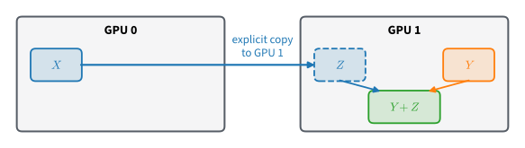
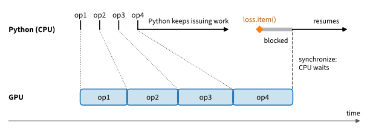
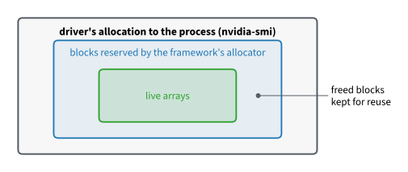
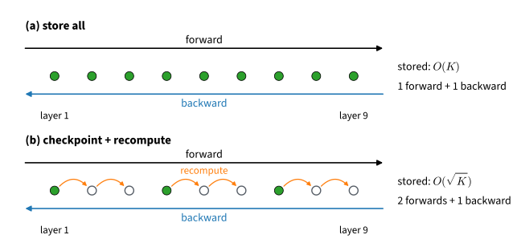

```{.python .input}
%load_ext d2lbook.tab
tab.interact_select('mxnet', 'pytorch', 'tensorflow', 'jax')
```

# GPUs, Devices, and Memory
:label:`sec_use_gpu`

Since :numref:`sec_oo-design`, our `Trainer` has accepted a `num_gpus` argument
and politely ignored it. For the tiny models of earlier chapters that hardly
mattered, since CPU training finished in seconds. Once models scale up,
however, device placement makes the difference between seconds and hours: a
modern desktop GPU multiplies two $4096 \times 4096$ matrices in under 2
milliseconds, whereas a CPU needs a fifth of a second or more (as we benchmark
in :numref:`subsec_async_dispatch`). That raw speed comes with a strict hardware
constraint: the GPU has its own dedicated memory—say 24 GB on a desktop card—and
every tensor it operates on must reside there.

Will a target model even fit? Our running 8-billion-parameter model needs 16 GB
for its weights in bf16, which fits easily for inference. Training it with Adam
in fp32, however, requires 128 GB of static state (:numref:`sec_parameters`)
before storing a single activation—far more than any single 24 GB or 80 GB card.
Whether a model fits on a device, and whether the GPU stays busy computing or
stalls waiting for data, comes down to where every tensor lives and how many
bytes it consumes.

In this section, we answer three core questions: how tensors and models are
placed on and copied between CPUs and GPUs; how asynchronous GPU execution
works (and how to benchmark GPU kernels accurately); and what actually fills GPU
memory during training, including how *activation checkpointing* trades extra
compute for dramatic memory savings. We then wire everything into the
device-aware `Trainer` used throughout the rest of the book. Whereas
:numref:`sec_parameters` and :numref:`sec_numerics` accounted for bytes per
parameter and per number, here we put those bytes onto real hardware (deferring
multi-GPU training to :numref:`chap_performance`). Every code cell degrades
gracefully to CPU if no GPU is available—confirming correctness even if timings
require a GPU.

```{.python .input #gpus-devices-memory-setup}
%%tab tensorflow
# Silence TensorFlow's C++ info and warning messages. TensorFlow reads this
# variable when it is first imported, so this cell runs before the imports.
import os
os.environ['TF_CPP_MIN_LOG_LEVEL'] = '2'
```

```{.python .input #gpus-devices-memory-gpus-devices-and-memory}
%%tab mxnet
import math
import numpy as np
from mxnet import autograd, gluon, init, np as mnp, npx
from mxnet.gluon import nn
from d2l import mxnet as d2l
npx.set_np()
```

```{.python .input #gpus-devices-memory-gpus-devices-and-memory}
%%tab pytorch
import math
import numpy as np
import torch
from torch import nn
from torch.nn import functional as F
from d2l import torch as d2l
```

```{.python .input #gpus-devices-memory-gpus-devices-and-memory}
%%tab tensorflow
import math
import numpy as np
import tensorflow as tf
from d2l import tensorflow as d2l
```

```{.python .input #gpus-devices-memory-gpus-devices-and-memory}
%%tab jax
import math
import numpy as np
import jax
from jax import numpy as jnp
from flax import nnx
import optax
from d2l import jax as d2l
```

```{.python .input #gpus-devices-memory-gpus-devices-and-memory-1}
%%tab mxnet, tensorflow, jax
import time
```

```{.python .input #gpus-devices-memory-gpus-devices-and-memory-1}
%%tab pytorch
import time
from torch.utils.checkpoint import checkpoint
```

```{.python .input #gpus-devices-memory-gpus-devices-and-memory-2}
%%tab pytorch
torch.set_float32_matmul_precision('high')  # allow tf32 in fp32 matmuls
```

## Devices and Placement

### Device Objects

Every tensor lives on a specific *device*: either the CPU paired with host RAM,
or an individual GPU paired with its onboard memory. Running `nvidia-smi` in a
terminal lists every NVIDIA GPU on your machine, its total and occupied memory,
and active processes. While each framework names devices slightly differently,
all four follow one governing principle: an operation executes on a single
device, so all of its operands must live on that device.

:begin_tab:`mxnet`
The CPU is `npx.cpu()`, `npx.gpu(i)` is the GPU with index $i$, and
`npx.gpu()` is `npx.gpu(0)`. Most MXNet code online calls this object a
*context* and writes `ctx=`, `.ctx`, and `as_in_ctx`; MXNet 2.0 renamed it to
*device*, and this book uses the new spelling.
:end_tab:

:begin_tab:`pytorch`
The CPU is `torch.device('cpu')`. `torch.device('cuda:0')` is the first GPU,
`cuda:1` the second, and plain `'cuda'` is `cuda:0`.
:end_tab:

:begin_tab:`tensorflow`
TensorFlow names devices with strings, `'/CPU:0'` for the CPU and `'/GPU:0'`
for the first GPU. `tf.device` turns a name into a *scope*: operations
executed inside it run on the named device and store their results there.
:end_tab:

:begin_tab:`jax`
`jax.devices(backend)` returns the device handles of a backend:
`jax.devices('cpu')[0]` is the CPU, and `jax.devices('gpu')[i]` is the GPU
with index $i$.
:end_tab:

We wrap device lookup in three small helpers that the rest of the book imports:
one for CPU, one for GPU $i$, and one that counts available GPUs.

```{.python .input #gpus-devices-memory-devices-1}
%%tab mxnet
def cpu():  #@save
    """Get the CPU device."""
    return npx.cpu()

def gpu(i=0):  #@save
    """Get a GPU device."""
    return npx.gpu(i)

def num_gpus():  #@save
    """Get the number of available GPUs."""
    return npx.num_gpus()
```

```{.python .input #gpus-devices-memory-devices-1}
%%tab pytorch
def cpu():  #@save
    """Get the CPU device."""
    return torch.device('cpu')

def gpu(i=0):  #@save
    """Get a GPU device."""
    return torch.device(f'cuda:{i}')

def num_gpus():  #@save
    """Get the number of available GPUs."""
    return torch.cuda.device_count()
```

```{.python .input #gpus-devices-memory-devices-1}
%%tab tensorflow
def cpu():  #@save
    """Get the CPU device."""
    return tf.device('/CPU:0')

def gpu(i=0):  #@save
    """Get a GPU device."""
    return tf.device(f'/GPU:{i}')

def num_gpus():  #@save
    """Get the number of available GPUs."""
    return len(tf.config.experimental.list_physical_devices('GPU'))
```

```{.python .input #gpus-devices-memory-devices-1}
%%tab jax
def cpu():  #@save
    """Get the CPU device."""
    return jax.devices('cpu')[0]

def gpu(i=0):  #@save
    """Get a GPU device."""
    return jax.devices('gpu')[i]

def num_gpus():  #@save
    """Get the number of available GPUs."""
    try:
        return jax.device_count('gpu')
    except:
        return 0  # No GPU backend found
```

:begin_tab:`mxnet`
Constructing a device object always succeeds, whether or not the hardware
exists; the check happens only when data is put on the device.
:end_tab:

:begin_tab:`pytorch`
Constructing a device object always succeeds, whether or not the hardware
exists; the check happens only when data is put on the device.
:end_tab:

:begin_tab:`tensorflow`
Constructing a device scope always succeeds, whether or not the hardware
exists. Even an operation inside the scope of a missing GPU does not fail:
TensorFlow's default *soft placement* runs it on the CPU instead. Convenient
as this is, it can hide a placement mistake, so inspect `x.device` when
placement matters.
:end_tab:

:begin_tab:`jax`
A JAX device object is a handle to hardware that exists: `jax.devices('gpu')`
raises an error when there is no GPU.
:end_tab:

Building on `num_gpus`, we define two fallback helpers that select a GPU when
present and fall back to CPU otherwise, allowing identical notebook code to run
unchanged on both laptops and GPU servers.

```{.python .input #gpus-devices-memory-devices-3}
def try_gpu(i=0):  #@save
    """Return gpu(i) if exists, otherwise return cpu()."""
    if num_gpus() >= i + 1:
        return gpu(i)
    return cpu()

def try_all_gpus():  #@save
    """Return all available GPUs, or [cpu(),] if no GPU exists."""
    devices = [gpu(i) for i in range(num_gpus())]
    return devices if devices else [cpu()]

try_gpu(), try_gpu(10), try_all_gpus()
```

Other accelerators—such as Apple-silicon GPUs (`mps`) and Google TPUs—use their
own device identifiers, though the placement principles below apply equally to
all of them. Throughout this book we focus on CPUs and CUDA GPUs.

### Arrays on Devices

Every tensor exposes its location via its `device` attribute, while the default
creation device varies by framework.

:begin_tab:`mxnet`
By default, arrays are created on the CPU.
:end_tab:

:begin_tab:`pytorch`
By default, tensors are created on the CPU.
:end_tab:

:begin_tab:`tensorflow`
By default, eager TensorFlow creates tensors on the first GPU if there is one
and on the CPU otherwise.
:end_tab:

:begin_tab:`jax`
By default, arrays are created on the *default device*, the first GPU if there
is one and the CPU otherwise.
:end_tab:

Whenever possible, allocate tensors directly on their target device rather than
allocating on the CPU and copying across the PCIe bus—saving both host RAM and
transfer overhead.

:begin_tab:`mxnet`
To create an array on another device, pass the argument `device`.
:end_tab:

:begin_tab:`pytorch`
To create a tensor on another device, pass the argument `device`.
:end_tab:

:begin_tab:`tensorflow`
To create a tensor on a particular device, create it inside that device's
scope.
:end_tab:

:begin_tab:`jax`
`jax.device_put(x, device)` copies an array to a device, and the result is
*committed* to that device: JAX keeps it, and every computation on it, where
we put it. Arrays created without an explicit placement are *uncommitted*:
they live on the default device, but JAX may move them when they meet
committed arrays.
:end_tab:

Let's place `X` on the first GPU and `Y` on the second GPU (falling back to CPU
when fewer than two GPUs are present) and try adding them:

```{.python .input #gpus-devices-memory-copying-between-devices-4}
%%tab mxnet
X = mnp.ones((2, 3), device=try_gpu())
Y = mnp.random.uniform(size=(2, 3), device=try_gpu(1))
try:
    print(X + Y)
except Exception as e:
    print(str(e).splitlines()[0])
```

```{.python .input #gpus-devices-memory-copying-between-devices-4}
%%tab pytorch
X = torch.ones(2, 3, device=try_gpu())
Y = torch.rand(2, 3, device=try_gpu(1))
try:
    print(X + Y)
except RuntimeError as e:
    print(str(e).split(', but')[0])
```

```{.python .input #gpus-devices-memory-copying-between-devices-4}
%%tab tensorflow
with try_gpu():
    X = tf.ones((2, 3))
with try_gpu(1):
    Y = tf.random.uniform((2, 3))
print((X + Y).device)
```

```{.python .input #gpus-devices-memory-copying-between-devices-4}
%%tab jax
X = jax.device_put(jnp.ones((2, 3)), try_gpu())
Y = jax.device_put(jax.random.uniform(d2l.get_key(), (2, 3)), try_gpu(1))
try:
    print(X + Y)
except ValueError as e:
    print(str(e).split('. ')[0])  # The first sentence names the problem
```

:begin_tab:`mxnet`
The addition fails: MXNet's execution engine does not find both operands on
one device and refuses to choose where the result should live.
:end_tab:

:begin_tab:`pytorch`
The addition fails: PyTorch requires the operands of an operation to be on
the same device.
:end_tab:

:begin_tab:`tensorflow`
The addition succeeds. Outside a device scope, TensorFlow runs an operation
on its default device, the first GPU, and its default *device policy* copies
any operand that lives elsewhere, without a warning.
`tf.config.experimental.set_device_policy('explicit')` turns such silent
copies into errors.
:end_tab:

:begin_tab:`jax`
The addition fails: the two operands are committed to different devices, and
JAX does not choose between two explicit placements.
:end_tab:

### Copying Between Devices

Moving tensors across devices is vastly slower than computing on them
(:numref:`subsec_async_dispatch` measures the gap), so silently copying
mismatched operands would hide severe performance bugs. Instead, we copy `X`
explicitly onto `Y`'s device (:numref:`fig_copyto`) before adding them.


:label:`fig_copyto`

```{.python .input #gpus-devices-memory-copying-between-devices-1}
%%tab mxnet
Z = X.copyto(try_gpu(1))
(Y + Z).device
```

```{.python .input #gpus-devices-memory-copying-between-devices-1}
%%tab pytorch
Z = X.to(try_gpu(1))
(Y + Z).device
```

```{.python .input #gpus-devices-memory-copying-between-devices-1}
%%tab tensorflow
with try_gpu(1):
    Z = tf.identity(X)  # The explicit copy: tf.identity in the target's scope
    print((Y + Z).device)  # The scope, not the operands, decides the device
```

```{.python .input #gpus-devices-memory-copying-between-devices-1}
%%tab jax
Z = jax.device_put(X, try_gpu(1))
(Y + Z).device
```

Now the sum runs and lands on the second GPU alongside both operands. The
practical rule is simple: transfer data once at the boundary of your computation
(moving a tensor to a device it already occupies is essentially a no-op) and
keep every inner-loop operation on that single device.

:begin_tab:`mxnet`
The method for such a move is `to_device`, which returns the array itself
when it is already there; `copyto` always copies.
:end_tab:

### Models on a Device

Because a forward pass combines inputs with model parameters, the entire model
must live on the same device as its minibatches. Thanks to the module tree from
:numref:`sec_model_construction`, every framework moves or initializes all
parameters in one call.

:begin_tab:`mxnet`
`initialize(device=...)` creates the parameters of a Gluon model on the named
device, so one call places the whole model.
:end_tab:

:begin_tab:`pytorch`
A model is a tree of parameter tensors, and `net.to(device)` moves the whole
tree in one call.
:end_tab:

:begin_tab:`tensorflow`
A Keras model has no method to move it: its layers create their variables at
the first call, on the device where that call runs. So we run the first
forward pass inside a device scope, and the variables stay there.
:end_tab:

:begin_tab:`jax`
An NNX model owns a tree of state, and `jax.device_put` accepts the whole
tree. Updating the model with the placed state moves all its parameters
together.
:end_tab:

```{.python .input #gpus-devices-memory-models-on-a-device-1}
%%tab mxnet
net = nn.Sequential()
net.add(nn.Dense(1, in_units=3))
net.initialize(device=try_gpu())
net(X)
```

```{.python .input #gpus-devices-memory-models-on-a-device-1}
%%tab pytorch
net = nn.Sequential(nn.Linear(3, 1))
net = net.to(device=try_gpu())
net(X)
```

```{.python .input #gpus-devices-memory-models-on-a-device-1}
%%tab tensorflow
net = tf.keras.Sequential([tf.keras.layers.Dense(1)])
with try_gpu():
    Y_hat = net(X)  # The first call creates the variables inside the scope
Y_hat
```

```{.python .input #gpus-devices-memory-models-on-a-device-1}
%%tab jax
net = nnx.Sequential(nnx.Linear(3, 1, rngs=nnx.Rngs(d2l.get_key())))
nnx.update(net, jax.device_put(nnx.state(net), try_gpu()))
net(X)
```

With inputs and parameters colocated on the same device, the forward pass runs
there and returns its output on that device as well.

:begin_tab:`mxnet`
Two rules keep a model on its device. Create the `gluon.Trainer` after
`initialize`, so that the optimizer state is created next to the parameters
it updates. And when `forward` needs a new array, create it on the input's
device (`mnp.zeros(n, device=X.device)`) rather than on the CPU. To move a
model that is already initialized, `net.reset_device(device)` reassigns
every parameter.
:end_tab:

:begin_tab:`pytorch`
Two rules keep a model on its device. Move the model *before* creating the
optimizer, so that the optimizer state is created next to the parameters it
updates. And when `forward` needs a new tensor, create it on the input's
device (`torch.zeros(n, device=X.device)`) rather than on the CPU; state that
belongs to the model but is not a parameter goes into a buffer
(:numref:`sec_parameters`), which `.to(device)` moves with the parameters.
:end_tab:

:begin_tab:`tensorflow`
Placement in TensorFlow follows execution. A tensor created during the
forward pass lives where the surrounding operations run, and a Keras
optimizer creates its state at the first `apply_gradients`, next to the
variables it updates. The one rule is the first-call rule above: build the
variables under the device scope you intend, because moving them afterwards
means rebuilding the model.
:end_tab:

:begin_tab:`jax`
In JAX all state is explicit, so there is little to remember. The optimizer
state is built from the parameters and lives where they live, and a compiled
function runs where its inputs are. Keep the parameters and each minibatch on
one device, and everything else follows.
:end_tab:

## Asynchronous Execution

### The Execution Queue
:label:`subsec_async_dispatch`

A GPU does not execute operations synchronously when Python invokes them.
Instead, Python enqueues each kernel launch onto the device's command queue and
returns immediately, letting the CPU prepare subsequent work while the GPU
crunches through its queue in order. This pipelining hides Python overhead, but
it comes with a crucial timing catch: measuring how long a Python loop takes
measures *enqueueing*, not *execution*. Let's enqueue 32 products of
$4096 \times 4096$ matrices and check the wall clock twice—right after Python
finishes queuing them, and again once the device finishes computing them.

```{.python .input #gpus-devices-memory-don-t-break-the-pipeline-1}
%%tab mxnet
A = mnp.random.normal(size=(4096, 4096), device=try_gpu())
mnp.dot(A, A)
npx.waitall()  # Warm up and wait
t = time.perf_counter()
for _ in range(32):
    B = mnp.dot(A, A)
print(f'time to queue 32 matrix products: {time.perf_counter() - t:.4f} sec')
npx.waitall()
print(f'time until they all finished:     {time.perf_counter() - t:.4f} sec')
```

```{.python .input #gpus-devices-memory-don-t-break-the-pipeline-1}
%%tab pytorch
if torch.cuda.is_available():
    A = torch.randn(4096, 4096, device=gpu())
    A @ A
    torch.cuda.synchronize()  # Warm up and wait
    t = time.perf_counter()
    for _ in range(32):
        B = A @ A
    print(f'time to queue 32 matrix products: {time.perf_counter() - t:.4f} sec')
    torch.cuda.synchronize()
    print(f'time until they all finished:     {time.perf_counter() - t:.4f} sec')
else:
    print('No CUDA device: operations on the CPU run synchronously.')
```

```{.python .input #gpus-devices-memory-don-t-break-the-pipeline-1}
%%tab tensorflow
if num_gpus() > 0:
    with gpu():
        A = tf.random.normal((4096, 4096))
        A @ A
    tf.test.experimental.sync_devices()  # Warm up and wait
    t = time.perf_counter()
    with gpu():
        for _ in range(32):
            B = A @ A
    print(f'time to queue 32 matrix products: {time.perf_counter() - t:.4f} sec')
    tf.test.experimental.sync_devices()
    print(f'time until they all finished:     {time.perf_counter() - t:.4f} sec')
else:
    print('No GPU: eager operations on the CPU run synchronously.')
```

```{.python .input #gpus-devices-memory-don-t-break-the-pipeline-1}
%%tab jax
A = jax.random.normal(d2l.get_key(), (4096, 4096))
(A @ A).block_until_ready()  # Warm up and wait
t = time.perf_counter()
for _ in range(32):
    B = A @ A
print(f'time to queue 32 matrix products: {time.perf_counter() - t:.4f} sec')
B.block_until_ready()  # The device runs the products in order
print(f'time until they all finished:     {time.perf_counter() - t:.4f} sec')
```

:begin_tab:`mxnet`
MXNet's execution engine is asynchronous on the CPU as well as on a GPU, and
`npx.waitall()` waits until every queued operation has finished.
:end_tab:

:begin_tab:`pytorch`
CUDA operations are asynchronous, and `torch.cuda.synchronize()` waits until
every queued operation on the GPU has finished. Operations on the CPU run
synchronously, which is why the cell needs a GPU. The imports cell allows
tf32 for fp32 matrix products (:numref:`sec_numerics`), so that the matrix
products timed in this section run on the tensor cores.
:end_tab:

:begin_tab:`tensorflow`
GPU operations are asynchronous, and `tf.test.experimental.sync_devices()`
waits until every queued operation has finished. Eager operations on the CPU
run synchronously, which is why the cell needs a GPU.
:end_tab:

:begin_tab:`jax`
JAX dispatches asynchronously on the CPU as well as on a GPU.
`block_until_ready()` waits until the array it is called on has been
computed; since a device runs its queue in order, the last product finishing
means that all of them have.
:end_tab:

Python finishes enqueuing all 32 matrix multiplications in a tiny fraction of
the actual compute time. When does the CPU actually block and wait? Only when
Python needs a concrete value back on the host—printing a tensor, calling
`.item()`, converting to NumPy, or branching on a tensor in an `if` statement.
Every such *synchronization point* stalls Python until the GPU drains its queue
up to that value, leaving the GPU idle while Python catches up
(:numref:`fig_bg_async_queue`). Logging `loss.item()` after every minibatch
inserts a synchronization bubble on every step—which is why our `Trainer` keeps
losses on-device inside a `d2l.Averager` and converts them to Python floats only
once per epoch (:numref:`sec_oo-design`).


:label:`fig_bg_async_queue`

Asynchronous dispatch also dictates four rules for trustworthy GPU benchmarks:
(1) run warm-up calls first to exclude one-time allocation, library setup, and
JIT compilation; (2) synchronize the device both immediately *before* starting
the timer and immediately *before* stopping it; (3) average over multiple
repetitions; and (4) use `time.perf_counter` for sub-millisecond resolution.
(The demonstration cell above warmed up and synchronized but reported the
32-product total; our `Benchmark` helper below automates all four rules for this
and later chapters.)

```{.python .input #gpus-devices-memory-the-execution-queue-1}
%%tab mxnet
class Benchmark:  #@save
    """Time a callable: warmup, then device-synchronized average seconds."""
    def __init__(self, f, warmup=3, repeats=10, desc='time'):
        self.desc = desc
        for _ in range(warmup):
            f()
        npx.waitall()
        t0 = time.perf_counter()
        for _ in range(repeats):
            f()
        npx.waitall()
        self.time = (time.perf_counter() - t0) / repeats

    def __repr__(self):
        return f'{self.desc}: {1000 * self.time:.2f} ms/call'
```

```{.python .input #gpus-devices-memory-the-execution-queue-1}
%%tab pytorch
class Benchmark:  #@save
    """Time a callable: warmup, then device-synchronized average seconds.
    `devices` lists the GPUs to wait for, by default the current one."""
    def __init__(self, f, warmup=3, repeats=10, desc='time', devices=None):
        def wait():  # CUDA runs asynchronously; the CPU does not
            if torch.cuda.is_available():
                for device in devices or [None]:
                    torch.cuda.synchronize(device)
        self.desc = desc
        for _ in range(warmup):
            f()
        wait()
        t0 = time.perf_counter()
        for _ in range(repeats):
            f()
        wait()
        self.time = (time.perf_counter() - t0) / repeats

    def __repr__(self):
        return f'{self.desc}: {1000 * self.time:.2f} ms/call'
```

```{.python .input #gpus-devices-memory-the-execution-queue-1}
%%tab tensorflow
class Benchmark:  #@save
    """Time a callable: warmup, then device-synchronized average seconds."""
    def __init__(self, f, warmup=3, repeats=10, desc='time'):
        self.desc = desc
        for _ in range(warmup):
            f()
        tf.test.experimental.sync_devices()
        t0 = time.perf_counter()
        for _ in range(repeats):
            f()
        tf.test.experimental.sync_devices()
        self.time = (time.perf_counter() - t0) / repeats

    def __repr__(self):
        return f'{self.desc}: {1000 * self.time:.2f} ms/call'
```

```{.python .input #gpus-devices-memory-the-execution-queue-1}
%%tab jax
class Benchmark:  #@save
    """Time a callable: warmup, then device-synchronized average seconds."""
    def __init__(self, f, warmup=3, repeats=10, desc='time'):
        self.desc, out = desc, None
        for _ in range(warmup):
            out = f()
        jax.block_until_ready(out)
        t0 = time.perf_counter()
        for _ in range(repeats):
            out = f()
        jax.block_until_ready(out)
        self.time = (time.perf_counter() - t0) / repeats

    def __repr__(self):
        return f'{self.desc}: {1000 * self.time:.2f} ms/call'
```

:begin_tab:`jax`
JAX waits for specific arrays rather than for a whole device, so the timed
function must return what it computes, and `Benchmark` waits for the value
returned by the last call.
:end_tab:

Let's put `Benchmark` to work immediately on two claims from earlier: how much
faster a GPU is than a CPU on large matrix multiplications, and how expensive
host-to-device transfers are relative to compute. Below we time a
$4096 \times 4096$ product on CPU (fp32), on GPU in tf32 (:numref:`sec_numerics`)
and 16-bit precision, alongside copying a single $4096 \times 4096$ matrix from
CPU RAM to the GPU.

```{.python .input #gpus-devices-memory-the-execution-queue-2}
%%tab mxnet
if num_gpus() > 0:
    A_cpu = A.copyto(cpu())  # The same matrix in main memory
    A16 = A.astype('float16')  # MXNet's matrix product rejects bf16
    print(Benchmark(lambda: mnp.dot(A_cpu, A_cpu), warmup=1, repeats=3,
                    desc='product on the CPU, fp32'))
    print(Benchmark(lambda: mnp.dot(A, A), desc='product on the GPU, tf32'))
    print(Benchmark(lambda: mnp.dot(A16, A16),
                    desc='product on the GPU, fp16'))
    print(Benchmark(lambda: A_cpu.copyto(gpu()),
                    desc='copy from CPU to the GPU'))
else:
    print('No GPU: there is nothing to compare the CPU with.')
```

```{.python .input #gpus-devices-memory-the-execution-queue-2}
%%tab pytorch
if torch.cuda.is_available():
    A_cpu = A.cpu()  # The same matrix in main memory
    A16 = A.bfloat16()
    print(Benchmark(lambda: A_cpu @ A_cpu, warmup=1, repeats=3,
                    desc='product on the CPU, fp32'))
    print(Benchmark(lambda: A @ A, desc='product on the GPU, tf32'))
    print(Benchmark(lambda: A16 @ A16, desc='product on the GPU, bf16'))
    print(Benchmark(lambda: A_cpu.to(gpu()),
                    desc='copy from CPU to the GPU'))
else:
    print('No CUDA device: there is nothing to compare the CPU with.')
```

```{.python .input #gpus-devices-memory-the-execution-queue-2}
%%tab tensorflow
if num_gpus() > 0:
    with cpu():
        A_cpu = tf.identity(A)  # The same matrix in main memory
    A16 = tf.cast(A, tf.bfloat16)
    def cpu_product():
        with cpu():
            return A_cpu @ A_cpu
    @tf.function  # Eager mode would reuse a cached copy of A_cpu on the GPU
    def copy_to_gpu():
        with gpu():
            return tf.identity(A_cpu)
    print(Benchmark(cpu_product, warmup=1, repeats=3,
                    desc='product on the CPU, fp32'))
    print(Benchmark(lambda: A @ A, desc='product on the GPU, tf32'))
    print(Benchmark(lambda: A16 @ A16, desc='product on the GPU, bf16'))
    print(Benchmark(copy_to_gpu, desc='copy from CPU to the GPU'))
else:
    print('No GPU: there is nothing to compare the CPU with.')
```

```{.python .input #gpus-devices-memory-the-execution-queue-2}
%%tab jax
if num_gpus() > 0:
    A_cpu = jax.device_put(A, cpu())  # The same matrix in main memory
    A16 = A.astype(jnp.bfloat16)
    print(Benchmark(lambda: A_cpu @ A_cpu, warmup=1, repeats=3,
                    desc='product on the CPU, fp32'))
    print(Benchmark(lambda: A @ A, desc='product on the GPU, tf32'))
    print(Benchmark(lambda: A16 @ A16, desc='product on the GPU, bf16'))
    # Wait for each copy, so that the copies are timed one at a time
    print(Benchmark(lambda: jax.device_put(A_cpu, gpu()).block_until_ready(),
                    desc='copy from CPU to the GPU'))
else:
    print('No GPU: there is nothing to compare the CPU with.')
```

:begin_tab:`mxnet`
MXNet uses tf32 for fp32 matrix products by default. Its matrix product does
not accept bf16, so the 16-bit product here is in fp16, which runs on the
same tensor cores at the same rate.
:end_tab:

:begin_tab:`tensorflow`
TensorFlow uses tf32 for fp32 matrix products by default.
:end_tab:

:begin_tab:`jax`
JAX's default matrix-product precision chooses tf32 on this GPU.
:end_tab:

On a modern GPU, the $4096 \times 4096$ product finishes in under 2 ms, whereas
the CPU requires 200 ms to 2 s—a $100\times$ to $1000\times$ speedup depending
on CPU core count. Dropping to 16-bit precision cuts GPU time roughly in half
again, delivering the tensor-core speedup promised in :numref:`sec_numerics`.

Pay special attention to the final line: merely *copying* the matrix from CPU
memory to the GPU takes three to five times *longer* than multiplying it once it
arrives—even though the multiplication executes 4096 multiply-adds per copied
element! Standard host copies first stage data through *pinned* (page-locked)
host memory so the GPU's DMA engine can pull it directly; pre-pinning batches
eliminates that extra copy and allows transfers to overlap with compute
(:numref:`sec_hardware`).

## GPU Memory

### Three Views of Memory

Ask how much GPU memory a training script uses and you can get three different
numbers, depending on which layer of the stack you query. Requesting memory
directly from the CUDA driver is slow, so frameworks run an internal *caching
allocator* that grabs large slabs from the driver and sub-allocates them to
tensors, retaining freed slabs for reuse rather than releasing them immediately.
This creates three nested memory views (:numref:`fig_bg_allocator`): the bytes
currently occupied by live tensors, the larger pool reserved by the framework's
allocator, and the total memory assigned by the CUDA driver to the process—the
figure displayed by `nvidia-smi`.


:label:`fig_bg_allocator`

:begin_tab:`mxnet`
MXNet keeps a *memory pool* per device and has no counter of live bytes. Its
only memory query is `npx.gpu_memory_info(i)`, which returns the free and
total bytes of the whole device, the outermost view, as `nvidia-smi` does.
That count includes other processes on the same GPU, so we report the
*difference* from a reading at the start, taken after `gpu().empty_cache()`
has returned the pool's unused blocks to the driver.
:end_tab:

:begin_tab:`pytorch`
`torch.cuda.memory_allocated()` counts the bytes held by live tensors, and
`torch.cuda.memory_reserved()` counts those bytes plus the blocks that
PyTorch's *caching allocator* keeps for reuse.
:end_tab:

:begin_tab:`tensorflow`
TensorFlow reserves GPU memory for its own allocator.
`tf.config.experimental.get_memory_info('GPU:0')` returns a dictionary whose
entry `'current'` counts the bytes of live tensors and whose entry `'peak'`
is their largest value so far. On the CPU there is no such allocator, and the
call raises an error.
:end_tab:

:begin_tab:`jax`
On its first use of a GPU, JAX *preallocates* a large fraction of its memory
for its allocator, so `nvidia-smi` shows that whole block no matter how much
of it is used. The method `memory_stats()` of a GPU device returns a
dictionary whose entry `bytes_in_use` counts the bytes of live arrays and
whose entry `peak_bytes_in_use` is their largest value so far. On the CPU it
returns `None`.
:end_tab:

Let's allocate a 1 GiB float32 tensor and immediately delete it to watch these
counters respond:

```{.python .input #gpus-devices-memory-gpu-memory}
%%tab mxnet
if num_gpus() > 0:
    gpu().empty_cache()
    npx.waitall()
    free_start, _ = npx.gpu_memory_info(0)
    def report(tag):
        npx.waitall()
        free, _ = npx.gpu_memory_info(0)
        print(f'{tag}: {(free_start - free) / 2**20:7.1f} MiB more used')
    big = mnp.zeros((256, 1024, 1024), device=gpu())  # 1 GiB of float32
    report('after creating big')
    del big
    report('after deleting it ')
    gpu().empty_cache()
    report('after empty_cache ')
else:
    print('No GPU: gpu_memory_info() queries the CUDA driver.')
```

```{.python .input #gpus-devices-memory-gpu-memory}
%%tab pytorch
if torch.cuda.is_available():
    def report(tag):
        print(f'{tag}: {torch.cuda.memory_allocated() / 2**20:7.1f} MiB '
              f'allocated, {torch.cuda.memory_reserved() / 2**20:7.1f} MiB '
              'reserved')
    big = torch.zeros(256, 1024, 1024, device=gpu())  # 1 GiB of float32
    report('after creating big')
    del big
    report('after deleting it ')
else:
    print('No CUDA device: both counters read 0 on the CPU.')
```

```{.python .input #gpus-devices-memory-gpu-memory}
%%tab tensorflow
if num_gpus() > 0:
    def report(tag):
        info = tf.config.experimental.get_memory_info('GPU:0')
        print(f'{tag}: {info["current"] / 2**20:7.1f} MiB in use, '
              f'{info["peak"] / 2**20:7.1f} MiB peak')
    with gpu():
        big = tf.zeros((256, 1024, 1024))  # 1 GiB of float32
    report('after creating big')
    del big
    report('after deleting it ')
else:
    print('No GPU: get_memory_info() tracks only GPU and TPU allocators.')
```

```{.python .input #gpus-devices-memory-gpu-memory}
%%tab jax
if num_gpus() > 0:
    def report(tag):
        s = gpu().memory_stats()
        print(f'{tag}: {s["bytes_in_use"] / 2**20:7.1f} MiB in use, '
              f'{s["peak_bytes_in_use"] / 2**20:7.1f} MiB peak')
    big = jnp.zeros((256, 1024, 1024))  # 1 GiB of float32
    big.block_until_ready()
    report('after creating big')
    del big
    report('after deleting it ')
else:
    print('No GPU: memory_stats() returns None on the CPU backend.')
```

:begin_tab:`mxnet`
Creating `big` takes a gibibyte from the driver, and deleting it gives
nothing back: the block returns to MXNet's pool, which still holds it. Only
`empty_cache()` returns it to the driver. Do not call `empty_cache` inside a
training loop, since the pool would then have to request the memory from the
driver again at every step.
:end_tab:

:begin_tab:`pytorch`
After the deletion, `memory_allocated()` falls by a gibibyte while
`memory_reserved()` does not move: the block went back to the cache, and
`nvidia-smi` still counts it. (Most of what remains allocated is the
matrices of the timing cells above: `A` and `B`, 64 MiB each, and the 32 MiB
of `A16`.)
`torch.cuda.empty_cache()` returns cached blocks to the driver, which helps
when another process needs the GPU. Do not call it inside a training loop,
since the allocator would then have to request the memory from the driver
again at every step.
:end_tab:

:begin_tab:`tensorflow`
The count of live bytes falls by a gibibyte when `big` is deleted, to the 160
MiB of the matrices `A`, `B`, and `A16` of the timing cells above, while
`nvidia-smi` does not move: the block returns to TensorFlow's allocator, not
to the driver, and TensorFlow keeps its reservation until the process ends. To share a GPU
with another process, call
`tf.config.experimental.set_memory_growth(gpu, True)`, which grows the
reservation on demand instead, before the first computation.
:end_tab:

:begin_tab:`jax`
The count of live bytes falls by a gibibyte when `big` is deleted, to the 160
MiB of the matrices `A`, `B`, and `A16` of the timing cells above, while
`nvidia-smi` does not move: the block returns to the preallocated pool. To
share a GPU with another process, set the environment variable
`XLA_PYTHON_CLIENT_PREALLOCATE=false` before the first computation; JAX then
requests memory from the driver as it needs it.
:end_tab:

The outermost driver view sets the hard out-of-memory ceiling, since the driver
cannot hand out more RAM than the card physically holds. To diagnose *where*
memory goes inside our code, we inspect live-byte counters—especially the *peak*
memory reached during a call, which determines whether a step succeeds or
crashes with out-of-memory (OOM).

:begin_tab:`pytorch`
The allocator tracks this high-water mark:
`torch.cuda.reset_peak_memory_stats()` clears it and
`torch.cuda.max_memory_allocated()` reads it back. `peak_memory` returns the
memory that a call needs beyond what was allocated before it; later chapters
use it to compare implementations.
:end_tab:

:begin_tab:`jax`
The arrays inside a compiled function exist only during the call, and
`peak_bytes_in_use` cannot be reset, so the counters cannot show the peak of
one call. XLA, however, plans the memory of a compiled function in advance,
and `memory_analysis()` of the compiled function reports the temporary memory
that it needs beyond its inputs and outputs. `peak_memory` returns this
amount; later chapters use it to compare implementations.
:end_tab:

```{.python .input #gpus-devices-memory-three-views-of-memory-1}
%%tab pytorch
def peak_memory(f, *args):  #@save
    """Extra peak GPU memory allocated by f(*args), in bytes."""
    torch.cuda.synchronize()
    torch.cuda.reset_peak_memory_stats()
    base = torch.cuda.memory_allocated()
    f(*args)
    torch.cuda.synchronize()
    return torch.cuda.max_memory_allocated() - base
```

```{.python .input #gpus-devices-memory-three-views-of-memory-1}
%%tab jax
def peak_memory(f, *args):  #@save
    """Temporary memory that XLA reserves to run jax.jit(f) on args, in
    bytes."""
    compiled = jax.jit(f).lower(*args).compile()
    return compiled.memory_analysis().temp_size_in_bytes
```

### Memory During Training
:label:`subsec_memory_during_training`

In :numref:`sec_parameters`, we established the static memory floor for fp32
Adam training: $16N$ bytes for $N$ parameters ($4N$ weights, $4N$ gradients, and
$8N$ Adam moments). During an actual training step, a fourth term joins them:
*activations*. Backpropagation must retain intermediate forward-pass outputs
until the backward pass consumes them—and unlike the static $16N$, activation
memory scales linearly with minibatch size and layer width. Let's calculate it
before measuring: consider a three-hidden-layer MLP of width 4096 taking
1024-dimensional inputs ($N \approx 3.8 \times 10^7$ parameters, so
$4N \approx 144$ MiB) at minibatch size 4096. The three hidden-layer outputs are
each $4096 \times 4096$ fp32 tensors of 64 MiB—192 MiB in total, already a third
larger than the weights themselves!

:begin_tab:`mxnet`
MXNet has no counter of live bytes, so this tab measures nothing here. The
accounting itself holds, with one point of timing: Gluon allocates the
gradient of each parameter at `initialize`, so the $4N$ bytes of gradients are
there from the start.
:end_tab:

:begin_tab:`pytorch`
We read `memory_allocated()` at four points of one training step.
:end_tab:

:begin_tab:`tensorflow`
We read `'current'` at four points of one training step. `tf.GradientTape`
records the forward pass and holds its intermediate results until we ask it
for the gradients, so the activations appear in the second reading.
:end_tab:

:begin_tab:`jax`
We read `bytes_in_use` after each piece of a training step. The activations
exist only while `nnx.grad` runs, so no reading afterwards shows them.
Instead we ask the compiler: `peak_memory` of the gradient function reports
the temporary memory it needs, which here is the activations.
:end_tab:

```{.python .input #gpus-devices-memory-what-fills-memory-during-training}
%%tab pytorch
if torch.cuda.is_available():
    start = torch.cuda.memory_allocated()
    def allocated():  # Memory in use beyond that at the start of the cell
        return f'{(torch.cuda.memory_allocated() - start) / 2**20:7.1f} MiB'
    net = nn.Sequential(nn.Linear(1024, 4096), nn.ReLU(),
                        nn.Linear(4096, 4096), nn.ReLU(),
                        nn.Linear(4096, 4096), nn.ReLU(),
                        nn.Linear(4096, 10)).to(gpu())
    optimizer = torch.optim.Adam(net.parameters())
    X = torch.randn(4096, 1024, device=gpu())
    y = torch.randint(0, 10, (4096,), device=gpu())
    print('weights           ', allocated())
    loss = F.cross_entropy(net(X), y)
    print('+ activations     ', allocated())
    loss.backward()
    print('+ gradients       ', allocated())
    optimizer.step()
    print('+ optimizer state ', allocated())
else:
    print('No CUDA device: run this cell on a GPU to see the four readings.')
```

```{.python .input #gpus-devices-memory-what-fills-memory-during-training}
%%tab tensorflow
if num_gpus() > 0:
    start = tf.config.experimental.get_memory_info('GPU:0')['current']
    def in_use():  # Memory in use beyond that at the start of the cell
        info = tf.config.experimental.get_memory_info('GPU:0')
        return f'{(info["current"] - start) / 2**20:7.1f} MiB'
    with gpu():
        net = tf.keras.Sequential(
            [tf.keras.layers.Dense(4096, activation='relu'),
             tf.keras.layers.Dense(4096, activation='relu'),
             tf.keras.layers.Dense(4096, activation='relu'),
             tf.keras.layers.Dense(10)])
        X = tf.random.normal((4096, 1024))
        y = tf.random.uniform((4096,), 0, 10, dtype=tf.int32)
        net(X)  # The first call creates the variables
    optimizer = tf.keras.optimizers.Adam()
    loss_fn = tf.keras.losses.SparseCategoricalCrossentropy(from_logits=True)
    print('weights           ', in_use())
    with tf.GradientTape() as tape:
        loss = loss_fn(y, net(X, training=True))
    print('+ activations     ', in_use())
    grads = tape.gradient(loss, net.trainable_variables)
    print('+ gradients       ', in_use())
    optimizer.apply_gradients(zip(grads, net.trainable_variables))
    print('+ optimizer state ', in_use())
else:
    print('No GPU: run this cell on a GPU to see the four readings.')
```

```{.python .input #gpus-devices-memory-what-fills-memory-during-training}
%%tab jax
if num_gpus() > 0:
    start = gpu().memory_stats()['bytes_in_use']
    def in_use():  # Memory in use beyond that at the start of the cell
        s = gpu().memory_stats()
        return f'{(s["bytes_in_use"] - start) / 2**20:7.1f} MiB'
    rngs = nnx.Rngs(d2l.get_key())
    net = nnx.Sequential(nnx.Linear(1024, 4096, rngs=rngs), nnx.relu,
                         nnx.Linear(4096, 4096, rngs=rngs), nnx.relu,
                         nnx.Linear(4096, 4096, rngs=rngs), nnx.relu,
                         nnx.Linear(4096, 10, rngs=rngs))
    key1, key2 = jax.random.split(d2l.get_key())
    X = jax.random.normal(key1, (4096, 1024))
    y = jax.random.randint(key2, (4096,), 0, 10)
    def loss(model):
        logits = model(X)
        return optax.softmax_cross_entropy_with_integer_labels(
            logits, y).mean()
    jax.block_until_ready(nnx.state(net))
    print('weights                ', in_use())
    grads = jax.block_until_ready(nnx.grad(loss)(net))
    print('+ gradients            ', in_use())
    optimizer = nnx.Optimizer(net, optax.adam(1e-3), wrt=nnx.Param)
    jax.block_until_ready(optimizer.opt_state)
    print('+ optimizer state      ', in_use())
    graphdef, params = nnx.split(net)
    grad_fn = jax.grad(lambda params: loss(nnx.merge(graphdef, params)))
    planned = peak_memory(grad_fn, params)
    print(f'activations (planned)  {planned / 2**20:7.1f} MiB')
else:
    print('No GPU: run this cell on a GPU to see the terms arrive.')
```

:begin_tab:`pytorch`
The first reading is the weights, about $4N$ bytes, plus the input
minibatch. The second adds the stored activations, here about a third more
than the weights. The third *falls*: `backward` frees the activations as it
uses them and leaves gradients of the same size as the weights. The fourth
adds about $8N$ at the first `optimizer.step()`, when Adam creates its two
running averages. From then on every step rises to the second reading and
falls back to the third; weights, gradients, and optimizer state stay.
:end_tab:

:begin_tab:`tensorflow`
The first reading is the weights, about $4N$ bytes, plus the input
minibatch. The second adds the activations that the tape holds, here about a
third more than the weights. The third *falls*: `tape.gradient` frees the
recorded forward pass and leaves gradients of the same size as the weights.
The fourth adds about $8N$ at the first `apply_gradients`, when Adam creates
its two running averages. From then on every step rises to the second
reading and falls back to the third; weights, gradients, and optimizer state
stay.
:end_tab:

:begin_tab:`jax`
The first reading is the weights, about $4N$ bytes, plus the input
minibatch. The second adds gradients of the same size as the weights: in JAX
a gradient is not attached to a parameter but is a second tree of arrays,
returned by `nnx.grad`. The third adds about $8N$ when `optax.adam` creates
its two running averages. The activations, about a third more than the
weights, exist only during the gradient computation.
:end_tab:

Shrinking the minibatch size is the quickest lever when activations push memory
over the edge, since it cuts activation footprint without altering the
architecture. By contrast, if memory climbs steadily *from step to step*, look
for a leak keeping old computation graphs alive—the classic culprit being
appending raw loss tensors to a Python list without detaching them first.

### Activation Checkpointing
:label:`subsec_activation_checkpointing`

There is a second, architectural lever for activation memory. Standard
backpropagation stores every layer's intermediate output only to read it once on
the backward sweep. *Activation checkpointing* (also called *gradient
checkpointing* or *rematerialization*, :cite:`Chen.Xu.Zhang.ea.2016`) discards
most intermediate activations during the forward pass, retaining only the inputs
at the boundaries of chosen segments, and recomputes each segment's internal
activations on the fly during the backward pass. (Despite the shared word, this
in-memory technique is unrelated to the disk checkpoints of
:numref:`sec_read_write`.)

Partitioning $K$ uniform layers into segments of $s$ layers stores only $K/s$
segment boundaries plus $s$ live activations inside the active segment—about
$K/s + s$ tensors instead of $K$. Choosing $s = \sqrt{K}$ drops peak activation
memory from $O(K)$ down to $O(\sqrt{K})$! The trade-off is one extra forward
pass per segment during backpropagation (:numref:`fig_bg_activation_checkpoint`).
Since a linear layer's backward pass computes two matrix products (input
gradient and weight gradient) while its forward pass computes one, adding an
extra forward pass increases total step compute from roughly 3 forward-pass
equivalents to 4—about a 33% rough upper bound, depending on hardware and layer
mix.


:label:`fig_bg_activation_checkpoint`

Activation checkpointing shines on deep stacks of identical blocks, such as our
residual MLP (:numref:`sec_model_construction`) and modern transformers. Below
we define `ResidualBlock` with $\mathcal{N}(0, 0.01^2)$ weights and zero biases
across all frameworks, along with a `run_stack` helper that groups blocks into
segments with optional checkpointing.

```{.python .input #gpus-devices-memory-trading-compute-for-memory-activation-checkpointing-1}
%%tab pytorch
class ResidualBlock(nn.Module):
    def __init__(self, num_hiddens):
        super().__init__()
        self.body = nn.Sequential(
            nn.Linear(num_hiddens, num_hiddens), nn.ReLU(),
            nn.Linear(num_hiddens, num_hiddens))
        for layer in self.body[0], self.body[2]:
            nn.init.normal_(layer.weight, std=0.01)
            nn.init.zeros_(layer.bias)

    def forward(self, X):
        return X + self.body(X)

def run_stack(blocks, X, use_checkpoint=False, segment_size=4):
    for start in range(0, len(blocks), segment_size):
        stop = min(start + segment_size, len(blocks))
        # Bind this segment's range now: the backward pass calls segment
        # again after the loop has moved on
        def segment(X, start=start, stop=stop):
            for i in range(start, stop):
                X = blocks[i](X)
            return X
        X = checkpoint(segment, X, use_reentrant=False) \
            if use_checkpoint else segment(X)
    return X
```

```{.python .input #gpus-devices-memory-trading-compute-for-memory-activation-checkpointing-1}
%%tab tensorflow
class ResidualBlock(tf.keras.layers.Layer):
    def __init__(self, num_hiddens, **kwargs):
        super().__init__(**kwargs)
        normal = tf.keras.initializers.RandomNormal  # One instance per layer
        self.body = tf.keras.Sequential([
            tf.keras.layers.Dense(num_hiddens, activation='relu',
                                  kernel_initializer=normal(stddev=0.01)),
            tf.keras.layers.Dense(num_hiddens,
                                  kernel_initializer=normal(stddev=0.01))])

    def call(self, X):
        return X + self.body(X)

def run_stack(blocks, X, use_checkpoint=False, segment_size=4):
    for start in range(0, len(blocks), segment_size):
        # Bind this segment's blocks now: the backward pass calls segment
        # again after the loop has moved on
        def segment(X, segment_blocks=blocks[start:start + segment_size]):
            for blk in segment_blocks:
                X = blk(X)
            return X
        f = tf.recompute_grad(segment) if use_checkpoint else segment
        X = f(X)
    return X
```

```{.python .input #gpus-devices-memory-trading-compute-for-memory-activation-checkpointing-1}
%%tab jax
class ResidualBlock(nnx.Module):
    def __init__(self, num_hiddens, *, rngs):
        normal = nnx.initializers.normal(0.01)
        self.body = nnx.Sequential(
            nnx.Linear(num_hiddens, num_hiddens, kernel_init=normal,
                       rngs=rngs), nnx.relu,
            nnx.Linear(num_hiddens, num_hiddens, kernel_init=normal,
                       rngs=rngs))

    def __call__(self, X):
        return X + self.body(X)

def run_stack(graphdef, states, X, use_checkpoint=False, segment_size=4):
    def segment(segment_states, X):
        for state in segment_states:
            X = nnx.merge(graphdef, state)(X)
        return X
    f = jax.checkpoint(segment) if use_checkpoint else segment
    for start in range(0, len(states), segment_size):
        X = f(states[start:start + segment_size], X)
    return X
```

:begin_tab:`mxnet`
MXNet has no per-segment activation checkpointing. There is only a global
switch: the environment variable `MXNET_BACKWARD_DO_MIRROR=1`, read when the
process starts, lets MXNet drop some intermediate results of a hybridized
graph and recompute them during the backward pass, with no control over which
ones. This tab therefore has no code in this subsection, and the minibatch
size remains the control over activation memory.
:end_tab:

:begin_tab:`pytorch`
`checkpoint(segment, X)` runs a segment without storing its intermediate
results and keeps what it needs to rerun it. The recomputation must reproduce
the original forward pass, so `checkpoint` also saves and restores the state
of the random number generator, which keeps segments with dropout correct.
:end_tab:

:begin_tab:`tensorflow`
`tf.recompute_grad(segment)` returns a function that computes the same values
as `segment` but tells the tape to store only its input, and reruns `segment`
during the backward pass. It does not save the state of the random number
generator, so a segment with stateful dropout can draw a different mask when
it is recomputed.
:end_tab:

:begin_tab:`jax`
`jax.checkpoint` (also called `jax.remat`) is a function transformation like
`grad` and `jit`: `jax.checkpoint(f)` computes the same values as `f`, but
when it is differentiated, it saves only the inputs of `f` and recomputes the
rest during the backward pass. JAX functions receive their random keys as
arguments, so a recomputed segment with dropout draws the same mask by
construction. The NNX model is split into its structure, `graphdef`, and its
parameters, `states`, so that the segments are pure functions of the
parameters.
:end_tab:

First, a sanity check: recomputing activations must never alter the math. Let's
verify on an eight-block stack split into two checkpointed segments that all
gradients match standard backpropagation.

```{.python .input #gpus-devices-memory-trading-compute-for-memory-activation-checkpointing-2}
%%tab pytorch
blocks = nn.Sequential(*[ResidualBlock(64) for _ in range(8)])
X = torch.randn(32, 64)

def stack_grads(use_checkpoint):
    blocks.zero_grad(set_to_none=True)
    run_stack(blocks, X, use_checkpoint).sum().backward()
    return [p.grad.clone() for p in blocks.parameters()]

for g, g_ckpt in zip(stack_grads(False), stack_grads(True)):
    assert torch.allclose(g, g_ckpt)
print('checkpointed gradients match the ordinary ones')
```

```{.python .input #gpus-devices-memory-trading-compute-for-memory-activation-checkpointing-2}
%%tab tensorflow
blocks = [ResidualBlock(64) for _ in range(8)]
X = tf.random.normal((32, 64))

def stack_grads(use_checkpoint):
    with tf.GradientTape() as tape:
        loss = tf.reduce_sum(run_stack(blocks, X, use_checkpoint))
    params = [v for blk in blocks for v in blk.trainable_variables]
    return tape.gradient(loss, params)

for g, g_ckpt in zip(stack_grads(False), stack_grads(True)):
    assert np.allclose(g, g_ckpt)
print('checkpointed gradients match the ordinary ones')
```

```{.python .input #gpus-devices-memory-trading-compute-for-memory-activation-checkpointing-2}
%%tab jax
X = jax.random.normal(d2l.get_key(), (32, 64))
blocks = [ResidualBlock(64, rngs=nnx.Rngs(d2l.get_key())) for _ in range(8)]
split_blocks = [nnx.split(block) for block in blocks]
graphdef = split_blocks[0][0]
states = [state for _, state in split_blocks]

def stack_grads(use_checkpoint):
    loss = lambda states: run_stack(graphdef, states, X,
                                    use_checkpoint).sum()
    return jax.tree_util.tree_leaves(jax.grad(loss)(states))

for g, g_ckpt in zip(stack_grads(False), stack_grads(True)):
    assert jnp.allclose(g, g_ckpt)
print('checkpointed gradients match the ordinary ones')
```

That correctness check runs anywhere; to measure the memory–compute trade-off,
we move to a GPU with a deeper stack of 16 blocks (width 1024, batch size 8192)
grouped into four-block segments, reporting both *step memory* (peak memory
beyond parameters and inputs) and wall-clock time via `Benchmark`.

```{.python .input #gpus-devices-memory-trading-compute-for-memory-activation-checkpointing-3}
%%tab pytorch
if torch.cuda.is_available():
    blocks = nn.Sequential(*[ResidualBlock(1024) for _ in range(16)]).to(gpu())
    X = torch.randn(8192, 1024, device=gpu())
    def step(use_checkpoint):
        blocks.zero_grad(set_to_none=True)
        run_stack(blocks, X, use_checkpoint).sum().backward()
    for use_checkpoint in (False, True):
        timing = Benchmark(lambda: step(use_checkpoint))
        blocks.zero_grad(set_to_none=True)  # Gradients count as step memory
        peak = peak_memory(step, use_checkpoint)
        print(f'checkpointing={use_checkpoint!s:5}  step memory '
              f'{peak / 2**20:5.0f} MiB, {timing.time * 1e3:5.1f} ms per step')
else:
    print('No CUDA device: the peak-memory comparison needs a GPU.')
```

```{.python .input #gpus-devices-memory-trading-compute-for-memory-activation-checkpointing-3}
%%tab tensorflow
if num_gpus() > 0:
    with gpu():
        blocks = [ResidualBlock(1024) for _ in range(16)]
        X = tf.random.normal((8192, 1024))
        run_stack(blocks, X)  # Create the variables
    params = [v for blk in blocks for v in blk.trainable_variables]
    @tf.function  # One graph for each value of use_checkpoint
    def step(use_checkpoint):
        with tf.GradientTape() as tape:
            loss = tf.reduce_sum(run_stack(blocks, X, use_checkpoint))
        return tape.gradient(loss, params)
    for use_checkpoint in (False, True):
        step(use_checkpoint)  # Trace and warm up
        tf.test.experimental.sync_devices()
        start = tf.config.experimental.get_memory_info('GPU:0')['current']
        tf.config.experimental.reset_memory_stats('GPU:0')
        timing = Benchmark(lambda: step(use_checkpoint), warmup=0)
        peak = tf.config.experimental.get_memory_info('GPU:0')['peak'] - start
        print(f'checkpointing={use_checkpoint!s:5}  step memory '
              f'{peak / 2**20:5.0f} MiB, {timing.time * 1e3:5.1f} ms per step')
else:
    print('No GPU: the peak-memory comparison needs a GPU.')
```

```{.python .input #gpus-devices-memory-trading-compute-for-memory-activation-checkpointing-3}
%%tab jax
if num_gpus() > 0:
    X = jax.random.normal(d2l.get_key(), (8192, 1024))
    blocks = [ResidualBlock(1024, rngs=nnx.Rngs(d2l.get_key()))
              for _ in range(16)]
    split_blocks = [nnx.split(block) for block in blocks]
    graphdef = split_blocks[0][0]
    states = [state for _, state in split_blocks]
    for use_checkpoint in (False, True):
        step = jax.jit(jax.grad(lambda states: run_stack(
            graphdef, states, X, use_checkpoint).sum()))
        plan = step.lower(states).compile().memory_analysis()
        timing = Benchmark(lambda: step(states))
        peak = plan.temp_size_in_bytes + plan.output_size_in_bytes
        print(f'checkpointing={use_checkpoint!s:5}  step memory '
              f'{peak / 2**20:5.0f} MiB, {timing.time * 1e3:5.1f} ms per step')
else:
    print('No GPU: the peak-memory comparison needs a GPU.')
```

:begin_tab:`tensorflow`
Like all TensorFlow code that we time, the step is compiled with
`tf.function`.
:end_tab:

:begin_tab:`jax`
The step memory is the memory the compiled step plans to use beyond its
inputs: temporary arrays, mostly activations, plus its output, the
gradients. `peak_bytes_in_use` would not do, since JAX cannot reset it and
earlier cells have already raised it.
:end_tab:

Without checkpointing, the backward pass holds activations for all 16 blocks at
once; grouping into four-block segments keeps only four segment boundaries plus
one active segment, cutting step memory from roughly 1.1 GiB down to 0.4–0.5 GiB
for roughly 25% more compute time—slightly better than our back-of-the-envelope
33% estimate. That favorable exchange makes activation checkpointing standard
practice when training large transformers and deep vision models.

## Device-Aware Trainer
:label:`subsec_device_aware_trainer`

Now we can finally wire `num_gpus` into `d2l.Trainer`. Putting our rules into
practice takes just two steps: place the model parameters on the target device
before training begins, and move each minibatch to that device at the start of
every step.

:begin_tab:`mxnet`
`prepare_model` moves the parameters with `reset_device`, and
`prepare_batch` moves every minibatch, to the CPU as well when there is no
GPU.
:end_tab:

:begin_tab:`pytorch`
`prepare_model` moves the model before the `Trainer` creates the optimizer,
and `prepare_batch` moves every minibatch.
:end_tab:

:begin_tab:`tensorflow`
`prepare_batch` copies every minibatch with `tf.identity` inside the device
scope: `tf.data` produces minibatches on the CPU, and without the copy every
operation on them would copy them silently. The variables need no code of
their own. Keras creates them at the first call, and the `Trainer` makes that
call, a forward pass on a minibatch from `prepare_batch`, when it compiles its
steps.
:end_tab:

:begin_tab:`jax`
The parameters need no code of their own: a JAX model creates them in its
constructor, on the default device, which is the GPU whenever there is one.
:end_tab:

```{.python .input #gpus-devices-memory-the-trainer-now-with-devices-1}
%%tab mxnet
@d2l.add_to_class(d2l.Trainer)  #@save
def __init__(self, max_epochs, num_gpus=0, gradient_clip_val=0):
    self.save_hyperparameters()
    self.gpus = [d2l.gpu(i) for i in range(min(num_gpus, d2l.num_gpus()))]
    self.board = d2l.ProgressBoard(xlabel='epoch', ylabel='loss')

@d2l.add_to_class(d2l.Trainer)  #@save
def prepare_batch(self, batch):
    # Move to the CPU too: a DataLoader with worker processes delivers its
    # minibatches in shared memory, cpu_shared(0), and a hybridized model
    # refuses inputs that are not on the device of its parameters, cpu(0)
    device = self.gpus[0] if self.gpus else d2l.cpu()
    return [a.to_device(device) for a in batch]

@d2l.add_to_class(d2l.Trainer)  #@save
def prepare_model(self, model):
    self.model = model
    if self.gpus:
        # Works even while the parameters still wait for their shapes
        model.reset_device(self.gpus[0])
```

```{.python .input #gpus-devices-memory-the-trainer-now-with-devices-1}
%%tab pytorch
@d2l.add_to_class(d2l.Trainer)  #@save
def __init__(self, max_epochs, num_gpus=0, gradient_clip_val=0):
    self.save_hyperparameters()
    self.gpus = [d2l.gpu(i) for i in range(min(num_gpus, d2l.num_gpus()))]
    self.board = d2l.ProgressBoard(xlabel='epoch', ylabel='loss')

@d2l.add_to_class(d2l.Trainer)  #@save
def prepare_batch(self, batch):
    if self.gpus:
        batch = [d2l.to(a, self.gpus[0]) for a in batch]
    return batch

@d2l.add_to_class(d2l.Trainer)  #@save
def prepare_model(self, model):
    self.model = model
    if self.gpus:
        model.to(self.gpus[0])
        # Pick convolution algorithms by timing, unless determinism is wanted
        torch.backends.cudnn.benchmark = not (
            torch.are_deterministic_algorithms_enabled()
            or torch.backends.cudnn.deterministic)
    # Lazy parameters get their shapes from a dry pass on the device, then
    # the model's weight_init, if it has one, before the optimizer exists
    if any(isinstance(p, nn.parameter.UninitializedParameter)
           for p in model.parameters()):
        loader = (self.train_dataloader if self.train_dataloader is not None
                  else self.val_dataloader)  # `evaluate` has no training data
        batch = self.prepare_batch(next(iter(loader)))
        model.apply_init(batch[:-1], getattr(model, 'weight_init', None))
```

```{.python .input #gpus-devices-memory-the-trainer-now-with-devices-1}
%%tab tensorflow
@d2l.add_to_class(d2l.Trainer)  #@save
def __init__(self, max_epochs, num_gpus=0, gradient_clip_val=0):
    self.save_hyperparameters()
    self.gpus = [d2l.gpu(i) for i in range(min(num_gpus, d2l.num_gpus()))]
    self.board = d2l.ProgressBoard(xlabel='epoch', ylabel='loss')

@d2l.add_to_class(d2l.Trainer)  #@save
def prepare_batch(self, batch):
    if self.gpus:
        # tf.data.Dataset emits batches on CPU. Re-wrap them inside the
        # GPU device context so subsequent ops keep their inputs on-device
        # rather than incurring an implicit copy each step.
        with self.gpus[0]:
            batch = [tf.identity(a) for a in batch]
    return batch
```

```{.python .input #gpus-devices-memory-the-trainer-now-with-devices-1}
%%tab jax
@d2l.add_to_class(d2l.Trainer)  #@save
def __init__(self, max_epochs, num_gpus=0, gradient_clip_val=0):
    self.save_hyperparameters()
    self.gpus = [d2l.gpu(i) for i in range(min(num_gpus, d2l.num_gpus()))]
    self.board = d2l.ProgressBoard(xlabel='epoch', ylabel='loss')

@d2l.add_to_class(d2l.Trainer)  #@save
def prepare_batch(self, batch):
    if self.gpus:
        batch = [d2l.to(a, self.gpus[0]) for a in batch]
    return batch
```

Using `min(num_gpus, d2l.num_gpus())` treats `num_gpus` as an upper bound rather
than a hard requirement: on CPU-only machines, `self.gpus` is empty and training
runs seamlessly on the CPU—the exact fallback behind every `Trainer(num_gpus=1)`
call throughout the rest of the book.

How much faster does a GPU actually train a small model? While our
$4096 \times 4096$ matrix product sped up by over $100\times$, an end-to-end
training loop includes data loading, Python dispatch, and smaller layers. Let's
measure a Fashion-MNIST classifier built from two 256-wide residual blocks
(:numref:`subsec_activation_checkpointing`) with $\mathcal{N}(0, 0.01^2)$
weights and zero biases.

```{.python .input #gpus-devices-memory-the-trainer-now-with-devices-3}
%%tab mxnet
class ResidualBlock(nn.Block):
    def __init__(self, num_hiddens):
        super().__init__()
        self.body = nn.Sequential()
        self.body.add(nn.Dense(num_hiddens, activation='relu',
                               in_units=num_hiddens),
                      nn.Dense(num_hiddens, in_units=num_hiddens))

    def forward(self, X):
        return X + self.body(X)

class ResMLPClassifier(d2l.Classifier):
    def __init__(self, num_hiddens=256, num_blocks=2, lr=0.1):
        super().__init__()
        self.save_hyperparameters()
        self.net = nn.Sequential()
        self.net.add(nn.Dense(num_hiddens, activation='relu', in_units=784),
                     *[ResidualBlock(num_hiddens) for _ in range(num_blocks)],
                     nn.Dense(10, in_units=num_hiddens))
        self.net.initialize(init.Normal(sigma=0.01))
```

```{.python .input #gpus-devices-memory-the-trainer-now-with-devices-2}
%%tab pytorch
class ResMLPClassifier(d2l.Classifier):
    def __init__(self, num_hiddens=256, num_blocks=2, lr=0.1):
        super().__init__()
        self.save_hyperparameters()
        self.net = nn.Sequential(
            nn.Flatten(), nn.Linear(784, num_hiddens), nn.ReLU(),
            *[ResidualBlock(num_hiddens) for _ in range(num_blocks)],
            nn.Linear(num_hiddens, 10))
        for layer in self.net[1], self.net[-1]:  # The blocks set their own
            nn.init.normal_(layer.weight, std=0.01)
            nn.init.zeros_(layer.bias)
```

```{.python .input #gpus-devices-memory-the-trainer-now-with-devices-2}
%%tab tensorflow
class ResMLPClassifier(d2l.Classifier):
    def __init__(self, num_hiddens=256, num_blocks=2, lr=0.1):
        super().__init__()
        self.save_hyperparameters()
        normal = tf.keras.initializers.RandomNormal  # One instance per layer
        self.net = tf.keras.Sequential([
            tf.keras.layers.Flatten(),
            tf.keras.layers.Dense(num_hiddens, activation='relu',
                                  kernel_initializer=normal(stddev=0.01)),
            *[ResidualBlock(num_hiddens) for _ in range(num_blocks)],
            tf.keras.layers.Dense(10, kernel_initializer=normal(stddev=0.01))])
```

```{.python .input #gpus-devices-memory-the-trainer-now-with-devices-2}
%%tab jax
class ResMLPClassifier(d2l.Classifier):
    def __init__(self, num_hiddens=256, num_blocks=2, lr=0.1, rngs=None):
        super().__init__()
        self.save_hyperparameters(ignore=['rngs'])
        rngs = nnx.Rngs(d2l.get_key()) if rngs is None else rngs
        normal = nnx.initializers.normal(0.01)
        self.net = nnx.Sequential(
            lambda x: x.reshape((x.shape[0], -1)),
            nnx.Linear(784, num_hiddens, kernel_init=normal, rngs=rngs),
            nnx.relu,
            *[ResidualBlock(num_hiddens, rngs=rngs) for _ in range(num_blocks)],
            nnx.Linear(num_hiddens, 10, kernel_init=normal, rngs=rngs))
```

:begin_tab:`mxnet`
Since MXNet has no checkpointing code above, the cell defines the Gluon
version of the residual block of :numref:`sec_model_construction`; the
model's `initialize` draws all its weights from $\mathcal{N}(0, 0.01^2)$.
:end_tab:

We compare one post-warmup epoch on Fashion-MNIST with `num_gpus=0` versus
`num_gpus=1`:

```{.python .input #gpus-devices-memory-the-trainer-now-with-devices-4}
%%tab mxnet, pytorch
data = d2l.FashionMNIST(batch_size=256)

def epoch_time(num_gpus):
    model = ResMLPClassifier()
    trainer = d2l.Trainer(max_epochs=1, num_gpus=num_gpus)
    trainer.board.display = False
    trainer.fit(model, data)  # The first epoch warms up
    return Benchmark(trainer.fit_epoch, warmup=0, repeats=1).time

for gpus in (0, 1):
    print(f'num_gpus={gpus}: {epoch_time(num_gpus=gpus):.1f} sec per epoch')
```

```{.python .input #gpus-devices-memory-the-trainer-now-with-devices-4}
%%tab tensorflow
data = d2l.FashionMNIST(batch_size=256)

def epoch_time(num_gpus):
    model = ResMLPClassifier()
    trainer = d2l.Trainer(max_epochs=1, num_gpus=num_gpus)
    trainer.board.display = False
    # TensorFlow runs operations on a GPU whenever there is one, and
    # num_gpus=0 only keeps the minibatches where they are: the CPU scope
    # keeps the whole run on the CPU
    with try_gpu() if num_gpus else cpu():
        trainer.fit(model, data)  # The first epoch warms up and compiles
        return Benchmark(trainer.fit_epoch, warmup=0, repeats=1).time

for gpus in (0, 1):
    print(f'num_gpus={gpus}: {epoch_time(num_gpus=gpus):.1f} sec per epoch')
```

```{.python .input #gpus-devices-memory-the-trainer-now-with-devices-4}
%%tab jax
data = d2l.FashionMNIST(batch_size=256)

def epoch_time(num_gpus):
    # JAX creates the parameters, and runs on the minibatches, on the default
    # device, the GPU whenever there is one: num_gpus=0 alone would not move
    # the run to the CPU, so we set the default device
    with jax.default_device(try_gpu() if num_gpus else cpu()):
        model = ResMLPClassifier()
        trainer = d2l.Trainer(max_epochs=1, num_gpus=num_gpus)
        trainer.board.display = False
        trainer.fit(model, data)  # The first epoch warms up and compiles
        return Benchmark(trainer.fit_epoch, warmup=0, repeats=1).time

for gpus in (0, 1):
    print(f'num_gpus={gpus}: {epoch_time(num_gpus=gpus):.1f} sec per epoch')
```

The speedup is a useful reality check: on this tiny Fashion-MNIST network, a GPU
epoch runs at most a few times faster than CPU—nowhere near the $100\times$ gain
on $4096 \times 4096$ matrix multiplies. Here the largest matrix is only
$784 \times 256$, leaving the GPU vastly underutilized while data loading and
kernel-launch overhead dominate the clock. GPUs earn their keep once large
convolutions, attention heads, and wide linear layers dominate the workload—as
they do starting in the next chapter.

From a memory perspective, this small SGD model fits comfortably with gigabytes
to spare. Return to our 8-billion-parameter model, however: shrinking batch size
and enabling activation checkpointing tame activation memory, yet the 128 GB
static floor of fp32 weights, gradients, and Adam moments remains untouched—and
remember that `Trainer` cannot warn you ahead of time before hitting OOM.
Back-of-the-envelope memory budgeting remains essential, and scaling past a
single device's memory brings us to multi-GPU parallelism in
:numref:`chap_performance`.

## Summary

Every tensor and model parameter resides on a specific device, and every
operation requires its operands on the same device. Because host–device
transfers are far slower than GPU compute, place models once upfront, transfer
batches at step boundaries, and keep inner loops on-device. GPUs execute
asynchronously from a command queue, meaning Python stalls only at
synchronization points (such as `.item()` or NumPy conversions) and reliable
benchmarks require warm-up, explicit synchronization, and repeated trials.
Training memory consists of static model/optimizer state plus batch-dependent
activations; activation checkpointing cuts activation memory from $O(K)$ to
$O(\sqrt{K})$ at the cost of roughly one extra forward pass. Finally, our
device-aware `Trainer` automates single-GPU placement while falling back cleanly
to CPU when no GPU is present.

:begin_tab:`mxnet`
MXNet reports only device-wide memory, through `npx.gpu_memory_info`, and has
no per-segment activation checkpointing.
:end_tab:

:begin_tab:`tensorflow`
TensorFlow copies between devices silently by default, so in TensorFlow
explicit copies are a discipline rather than a rule the framework enforces.
:end_tab:

## Exercises

1. [code] **Peak memory.** Take a four-layer MLP with widths 1024, 4096,
   4096, 4096 and 10 outputs, trained with Adam, as
   in :numref:`subsec_memory_during_training`. Using the accounting of that
   subsection, predict the peak memory of one training step at batch sizes
   64, 256, and 1024, counting weights, gradients, optimizer state, and the
   activations the backward pass keeps. Then measure the peak on a GPU.
   Where does the prediction break down, and what did it omit?

2. **Checkpointing arithmetic.** Work out the schedule of
   :numref:`fig_bg_activation_checkpoint` on paper for a stack of sixteen
   `ResidualBlock`s of width 1024 at batch size 8192.
    1. Name the arrays inside one block that the backward pass must keep,
       and count their entries.
    1. Compute the activation memory held at the peak of the backward pass
       without checkpointing and with segments of one, two, four, and eight
       blocks. State how much forward computation each schedule repeats.
    1. Which segment size would you choose here, and how does it relate to
       the rule of segments of about $\sqrt{K}$ layers in
       :numref:`subsec_activation_checkpointing`?

3. [code] **Asynchronous dispatch.** ● Use the timing rules of
   :numref:`subsec_async_dispatch` for both parts.
    1. For $n$ from 256 to 8192, time a round trip of an $n \times n$
       matrix from CPU to GPU and back, and time one $n \times n$ matrix
       product on the device. Find the $n$ at which the two times are
       equal, extrapolating from how each time grows with $n$ if they do
       not cross in this range. Predict this crossover from your GPU's
       published host-to-device bandwidth and matrix-product throughput,
       and explain any gap between prediction and measurement.
    1. If you have two GPUs, time 1000 matrix products of two
       $4096 \times 4096$ matrices executed on one GPU, then 500 on each of
       two GPUs issued from the same loop. Measure the scaling, explain how
       asynchronous dispatch lets Python issue work to both devices, and
       identify sources of deviation from linear scaling. Guard the
       experiment with `num_gpus() >= 2`.

4. [code] **Precision crossover.** ● Adapt the `train` function of
   :numref:`sec_numerics` to a GPU: place the network and every batch on
   the device, so that the 16-bit computation runs there, and let the
   caller choose the hidden width of the MLP and the batch size. Time ten
   steps of its fp32 run and of its mixed-precision run with `Benchmark`,
   after one untimed step.
    1. For hidden widths 256 and 4096, sweep the batch size from 8 to 4096
       in powers of two and plot the mixed-precision speedup over fp32
       against the batch size, one curve per width.
    1. Below which batch size, if any, is mixed precision slower than fp32
       at each width? Explain the reversal and why the crossover moves with
       the width.

    *Adapted from the PyTorch recipe
    [Automatic Mixed Precision](https://docs.pytorch.org/tutorials/recipes/recipes/amp_recipe.html).*

5. [code] **Synchronization points.** ● Consider the training run of
   `ResMLPClassifier` in :numref:`subsec_device_aware_trainer` on a GPU.
    1. List every synchronization point in one training step, reading
       `Trainer.fit_epoch`, `Trainer.prepare_batch`, and `Averager` as
       well as the model code. Classify each as unavoidable for a correct
       loop or as an avoidable instrumentation artifact, and justify each
       classification.
    1. Suppose the loop reads the loss into a Python float after every
       step. Predict from your list how much this readout slows down the
       default `ResMLPClassifier` and
       `ResMLPClassifier(num_hiddens=2048, num_blocks=8)`. Then time one
       epoch of each model with and without the readout, and explain the
       four timings.

    *Adapted from the PyTorch documentation
    [CUDA semantics](https://docs.pytorch.org/docs/stable/notes/cuda.html).*

:begin_tab:`pytorch, tensorflow`
6. [code] **Activation checkpointing.** Revisit the comparison
   of :numref:`subsec_activation_checkpointing`.
    1. Increase the batch size until the run without checkpointing raises
       an out-of-memory error. How much further can the checkpointed run go
       before it does too? Explain the ratio from what each variant stores.
    1. Run `run_stack` with `segment_size` equal to 1, 4, and the number of
       blocks, and once without checkpointing. Plot step memory against
       step time for the four configurations. Which segment size would you
       choose here, and why?
:end_tab:

:begin_tab:`jax`
6. [code] **Activation checkpointing.** Revisit the comparison
   of :numref:`subsec_activation_checkpointing`.
    1. Increase the batch size until the run without checkpointing raises
       an out-of-memory error. How much further can the checkpointed run go
       before it does too? Explain the ratio from what each variant stores.
    1. Run `run_stack` with `segment_size` equal to 1, 4, and the number of
       blocks, and once without checkpointing. Measure the step memory with
       `memory_analysis()`, as in the section. Plot step memory against
       step time for the four configurations. Which segment size would you
       choose here, and why?
:end_tab:

[Discussions](https://d2l.discourse.group/t/36758)

<!-- slides -->

::: {.slide}
::: {.cover}
[Dive into Deep Learning · §5.7]{.kicker}

GPUs, Devices, and Memory<br>**placement · asynchronous execution · training memory · checkpointing · a device-aware Trainer**
:::
:::

::: {.slide title="An 8B Model Fits a 24 GB GPU for Inference, Not for Adam Training"}
[The problem]{.kicker}

- **Weights in bf16:** $8 \times 10^9 \times 2$ B = 16 GB: fits.
- **Training with Adam in fp32:** 16 B per parameter (weights, gradients,
  two running averages) = 128 GB, before any activations: does not fit.
- **Placement:** an array on the wrong device raises an error or is copied
  silently; a `print(loss.item())` per step makes the GPU wait for Python.

::: {.d2l-note .warn}
Where each array lives, and how many bytes it takes, decide whether a model
runs, fits, and keeps the GPU busy.
:::
:::

::: {.slide title="By the End of This Deck You Can"}
[Goals]{.kicker}

- place arrays and models on devices, and copy between them explicitly;
- explain asynchronous execution and time GPU code correctly;
- read the three views of GPU memory, and count what training stores;
- trade computation for memory with activation checkpointing;
- use the `Trainer`'s device handling, with its fallback to the CPU.

**The idea:** move data once, at the boundary; count bytes before you run.
**Running example:** the 8B-parameter model, and measurements on one GPU.
:::

::: {.slide title="GPUs and Memory, after Saving and Loading"}
[Where this fits]{.kicker}

::: {.cols .vc}
::: {.col}
| section | adds |
|---|---|
| Modules and Model Construction | a model is a tree of modules, built from a config |
| Parameters, State, and Memory | parameters, buffers, bytes per parameter |
| Initialization | library defaults, custom initializers, residual depth |
| Custom Layers and Functions | new layers, state, and custom gradients |
| Numerical Formats | dtypes, mixed precision, loss scaling |
| Saving, Loading, and Pretrained Weights | safe files, checkpoints, pretrained weights |
| **GPUs, Devices, and Memory** | **placement, asynchrony, training memory** |
| Reproducibility and Inspection | seeds, determinism, hooks |
:::

::: {.col .narrow}
- **Uses:** 16 bytes per parameter for Adam in fp32; the residual block;
  the `Trainer`.
- **Skips:** several GPUs, streams, and profiling (the Computational
  Performance chapter).
:::
:::
:::

::: {.slide}
::: {.divider}
[01]{.dnum}

[Devices and Placement]{.dtitle}

[device objects · copies · models]{.dsub}
:::
:::

::: {.slide title="Arrays Live on One Device; try_gpu Falls Back to the CPU"}
[Devices]{.kicker}

@gpus-devices-memory-devices-3

- `try_gpu(10)` on two GPUs returns the CPU: the code runs anywhere.
:::

::: {.slide title="Arrays on Two GPUs Do Not Add" except="tensorflow"}
[Copying between devices]{.kicker}

`X` on GPU 0, `Y` on GPU 1, then `X + Y`:

@!gpus-devices-memory-copying-between-devices-4

- The addition raises an error: the framework does not choose a device for
  the result.
- A copy between devices is slow next to arithmetic: a silent copy would
  hide a cost where it occurs.
:::

::: {.slide title="Arrays on Two GPUs Add after a Silent Copy" only="tensorflow"}
[Copying between devices]{.kicker}

`X` on GPU 0, `Y` on GPU 1, then `X + Y`:

@!gpus-devices-memory-copying-between-devices-4

- TensorFlow's default device policy copies one operand silently;
  `tf.config.experimental.set_device_policy('explicit')` makes it an error.
- A copy between devices is slow next to arithmetic: the silent copy hides a
  cost where it occurs.
:::

::: {.slide title="Copy Explicitly, Once, at the Boundary of the Computation"}
[Copying between devices]{.kicker}

{width=70%}

- Create data on the device where it is used.
- Move the model to the device before creating the optimizer, so its state
  is created there too.
- Inside the training loop, keep every operation on one device.
:::

::: {.slide}
::: {.divider}
[02]{.dnum}

[Asynchronous Execution]{.dtitle}

[the queue · synchronization points · timing]{.dsub}
:::
:::

::: {.slide title="Python Queues 32 Matrix Products in a Few Milliseconds"}
[Asynchronous execution]{.kicker}

32 products of $4096 \times 4096$ matrices on a GPU:

@!gpus-devices-memory-don-t-break-the-pipeline-1

Python issues work into the device's queue and moves on; the GPU runs the
queue in order.
:::

::: {.slide title="Converting a Result to a Python Number Makes Python Wait"}
[Synchronization points]{.kicker}

{width=85%}

- `.item()`, `float()`, `.numpy()`, `print`, an `if` on a value.
- The `Trainer` sums step losses on the device and converts once per epoch.
:::

::: {.slide title="Time GPU Code with Warm-Up, Waits, and Repetitions"}
[Timing]{.kicker}

1. Run once untimed: allocation, library setup, compilation.
2. Wait for the device before starting and before stopping the clock
   (`synchronize`, `block_until_ready`, `waitall`, `sync_devices`).
3. Time several repetitions and divide; use `time.perf_counter`.

::: {.d2l-note .rule}
Without step 2, a GPU timing measures how fast Python fills the queue.
:::
:::

::: {.slide title="The GPU Multiplies in Under 2 ms; Copying the Matrix Takes Longer"}
[Timing]{.kicker}

The $4096 \times 4096$ product on the CPU and the GPU, in tf32 and 16 bits,
and the copy of the matrix to the GPU:

@!gpus-devices-memory-the-execution-queue-2

- The GPU is a hundred to a thousand times faster than the CPU, and 16
  bits halve its time.
- Copying the matrix to the GPU takes three to five times as long as
  multiplying it there.
:::

::: {.slide title="Check: Where Does This Loop Wait?"}
[Check]{.kicker}

```{.python #gpus-devices-memory-exercises}
for X, y in data:
    loss = step(X, y)
    if loss < best:
        best = loss
```

::: {.fragment .fade-up}
::: {.d2l-note}
**Answer.** `loss < best` needs the value on the host, so every step waits for
the GPU to finish it, and the GPU then idles until Python issues the next
step. Keep `best` on the device (an elementwise minimum) and read it once per
epoch.
:::
:::
:::

::: {.slide}
::: {.divider}
[03]{.dnum}

[GPU Memory]{.dtitle}

[three views · memory during training · checkpointing]{.dsub}
:::
:::

::: {.slide title="Deleting an Array Frees It for the Allocator, Not for the Driver"}
[Three views of memory]{.kicker}

::: {.cols .vc}
::: {.col}
@!gpus-devices-memory-gpu-memory
:::

::: {.col .fig}

:::
:::

`nvidia-smi` shows the driver's view: the allocator's high-water mark.
:::

::: {.slide title="Training Stores 16 Bytes per Parameter, Plus the Activations" except="mxnet"}
[Memory during training]{.kicker}

MLP $1024 \to 4096 \to 4096 \to 4096 \to 10$, $4N \approx 144$ MiB,
minibatch 4096:

@!gpus-devices-memory-what-fills-memory-during-training

Weights $4N$, gradients $4N$, Adam $8N$; activations grow with the minibatch
and vanish after the backward pass.
:::

::: {.slide title="Training Stores 16 Bytes per Parameter, Plus the Activations" only="mxnet"}
[Memory during training]{.kicker}

- Weights $4N$, gradients $4N$ (Gluon allocates them at `initialize`), Adam
  $8N$: 16 bytes per parameter.
- Activations: stored by the forward pass for the backward pass; they grow
  with the minibatch size and the layer widths.
- MXNet reports only device-wide memory, so the four terms cannot be read
  off separately.
:::

::: {.slide title="Will It Fit? The 8B Model on a 24 GB GPU"}
[Running example]{.kicker}

| what is stored | bytes per parameter | 8B parameters |
|---|---:|---:|
| bf16 weights (inference) | 2 | 16 GB |
| fp32 weights | 4 | 32 GB |
| + gradients | 4 | 64 GB |
| + Adam's two running averages | 8 | 128 GB |

- Inference fits; Adam training needs more than five such GPUs before
  activations.
- Activations scale with minibatch × sequence length × width: reduce the
  minibatch first, then checkpoint.
:::

::: {.slide title="Checkpointing Stores Segment Inputs and Recomputes the Rest"}
[Activation checkpointing]{.kicker}

{width=78%}

$K$ layers in segments of $s$: store $K/s + s$ layer activations, smallest at
$s = \sqrt{K}$. The cost is one extra forward pass: by a crude count of
passes, a third more work.
:::

::: {.slide title="Sixteen Blocks: Less than Half the Step Memory for a Quarter More Time" except="mxnet"}
[Activation checkpointing]{.kicker}

16 residual blocks of width 1024, minibatch 8192, segments of 4; memory of
one step beyond parameters and input:

@!gpus-devices-memory-trading-compute-for-memory-activation-checkpointing-3

Checkpointed gradients equal the ordinary ones.
:::

::: {.slide title="MXNet Has No Per-Segment Checkpointing; the Minibatch Size Is the Control" only="mxnet"}
[Activation checkpointing]{.kicker}

- Neither `autograd` nor Gluon can recompute a chosen segment during the
  backward pass.
- `MXNET_BACKWARD_DO_MIRROR=1` recomputes some results of a hybridized
  graph, globally, without control over which ones.
- Per-segment checkpointing of $K$ blocks in segments of about $\sqrt{K}$
  keeps only the segment inputs and one segment's activations, for one
  extra forward pass.
:::

::: {.slide title="Check: How Many Activations at the Peak?"}
[Check]{.kicker}

Sixteen layers. How many layer activations does the backward pass hold
with segments of 1, 4, and 16 layers?

::: {.fragment .fade-up}
::: {.d2l-note}
**Answer.** $K/s + s$: $16 + 1 = 17$ for $s = 1$, $4 + 4 = 8$ for $s = 4$,
$1 + 16 = 17$ for $s = 16$. Segments of $\sqrt{16} = 4$ layers halve the
memory; the extremes save nothing.
:::
:::
:::

::: {.slide}
::: {.divider}
[04]{.dnum}

[Device-Aware Trainer]{.dtitle}

[the model once · each minibatch per step]{.dsub}
:::
:::

::: {.slide title="A Small Model Gains Little from the GPU"}
[Device-aware Trainer]{.kicker}

`Trainer(num_gpus=...)` moves the model once and each minibatch per step.
One epoch of Fashion-MNIST, after one epoch of warm-up:

@!gpus-devices-memory-the-trainer-now-with-devices-4

- On the GPU an epoch runs at most a few times as fast, against more than a
  hundred times for one large matrix product.
- Matrices of at most $784 \times 256$ entries leave the GPU idle; loading
  data and launching many small operations take the time.
- A GPU pays off when large matrix products dominate the work.
:::

::: {.slide title="Recap" only="mxnet"}
[Wrap-up]{.kicker}

- **Placement:** every array has a device; copy explicitly, once, at the
  boundary; `try_gpu` falls back to the CPU.
- **Asynchrony:** Python queues 32 large products in milliseconds; time with
  warm-up, waits, and repetitions.
- **Memory:** 16 bytes per parameter for Adam in fp32, so the 8B model needs
  128 GB, plus activations that scale with the minibatch.
- **Checkpointing:** no per-segment API in MXNet; the minibatch size
  controls activation memory.
- **Trainer:** model once, minibatches per step, CPU fallback.

**Next:** when two runs of the same code give the same result.
:::

::: {.slide title="Recap" except="mxnet"}
[Wrap-up]{.kicker}

- **Placement:** every array has a device; copy explicitly, once, at the
  boundary; `try_gpu` falls back to the CPU.
- **Asynchrony:** Python queues 32 large products in milliseconds; time with
  warm-up, waits, and repetitions.
- **Memory:** 16 bytes per parameter for Adam in fp32, so the 8B model needs
  128 GB, plus activations that scale with the minibatch.
- **Checkpointing:** 16 blocks, segments of 4: step memory from about 1.1 GiB
  to 0.4 to 0.5 GiB, for about a quarter more time.
- **Trainer:** model once, minibatches per step, CPU fallback.

**Next:** when two runs of the same code give the same result.
:::
