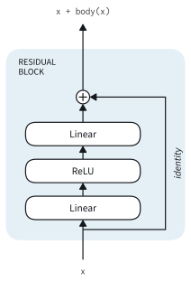
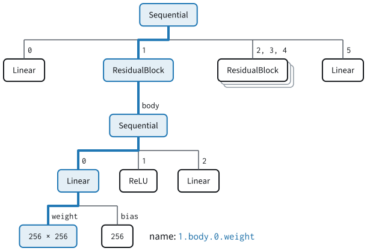

```{.python .input}
%load_ext d2lbook.tab
tab.interact_select('mxnet', 'pytorch', 'tensorflow', 'jax')
```

# Modules and Model Construction
:label:`sec_model_construction`

The multilayer perceptron in :numref:`sec_mlp-implementation` had just four
parameter arrays, small enough to manage by hand. Real-world architectures are
far more intricate. A modern residual network for computer vision stacks dozens
or hundreds of layers, and a language model such as Llama 3 8B
:cite:`Grattafiori.Dubey.Jauhri.ea.2024`—holding 8 billion parameters across 32
identical transformer blocks—spreads its weights over 291 separate arrays. Every
single one of those arrays must reach the optimizer, be written into
checkpoints, and move onto the GPU. Worse, omitting an array raises no syntax
error: it simply sits silently untrained or unsaved.

Deep learning frameworks solve this bookkeeping problem with a single recursive
abstraction: the *module*. A module can represent an individual layer, a group
of layers, or an entire model. It owns parameters, owns child modules, and
defines a forward computation mapping inputs to outputs. Because modules nest
inside other modules, any architecture forms a tree of modules
(:numref:`fig_blocks`). Every framework discovers all parameters by traversing
this tree—provided each child is properly *registered* with its parent.

This section is hands-on, and readers who have already built custom modules can
skim the basics. Do not skip how registration works and how it fails silently,
however, because that bug is notoriously easy to hit. We also show how to write
custom forward computations (such as residual connections), how lazy
initialization infers shapes on the fly, and how to separate architectural
hyperparameters into a compact configuration object. Later sections reuse the
same tree traversal for counting parameters (:numref:`sec_parameters`),
initializing weights (:numref:`sec_init_param`), saving checkpoints
(:numref:`sec_read_write`), and placing models on GPUs (:numref:`sec_use_gpu`).


:label:`fig_blocks`

```{.python .input #model-construction-modules-and-model-construction}
%%tab mxnet
from dataclasses import dataclass
from mxnet import autograd, gluon, init, np as mnp, npx
from mxnet.gluon import nn
npx.set_np()
```

```{.python .input #model-construction-modules-and-model-construction}
%%tab pytorch
import math
import numpy as np
import torch
from torch import nn
from torch.nn import functional as F
from d2l import torch as d2l
```

```{.python .input #model-construction-modules-and-model-construction}
%%tab tensorflow
from dataclasses import dataclass
import tensorflow as tf
```

```{.python .input #model-construction-modules-and-model-construction}
%%tab jax
import math
import numpy as np
import jax
from jax import numpy as jnp
from flax import nnx
import optax
from d2l import jax as d2l
```

```{.python .input #model-construction-modules-and-model-construction-1}
%%tab pytorch, jax
from dataclasses import dataclass
```

## The Module Abstraction

### Sequential Containers and the Registry

Every model we have written since :numref:`sec_oo-design` has been a module:
`d2l.Module` subclasses each framework's base module class. The fastest way to
assemble a pipeline of layers is a *sequential container*, which chains its
children together one after another. Below we construct an MLP with one hidden
layer of 256 ReLU units and 10 outputs—matching :numref:`sec_mlp-implementation`—and
pass in a minibatch of two examples with 20 features each.

:begin_tab:`mxnet`
In Gluon the base class is `nn.Block`, `nn.Sequential` adds layers via `add`, and `initialize()` prepares parameters before the first call (:numref:`sec_lazy_init`).
:end_tab:

:begin_tab:`pytorch`
In PyTorch the base class is `nn.Module` and `nn.Sequential` chains layers passed as arguments.
:end_tab:

:begin_tab:`tensorflow`
In Keras the base class is `tf.keras.layers.Layer` (with training methods on `tf.keras.Model`) and `tf.keras.Sequential` chains a list of layers.
:end_tab:

:begin_tab:`jax`
In Flax NNX the base class is `nnx.Module`, `nnx.Sequential` chains its arguments, and layers allocate parameters at construction using `rngs`.
:end_tab:
```{.python .input #model-construction-the-module-abstraction-1}
%%tab mxnet
net = nn.Sequential()
net.add(nn.Dense(256, activation='relu', in_units=20))
net.add(nn.Dense(10, in_units=256))
net.initialize()

X = mnp.random.uniform(size=(2, 20))
net(X).shape
```

```{.python .input #model-construction-the-module-abstraction-1}
%%tab pytorch
net = nn.Sequential(nn.Linear(20, 256), nn.ReLU(), nn.Linear(256, 10))

X = torch.rand(2, 20)
net(X).shape
```

```{.python .input #model-construction-the-module-abstraction-1}
%%tab tensorflow
net = tf.keras.Sequential([tf.keras.layers.Dense(256, activation='relu'),
                           tf.keras.layers.Dense(10)])

X = tf.random.uniform((2, 20))
net(X).shape
```

```{.python .input #model-construction-the-module-abstraction-1}
%%tab jax
rngs = nnx.Rngs(d2l.get_key())
net = nnx.Sequential(nnx.Linear(20, 256, rngs=rngs), nnx.relu,
                     nnx.Linear(256, 10, rngs=rngs))

X = jax.random.uniform(d2l.get_key(), (2, 20))
net(X).shape
```

Under the hood, the container stores its children in an ordered *registry*
mapping names to child modules, and its forward pass iterates through that table
in insertion order.

:begin_tab:`mxnet`
Printing the block displays its children keyed by index (`0`, `1`).
:end_tab:

:begin_tab:`pytorch`
`named_children` yields `(name, module)` pairs (`'0'`, `'1'`, `'2'`).
:end_tab:

:begin_tab:`tensorflow`
Keras stores children in `net.layers` with auto-generated names.
:end_tab:

:begin_tab:`jax`
`nnx.state(net, nnx.Param)` lists every parameter by its path through `layers`.
:end_tab:
```{.python .input #model-construction-the-module-abstraction-2}
%%tab mxnet
net
```

```{.python .input #model-construction-the-module-abstraction-2}
%%tab pytorch
dict(net.named_children())
```

```{.python .input #model-construction-the-module-abstraction-2}
%%tab tensorflow
net.layers
```

```{.python .input #model-construction-the-module-abstraction-2}
%%tab jax
[(path, value.shape)
 for path, value in nnx.state(net, nnx.Param).flat_state()]
```

Every tree traversal over the model begins at this registry. Gathering
parameters for the optimizer, serializing weights to disk, and moving tensors to
a GPU all recurse through registered children down to every leaf parameter. As
far as those operations are concerned, an unregistered layer might as well not
exist.

### Subclasses of the Module Class

A sequential container handles linear chains neatly, but many architectures
branch, merge, or reuse components. For anything beyond a straight chain, we
subclass the framework's base module and implement two methods: a constructor
that creates child modules and a forward method that specifies how data flows
through them.

:begin_tab:`mxnet`
In Gluon the forward method is `forward`.
:end_tab:

:begin_tab:`pytorch`
In PyTorch the forward method is `forward`.
:end_tab:

:begin_tab:`tensorflow`
In Keras the forward method is `call`.
:end_tab:

:begin_tab:`jax`
In Flax NNX the forward method is `__call__`.
:end_tab:

Here is the same MLP once more:

```{.python .input #model-construction-the-module-abstraction-3}
%%tab mxnet
class MLP(nn.Block):
    def __init__(self):
        super().__init__()
        self.hidden = nn.Dense(256, activation='relu', in_units=20)
        self.out = nn.Dense(10, in_units=256)

    def forward(self, X):
        return self.out(self.hidden(X))
```

```{.python .input #model-construction-the-module-abstraction-3}
%%tab pytorch
class MLP(nn.Module):
    def __init__(self):
        super().__init__()
        self.hidden = nn.Linear(20, 256)
        self.out = nn.Linear(256, 10)

    def forward(self, X):
        return self.out(F.relu(self.hidden(X)))
```

```{.python .input #model-construction-the-module-abstraction-3}
%%tab tensorflow
class MLP(tf.keras.Model):
    def __init__(self):
        super().__init__()
        self.hidden = tf.keras.layers.Dense(256, activation='relu')
        self.out = tf.keras.layers.Dense(10)

    def call(self, X):
        return self.out(self.hidden(X))
```

```{.python .input #model-construction-the-module-abstraction-3}
%%tab jax
class MLP(nnx.Module):
    def __init__(self, rngs):
        self.hidden = nnx.Linear(20, 256, rngs=rngs)
        self.out = nnx.Linear(256, 10, rngs=rngs)

    def __call__(self, X):
        return self.out(nnx.relu(self.hidden(X)))
```

Instantiating `MLP` and invoking `net(X)` dispatches to our custom forward method and maps the $2 \times 20$ input batch `X` to an output tensor of shape `(2, 10)`:

:begin_tab:`mxnet`
In MXNet, `net.initialize()` creates the parameters first.
:end_tab:

:begin_tab:`jax`
In JAX, the constructor takes an explicit `nnx.Rngs`.
:end_tab:

```{.python .input #model-construction-the-module-abstraction-4}
%%tab mxnet
net = MLP()
net.initialize()
net(X).shape
```

```{.python .input #model-construction-the-module-abstraction-4}
%%tab pytorch
net = MLP()
net(X).shape
```

```{.python .input #model-construction-the-module-abstraction-4}
%%tab tensorflow
net = MLP()
net(X).shape
```

```{.python .input #model-construction-the-module-abstraction-4}
%%tab jax
net = MLP(nnx.Rngs(d2l.get_key()))
net(X).shape
```

Two mechanisms do the heavy lifting behind the scenes. First, assigning
`self.hidden = ...` is not plain Python attribute storage: the base module
intercepts assignment via `__setattr__`, notices that the value is a module, and
registers it under the attribute name (`hidden` and `out`). That automatic
registration is all it takes for both layers' parameters to reach the optimizer.
Second, we never have to write a backward method: automatic differentiation
(:numref:`sec_autograd`) derives the gradients directly from the operations
performed during the forward pass.

Always invoke a module as `net(X)`.

:begin_tab:`mxnet, pytorch`
Calling `forward` directly skips the hooks that `__call__` runs (:numref:`sec_repro`).
:end_tab:

:begin_tab:`tensorflow`
Calling `call` directly skips `__call__`, which builds deferred variables on the first call (:numref:`sec_lazy_init`).
:end_tab:

## Module Containers
:label:`subsec_model-construction-sequential`

### Writing a Container

A sequential container has just two responsibilities: register each child module
as it is added, and pass the input through them in order. Implementing a minimal
version ourselves clarifies exactly how registration works—and where it can go
wrong.

```{.python .input #model-construction-sequential-and-friends-containers-1}
%%tab mxnet
class MySequential(nn.Block):
    def __init__(self):
        super().__init__()
        self._layers = []  # The registry holds weak references

    def add(self, block):
        self._layers.append(block)
        self.register_child(block)

    def forward(self, X):
        for block in self._layers:
            X = block(X)
        return X
```

```{.python .input #model-construction-sequential-and-friends-containers-1}
%%tab pytorch
class MySequential(nn.Module):
    def __init__(self, *args):
        super().__init__()
        for idx, module in enumerate(args):
            self.add_module(str(idx), module)

    def forward(self, X):
        for module in self.children():
            X = module(X)
        return X
```

```{.python .input #model-construction-sequential-and-friends-containers-1}
%%tab tensorflow
class MySequential(tf.keras.Model):
    def __init__(self, *args):
        super().__init__()
        self.modules = args

    def call(self, X):
        for module in self.modules:
            X = module(X)
        return X
```

```{.python .input #model-construction-sequential-and-friends-containers-1}
%%tab jax
class MySequential(nnx.Module):
    def __init__(self, *modules):
        self.modules = nnx.List(modules)

    def __call__(self, X):
        for module in self.modules:
            X = module(X)
        return X
```

:begin_tab:`mxnet`
`register_child` adds a block to the registry (which stores weak references, so `self._layers` keeps the blocks alive).
:end_tab:

:begin_tab:`pytorch`
`add_module` registers each child by string index, and `children()` iterates over the registry in insertion order.
:end_tab:

:begin_tab:`tensorflow`
Keras's `__setattr__` automatically scans inside Python lists, tuples, and dicts, tracking every layer in `self.modules`.
:end_tab:

:begin_tab:`jax`
`nnx.List` wraps a sequence of modules as a graph-tracked container under `modules`.
:end_tab:
Our custom `MySequential` behaves just like the built-in container:

```{.python .input #model-construction-sequential-and-friends-containers-2}
%%tab mxnet
net = MySequential()
net.add(nn.Dense(256, activation='relu', in_units=20))
net.add(nn.Dense(10, in_units=256))
net.initialize()
net(X).shape
```

```{.python .input #model-construction-sequential-and-friends-containers-2}
%%tab pytorch
net = MySequential(nn.Linear(20, 256), nn.ReLU(), nn.Linear(256, 10))
net(X).shape
```

```{.python .input #model-construction-sequential-and-friends-containers-2}
%%tab tensorflow
net = MySequential(tf.keras.layers.Dense(256, activation='relu'),
                   tf.keras.layers.Dense(10))
net(X).shape
```

```{.python .input #model-construction-sequential-and-friends-containers-2}
%%tab jax
rngs = nnx.Rngs(d2l.get_key())
net = MySequential(nnx.Linear(20, 256, rngs=rngs), nnx.relu,
                   nnx.Linear(256, 10, rngs=rngs))
net(X).shape
```

### Layers in a Plain List

What happens if we store layers in an ordinary Python `list`, as anyone
unfamiliar with module registration naturally would? The forward pass can still
loop over the list, but a plain `list` is not a module. Does the framework still
discover the layers inside it?

:begin_tab:`mxnet`
The block below keeps its layers in a plain list. `net.initialize()` walks
the registry and cannot reach them, so we initialize each layer by hand to
get a forward pass at all:
:end_tab:

:begin_tab:`tensorflow`
In Keras the plain list is the ordinary way to hold a stack of layers,
because the attribute scan looks inside lists:
:end_tab:

```{.python .input #model-construction-sequential-and-friends-containers-3}
%%tab mxnet
class PlainListMLP(nn.Block):
    def __init__(self):
        super().__init__()
        self.layers = [nn.Dense(256, activation='relu', in_units=20),
                       nn.Dense(10, in_units=256)]
        for layer in self.layers:
            layer.initialize()  # By hand: net.initialize() cannot see them

    def forward(self, X):
        for layer in self.layers:
            X = layer(X)
        return X

net = PlainListMLP()
net(X).shape, len(net.collect_params())
```

```{.python .input #model-construction-sequential-and-friends-containers-3}
%%tab pytorch
class PlainListMLP(nn.Module):
    def __init__(self):
        super().__init__()
        self.layers = [nn.Linear(20, 256), nn.ReLU(), nn.Linear(256, 10)]

    def forward(self, X):
        for layer in self.layers:
            X = layer(X)
        return X

net = PlainListMLP()
net(X).shape, sum(p.numel() for p in net.parameters())
```

```{.python .input #model-construction-sequential-and-friends-containers-3}
%%tab tensorflow
class ListMLP(tf.keras.Model):
    def __init__(self):
        super().__init__()
        self.blocks = [tf.keras.layers.Dense(256, activation='relu'),
                       tf.keras.layers.Dense(10)]

    def call(self, X):
        for block in self.blocks:
            X = block(X)
        return X

net = ListMLP()
net(X).shape, sum(int(tf.size(v)) for v in net.trainable_variables)
```

```{.python .input #model-construction-sequential-and-friends-containers-3}
%%tab jax
class PlainListMLP(nnx.Module):
    def __init__(self, rngs):
        self.layers = [nnx.Linear(20, 256, rngs=rngs),
                       nnx.Linear(256, 10, rngs=rngs)]  # Plain list

    def __call__(self, X):
        return self.layers[1](nnx.relu(self.layers[0](X)))

try:
    net = PlainListMLP(nnx.Rngs(d2l.get_key()))
except ValueError as e:
    print(str(e).split(' of Pytree')[0])  # The rest lists the repairs
```

:begin_tab:`mxnet`
The forward pass succeeds, yet `collect_params()` is empty! While a completely empty parameter dict makes `Trainer` fail immediately, a *partly* registered model—where outer layers are attributes and inner layers sit in a plain list—fails silently during training. Let's take one SGD step on such a model and check which weights move:
:end_tab:

:begin_tab:`pytorch`
The forward pass succeeds, yet `net.parameters()` is empty because `__setattr__` treats a plain Python `list` as an ordinary attribute rather than a module container. Worse than a completely empty model (which `torch.optim.SGD` rejects) is a *partly* registered model whose outer layers are attributes and inner layers sit in a plain list. Let's take one SGD step and check which weights move:
:end_tab:

:begin_tab:`tensorflow`
Because Keras scans inside Python lists assigned to attributes, all 7,946 parameters ($20 \cdot 256 + 256 + 256 \cdot 10 + 10$) are tracked automatically. Instead, the structural bug Keras forbids is attaching a new layer *after* the model has already been built:
:end_tab:

:begin_tab:`jax`
NNX immediately raises a `ValueError` at construction when a plain Python list holds modules, naming `nnx.List` as the fix so a partly registered model can never be constructed silently:
:end_tab:
```{.python .input #model-construction-layers-in-a-plain-list-1}
%%tab mxnet
class PartlyRegisteredMLP(nn.Block):
    def __init__(self):
        super().__init__()
        self.first = nn.Dense(256, activation='relu', in_units=20)
        self.blocks = [nn.Dense(256, activation='relu', in_units=256)
                       for _ in range(2)]  # Plain list
        for block in self.blocks:
            block.initialize()  # By hand, as before
        self.last = nn.Dense(10, in_units=256)

    def forward(self, X):
        X = self.first(X)
        for block in self.blocks:
            X = block(X)
        return self.last(X)
```

```{.python .input #model-construction-layers-in-a-plain-list-1}
%%tab pytorch
class PartlyRegisteredMLP(nn.Module):
    def __init__(self):
        super().__init__()
        self.first = nn.Linear(20, 256)
        self.blocks = [nn.Linear(256, 256), nn.Linear(256, 256)]  # Plain list
        self.last = nn.Linear(256, 10)

    def forward(self, X):
        X = F.relu(self.first(X))
        for block in self.blocks:
            X = F.relu(block(X))
        return self.last(X)
```

:begin_tab:`mxnet, pytorch`
To see which layers actually move during training, we snapshot all four weight matrices of `PartlyRegisteredMLP` in `before`, run a single backward pass on `net(X).sum()` followed by one SGD step, and compare each layer's weights against `before`:
:end_tab:

```{.python .input #model-construction-layers-in-a-plain-list-2}
%%tab mxnet
net = PartlyRegisteredMLP()
net.initialize()
layers = [net.first, *net.blocks, net.last]
before = [layer.weight.data().copy() for layer in layers]
trainer = gluon.Trainer(net.collect_params(), 'sgd', {'learning_rate': 0.1})
with autograd.record():
    loss = net(X).sum()
loss.backward()
trainer.step(batch_size=1)
[bool((b != layer.weight.data()).any()) for b, layer in zip(before, layers)]
```

```{.python .input #model-construction-layers-in-a-plain-list-2}
%%tab pytorch
net = PartlyRegisteredMLP()
layers = [net.first, *net.blocks, net.last]
before = [layer.weight.clone() for layer in layers]
optimizer = torch.optim.SGD(net.parameters(), lr=0.1)
net(X).sum().backward()
optimizer.step()
[not torch.equal(b, layer.weight) for b, layer in zip(before, layers)]
```

:begin_tab:`mxnet`
Only the outer weights updated! Backpropagation flowed through `self.blocks` to reach `self.first`, but `Trainer` never received the list's parameters (though `collect_params()` does print a warning). Registering each child via `register_child` fixes the bug:
:end_tab:

:begin_tab:`pytorch`
Only the outer weights updated, without a single warning or error! Backpropagation flowed through `self.blocks` to reach `self.first`, but the optimizer never saw the middle layers. Wrapping the list in `nn.ModuleList` (or `nn.ModuleDict` for dictionaries) registers every child properly:
:end_tab:
```{.python .input #model-construction-sequential-and-friends-containers-4}
%%tab mxnet
class RegisteredListMLP(PlainListMLP):
    def __init__(self):
        super().__init__()
        for layer in self.layers:
            self.register_child(layer)

net = RegisteredListMLP()
net(X).shape, sum(p.data().size for p in net.collect_params().values())
```

```{.python .input #model-construction-sequential-and-friends-containers-4}
%%tab pytorch
class ModuleListMLP(PlainListMLP):
    def __init__(self):
        super().__init__()
        self.layers = nn.ModuleList(self.layers)

net = ModuleListMLP()
net(X).shape, sum(p.numel() for p in net.parameters())
```

```{.python .input #model-construction-sequential-and-friends-containers-4}
%%tab tensorflow
try:
    net.head = tf.keras.layers.Dense(2)  # net is built: too late
except ValueError as e:
    print(str(e)[:70].rsplit(' ', 1)[0], '...')
```

```{.python .input #model-construction-sequential-and-friends-containers-4}
%%tab jax
class ListMLP(PlainListMLP):
    def __init__(self, rngs):
        self.layers = nnx.List([nnx.Linear(20, 256, rngs=rngs),
                                nnx.Linear(256, 10, rngs=rngs)])

net = ListMLP(nnx.Rngs(d2l.get_key()))
state = nnx.state(net, nnx.Param)
net(X).shape, sum(x.size for _, x in state.flat_state())
```

:begin_tab:`mxnet`
All 7,946 parameters are now registered. In Gluon, register children via attribute assignment, `nn.Sequential`, or `register_child`.
:end_tab:

:begin_tab:`pytorch`
All 7,946 parameters are now registered. Use `nn.Sequential` for straight chains, and `nn.ModuleList` or `nn.ModuleDict` whenever your `forward` method loops or indexes over children manually.
:end_tab:

:begin_tab:`tensorflow`
Keras requires all layers to be attached in `__init__` or `build`; any layer reachable from an attribute (including inside lists or dicts) is tracked automatically.
:end_tab:

:begin_tab:`jax`
With `nnx.List` (or `nnx.Dict` for mappings), all 7,946 parameters are registered cleanly.
:end_tab:
## Forward Computation

Because a module's forward method is just Python, it can invoke arbitrary tensor
operations, loops, conditionals, and skip paths. Let's use this flexibility to
implement a residual connection, and then see what constraints arise when a
framework compiles the training step.

### Residual Connections

The simplest widely used architecture that is not a straight chain is a
*residual connection*, which adds a block's input directly to its output
:cite:`He.Zhang.Ren.ea.2016*1`. Writing $f$ for the block's *body*—here two
fully connected layers with a ReLU between them—the block computes

$$\mathbf{y} = \mathbf{x} + f(\mathbf{x}).$$

Whenever $f(\mathbf{x}) = \mathbf{0}$, the block reduces to the identity map,
allowing signals to pass cleanly through deep stacks while each block learns
only a refinement $f(\mathbf{x})$ rather than rebuilding the representation from
scratch. The ResNet architectures of :numref:`sec_resnet` rely on this pattern.
No framework needs a special built-in layer for residual connections: in a
custom module, it is simply one line, `X + self.body(X)`:

```{.python .input #model-construction-forward-is-just-python-1}
%%tab mxnet
class ResidualBlock(nn.Block):
    def __init__(self, num_hiddens):
        super().__init__()
        self.body = nn.Sequential()
        self.body.add(nn.Dense(num_hiddens, activation='relu',
                               in_units=num_hiddens),
                      nn.Dense(num_hiddens, in_units=num_hiddens))

    def forward(self, X):
        return X + self.body(X)
```

```{.python .input #model-construction-forward-is-just-python-1}
%%tab pytorch
class ResidualBlock(nn.Module):
    def __init__(self, num_hiddens):
        super().__init__()
        self.body = nn.Sequential(
            nn.Linear(num_hiddens, num_hiddens), nn.ReLU(),
            nn.Linear(num_hiddens, num_hiddens))

    def forward(self, X):
        return X + self.body(X)
```

```{.python .input #model-construction-forward-is-just-python-1}
%%tab tensorflow
class ResidualBlock(tf.keras.layers.Layer):
    def __init__(self, num_hiddens, **kwargs):
        super().__init__(**kwargs)
        self.body = tf.keras.Sequential([
            tf.keras.layers.Dense(num_hiddens, activation='relu'),
            tf.keras.layers.Dense(num_hiddens)])

    def call(self, X):
        return X + self.body(X)
```

```{.python .input #model-construction-forward-is-just-python-1}
%%tab jax
class ResidualBlock(nnx.Module):
    def __init__(self, num_hiddens, *, rngs):
        self.body = nnx.Sequential(
            nnx.Linear(num_hiddens, num_hiddens, rngs=rngs), nnx.relu,
            nnx.Linear(num_hiddens, num_hiddens, rngs=rngs))

    def __call__(self, X):
        return X + self.body(X)
```


:label:`fig_bg_residual-block`

:numref:`fig_bg_residual-block` depicts the wiring. Adding $\mathbf{x}$ and
$f(\mathbf{x})$ requires their shapes to match, so a residual block takes a
single hidden width `num_hiddens`.

:begin_tab:`tensorflow`
Keras infers input widths when the layer is built, so the constraint falls
on the caller: an input with other than `num_hiddens` columns makes the
addition fail.
:end_tab:

```{.python .input #model-construction-forward-is-just-python-2}
%%tab mxnet
block = ResidualBlock(24)
block.initialize()
block(mnp.random.normal(size=(2, 24))).shape
```

```{.python .input #model-construction-forward-is-just-python-2}
%%tab pytorch
block = ResidualBlock(24)
block(torch.randn(2, 24)).shape
```

```{.python .input #model-construction-forward-is-just-python-2}
%%tab tensorflow
block = ResidualBlock(24)
block(tf.random.normal((2, 24))).shape
```

```{.python .input #model-construction-forward-is-just-python-2}
%%tab jax
block = ResidualBlock(24, rngs=nnx.Rngs(d2l.get_key()))
X24 = jax.random.normal(d2l.get_key(), (2, 24))
block(X24).shape
```

A forward method can also depend on values that are neither inputs nor trainable
parameters. A scalar constant can live as an ordinary Python attribute, whereas
a tensor tracked from data—such as running input statistics—must be saved in
checkpoints and moved across devices alongside the model without being updated
by the optimizer. We cover how to register such non-trainable *buffers* in
:numref:`subsec_params_buffers`.

### Eager and Compiled Execution

So far our forward passes have executed like regular Python, running one
operation at a time. To eliminate Python overhead and fuse operations, however,
frameworks can trace a computation once and replay the compiled graph on future
calls. That speedup comes with a trade-off: compiled execution restricts
data-dependent Python control flow inside the forward pass.

:begin_tab:`mxnet, pytorch`
Both Gluon `Block` and PyTorch `nn.Module` run *eagerly* by default—executing Python statement by statement—so data-dependent control flow works just like NumPy (we cover graph compilation in :numref:`chap_performance`).
:end_tab:

:begin_tab:`tensorflow`
Direct calls run eagerly, but `d2l.Trainer` compiles training steps with `tf.function` by tracing `call` once on symbolic tensors without concrete values. Because Keras does not apply AutoGraph inside `Layer.call`, a Python `while` loop conditioned on tensor values fails during tracing:
:end_tab:

:begin_tab:`jax`
Direct calls run eagerly, but `d2l.Trainer` compiles training steps with `nnx.jit` by tracing `__call__` once on abstract *tracers* that carry shapes and dtypes but no values. Branching on a tracer in a Python `while` loop raises an error:
:end_tab:
```{.python .input #model-construction-forward-is-just-python-4}
%%tab tensorflow
class HalvingNet(tf.keras.Model):
    def __init__(self):
        super().__init__()
        self.proj = tf.keras.layers.Dense(24)

    def call(self, X):
        X = self.proj(X)
        while tf.reduce_sum(tf.abs(X)) > 1:  # Depends on the values of X
            X = X / 2
        return tf.reduce_sum(X)

net = HalvingNet()
print(net(X))
try:
    tf.function(net)(X)
except tf.errors.OperatorNotAllowedInGraphError as e:
    print(type(e).__name__)
```

```{.python .input #model-construction-forward-is-just-python-4}
%%tab jax
class HalvingNet(nnx.Module):
    def __init__(self, rngs):
        self.proj = nnx.Linear(20, 24, rngs=rngs)

    def __call__(self, X):
        X = self.proj(X)
        while jnp.abs(X).sum() > 1:  # Depends on the values of X
            X = X / 2
        return X.sum()

net = HalvingNet(nnx.Rngs(d2l.get_key()))
print(net(X))
try:
    nnx.jit(lambda net, X: net(X))(net, X)
except jax.errors.TracerBoolConversionError as e:
    print(type(e).__name__)
```

:begin_tab:`tensorflow, jax`
Eager execution runs the data-dependent loop, whereas tracing rejects converting a symbolic tensor/tracer into a Python `bool` (requiring `tf.while_loop` or `jax.lax.while_loop`). Loops over static model structure—such as iterating over `self.modules`—unroll cleanly at trace time.
:end_tab:
## Lazy Initialization
:label:`sec_lazy_init`

### Shapes from Data

Some layer libraries let a layer specify only its output dimension and infer
its input width from the first minibatch; the tab note says whether yours does.

:begin_tab:`mxnet`
Before the first forward pass, `nn.Dense(256)` creates parameter placeholders with unknown input dimension `-1`:
:end_tab:

:begin_tab:`pytorch`
Before the first forward pass, `nn.LazyLinear(256)` holds an `UninitializedParameter` without a shape:
:end_tab:

:begin_tab:`tensorflow`
Before the first call, `Dense(256)` has not allocated any variables at all:
:end_tab:

:begin_tab:`jax`
NNX layers require explicit input and output widths and allocate their parameters immediately in `__init__`.
:end_tab:
```{.python .input #model-construction-lazy-initialization-shapes-from-data-1}
%%tab mxnet
net = nn.Sequential()
net.add(nn.Dense(256, activation='relu'))
net.add(nn.Dense(10))
{name: p.shape for name, p in net.collect_params().items()}
```

```{.python .input #model-construction-lazy-initialization-shapes-from-data-1}
%%tab pytorch
net = nn.Sequential(nn.LazyLinear(256), nn.ReLU(), nn.LazyLinear(10))
net[0].weight
```

```{.python .input #model-construction-lazy-initialization-shapes-from-data-1}
%%tab tensorflow
net = tf.keras.Sequential([tf.keras.layers.Dense(256, activation='relu'),
                           tf.keras.layers.Dense(10)])
net.weights
```

:begin_tab:`mxnet, pytorch, tensorflow`
Passing the first minibatch `X` through the network cascades shapes from layer to layer and materializes every weight tensor:
:end_tab:
```{.python .input #model-construction-lazy-initialization-shapes-from-data-2}
%%tab mxnet
net.initialize()
net(X)
{name: p.shape for name, p in net.collect_params().items()}
```

```{.python .input #model-construction-lazy-initialization-shapes-from-data-2}
%%tab pytorch
net(X)
net[0].weight.shape
```

```{.python .input #model-construction-lazy-initialization-shapes-from-data-2}
%%tab tensorflow
net(X)
[w.shape for w in net.weights]
```

```{.python .input #model-construction-lazy-initialization-shapes-from-data-2}
%%tab jax
rngs = nnx.Rngs(d2l.get_key())
net = nnx.Sequential(nnx.Linear(20, 256, rngs=rngs), nnx.relu,
                     nnx.Linear(256, 10, rngs=rngs))
[(path, value.shape)
 for path, value in nnx.state(net, nnx.Param).flat_state()]
```

### Initialization after a Dry Run

Lazy layers free us from manually propagating input dimensions from layer to
layer, which quickly becomes error-prone in deep models. The trade-off is that
parameters do not exist until data flows through the network: before that first
pass, we cannot inspect parameter counts or run shape-dependent initializers
such as Xavier initialization (:numref:`subsec_xavier`). A lazy model therefore needs its initializer either recorded up front or
applied after a *dry run*—a single forward pass on a dummy minibatch whose
output is discarded—that materializes every shape; the tab note shows which
your framework uses.

:begin_tab:`mxnet`
`net.initialize(init.Xavier())` records the initializer upfront and applies it automatically on the first forward pass.
:end_tab:

:begin_tab:`pytorch`
`d2l.Module.apply_init` runs one forward pass without tracking gradients to materialize lazy shapes, then applies an initializer callback across the module tree via `self.apply`:
:end_tab:

:begin_tab:`tensorflow`
Keras layers take `kernel_initializer` at construction and apply it when `build` runs (either on the first data call or via `net.build((None, 20))`).
:end_tab:

:begin_tab:`jax`
`nnx.Linear` takes `kernel_init` and draws weights immediately in the constructor.
:end_tab:
```{.python .input #model-construction-lazy-initialization-shapes-from-data-3}
%%tab pytorch
@d2l.add_to_class(d2l.Module)  #@save
def apply_init(self, inputs, init=None):
    """Run a dry pass to fix lazy shapes, then apply `init`."""
    with torch.no_grad():
        self(*inputs)
    if init is not None:
        self.apply(init)
```

:begin_tab:`pytorch`
`nn.Module.apply(fn)` calls `fn` on every module of the tree, children
before their parents: one more task that is a walk over the tree. Here is
`apply_init` with Xavier's uniform initializer:
:end_tab:

```{.python .input #model-construction-lazy-initialization-shapes-from-data-4}
%%tab mxnet
net = nn.Sequential()
net.add(nn.Dense(256, activation='relu'))
net.add(nn.Dense(10))
net.initialize(init.Xavier())
net(X)
net[0].weight.data().shape
```

```{.python .input #model-construction-lazy-initialization-shapes-from-data-4}
%%tab pytorch
class TinyMLP(d2l.Module):
    def __init__(self):
        super().__init__()
        self.net = nn.Sequential(nn.LazyLinear(256), nn.ReLU(),
                                 nn.LazyLinear(10))

def init_xavier(module):
    if isinstance(module, nn.Linear):
        nn.init.xavier_uniform_(module.weight)

model = TinyMLP()
model.apply_init([X], init_xavier)
model.net[0].weight.shape
```

```{.python .input #model-construction-lazy-initialization-shapes-from-data-4}
%%tab tensorflow
net = tf.keras.Sequential([
    tf.keras.layers.Dense(
        256, activation='relu',
        kernel_initializer=tf.keras.initializers.GlorotUniform()),
    tf.keras.layers.Dense(10)])
net.build((None, 20))
net.layers[0].kernel.shape
```

```{.python .input #model-construction-lazy-initialization-shapes-from-data-4}
%%tab jax
class TinyMLP(d2l.Module):
    def __init__(self, rngs):
        super().__init__()
        self.net = nnx.Sequential(
            nnx.Linear(20, 256,
                       kernel_init=nnx.initializers.xavier_uniform(),
                       rngs=rngs), nnx.relu,
            nnx.Linear(256, 10, rngs=rngs))

model = TinyMLP(nnx.Rngs(d2l.get_key()))
[(path, value.shape)
 for path, value in nnx.state(model, nnx.Param).flat_state()]
```

When should we use lazy layers versus explicit dimensions? For rapid prototyping
on unfamiliar datasets, lazy layers are handy. For production models whose
parameters we want to count, initialize programmatically, or instantiate from a
configuration file without dummy data, declaring explicit input and output
widths is cleaner—and that is the convention we adopt for the rest of this
chapter.

## Models from a Config

### Configs and Builders

Can we reconstruct a trained model from its saved weight tensors alone? Not
entirely. A trained model consists of both numerical arrays and the code that
interprets them. Every width and depth we wrote earlier was hardcoded directly
into constructor calls; a weights file reflects those choices only indirectly
(tensor shapes reveal layer widths, but nothing in the arrays reveals a
parameter-free choice such as ReLU vs. tanh).

Architectural hyperparameters that vary across experiments therefore belong in a
dedicated *configuration* object (*config*) that can be logged alongside metrics
and saved next to checkpoints, while the topology itself—what each block
computes and how blocks wire together—lives in code. Below, a Python `dataclass`
captures four architectural fields, and a `build` factory function turns any
config into a complete module tree:

```{.python .input #model-construction-building-from-a-config-1}
%%tab mxnet
@dataclass
class MLPConfig:
    num_inputs: int = 784
    num_hiddens: int = 256
    num_blocks: int = 4
    num_outputs: int = 10

def build(cfg: MLPConfig) -> nn.Block:
    net = nn.Sequential()
    net.add(nn.Dense(cfg.num_hiddens, in_units=cfg.num_inputs))
    for _ in range(cfg.num_blocks):
        net.add(ResidualBlock(cfg.num_hiddens))
    net.add(nn.Dense(cfg.num_outputs, in_units=cfg.num_hiddens))
    return net
```

```{.python .input #model-construction-building-from-a-config-1}
%%tab pytorch
@dataclass
class MLPConfig:
    num_inputs: int = 784
    num_hiddens: int = 256
    num_blocks: int = 4
    num_outputs: int = 10

def build(cfg: MLPConfig) -> nn.Module:
    blocks = [ResidualBlock(cfg.num_hiddens) for _ in range(cfg.num_blocks)]
    return nn.Sequential(nn.Linear(cfg.num_inputs, cfg.num_hiddens),
                         *blocks, nn.Linear(cfg.num_hiddens, cfg.num_outputs))
```

```{.python .input #model-construction-building-from-a-config-1}
%%tab tensorflow
@dataclass
class MLPConfig:
    num_inputs: int = 784
    num_hiddens: int = 256
    num_blocks: int = 4
    num_outputs: int = 10

def build(cfg: MLPConfig) -> tf.keras.Model:
    blocks = [ResidualBlock(cfg.num_hiddens) for _ in range(cfg.num_blocks)]
    return tf.keras.Sequential([tf.keras.Input((cfg.num_inputs,)),
                                tf.keras.layers.Dense(cfg.num_hiddens),
                                *blocks,
                                tf.keras.layers.Dense(cfg.num_outputs)])
```

```{.python .input #model-construction-building-from-a-config-1}
%%tab jax
@dataclass
class MLPConfig:
    num_inputs: int = 784
    num_hiddens: int = 256
    num_blocks: int = 4
    num_outputs: int = 10

def build(cfg: MLPConfig, rngs=None) -> nnx.Module:
    rngs = nnx.Rngs(d2l.get_key()) if rngs is None else rngs
    blocks = [ResidualBlock(cfg.num_hiddens, rngs=rngs)
              for _ in range(cfg.num_blocks)]
    return nnx.Sequential(
        nnx.Linear(cfg.num_inputs, cfg.num_hiddens, rngs=rngs), *blocks,
        nnx.Linear(cfg.num_hiddens, cfg.num_outputs, rngs=rngs))
```

A single config completely specifies an instance of the architecture: an input
projection from `num_inputs` to `num_hiddens`, `num_blocks` residual blocks, and
an output head. Notice that `blocks` starts as a temporary Python list, which is
completely safe here because unpacking it into the sequential container
registers every block immediately. Because every layer specifies both its input
and output widths, we can inspect and count parameters right away without a dry
run.

```{.python .input #model-construction-building-from-a-config-2}
%%tab mxnet
net = build(MLPConfig())
net.initialize()
[(name, p.shape) for name, p in net.collect_params().items()][:4]
```

```{.python .input #model-construction-building-from-a-config-2}
%%tab pytorch
net = build(MLPConfig())
[(name, tuple(p.shape)) for name, p in net.named_parameters()][:4]
```

```{.python .input #model-construction-building-from-a-config-2}
%%tab tensorflow
net = build(MLPConfig())
[(w.path, tuple(w.shape)) for w in net.weights][:4]
```

```{.python .input #model-construction-building-from-a-config-2}
%%tab jax
net = build(MLPConfig())
[(path, value.shape)
 for path, value in nnx.state(net, nnx.Param).flat_state()][:4]
```

The resulting model maps a minibatch of 784-dimensional vectors (such as
flattened Fashion-MNIST images) to 10 output logits:

```{.python .input #model-construction-building-from-a-config-3}
%%tab mxnet
net(mnp.random.uniform(size=(2, 784))).shape
```

```{.python .input #model-construction-building-from-a-config-3}
%%tab pytorch
net(torch.rand(2, 784)).shape
```

```{.python .input #model-construction-building-from-a-config-3}
%%tab tensorflow
net(tf.random.uniform((2, 784))).shape
```

```{.python .input #model-construction-building-from-a-config-3}
%%tab jax
net(jax.random.uniform(d2l.get_key(), (2, 784))).shape
```

### Counting Parameters

A config also lets us calculate a model's exact parameter count on paper before
allocating any memory. The input projection has $784 \cdot 256 + 256 = 200{,}960$
parameters, each residual block contains two dense layers totaling
$2 \cdot (256 \cdot 256 + 256) = 131{,}584$ parameters, and the output layer
adds $256 \cdot 10 + 10 = 2{,}570$, giving

$$200{,}960 + 4 \cdot 131{,}584 + 2{,}570 = 729{,}866$$

parameters in all—dominated by the residual blocks. Scaling the model up now
takes changing two config fields rather than editing model code, and walking the
parameter tree verifies our calculation:

```{.python .input #model-construction-building-from-a-config-4}
%%tab mxnet
for cfg in (MLPConfig(), MLPConfig(num_hiddens=512, num_blocks=8)):
    net = build(cfg)
    net.initialize()
    n = sum(p.data().size for p in net.collect_params().values())
    print(f'num_hiddens={cfg.num_hiddens}, num_blocks={cfg.num_blocks}: '
          f'{n:,} parameters')
```

```{.python .input #model-construction-building-from-a-config-4}
%%tab pytorch
for cfg in (MLPConfig(), MLPConfig(num_hiddens=512, num_blocks=8)):
    n = sum(p.numel() for p in build(cfg).parameters())
    print(f'num_hiddens={cfg.num_hiddens}, num_blocks={cfg.num_blocks}: '
          f'{n:,} parameters')
```

```{.python .input #model-construction-building-from-a-config-4}
%%tab tensorflow
for cfg in (MLPConfig(), MLPConfig(num_hiddens=512, num_blocks=8)):
    print(f'num_hiddens={cfg.num_hiddens}, num_blocks={cfg.num_blocks}: '
          f'{build(cfg).count_params():,} parameters')
```

```{.python .input #model-construction-building-from-a-config-4}
%%tab jax
for cfg in (MLPConfig(), MLPConfig(num_hiddens=512, num_blocks=8)):
    n = sum(x.size for _, x in nnx.state(build(cfg), nnx.Param).flat_state())
    print(f'num_hiddens={cfg.num_hiddens}, num_blocks={cfg.num_blocks}: '
          f'{n:,} parameters')
```

Doubling the hidden width quadruples the parameter count inside each block, and
doubling the number of blocks doubles that total, so the larger config contains
more than six times as many parameters. Real-world foundation models follow the
exact same pattern: our 8B language model is specified by a compact config
(e.g., 32 blocks, hidden width 4,096) paired with builder code that materializes
the module tree.

Keep in mind that a config stores hyperparameters, not implementation code.
Restoring a model from a checkpoint requires all three pieces: the weights, the
config, and the matching `build` function and block definitions. In
:numref:`sec_read_write`, we save the weights and config together, while version
control takes care of the code.

So far we have only located and counted parameters without inspecting what lives
inside them. In :numref:`sec_parameters`, we open up the tensors a model owns,
account for how much memory training consumes, and see how to share or freeze
weights.

## Summary

Three core ideas anchor model construction. First, every neural network is a
tree of modules, with each parameter uniquely addressed by its path from the
root. Second, optimizers, checkpoints, and device transfers all operate by
walking registered children, so hiding layers inside an unregistered container
silently excludes them from training and saving. Third, factoring variable
dimensions into a lightweight config paired with a `build` function makes
architectures easy to log, scale, and reproduce. On top of these fundamentals,
custom forward methods give us full Python flexibility (subject to tracing
constraints under compiled execution), while lazy layers offer convenience for
quick experiments at the cost of deferring shape creation until a dry run.

## Exercises

:begin_tab:`mxnet`
1. [code] **Unregistered modules.** The plain list in `PlainListMLP` keeps
   its layers out of `collect_params()`, `initialize()`, and
   `save_parameters`, and `collect_params()` warns about it. Predict, then
   verify, what two further operations do to the model.
    1. Pass a batch through a fresh `PlainListMLP`, call
       `net.cast('float64')`, check the dtype of
       `net.layers[0].weight.data()`, and pass a `float64` batch through
       the model.
    1. The method `load_parameters` is the inverse of `save_parameters`: it
       reads a saved parameter file into a model. Run one forward pass
       through a `RegisteredListMLP`, save it with `save_parameters`, and
       load the file into a fresh `PlainListMLP` with `load_parameters`.
    1. Which of these failures are silent and which raise an error? Explain
       both from the same missing registration.
:end_tab:

:begin_tab:`pytorch`
1. [code] **Unregistered modules.** The plain list in `PlainListMLP` keeps
   its layers out of `net.parameters()`, `net.to(device)`, and
   `net.state_dict()`. Predict, then verify, what three further operations
   do to the model.
    1. Call `net.apply(init_xavier)` and check whether the weight of
       `net.layers[0]` changes.
    1. Add `nn.Dropout(0.5)` after the `nn.ReLU()` in the list, call
       `net.eval()`, and pass the same input through the model twice.
    1. The method `load_state_dict` is the inverse of `state_dict`: it
       copies a dictionary of saved tensors into a model. Call
       `net.load_state_dict(ModuleListMLP().state_dict())`.
    1. Which of these failures are silent and which raise an error? Explain
       all three from the same missing registration.
:end_tab:

:begin_tab:`tensorflow`
1. [code] **Unregistered modules.** Keras tracks a layer that the
   constructor assigns to an attribute, but not a `Dense` layer created
   *inside* `call`. Such a model runs without complaint. Write one, check
   `len(net.trainable_variables)` after calling it, explain what an
   optimizer would train, and explain what happens to the layer's weights
   between two calls.
:end_tab:

:begin_tab:`jax`
1. [code] **Unregistered containers.** NNX rejects a plain Python list that
   holds modules and names `nnx.List` and `nnx.data` as repairs.
    1. Rewrite `ListMLP` twice: once with its two layers in an `nnx.Dict`
       keyed `'hidden'` and `'out'`, and once with the plain list wrapped
       in `nnx.data`. Verify that all 7,946 parameters appear in
       `nnx.state(net, nnx.Param)` in both versions.
    1. Compare the parameter paths of the two versions with those of
       `ListMLP`. A checkpoint stores the state as a mapping from paths to
       arrays. Which of the two rewrites could restore a checkpoint saved
       from `ListMLP`, and why?
:end_tab:

2. **Widening a residual block.** `ResidualBlock` requires its input and
   output widths to agree. Suppose a block maps width $d$ to a larger width
   $d'$, so its body ends in a $d'$-wide layer and the skip path must also
   produce width $d'$. Give one way to build that skip path with
   parameters and one without. For each, count the extra parameters and
   state which output coordinates still receive the identity path.

3. [code] **A module from scratch.** ● In plain Python and NumPy, without any
   framework base class, write a `Parameter` class that wraps an array and
   a minimal `Module` class whose `__setattr__` registers every assigned
   `Parameter` or `Module`. Give `Module` a `parameters()` method that
   recurses into the registered children. Write a `Linear` subclass of
   `Module` that holds a weight and a bias, build a two-layer MLP from two
   instances of it, and verify that `parameters()` returns all four arrays.
   Then store the two layers in a plain list, check what `parameters()`
   returns, and extend `Module` so that the list version finds all four
   arrays as well.

    *Adapted from CMU 10-714,
    [Homework 2](https://github.com/dlsyscourse/hw2), Question 2.*

:begin_tab:`mxnet`
4. [code] **Lazy input width.** Build an `nn.Sequential` holding
   `nn.Dense(256, activation='relu')` and `nn.Dense(10)`, call
   `initialize()`, and pass a batch with 20 features through it, then a
   batch with 30 features. Explain the outcome from what the first forward
   pass did to each layer. Then describe a model that accepts inputs of
   either width while sharing every layer after the first.
:end_tab:

:begin_tab:`pytorch`
4. [code] **Lazy input width.** Build
   `net = nn.Sequential(nn.LazyLinear(256), nn.ReLU(), nn.LazyLinear(10))`
   and pass a batch with 20 features through it, then a batch with 30
   features. Explain the outcome from what the first forward pass did to
   each layer. Then describe a model that accepts inputs of either width
   while sharing every layer after the first.
:end_tab:

:begin_tab:`tensorflow`
4. [code] **Lazy input width.** Build a `tf.keras.Sequential` holding
   `tf.keras.layers.Dense(256, activation='relu')` and
   `tf.keras.layers.Dense(10)`, and pass a batch with 20 features through
   it, then a batch with 30 features. Explain the outcome from what the
   first forward pass did to each layer. Then describe a model that accepts
   inputs of either width while sharing every layer after the first.
:end_tab:

:begin_tab:`jax`
4. [code] **Shared children.** Reusing one child module at several sites
   turns the module tree of :numref:`fig_blocks` into a graph. Build a
   small network that uses the same child at two sites. Predict, then
   verify: does the shared child's parameter set appear once or twice in
   `nnx.state(net, nnx.Param)`? The function `nnx.split(net)` separates a
   module into a static graph definition and its state, and `nnx.merge`
   rebuilds a module from the two. After such a round trip, are the two
   sites still one object, checked with `is`?
:end_tab:

[Discussions](https://d2l.discourse.group/t/36752)

<!-- slides -->

::: {.slide}
::: {.cover}
[Dive into Deep Learning · §5.1]{.kicker}

Modules and Model Construction<br>**module trees · child registration · containers · residual blocks · lazy shapes · configs**
:::
:::

::: {.slide title="Why Models Need a Recursive Bookkeeping Abstraction"}
[Motivation & Scale]{.kicker}

::: {.cols .vc}
::: {.col}
- **Hundreds of distributed weight tensors:** Llama 3 8B stacks 32 transformer blocks of 9 parameter arrays each plus 3 outer arrays, totaling $32 \times 9 + 3 = 291$ distinct tensors.
- **All-or-nothing lifecycle:** Every tensor must be discovered by the optimizer, serialized into checkpoints, initialized, and transferred to GPU memory.
- **Silent failure hazard:** Omitting a weight array from the module registry raises no error during a CPU forward pass—those weights simply stay frozen at initialization.
:::

::: {.col .fig .big}
@fig:ch05-bg-scale-bookkeeping
:::
:::
:::

::: {.slide title="A Model Is a Tree of Modules Addressed by Path"}
[The Module Tree]{.kicker}

::: {.cols .vc}
::: {.col}
- **Modules all the way down:** Every layer, composite block, and complete network is a **module** that owns parameters, registers child modules, and defines a forward pass.
- **Hierarchical paths:** Each edge carries the attribute or index name under which the parent registered the child, so every leaf parameter is uniquely named by its path from the root (e.g., block 1, layer 0, weight).
:::

::: {.col .fig}
{.nostretch width=100%}
:::
:::
:::

::: {.slide title="Sequential Containers Chain Registered Children"}
[The Module Abstraction]{.kicker}

When layers form a straight pipeline, a sequential container registers each child by integer index and passes activations through them in insertion order:

@model-construction-the-module-abstraction-1

@!model-construction-the-module-abstraction-2
:::

::: {.slide title="Custom Module Subclasses Register Attributes"}
[Subclassing the Base Module]{.kicker}

::: {.cols .vc}
::: {.col}
@-model-construction-the-module-abstraction-3

@model-construction-the-module-abstraction-4

- **Automatic registration via `__setattr__`:** Assigning `self.hidden = ...` inserts the child into `_modules['hidden']`; always call `net(X)` to run hooks and builders.
:::

::: {.col .fig}
@fig:ch05-bg-setattr-registry
:::
:::
:::

::: {.slide title="Every Whole-Model Operation Walks the Module Registry"}
[Why Registration Matters]{.kicker}

::: {.cols .vc}
::: {.col}
- **Five recursive tree walks:** Optimizer setup, checkpointing, device transfer, initialization, and mode/hook toggling all walk registered children.
- **Consequence of an unregistered layer:** Its weights never update, are omitted from checkpoints, stay behind when the model moves to the GPU, and keep training-mode Dropout/BatchNorm during evaluation.
:::

::: {.col .fig .big}
@fig:ch05-bg-tree-walk-ops
:::
:::
:::

::: {.slide title="Inside a Sequential Container: Registration + Loop" except="mxnet"}
[Building a Container]{.kicker}

::: {.cols .vc}
::: {.col}
- A sequential container only registers children in `__init__` and loops over them in `forward`:

@-model-construction-sequential-and-friends-containers-1

@model-construction-sequential-and-friends-containers-2
:::

::: {.col .fig}
@fig:ch05-bg-sequential-loop
:::
:::
:::

::: {.slide title="Inside a Sequential Container: Registration + Loop" only="mxnet"}
[Building a Container]{.kicker}

::: {.cols .vc}
::: {.col}
- A sequential container only registers children in `add` and loops over them in `forward`.
:::

::: {.col .fig}
@fig:ch05-bg-sequential-loop
:::
:::
:::

::: {.slide title="A Sequential Container in Code" only="mxnet"}
[Building a Container]{.kicker}

@-model-construction-sequential-and-friends-containers-1

@model-construction-sequential-and-friends-containers-2
:::

::: {.slide title="Pitfall: Plain Python Lists Hide Layers from PyTorch" only="pytorch"}
[The Plain-List Trap]{.kicker}

::: {.cols .vc}
::: {.col}
- Storing layers inside an ordinary Python `list` (`self.layers = [...]`) allows `forward` to run, but `net.parameters()` is empty (`0` parameters instead of `7,946`):

@model-construction-sequential-and-friends-containers-3
:::

::: {.col .fig}
@fig:ch05-bg-plain-list-trap@pytorch
:::
:::
:::

::: {.slide title="Pitfall: Plain Python Lists Hide Layers from Gluon" only="mxnet"}
[The Plain-List Trap]{.kicker}

::: {.cols .vc}
::: {.col}
- Layers in a plain Python `list` are hidden from `net.initialize()` and `net.collect_params()` (`0` parameters, not `7,946`):

@model-construction-sequential-and-friends-containers-3
:::

::: {.col .fig}
@fig:ch05-bg-plain-list-trap@mxnet
:::
:::
:::

::: {.slide title="A Partly Registered Model Silently Freezes Inner Layers" only="pytorch,mxnet"}
[The Silent Training Bug]{.kicker}

Outer layers as attributes, middle layers in a plain list: the optimizer accepts the model silently.

@-model-construction-layers-in-a-plain-list-1

@!model-construction-layers-in-a-plain-list-2

- **Gradients flow, weights stay frozen:** `self.first` updates (`True`), but the optimizer never received `self.blocks`, so their weights never change (`False, False`).
:::

::: {.slide title="Keras Scans Python Lists Assigned to Attributes" only="tensorflow"}
[Container Registration in Keras]{.kicker}

::: {.cols .vc}
::: {.col}
- Keras's `__setattr__` automatically inspects Python lists, tuples, and dicts assigned to model attributes, tracking all $7{,}946$ parameters:

@model-construction-sequential-and-friends-containers-3
:::

::: {.col .fig}
@fig:ch05-bg-plain-list-trap@tensorflow
:::
:::
:::

::: {.slide title="Flax NNX Rejects Plain Lists of Modules at Construction" only="jax"}
[Container Registration in NNX]{.kicker}

::: {.cols .vc}
::: {.col}
- Flax NNX scans attributes during `__init__` and raises an immediate `ValueError` if a plain Python list contains an `nnx.Module`:

@model-construction-sequential-and-friends-containers-3
:::

::: {.col .fig}
@fig:ch05-bg-plain-list-trap@jax
:::
:::
:::

::: {.slide title="Fixing List Registration with Module Containers" only="pytorch"}
[Registered Collection Containers]{.kicker}

::: {.cols .vc}
::: {.col}
- Wrap dynamic collections of layers in `nn.ModuleList` (or `nn.ModuleDict`) so all $7{,}946$ parameters register in the module tree:

@model-construction-sequential-and-friends-containers-4
:::

::: {.col .fig}
@fig:ch05-bg-plain-list-trap@pytorch
:::
:::
:::

::: {.slide title="Fixing List Registration with register_child" only="mxnet"}
[Registered Collection Containers]{.kicker}

::: {.cols .vc}
::: {.col}
- Register each block in a Python list via `self.register_child(layer)` so all $7{,}946$ parameters appear in `net.collect_params()`:

@model-construction-sequential-and-friends-containers-4
:::

::: {.col .fig}
@fig:ch05-bg-plain-list-trap@mxnet
:::
:::
:::

::: {.slide title="Keras Forbids Attaching Layers After Build" only="tensorflow"}
[Structural Integrity in Keras]{.kicker}

::: {.cols .vc}
::: {.col}
- Keras locks the module tree once variables are built—attaching a new layer later raises an immediate `ValueError`:

@model-construction-sequential-and-friends-containers-4
:::

::: {.col .fig}
@fig:ch05-bg-plain-list-trap@tensorflow
:::
:::
:::

::: {.slide title="Fixing List Registration with nnx.List" only="jax"}
[Registered Collection Containers]{.kicker}

::: {.cols .vc}
::: {.col}
- Wrapping the sequence of layers in `nnx.List` (or `nnx.Dict`) registers every child module into `nnx.state(net, nnx.Param)`:

@model-construction-sequential-and-friends-containers-4
:::

::: {.col .fig}
@fig:ch05-bg-plain-list-trap@jax
:::
:::
:::

::: {.slide title="Custom Forward Passes: The Residual Connection"}
[Non-Sequential Wiring]{.kicker}

A module's forward method can express arbitrary branching and skip paths, such as a **residual block** that adds its input directly to a two-layer transformation $f(\mathbf{x})$:

::: {.cols .vc}
::: {.col}
$$\mathbf{y} = \mathbf{x} + f(\mathbf{x})$$

- **Identity baseline:** When $f(\mathbf{x}) = \mathbf{0}$, the block acts as the identity map $\mathbf{y} = \mathbf{x}$, letting deep stacks learn incremental refinements.
- **Shape invariant:** Elementwise addition requires $\mathbf{x}$ and $f(\mathbf{x})$ to share the exact same feature width `num_hiddens`.
:::

::: {.col .fig}
{.nostretch width=60%}
:::
:::
:::

::: {.slide title="Implementing a Reusable ResidualBlock Module"}
[Forward Is Just Python]{.kicker}

No special framework primitive is needed for a skip connection—the forward method simply returns `X + self.body(X)`:

@model-construction-forward-is-just-python-1

@model-construction-forward-is-just-python-2
:::

::: {.slide title="Eager vs. Compiled Execution: Tracing Constraints" only="tensorflow,jax"}
[Graph Compilation Limits]{.kicker}

::: {.cols .vc}
::: {.col}
- `d2l.Trainer` compiles training steps by tracing `forward` once on symbolic tensors:

@model-construction-forward-is-just-python-4
:::

::: {.col .fig}
@fig:ch05-bg-eager-vs-trace
:::
:::
:::

::: {.slide title="Eager Execution vs. Graph Tracing" only="pytorch,mxnet"}
[Forward Execution Modes]{.kicker}

::: {.cols .vc}
::: {.col}
- **Eager execution (default):** Runs line-by-line on concrete values so data-dependent `if`/`while` loops and `print` debugging work directly.
- **Compiled graph tracing:** Static loops over registered modules (`for block in self.blocks:`) unroll cleanly, whereas data-dependent branches require symbolic control flow.
:::

::: {.col .fig .big}
@fig:ch05-bg-eager-vs-trace
:::
:::
:::

::: {.slide title="Lazy Layers Infer Input Shapes on the First Batch" except="jax"}
[Deferred Shape Inference]{.kicker}

::: {.cols .vc}
::: {.col}
- Lazy layers specify only their output width at construction and materialize weight matrices on the first forward pass:

@model-construction-lazy-initialization-shapes-from-data-1

@model-construction-lazy-initialization-shapes-from-data-2
:::

::: {.col .fig}
@fig:ch05-bg-lazy-dry-run
:::
:::
:::

::: {.slide title="Flax NNX Allocates Explicit Shapes at Construction" only="jax"}
[Eager Parameter Allocation]{.kicker}

::: {.cols .vc}
::: {.col}
- Flax NNX layers require both input and output widths (`nnx.Linear(20, 256, rngs=rngs)`) and allocate weights immediately in `__init__`:

@model-construction-lazy-initialization-shapes-from-data-2
:::

::: {.col .fig}
@fig:ch05-bg-lazy-dry-run@jax
:::
:::
:::

::: {.slide title="Initializing Lazy Models After a Dry Run" except="jax"}
[Materializing Shapes Before Training]{.kicker}

::: {.cols .vc}
::: {.col}
- Because variance-scaling initializers depend on $n_{\text{in}}$ and $n_{\text{out}}$, lazy layers must run a dummy forward pass (**dry run**) before custom initialization:

@model-construction-lazy-initialization-shapes-from-data-4
:::

::: {.col .fig}
@fig:ch05-bg-lazy-dry-run
:::
:::
:::

::: {.slide title="Separating Architecture Configs from Builder Code"}
[Dataclass Configurations]{.kicker}

::: {.cols .vc}
::: {.col}
- Production code factors hyperparameters into a serializable `@dataclass` paired with a `build` function.
:::

::: {.col .fig}
@fig:ch05-bg-config-builder
:::
:::
:::

::: {.slide title="Building a Model from a Config"}
[Dataclass Configurations]{.kicker}

::: {.cols .vc}
::: {.col}
@-model-construction-building-from-a-config-1
:::

::: {.col}
@model-construction-building-from-a-config-2
:::
:::
:::

::: {.slide title="Exact Parameter Accounting From the Config"}
[Analytical vs. Tree-Walk Counts]{.kicker}

With explicit widths in `MLPConfig(num_inputs=784, num_hiddens=256, num_blocks=4, num_outputs=10)`, we can compute the exact parameter count on paper and verify it across the module tree:

| Module Component | Shape Formula ($W + b$) | Parameter Count |
|:---|:---|---:|
| **Input projection (`0`)** | $784 \times 256 + 256$ | $200{,}960$ |
| **4 Residual blocks (`1..4`)** | $4 \times 2 \times (256 \times 256 + 256)$ | $526{,}336$ |
| **Output head (`5`)** | $256 \times 10 + 10$ | $2{,}570$ |
| **Total network** | **10 Linear layers (20 parameter tensors)** | **$729{,}866$** |

@!model-construction-building-from-a-config-4
:::

::: {.slide title="Concept Check: Module Trees & Parameter Scaling"}
[Concept Check]{.kicker}

Work out both questions from the `MLPConfig` architecture ($d_{\text{in}}=784$, $K$ residual blocks of width $d$, $d_{\text{out}}=10$):

1. Suppose a programmer stores the 4 residual blocks (`d = 256`) in a plain Python `list` (in a framework that does not scan lists) while assigning the input and output layers to `self.first` and `self.last`. How many parameters does the optimizer receive, and what happens on a GPU?
2. Why does doubling both `num_hiddens` ($256 \to 512$) and `num_blocks` ($4 \to 8$) increase the total parameter count by more than $6\times$ ($729{,}866 \to 4{,}609{,}546$)?

::: {.d2l-note .fragment .fade-up}
**Answers:**

1. **Only $200{,}960 + 2{,}570 = 203{,}530$ parameters** reach the optimizer; the $526{,}336$ block parameters remain frozen. Calling `.to(gpu)` moves only the outer layers, crashing the first forward pass on a CPU/GPU device mismatch.
2. Each residual block's weights scale **quadratically** with width ($2 d^2$) and linearly with depth ($K$), multiplying block parameters by $2^2 \times 2 = 8\times$ ($526{,}336 \to 4{,}202{,}496$).
:::
:::

::: {.slide title="Summary: Modules and Model Construction"}
[Key Takeaways]{.kicker}

| Concept | Mechanism / Rule | Practical Systems Implication |
|:---|:---|:---|
| **Module tree** | Recursive hierarchy of layers/blocks; leaves hold parameters | Every parameter is uniquely addressed by its dotted root-to-leaf path |
| **Registration** | `__setattr__` and registered module containers | Unregistered plain lists hide layers from optimizers, checkpoints, and GPUs |
| **Custom `forward`** | Arbitrary Python tensor code (e.g., $\mathbf{x} + f(\mathbf{x})$); call via `net(X)` | Compiled steps forbid branching on tensor values |
| **Lazy layers** | Infer $n_{\text{in}}$ on the first minibatch; initialize after a dry run | Handy for quick prototypes; explicit widths are preferred for production |
| **Config + builder** | Serializable `@dataclass` hyperparameters + `build(cfg)` factory | Reconstructing a model requires weights + config + builder code |
:::
