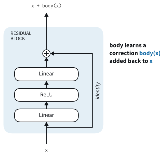
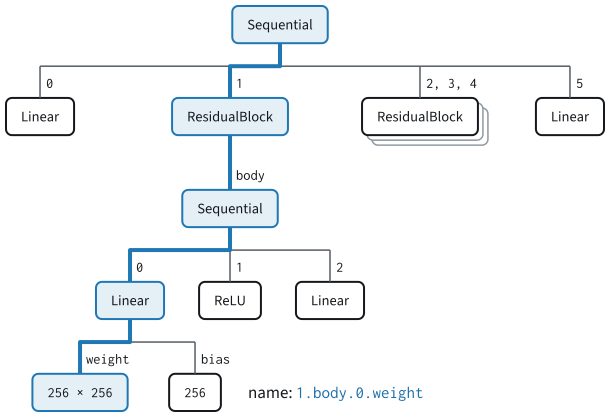

```{.python .input}
%load_ext d2lbook.tab
tab.interact_select('mxnet', 'pytorch', 'tensorflow', 'jax')
```

# Modules and Model Construction
:label:`sec_model_construction`

The multilayer perceptron of :numref:`sec_mlp-implementation` had four
parameter arrays, and we could name each one by hand. The models in the rest
of this book have many more. A residual network for images stacks dozens of
layers, and the language model Llama 3 8B
:cite:`Grattafiori.Dubey.Jauhri.ea.2024`, with 8 billion parameters,
consists of 32 identical blocks and stores its parameters in 291 arrays.
Every one of them must
reach the optimizer, be written to a checkpoint, and move to the GPU. An
array that is left out raises no error: it is simply never trained, or never
saved.

Deep learning frameworks solve this with one abstraction, the *module*. A
module is an object that owns parameters, owns other modules (its
*children*), and defines a forward computation from inputs to outputs.
Layers, groups of layers, and whole models are all modules, so a model is a
tree of modules, as in :numref:`fig_blocks`. The framework finds every
parameter by walking this tree, provided that each child has been
*registered* with its parent. This section shows how registration works, how
it fails, and how to write the forward computation of a module yourself. The
rest of the chapter uses the same walk for other tasks: counting the
parameters (:numref:`sec_parameters`), initializing them
(:numref:`sec_init_param`), saving them (:numref:`sec_read_write`), and
moving them to a GPU (:numref:`sec_use_gpu`).

![The module tree of the residual MLP that we build at the end of this section. Each edge carries the name under which the parent registered the child, and the path of names from the root to a parameter is the name of that parameter, here `1.body.0.weight`. Blocks 2 to 4 repeat block 1. PyTorch and Gluon join the names with dots; JAX lists the same path as a tuple and keeps the children of a sequential container under `layers`. Gluon folds the ReLU into the first dense layer, so its second dense layer is child 1 of the body; Keras names the children after their classes.](../img/bg-module-names.svg)
:label:`fig_blocks`

```{.python .input #model-construction-modules-and-model-construction}
%%tab mxnet
from dataclasses import dataclass
from mxnet import init, np as mnp, npx
from mxnet.gluon import nn
npx.set_np()
```

```{.python .input #model-construction-modules-and-model-construction}
%%tab pytorch
from dataclasses import dataclass
from d2l import torch as d2l
import torch
from torch import nn
from torch.nn import functional as F
```

```{.python .input #model-construction-modules-and-model-construction}
%%tab tensorflow
from dataclasses import dataclass
import tensorflow as tf
```

```{.python .input #model-construction-modules-and-model-construction}
%%tab jax
from dataclasses import dataclass
from d2l import jax as d2l
import jax
from jax import numpy as jnp
from flax import nnx
```

## The Module Abstraction

### Sequential Containers and the Registry

Every model since :numref:`sec_oo-design` has been a module: `d2l.Module`
is a subclass of the framework's module class. The quickest way to build a
module from layers is a *sequential container*, a module that applies its
children one after the other. Here it holds the MLP of
:numref:`sec_mlp-implementation`, with a hidden layer of 256 ReLU units and
10 outputs, applied to a minibatch of two examples with 20 features each.

:begin_tab:`mxnet`
In Gluon the module class is `nn.Block`. The container `nn.Sequential`
receives its layers through `add`, and the argument `activation` attaches
the ReLU to the first `Dense` layer. The call `initialize` comes between
construction and the first forward pass; we return to it in
:numref:`sec_lazy_init`.
:end_tab:

:begin_tab:`pytorch`
In PyTorch the module class is `nn.Module`, and the container
`nn.Sequential` takes its layers as arguments.
:end_tab:

:begin_tab:`tensorflow`
In Keras the module class is `tf.keras.layers.Layer`; a `tf.keras.Model` is
a layer with training methods added. The container `tf.keras.Sequential`
takes a list of layers, and the argument `activation` attaches the ReLU to
the first `Dense` layer.
:end_tab:

:begin_tab:`jax`
In Flax NNX the module class is `nnx.Module`, and the container
`nnx.Sequential` takes its layers as arguments. NNX layers create their
parameters in the constructor, so each `nnx.Linear` needs its number of
inputs and `rngs`, the source of random keys for its initial weights.
:end_tab:

```{.python .input #model-construction-the-module-abstraction-1}
%%tab mxnet
net = nn.Sequential()
net.add(nn.Dense(256, activation='relu'))
net.add(nn.Dense(10))
net.initialize()

X = mnp.random.uniform(size=(2, 20))
net(X).shape
```

```{.python .input #model-construction-the-module-abstraction-1}
%%tab pytorch
net = nn.Sequential(nn.LazyLinear(256), nn.ReLU(), nn.LazyLinear(10))

X = torch.rand(2, 20)
net(X).shape
```

```{.python .input #model-construction-the-module-abstraction-1}
%%tab tensorflow
net = tf.keras.Sequential([tf.keras.layers.Dense(256, activation='relu'),
                           tf.keras.layers.Dense(10)])

X = tf.random.uniform((2, 20))
net(X).shape
```

```{.python .input #model-construction-the-module-abstraction-1}
%%tab jax
rngs = nnx.Rngs(d2l.get_key())
net = nnx.Sequential(nnx.Linear(20, 256, rngs=rngs), nnx.relu,
                     nnx.Linear(256, 10, rngs=rngs))

X = jax.random.uniform(d2l.get_key(), (2, 20))
net(X).shape
```

The container keeps its children in a *registry*, a table from names to
modules, and its forward computation runs through that table in order.

:begin_tab:`mxnet`
Printing the block lists the registry. The names are the positions `0` and
`1`.
:end_tab:

:begin_tab:`pytorch`
`named_children` lists the registry. The names are the positions `'0'`,
`'1'`, and `'2'`; the ReLU is a module without parameters.
:end_tab:

:begin_tab:`tensorflow`
Keras keeps the children in a tracked list, `layers`. The names are
generated from the class names.
:end_tab:

:begin_tab:`jax`
In NNX the module and its attributes form a graph of Python objects, and
`nnx.state(net, nnx.Param)` lists every parameter by its path through that
graph. The container keeps its children under `layers`, at the positions 0,
1, and 2; the ReLU at position 1 is a plain function and owns nothing.
:end_tab:

```{.python .input #model-construction-the-module-abstraction-2}
%%tab mxnet
net
```

```{.python .input #model-construction-the-module-abstraction-2}
%%tab pytorch
dict(net.named_children())
```

```{.python .input #model-construction-the-module-abstraction-2}
%%tab tensorflow
net.layers
```

```{.python .input #model-construction-the-module-abstraction-2}
%%tab jax
[(path, value.shape)
 for path, value in nnx.state(net, nnx.Param).flat_state()]
```

Everything the framework does to a model as a whole walks this registry.
Collecting the parameters for the optimizer, writing them to a file, and
moving them to a GPU all visit the registered children, then their children,
and so on down to the parameters. A layer that is not registered is skipped
by all of them.

### Subclasses of the Module Class

A sequential container only expresses a chain. For any other wiring we
subclass the module class and write two methods: a constructor that creates
the children, and a forward method that applies them to the input. The
forward method is called `forward` in PyTorch and Gluon, `call` in Keras,
and `__call__` in NNX. Here is the same MLP once more:

```{.python .input #model-construction-the-module-abstraction-3}
%%tab mxnet
class MLP(nn.Block):
    def __init__(self):
        super().__init__()
        self.hidden = nn.Dense(256, activation='relu')
        self.out = nn.Dense(10)

    def forward(self, X):
        return self.out(self.hidden(X))
```

```{.python .input #model-construction-the-module-abstraction-3}
%%tab pytorch
class MLP(nn.Module):
    def __init__(self):
        super().__init__()
        self.hidden = nn.LazyLinear(256)
        self.out = nn.LazyLinear(10)

    def forward(self, X):
        return self.out(F.relu(self.hidden(X)))
```

```{.python .input #model-construction-the-module-abstraction-3}
%%tab tensorflow
class MLP(tf.keras.Model):
    def __init__(self):
        super().__init__()
        self.hidden = tf.keras.layers.Dense(256, activation='relu')
        self.out = tf.keras.layers.Dense(10)

    def call(self, X):
        return self.out(self.hidden(X))
```

```{.python .input #model-construction-the-module-abstraction-3}
%%tab jax
class MLP(nnx.Module):
    def __init__(self, rngs):
        self.hidden = nnx.Linear(20, 256, rngs=rngs)
        self.out = nnx.Linear(256, 10, rngs=rngs)

    def __call__(self, X):
        return self.out(nnx.relu(self.hidden(X)))
```

```{.python .input #model-construction-the-module-abstraction-4}
%%tab mxnet
net = MLP()
net.initialize()
net(X).shape
```

```{.python .input #model-construction-the-module-abstraction-4}
%%tab pytorch
net = MLP()
net(X).shape
```

```{.python .input #model-construction-the-module-abstraction-4}
%%tab tensorflow
net = MLP()
net(X).shape
```

```{.python .input #model-construction-the-module-abstraction-4}
%%tab jax
net = MLP(nnx.Rngs(d2l.get_key()))
net(X).shape
```

Two details make this work. First, `self.hidden = ...` is not an ordinary
attribute assignment. The module class intercepts assignment (the Python
method `__setattr__`), and when the value is a module it enters the
registry under the attribute name, here `hidden` and `out`. That is all it
takes for both layers' parameters to reach the optimizer. Second, we wrote
no backward method: automatic differentiation derives the gradients from
whatever the forward method computes.

:begin_tab:`mxnet`
We call the model as `net(X)`, never as `net.forward(X)`. Calling a block
runs `Block.__call__`, which runs `forward` and, around it, any *hooks*
registered on the block: functions that see its inputs and outputs without
changing its code. :numref:`sec_repro` uses them to inspect a model.
:end_tab:

:begin_tab:`pytorch`
We call the model as `net(X)`, never as `net.forward(X)`. Calling a module
runs `nn.Module.__call__`, which runs `forward` and, around it, any *hooks*
registered on the module: functions that see its inputs and outputs without
changing its code. :numref:`sec_repro` uses them to inspect a model.
:end_tab:

:begin_tab:`tensorflow`
We call the model as `net(X)`, never as `net.call(X)`. Calling a layer runs
Keras's `__call__`, which on the first call creates the layer's variables
from the shape of the input (:numref:`sec_lazy_init`) and then runs `call`.
:end_tab:

:begin_tab:`jax`
In NNX, `net(X)` runs `__call__` directly; the model needs no extra
dictionary of parameters, because the parameters are attributes of the
layers. The transformations `nnx.grad` and `nnx.jit` follow the same
attributes.
:end_tab:

## Module Containers
:label:`subsec_model-construction-sequential`

### Writing a Container

A container has two jobs: register each child, and run the children in
order. Writing one ourselves shows both. The registration step is the one
that can go wrong.

```{.python .input #model-construction-sequential-and-friends-containers-1}
%%tab mxnet
class MySequential(nn.Block):
    def __init__(self):
        super().__init__()
        self._layers = []  # The registry holds weak references

    def add(self, block):
        self._layers.append(block)
        self.register_child(block)

    def forward(self, X):
        for block in self._layers:
            X = block(X)
        return X
```

```{.python .input #model-construction-sequential-and-friends-containers-1}
%%tab pytorch
class MySequential(nn.Module):
    def __init__(self, *args):
        super().__init__()
        for idx, module in enumerate(args):
            self.add_module(str(idx), module)

    def forward(self, X):
        for module in self.children():
            X = module(X)
        return X
```

```{.python .input #model-construction-sequential-and-friends-containers-1}
%%tab tensorflow
class MySequential(tf.keras.Model):
    def __init__(self, *args):
        super().__init__()
        self.modules = args

    def call(self, X):
        for module in self.modules:
            X = module(X)
        return X
```

```{.python .input #model-construction-sequential-and-friends-containers-1}
%%tab jax
class MySequential(nnx.Module):
    def __init__(self, *modules):
        self.modules = nnx.List(modules)

    def __call__(self, X):
        for module in self.modules:
            X = module(X)
        return X
```

:begin_tab:`mxnet`
`register_child` enters a block into the registry under its position in the
sequence; attribute assignment calls it with the attribute name instead.
Gluon's registry holds weak references, so our class also keeps the blocks
in a list of its own, which keeps them alive.
:end_tab:

:begin_tab:`pytorch`
`add_module` enters a child into the registry under a name, here its
position as a string, and `children()` runs through the registry in the
order of insertion.
:end_tab:

:begin_tab:`tensorflow`
`self.modules = args` looks like an ordinary assignment. Keras's
`__setattr__` looks inside lists, tuples, and dictionaries, so both `Dense`
layers are tracked.
:end_tab:

:begin_tab:`jax`
`nnx.List` is a list that NNX treats as part of the module graph, so the
parameters of both `Linear` layers appear under the path `modules`.
:end_tab:

Our container works like the built-in one:

```{.python .input #model-construction-sequential-and-friends-containers-2}
%%tab mxnet
net = MySequential()
net.add(nn.Dense(256, activation='relu'))
net.add(nn.Dense(10))
net.initialize()
net(X).shape
```

```{.python .input #model-construction-sequential-and-friends-containers-2}
%%tab pytorch
net = MySequential(nn.LazyLinear(256), nn.ReLU(), nn.LazyLinear(10))
net(X).shape
```

```{.python .input #model-construction-sequential-and-friends-containers-2}
%%tab tensorflow
net = MySequential(tf.keras.layers.Dense(256, activation='relu'),
                   tf.keras.layers.Dense(10))
net(X).shape
```

```{.python .input #model-construction-sequential-and-friends-containers-2}
%%tab jax
rngs = nnx.Rngs(d2l.get_key())
net = MySequential(nnx.Linear(20, 256, rngs=rngs), nnx.relu,
                   nnx.Linear(256, 10, rngs=rngs))
net(X).shape
```

### Layers in a Plain List

Now suppose we store the layers in an ordinary Python list. The forward
method can still loop over the list, but the list is not a module, and the
four frameworks react to it in four different ways.

:begin_tab:`mxnet`
The block below keeps its layers in a plain list. `net.initialize()` walks
the registry and cannot reach them, so we initialize each layer by hand to
get a forward pass at all:
:end_tab:

:begin_tab:`pytorch`
The module below keeps its layers in a plain list:
:end_tab:

:begin_tab:`tensorflow`
In Keras the plain list is the ordinary way to hold a stack of layers,
because the attribute scan looks inside lists:
:end_tab:

:begin_tab:`jax`
NNX needs the graph-aware `nnx.List` for a list of modules. With it, the
model is complete:
:end_tab:

```{.python .input #model-construction-sequential-and-friends-containers-3}
%%tab mxnet
class PlainListMLP(nn.Block):
    def __init__(self):
        super().__init__()
        self.layers = [nn.Dense(256, activation='relu'), nn.Dense(10)]
        for layer in self.layers:
            layer.initialize()  # By hand: net.initialize() cannot see them

    def forward(self, X):
        for layer in self.layers:
            X = layer(X)
        return X

net = PlainListMLP()
net(X).shape, len(net.collect_params())
```

```{.python .input #model-construction-sequential-and-friends-containers-3}
%%tab pytorch
class PlainListMLP(nn.Module):
    def __init__(self):
        super().__init__()
        self.layers = [nn.Linear(20, 256), nn.ReLU(), nn.Linear(256, 10)]

    def forward(self, X):
        for layer in self.layers:
            X = layer(X)
        return X

net = PlainListMLP()
net(X).shape, sum(p.numel() for p in net.parameters())
```

```{.python .input #model-construction-sequential-and-friends-containers-3}
%%tab tensorflow
class ListMLP(tf.keras.Model):
    def __init__(self):
        super().__init__()
        self.blocks = [tf.keras.layers.Dense(256, activation='relu'),
                       tf.keras.layers.Dense(10)]

    def call(self, X):
        for block in self.blocks:
            X = block(X)
        return X

net = ListMLP()
net(X).shape, sum(int(tf.size(v)) for v in net.trainable_variables)
```

```{.python .input #model-construction-sequential-and-friends-containers-3}
%%tab jax
class ListMLP(nnx.Module):
    def __init__(self, rngs):
        self.layers = nnx.List([nnx.Linear(20, 256, rngs=rngs),
                                nnx.Linear(256, 10, rngs=rngs)])

    def __call__(self, X):
        return self.layers[1](nnx.relu(self.layers[0](X)))

net = ListMLP(nnx.Rngs(d2l.get_key()))
state = nnx.state(net, nnx.Param)
net(X).shape, sum(x.size for _, x in state.flat_state())
```

:begin_tab:`mxnet`
The model computes, yet it owns zero parameters, and `save_parameters`
would write an empty file. Here the `Trainer` at least fails when it is
constructed from the empty parameter dictionary, although with a
`TypeError` that does not name the cause. A block that registers some
layers as attributes and keeps others in a list is worse. On the CPU, the
`Trainer` updates the registered layers and leaves the others at their
initial weights, without an error. With `num_gpus=1` it moves only the
registered layers to the GPU, and the first forward pass stops with an
error about arrays on different devices. Gluon does warn, though:
`collect_params()` looks for lists, tuples, and dictionaries of blocks among
the ordinary attributes and prints a warning that names the unregistered
attribute and the repair. Had we skipped the initialization by hand, the
first forward pass would have stopped with the error that the parameters
are not initialized. The repair is to register each child, as
`MySequential.add` did:
:end_tab:

:begin_tab:`pytorch`
The model computes, yet it owns zero parameters. A plain Python list is not
a module, so `__setattr__` stores it like any other value and registers
nothing inside it. The layers still hold their own weights, which is why
the forward pass runs. But `net.parameters()` is empty, `net.to(device)`
leaves every layer on the CPU, and `net.state_dict()` saves an empty model.
Here the optimizer at least complains: `torch.optim.SGD` refuses an empty
list of parameters. A model that is only partly registered is worse.
Suppose its input and output layers are attributes and the blocks between
them sit in a plain list. On the CPU, the optimizer then trains the two
outer layers and leaves the blocks at their initial weights, without any
error, and the only sign is a model that learns less than it should. On a
GPU the failure is at least loud: `Trainer(num_gpus=1)` moves only the
registered layers, and the first forward pass stops with an error about
tensors on different devices. The registered
container for a list of children is `nn.ModuleList`:
:end_tab:

:begin_tab:`tensorflow`
All 7,946 parameters are present: 20 · 256 + 256 in the hidden layer and
256 · 10 + 10 in the output layer. (We named the list `blocks` because
Keras reserves the attribute `layers` for its own tracked list.) The mistake
that Keras guards against is a different one: adding a layer to a model
whose variables already exist. Creating the variables fixes the structure
of the model, and a later assignment fails at once:
:end_tab:

:begin_tab:`jax`
All 7,946 parameters are present: 20 · 256 + 256 in the hidden layer and
256 · 10 + 10 in the output layer. A plain Python list of modules is
rejected outright, because NNX would otherwise treat the list as fixed
configuration and hide the parameters inside it. The error lists the
repairs, among them `nnx.List` and `nnx.data`:
:end_tab:

```{.python .input #model-construction-sequential-and-friends-containers-4}
%%tab mxnet
class RegisteredListMLP(PlainListMLP):
    def __init__(self):
        super().__init__()
        for layer in self.layers:
            self.register_child(layer)

net = RegisteredListMLP()
net(X).shape, sum(p.data().size for p in net.collect_params().values())
```

```{.python .input #model-construction-sequential-and-friends-containers-4}
%%tab pytorch
class ModuleListMLP(PlainListMLP):
    def __init__(self):
        super().__init__()
        self.layers = nn.ModuleList(self.layers)

net = ModuleListMLP()
net(X).shape, sum(p.numel() for p in net.parameters())
```

```{.python .input #model-construction-sequential-and-friends-containers-4}
%%tab tensorflow
try:
    net.head = tf.keras.layers.Dense(2)  # net is built: too late
except ValueError as e:
    print(e)
```

```{.python .input #model-construction-sequential-and-friends-containers-4}
%%tab jax
class PlainListSequential(nnx.Module):
    def __init__(self, *modules):
        self.modules = list(modules)  # Modules in a plain list: rejected

try:
    net = PlainListSequential(
        nnx.Linear(20, 10, rngs=nnx.Rngs(d2l.get_key())))
except ValueError as e:
    print(e)
```

:begin_tab:`mxnet`
Same forward pass, and now all 7,946 parameters are registered: 20 · 256 +
256 in the hidden layer and 256 · 10 + 10 in the output layer. Gluon has no
list container. Children are registered through attributes, through
`nn.Sequential`, or one at a time with `register_child`, which suits a loop
that is not a plain chain, such as blocks that take an extra argument.
:end_tab:

:begin_tab:`pytorch`
Same forward pass, and now all 7,946 parameters are registered: 20 · 256 +
256 in the hidden layer and 256 · 10 + 10 in the output layer. The
containers divide the work as follows. `nn.Sequential` registers its
children and supplies a forward method that chains them. `nn.ModuleList`
registers a list of children and supplies no forward method, so we write
the loop ourselves, which is what we want when the loop is not a plain
chain: blocks that take an extra argument, or a computation between blocks.
`nn.ModuleDict` does the same for children indexed by name. A model that
repeats one block many times, such as the 32-block 8B model of the
introduction, keeps the blocks in an `nn.ModuleList`.
:end_tab:

:begin_tab:`tensorflow`
The message states the rule: all state is created in `__init__` or in
`build`, never afterwards. Keras therefore needs no special list or
dictionary containers. Any layer reachable from an attribute is tracked,
and a late change to the structure fails when it is made, not when the
model silently ignores it.
:end_tab:

:begin_tab:`jax`
NNX supplies `nnx.List` and `nnx.Dict` for collections of modules. A
misdeclared child fails when the model is constructed, not after a training
run that updated nothing.
:end_tab:

## Forward Computation

The forward method is ordinary Python. It can call any tensor operation,
loop, branch, and combine intermediate results. This section uses that
freedom three times: for a residual connection, for a constant, and for a
loop whose length depends on the data.

### Residual Connections

The most important example in this book is the *residual connection*,
which adds the input of a block to its output. If $f$ is the *body* of the
block, the computation inside it, here two fully connected layers with a
ReLU between them, the block computes

$$\mathbf{y} = \mathbf{x} + f(\mathbf{x}).$$

The block outputs its input plus a correction $f(\mathbf{x})$. If $f$ is
zero, the block is the identity, so a stack of such blocks can pass its
input through unchanged, and each block only has to learn a correction to
its input. The networks of :numref:`sec_resnet` are built this way. No
framework provides this as a layer; it is one line of the forward method,
`X + self.body(X)`:

```{.python .input #model-construction-forward-is-just-python-1}
%%tab mxnet
class ResidualBlock(nn.Block):
    def __init__(self, num_hiddens):
        super().__init__()
        self.body = nn.Sequential()
        self.body.add(nn.Dense(num_hiddens, activation='relu',
                               in_units=num_hiddens),
                      nn.Dense(num_hiddens, in_units=num_hiddens))

    def forward(self, X):
        return X + self.body(X)
```

```{.python .input #model-construction-forward-is-just-python-1}
%%tab pytorch
class ResidualBlock(nn.Module):
    def __init__(self, num_hiddens):
        super().__init__()
        self.body = nn.Sequential(
            nn.Linear(num_hiddens, num_hiddens), nn.ReLU(),
            nn.Linear(num_hiddens, num_hiddens))

    def forward(self, X):
        return X + self.body(X)
```

```{.python .input #model-construction-forward-is-just-python-1}
%%tab tensorflow
class ResidualBlock(tf.keras.layers.Layer):
    def __init__(self, num_hiddens, **kwargs):
        super().__init__(**kwargs)
        self.body = tf.keras.Sequential([
            tf.keras.layers.Dense(num_hiddens, activation='relu'),
            tf.keras.layers.Dense(num_hiddens)])

    def call(self, X):
        return X + self.body(X)
```

```{.python .input #model-construction-forward-is-just-python-1}
%%tab jax
class ResidualBlock(nnx.Module):
    def __init__(self, num_hiddens, *, rngs):
        self.body = nnx.Sequential(
            nnx.Linear(num_hiddens, num_hiddens, rngs=rngs), nnx.relu,
            nnx.Linear(num_hiddens, num_hiddens, rngs=rngs))

    def __call__(self, X):
        return X + self.body(X)
```


:label:`fig_bg_residual-block`

:numref:`fig_bg_residual-block` shows the wiring. The skip path also
changes the backward pass. The Jacobian of the block is
$\mathbf{I} + \mathbf{J}_f$, where $\mathbf{J}_f$ is the Jacobian of the
body, so the gradient that reaches $\mathbf{x}$ is the gradient at
$\mathbf{y}$ plus the part that flows through the body
:cite:`He.Zhang.Ren.ea.2016*1`. The addition also has a consequence for
construction: $\mathbf{x}$ and $f(\mathbf{x})$ must have the same shape, so
a residual block has a single width, which we pass to the constructor.

:begin_tab:`mxnet`
Both `Dense` layers therefore receive `in_units`, and the block's
parameters are created by `initialize` without waiting for data.
:end_tab:

:begin_tab:`pytorch`
The body therefore uses `nn.Linear` with both widths rather than lazy
layers.
:end_tab:

:begin_tab:`tensorflow`
Keras infers input widths when the layer is built, so the constraint falls
on the caller: an input with other than `num_hiddens` columns makes the
addition fail.
:end_tab:

:begin_tab:`jax`
NNX layers take both widths anyway, and `num_hiddens` supplies them.
:end_tab:

```{.python .input #model-construction-forward-is-just-python-2}
%%tab mxnet
block = ResidualBlock(24)
block.initialize()
block(mnp.random.normal(size=(2, 24))).shape
```

```{.python .input #model-construction-forward-is-just-python-2}
%%tab pytorch
block = ResidualBlock(24)
block(torch.randn(2, 24)).shape
```

```{.python .input #model-construction-forward-is-just-python-2}
%%tab tensorflow
block = ResidualBlock(24)
block(tf.random.normal((2, 24))).shape
```

```{.python .input #model-construction-forward-is-just-python-2}
%%tab jax
block = ResidualBlock(24, rngs=nnx.Rngs(d2l.get_key()))
X24 = jax.random.normal(d2l.get_key(), (2, 24))
block(X24).shape
```

### Constants in the Forward Method

The forward method may also use values that are neither inputs nor
parameters. Suppose we want to damp the correction by a fixed factor
$\alpha = 0.5$, so that the block computes
$\mathbf{x} + \alpha f(\mathbf{x})$. The factor is part of the design, and
training must not change it:

```{.python .input #model-construction-forward-is-just-python-3}
%%tab mxnet
class ScaledResidual(ResidualBlock):
    def __init__(self, num_hiddens, alpha=0.5):
        super().__init__(num_hiddens)
        self.alpha = mnp.array(alpha)  # Fixed by design, never trained

    def forward(self, X):
        return X + self.alpha * self.body(X)

block = ScaledResidual(24)
'alpha' in block.collect_params(), list(block.collect_params())[:2]
```

```{.python .input #model-construction-forward-is-just-python-3}
%%tab pytorch
class ScaledResidual(ResidualBlock):
    def __init__(self, num_hiddens, alpha=0.5):
        super().__init__(num_hiddens)
        self.alpha = torch.tensor(alpha)  # Fixed by design, never trained

    def forward(self, X):
        return X + self.alpha * self.body(X)

block = ScaledResidual(24)
'alpha' in block.state_dict(), list(block.state_dict())[:2]
```

```{.python .input #model-construction-forward-is-just-python-3}
%%tab tensorflow
class ScaledResidual(ResidualBlock):
    def __init__(self, num_hiddens, alpha=0.5, **kwargs):
        super().__init__(num_hiddens, **kwargs)
        self.alpha = tf.constant(alpha)  # Fixed by design, never trained

    def call(self, X):
        return X + self.alpha * self.body(X)

block = ScaledResidual(24)
block(tf.random.normal((2, 24)))
paths = [w.path for w in block.weights]
any('alpha' in path for path in paths), paths[:2]
```

```{.python .input #model-construction-forward-is-just-python-3}
%%tab jax
class ScaledResidual(ResidualBlock):
    def __init__(self, num_hiddens, *, rngs, alpha=0.5):
        super().__init__(num_hiddens, rngs=rngs)
        self.alpha = alpha  # Fixed by design, never trained

    def __call__(self, X):
        return X + self.alpha * self.body(X)

block = ScaledResidual(24, rngs=nnx.Rngs(d2l.get_key()))
block.alpha, [path for path, _ in nnx.state(block, nnx.Param).flat_state()]
```

:begin_tab:`mxnet`
The factor enters the computation but is not a parameter: it is missing
from `collect_params()`, so the `Trainer` never changes it, which is what
we wanted. It is also invisible to everything else that walks the
parameters: `save_parameters` does not save it, and it does not move to a
GPU with the rest of the block. Some state must travel with the model
without being trained. :numref:`sec_parameters` gives such state its
registered place, a constant parameter (`gluon.Constant`).
:end_tab:

:begin_tab:`pytorch`
The factor enters the computation but is not a parameter: it is missing
from `named_parameters()`, so the optimizer never changes it, which is what
we wanted. It is missing from `state_dict()` as well, so it is not saved
with the model, and `.to(device)` does not move it. Some state must travel
with the model without being trained. :numref:`sec_parameters` gives such
state its registered place, a *buffer*.
:end_tab:

:begin_tab:`tensorflow`
The factor enters the computation but is not a variable: `block.weights`
holds only the `Dense` variables, so the optimizer never changes it, which
is what we wanted. Not being a variable, it is not saved with the weights
either. Some state must travel with the model without being trained.
:numref:`sec_parameters` gives such state its registered place, a
non-trainable variable.
:end_tab:

:begin_tab:`jax`
The factor enters the computation but is not an `nnx.Param`, so an
optimizer that updates parameters never changes it, which is what we
wanted. As a plain Python number it belongs to the definition of the model,
and `ScaledResidual(24, rngs=rngs, alpha=0.5)` rebuilds it. State that changes
during training, such as running statistics, is held in other
`nnx.Variable` types instead (:numref:`sec_parameters`).
:end_tab:

### Eager and Compiled Execution

:begin_tab:`mxnet`
Gluon runs `forward` as written, one operation at a time, a mode called
*eager execution*, and so does our `Trainer`. A loop whose condition
depends on the values of arrays therefore works just as it does in NumPy.
A `HybridBlock` can instead compile its forward method into a graph, which
forbids such loops; this chapter uses `Block` throughout.
:end_tab:

:begin_tab:`pytorch`
PyTorch runs `forward` as written, one operation at a time, a mode called
*eager execution*, and so does our `Trainer`. A loop whose condition depends
on the values of tensors therefore works just as it does in NumPy.
Compilers for PyTorch models exist, and :numref:`chap_performance` uses
them.
:end_tab:

:begin_tab:`tensorflow`
Called directly, `call` runs as written, one operation at a time, a mode
called *eager execution*. The `Trainer` of :numref:`sec_linear_scratch`
compiles each training step with `tf.function` instead: it runs the step
once with symbolic tensors that have shapes but no values, records the
operations, and from then on executes the recording. In a plain
`tf.function`, a converter called AutoGraph rewrites a Python loop whose
condition depends on the values of tensors into a graph loop. Keras does
not apply AutoGraph to the `call` method of a layer, however, so in a model
such a loop cannot be recorded:
:end_tab:

:begin_tab:`jax`
Called directly, `__call__` runs as written, one operation at a time, a
mode called *eager execution*. The `Trainer` of :numref:`sec_linear_scratch`
compiles each training step with `nnx.jit` instead: it runs the step once
with *tracers*, placeholder arrays that have shapes but no values, records
the operations, and from then on executes the recording. A loop whose
condition depends on the values of arrays cannot be recorded this way:
:end_tab:

```{.python .input #model-construction-forward-is-just-python-4}
%%tab tensorflow
class HalvingNet(tf.keras.Model):
    def __init__(self):
        super().__init__()
        self.proj = tf.keras.layers.Dense(24)

    def call(self, X):
        X = self.proj(X)
        while tf.reduce_sum(tf.abs(X)) > 1:  # Depends on the values of X
            X = X / 2
        return tf.reduce_sum(X)

net = HalvingNet()
print(net(X))
try:
    tf.function(net)(X)
except tf.errors.OperatorNotAllowedInGraphError as e:
    print(type(e).__name__)
```

```{.python .input #model-construction-forward-is-just-python-4}
%%tab jax
class HalvingNet(nnx.Module):
    def __init__(self, rngs):
        self.proj = nnx.Linear(20, 24, rngs=rngs)

    def __call__(self, X):
        X = self.proj(X)
        while jnp.abs(X).sum() > 1:  # Depends on the values of X
            X = X / 2
        return X.sum()

net = HalvingNet(nnx.Rngs(d2l.get_key()))
print(net(X))
try:
    nnx.jit(lambda net, X: net(X))(net, X)
except jax.errors.TracerBoolConversionError as e:
    print(type(e).__name__)
```

:begin_tab:`tensorflow`
Eager execution runs the loop and returns a number. Under `tf.function` the
condition in `call` is a symbolic tensor without a value, and TensorFlow
refuses to turn it into a Python `bool`. Inside a layer, a loop that
depends on values must be written with `tf.while_loop`, which becomes part
of the recorded program. Loops over
the structure of the model, such as the loop over the children in
`MySequential`, cause no trouble: they run once while the step is recorded.
:end_tab:

:begin_tab:`jax`
Eager execution runs the loop and returns a number. Under `nnx.jit` the
condition is a tracer without a value, and JAX refuses to turn it into a
Python `bool`. A loop that depends on values must be written with
`jax.lax.while_loop`, which becomes part of the compiled program. Loops over
the structure of the model, such as the loop over the children in
`MySequential`, cause no trouble: they run once while the step is traced.
:end_tab:

## Lazy Initialization
:label:`sec_lazy_init`

### Shapes from Data

:begin_tab:`mxnet`
Since :numref:`sec_linear_concise`, our Gluon layers such as
`nn.Dense(256)` have named only their output width. The weight has shape
`(256, in_units)`, and we never said what `in_units` is: the layer reads it
from the first minibatch.
Gluon works this way in every layer, and `in_units` is an optional
argument. Here is the mechanism. Before the first forward pass the
parameter objects exist, but the input width is marked as unknown, $-1$:
:end_tab:

:begin_tab:`pytorch`
Since :numref:`sec_linear_concise`, our PyTorch models have used lazy
layers such as `nn.LazyLinear(256)`, which name only their output width.
The weight has shape `(256, in_features)`, and we never said what
`in_features` is: the layer reads it from the first minibatch, and the
`Trainer` initializes the weights afterwards by calling the model's method
`weight_init`. Here is the mechanism. Before the first
forward pass the weight is a placeholder without a shape:
:end_tab:

:begin_tab:`tensorflow`
Since :numref:`sec_linear_concise`, our Keras layers such as `Dense(256)`
have named only their output width. The kernel has shape
`(in_features, 256)`, and we never said what `in_features` is: the layer
reads it from the first minibatch.
Every Keras layer works this way. Here is the mechanism. Before the first
call the layer has no variables at all:
:end_tab:

:begin_tab:`jax`
NNX makes a different choice from the other three frameworks, whose layers
can leave the input width open until the first minibatch arrives. An
`nnx.Linear` takes both widths and creates its parameters in the
constructor, so the model is complete at once: an optimizer or a checkpoint
can see every parameter without a forward pass, and the shapes can be read
as soon as construction returns:
:end_tab:

```{.python .input #model-construction-lazy-initialization-shapes-from-data-1}
%%tab mxnet
net = nn.Sequential()
net.add(nn.Dense(256, activation='relu'))
net.add(nn.Dense(10))
{name: p.shape for name, p in net.collect_params().items()}
```

```{.python .input #model-construction-lazy-initialization-shapes-from-data-1}
%%tab pytorch
net = nn.Sequential(nn.LazyLinear(256), nn.ReLU(), nn.LazyLinear(10))
net[0].weight
```

```{.python .input #model-construction-lazy-initialization-shapes-from-data-1}
%%tab tensorflow
net = tf.keras.Sequential([tf.keras.layers.Dense(256, activation='relu'),
                           tf.keras.layers.Dense(10)])
net.weights
```

:begin_tab:`mxnet`
Even `initialize()` allocates nothing yet; it records which initializer to
use once the shapes are known. The first forward pass reads the input width
from the minibatch and creates the weight. The output width of each layer
is the input width of the next, so the shapes cascade through the model:
:end_tab:

:begin_tab:`pytorch`
The first forward pass reads the input width from the minibatch, creates
the weight, and turns the layer into an ordinary `nn.Linear`. The output
width of each layer is the input width of the next, so the shapes cascade
through the model:
:end_tab:

:begin_tab:`tensorflow`
Reading `net.layers[0].kernel` now would raise an error. The first call
runs each layer's `build`, which reads the input width from the minibatch
and creates the kernel. The output width of each layer is the input width
of the next, so the shapes cascade through the model:
:end_tab:

```{.python .input #model-construction-lazy-initialization-shapes-from-data-2}
%%tab mxnet
net.initialize()
net(X)
{name: p.shape for name, p in net.collect_params().items()}
```

```{.python .input #model-construction-lazy-initialization-shapes-from-data-2}
%%tab pytorch
net(X)
net[0].weight.shape
```

```{.python .input #model-construction-lazy-initialization-shapes-from-data-2}
%%tab tensorflow
net(X)
[w.shape for w in net.weights]
```

```{.python .input #model-construction-lazy-initialization-shapes-from-data-2}
%%tab jax
rngs = nnx.Rngs(d2l.get_key())
net = nnx.Sequential(nnx.Linear(20, 256, rngs=rngs), nnx.relu,
                     nnx.Linear(256, 10, rngs=rngs))
[(path, value.shape)
 for path, value in nnx.state(net, nnx.Param).flat_state()]
```

### Initialization after a Dry Run

Lazy layers spare us the arithmetic of input widths: in a deep model the
input width of each layer is the output width of the one before, and
working it out by hand is tedious and easy to get wrong. The cost is that
the parameters do not exist until a minibatch has passed through. Before
that, they cannot be counted, and an initializer whose scale depends on the
number of inputs, such as the Xavier initialization of
:numref:`subsec_xavier`, cannot be applied. Initialization therefore follows
a *dry run*, one forward pass on a representative minibatch whose output is
discarded.

:begin_tab:`mxnet`
Gluon builds this order into its interface. `initialize` takes the
initializer as an argument and records it for every parameter, and the
first forward pass applies it once the shapes are known. Xavier's uniform
initializer is `init.Xavier()`:
:end_tab:

:begin_tab:`pytorch`
`d2l.Module` packs the dry run and the initialization into one method,
`apply_init`. It runs the model once without recording gradients, then
calls the given function on every submodule. The `Trainer` calls
`apply_init` with the model's `weight_init` before training whenever the
model still has lazy parameters, as in the training runs of the previous
chapters.
:end_tab:

:begin_tab:`tensorflow`
Keras attaches the initializer to the layer: each layer accepts a
`kernel_initializer`, and `build` uses it when it creates the kernel. The
dry run can also be replaced by `build` with the input shape, which
propagates shapes through the model without data (`None` stands for the
size of the minibatch). Xavier's uniform initializer is the Keras default,
`GlorotUniform`; we spell it out:
:end_tab:

:begin_tab:`jax`
The initializer is an argument of the layer: `nnx.Linear` accepts a
`kernel_init` function and calls it in the constructor. Xavier's uniform
initializer is `nnx.initializers.xavier_uniform()`:
:end_tab:

```{.python .input #model-construction-lazy-initialization-shapes-from-data-3}
%%tab pytorch
@d2l.add_to_class(d2l.Module)  #@save
def apply_init(self, inputs, init=None):
    """Run a dry pass to fix lazy shapes, then apply `init`."""
    with torch.no_grad():
        self(*inputs)
    if init is not None:
        self.apply(init)
```

:begin_tab:`pytorch`
`nn.Module.apply(fn)` calls `fn` on every module of the tree, children
before their parents: one more task that is a walk over the tree. Here is
`apply_init` with Xavier's uniform initializer:
:end_tab:

```{.python .input #model-construction-lazy-initialization-shapes-from-data-4}
%%tab mxnet
net = nn.Sequential()
net.add(nn.Dense(256, activation='relu'))
net.add(nn.Dense(10))
net.initialize(init.Xavier())
net(X)
net[0].weight.data().shape
```

```{.python .input #model-construction-lazy-initialization-shapes-from-data-4}
%%tab pytorch
class TinyMLP(d2l.Module):
    def __init__(self):
        super().__init__()
        self.net = nn.Sequential(nn.LazyLinear(256), nn.ReLU(),
                                 nn.LazyLinear(10))

def init_xavier(module):
    if isinstance(module, nn.Linear):
        nn.init.xavier_uniform_(module.weight)

model = TinyMLP()
model.apply_init([X], init_xavier)
model.net[0].weight.shape
```

```{.python .input #model-construction-lazy-initialization-shapes-from-data-4}
%%tab tensorflow
net = tf.keras.Sequential([
    tf.keras.layers.Dense(
        256, activation='relu',
        kernel_initializer=tf.keras.initializers.GlorotUniform()),
    tf.keras.layers.Dense(10)])
net.build((None, 20))
net.layers[0].kernel.shape
```

```{.python .input #model-construction-lazy-initialization-shapes-from-data-4}
%%tab jax
class TinyMLP(d2l.Module):
    def __init__(self, rngs):
        super().__init__()
        self.net = nnx.Sequential(
            nnx.Linear(20, 256,
                       kernel_init=nnx.initializers.xavier_uniform(),
                       rngs=rngs), nnx.relu,
            nnx.Linear(256, 10, rngs=rngs))

model = TinyMLP(nnx.Rngs(d2l.get_key()))
[(path, value.shape)
 for path, value in nnx.state(model, nnx.Param).flat_state()]
```

:begin_tab:`mxnet`
The dry run created every weight and drew the first one from the Xavier
initializer that `initialize` had recorded.
:end_tab:

:begin_tab:`pytorch`
The dry run turned every lazy layer into an `nn.Linear`, after which
`init_xavier` could recognize the layers and redraw their weights.
:end_tab:

:begin_tab:`tensorflow`
`build` created every variable and drew the first kernel from the Xavier
initializer, without any data.
:end_tab:

:begin_tab:`jax`
The constructor created every parameter and drew the first kernel from the
Xavier initializer.
:end_tab:

## Models from a Config

### Configs and Builders

A trained model is a set of arrays plus the code that knows what to do with
them. The arrays alone do not say how to rebuild the model. Every width and
depth in this section so far was a literal typed into a constructor call,
and a checkpoint of the weights records such choices at best indirectly:
the shapes of the arrays reveal the widths, but nothing in them reveals a
choice without parameters, such as the activation function. The choices that
vary from one experiment to the next therefore belong in a small
*configuration* object, or *config*, that is logged with the results and
saved with the weights. The topology, meaning what a block computes and how
blocks connect, stays in code. Here a Python `dataclass` holds four fields,
and `build` turns them into a model:

```{.python .input #model-construction-building-from-a-config-1}
%%tab mxnet
@dataclass
class MLPConfig:
    num_inputs: int = 784
    num_hiddens: int = 256
    num_blocks: int = 4
    num_outputs: int = 10

def build(cfg: MLPConfig) -> nn.Block:
    net = nn.Sequential()
    net.add(nn.Dense(cfg.num_hiddens, in_units=cfg.num_inputs))
    for _ in range(cfg.num_blocks):
        net.add(ResidualBlock(cfg.num_hiddens))
    net.add(nn.Dense(cfg.num_outputs, in_units=cfg.num_hiddens))
    return net
```

```{.python .input #model-construction-building-from-a-config-1}
%%tab pytorch
@dataclass
class MLPConfig:
    num_inputs: int = 784
    num_hiddens: int = 256
    num_blocks: int = 4
    num_outputs: int = 10

def build(cfg: MLPConfig) -> nn.Module:
    blocks = [ResidualBlock(cfg.num_hiddens) for _ in range(cfg.num_blocks)]
    return nn.Sequential(nn.Linear(cfg.num_inputs, cfg.num_hiddens),
                         *blocks, nn.Linear(cfg.num_hiddens, cfg.num_outputs))
```

```{.python .input #model-construction-building-from-a-config-1}
%%tab tensorflow
@dataclass
class MLPConfig:
    num_inputs: int = 784
    num_hiddens: int = 256
    num_blocks: int = 4
    num_outputs: int = 10

def build(cfg: MLPConfig) -> tf.keras.Model:
    blocks = [ResidualBlock(cfg.num_hiddens) for _ in range(cfg.num_blocks)]
    return tf.keras.Sequential([tf.keras.Input((cfg.num_inputs,)),
                                tf.keras.layers.Dense(cfg.num_hiddens),
                                *blocks,
                                tf.keras.layers.Dense(cfg.num_outputs)])
```

```{.python .input #model-construction-building-from-a-config-1}
%%tab jax
@dataclass
class MLPConfig:
    num_inputs: int = 784
    num_hiddens: int = 256
    num_blocks: int = 4
    num_outputs: int = 10

def build(cfg: MLPConfig, rngs=None) -> nnx.Module:
    rngs = nnx.Rngs(d2l.get_key()) if rngs is None else rngs
    blocks = [ResidualBlock(cfg.num_hiddens, rngs=rngs)
              for _ in range(cfg.num_blocks)]
    return nnx.Sequential(
        nnx.Linear(cfg.num_inputs, cfg.num_hiddens, rngs=rngs), *blocks,
        nnx.Linear(cfg.num_hiddens, cfg.num_outputs, rngs=rngs))
```

One config gives one architecture: an input layer from `num_inputs` features to
the hidden width, `num_blocks` residual blocks, and an output layer. The
blocks pass through a plain Python list, which is safe here because
unpacking it into the sequential container registers each block. Every
layer receives both of its widths, so the model needs no dry run before its
parameters can be counted.

:begin_tab:`mxnet`
The names of the first parameters are the paths of :numref:`fig_blocks`,
joined by dots:
:end_tab:

:begin_tab:`pytorch`
The names of the first parameters are the paths of :numref:`fig_blocks`,
joined by dots:
:end_tab:

:begin_tab:`tensorflow`
`tf.keras.Input` declares the input width, so `Sequential` builds the whole
model at construction. Keras names variables by the generated names of the
layers rather than by attribute names, but the path still runs from the
model through the block and its body to the variable:
:end_tab:

:begin_tab:`jax`
The paths of the first parameters are those of :numref:`fig_blocks`:
:end_tab:

```{.python .input #model-construction-building-from-a-config-2}
%%tab mxnet
net = build(MLPConfig())
net.initialize()
[(name, p.shape) for name, p in net.collect_params().items()][:4]
```

```{.python .input #model-construction-building-from-a-config-2}
%%tab pytorch
net = build(MLPConfig())
[(name, tuple(p.shape)) for name, p in net.named_parameters()][:4]
```

```{.python .input #model-construction-building-from-a-config-2}
%%tab tensorflow
net = build(MLPConfig())
[(w.path, tuple(w.shape)) for w in net.weights][:4]
```

```{.python .input #model-construction-building-from-a-config-2}
%%tab jax
net = build(MLPConfig())
[(path, value.shape)
 for path, value in nnx.state(net, nnx.Param).flat_state()][:4]
```

The model maps a minibatch of 784-dimensional inputs, the size of a
flattened Fashion-MNIST image, to 10 outputs:

```{.python .input #model-construction-building-from-a-config-3}
%%tab mxnet
net(mnp.random.uniform(size=(2, 784))).shape
```

```{.python .input #model-construction-building-from-a-config-3}
%%tab pytorch
net(torch.rand(2, 784)).shape
```

```{.python .input #model-construction-building-from-a-config-3}
%%tab tensorflow
net(tf.random.uniform((2, 784))).shape
```

```{.python .input #model-construction-building-from-a-config-3}
%%tab jax
net(jax.random.uniform(d2l.get_key(), (2, 784))).shape
```

### Counting Parameters

The config also tells us the size of the model before we build it. The
input layer has $784 \cdot 256 + 256 = 200{,}960$ parameters, each block
has two layers of $256 \cdot 256 + 256$, or $131{,}584$ together, and the
output layer has $256 \cdot 10 + 10 = 2{,}570$. The default model therefore
has

$$200{,}960 + 4 \cdot 131{,}584 + 2{,}570 = 729{,}866$$

parameters, most of them in the blocks. Rescaling the model is a change to
two fields, not an edit of the model code, and a walk over the parameters
confirms the count:

```{.python .input #model-construction-building-from-a-config-4}
%%tab mxnet
for cfg in (MLPConfig(), MLPConfig(num_hiddens=512, num_blocks=8)):
    net = build(cfg)
    net.initialize()
    n = sum(p.data().size for p in net.collect_params().values())
    print(f'num_hiddens={cfg.num_hiddens}, num_blocks={cfg.num_blocks}: '
          f'{n:,} parameters')
```

```{.python .input #model-construction-building-from-a-config-4}
%%tab pytorch
for cfg in (MLPConfig(), MLPConfig(num_hiddens=512, num_blocks=8)):
    n = sum(p.numel() for p in build(cfg).parameters())
    print(f'num_hiddens={cfg.num_hiddens}, num_blocks={cfg.num_blocks}: '
          f'{n:,} parameters')
```

```{.python .input #model-construction-building-from-a-config-4}
%%tab tensorflow
for cfg in (MLPConfig(), MLPConfig(num_hiddens=512, num_blocks=8)):
    print(f'num_hiddens={cfg.num_hiddens}, num_blocks={cfg.num_blocks}: '
          f'{build(cfg).count_params():,} parameters')
```

```{.python .input #model-construction-building-from-a-config-4}
%%tab jax
for cfg in (MLPConfig(), MLPConfig(num_hiddens=512, num_blocks=8)):
    n = sum(x.size for _, x in nnx.state(build(cfg), nnx.Param).flat_state())
    print(f'num_hiddens={cfg.num_hiddens}, num_blocks={cfg.num_blocks}: '
          f'{n:,} parameters')
```

Doubling the width multiplies the parameters of each block by about four,
and doubling the number of blocks doubles their total, so the larger
config has more than six times as many parameters. The 8B model of the
introduction is described the same way: a config of
a dozen numbers, such as 32 blocks and a width of 4,096, and code that
turns it into a module tree.

A config records numbers, not code. Rebuilding a model from a checkpoint
also needs the same `build` function and the same block classes, which is
why :numref:`sec_read_write` saves the config inside the checkpoint next to
the weights.

:begin_tab:`tensorflow`
Keras offers the same idea in its own form: every layer has a method
`get_config` that returns its constructor arguments, which Keras saves with
the model and uses to rebuild it, provided the layer classes are available.
:end_tab:

We can now build a model of any size from modules, find all of its
parameters, and rebuild it from a few numbers. What we have not yet done is
look at the parameters themselves: which tensors a model holds, how much
memory they take, and how to share or freeze them. That is the subject of
:numref:`sec_parameters`.

## Summary

A module owns parameters, child modules, and a forward computation. Layers,
blocks, and whole models are modules, so a model is a tree, and the name of
each parameter is its path from the root. The framework finds parameters by
walking the registered children, so a child stored where the walk cannot
see it is never trained or saved. The forward method is ordinary Python, so
a residual connection is one line of it, although a compiled training step
forbids control flow that depends on the values of arrays. Lazy layers take
their input widths from the first minibatch, so their initialization follows
a dry run. A config of a few numbers, together with a `build` function,
records an architecture so that it can be logged, saved, and rebuilt.

:begin_tab:`mxnet`
In Gluon, children are registered by attribute assignment, by
`nn.Sequential`, and by `register_child`. Blocks in a plain list stay
unregistered, and `collect_params()` warns about them.
:end_tab:

:begin_tab:`pytorch`
In PyTorch, children are registered by attribute assignment and by the
containers `nn.Sequential`, `nn.ModuleList`, and `nn.ModuleDict`. Modules in
a plain list stay unregistered, without any warning.
:end_tab:

:begin_tab:`tensorflow`
In Keras, every layer reachable from an attribute is tracked, inside lists
and dictionaries too. Once the variables exist, the structure of the model
is fixed.
:end_tab:

:begin_tab:`jax`
In NNX, the attributes of a module form its graph. Collections of modules
go into `nnx.List` or `nnx.Dict`; a plain list of modules is rejected when
the model is constructed.
:end_tab:

## Exercises

:begin_tab:`mxnet`
1. [code] **Unregistered modules.** The plain list in `PlainListMLP` keeps
   its layers out of `collect_params()`, `initialize()`, and
   `save_parameters`, and `collect_params()` warns about it. Predict, then
   verify, what two further operations do to the model.
    1. Pass a batch through a fresh `PlainListMLP`, call
       `net.cast('float64')`, check the dtype of
       `net.layers[0].weight.data()`, and pass a `float64` batch through
       the model.
    1. The method `load_parameters` is the inverse of `save_parameters`: it
       reads a saved parameter file into a model. Run one forward pass
       through a `RegisteredListMLP`, save it with `save_parameters`, and
       load the file into a fresh `PlainListMLP` with `load_parameters`.
    1. Which of these failures are silent and which raise an error? Explain
       both from the same missing registration.
:end_tab:

:begin_tab:`pytorch`
1. [code] **Unregistered modules.** The plain list in `PlainListMLP` keeps
   its layers out of `net.parameters()`, `net.to(device)`, and
   `net.state_dict()`. Predict, then verify, what three further operations
   do to the model.
    1. Call `net.apply(init_xavier)` and check whether the weight of
       `net.layers[0]` changes.
    1. Add `nn.Dropout(0.5)` after the `nn.ReLU()` in the list, call
       `net.eval()`, and pass the same input through the model twice.
    1. The method `load_state_dict` is the inverse of `state_dict`: it
       copies a dictionary of saved tensors into a model. Call
       `net.load_state_dict(ModuleListMLP().state_dict())`.
    1. Which of these failures are silent and which raise an error? Explain
       all three from the same missing registration.
:end_tab:

:begin_tab:`tensorflow`
1. [code] **Unregistered modules.** Keras tracks a layer that the
   constructor assigns to an attribute, but not a `Dense` layer created
   *inside* `call`. Such a model runs without complaint. Write one, check
   `len(net.trainable_variables)` after calling it, explain what an
   optimizer would train, and explain what happens to the layer's weights
   between two calls.
:end_tab:

:begin_tab:`jax`
1. [code] **Unregistered containers.** NNX rejects a plain Python list that
   holds modules and names `nnx.List` and `nnx.data` as repairs.
    1. Rewrite `ListMLP` twice: once with its two layers in an `nnx.Dict`
       keyed `'hidden'` and `'out'`, and once with the plain list wrapped
       in `nnx.data`. Verify that all 7,946 parameters appear in
       `nnx.state(net, nnx.Param)` in both versions.
    1. Compare the parameter paths of the two versions with those of
       `ListMLP`. A checkpoint stores the state as a mapping from paths to
       arrays. Which of the two rewrites could restore a checkpoint saved
       from `ListMLP`, and why?
:end_tab:

2. **Widening a residual block.** `ResidualBlock` requires its input and
   output widths to agree. Suppose a block maps width $d$ to a larger width
   $d'$, so its body ends in a $d'$-wide layer and the skip path must also
   produce width $d'$. Give one way to build that skip path with
   parameters and one without. For each, count the extra parameters and
   state which output coordinates still receive the identity path.

3. [code] **Config boundaries.** Extend `MLPConfig` with a field
   `act: str = 'relu'` that selects the activation inside every
   `ResidualBlock`, and make `build` honor it.
    1. Build one model with `act='tanh'` and one from the default config,
       and compare their parameter shapes. Could a checkpoint that holds
       only the weights tell the two models apart? State what the answer
       implies for the config.
    1. A plain feed-forward block has the same `body` as `ResidualBlock`
       but no skip connection. Apply the same test to the choice between
       the two block types, and decide whether that choice belongs in the
       config or in code.

4. [code] **A module from scratch.** ● In plain Python and NumPy, without any
   framework base class, write a `Parameter` class that wraps an array and
   a minimal `Module` class whose `__setattr__` registers every assigned
   `Parameter` or `Module`. Give `Module` a `parameters()` method that
   recurses into the registered children. Write a `Linear` subclass of
   `Module` that holds a weight and a bias, build a two-layer MLP from two
   instances of it, and verify that `parameters()` returns all four arrays.
   Then store the two layers in a plain list, check what `parameters()`
   returns, and extend `Module` so that the list version finds all four
   arrays as well.

    *Adapted from CMU 10-714,
    [Homework 2](https://github.com/dlsyscourse/hw2), Question 2.*

5. [extended] **Depth family.** ● With `MLPConfig` and `build`, construct the
   residual MLP with `num_inputs=1`, `num_outputs=1`, and `num_blocks` set
   to 0, 1, and 4.
    1. Before training, list the layers that `build` stacks when
       `num_blocks=0` and state which functions of $x$ that model can
       represent.
    1. Train each variant with the squared loss, the same optimizer, and
       the same number of epochs on 1,000 points $x$ drawn uniformly from
       $[-3, 3]$ with targets $y = \sin(2x)$. Report a table of parameter
       count and final training loss against `num_blocks`, and explain the
       loss of the `num_blocks=0` variant from the first part.

    *Adapted from CMU 11-785,
    [Homework 1 Part 1](https://deeplearning.cs.cmu.edu/F23/document/homework/HW1/HW1P1_F23.pdf),
    Section 7.*

:begin_tab:`mxnet`
6. [code] **Lazy input width.** Build an `nn.Sequential` holding
   `nn.Dense(256, activation='relu')` and `nn.Dense(10)`, call
   `initialize()`, and pass a batch with 20 features through it, then a
   batch with 30 features. Explain the outcome from what the first forward
   pass did to each layer. Then describe a model that accepts inputs of
   either width while sharing every layer after the first.
:end_tab:

:begin_tab:`pytorch`
6. [code] **Lazy input width.** Build
   `net = nn.Sequential(nn.LazyLinear(256), nn.ReLU(), nn.LazyLinear(10))`
   and pass a batch with 20 features through it, then a batch with 30
   features. Explain the outcome from what the first forward pass did to
   each layer. Then describe a model that accepts inputs of either width
   while sharing every layer after the first.
:end_tab:

:begin_tab:`tensorflow`
6. [code] **Lazy input width.** Build a `tf.keras.Sequential` holding
   `tf.keras.layers.Dense(256, activation='relu')` and
   `tf.keras.layers.Dense(10)`, and pass a batch with 20 features through
   it, then a batch with 30 features. Explain the outcome from what the
   first forward pass did to each layer. Then describe a model that accepts
   inputs of either width while sharing every layer after the first.
:end_tab:

:begin_tab:`jax`
6. [code] **Shared children.** Reusing one child module at several sites
   turns the module tree of :numref:`fig_blocks` into a graph. Build a
   small network that uses the same child at two sites. Predict, then
   verify: does the shared child's parameter set appear once or twice in
   `nnx.state(net, nnx.Param)`? The function `nnx.split(net)` separates a
   module into a static graph definition and its state, and `nnx.merge`
   rebuilds a module from the two. After such a round trip, are the two
   sites still one object, checked with `is`?
:end_tab:

<!-- slides -->

::: {.slide}
::: {.cover}
[Dive into Deep Learning · §5.1]{.kicker}

Modules and Model Construction<br>**a tree of modules · registration · containers · residual blocks · lazy shapes · configs**
:::
:::

::: {.slide title="An 8B-Parameter Model Stores Its Weights in 291 Arrays"}
[The problem]{.kicker}

- The MLP of the last chapter: 4 parameter arrays, each written by hand.
- Llama 3 8B, a language model with 8 billion parameters: 32 identical
  blocks of 9 arrays, plus 3 outside the blocks,
  $32 \cdot 9 + 3 = 291$ arrays.
- Every array must reach the optimizer, be written to a checkpoint, and
  move to the GPU.

::: {.d2l-note .warn}
An array that is left out raises no error. It is never trained, or never
saved.
:::
:::

::: {.slide title="By the End of This Deck You Can"}
[Goals]{.kicker}

- explain how a framework finds every parameter of a model;
- write a module: a constructor that creates children, a forward method
  that uses them;
- recognize a child that is not registered, and repair it;
- write a residual block, and a forward method that a compiled training
  step accepts;
- build a model from a config and count its parameters by hand.

**Running example:** a residual MLP built from a config, 784 inputs, 4
blocks of width 256, 10 outputs: 729,866 parameters.
:::

::: {.slide title="The First Section of the Chapter on What Happens Inside a Model"}
[Where this fits]{.kicker}

::: {.cols .vc}
::: {.col}
| section | adds |
|---|---|
| **Modules and Model Construction** | **a model is a tree of modules, built from a config** |
| Parameters, State, and Memory | parameters, buffers, bytes per parameter |
| Initialization | library defaults, custom initializers, residual depth |
| Custom Layers and Functions | new layers, state, and custom gradients |
| Number Formats and Mixed Precision | dtypes, mixed precision, loss scaling |
| Saving, Loading, and Pretrained Weights | safe files, checkpoints, pretrained weights |
| GPUs, Devices, and Memory | placement, asynchrony, training memory |
| Reproducibility and Inspection | seeds, determinism, hooks |
:::

::: {.col .narrow}
- **Uses:** `d2l.Module`, the `Trainer`, the MLP with 256 hidden units,
  lazy layers and `weight_init`.
- **Skips:** what parameters hold and cost (next deck); how to choose
  initial values (two decks on).
:::
:::
:::

::: {.slide}
::: {.divider}
[01]{.dnum}

[Modules]{.dtitle}

[parameters · children · forward]{.dsub}
:::
:::

::: {.slide title="A Model Is a Tree of Modules, and a Parameter's Name Is Its Path"}
[Modules]{.kicker}

{width=72%}

A module owns parameters, owns child modules, and computes outputs from
inputs. Layers, blocks, and models are all modules.
:::

::: {.slide title="Assigning a Layer to an Attribute Registers It"}
[Modules]{.kicker}

@-model-construction-the-module-abstraction-3

- The module class intercepts attribute assignment (`__setattr__`): a
  module assigned to an attribute enters the *registry* under the
  attribute's name.
- No backward method: automatic differentiation derives the gradients from
  the forward computation.
:::

::: {.slide title="Every Whole-Model Operation Is a Walk over the Registry"}
[Modules]{.kicker}

| task | walks the tree to |
|---|---|
| optimizer | collect the trainable parameters |
| checkpoint | write every parameter and buffer under its path |
| GPU transfer | move every array |
| initialization | call an initializer on every layer |
| hooks, inspection | find every submodule |

::: {.d2l-note}
A layer that is not registered is skipped by every one of these walks.
:::
:::

::: {.slide}
::: {.divider}
[02]{.dnum}

[Containers]{.dtitle}

[register · run in order · plain lists]{.dsub}
:::
:::

::: {.slide title="A Container Registers Its Children and Runs Them in Order" except="mxnet"}
[Containers]{.kicker}

@-model-construction-sequential-and-friends-containers-1

A sequential container is an ordinary module: registration in the
constructor, a loop in the forward method.
:::

::: {.slide title="A Container Registers Its Children and Runs Them in Order" only="mxnet"}
[Containers]{.kicker}

```{.python #model-construction-exercises-3}
def add(self, block):
    self._layers.append(block)  # the registry holds weak references
    self.register_child(block)  # enter the block into the registry

def forward(self, X):
    for block in self._layers:
        X = block(X)
    return X
```

A sequential container is an ordinary block: registration in `add`, a
loop in the forward method.
:::

::: {.slide title="Layers in a Plain List: The Model Runs and Owns 0 Parameters" only="pytorch"}
[Containers]{.kicker}

@!model-construction-sequential-and-friends-containers-3

- The list is not a module, so nothing inside it is registered.
- The forward pass works; the parameter list, the checkpoint, and the GPU
  transfer all see nothing.
- Worse: a model that registers its outer layers and keeps its blocks in a
  list trains the outer layers only, on the CPU without an error.
:::

::: {.slide title="Layers in a Plain List: The Block Runs and Owns 0 Parameters" only="mxnet"}
[Containers]{.kicker}

`net(X).shape, len(net.collect_params())` gives `((2, 10), 0)`, and
`collect_params()` prints a `UserWarning` that names `PlainListMLP.layers`.

- The list is not a block, so nothing inside it is registered.
- The forward pass works; the parameters, the saved file, and the GPU
  transfer all see nothing.
- Worse: a block that registers its outer layers and keeps the others in a
  list trains the outer layers only, on the CPU without an error.
:::

::: {.slide title="Keras and NNX Find the Layers in a List" only="tensorflow,jax"}
[Containers]{.kicker}

@!model-construction-sequential-and-friends-containers-3

- All $20 \cdot 256 + 256 + 256 \cdot 10 + 10 = 7{,}946$ parameters are
  present.
- Keras scans lists and dictionaries assigned to attributes; NNX needs its
  `nnx.List` and rejects a plain list of modules.
:::

::: {.slide title="Four Frameworks React to a Plain List in Four Ways"}
[Containers]{.kicker}

| framework | plain list of layers | registered alternative |
|---|---|---|
| PyTorch | no warning: 0 parameters | `nn.ModuleList`, `nn.ModuleDict` |
| Gluon | a warning names the attribute | `register_child` |
| Keras | tracked like an attribute | (none needed) |
| NNX | error at construction | `nnx.List`, `nnx.Dict` |

::: {.d2l-note}
Keras guards a different mistake: adding a layer after the variables
exist fails at the assignment.
:::
:::

::: {.slide title="Check: Which Layers Does the Optimizer Train?" only="pytorch,mxnet"}
[Check]{.kicker}

A model assigns its input layer (784 to 256) and its output layer (256 to
10) to attributes, and keeps four residual blocks of width 256 in a plain
Python list. How many parameters does the optimizer receive, and what
happens in training?

::: {.fragment .fade-up}
::: {.d2l-note}
**Answer.** $200{,}960 + 2{,}570 = 203{,}530$ of 729,866. On the CPU,
training runs without an error, updates the two outer layers, and leaves
the 526,336 block parameters at their initial values. On a GPU, only the
outer layers move, and the first forward pass fails with a device
mismatch.
:::
:::
:::

::: {.slide}
::: {.divider}
[03]{.dnum}

[Forward computation]{.dtitle}

[residual blocks · constants · compiled steps]{.dsub}
:::
:::

::: {.slide title="A Residual Block Is One Line of the Forward Method"}
[Forward computation]{.kicker}

::: {.cols .vc}
::: {.col}
$$\mathbf{y} = \mathbf{x} + f(\mathbf{x})$$

- $f$: Linear, ReLU, Linear, the *body*.
- With $f = 0$ the block is the identity; training learns corrections.
- Jacobian $\mathbf{I} + \mathbf{J}_f$: the gradient at $\mathbf{y}$
  reaches $\mathbf{x}$ directly, plus the part through the body.
- $\mathbf{x}$ and $f(\mathbf{x})$ must have the same shape: one width.
:::

::: {.col .fig}

:::
:::
:::

::: {.slide title="A Constant in the Forward Method Is Not Saved with the Model"}
[Forward computation]{.kicker}

The block $\mathbf{x} + \alpha f(\mathbf{x})$ with a fixed $\alpha = 0.5$,
stored as a plain attribute. Is `alpha` among the saved state, and what
is?

@!model-construction-forward-is-just-python-3

::: {.d2l-note}
Not a parameter, so never trained: as intended. But not saved or moved
either. The next deck gives such state its registered place.
:::
:::

::: {.slide title="A Compiled Step Cannot Branch on the Values of Arrays" only="tensorflow,jax"}
[Forward computation]{.kicker}

```{.python #model-construction-exercises-1}
while abs(X).sum() > 1:   # depends on the values of X
    X = X / 2
```

@!model-construction-forward-is-just-python-4

- Eager: runs, returns a number. The `Trainer` compiles each step: shapes
  known, values not, so the condition has no `bool`.
- Write such loops with `while_loop`; loops over the model's structure are
  fine.
:::

::: {.slide title="Our Trainer Runs the Forward Method Eagerly" only="pytorch,mxnet"}
[Forward computation]{.kicker}

- *Eager execution*: one operation at a time, as written.
- Any Python control flow works, including loops whose condition depends
  on the values of tensors.
- Compilers trace the forward method with placeholder arrays instead; then
  such loops need the framework's own control-flow operations.

::: {.d2l-note}
Loops over the structure of the model, such as over the children of a
container, compile without trouble.
:::
:::

::: {.slide}
::: {.divider}
[04]{.dnum}

[Shapes and configs]{.dtitle}

[lazy layers · dry run · config · counting]{.dsub}
:::
:::

::: {.slide title="Lazy Layers Read Their Input Width from the First Minibatch" except="jax"}
[Shapes and configs]{.kicker}

Before the first forward pass:

@!model-construction-lazy-initialization-shapes-from-data-1

After one minibatch of 20 features:

@!model-construction-lazy-initialization-shapes-from-data-2
:::

::: {.slide title="NNX Layers Take Both Widths and Exist at Construction" only="jax"}
[Shapes and configs]{.kicker}

@model-construction-lazy-initialization-shapes-from-data-2

- No lazy mode: an optimizer or checkpoint sees every parameter at once.
- The cost: the input width of every layer is written out.
:::

::: {.slide title="Initialization Follows a Dry Run"}
[Shapes and configs]{.kicker}

- A lazy parameter cannot be counted or initialized with a scale that
  depends on its number of inputs.
- *Dry run*: one forward pass on a representative minibatch, output
  discarded; then the initializer.

| framework | how the initializer is applied |
|---|---|
| PyTorch | `model.apply_init([X], init)`: dry run, then `apply` |
| Gluon | `initialize(init)` records it; the first pass applies it |
| Keras | `kernel_initializer=` per layer, used by `build` |
| NNX | `kernel_init=` per layer, used by the constructor |
:::

::: {.slide title="A Checkpoint Holds Arrays; the Config Holds the Choices"}
[Shapes and configs]{.kicker}

```{.python #model-construction-exercises-2}
class MLPConfig:  # a dataclass
    num_inputs: int = 784
    num_hiddens: int = 256
    num_blocks: int = 4
    num_outputs: int = 10
```

- The shapes of the arrays reveal the widths, but not a choice without
  parameters, such as the activation function.
- The config is logged with results and saved with the weights;
  `build(cfg)` stays in code.
:::

::: {.slide title="The Default Config Has 729,866 Parameters"}
[Shapes and configs]{.kicker}

| part | parameters |
|---|--:|
| input layer, $784 \cdot 256 + 256$ | 200,960 |
| 4 blocks, $4 \cdot 2\,(256 \cdot 256 + 256)$ | 526,336 |
| output layer, $256 \cdot 10 + 10$ | 2,570 |
| **total** | **729,866** |

@!model-construction-building-from-a-config-4
:::

::: {.slide title="Check: What Does Doubling Width and Depth Cost?"}
[Check]{.kicker}

Change the config to `num_hiddens=512, num_blocks=8`. Predict the number of
parameters before running the code.

::: {.fragment .fade-up}
::: {.d2l-note}
**Answer.** $784 \cdot 512 + 512 = 401{,}920$; each block
$2\,(512^2 + 512) = 525{,}312$, times 8 is $4{,}202{,}496$; output
$5{,}130$. Total $4{,}609{,}546$, more than 6 times the default: twice the
width makes each block about 4 times larger, twice the depth doubles the
blocks.
:::
:::
:::

::: {.slide title="Recap"}
[Wrap-up]{.kicker}

- **Module:** parameters, registered children, a forward method. A model
  is a tree; a parameter's name is its path, such as `1.body.0.weight`.
- **Registration:** attribute assignment and containers. A plain list
  hides layers: 0 of 7,946 parameters in PyTorch, a warning in Gluon.
- **Forward:** ordinary Python; the residual block is $\mathbf{x} +
  f(\mathbf{x})$. Compiled steps forbid control flow on array values.
- **Lazy layers:** input width from the first minibatch, initialization
  after a dry run.
- **Config:** a few numbers plus `build`; 729,866 parameters by hand and by
  count.

**Next:** what the parameters hold, and what they cost in memory.
:::
