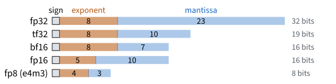
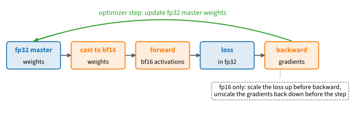

```{.python .input}
%load_ext d2lbook.tab
tab.interact_select('mxnet', 'pytorch', 'tensorflow', 'jax')
```

# Number Formats and Mixed Precision
:label:`sec_numerics`

A model with 8 billion parameters needs 32 GB to store its weights in the
32-bit floating-point format we have used so far, and 16 GB in a 16-bit
format. Recent GPUs also multiply 16-bit matrices at a multiple of their
32-bit rate. Halving the bits halves memory and memory traffic, but it makes
the numbers coarser. In the 16-bit format fp16, $300^2$ is already infinite,
and in the 16-bit format bf16, adding 0.001 to a weight of 1 leaves the
weight at 1. A training run that ignores this either fills with `inf` and
NaN or stops learning, without an error message in either case.

This section shows how to compute in 16 bits without these failures. Every
tensor has a *dtype*, the number format of its entries, and each format
trades *range*, how large and how small its numbers can be, against
*precision*, how finely it resolves them. Mixed-precision training keeps a
32-bit copy of the weights, so that small updates are not lost, and runs the
expensive matrix multiplications in 16 bits. With fp16 it also scales the
loss, so that small gradients do not round to zero.
:numref:`sec_parameters` counted the bytes per parameter of a training run;
this section changes the bytes per number. The code runs on any device. The
speed of 16-bit arithmetic needs a GPU with 16-bit matrix units, and
:numref:`sec_use_gpu` moves computation there.

```{.python .input #numerics-numerics-dtypes-and-mixed-precision}
%%tab mxnet
import random
from mxnet import autograd, gluon, init, np as mnp, npx
from mxnet.gluon import nn
from d2l import mxnet as d2l
npx.set_np()
```

```{.python .input #numerics-numerics-dtypes-and-mixed-precision}
%%tab pytorch
import random
import torch
from torch import nn
from torch.nn import functional as F
from d2l import torch as d2l
```

```{.python .input #numerics-numerics-dtypes-and-mixed-precision}
%%tab tensorflow
import random
import ml_dtypes
import tensorflow as tf
from d2l import tensorflow as d2l
```

```{.python .input #numerics-numerics-dtypes-and-mixed-precision}
%%tab jax
import jax
from jax import numpy as jnp
from flax import nnx
import optax
from d2l import jax as d2l
```

## Floating-Point Formats

### Range and Precision

Squaring 300 in the two 16-bit formats shows the two ways in which a format
can fail. A value of 300 is unremarkable in a network: an unnormalized logit
or an intermediate result of a variance computation can be that large.

```{.python .input #numerics-the-dtype-zoo-1}
%%tab mxnet
x = mnp.array(300.0)
x.astype('float16')**2
```

```{.python .input #numerics-the-dtype-zoo-1}
%%tab pytorch
x = torch.tensor(300.0)
x.to(torch.float16)**2, x.to(torch.bfloat16)**2
```

```{.python .input #numerics-the-dtype-zoo-1}
%%tab tensorflow
x = tf.constant(300.0)
tf.cast(x, tf.float16)**2, tf.cast(x, tf.bfloat16)**2
```

```{.python .input #numerics-the-dtype-zoo-1}
%%tab jax
x = jnp.array(300.0)
x.astype(jnp.float16)**2, x.astype(jnp.bfloat16)**2
```

:begin_tab:`mxnet`
MXNet arrays come in `float16`, `float32`, and `float64` but not in
bfloat16, so the cell squares only in fp16. In bf16 the result would be
90112.
:end_tab:

The format fp16 (*half precision*) overflows to `inf`: its largest number
is 65504. The format bf16 (*brain floating point*) returns 90112 instead of
90000, a finite result that is wrong in the fourth digit. Both formats
spend 16 bits, but they divide them differently. A normal floating-point
number is stored as a sign bit $s$, an exponent $e$, and a mantissa of $t$
bits that encodes a fraction $f \in [0, 1)$, and its value is

$$x = (-1)^s \cdot 2^{e} \cdot (1 + f).$$

The exponent bits set the range of $e$, and so how large and how small $|x|$
can be. The mantissa bits set the precision: between 1 and 2, adjacent
numbers are $2^{-t}$ apart, and between $2^e$ and $2^{e+1}$ they are
$2^{e-t}$ apart, so the relative spacing is the same at every scale. The
formats in use are:

| format | sign | exponent | mantissa |
|:-------|-----:|---------:|---------:|
| fp32   | 1    | 8        | 23       |
| tf32   | 1    | 8        | 10       |
| bf16   | 1    | 8        | 7        |
| fp16   | 1    | 5        | 10       |
| fp8 (e4m3) | 1 | 4       | 3        |

bf16 keeps the 8 exponent bits of fp32 and cuts the mantissa to 7 bits, so it
has the range of fp32 and coarse steps. fp16 keeps 10 mantissa bits and only 5
exponent bits: finer steps, much smaller range. :numref:`fig_bg_float-formats`
draws the table as bit layouts. The tf32 row is a mode of matrix
multiplication rather than a storage format, and we return to it below. The
fp8 row is used for inference and, with extra scaling machinery, for training
on the newest accelerators; this book stops at 16 bits, and an exercise
examines fp8. :numref:`sec_mdl-numerical-stability-conditioning` treats the
floating-point representation itself, including rounding and subnormal
numbers, in more detail.


:label:`fig_bg_float-formats`

The function `finfo` reports what each bit budget gives. Three of its numbers
matter here: `max`, the largest finite value; `tiny`, the smallest *normal*
value, below which the format switches to *subnormal* numbers, whose
precision falls with every halving until they reach zero; and `eps`, the
spacing $2^{-t}$ of representable numbers just above 1.

```{.python .input #numerics-the-dtype-zoo-2}
%%tab mxnet
for dtype in ('float32', 'float16'):
    fi = mnp.finfo(dtype)
    print(f'{dtype:10} max {fi.max:10.3e}  tiny {fi.smallest_normal:9.3e}'
          f'  eps {fi.eps:8.3e}')
```

```{.python .input #numerics-the-dtype-zoo-2}
%%tab pytorch
for dtype in (torch.float32, torch.bfloat16, torch.float16):
    fi = torch.finfo(dtype)
    print(f'{str(dtype):15} max {fi.max:10.3e}  tiny {fi.tiny:9.3e}'
          f'  eps {fi.eps:8.3e}')
```

```{.python .input #numerics-the-dtype-zoo-2}
%%tab tensorflow
for dtype in (tf.float32, tf.bfloat16, tf.float16):
    fi = ml_dtypes.finfo(dtype.as_numpy_dtype)
    print(f'{dtype.name:10} max {float(fi.max):10.3e}'
          f'  tiny {float(fi.tiny):9.3e}  eps {float(fi.eps):8.3e}')
```

```{.python .input #numerics-the-dtype-zoo-2}
%%tab jax
for dtype in (jnp.float32, jnp.bfloat16, jnp.float16):
    fi = jnp.finfo(dtype)
    print(f'{fi.dtype.name:10} max {float(fi.max):10.3e}'
          f'  tiny {float(fi.tiny):9.3e}  eps {float(fi.eps):8.3e}')
```

:begin_tab:`mxnet`
`mnp.finfo` follows the naming of the Python array API, which calls the
smallest normal value `smallest_normal` rather than `tiny`. MXNet does not
store bf16. Its format, 8 exponent bits and 7 mantissa bits, gives `max`
$3.39 \times 10^{38}$, `tiny` $1.18 \times 10^{-38}$, and `eps`
$2^{-7} \approx 0.0078$.
:end_tab:

:begin_tab:`tensorflow`
TensorFlow has no `finfo` of its own for bf16. The numbers come from
`ml_dtypes`, the small package that defines the bf16 type TensorFlow uses,
and each `tf` dtype hands over its NumPy counterpart through
`as_numpy_dtype`.
:end_tab:

bf16 has the `tiny` of fp32 and nearly the same `max`, because it has the same
exponent bits. Its `eps` of 0.0078 means two to three significant decimal
digits. fp16 resolves three to four digits, overflows above 65504, turns
subnormal below about $6.1 \times 10^{-5}$, and has no positive number below
$2^{-24} \approx 6.0 \times 10^{-8}$. Activations and gradients of a network
span many orders of magnitude, and too little range turns them into `inf` or
zero, while too little precision only adds rounding error. This is why bf16 is
the preferred 16-bit format for training on hardware that supports it. fp16
remains in use on older GPUs and for inference.

### Rounding of Small Updates

The coarse steps of bf16 matter most for the weights. An update of gradient
descent changes a weight by $\eta g$, which is often $10^{-3}$ or less of the
weight's own size. Under round-to-nearest, an increment smaller than half the
spacing of the numbers near the weight is lost entirely. We add $10^{-3}$ and
$10^{-4}$ to a weight of 1 in each format:

```{.python .input #numerics-rounding-of-small-updates}
%%tab mxnet
w = mnp.array(1.0)
for dtype in ('float32', 'float16'):
    print(f'{dtype:8}: {float(w.astype(dtype) + 1e-3):.7f}, '
          f'{float(w.astype(dtype) + 1e-4):.7f}')
```

```{.python .input #numerics-rounding-of-small-updates}
%%tab pytorch
w = torch.tensor(1.0)
for dtype in (torch.float32, torch.bfloat16, torch.float16):
    print(f'{str(dtype):14}: {float(w.to(dtype) + 1e-3):.7f}, '
          f'{float(w.to(dtype) + 1e-4):.7f}')
```

```{.python .input #numerics-rounding-of-small-updates}
%%tab tensorflow
w = tf.constant(1.0)
for dtype in (tf.float32, tf.bfloat16, tf.float16):
    print(f'{dtype.name:8}: {float(tf.cast(w, dtype) + 1e-3):.7f}, '
          f'{float(tf.cast(w, dtype) + 1e-4):.7f}')
```

```{.python .input #numerics-rounding-of-small-updates}
%%tab jax
w = jnp.array(1.0)
for dtype in (jnp.float32, jnp.bfloat16, jnp.float16):
    print(f'{jnp.dtype(dtype).name:8}: {float(w.astype(dtype) + 1e-3):.7f}, '
          f'{float(w.astype(dtype) + 1e-4):.7f}')
```

In fp32 both updates register. In bf16, whose numbers near 1 are
$2^{-7} \approx 0.0078$ apart, both round back to 1. In fp16, with spacing
$2^{-10} \approx 0.00098$, the larger update survives, rounded to one step,
and the smaller one is lost. A model whose weights are stored in 16 bits can
therefore stop learning even though its gradients are correct. This is the
first reason why training keeps the weights in fp32.

### TF32 Matrix Multiplication

On NVIDIA GPUs of the Ampere generation and later, an fp32 matrix
multiplication can take a shortcut through the 16-bit matrix units, the
*tensor cores*. In this *tf32* mode, the inputs are rounded to a 10-bit
mantissa while keeping the 8-bit exponent of fp32, and the products are
summed in fp32. The tensors stay fp32; only the arithmetic inside the
multiplication becomes faster and less precise, with results that typically
differ from true fp32 in the third or fourth significant digit. Whether
fp32 matrix multiplications use tf32 depends on a default that can be
changed:

```{.python .input #numerics-tf32-what-happens-to-fp32-matrix-multiplication}
%%tab pytorch
print(torch.get_float32_matmul_precision())
torch.set_float32_matmul_precision('high')  # allow tf32 in fp32 matmuls
print(torch.get_float32_matmul_precision())
torch.set_float32_matmul_precision('highest')  # restore the default
```

```{.python .input #numerics-tf32-what-happens-to-fp32-matrix-multiplication}
%%tab tensorflow
print(tf.config.experimental.tensor_float_32_execution_enabled())
tf.config.experimental.enable_tensor_float_32_execution(False)
print(tf.config.experimental.tensor_float_32_execution_enabled())
tf.config.experimental.enable_tensor_float_32_execution(True)  # the default
```

```{.python .input #numerics-tf32-what-happens-to-fp32-matrix-multiplication}
%%tab jax
print(jax.config.jax_default_matmul_precision)
with jax.default_matmul_precision('float32'):
    print(jax.config.jax_default_matmul_precision)
```

:begin_tab:`mxnet`
MXNet has no Python switch for tf32: whether an fp32 matrix multiplication
uses tensor cores is decided by the CUDA libraries it calls. Two environment
variables, read when the process starts, control them.
`NVIDIA_TF32_OVERRIDE=0` turns tf32 off in every NVIDIA library the process
calls, and `MXNET_CUDA_ALLOW_TENSOR_CORE=0` stops MXNet's own operators from
using tensor cores. Where full fp32 precision matters, set the first before
starting Python, or compute in `float64`.
:end_tab:

:begin_tab:`pytorch`
The default `'highest'` computes fp32 matrix multiplications in full fp32.
Setting `'high'` allows tf32.
:end_tab:

:begin_tab:`tensorflow`
TensorFlow uses tf32 by default wherever the hardware supports it. The switch
is global, so the cell turns it off and on again.
:end_tab:

:begin_tab:`jax`
The default `None` lets the backend choose, and on GPUs with tensor cores it
chooses tf32 for fp32 matrix multiplications. The context manager
`jax.default_matmul_precision('float32')` requests full fp32 for the code
inside it, and a single call accepts the same choice, as in
`jnp.dot(A, B, precision='float32')`.
:end_tab:

For training, the difference that tf32 makes is usually smaller than the
noise between runs. Ill-conditioned linear algebra, such as solving a nearly singular
system, and checks of results against a reference are cases for full fp32.

## Dtype Promotion and Model Casting

### Promotion

What dtype does an expression get when its operands disagree? We add an fp16
tensor to an fp32 tensor, to a Python float, and to an integer tensor:

```{.python .input #numerics-dtype-rules-promotion-parameters-and-casts-1}
%%tab mxnet
x16 = mnp.ones(3, dtype='float16')
x32 = mnp.ones(3, dtype='float32')
((x16 + x32).dtype, (x16 + 1.0).dtype,
 mnp.result_type(x16, mnp.ones(3, dtype='int32')))
```

```{.python .input #numerics-dtype-rules-promotion-parameters-and-casts-1}
%%tab pytorch
x16 = torch.ones(3, dtype=torch.float16)
x32 = torch.ones(3, dtype=torch.float32)
(x16 + x32).dtype, (x16 + 1.0).dtype, (x16 + torch.arange(3)).dtype
```

```{.python .input #numerics-dtype-rules-promotion-parameters-and-casts-1}
%%tab tensorflow
x16 = tf.ones(3, dtype=tf.float16)
x32 = tf.ones(3, dtype=tf.float32)
try:
    x16 + x32
except tf.errors.InvalidArgumentError as e:
    print(e.message)
(x16 + 1.0).dtype
```

```{.python .input #numerics-dtype-rules-promotion-parameters-and-casts-1}
%%tab jax
x16 = jnp.ones(3, dtype=jnp.float16)
x32 = jnp.ones(3, dtype=jnp.float32)
(x16 + x32).dtype, (x16 + 1.0).dtype, (x16 + jnp.arange(3)).dtype
```

:begin_tab:`mxnet, pytorch, jax`
Two float tensors promote to the wider format, so an fp16 computation that
meets one stray fp32 tensor continues in fp32 and needs twice the memory
from then on. Python scalars are *weak*: they take the dtype of the tensor
instead of promoting it, so a literal such as `x + 1.0` keeps low-precision
code in low precision. An integer tensor does not promote a float tensor
either: the result keeps the float's dtype.
:end_tab:

:begin_tab:`mxnet`
The third expression asks the promotion table directly through
`result_type`.
:end_tab:

:begin_tab:`pytorch, jax`
fp16 and bf16 together promote to fp32, since neither contains the other.
:end_tab:

:begin_tab:`tensorflow`
TensorFlow does not promote. A Python scalar is cast to the dtype of the
tensor, so a literal such as `x + 1.0` keeps low-precision code in low
precision, but two tensors of different dtypes raise an error at the first
operation that combines them. A stray fp32 tensor therefore cannot silently
turn an fp16 computation into an fp32 one; the cost is that every intended
conversion is written as `tf.cast`.
:end_tab:

### Casting a Model

Parameters are tensors too, so a model can be stored in 16 bits. We use the
MLP of :numref:`sec_mlp-implementation` throughout this section: a hidden
layer of 256 ReLU units between the 784 pixels of a Fashion-MNIST image and
10 outputs, with weights drawn from $\mathcal{N}(0, 0.01^2)$ and zero biases.
Its 203,530 parameters take 814,120 bytes in fp32.

```{.python .input #numerics-dtype-rules-promotion-parameters-and-casts-2}
%%tab mxnet
def mlp():
    net = nn.Sequential()
    net.add(nn.Dense(256, activation='relu'), nn.Dense(10))
    net.initialize(init.Normal(sigma=0.01))
    return net

def param_bytes(net):
    return sum(p.data().size * p.data().dtype.itemsize
               for p in net.collect_params().values())

net = mlp()
X = mnp.random.normal(size=(8, 1, 28, 28))
net(X)  # Initialization is deferred until the first call
param_bytes(net)
```

```{.python .input #numerics-dtype-rules-promotion-parameters-and-casts-2}
%%tab pytorch
def mlp():
    net = nn.Sequential(nn.Flatten(), nn.Linear(784, 256), nn.ReLU(),
                        nn.Linear(256, 10))
    for layer in net[1], net[3]:
        nn.init.normal_(layer.weight, std=0.01)
        nn.init.zeros_(layer.bias)
    return net

def param_bytes(net):
    return sum(p.numel() * p.element_size() for p in net.parameters())

net = mlp()
param_bytes(net)
```

```{.python .input #numerics-dtype-rules-promotion-parameters-and-casts-2}
%%tab tensorflow
def mlp(dtype=None):
    normal = tf.keras.initializers.RandomNormal  # one instance per layer
    return tf.keras.Sequential([
        tf.keras.layers.Flatten(dtype=dtype),
        tf.keras.layers.Dense(256, activation='relu', dtype=dtype,
                              kernel_initializer=normal(stddev=0.01)),
        tf.keras.layers.Dense(10, dtype=dtype,
                              kernel_initializer=normal(stddev=0.01))])

def param_bytes(net):
    return sum(w.shape.num_elements() * tf.as_dtype(w.dtype).size
               for w in net.weights)

net = mlp()
net(tf.zeros((1, 28, 28, 1)))  # The first call creates the weights
param_bytes(net)
```

```{.python .input #numerics-dtype-rules-promotion-parameters-and-casts-2}
%%tab jax
def mlp(rngs, dtype=None):
    normal = nnx.initializers.normal(0.01)
    return nnx.Sequential(
        lambda x: x.reshape((x.shape[0], -1)),
        nnx.Linear(784, 256, kernel_init=normal, dtype=dtype, rngs=rngs),
        nnx.relu,
        nnx.Linear(256, 10, kernel_init=normal, dtype=dtype, rngs=rngs))

def param_bytes(model):
    return sum(p.size * p.dtype.itemsize
               for _, p in nnx.state(model, nnx.Param).flat_state())

net = mlp(nnx.Rngs(d2l.get_key()))
param_bytes(net)
```

:begin_tab:`mxnet`
Gluon operators require the input and the weights to have the same dtype, so
to change the dtype of a model we cast the whole block:
`net.cast('float16')` converts every parameter, including those of nested
blocks. Inputs we cast ourselves.
:end_tab:

:begin_tab:`pytorch`
Layers do not promote: they require the input to have the dtype of their
weights and raise an error otherwise. To change the dtype of a model we cast
the whole module; `net.to(dtype)`, or the shorthand `net.bfloat16()`,
converts every parameter and buffer.
:end_tab:

:begin_tab:`tensorflow`
A Keras layer has a *dtype policy* with two parts: `variable_dtype`, the
format of its weights, and `compute_dtype`, the format of its forward pass,
both fp32 by default. The argument `dtype='bfloat16'` sets both, so a bf16
model is chosen when it is constructed rather than converted afterwards.
`mlp` passes its `dtype` argument to every layer.
:end_tab:

:begin_tab:`jax`
A Flax NNX layer takes two dtype arguments: `param_dtype`, the format in
which it stores its parameters (fp32 by default), and `dtype`, the format in
which it computes (by default `None`, which promotes parameters and input to a
common type by the rule above). To cast a model we map over its `nnx.Param`
state and leave other state alone.
:end_tab:

```{.python .input #numerics-dtype-rules-promotion-parameters-and-casts-3}
%%tab mxnet
net.cast('float16')
print(net(X.astype('float16')).dtype, param_bytes(net))
```

```{.python .input #numerics-dtype-rules-promotion-parameters-and-casts-3}
%%tab pytorch
net = net.bfloat16()
X = torch.randn(8, 1, 28, 28)
try:
    net(X)
except RuntimeError as e:
    print(e)
print(net(X.bfloat16()).dtype, param_bytes(net))
```

```{.python .input #numerics-dtype-rules-promotion-parameters-and-casts-3}
%%tab tensorflow
net16 = mlp(dtype='bfloat16')
X = tf.random.normal((8, 28, 28, 1))
print(net16(X).dtype, param_bytes(net16))
```

```{.python .input #numerics-dtype-rules-promotion-parameters-and-casts-3}
%%tab jax
graph, params = nnx.split(net, nnx.Param)
params16 = jax.tree.map(lambda p: p.astype(jnp.bfloat16), params)
net16 = nnx.merge(graph, params16)
X = jax.random.normal(d2l.get_key(), (8, 28, 28, 1))
print(net16(X).dtype, param_bytes(net16))
print(net16(X.astype(jnp.bfloat16)).dtype)
```

:begin_tab:`mxnet`
The parameters take half the bytes and the output is fp16. Feeding the fp32
`X` to the fp16 network would raise an error: Gluon layers refuse an input
whose dtype differs from their weights rather than convert it.
:end_tab:

:begin_tab:`pytorch`
The parameters take half the bytes, and the forward pass runs in bf16. The
error message shows the strictness: the fp32 input was refused rather than
converted.
:end_tab:

:begin_tab:`tensorflow`
The parameters take half the bytes, and the fp32 input raised no error: a
Keras layer casts floating-point inputs to its `compute_dtype` before
computing. Raw operations refuse to guess, while layers fix the dtype when
they are constructed.
:end_tab:

:begin_tab:`jax`
The parameters take half the bytes, but the first output is fp32. With
`dtype=None` the layers promoted the bf16 parameters and the fp32 input to
fp32, so casting the parameters saved memory but not compute. A bf16 input
(second line) keeps the forward pass in bf16, as does constructing the
layers with `dtype=jnp.bfloat16`.
:end_tab:

For *inference*, a cast model needs half the memory for its parameters, and
whether its predictions are still good enough must be checked for the model
and task. For *training*, the rounding experiment above has already shown
what goes wrong: updates that are small relative to the weights are lost when
the weights are stored in 16 bits.

## Mixed-Precision Training

### Master Weights and 16-Bit Compute

*Mixed-precision training* :cite:`Micikevicius.Narang.Alben.ea.2018`
separates storage from computation. The parameters stay in fp32, the
*master weights*, so that every update registers. The matrix multiplications
of the forward and backward pass, which account for most of the computation,
run in a 16-bit format, and so do the activations they produce. Reductions
such as the loss are computed in fp32. :numref:`fig_bg_amp-loop` shows one
step.


:label:`fig_bg_amp-loop`

:begin_tab:`mxnet`
Gluon assigns the two halves to two objects. We cast the *network* to fp16,
and ask the *optimizer* to keep fp32 master weights with the flag
`multi_precision=True`. The optimizer then holds an fp32 copy of every fp16
weight, applies each update to that copy, and writes the rounded fp16 value
back to the network. MXNet arrays have no bf16 dtype, so the MXNet tab uses
fp16 throughout this section.
:end_tab:

:begin_tab:`pytorch`
Inside a `torch.autocast` context, every operation consults a built-in
policy. Matrix multiplications and convolutions run in the 16-bit dtype, a
list of sensitive operations such as `cross_entropy` runs in fp32, and other
operations run in the dtype of their inputs. The parameters are not
touched; each eligible operation casts its inputs as it runs.
:end_tab:

:begin_tab:`tensorflow`
In Keras the split is the global policy `'mixed_bfloat16'`. Every layer
constructed while it is set gets fp32 `variable_dtype` and bf16
`compute_dtype`. The policy is global state, so we set it just before we
construct a model and reset it to `'float32'` right after. The loss is
computed outside the layers and follows no policy; we cast the logits to fp32
before computing it.
:end_tab:

:begin_tab:`jax`
In Flax NNX the split is the pair of constructor arguments from above: leave
`param_dtype` at fp32 and set `dtype=jnp.bfloat16`, and each layer stores
fp32 parameters and computes in bf16. Everything outside the layers, such as
the loss, stays in the dtype we give it; we cast the logits to fp32 before
computing it.
:end_tab:

```{.python .input #numerics-mixed-precision-training-1}
%%tab mxnet
net = mlp()
net(X)
net.cast('float16')
trainer = gluon.Trainer(net.collect_params(), 'sgd',
                        {'learning_rate': 0.1, 'multi_precision': True})
loss = gluon.loss.SoftmaxCrossEntropyLoss()
with autograd.record():
    l = loss(net(X.astype('float16')), mnp.zeros(8)).mean()
l.backward()
trainer.step(1)
master = trainer._updaters[0].states[0][0]  # The fp32 master copy
net[0].weight.data().dtype, master.dtype
```

```{.python .input #numerics-mixed-precision-training-1}
%%tab pytorch
net = mlp()
with torch.autocast('cpu', dtype=torch.bfloat16):
    Y = net(X)
Y.dtype, net[1].weight.dtype
```

```{.python .input #numerics-mixed-precision-training-1}
%%tab tensorflow
tf.keras.mixed_precision.set_global_policy('mixed_bfloat16')
net = mlp()
tf.keras.mixed_precision.set_global_policy('float32')
Y = net(X)
Y.dtype, net.layers[1].kernel.dtype
```

```{.python .input #numerics-mixed-precision-training-1}
%%tab jax
net = mlp(nnx.Rngs(d2l.get_key()), dtype=jnp.bfloat16)
net(X).dtype, jax.tree.leaves(nnx.state(net, nnx.Param))[0].dtype
```

:begin_tab:`mxnet`
The network holds fp16 weights and the optimizer holds the fp32 master copy.
The copy is created at the first update, so the cell takes one training step
and then reads it from the optimizer's internal state.
:end_tab:

:begin_tab:`pytorch`
The output is bf16 and the weights are fp32: the opposite of `net.bfloat16()`.
The first argument of `autocast` names the device type; on a GPU it is
`'cuda'`.
:end_tab:

:begin_tab:`tensorflow`
The output is bf16 and the weights are fp32: the opposite of
`mlp(dtype='bfloat16')`.
:end_tab:

:begin_tab:`jax`
The output is bf16 and the parameters are fp32: the opposite of casting the
parameter tree. The fp32 input does not promote the computation, because
`dtype` fixes the compute format.
:end_tab:

### Training in fp32 and in 16 Bits

Does 16-bit computation change what the model learns? We train the MLP for
100 minibatch steps of size 256 on Fashion-MNIST, once in fp32 and once with
mixed precision. Both runs see the same minibatches in the same order and
start from the same weights, drawn with one random seed.

```{.python .input #numerics-mixed-precision-training-2}
%%tab mxnet
data = d2l.FashionMNIST(batch_size=256)
loader = gluon.data.DataLoader(data.train, batch_size=256)
batches = [b for b, _ in zip(loader, range(100))]
val_batch = next(iter(gluon.data.DataLoader(data.val, batch_size=1024)))
```

```{.python .input #numerics-mixed-precision-training-2}
%%tab pytorch
data = d2l.FashionMNIST(batch_size=256)
loader = torch.utils.data.DataLoader(data.train, batch_size=256)
batches = [b for b, _ in zip(loader, range(100))]
val_batch = next(iter(torch.utils.data.DataLoader(data.val, batch_size=1024)))
```

```{.python .input #numerics-mixed-precision-training-2}
%%tab tensorflow
data = d2l.FashionMNIST(batch_size=256)
images, labels = data.train
batches = [(tf.constant(images[k:k+256, :, :, None], tf.float32) / 255,
            tf.constant(labels[k:k+256], tf.int32))
           for k in range(0, 100 * 256, 256)]
val_images, val_labels = data.val
val_batch = (tf.constant(val_images[:1024, :, :, None], tf.float32) / 255,
             tf.constant(val_labels[:1024], tf.int32))
```

```{.python .input #numerics-mixed-precision-training-2}
%%tab jax
data = d2l.FashionMNIST(batch_size=256)
images, labels = data.train
batches = [(jnp.asarray(images[k:k+256], jnp.float32) / 255,
            jnp.asarray(labels[k:k+256], jnp.int32))
           for k in range(0, 100 * 256, 256)]
val_images, val_labels = data.val
val_batch = (jnp.asarray(val_images[:1024, :, :, None], jnp.float32) / 255,
             jnp.asarray(val_labels[:1024], jnp.int32))
```

```{.python .input #numerics-mixed-precision-training-3}
%%tab mxnet
def train(dtype, seed):
    npx.random.seed(seed)  # The same initial weights in both runs
    net = mlp()
    net(batches[0][0])  # Create the weights in fp32, then cast them
    net.cast(dtype)
    trainer = gluon.Trainer(net.collect_params(), 'sgd', {
        'learning_rate': 0.1, 'multi_precision': dtype == 'float16'})
    loss = gluon.loss.SoftmaxCrossEntropyLoss()
    losses = []
    for X, y in batches:
        with autograd.record():
            logits = net(X.astype(dtype)).astype('float32')
            l = loss(logits, y).mean()
        l.backward()
        trainer.step(1)
        losses.append(l)
    Xv, yv = val_batch
    accuracy = float((net(Xv.astype(dtype)).argmax(axis=1) == yv).mean())
    return [float(l) for l in losses], accuracy
```

```{.python .input #numerics-mixed-precision-training-3}
%%tab pytorch
def train(mixed, seed):
    torch.manual_seed(seed)  # The same initial weights in both runs
    net = mlp()
    optimizer = torch.optim.SGD(net.parameters(), lr=0.1)
    losses = []
    for X, y in batches:
        with torch.autocast('cpu', dtype=torch.bfloat16, enabled=mixed):
            loss = F.cross_entropy(net(X), y)
        optimizer.zero_grad()
        loss.backward()
        optimizer.step()
        losses.append(loss.detach())
    Xv, yv = val_batch
    with torch.no_grad():
        accuracy = (net(Xv).argmax(1) == yv).float().mean().item()
    return torch.stack(losses).tolist(), accuracy
```

```{.python .input #numerics-mixed-precision-training-3}
%%tab tensorflow
def train(policy, seed):
    tf.keras.utils.set_random_seed(seed)  # The same initial weights
    tf.keras.mixed_precision.set_global_policy(policy)
    net = mlp()
    tf.keras.mixed_precision.set_global_policy('float32')
    optimizer = tf.keras.optimizers.SGD(learning_rate=0.1)
    losses = []
    for X, y in batches:
        with tf.GradientTape() as tape:
            logits = tf.cast(net(X), tf.float32)
            loss = tf.reduce_mean(
                tf.keras.losses.sparse_categorical_crossentropy(
                    y, logits, from_logits=True))
        grads = tape.gradient(loss, net.trainable_variables)
        optimizer.apply_gradients(zip(grads, net.trainable_variables))
        losses.append(loss)
    Xv, yv = val_batch
    y_hat = tf.argmax(net(Xv), axis=1, output_type=yv.dtype)
    accuracy = float(tf.reduce_mean(tf.cast(y_hat == yv, tf.float32)))
    return [float(l) for l in losses], accuracy
```

```{.python .input #numerics-mixed-precision-training-3}
%%tab jax
@nnx.jit
def train_step(model, optimizer, X, y):
    def loss_fn(model):
        logits = model(X).astype(jnp.float32)
        return optax.softmax_cross_entropy_with_integer_labels(
            logits, y).mean()
    loss, grads = nnx.value_and_grad(loss_fn)(model)
    optimizer.update(model, grads)
    return loss

def train(dtype, key):
    net = mlp(nnx.Rngs(key), dtype)  # The same key gives the same weights
    optimizer = nnx.Optimizer(net, optax.sgd(0.1), wrt=nnx.Param)
    losses = [train_step(net, optimizer, X, y) for X, y in batches]
    Xv, yv = val_batch
    accuracy = float((net(Xv).argmax(1) == yv).mean())
    return [float(l) for l in losses], accuracy
```

:begin_tab:`mxnet`
The loss values stay on the device during training and are converted to
Python numbers once, at the end. Converting every step would force the
program to wait for each step to finish, a cost that :numref:`sec_use_gpu`
examines.
:end_tab:

:begin_tab:`pytorch`
The loss values stay on the device during training and are converted to
Python numbers once, at the end. Converting every step would force the
program to wait for each step to finish, a cost that :numref:`sec_use_gpu`
examines.
:end_tab:

:begin_tab:`tensorflow`
The loss values stay on the device during training and are converted to
Python numbers once, at the end. Converting every step would force the
program to wait for each step to finish, a cost that :numref:`sec_use_gpu`
examines.
:end_tab:

:begin_tab:`jax`
The parameters are created in fp32 in both runs, because `param_dtype`
keeps its default, so the same key gives the same initial weights. The loss
values stay on the device during training and are converted to Python
numbers once, at the end; converting every step would force the program to
wait for each step to finish, a cost that :numref:`sec_use_gpu` examines.
:end_tab:

```{.python .input #numerics-mixed-precision-training-4}
%%tab mxnet
seed = random.randrange(2**31)  # One random draw, shared by both runs
loss32, acc32 = train('float32', seed)
loss16, acc16 = train('float16', seed)
print(f'validation accuracy: fp32 {acc32:.3f}, fp16 {acc16:.3f}')
d2l.plot(list(range(1, 101)), [loss32, loss16], 'step', 'loss',
         legend=['fp32', 'fp16 with fp32 master weights'])
```

```{.python .input #numerics-mixed-precision-training-4}
%%tab pytorch
seed = random.randrange(2**31)  # One random draw, shared by both runs
loss32, acc32 = train(False, seed)
loss16, acc16 = train(True, seed)
print(f'validation accuracy: fp32 {acc32:.3f}, bf16 {acc16:.3f}')
d2l.plot(list(range(1, 101)), [loss32, loss16], 'step', 'loss',
         legend=['fp32', 'bf16 autocast'])
```

```{.python .input #numerics-mixed-precision-training-4}
%%tab tensorflow
seed = random.randrange(2**31)  # One random draw, shared by both runs
loss32, acc32 = train('float32', seed)
loss16, acc16 = train('mixed_bfloat16', seed)
print(f'validation accuracy: fp32 {acc32:.3f}, bf16 {acc16:.3f}')
d2l.plot(list(range(1, 101)), [loss32, loss16], 'step', 'loss',
         legend=['fp32', 'mixed_bfloat16'])
```

```{.python .input #numerics-mixed-precision-training-4}
%%tab jax
key = d2l.get_key()  # One random key, shared by both runs
loss32, acc32 = train(jnp.float32, key)
loss16, acc16 = train(jnp.bfloat16, key)
print(f'validation accuracy: fp32 {acc32:.3f}, bf16 {acc16:.3f}')
d2l.plot(list(range(1, 101)), [loss32, loss16], 'step', 'loss',
         legend=['fp32', 'bf16 compute'])
```

The two loss curves lie on top of each other, and the validation accuracies
agree to within about half a percentage point. Rounding in 16 bits perturbs
every step slightly, so the two runs are not identical, but they descend at
the same rate to the same place. We did not time the runs. The speed of
16-bit arithmetic depends on matrix units that compute in 16 bits, as the
tensor cores of recent GPUs do, and on models large enough to keep them busy;
an exercise in :numref:`sec_use_gpu` measures it. Mixed precision also does
not shrink everything: the master weights and the optimizer state remain
fp32, so the bytes per parameter counted in :numref:`sec_parameters` stay
the same. What it saves is the memory of the activations, which are stored
in 16 bits, and the time of the matrix multiplications.

:begin_tab:`mxnet`
The MXNet tab computes in fp16 rather than bf16, and it needed no loss
scaling: with plain SGD on this well-scaled loss, the gradients stay inside
the range of fp16. The next subsection explains when they do not.
:end_tab:

### Loss Scaling for fp16
:label:`subsec_loss_scaling`

With bf16, the recipe above is complete. fp16 fails at the other end of its
range as well: small gradients *underflow*. Below about
$6.1 \times 10^{-5}$ fp16 stores numbers as subnormals with fewer and fewer
significant bits, and below about $3 \times 10^{-8}$ it rounds them to zero.
A gradient of $10^{-8}$ vanishes, but the same gradient multiplied by
$2^{16}$ is stored without trouble:

```{.python .input #numerics-loss-scaling-for-fp16-1}
%%tab mxnet
g = mnp.array(1e-8)
g.astype('float16'), (g * 2**16).astype('float16')
```

```{.python .input #numerics-loss-scaling-for-fp16-1}
%%tab pytorch
g = torch.tensor(1e-8)
g.half(), (g * 2**16).half()
```

```{.python .input #numerics-loss-scaling-for-fp16-1}
%%tab tensorflow
g = tf.constant(1e-8)
tf.cast(g, tf.float16), tf.cast(g * 2**16, tf.float16)
```

```{.python .input #numerics-loss-scaling-for-fp16-1}
%%tab jax
g = jnp.array(1e-8)
g.astype(jnp.float16), (g * 2**16).astype(jnp.float16)
```

How many real gradients are that small? We compute the gradient of the loss
with respect to the first-layer weights of the MLP, on the first minibatch,
in fp32, and count the nonzero entries that fp16 could store only as
subnormals or zeros, with and without a factor of $2^{16}$:

```{.python .input #numerics-loss-scaling-for-fp16-3}
%%tab mxnet
net = mlp()
X, y = batches[0]
net(X)
with autograd.record():
    l = gluon.loss.SoftmaxCrossEntropyLoss()(net(X), y).mean()
l.backward()
g = net[0].weight.grad().reshape(-1)
g = g[g != 0]
for scale in (1, 2**16):
    print(f'scale {scale:5}: '
          f'{float((mnp.abs(g * scale) < 2**-14).mean()):.1%} subnormal, '
          f'{float(((g * scale).astype("float16") == 0).mean()):.2%} zero')
```

```{.python .input #numerics-loss-scaling-for-fp16-3}
%%tab pytorch
net = mlp()
X, y = batches[0]
F.cross_entropy(net(X), y).backward()
g = net[1].weight.grad.flatten()
g = g[g != 0]
for scale in (1, 2**16):
    print(f'scale {scale:5}: '
          f'{((g * scale).abs() < 2**-14).float().mean():.1%} subnormal, '
          f'{((g * scale).half() == 0).float().mean():.2%} zero')
```

```{.python .input #numerics-loss-scaling-for-fp16-3}
%%tab tensorflow
net = mlp()
X, y = batches[0]
with tf.GradientTape() as tape:
    loss = tf.reduce_mean(tf.keras.losses.sparse_categorical_crossentropy(
        y, net(X), from_logits=True))
g = tf.reshape(tape.gradient(loss, net.layers[1].kernel), -1)
g = g[g != 0]
for scale in (1, 2**16):
    subnormal = tf.reduce_mean(tf.cast(tf.abs(g * scale) < 2**-14, tf.float32))
    zero = tf.reduce_mean(tf.cast(tf.cast(g * scale, tf.float16) == 0,
                                  tf.float32))
    print(f'scale {scale:5}: {float(subnormal):.1%} subnormal, '
          f'{float(zero):.2%} zero')
```

```{.python .input #numerics-loss-scaling-for-fp16-3}
%%tab jax
net = mlp(nnx.Rngs(d2l.get_key()))
X, y = batches[0]
def loss_fn(model):
    return optax.softmax_cross_entropy_with_integer_labels(
        model(X), y).mean()
g = nnx.grad(loss_fn)(net)['layers'][1]['kernel'][...].reshape(-1)
g = g[g != 0]
for scale in (1, 2**16):
    print(f'scale {scale:5}: '
          f'{float((jnp.abs(g * scale) < 2**-14).mean()):.1%} subnormal, '
          f'{float(((g * scale).astype(jnp.float16) == 0).mean()):.2%} zero')
```

About a third of the nonzero first-layer gradients lie below the smallest
normal fp16 number, $2^{-14} \approx 6.1 \times 10^{-5}$, and about two in a
thousand would round to zero. Multiplied by $2^{16}$, none is that
small, and none comes near the overflow threshold of 65504 either. This is
the idea of *loss scaling*. We multiply the loss by a large constant $S$
before the backward pass, and because differentiation is linear, every
gradient is multiplied by $S$ as well. Before the update, we divide the
gradients by $S$ in fp32, where the small values are representable. The
update is unchanged; only the gradients in between are kept in a range that
fp16 can store.

A fixed $S$ that is too large makes large gradients overflow to `inf`. The
standard remedy chooses $S$ dynamically: start high, and whenever the scaled
gradients contain `inf` or NaN, skip that update and halve $S$; after a run
of clean steps, double it again.

:begin_tab:`mxnet`
Gluon's `Trainer` has no automatic loss scaling. A fixed scale takes two
changes: call `(2**10 * l).backward()` instead of `l.backward()`, and
`trainer.step(2**10)` instead of `trainer.step(1)`, since the argument of
`step` divides the gradients before the update. The dynamic version lives in
the `mxnet.amp` module, which this book does not use.
:end_tab:

:begin_tab:`pytorch`
`torch.amp.GradScaler` implements dynamic loss scaling. The loop below trains
the MLP for 20 steps with fp16 autocast:
:end_tab:

:begin_tab:`tensorflow`
Keras implements dynamic loss scaling in
`tf.keras.mixed_precision.LossScaleOptimizer`, which wraps an optimizer.
Under the policy `'mixed_float16'`, `model.compile` applies the wrapper
automatically, so `model.fit` trains correctly in fp16 without further
changes. A custom loop wraps the optimizer itself, multiplies the loss with
the wrapper's `scale_loss` before computing gradients, and lets the wrapped
optimizer divide them and skip bad steps. The loop below trains the MLP for
20 steps under the policy `'mixed_float16'`:
:end_tab:

:begin_tab:`jax`
Optax provides no automatic loss scaling, and JAX code rarely needs it: JAX
grew up on TPUs, whose native 16-bit format is bf16. If you must train in
fp16, the two multiplications are yours to write: scale the loss inside
`loss_fn`, and divide the gradients before `optimizer.update`.
:end_tab:

```{.python .input #numerics-loss-scaling-for-fp16-2}
%%tab pytorch
net = mlp()
optimizer = torch.optim.SGD(net.parameters(), lr=0.1)
scaler = torch.amp.GradScaler('cpu')
for X, y in batches[:20]:
    with torch.autocast('cpu', dtype=torch.float16):
        loss = F.cross_entropy(net(X), y)
    optimizer.zero_grad()
    scaler.scale(loss).backward()  # Gradients of S * loss
    scaler.step(optimizer)         # Divide by S, skip the step on inf/NaN
    scaler.update()                # Adjust S
print(f'loss {loss.item():.3f}, loss scale {scaler.get_scale():.0f}')
```

```{.python .input #numerics-loss-scaling-for-fp16-2}
%%tab tensorflow
tf.keras.mixed_precision.set_global_policy('mixed_float16')
net = mlp()
tf.keras.mixed_precision.set_global_policy('float32')
optimizer = tf.keras.mixed_precision.LossScaleOptimizer(
    tf.keras.optimizers.SGD(learning_rate=0.1))
for X, y in batches[:20]:
    with tf.GradientTape() as tape:
        loss = tf.reduce_mean(tf.keras.losses.sparse_categorical_crossentropy(
            y, tf.cast(net(X), tf.float32), from_logits=True))
        scaled_loss = optimizer.scale_loss(loss)  # S * loss
    grads = tape.gradient(scaled_loss, net.trainable_variables)
    # Divide by S, skip the step on inf/NaN, adjust S
    optimizer.apply_gradients(zip(grads, net.trainable_variables))
print(f'loss {float(loss):.3f}, '
      f'loss scale {float(optimizer.dynamic_scale):.0f}')
```

:begin_tab:`pytorch`
The scale starts at $2^{16}$ and stays there, because no step overflowed.
Two rules apply when the loop does more. `scaler.unscale_(optimizer)` may be
called at most once per step, so a loop that divides the gradients early,
for instance to clip them, must not divide them again to log them. Under
gradient accumulation, call `scaler.update()` once per effective batch, after
the last micro-step.
:end_tab:

:begin_tab:`tensorflow`
The scale starts at $2^{15}$, the default of `LossScaleOptimizer`, and stays
there, because no step overflowed. The wrapper grows the scale only after
2000 clean steps in a row, far more than this loop takes.
:end_tab:

On hardware that supports bf16, which includes recent GPUs, TPUs, and recent
CPUs, the standard choice is therefore bf16 mixed precision without loss
scaling. fp16 with loss scaling remains for older GPUs.

## Numerical Failure Modes

Three failures account for most numerical trouble in 16-bit code: an overflow
that later appears as NaN, an exponential that overflows before the result
does, and a long sum that loses its small terms.

### From Overflow to NaN

A NaN in the loss is often the second symptom. The first is an overflow to
`inf`, and arithmetic on infinite values produces NaN:

```{.python .input #numerics-when-numerics-bite-1}
%%tab mxnet
s = mnp.array(60000., dtype='float16') * 2  # Overflows
s, s - s
```

```{.python .input #numerics-when-numerics-bite-1}
%%tab pytorch
s = torch.tensor(60000., dtype=torch.float16) * 2  # Overflows
s, s - s
```

```{.python .input #numerics-when-numerics-bite-1}
%%tab tensorflow
s = tf.constant(60000., dtype=tf.float16) * 2  # Overflows
s, s - s
```

```{.python .input #numerics-when-numerics-bite-1}
%%tab jax
s = jnp.array(60000., dtype=jnp.float16) * 2  # Overflows
s, s - s
```

The overflow can happen many operations before the NaN reaches the loss, and
once an update contains NaN, every later result does too. When a loss turns
NaN, check ranges first: does any computation run in fp16, and do
intermediate values approach its maximum of 65504? Only then look for other
causes, such as a learning rate that is too large.

:begin_tab:`mxnet`
MXNet has no switch that stops at the first bad operation, so the search is
manual: insert checks such as `mnp.isnan(x).any()` and `mnp.isinf(x).any()`
after suspect stages, starting from the loss and moving upstream.
:end_tab:

:begin_tab:`pytorch`
Under autocast with `GradScaler`, the check for `inf` and NaN in the
gradients catches an overflow in the step where it occurs and skips the
update.
:end_tab:

:begin_tab:`tensorflow`
`tf.debugging.enable_check_numerics()` makes TensorFlow stop with an error at
the first operation whose output contains `inf` or NaN. The check wraps every
operation and slows execution, so it is a debugging mode, not a default.
:end_tab:

:begin_tab:`jax`
`jax.config.update('jax_debug_nans', True)` makes JAX stop with an error at
the first operation whose output is NaN; for compiled code, it reruns the
function operation by operation to find it. The check slows execution, so it
is a debugging mode, not a default.
:end_tab:

### Log-Sum-Exp

The direct evaluation of $\log \sum_i \exp(x_i)$ overflows long before its
result does:

```{.python .input #numerics-when-numerics-bite-2}
%%tab mxnet
x = mnp.array([12.0, 11.0, 10.0], dtype='float16')
m = x.max()
mnp.log(mnp.exp(x).sum()), m + mnp.log(mnp.exp(x - m).sum())
```

```{.python .input #numerics-when-numerics-bite-2}
%%tab pytorch
x = torch.tensor([12.0, 11.0, 10.0], dtype=torch.float16)
x.exp().sum().log(), torch.logsumexp(x, dim=0)
```

```{.python .input #numerics-when-numerics-bite-2}
%%tab tensorflow
x = tf.constant([12.0, 11.0, 10.0], dtype=tf.float16)
tf.math.log(tf.reduce_sum(tf.exp(x))), tf.math.reduce_logsumexp(x)
```

```{.python .input #numerics-when-numerics-bite-2}
%%tab jax
x = jnp.array([12.0, 11.0, 10.0], dtype=jnp.float16)
jnp.log(jnp.exp(x).sum()), jax.scipy.special.logsumexp(x)
```

The result is about 12.4, but the intermediate value $e^{12} \approx 163{,}000$
exceeds 65504. The remedy is the one we used for the softmax in
:numref:`subsec_softmax-implementation-revisited`: subtract the largest
entry $m$ before exponentiating and add it back afterwards,

$$\log \sum_i \exp(x_i) = m + \log \sum_i \exp(x_i - m).$$

Every exponent on the right is at most 0, so no term exceeds 1, and the
largest term equals 1, so the sum cannot underflow to zero either.

:begin_tab:`mxnet`
`mx.np` has no `logsumexp`, so the cell writes the shift out. Inside a model,
`npx.log_softmax` and Gluon's `SoftmaxCrossEntropyLoss` apply it.
:end_tab:

:begin_tab:`pytorch`
`torch.logsumexp`, `F.log_softmax`, and `F.cross_entropy` all apply the shift.
:end_tab:

:begin_tab:`tensorflow`
`tf.math.reduce_logsumexp`, `tf.nn.log_softmax`, and the Keras cross-entropy
losses with `from_logits=True` all apply the shift.
:end_tab:

:begin_tab:`jax`
`jax.scipy.special.logsumexp`, `jax.nn.log_softmax`, and the cross-entropy
losses of optax all apply the shift.
:end_tab:

### Accumulation in fp32

A long sum in a 16-bit format drifts: once the running total is large, each
small increment falls below half the spacing of the numbers near the total
and is rounded away, in whole or in part. We add $10^{-3}$ ten million times:

```{.python .input #numerics-when-numerics-bite-3}
%%tab mxnet
x = mnp.full((10**7,), 1e-3, dtype='float16')
(x.cumsum()[-1], x.cumsum(dtype='float32')[-1],
 x.cumsum(dtype='float64')[-1])
```

```{.python .input #numerics-when-numerics-bite-3}
%%tab pytorch
x = torch.full((10**7,), 1e-3, dtype=torch.float16)
x.cumsum(0)[-1], x.cumsum(0, dtype=torch.float32)[-1]
```

```{.python .input #numerics-when-numerics-bite-3}
%%tab tensorflow
x = tf.fill([10**7], tf.constant(1e-3, tf.float16))
(tf.cumsum(x)[-1], tf.cumsum(tf.cast(x, tf.float32))[-1],
 tf.cumsum(tf.cast(x, tf.float64))[-1])
```

```{.python .input #numerics-when-numerics-bite-3}
%%tab jax
x = jnp.full((10**7,), 1e-3, dtype=jnp.float16)
x.cumsum()[-1], x.cumsum(dtype=jnp.float32)[-1]
```

The stored value of $10^{-3}$ in fp16 is slightly larger than $10^{-3}$, so
the exact sum of the stored values is 10004.04, not 10000. The fp16 totals
miss it, by an amount that depends on the order in which the library adds
the terms: a left-to-right loop stalls at 4, where the spacing of fp16
exceeds twice the increment, while the parallel prefix sums of GPUs and
compilers keep their partial sums small and drift less. An fp32 running
total, with the data still in fp16, does much better. A left-to-right loop
ends about 2% low, because near $10^4$ the spacing of fp32 numbers,
$2^{-10} \approx 0.00098$, is about the size of one increment, so each
increment is rounded to one step; a tree-shaped sum is accurate to about
four digits or better. An fp64 total is exact. Means over large batches, loss totals over an epoch,
and variances all follow this pattern, which is why mixed-precision recipes
compute reductions and normalization layers in fp32. When you write a
reduction over 16-bit data yourself, give it an fp32 accumulator.

:begin_tab:`mxnet`
The argument `dtype` of `cumsum` sets the accumulator while the data stay
fp16. MXNet sums left to right on the CPU, so its fp16 total stalls at 4 and
its fp32 total ends about 2% low.
:end_tab:

:begin_tab:`pytorch`
The argument `dtype` of `cumsum` sets the accumulator while the data stay
fp16.
:end_tab:

:begin_tab:`tensorflow`
The fp64 accumulator returns the exact sum of the stored values. When only
the total is needed, `tf.reduce_sum` lets the library choose an accurate
summation order instead of computing every prefix.
:end_tab:

:begin_tab:`jax`
The argument `dtype` of `cumsum` sets the accumulator while the data stay
fp16.
:end_tab:

These failures share one cause: a 16-bit format has too little range or too
little precision for one intermediate value, even when the inputs and the
result are representable. Mixed precision also changes results in their last
bits by design, so a run with tf32 or mixed precision never matches an fp32
run bit for bit. Which runs can be expected to agree exactly, and how to make
them agree, is the subject of :numref:`sec_repro`.

## Summary

A floating-point format divides its bits between the exponent, which sets
its range, and the mantissa, which sets its precision. Of the two 16-bit
formats, fp16 has more precision and much less range, while bf16 has the
range of fp32 and only two to three significant digits. Stored in 16 bits,
weights lose updates that are small relative to their size, so mixed-precision
training keeps fp32 master weights and runs the matrix multiplications and
activations in 16 bits; on the MLP, its loss curve matches that of fp32
training. fp16 additionally needs loss scaling, which multiplies the loss and
divides the gradients by the same factor so that small gradients do not
underflow; bf16 does not. Exponentials and long sums are computed in stable
forms and with fp32 accumulators.

:begin_tab:`mxnet`
In Gluon, `net.cast('float16')` casts a model, and the optimizer flag
`multi_precision=True` adds the fp32 master weights for training. MXNet has
no bf16 arrays and no automatic loss scaling in the `Trainer`.
:end_tab:

:begin_tab:`pytorch`
In PyTorch, `net.bfloat16()` casts a model, `torch.autocast` runs eligible
operations in 16 bits over fp32 parameters, and `torch.amp.GradScaler` scales
the loss for fp16.
:end_tab:

:begin_tab:`tensorflow`
In TensorFlow, raw operations never promote, and a Keras layer fixes its
storage and compute dtypes when it is constructed: `dtype='bfloat16'` casts a
layer, the global policy `'mixed_bfloat16'` gives fp32 weights with bf16
compute, and `LossScaleOptimizer` scales the loss for fp16.
:end_tab:

:begin_tab:`jax`
In Flax NNX, every layer takes a storage dtype, `param_dtype`, and a compute
dtype, `dtype`; mixed precision sets `dtype=jnp.bfloat16` and leaves
`param_dtype` at fp32, without any context manager.
:end_tab:

## Exercises

1. **Rounded updates.** A weight $w = 1$ receives 1000 updates of
   $+10^{-3}$ each and is rounded to its storage dtype after every update.
    1. Using the `eps` values of this section and round-to-nearest, predict
       the final value of $w$ to three decimal places when it is stored in
       fp32, in fp16, and in bf16.
    1. Now the updates go to an fp32 master copy, and a bf16 working copy
       is rounded from the master copy after every update. Predict the
       final values of both copies.

1. **Mixed-precision memory.** Training with Adam in fp32 stores 16 bytes per
   parameter: 4 for the weight, 4 for its gradient, and 8 for the two moment
   estimates of Adam. Suppose that `train` used Adam instead of SGD.
    1. In which dtype does the mixed-precision recipe of your framework store
       the weights, the gradients, and the moments between steps? Give the
       total bytes per parameter, and say whether mixed precision reduces it.
    1. Count as stored activations the input of each linear layer and the
       logits. For the MLP of `train`, convert the per-example count to
       bytes in fp32 and in the 16-bit format `train` uses. At which batch
       size does the activation saving equal the persistent training state
       of this MLP?

1. **Loss scaling on overflow.** Under dynamic loss
   scaling (:numref:`subsec_loss_scaling`), a step whose unscaled gradients contain
   an `inf` or NaN is skipped and the scale is halved. After $N$
   consecutive clean steps, the scale is doubled.
    1. A skipped step must leave Adam's moment estimates untouched. Explain
       what would go wrong if the step instead updated the moments with the
       non-finite gradient, and what would go wrong if it updated them with
       the non-finite entries replaced by zeros.
    1. Explain why the scale must grow again after a run of clean steps
       instead of only shrinking.
    1. Suppose that every step overflows when the scale is above a fixed
       threshold and that no step overflows below it. Once the scale has
       settled, what fraction of steps is skipped as a function of $N$?
       Without the assumption of a fixed threshold, what does a larger $N$
       cost?

1. [code] **Normalization in fp16.** Mixed-precision recipes run
   normalization layers in fp32. To see why, consider RMSNorm with its
   gain set to one (:numref:`sec_custom_layer` implements it as a
   module). It rescales an input row $\mathbf{x}$ of width $d$ by its root
   mean square,

   $$\frac{\mathbf{x}}{\sqrt{\frac{1}{d} \sum_{i=1}^{d} x_i^2 + \epsilon}},$$

   where the small constant $\epsilon$ guards against division by zero.
   Compute it entirely in fp16 for a batch of 64 rows of width $d = 1024$
   whose entries have a standard deviation of about 100.
    1. Which intermediate quantity is the first to become `inf`, and what
       does the layer return for the affected rows?
    1. Take the squares as exact. At what input standard deviation does
       their mean exceed the fp16 maximum, and at what standard deviation
       does their sum over the $d$ entries exceed it?

:begin_tab:`mxnet`
5. **The e4m3fn format.** ● The fp8 format `float8_e4m3fn` has one sign
   bit, 4 exponent bits with bias 7, and 3 mantissa bits. Derive its
   `tiny` and `eps` and compare them with those of fp16 and bf16. Explain
   the name `e4m3fn`. A format with the same bit layout that followed the
   IEEE convention would reserve the all-ones exponent for `inf` and NaN.
   Compute that format's largest finite value, and explain how
   `float8_e4m3fn` reaches a largest finite value of 448 instead.
:end_tab:

:begin_tab:`pytorch`
5. [code] **The e4m3fn format.** ● Print `torch.finfo(torch.float8_e4m3fn)`
   and compare its `max`, `tiny` and `eps` with those of fp16 and bf16.
   Explain the name `e4m3fn`. A format with a 4-bit exponent and a 3-bit
   mantissa that followed the IEEE convention would reserve the all-ones
   exponent for `inf` and NaN. Compute that format's largest finite value,
   and explain how `e4m3fn` reaches a `max` of 448 instead.
:end_tab:

:begin_tab:`tensorflow`
5. [code] **The e4m3fn format.** ● Print
   `ml_dtypes.finfo(ml_dtypes.float8_e4m3fn)` and compare its `max`,
   `tiny` and `eps` with those of fp16 and bf16. Explain the name
   `e4m3fn`. A format with a 4-bit exponent and a 3-bit mantissa that
   followed the IEEE convention would reserve the all-ones exponent for
   `inf` and NaN. Compute that format's largest finite value, and explain
   how `e4m3fn` reaches a `max` of 448 instead.
:end_tab:

:begin_tab:`jax`
5. [code] **The e4m3fn format.** ● Print `jnp.finfo(jnp.float8_e4m3fn)` and
   compare its `max`, `tiny` and `eps` with those of fp16 and bf16.
   Explain the name `e4m3fn`. A format with a 4-bit exponent and a 3-bit
   mantissa that followed the IEEE convention would reserve the all-ones
   exponent for `inf` and NaN. Compute that format's largest finite value,
   and explain how `e4m3fn` reaches a `max` of 448 instead.
:end_tab:

<!-- slides -->

::: {.slide}
::: {.cover}
[Dive into Deep Learning · §5.5]{.kicker}

Number Formats and Mixed Precision<br>**range and precision · rounding of updates · master weights · loss scaling**
:::
:::

::: {.slide title="16 Bits Halve an 8B Model, but Square 300 to Infinity"}
[The problem]{.kicker}

- **Memory:** 8 billion weights take 32 GB in fp32 and 16 GB in a 16-bit
  format; recent GPUs also multiply 16-bit matrices at a multiple of their
  fp32 rate.
- **Range:** in fp16, $300^2 = \infty$; its largest number is 65504.
- **Precision:** in bf16, $1 + 0.001 = 1$; the update is lost.

::: {.d2l-note .warn}
Neither failure raises an error: the loss turns NaN, or training stops
improving.
:::
:::

::: {.slide title="By the End of This Deck You Can"}
[Goals]{.kicker}

- read range and precision off a format's exponent and mantissa bits;
- predict when an update or a gradient is rounded away;
- explain dtype promotion and what casting a model does;
- train with fp32 master weights and 16-bit compute, and say what it saves;
- size a loss scale for fp16, and fix overflow, log-sum-exp, and long sums.

**The idea:** keep what must be precise (weights, sums) in fp32, compute the
rest in 16 bits. **Running example:** an 8B-parameter model, and the
Fashion-MNIST MLP (784–256–10, 203,530 parameters).
:::

::: {.slide title="Number Formats, between Custom Layers and Saving"}
[Where this fits]{.kicker}

| section | adds |
|---|---|
| Modules and Model Construction | a model is a tree of modules, built from a config |
| Parameters, State, and Memory | parameters, buffers, bytes per parameter |
| Initialization | library defaults, custom initializers, residual depth |
| Custom Layers and Functions | new layers, state, and custom gradients |
| **Number Formats and Mixed Precision** | **dtypes, mixed precision, loss scaling** |
| Saving, Loading, and Pretrained Weights | safe files, checkpoints, pretrained weights |
| GPUs, Devices, and Memory | placement, asynchrony, training memory |
| Reproducibility and Inspection | seeds, determinism, hooks |

Uses the Fashion-MNIST MLP and 16 bytes per parameter; skips fp8, int8, and timings.
:::

::: {.slide}
::: {.divider}
[01]{.dnum}

[Floating-Point Formats]{.dtitle}

[range · precision · rounding]{.dsub}
:::
:::

::: {.slide title="Exponent Bits Set the Range, Mantissa Bits the Precision"}
[Floating-point formats]{.kicker}

$$x = (-1)^s \cdot 2^{e} \cdot (1 + f), \qquad f \in [0, 1) \text{ stored in } t \text{ bits}.$$

Neighbors in $[2^e, 2^{e+1})$ are $2^{e-t}$ apart: the same *relative*
spacing $2^{-t}$ at every scale.

| format | exponent | mantissa $t$ | largest | spacing at 1 |
|---|---:|---:|---:|---:|
| fp32 | 8 | 23 | $3.4 \times 10^{38}$ | $1.2 \times 10^{-7}$ |
| bf16 | 8 | 7 | $3.4 \times 10^{38}$ | $0.0078$ |
| fp16 | 5 | 10 | $65504$ | $0.00098$ |
:::

::: {.slide title="fp16 and bf16 Split the Same 16 Bits in Opposite Ways"}
[Floating-point formats]{.kicker}

{width=85%}

- bf16: fp32's exponent, so fp32's range, and two to three digits.
- fp16: three to four digits, overflow above 65504, subnormal below
  $6.1 \times 10^{-5}$, zero below $3 \times 10^{-8}$.
:::

::: {.slide title="finfo Reports max, tiny, and eps"}
[Floating-point formats]{.kicker}

@!numerics-the-dtype-zoo-2

- `max`: largest finite value; `tiny`: smallest *normal* value, below which
  precision decays (subnormals); `eps`: spacing just above 1.
- Gradients span many orders of magnitude: too little range gives `inf` or
  0, too little precision only rounding error. Hence bf16 for training.
:::

::: {.slide title="An Update Smaller Than Half the Spacing Is Lost"}
[Rounding of small updates]{.kicker}

Add $10^{-3}$ and $10^{-4}$ to a weight of 1:

@!numerics-rounding-of-small-updates

- Spacing near 1: bf16 $2^{-7} \approx 0.0078$, both updates vanish; fp16
  $2^{-10} \approx 0.00098$, $10^{-3}$ becomes one step, $10^{-4}$ vanishes.

::: {.d2l-note .rule}
Updates are often $10^{-3}$ of a weight or less: weights stay in fp32.
:::
:::

::: {.slide title="TF32: fp32 Tensors, a 10-Bit Mantissa inside the Matrix Product" only="mxnet"}
[TF32]{.kicker}

On NVIDIA GPUs since Ampere, an fp32 matrix product may round its inputs to
10 mantissa bits and sum in fp32: faster, three to four digits. The tensors
stay fp32.

- No Python switch: the CUDA libraries decide.
- `NVIDIA_TF32_OVERRIDE=0`, set before Python starts, turns tf32 off.
- `float64` where full precision matters.
:::

::: {.slide title="TF32: fp32 Tensors, a 10-Bit Mantissa inside the Matrix Product" only="pytorch"}
[TF32]{.kicker}

On NVIDIA GPUs since Ampere, an fp32 matrix product may round its inputs to
10 mantissa bits and sum in fp32: faster, three to four digits. The tensors
stay fp32.

- Default `'highest'`: full fp32.
- `torch.set_float32_matmul_precision('high')` allows tf32.
:::

::: {.slide title="TF32: fp32 Tensors, a 10-Bit Mantissa inside the Matrix Product" only="tensorflow"}
[TF32]{.kicker}

On NVIDIA GPUs since Ampere, an fp32 matrix product may round its inputs to
10 mantissa bits and sum in fp32: faster, three to four digits. The tensors
stay fp32.

- Default: tf32 on wherever the hardware supports it.
- `tf.config.experimental.enable_tensor_float_32_execution(False)` turns it
  off, for the whole process.
:::

::: {.slide title="TF32: fp32 Tensors, a 10-Bit Mantissa inside the Matrix Product" only="jax"}
[TF32]{.kicker}

On NVIDIA GPUs since Ampere, an fp32 matrix product may round its inputs to
10 mantissa bits and sum in fp32: faster, three to four digits. The tensors
stay fp32.

- Default `None`: the backend chooses, tf32 on GPUs with tensor cores.
- `jax.default_matmul_precision('float32')` requests full fp32 inside a
  block; `precision='float32'` does it for one call.
:::

::: {.slide title="Check: Which Updates Survive in bf16?"}
[Check]{.kicker}

In bf16, which of these change the stored value?

1. $1 + 0.005$
2. $1000 + 1$

::: {.fragment .fade-up}
::: {.d2l-note}
**Answer.** Near 1 the spacing is $2^{-7} \approx 0.0078$; 0.005 exceeds half
of it, so the sum rounds up to $1.0078$. Between 512 and 1024 the spacing is
$2^{9-7} = 4$; an increment of 1 is below half of it and is lost.
:::
:::
:::

::: {.slide}
::: {.divider}
[02]{.dnum}

[Promotion and Casting]{.dtitle}

[what dtype an expression gets · halving a model]{.dsub}
:::
:::

::: {.slide title="Two Floats Promote to the Wider; Python Scalars Do Not Promote" except="tensorflow"}
[Promotion]{.kicker}

fp16 + fp32, fp16 + 1.0, fp16 + integer tensor:

@!numerics-dtype-rules-promotion-parameters-and-casts-1

- One stray fp32 tensor turns an fp16 computation into fp32: twice the
  memory from then on.
- Python scalars are *weak*: `x + 1.0` keeps the dtype of `x`.
- An integer tensor does not promote a float tensor.
:::

::: {.slide title="Mixed Tensors Raise an Error; Python Scalars Take the Tensor's Dtype" only="tensorflow"}
[Promotion]{.kicker}

fp16 + fp32, then fp16 + 1.0:

@!numerics-dtype-rules-promotion-parameters-and-casts-1

- TensorFlow does not promote: two tensors of different dtypes raise an
  error at the first operation that combines them.
- A Python scalar is cast to the tensor's dtype: `x + 1.0` keeps the dtype
  of `x`.
- Every intended conversion is a `tf.cast`.
:::

::: {.slide title="Casting the MLP Halves Its 814,120 Bytes" only="mxnet"}
[Casting a model]{.kicker}

@!numerics-dtype-rules-promotion-parameters-and-casts-3

- 203,530 parameters: 814,120 bytes in fp32, 407,060 in 16 bits.
- Gluon layers refuse an input whose dtype differs from their weights:
  cast the block with `net.cast`, and the inputs ourselves.
- Good for inference, if the predictions survive; bad for training,
  because small updates round away.
:::

::: {.slide title="Casting the MLP Halves Its 814,120 Bytes" only="pytorch"}
[Casting a model]{.kicker}

@!numerics-dtype-rules-promotion-parameters-and-casts-3

- 203,530 parameters: 814,120 bytes in fp32, 407,060 in 16 bits.
- Layers refuse an input whose dtype differs from their weights:
  `net.to(dtype)` or `net.bfloat16()` casts every parameter and buffer.
- Good for inference, if the predictions survive; bad for training,
  because small updates round away.
:::

::: {.slide title="Casting the MLP Halves Its 814,120 Bytes" only="tensorflow"}
[Casting a model]{.kicker}

@!numerics-dtype-rules-promotion-parameters-and-casts-3

- 203,530 parameters: 814,120 bytes in fp32, 407,060 in 16 bits.
- A Keras layer casts float inputs to its `compute_dtype`; the dtype is
  chosen when the layer is constructed.
- Good for inference, if the predictions survive; bad for training,
  because small updates round away.
:::

::: {.slide title="Casting the MLP Halves Its 814,120 Bytes" only="jax"}
[Casting a model]{.kicker}

@!numerics-dtype-rules-promotion-parameters-and-casts-3

- 203,530 parameters: 814,120 bytes in fp32, 407,060 in 16 bits.
- With `dtype=None` a layer promotes bf16 parameters and an fp32 input
  to fp32: cast the input too, or set `dtype`.
- Good for inference, if the predictions survive; bad for training,
  because small updates round away.
:::

::: {.slide}
::: {.divider}
[03]{.dnum}

[Mixed-Precision Training]{.dtitle}

[master weights · 16-bit compute · loss scaling]{.dsub}
:::
:::

::: {.slide title="fp32 Master Weights, 16-Bit Matrix Products, fp32 Loss" only="mxnet"}
[Mixed precision]{.kicker}

{width=95%}

Gluon: `net.cast('float16')` for the network, `multi_precision=True` for
fp32 master weights in the optimizer.
:::

::: {.slide title="fp32 Master Weights, 16-Bit Matrix Products, fp32 Loss" only="pytorch"}
[Mixed precision]{.kicker}

{width=95%}

PyTorch: `torch.autocast` casts the inputs of each eligible operation;
the parameters stay fp32.
:::

::: {.slide title="fp32 Master Weights, 16-Bit Matrix Products, fp32 Loss" only="tensorflow"}
[Mixed precision]{.kicker}

{width=95%}

Keras: the policy `'mixed_bfloat16'` gives each layer fp32 variables and
bf16 compute.
:::

::: {.slide title="fp32 Master Weights, 16-Bit Matrix Products, fp32 Loss" only="jax"}
[Mixed precision]{.kicker}

{width=95%}

Flax NNX: `dtype=jnp.bfloat16` with `param_dtype` left at fp32.
:::

::: {.slide title="Same Weights, Same Minibatches: the fp32 and 16-Bit Runs Agree"}
[Mixed precision]{.kicker}

MLP, 100 SGD steps of 256 Fashion-MNIST images, one random seed for both:

@!numerics-mixed-precision-training-4

Validation accuracies agree to within about half a point.
:::

::: {.slide title="Mixed Precision Does Not Make the 8B Model Fit"}
[Running example]{.kicker}

| per parameter, Adam | fp32 training | mixed precision |
|---|---:|---:|
| weights (fp32 master) | 4 B | 4 B |
| gradients | 4 B | 4 B |
| two moment estimates | 8 B | 8 B |
| **8B parameters** | **128 GB** | **128 GB** |

- Saved: activations (stored in 16 bits) and matrix-product time.
- Not saved: weights, gradients, optimizer state.
:::

::: {.slide title="A Third of the First-Layer Gradients Are Subnormal in fp16"}
[Loss scaling]{.kicker}

Nonzero first-layer gradients of the MLP, first minibatch:

@!numerics-loss-scaling-for-fp16-3

$$\nabla (S \cdot L) = S \cdot \nabla L: \quad \text{scale the loss by } S, \text{ divide the gradients by } S \text{ in fp32.}$$

Dynamic scaling: halve $S$ and skip the step on `inf`/NaN; double after a
run of clean steps. bf16 needs none of this.
:::

::: {.slide title="Check: Does This Gradient Survive?"}
[Check]{.kicker}

A gradient entry is $2 \times 10^{-6}$. Stored in fp16, is it exact,
subnormal, or zero? With $S = 2^{16}$?

::: {.fragment .fade-up}
::: {.d2l-note}
**Answer.** $2 \times 10^{-6}$ lies between $3 \times 10^{-8}$ and
$6.1 \times 10^{-5}$: subnormal, with only about 5 significant bits. Times
$2^{16}$ it is about $0.13$, a normal number with full fp16 precision.
:::
:::
:::

::: {.slide}
::: {.divider}
[04]{.dnum}

[Numerical Failure Modes]{.dtitle}

[overflow · log-sum-exp · accumulation]{.dsub}
:::
:::

::: {.slide title="A NaN Is Often the Second Symptom of an Overflow"}
[Failure modes]{.kicker}

$60000 \cdot 2$ in fp16, then $s - s$:

@!numerics-when-numerics-bite-1

When the loss turns NaN: does anything run in fp16, and do intermediate
values approach 65504? Then check the learning rate.
:::

::: {.slide title="Subtract the Max before Exponentiating"}
[Failure modes]{.kicker}

@!numerics-when-numerics-bite-2

$$\log \sum_i \exp(x_i) = m + \log \sum_i \exp(x_i - m), \qquad m = \max_i x_i.$$

$e^{12} \approx 163{,}000 > 65504$; after the shift every term is at most 1.
:::

::: {.slide title="Ten Million Additions of 0.001 Need a Wide Accumulator"}
[Failure modes]{.kicker}

@!numerics-when-numerics-bite-3

- Exact sum of the stored values: 10004.04.
- fp16 totals drift or stall (a left-to-right sum stops at 4).
- fp32 totals: about 2% low left to right, about four digits as a tree;
  fp64: exact.
- Reductions and normalization layers run in fp32 in every mixed-precision
  recipe.
:::

::: {.slide title="Recap"}
[Wrap-up]{.kicker}

- **Formats:** exponent bits set range, mantissa bits precision; bf16 has
  fp32's range and spacing 0.0078 at 1, fp16 overflows at 65504.
- **Updates:** $1 + 0.001 = 1$ in bf16, so weights stay in fp32.
- **Mixed precision:** fp32 master weights, 16-bit products; the MLP's loss
  curves coincide; the 8B model still needs 128 GB with Adam.
- **Loss scaling:** a third of the MLP's first-layer gradients are subnormal
  in fp16; $S = 2^{16}$ lifts them all.
- **Failures:** NaN follows overflow; shift log-sum-exp; sum in fp32.

**Next:** saving a model, and later placing its bytes on a GPU.
:::
