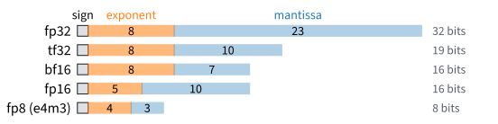
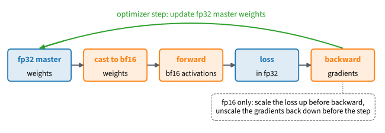

```{.python .input}
%load_ext d2lbook.tab
tab.interact_select('mxnet', 'pytorch', 'tensorflow', 'jax')
```

# Numerical Formats
:label:`sec_numerics`

Every tensor in our models so far has used 32-bit floating point (fp32), without
questioning whether neural networks actually need that many bits. Cutting the
bit width in half pays off immediately in both memory and throughput: the
8-billion-parameter model running through this chapter takes 32 GB for its
weights in 32-bit precision but only 16 GB in 16-bit, and modern GPUs execute
16-bit matrix multiplications at least twice as fast as 32-bit ones. Can we
train in 16 bits and still recover the same model?

Not naively. Sixteen-bit formats are noticeably coarser, opening the door to two
silent failure modes that raise no runtime error. In fp16, $300^2$ already
overflows to `inf`, flooding training with `inf` and NaN values. In bf16, adding
$0.001$ to a weight of $1$ rounds right back to $1$, quietly stalling learning
even while gradients look healthy.

This section shows how to train reliably in 16 bits while avoiding both traps.
Every tensor carries a *dtype*—its numerical format—and every format trades off
*dynamic range* (how large or small representable numbers can be) against
*precision* (how finely adjacent numbers are spaced). *Mixed-precision training*
keeps an fp32 master copy of the weights so tiny gradient updates accumulate
faithfully, while executing expensive matrix multiplications and storing
activations in 16 bits—paired with *loss scaling* when using fp16 so small
gradients do not underflow to zero. Whereas :numref:`sec_parameters` counted
bytes per parameter, here we control bytes per number. The second subsection
(dtype promotion and model casting) is practical reference material you can skim
quickly. All examples run on CPU or GPU; actual 16-bit speedups require GPU
matrix units, which we measure in :numref:`sec_use_gpu`.

```{.python .input #numerics-numerics-dtypes-and-mixed-precision}
%%tab mxnet
import math
import numpy as np
from mxnet import autograd, gluon, init, np as mnp, npx
from mxnet.gluon import nn
from d2l import mxnet as d2l
npx.set_np()
```

```{.python .input #numerics-numerics-dtypes-and-mixed-precision}
%%tab pytorch
import math
import numpy as np
import torch
from torch import nn
from torch.nn import functional as F
from d2l import torch as d2l
```

```{.python .input #numerics-numerics-dtypes-and-mixed-precision}
%%tab tensorflow
import math
import numpy as np
import tensorflow as tf
from d2l import tensorflow as d2l
```

```{.python .input #numerics-numerics-dtypes-and-mixed-precision}
%%tab jax
import math
import numpy as np
import jax
from jax import numpy as jnp
from flax import nnx
import optax
from d2l import jax as d2l
```

```{.python .input #numerics-numerical-formats-1}
%%tab mxnet, pytorch
import random
```

```{.python .input #numerics-numerical-formats-1}
%%tab tensorflow
import ml_dtypes
import random
```

## Floating-Point Formats

### Range and Precision

Simply squaring 300 in both 16-bit formats reveals the two distinct ways low
precision can bite—and 300 is hardly exotic inside a neural network, where an
unnormalized logit or intermediate variance sum can easily reach that size.

```{.python .input #numerics-the-dtype-zoo-1}
%%tab mxnet
x = mnp.array(300.0)
x.astype('float16')**2
```

```{.python .input #numerics-the-dtype-zoo-1}
%%tab pytorch
x = torch.tensor(300.0)
x.to(torch.float16)**2, x.to(torch.bfloat16)**2
```

```{.python .input #numerics-the-dtype-zoo-1}
%%tab tensorflow
x = tf.constant(300.0)
tf.cast(x, tf.float16)**2, tf.cast(x, tf.bfloat16)**2
```

```{.python .input #numerics-the-dtype-zoo-1}
%%tab jax
x = jnp.array(300.0)
x.astype(jnp.float16)**2, x.astype(jnp.bfloat16)**2
```

:begin_tab:`mxnet`
MXNet supports bf16 only in part, and it cannot train bf16 weights, so the
MXNet tab works in fp16 and the cell squares only in fp16. In bf16 the
result would be 90112.
:end_tab:

In fp16 (*half precision*), $300^2$ overflows straight to `inf` because its
largest finite value is just 65504. In bf16 (*brain floating point*), the result
stays finite—90112 instead of 90000—yet already incurs rounding error in the
third significant digit. Both formats fit in 16 bits; they simply partition
those bits differently. Any normal floating-point number stores a sign bit $s$,
an exponent $e$, and a $t$-bit mantissa encoding a fraction $f \in [0, 1)$,
representing

$$x = (-1)^s \cdot 2^{e} \cdot (1 + f).$$

Exponent bits govern dynamic range—the largest and smallest magnitudes $|x|$ the
format can represent—while mantissa bits govern relative precision: adjacent
numbers between $1$ and $2$ sit $2^{-t}$ apart, and between $2^e$ and $2^{e+1}$
they sit $2^{e-t}$ apart, maintaining uniform relative spacing across scales.
The three formats we work with allocate their bits as follows:

| format | sign | exponent | mantissa |
|:-------|-----:|---------:|---------:|
| fp32   | 1    | 8        | 23       |
| bf16   | 1    | 8        | 7        |
| fp16   | 1    | 5        | 10       |

Notice the trade-off immediately. bf16 preserves all 8 exponent bits of fp32
while trimming the mantissa down to 7 bits, delivering fp32's full dynamic range
at coarser resolution. fp16 does the opposite, retaining 10 mantissa bits but
only 5 exponent bits—finer local steps, far narrower range. We can check both
outputs above by hand: with 5 exponent bits, $e$ spans $[-14, 15]$, capping fp16
at $2^{15}(2 - 2^{-10}) = 65504$. With 7 mantissa bits, bf16 values between
$2^{16}$ and $2^{17}$ are spaced by $2^9 = 512$, so 90000 falls between
$175 \cdot 512 = 89600$ and $176 \cdot 512 = 90112$ and rounds to the closer
value, 90112.

:numref:`fig_bg_float-formats` visualizes these bit budgets side by side (see
:numref:`sec_mdl-numerical-stability-conditioning` for a deeper treatment of
IEEE floating-point arithmetic).


:label:`fig_bg_float-formats`

We can query each format's exact numerical limits via `finfo`, focusing on three
fields: `max` (largest finite value), `tiny` (smallest positive *normal* value),
and `eps` (the gap $2^{-t}$ just above 1). Below `tiny`, where the exponent
hits its floor, the format degrades gracefully through evenly spaced *subnormal*
numbers down to zero: in fp16 these are multiples of $2^{-24}$, so a value near
$3 \times 10^{-5}$ still preserves 9 significant bits, whereas one near
$10^{-7}$ retains only a single bit.

```{.python .input #numerics-the-dtype-zoo-2}
%%tab mxnet
for dtype in ('float32', 'float16'):
    fi = mnp.finfo(dtype)
    print(f'{dtype:10} max {fi.max:10.3e}  tiny {fi.smallest_normal:9.3e}'
          f'  eps {fi.eps:8.3e}')
```

```{.python .input #numerics-the-dtype-zoo-2}
%%tab pytorch
for dtype in (torch.float32, torch.bfloat16, torch.float16):
    fi = torch.finfo(dtype)
    print(f'{str(dtype):15} max {fi.max:10.3e}  tiny {fi.tiny:9.3e}'
          f'  eps {fi.eps:8.3e}')
```

```{.python .input #numerics-the-dtype-zoo-2}
%%tab tensorflow
for dtype in (tf.float32, tf.bfloat16, tf.float16):
    fi = ml_dtypes.finfo(dtype.as_numpy_dtype)
    print(f'{dtype.name:10} max {float(fi.max):10.3e}'
          f'  tiny {float(fi.tiny):9.3e}  eps {float(fi.eps):8.3e}')
```

```{.python .input #numerics-the-dtype-zoo-2}
%%tab jax
for dtype in (jnp.float32, jnp.bfloat16, jnp.float16):
    fi = jnp.finfo(dtype)
    print(f'{fi.dtype.name:10} max {float(fi.max):10.3e}'
          f'  tiny {float(fi.tiny):9.3e}  eps {float(fi.eps):8.3e}')
```

:begin_tab:`mxnet`
`mnp.finfo` calls the smallest normal value `smallest_normal` rather than
`tiny`. For bf16, which the cell leaves out, the three numbers are `max`
$3.39 \times 10^{38}$, `tiny` $1.18 \times 10^{-38}$, and `eps`
$2^{-7} \approx 0.0078$.
:end_tab:

:begin_tab:`tensorflow`
TensorFlow has no `finfo` of its own for bf16. The numbers come from
`ml_dtypes`, the small package that defines the bf16 type TensorFlow uses.
:end_tab:

Because bf16 shares fp32's 8-bit exponent, it matches fp32's `tiny` and nearly
matches its `max`, while its `eps` of $0.0078$ gives two to three decimal digits
of precision. fp16 resolves three to four decimal digits, but overflows above
65504, slips into subnormals below $6.1 \times 10^{-5}$, and cannot represent
any positive value below $2^{-24} \approx 6.0 \times 10^{-8}$. Which shortage
hurts deep learning more? Activations and gradients routinely span many orders
of magnitude; running out of range catastrophically turns numbers into `inf` or
zero, whereas slightly coarser precision merely introduces mild rounding noise.
That is why bf16 has become the default 16-bit training format on modern
hardware, leaving fp16 primarily for older GPUs and inference.

### Rounding of Small Updates

Where bf16's coarse spacing *does* hurt is during parameter updates. A single
gradient descent step shifts a weight by $\eta g$, often $10^{-3}$ or less of
the weight's magnitude. Under round-to-nearest, any step smaller than half the
local spacing vanishes completely. Let's add $10^{-3}$ and $10^{-4}$ to a weight
of $1$ in each format:

```{.python .input #numerics-rounding-of-small-updates}
%%tab mxnet
w = mnp.array(1.0)
for dtype in ('float32', 'float16'):
    print(f'{dtype:8}: {float(w.astype(dtype) + 1e-3):.7f}, '
          f'{float(w.astype(dtype) + 1e-4):.7f}')
```

```{.python .input #numerics-rounding-of-small-updates}
%%tab pytorch
w = torch.tensor(1.0)
for dtype in (torch.float32, torch.bfloat16, torch.float16):
    print(f'{str(dtype):14}: {float(w.to(dtype) + 1e-3):.7f}, '
          f'{float(w.to(dtype) + 1e-4):.7f}')
```

```{.python .input #numerics-rounding-of-small-updates}
%%tab tensorflow
w = tf.constant(1.0)
for dtype in (tf.float32, tf.bfloat16, tf.float16):
    print(f'{dtype.name:8}: {float(tf.cast(w, dtype) + 1e-3):.7f}, '
          f'{float(tf.cast(w, dtype) + 1e-4):.7f}')
```

```{.python .input #numerics-rounding-of-small-updates}
%%tab jax
w = jnp.array(1.0)
for dtype in (jnp.float32, jnp.bfloat16, jnp.float16):
    print(f'{jnp.dtype(dtype).name:8}: {float(w.astype(dtype) + 1e-3):.7f}, '
          f'{float(w.astype(dtype) + 1e-4):.7f}')
```

In fp32, both increments register cleanly. In bf16—whose spacing near 1 is
$2^{-7} \approx 0.0078$—both round right back to 1, leaving the weight
completely frozen. In fp16 (spacing $2^{-10} \approx 0.00098$), the $10^{-3}$
step survives (rounded to one grid step) while $10^{-4}$ disappears. Storing
weights directly in 16 bits can therefore stall optimization even when every
gradient is accurate—which is why training keeps master weights in fp32.

## Dtype Promotion and Model Casting

### Promotion

What dtype results when an expression combines mismatched operands? Let's test
adding an fp16 tensor to an fp32 tensor, a Python float, and an integer tensor:

```{.python .input #numerics-dtype-rules-promotion-parameters-and-casts-1}
%%tab mxnet
x16 = mnp.ones(3, dtype='float16')
x32 = mnp.ones(3, dtype='float32')
((x16 + x32).dtype, (x16 + 1.0).dtype,
 mnp.result_type(x16, mnp.ones(3, dtype='int32')))
```

```{.python .input #numerics-dtype-rules-promotion-parameters-and-casts-1}
%%tab pytorch
x16 = torch.ones(3, dtype=torch.float16)
x32 = torch.ones(3, dtype=torch.float32)
(x16 + x32).dtype, (x16 + 1.0).dtype, (x16 + torch.arange(3)).dtype
```

```{.python .input #numerics-dtype-rules-promotion-parameters-and-casts-1}
%%tab tensorflow
x16 = tf.ones(3, dtype=tf.float16)
x32 = tf.ones(3, dtype=tf.float32)
try:
    x16 + x32
except tf.errors.InvalidArgumentError as e:
    print(e.message.split(' but ')[0])
(x16 + 1.0).dtype
```

```{.python .input #numerics-dtype-rules-promotion-parameters-and-casts-1}
%%tab jax
x16 = jnp.ones(3, dtype=jnp.float16)
x32 = jnp.ones(3, dtype=jnp.float32)
(x16 + x32).dtype, (x16 + 1.0).dtype, (x16 + jnp.arange(3)).dtype
```

:begin_tab:`mxnet, pytorch, jax`
Two float tensors promote to the wider format. This is the one rule worth
remembering: an fp16 computation that meets a single stray fp32 tensor
continues in fp32, without a message, and needs twice the memory from then
on. Python scalars and integer tensors do not promote a float tensor, so a
literal such as `x + 1.0` keeps low-precision code in low precision.
:end_tab:

:begin_tab:`mxnet`
The third expression asks the promotion table directly through
`result_type`.
:end_tab:

:begin_tab:`pytorch, jax`
fp16 and bf16 together promote to fp32, since neither contains the other.
:end_tab:

:begin_tab:`tensorflow`
TensorFlow does not promote. A Python scalar is cast to the dtype of the
tensor, but two tensors of different dtypes raise an error at the first
operation that combines them. A stray fp32 tensor therefore cannot silently
turn an fp16 computation into an fp32 one; the cost is that every intended
conversion is written as `tf.cast`.
:end_tab:

### Casting a Model

Since parameters are just tensors, we can cast an entire model to 16 bits.
Throughout this section we use our Fashion-MNIST MLP from
:numref:`sec_mlp-implementation`: 784 inputs, a 256-unit ReLU hidden layer, and
10 outputs, with $\mathcal{N}(0, 0.01^2)$ weights and zero biases—203,530
parameters occupying 814,120 bytes in fp32.

```{.python .input #numerics-dtype-rules-promotion-parameters-and-casts-2}
%%tab mxnet
def mlp():
    net = nn.Sequential()
    net.add(nn.Dense(256, activation='relu', in_units=784),
            nn.Dense(10, in_units=256))
    net.initialize(init.Normal(sigma=0.01))
    return net

def param_bytes(net):
    return sum(p.data().size * p.data().dtype.itemsize
               for p in net.collect_params().values())

net = mlp()
param_bytes(net)
```

```{.python .input #numerics-dtype-rules-promotion-parameters-and-casts-2}
%%tab pytorch
def mlp():
    net = nn.Sequential(nn.Flatten(), nn.Linear(784, 256), nn.ReLU(),
                        nn.Linear(256, 10))
    for layer in net[1], net[3]:
        nn.init.normal_(layer.weight, std=0.01)
        nn.init.zeros_(layer.bias)
    return net

def param_bytes(net):
    return sum(p.numel() * p.element_size() for p in net.parameters())

net = mlp()
param_bytes(net)
```

```{.python .input #numerics-dtype-rules-promotion-parameters-and-casts-2}
%%tab tensorflow
def mlp(dtype=None):
    normal = tf.keras.initializers.RandomNormal  # one instance per layer
    return tf.keras.Sequential([
        tf.keras.layers.Flatten(dtype=dtype),
        tf.keras.layers.Dense(256, activation='relu', dtype=dtype,
                              kernel_initializer=normal(stddev=0.01)),
        tf.keras.layers.Dense(10, dtype=dtype,
                              kernel_initializer=normal(stddev=0.01))])

def param_bytes(net):
    return sum(w.shape.num_elements() * tf.as_dtype(w.dtype).size
               for w in net.weights)

net = mlp()
net(tf.zeros((1, 28, 28, 1)))  # The first call creates the weights
param_bytes(net)
```

```{.python .input #numerics-dtype-rules-promotion-parameters-and-casts-2}
%%tab jax
def mlp(rngs, dtype=None):
    normal = nnx.initializers.normal(0.01)
    return nnx.Sequential(
        lambda x: x.reshape((x.shape[0], -1)),
        nnx.Linear(784, 256, kernel_init=normal, dtype=dtype, rngs=rngs),
        nnx.relu,
        nnx.Linear(256, 10, kernel_init=normal, dtype=dtype, rngs=rngs))

def param_bytes(model):
    return sum(p.size * p.dtype.itemsize
               for _, p in nnx.state(model, nnx.Param).flat_state())

net = mlp(nnx.Rngs(d2l.get_key()))
param_bytes(net)
```

:begin_tab:`mxnet`
Gluon operators require the input and the weights to have the same dtype, so
to change the dtype of a model we cast the whole block:
`net.cast('float16')` converts every parameter, including those of nested
blocks. Inputs we cast ourselves.
:end_tab:

:begin_tab:`pytorch`
Layers do not promote: they require the input to have the dtype of their
weights and raise an error otherwise. To change the dtype of a model we cast
the whole module; `net.to(dtype)`, or the shorthand `net.bfloat16()`,
converts every parameter and buffer.
:end_tab:

:begin_tab:`tensorflow`
A Keras layer has a *dtype policy* with two parts: `variable_dtype`, the
format of its weights, and `compute_dtype`, the format of its forward pass,
both fp32 by default. The argument `dtype='bfloat16'` sets both, so a bf16
model is chosen when it is constructed rather than converted afterwards.
`mlp` passes its `dtype` argument to every layer.
:end_tab:

:begin_tab:`jax`
A Flax NNX layer takes two dtype arguments: `param_dtype`, the format in
which it stores its parameters (fp32 by default), and `dtype`, the format in
which it computes (by default `None`, which promotes parameters and input to a
common type by the rule above). To cast a model we map over its `nnx.Param`
state and leave other state alone.
:end_tab:

```{.python .input #numerics-dtype-rules-promotion-parameters-and-casts-3}
%%tab mxnet
net.cast('float16')
X = mnp.random.normal(size=(8, 1, 28, 28))
print(net(X.astype('float16')).dtype, param_bytes(net))
```

```{.python .input #numerics-dtype-rules-promotion-parameters-and-casts-3}
%%tab pytorch
net = net.bfloat16()
X = torch.randn(8, 1, 28, 28)
try:
    net(X)
except RuntimeError as e:
    print(e)
print(net(X.bfloat16()).dtype, param_bytes(net))
```

```{.python .input #numerics-dtype-rules-promotion-parameters-and-casts-3}
%%tab tensorflow
net16 = mlp(dtype='bfloat16')
X = tf.random.normal((8, 28, 28, 1))
print(net16(X).dtype, param_bytes(net16))
```

```{.python .input #numerics-dtype-rules-promotion-parameters-and-casts-3}
%%tab jax
def cast(model, dtype):
    """Return the model with its parameters stored in dtype."""
    graph, params = nnx.split(model, nnx.Param)
    return nnx.merge(graph, jax.tree.map(lambda p: p.astype(dtype), params))

net16 = cast(net, jnp.bfloat16)
X = jax.random.normal(d2l.get_key(), (8, 28, 28, 1))
print(net16(X).dtype, param_bytes(net16))
print(net16(X.astype(jnp.bfloat16)).dtype)
```

Across all four frameworks, casting halves parameter memory, though each
framework handles an fp32 input differently.

:begin_tab:`mxnet`
The fp32 `X` would have been refused, which is why the cell casts it.
:end_tab:

:begin_tab:`pytorch`
The error message shows the strictness: the fp32 input was refused rather
than converted.
:end_tab:

:begin_tab:`tensorflow`
The fp32 input raised no error: a Keras layer casts floating-point inputs to
its `compute_dtype` before computing. Raw operations refuse to guess, while
layers fix the dtype when they are constructed.
:end_tab:

:begin_tab:`jax`
The first output is fp32. With `dtype=None` the layers promoted the bf16
parameters and the fp32 input to fp32, so casting the parameters saved
memory but not compute. A bf16 input (second line) keeps the forward pass in
bf16, as does constructing the layers with `dtype=jnp.bfloat16`.
:end_tab:

For *inference*, casting a trained model to 16 bits immediately halves its
weight footprint (subject to verifying that task accuracy holds up). For
*training*, however, pure 16-bit weights run straight into the small-update
rounding trap we just saw—as we confirm empirically below.

## Mixed-Precision Training

### Master Weights and 16-Bit Compute

We appear to face a dilemma: reliable weight updates demand 32-bit storage, yet
hardware speedups live in 16-bit arithmetic. *Mixed-precision training*
:cite:`Micikevicius.Narang.Alben.ea.2018` resolves this tension by decoupling
parameter storage from computation. We keep fp32 *master weights* so every small
update accumulates cleanly, cast them to 16 bits for the compute-heavy matrix
multiplications and activations of the forward and backward passes, and keep
sensitive reductions such as the loss in fp32. :numref:`fig_bg_amp-loop`
summarizes a single training step.


:label:`fig_bg_amp-loop`

:begin_tab:`mxnet`
Gluon assigns the two halves to two objects. We cast the *network* to fp16,
and the flag `multi_precision=True` asks the *optimizer* to hold an fp32
copy of every weight, apply each update to that copy, and write the rounded
fp16 value back to the network. MXNet's optimizers cannot update bf16
weights, so the MXNet tab uses fp16 for mixed precision throughout this
section.
:end_tab:

:begin_tab:`pytorch`
Inside a `torch.autocast` context, every operation consults a built-in
policy. Matrix multiplications and convolutions run in the 16-bit dtype, a
list of sensitive operations such as `cross_entropy` runs in fp32, and other
operations run in the dtype of their inputs. The parameters are not
touched; each eligible operation casts its inputs as it runs.
:end_tab:

:begin_tab:`tensorflow`
In Keras the split is the global policy `'mixed_bfloat16'`. Every layer
constructed while it is set gets fp32 `variable_dtype` and bf16
`compute_dtype`, so we set it just before we construct a model and reset it
to `'float32'` right after. The loss is computed outside the layers and
follows no policy; we cast the logits to fp32 before computing it.
:end_tab:

:begin_tab:`jax`
In Flax NNX the split is the pair of constructor arguments from above: leave
`param_dtype` at fp32 and set `dtype=jnp.bfloat16`, and each layer stores
fp32 parameters and computes in bf16. Everything outside the layers, such as
the loss, stays in the dtype we give it; we cast the logits to fp32 before
computing it.
:end_tab:

```{.python .input #numerics-mixed-precision-training-1}
%%tab mxnet
net = mlp()
net.cast('float16')
trainer = gluon.Trainer(net.collect_params(), 'sgd',
                        {'learning_rate': 0.1, 'multi_precision': True})
loss = gluon.loss.SoftmaxCrossEntropyLoss()
with autograd.record():
    l = loss(net(X.astype('float16')), mnp.zeros(8)).mean()
l.backward()
trainer.step(1)
master = trainer._updaters[0].states[0][0]  # The fp32 master copy
net[0].weight.data().dtype, master.dtype
```

```{.python .input #numerics-mixed-precision-training-1}
%%tab pytorch
net = mlp()
with torch.autocast('cpu', dtype=torch.bfloat16):
    Y = net(X)
Y.dtype, net[1].weight.dtype
```

```{.python .input #numerics-mixed-precision-training-1}
%%tab tensorflow
tf.keras.mixed_precision.set_global_policy('mixed_bfloat16')
net = mlp()
tf.keras.mixed_precision.set_global_policy('float32')
Y = net(X)
Y.dtype, net.layers[1].kernel.dtype
```

```{.python .input #numerics-mixed-precision-training-1}
%%tab jax
net = mlp(nnx.Rngs(d2l.get_key()), dtype=jnp.bfloat16)
net(X).dtype, jax.tree.leaves(nnx.state(net, nnx.Param))[0].dtype
```

:begin_tab:`mxnet`
The network holds fp16 weights and the optimizer holds the fp32 master copy.
The copy is created at the first update, so the cell takes one training step
and then reads it from the optimizer's internal state.
:end_tab:

:begin_tab:`pytorch`
The output is bf16 and the weights are fp32: the opposite of `net.bfloat16()`.
The first argument of `autocast` names the device type; on a GPU it is
`'cuda'`.
:end_tab:

:begin_tab:`tensorflow`
The output is bf16 and the weights are fp32: the opposite of
`mlp(dtype='bfloat16')`.
:end_tab:

:begin_tab:`jax`
The output is bf16 and the parameters are fp32: the opposite of casting the
parameter tree. The fp32 input does not promote the computation, because
`dtype` fixes the compute format.
:end_tab:

### Training in fp32 and in 16 Bits

How much does 16-bit arithmetic affect optimization, and what goes wrong when we
drop the fp32 master copy? Let's train our MLP three times with plain SGD on
Fashion-MNIST minibatches of 256 images: full fp32, pure bf16 weights (with no
fp32 master copy), and mixed precision. All three runs start from identical
random weights and consume the exact same minibatches in the same order.

Notice the learning rate: we set $\eta = 0.01$—one-tenth the rate used in
:numref:`sec_mlp-implementation`—and run for 1000 steps (about four epochs). Our
rounding analysis explains why $\eta$ matters so dramatically: an update
$\eta g$ disappears whenever it falls below half the local bf16 grid spacing. At
$\eta = 0.01$, roughly 90% of first-layer updates vanish—mirroring the
late-stage learning-rate decay phase of any real training run. At $\eta = 0.1$,
by contrast, only the smallest 40% of updates (carrying about 2% of total update
mass) get rounded away, masking the failure until late in training.

```{.python .input #numerics-mixed-precision-training-2}
%%tab mxnet
data = d2l.FashionMNIST(batch_size=256)
batches = list(gluon.data.DataLoader(data.train, batch_size=256,
                                     last_batch='discard'))  # One epoch
val_batch = next(iter(gluon.data.DataLoader(data.val, batch_size=1024)))
```

```{.python .input #numerics-mixed-precision-training-2}
%%tab pytorch
data = d2l.FashionMNIST(batch_size=256)
batches = list(torch.utils.data.DataLoader(data.train, batch_size=256,
                                           drop_last=True))  # One epoch
val_batch = next(iter(torch.utils.data.DataLoader(data.val, batch_size=1024)))
```

```{.python .input #numerics-mixed-precision-training-2}
%%tab tensorflow
data = d2l.FashionMNIST(batch_size=256)
images, labels = data.train
batches = [(tf.constant(images[k:k+256, :, :, None], tf.float32) / 255,
            tf.constant(labels[k:k+256], tf.int32))
           for k in range(0, len(images) - 255, 256)]  # One epoch
val_images, val_labels = data.val
val_batch = (tf.constant(val_images[:1024, :, :, None], tf.float32) / 255,
             tf.constant(val_labels[:1024], tf.int32))
```

```{.python .input #numerics-mixed-precision-training-2}
%%tab jax
data = d2l.FashionMNIST(batch_size=256)
images, labels = data.train
batches = [(jnp.asarray(images[k:k+256], jnp.float32) / 255,
            jnp.asarray(labels[k:k+256], jnp.int32))
           for k in range(0, len(images) - 255, 256)]  # One epoch
val_images, val_labels = data.val
val_batch = (jnp.asarray(val_images[:1024, :, :, None], jnp.float32) / 255,
             jnp.asarray(val_labels[:1024], jnp.int32))
```

```{.python .input #numerics-mixed-precision-training-3}
%%tab mxnet
def bf16_round(w):
    """Round to the 8 significant bits of bf16, computed in NumPy."""
    m, e = np.frexp(w.asnumpy())  # w = m * 2**e with 1/2 <= |m| < 1
    return mnp.array(np.ldexp(np.round(m * 2**8) / 2**8, e))

def train(net, store=None, num_steps=1000):
    dtype = net[0].weight.data().dtype
    trainer = gluon.Trainer(net.collect_params(), 'sgd', {
        'learning_rate': 0.01, 'multi_precision': dtype == np.float16})
    loss = gluon.loss.SoftmaxCrossEntropyLoss()
    losses = []
    for step in range(num_steps):
        X, y = batches[step % len(batches)]
        with autograd.record():
            logits = net(X.astype(dtype)).astype('float32')
            l = loss(logits, y).mean()
        l.backward()
        trainer.step(1)
        if store:  # Round every updated weight to the storage format
            for p in net.collect_params().values():
                p.set_data(store(p.data()))
        losses.append(l)
    Xv, yv = val_batch
    accuracy = float((net(Xv.astype(dtype)).argmax(axis=1) == yv).mean())
    return [float(l) for l in losses], accuracy
```

```{.python .input #numerics-mixed-precision-training-3}
%%tab pytorch
def train(net, mixed=False, num_steps=1000):
    dtype = next(net.parameters()).dtype  # The inputs follow the weights
    optimizer = torch.optim.SGD(net.parameters(), lr=0.01)
    losses = []
    for step in range(num_steps):
        X, y = batches[step % len(batches)]
        with torch.autocast('cpu', dtype=torch.bfloat16, enabled=mixed):
            loss = F.cross_entropy(net(X.to(dtype)).float(), y)
        optimizer.zero_grad()
        loss.backward()
        optimizer.step()
        losses.append(loss.detach())
    Xv, yv = val_batch
    with torch.no_grad():
        accuracy = (net(Xv.to(dtype)).argmax(1) == yv).float().mean().item()
    return torch.stack(losses).tolist(), accuracy
```

```{.python .input #numerics-mixed-precision-training-3}
%%tab tensorflow
def train(net, num_steps=1000):
    optimizer = tf.keras.optimizers.SGD(learning_rate=0.01)
    losses = []
    for step in range(num_steps):
        X, y = batches[step % len(batches)]
        with tf.GradientTape() as tape:
            logits = tf.cast(net(X), tf.float32)
            loss = tf.reduce_mean(
                tf.keras.losses.sparse_categorical_crossentropy(
                    y, logits, from_logits=True))
        grads = tape.gradient(loss, net.trainable_variables)
        optimizer.apply_gradients(zip(grads, net.trainable_variables))
        losses.append(loss)
    Xv, yv = val_batch
    y_hat = tf.argmax(net(Xv), axis=1, output_type=yv.dtype)
    accuracy = float(tf.reduce_mean(tf.cast(y_hat == yv, tf.float32)))
    return [float(l) for l in losses], accuracy
```

```{.python .input #numerics-mixed-precision-training-3}
%%tab jax
@nnx.jit
def train_step(model, optimizer, X, y):
    def loss_fn(model):
        logits = model(X).astype(jnp.float32)
        return optax.softmax_cross_entropy_with_integer_labels(
            logits, y).mean()
    loss, grads = nnx.value_and_grad(loss_fn)(model)
    optimizer.update(model, grads)
    return loss

def train(net, num_steps=1000):
    optimizer = nnx.Optimizer(net, optax.sgd(0.01), wrt=nnx.Param)
    losses = [train_step(net, optimizer, *batches[step % len(batches)])
              for step in range(num_steps)]
    Xv, yv = val_batch
    accuracy = float((net(Xv).argmax(1) == yv).mean())
    return [float(l) for l in losses], accuracy
```

One implementation detail in `train` is a good systems habit independent of
precision: we keep per-step loss tensors on-device during the loop and convert
them to Python floats once at the end, avoiding a CPU–GPU synchronization stall
on every single step (:numref:`sec_use_gpu`).

:begin_tab:`mxnet`
MXNet cannot train weights stored in bf16, so the bf16 run keeps fp32
weights and `bf16_round` rounds each of them to the 8 significant bits of
bf16 after every update, which is what storing it in bf16 does. The
mixed-precision run computes in fp16, the network cast by `net.cast`, with
the fp32 master weights of `multi_precision`.
:end_tab:

:begin_tab:`pytorch`
`train` casts each minibatch to the dtype of the weights, so the cast model
computes in bf16 throughout, while `mixed=True` keeps fp32 weights and runs
the forward pass under autocast.
:end_tab:

:begin_tab:`tensorflow`
The three runs differ only in the dtype policy under which the MLP is
constructed: `'bfloat16'` stores and computes every layer in bf16, as
`mlp(dtype='bfloat16')` did above.
:end_tab:

:begin_tab:`jax`
The parameters are created in fp32 in every run, because `param_dtype` keeps
its default, so the same key gives the same initial weights; the bf16 run
then stores them in bf16 with `cast`.
:end_tab:

```{.python .input #numerics-mixed-precision-training-4}
%%tab mxnet
def seeded_mlp(seed):
    npx.random.seed(seed)  # The same seed gives the same initial weights
    return mlp()

seed = random.randrange(2**31)  # One random draw, shared by all runs
loss32, acc32 = train(seeded_mlp(seed))
loss_bf16, acc_bf16 = train(seeded_mlp(seed), store=bf16_round)
net = seeded_mlp(seed)
net.cast('float16')
loss_mixed, acc_mixed = train(net)
print(f'validation accuracy: fp32 {acc32:.3f}, bf16 weights {acc_bf16:.3f}, '
      f'mixed {acc_mixed:.3f}')
d2l.plot(list(range(1, 1001)), [loss32, loss_bf16, loss_mixed], 'step',
         'loss', legend=['fp32', 'bf16 weights', 'mixed precision'])
```

```{.python .input #numerics-mixed-precision-training-4}
%%tab pytorch
def seeded_mlp(seed):
    torch.manual_seed(seed)  # The same seed gives the same initial weights
    return mlp()

seed = random.randrange(2**31)  # One random draw, shared by all runs
loss32, acc32 = train(seeded_mlp(seed))
loss_bf16, acc_bf16 = train(seeded_mlp(seed).bfloat16())
loss_mixed, acc_mixed = train(seeded_mlp(seed), mixed=True)
print(f'validation accuracy: fp32 {acc32:.3f}, bf16 weights {acc_bf16:.3f}, '
      f'mixed {acc_mixed:.3f}')
d2l.plot(list(range(1, 1001)), [loss32, loss_bf16, loss_mixed], 'step',
         'loss', legend=['fp32', 'bf16 weights', 'mixed precision'])
```

```{.python .input #numerics-mixed-precision-training-4}
%%tab tensorflow
def seeded_mlp(seed, policy):
    tf.keras.utils.set_random_seed(seed)  # The same initial weights
    tf.keras.mixed_precision.set_global_policy(policy)
    net = mlp()
    tf.keras.mixed_precision.set_global_policy('float32')
    return net

seed = random.randrange(2**31)  # One random draw, shared by all runs
loss32, acc32 = train(seeded_mlp(seed, 'float32'))
loss_bf16, acc_bf16 = train(seeded_mlp(seed, 'bfloat16'))
loss_mixed, acc_mixed = train(seeded_mlp(seed, 'mixed_bfloat16'))
print(f'validation accuracy: fp32 {acc32:.3f}, bf16 weights {acc_bf16:.3f}, '
      f'mixed {acc_mixed:.3f}')
d2l.plot(list(range(1, 1001)), [loss32, loss_bf16, loss_mixed], 'step',
         'loss', legend=['fp32', 'bf16 weights', 'mixed precision'])
```

```{.python .input #numerics-mixed-precision-training-4}
%%tab jax
key = d2l.get_key()  # One random key, shared by all runs
loss32, acc32 = train(mlp(nnx.Rngs(key)))
loss_bf16, acc_bf16 = train(cast(mlp(nnx.Rngs(key), jnp.bfloat16),
                                 jnp.bfloat16))
loss_mixed, acc_mixed = train(mlp(nnx.Rngs(key), jnp.bfloat16))
print(f'validation accuracy: fp32 {acc32:.3f}, bf16 weights {acc_bf16:.3f}, '
      f'mixed {acc_mixed:.3f}')
d2l.plot(list(range(1, 1001)), [loss32, loss_bf16, loss_mixed], 'step',
         'loss', legend=['fp32', 'bf16 weights', 'mixed precision'])
```

The fp32 and mixed-precision loss curves sit virtually on top of each other,
with validation accuracies matching within about one percentage point. Pure bf16
weights, by contrast, lag behind within the first hundred steps: after 1000
steps, its loss stalls near 1.15 versus 0.85, and validation accuracy trails at
about 64% versus 68%. Just as our scalar experiment predicted, storing weights
directly in bf16 rounds away most first-layer updates, whereas mixed precision
applies them cleanly to fp32 master weights. None of the three runs is trained
to convergence—what matters is the apples-to-apples comparison on identical data
and step counts.

Notice two important caveats about what mixed precision does and does not buy
us. First, we do not see a wall-clock speedup on a tiny CPU MLP; 16-bit speedups
come from dedicated GPU tensor cores working on large matrix multiplications,
which we benchmark in :numref:`subsec_async_dispatch`. Second, mixed precision
does *not* shrink the static per-parameter memory floor from
:numref:`sec_parameters`, because master weights and optimizer moments remain in
fp32. That 16 GB footprint from the opening applies to an 8B model cast for
*inference*; during *training*, mixed precision saves activation memory (halving
stored 16-bit activations) and matrix-multiplication time.

:begin_tab:`mxnet`
The mixed-precision run of the MXNet tab computes in fp16 rather than bf16,
and it trained without loss scaling. The next subsection measures what fp16
does to the gradients of this network and explains when scaling is needed.
:end_tab:

### Loss Scaling for fp16
:label:`subsec_loss_scaling`

With bf16, master weights complete the recipe. With fp16, however, its narrow
exponent range creates a second hazard at the bottom end: small gradients
*underflow*. Magnitudes below $2^{-14} \approx 6.1 \times 10^{-5}$ drop into
subnormals and shed significant bits, and anything below half the smallest
subnormal ($\approx 3 \times 10^{-8}$) rounds straight to zero. A gradient of
$10^{-8}$ vanishes in fp16, yet multiplying it by $2^{16}$ lifts it safely into
normal range:

```{.python .input #numerics-loss-scaling-for-fp16-1}
%%tab mxnet
g = mnp.array(1e-8)
g.astype('float16'), (g * 2**16).astype('float16')
```

```{.python .input #numerics-loss-scaling-for-fp16-1}
%%tab pytorch
g = torch.tensor(1e-8)
g.half(), (g * 2**16).half()
```

```{.python .input #numerics-loss-scaling-for-fp16-1}
%%tab tensorflow
g = tf.constant(1e-8)
tf.cast(g, tf.float16), tf.cast(g * 2**16, tf.float16)
```

```{.python .input #numerics-loss-scaling-for-fp16-1}
%%tab jax
g = jnp.array(1e-8)
g.astype(jnp.float16), (g * 2**16).astype(jnp.float16)
```

How common are tiny gradients in practice? Let's compute first-layer fp32
gradients for our MLP on the first minibatch and measure what fraction of
nonzero entries fall into fp16's subnormal or zero regimes—both unscaled and
scaled by $2^{16}$:

```{.python .input #numerics-loss-scaling-for-fp16-3}
%%tab mxnet
net = mlp()
X, y = batches[0]
with autograd.record():
    l = gluon.loss.SoftmaxCrossEntropyLoss()(net(X), y).mean()
l.backward()
g = net[0].weight.grad().reshape(-1)
g = g[g != 0]
for scale in (1, 2**16):
    print(f'scale {scale:5}: '
          f'{float((mnp.abs(g * scale) < 2**-14).mean()):.1%} subnormal, '
          f'{float(((g * scale).astype("float16") == 0).mean()):.2%} zero')
```

```{.python .input #numerics-loss-scaling-for-fp16-3}
%%tab pytorch
net = mlp()
X, y = batches[0]
F.cross_entropy(net(X), y).backward()
g = net[1].weight.grad.flatten()
g = g[g != 0]
for scale in (1, 2**16):
    print(f'scale {scale:5}: '
          f'{((g * scale).abs() < 2**-14).float().mean():.1%} subnormal, '
          f'{((g * scale).half() == 0).float().mean():.2%} zero')
```

```{.python .input #numerics-loss-scaling-for-fp16-3}
%%tab tensorflow
net = mlp()
X, y = batches[0]
with tf.GradientTape() as tape:
    loss = tf.reduce_mean(tf.keras.losses.sparse_categorical_crossentropy(
        y, net(X), from_logits=True))
g = tf.reshape(tape.gradient(loss, net.layers[1].kernel), -1)
g = g[g != 0]
for scale in (1, 2**16):
    subnormal = tf.reduce_mean(tf.cast(tf.abs(g * scale) < 2**-14, tf.float32))
    zero = tf.reduce_mean(tf.cast(tf.cast(g * scale, tf.float16) == 0,
                                  tf.float32))
    print(f'scale {scale:5}: {float(subnormal):.1%} subnormal, '
          f'{float(zero):.2%} zero')
```

```{.python .input #numerics-loss-scaling-for-fp16-3}
%%tab jax
net = mlp(nnx.Rngs(d2l.get_key()))
X, y = batches[0]
def loss_fn(model):
    return optax.softmax_cross_entropy_with_integer_labels(
        model(X), y).mean()
g = nnx.grad(loss_fn)(net)['layers'][1]['kernel'][...].reshape(-1)
g = g[g != 0]
for scale in (1, 2**16):
    print(f'scale {scale:5}: '
          f'{float((jnp.abs(g * scale) < 2**-14).mean()):.1%} subnormal, '
          f'{float(((g * scale).astype(jnp.float16) == 0).mean()):.2%} zero')
```

Roughly a third of the nonzero first-layer gradients land in fp16's subnormal
range, and about two in a thousand underflow all the way to zero. On this small
MLP the impact is mild because only the tiniest entries vanish—in fact, it is
hard to construct a toy model where fp16 fails outright and loss scaling saves
it. Severe underflow hits large, deep models where losses average over many
tokens or pixels and gradients attenuate across dozens of layers:
:citet:`Micikevicius.Narang.Alben.ea.2018` found that while several ImageNet
classifiers trained fine in unscaled fp16, an object detector diverged and a
large recurrent language model matched fp32 accuracy only once loss scaling was
enabled.

Multiplying the gradients by $2^{16}$ eliminates every subnormal entry while
staying comfortably below fp16's overflow ceiling of 65504. That is the essence
of *loss scaling*: before calling `backward()`, multiply the scalar loss by a
large constant $S$. By linearity of differentiation, every intermediate gradient
shifts up by $S$ during backpropagation. Before stepping the optimizer, divide
the gradients back down by $S$ in fp32, where tiny values are represented
faithfully—leaving the mathematical parameter update completely unchanged while
keeping intermediate fp16 gradients out of the underflow zone.

Choosing $S$ statically is brittle—too small and gradients underflow, too large
and big gradients overflow to `inf`. *Dynamic loss scaling* automates the choice:
start with a large $S$, inspect the gradients on every step, and whenever an
`inf` or NaN appears, skip the optimizer update and halve $S$; after a streak of
clean steps, double $S$ to stay close to the top of fp16's range.

:begin_tab:`mxnet`
Gluon's `Trainer` has no automatic loss scaling. A fixed scale takes two
changes: call `(2**10 * l).backward()` instead of `l.backward()`, and
`trainer.step(2**10)` instead of `trainer.step(1)`, since the argument of
`step` divides the gradients before the update. The dynamic version lives in
the `mxnet.amp` module, which this book does not use.
:end_tab:

:begin_tab:`pytorch`
`torch.amp.GradScaler` implements dynamic loss scaling. The loop below trains
the MLP for 20 steps with fp16 autocast:
:end_tab:

:begin_tab:`tensorflow`
Keras implements dynamic loss scaling in
`tf.keras.mixed_precision.LossScaleOptimizer`, which wraps an optimizer.
Under the policy `'mixed_float16'`, `model.compile` applies the wrapper
automatically. A custom loop wraps the optimizer itself and multiplies the
loss with the wrapper's `scale_loss` before computing gradients. The loop
below trains the MLP for 20 steps under the policy `'mixed_float16'`:
:end_tab:

:begin_tab:`jax`
Optax provides no automatic loss scaling, and JAX code rarely needs it: JAX
grew up on TPUs, whose native 16-bit format is bf16. If you must train in
fp16, the two multiplications are yours to write: scale the loss inside
`loss_fn`, and divide the gradients before `optimizer.update`.
:end_tab:

```{.python .input #numerics-loss-scaling-for-fp16-2}
%%tab pytorch
net = mlp()
optimizer = torch.optim.SGD(net.parameters(), lr=0.1)
scaler = torch.amp.GradScaler('cpu')
for X, y in batches[:20]:
    with torch.autocast('cpu', dtype=torch.float16):
        loss = F.cross_entropy(net(X), y)
    optimizer.zero_grad()
    scaler.scale(loss).backward()  # Gradients of S * loss
    scaler.step(optimizer)         # Divide by S, skip the step on inf/NaN
    scaler.update()                # Adjust S
print(f'loss {loss.item():.3f}, loss scale {scaler.get_scale():.0f}')
```

```{.python .input #numerics-loss-scaling-for-fp16-2}
%%tab tensorflow
tf.keras.mixed_precision.set_global_policy('mixed_float16')
net = mlp()
tf.keras.mixed_precision.set_global_policy('float32')
optimizer = tf.keras.mixed_precision.LossScaleOptimizer(
    tf.keras.optimizers.SGD(learning_rate=0.1))
for X, y in batches[:20]:
    with tf.GradientTape() as tape:
        loss = tf.reduce_mean(tf.keras.losses.sparse_categorical_crossentropy(
            y, tf.cast(net(X), tf.float32), from_logits=True))
        scaled_loss = optimizer.scale_loss(loss)  # S * loss
    grads = tape.gradient(scaled_loss, net.trainable_variables)
    # Divide by S, skip the step on inf/NaN, adjust S
    optimizer.apply_gradients(zip(grads, net.trainable_variables))
print(f'loss {float(loss):.3f}, '
      f'loss scale {float(optimizer.dynamic_scale):.0f}')
```

:begin_tab:`pytorch`
The scale starts at $2^{16}$ and stays there, because no step overflowed.
:end_tab:

:begin_tab:`tensorflow`
The scale starts at $2^{15}$, the default of `LossScaleOptimizer`, and stays
there, because no step overflowed. The wrapper grows the scale only after
2000 clean steps in a row, far more than this loop takes.
:end_tab:

Consequently, on modern hardware with native bf16 support (recent GPUs, TPUs,
and server CPUs), bf16 mixed precision without loss scaling is the standard
recipe; fp16 with dynamic loss scaling remains essential on older GPUs.

One final hardware feature accelerates fp32 models without changing any tensor
dtypes at all. Starting with NVIDIA's Ampere architecture, fp32 matrix
multiplications can run on tensor cores in *tf32* mode: inputs are truncated to
fp16's 10-bit mantissa while keeping fp32's 8-bit exponent, and inner products
accumulate in full fp32—delivering substantial speedups while matching strict
fp32 to three or four significant digits.

:begin_tab:`mxnet`
MXNet has no Python switch for tf32; the environment variable
`NVIDIA_TF32_OVERRIDE=0`, set before the process starts, turns it off.
:end_tab:

:begin_tab:`pytorch`
PyTorch computes fp32 matrix multiplications in full fp32 by default;
`torch.set_float32_matmul_precision('high')`, which the imports of
:numref:`sec_use_gpu` set, allows tf32.
:end_tab:

:begin_tab:`tensorflow`
TensorFlow uses tf32 wherever the hardware supports it;
`tf.config.experimental.enable_tensor_float_32_execution(False)` turns it
off.
:end_tab:

:begin_tab:`jax`
JAX lets the backend choose, which on such GPUs means tf32;
`jax.default_matmul_precision('float32')` requests full fp32.
:end_tab:

## Numerical Failure Modes

Three concrete hazards explain the vast majority of numerical bugs in 16-bit
code: an upstream overflow that surfaces downstream as NaN, an unshifted
exponential that blows up before the final logarithm can shrink it, and a long
reduction that stops growing once individual terms fall below the accumulator's
rounding threshold.

### From Overflow to NaN

A NaN loss is rarely the root cause—it is usually the aftermath of an earlier
overflow to `inf`, because indeterminate arithmetic like `inf - inf` or
`inf / inf` produces NaN:

```{.python .input #numerics-when-numerics-bite-1}
%%tab mxnet
s = mnp.array(60000., dtype='float16') * 2  # Overflows
s, s - s
```

```{.python .input #numerics-when-numerics-bite-1}
%%tab pytorch
s = torch.tensor(60000., dtype=torch.float16) * 2  # Overflows
s, s - s
```

```{.python .input #numerics-when-numerics-bite-1}
%%tab tensorflow
s = tf.constant(60000., dtype=tf.float16) * 2  # Overflows
s, s - s
```

```{.python .input #numerics-when-numerics-bite-1}
%%tab jax
s = jnp.array(60000., dtype=jnp.float16) * 2  # Overflows
s, s - s
```

That initial overflow may occur layers upstream before NaN ever reaches the
loss, and once a single parameter update carries a NaN, every subsequent step is
poisoned. Whenever a loss turns NaN, check value ranges first—is any operation
running in fp16 near its 65504 ceiling?—before blaming the learning rate or
architecture.

:begin_tab:`mxnet`
MXNet has no switch that stops at the first bad operation, so the search is
manual: insert checks such as `mnp.isnan(x).any()` and `mnp.isinf(x).any()`
after suspect stages, starting from the loss and moving upstream.
:end_tab:

:begin_tab:`pytorch`
Under autocast with `GradScaler`, the check for `inf` and NaN in the
gradients catches an overflow in the step where it occurs and skips the
update.
:end_tab:

:begin_tab:`tensorflow`
`tf.debugging.enable_check_numerics()` makes TensorFlow stop with an error at
the first operation whose output contains `inf` or NaN. The check slows
every operation, so it is a debugging mode, not a default.
:end_tab:

:begin_tab:`jax`
`jax.config.update('jax_debug_nans', True)` makes JAX stop with an error at
the first operation whose output is NaN; for compiled code, it reruns the
function operation by operation to find it. The check slows execution, so it
is a debugging mode, not a default.
:end_tab:

### Log-Sum-Exp

Softmax cross-entropy requires computing $\log \sum_i \exp(x_i)$. Evaluating
that expression literally overflows in fp16 even when the final answer is small:

```{.python .input #numerics-when-numerics-bite-2}
%%tab mxnet
x = mnp.array([12.0, 11.0, 10.0], dtype='float16')
m = x.max()
mnp.log(mnp.exp(x).sum()), m + mnp.log(mnp.exp(x - m).sum())
```

```{.python .input #numerics-when-numerics-bite-2}
%%tab pytorch
x = torch.tensor([12.0, 11.0, 10.0], dtype=torch.float16)
x.exp().sum().log(), torch.logsumexp(x, dim=0)
```

```{.python .input #numerics-when-numerics-bite-2}
%%tab tensorflow
x = tf.constant([12.0, 11.0, 10.0], dtype=tf.float16)
tf.math.log(tf.reduce_sum(tf.exp(x))), tf.math.reduce_logsumexp(x)
```

```{.python .input #numerics-when-numerics-bite-2}
%%tab jax
x = jnp.array([12.0, 11.0, 10.0], dtype=jnp.float16)
jnp.log(jnp.exp(x).sum()), jax.scipy.special.logsumexp(x)
```

Although the true answer is a modest 12.4, the intermediate term
$e^{12} \approx 163{,}000$ easily blows past fp16's 65504 limit. The fix is the
exact shift we introduced in :numref:`subsec_softmax-implementation-revisited`:
subtract the maximum entry $m = \max_i x_i$ before exponentiating and add $m$
back afterward,

$$\log \sum_i \exp(x_i) = m + \log \sum_i \exp(x_i - m).$$

Every exponent on the right is nonpositive—making overflow impossible—and the
largest term is exactly $e^0 = 1$, preventing underflow to $\log 0$. In
practice you rarely need to code this shift yourself: built-in log-softmax and
cross-entropy routines apply it automatically.

:begin_tab:`mxnet`
`mx.np` has no `logsumexp`, so the cell writes the shift out. Inside a model,
`npx.log_softmax` and Gluon's `SoftmaxCrossEntropyLoss` apply it.
:end_tab:

:begin_tab:`pytorch`
So does `torch.logsumexp`, which the cell calls.
:end_tab:

:begin_tab:`tensorflow`
So does `tf.math.reduce_logsumexp`, which the cell calls; the Keras
cross-entropy losses apply the shift only with `from_logits=True`.
:end_tab:

:begin_tab:`jax`
So does `jax.scipy.special.logsumexp`, which the cell calls.
:end_tab:

### Accumulation in fp32

Long sums accumulated in 16 bits stall silently: once the running total grows
large enough, each small summand falls below half the local grid spacing and
rounds to zero. Let's add $2^{-10}$ (represented *exactly* in fp16) 4096 times
into an fp16 accumulator versus an fp32 accumulator:

```{.python .input #numerics-when-numerics-bite-3}
total16, total32 = np.float16(0), np.float32(0)
term = np.float16(2**-10)
for _ in range(4096):
    total16 += term  # fp16 accumulator
    total32 += term  # fp32 accumulator, same fp16 terms
total16, total32
```

The exact total is 4, which the fp32 accumulator hits on the nose. The fp16
accumulator freezes at 2 after 2048 steps: between 2 and 4, adjacent fp16
values lie $2^{-9}$ apart, so $2 + 2^{-10}$ lands right on the midpoint and
round-to-nearest-even snaps it back to 2 forever. Batch averages, epoch loss
totals, and variance calculations in normalization layers all share this hazard,
which is why mixed-precision policies keep reductions and normalizations in
fp32—and why any custom reduction over 16-bit tensors should accumulate in fp32.

All three failure modes trace back to the same root: an intermediate quantity
outstripping the range or precision of a 16-bit format even when the final
answer fits comfortably. Remember also that mixed precision and tf32 alter the
lowest bits of arithmetic by design, so they will never match pure fp32 bit for
bit. When runs *can* be made bit-for-bit repeatable—and how to achieve it—is
the focus of :numref:`sec_repro`.

## Summary

Floating-point formats trade dynamic range (exponent bits) against precision
(mantissa bits): fp16 gives finer local steps but a narrow range (overflowing
past 65504 and underflowing tiny gradients), whereas bf16 keeps fp32's full
8-bit exponent at just two to three decimal digits of precision. Storing weights
directly in 16 bits rounds away small gradient updates and stalls training, so
mixed-precision training keeps fp32 master weights while running matrix
multiplications and storing activations in 16 bits—matching fp32 accuracy on our
Fashion-MNIST MLP where pure bf16 weights fall behind. With fp16, dynamic loss
scaling lifts gradients out of the subnormal/underflow zone during
backpropagation; bf16 avoids this step altogether. Finally, guard low-precision
code against overflow-induced NaNs by using shifted log-sum-exp operations and
fp32 accumulators for long reductions and normalizations.

:begin_tab:`mxnet`
In Gluon, `net.cast('float16')` casts a model, and the optimizer flag
`multi_precision=True` adds the fp32 master weights for training. MXNet
cannot train bf16 weights, and its `Trainer` has no automatic loss scaling.
:end_tab:

:begin_tab:`pytorch`
In PyTorch, `net.bfloat16()` casts a model, `torch.autocast` runs eligible
operations in 16 bits over fp32 parameters, and `torch.amp.GradScaler` scales
the loss for fp16.
:end_tab:

:begin_tab:`tensorflow`
In TensorFlow, raw operations never promote, and a Keras layer fixes its
storage and compute dtypes when it is constructed: `dtype='bfloat16'` casts a
layer, the global policy `'mixed_bfloat16'` gives fp32 weights with bf16
compute, and `LossScaleOptimizer` scales the loss for fp16.
:end_tab:

:begin_tab:`jax`
In Flax NNX, every layer takes a storage dtype, `param_dtype`, and a compute
dtype, `dtype`; mixed precision sets `dtype=jnp.bfloat16` and leaves
`param_dtype` at fp32, without any context manager.
:end_tab:

## Exercises

1. **Rounded updates.** A weight $w = 1$ receives 1000 updates of
   $+10^{-3}$ each and is rounded to its storage dtype after every update.
    1. Using the `eps` values of this section and round-to-nearest, predict
       the final value of $w$ to three decimal places when it is stored in
       fp32, in fp16, and in bf16.
    1. Now the updates go to an fp32 master copy, and a bf16 working copy
       is rounded from the master copy after every update. Predict the
       final values of both copies.

1. **Mixed-precision memory.** Training with Adam in fp32 stores 16 bytes per
   parameter (:numref:`sec_parameters`). Suppose that `train` used Adam
   instead of SGD.
    1. In which dtype does the mixed-precision recipe of your framework store
       the weights, the gradients, and Adam's running averages between
       steps? Does mixed precision reduce the bytes per parameter?
    1. Count as stored activations the input of each linear layer and the
       logits. For the MLP of `train`, convert the per-example count to
       bytes in fp32 and in the 16-bit format `train` uses. At which batch
       size does the activation saving equal the persistent training state
       of this MLP?

1. **Loss scaling on overflow.** Under dynamic loss
   scaling (:numref:`subsec_loss_scaling`), a step whose unscaled gradients contain
   an `inf` or NaN is skipped and the scale is halved. After $N$
   consecutive clean steps, the scale is doubled.
    1. A skipped step must leave Adam's running averages untouched. Explain
       what would go wrong if the step instead updated them with the
       non-finite gradient, and what would go wrong if it updated them with
       the non-finite entries replaced by zeros.
    1. Explain why the scale must grow again after a run of clean steps
       instead of only shrinking.
    1. Suppose that every step overflows when the scale is above a fixed
       threshold and that no step overflows below it. Once the scale has
       settled, what fraction of steps is skipped as a function of $N$?
       Without the assumption of a fixed threshold, what does a larger $N$
       cost?

1. [code] **Normalization in fp16.** Mixed-precision recipes run
   normalization layers in fp32. To see why, consider RMSNorm with its
   gain set to one (:numref:`sec_custom_layer` implements it as a
   module). It rescales an input row $\mathbf{x}$ of width $d$ by its root
   mean square,

   $$\frac{\mathbf{x}}{\sqrt{\frac{1}{d} \sum_{i=1}^{d} x_i^2 + \epsilon}},$$

   where the small constant $\epsilon$ guards against division by zero.
   Compute it entirely in fp16 for a batch of 64 rows of width $d = 1024$
   whose entries have a standard deviation of about 100.
    1. Which intermediate quantity is the first to become `inf`, and what
       does the layer return for the affected rows?
    1. Take the squares as exact. At what input standard deviation does
       their mean exceed the fp16 maximum, and at what standard deviation
       does their sum over the $d$ entries exceed it?

5. [code] **The learning rate at which bf16 weights fail.** Give `train` a
   learning-rate argument and repeat the fp32 run and the run with bf16
   weights at the rates 0.1, 0.03, 0.01, and 0.003, with the number of
   steps chosen so that the rate times the number of steps stays at 10.
    1. At which rate does the run with bf16 weights begin to fall behind?
    1. A first-layer weight of this MLP has a size of about 0.01. What is
       the bf16 spacing near it, and how small must a gradient entry be at
       each rate for its update to be lost?

:begin_tab:`mxnet`
6. **The e4m3fn format.** ● The fp8 format `float8_e4m3fn` has one sign
   bit, 4 exponent bits with bias 7, and 3 mantissa bits. Derive its
   `tiny` and `eps` and compare them with those of fp16 and bf16. Explain
   the name `e4m3fn`. A format with the same bit layout that followed the
   IEEE convention would reserve the all-ones exponent for `inf` and NaN.
   Compute that format's largest finite value, and explain how
   `float8_e4m3fn` reaches a largest finite value of 448 instead.
:end_tab:

:begin_tab:`pytorch`
6. [code] **The e4m3fn format.** ● Print `torch.finfo(torch.float8_e4m3fn)`
   and compare its `max`, `tiny` and `eps` with those of fp16 and bf16.
   Explain the name `e4m3fn`. A format with a 4-bit exponent and a 3-bit
   mantissa that followed the IEEE convention would reserve the all-ones
   exponent for `inf` and NaN. Compute that format's largest finite value,
   and explain how `e4m3fn` reaches a `max` of 448 instead.
:end_tab:

:begin_tab:`tensorflow`
6. [code] **The e4m3fn format.** ● Print
   `ml_dtypes.finfo(ml_dtypes.float8_e4m3fn)` and compare its `max`,
   `tiny` and `eps` with those of fp16 and bf16. Explain the name
   `e4m3fn`. A format with a 4-bit exponent and a 3-bit mantissa that
   followed the IEEE convention would reserve the all-ones exponent for
   `inf` and NaN. Compute that format's largest finite value, and explain
   how `e4m3fn` reaches a `max` of 448 instead.
:end_tab:

:begin_tab:`jax`
6. [code] **The e4m3fn format.** ● Print `jnp.finfo(jnp.float8_e4m3fn)` and
   compare its `max`, `tiny` and `eps` with those of fp16 and bf16.
   Explain the name `e4m3fn`. A format with a 4-bit exponent and a 3-bit
   mantissa that followed the IEEE convention would reserve the all-ones
   exponent for `inf` and NaN. Compute that format's largest finite value,
   and explain how `e4m3fn` reaches a `max` of 448 instead.
:end_tab:

[Discussions](https://d2l.discourse.group/t/36756)

<!-- slides -->

::: {.slide}
::: {.cover}
[Dive into Deep Learning · §5.5]{.kicker}

Numerical Formats<br>**range and precision · rounding of updates · master weights · loss scaling**
:::
:::

::: {.slide title="16 Bits Halve an 8B Model, but Square 300 to Infinity"}
[The problem]{.kicker}

- **Memory:** 8 billion weights take 32 GB in fp32 and 16 GB in a 16-bit
  format; recent GPUs also multiply 16-bit matrices at least twice as fast.
- **Range:** in fp16, $300^2 = \infty$; its largest number is 65504.
- **Precision:** in bf16, $1 + 0.001 = 1$; the update is lost.

::: {.d2l-note .warn}
Neither failure raises an error: the loss turns NaN, or training stops
improving.
:::
:::

::: {.slide title="By the End of This Deck You Can"}
[Goals]{.kicker}

- read range and precision off a format's exponent and mantissa bits;
- predict when an update or a gradient is rounded away;
- explain dtype promotion and what casting a model does;
- train with fp32 master weights and 16-bit compute, and say what it saves;
- size a loss scale for fp16, and fix overflow, log-sum-exp, and long sums.

**The idea:** keep what must be precise (weights, sums) in fp32, compute the
rest in 16 bits. **Running example:** an 8B-parameter model, and the
Fashion-MNIST MLP (784–256–10, 203,530 parameters).
:::

::: {.slide title="Number Formats, between Custom Layers and Saving"}
[Where this fits]{.kicker}

| section | adds |
|---|---|
| Modules and Model Construction | a model is a tree of modules, built from a config |
| Parameters, State, and Memory | parameters, buffers, bytes per parameter |
| Initialization | library defaults, custom initializers, residual depth |
| Custom Layers and Functions | new layers, state, and custom gradients |
| **Numerical Formats** | **dtypes, mixed precision, loss scaling** |
| Saving, Loading, and Pretrained Weights | safe files, checkpoints, pretrained weights |
| GPUs, Devices, and Memory | placement, asynchrony, training memory |
| Reproducibility and Inspection | seeds, determinism, hooks |

Uses the Fashion-MNIST MLP and 16 bytes per parameter; skips fp8, int8, and timings.
:::

::: {.slide}
::: {.divider}
[01]{.dnum}

[Floating-Point Formats]{.dtitle}

[range · precision · rounding]{.dsub}
:::
:::

::: {.slide title="Exponent Bits Set the Range, Mantissa Bits the Precision"}
[Floating-point formats]{.kicker}

$$x = (-1)^s \cdot 2^{e} \cdot (1 + f), \qquad f \in [0, 1) \text{ stored in } t \text{ bits}.$$

Neighbors in $[2^e, 2^{e+1})$ are $2^{e-t}$ apart: the same *relative*
spacing $2^{-t}$ at every scale.

| format | exponent | mantissa $t$ | largest | spacing at 1 |
|---|---:|---:|---:|---:|
| fp32 | 8 | 23 | $3.4 \times 10^{38}$ | $1.2 \times 10^{-7}$ |
| bf16 | 8 | 7 | $3.4 \times 10^{38}$ | $0.0078$ |
| fp16 | 5 | 10 | $65504$ | $0.00098$ |
:::

::: {.slide title="fp16 and bf16 Split the Same 16 Bits in Opposite Ways"}
[Floating-point formats]{.kicker}

{width=85%}

- bf16: fp32's exponent, so fp32's range, and two to three digits.
- fp16: three to four digits, overflow above 65504, subnormal below
  $6.1 \times 10^{-5}$, zero below $3 \times 10^{-8}$.
:::

::: {.slide title="finfo Reports max, tiny, and eps"}
[Floating-point formats]{.kicker}

@!numerics-the-dtype-zoo-2

- `max`: largest finite value; `tiny`: smallest *normal* value, below which
  precision decays (subnormals); `eps`: spacing just above 1.
- Gradients span many orders of magnitude: too little range gives `inf` or
  0, too little precision only rounding error. Hence bf16 for training.
:::

::: {.slide title="An Update Smaller Than Half the Spacing Is Lost"}
[Rounding of small updates]{.kicker}

Add $10^{-3}$ and $10^{-4}$ to a weight of 1:

@!numerics-rounding-of-small-updates

- Spacing near 1: bf16 $2^{-7} \approx 0.0078$, both updates vanish; fp16
  $2^{-10} \approx 0.00098$, $10^{-3}$ becomes one step, $10^{-4}$ vanishes.

::: {.d2l-note .rule}
Updates are often $10^{-3}$ of a weight or less: weights stay in fp32.
:::
:::

::: {.slide title="Check: Which Updates Survive in bf16?"}
[Check]{.kicker}

In bf16, which of these change the stored value?

1. $1 + 0.005$
2. $1000 + 1$

::: {.fragment .fade-up}
::: {.d2l-note}
**Answer.** Near 1 the spacing is $2^{-7} \approx 0.0078$; 0.005 exceeds half
of it, so the sum rounds up to $1.0078$. Between 512 and 1024 the spacing is
$2^{9-7} = 4$; an increment of 1 is below half of it and is lost.
:::
:::
:::

::: {.slide}
::: {.divider}
[02]{.dnum}

[Promotion and Casting]{.dtitle}

[what dtype an expression gets · halving a model]{.dsub}
:::
:::

::: {.slide title="Two Floats Promote to the Wider; Python Scalars Do Not Promote" except="tensorflow"}
[Promotion]{.kicker}

fp16 + fp32, fp16 + 1.0, fp16 + integer tensor:

@!numerics-dtype-rules-promotion-parameters-and-casts-1

- One stray fp32 tensor turns an fp16 computation into fp32: twice the
  memory from then on.
- Python scalars are *weak*: `x + 1.0` keeps the dtype of `x`.
- An integer tensor does not promote a float tensor.
:::

::: {.slide title="Mixed Tensors Raise an Error; Python Scalars Take the Tensor's Dtype" only="tensorflow"}
[Promotion]{.kicker}

fp16 + fp32, then fp16 + 1.0:

@!numerics-dtype-rules-promotion-parameters-and-casts-1

- TensorFlow does not promote: two tensors of different dtypes raise an
  error at the first operation that combines them.
- A Python scalar is cast to the tensor's dtype: `x + 1.0` keeps the dtype
  of `x`.
- Every intended conversion is a `tf.cast`.
:::

::: {.slide title="Casting the MLP Halves Its 814,120 Bytes" only="mxnet"}
[Casting a model]{.kicker}

@!numerics-dtype-rules-promotion-parameters-and-casts-3

- 203,530 parameters: 814,120 bytes in fp32, 407,060 in 16 bits.
- Gluon layers refuse an input whose dtype differs from their weights:
  cast the block with `net.cast`, and the inputs ourselves.
- Good for inference, if the predictions survive; bad for training,
  because small updates round away.
:::

::: {.slide title="Casting the MLP Halves Its 814,120 Bytes" only="pytorch"}
[Casting a model]{.kicker}

@!numerics-dtype-rules-promotion-parameters-and-casts-3

- 203,530 parameters: 814,120 bytes in fp32, 407,060 in 16 bits.
- Layers refuse an input whose dtype differs from their weights:
  `net.to(dtype)` or `net.bfloat16()` casts every parameter and buffer.
- Good for inference, if the predictions survive; bad for training,
  because small updates round away.
:::

::: {.slide title="Casting the MLP Halves Its 814,120 Bytes" only="tensorflow"}
[Casting a model]{.kicker}

@!numerics-dtype-rules-promotion-parameters-and-casts-3

- 203,530 parameters: 814,120 bytes in fp32, 407,060 in 16 bits.
- A Keras layer casts float inputs to its `compute_dtype`; the dtype is
  chosen when the layer is constructed.
- Good for inference, if the predictions survive; bad for training,
  because small updates round away.
:::

::: {.slide title="Casting the MLP Halves Its 814,120 Bytes" only="jax"}
[Casting a model]{.kicker}

@!numerics-dtype-rules-promotion-parameters-and-casts-3

- 203,530 parameters: 814,120 bytes in fp32, 407,060 in 16 bits.
- With `dtype=None` a layer promotes bf16 parameters and an fp32 input
  to fp32: cast the input too, or set `dtype`.
- Good for inference, if the predictions survive; bad for training,
  because small updates round away.
:::

::: {.slide}
::: {.divider}
[03]{.dnum}

[Mixed-Precision Training]{.dtitle}

[master weights · 16-bit compute · loss scaling]{.dsub}
:::
:::

::: {.slide title="fp32 Master Weights, 16-Bit Matrix Products, fp32 Loss" only="mxnet"}
[Mixed precision]{.kicker}

{width=95%}

Gluon: `net.cast('float16')` for the network, `multi_precision=True` for
fp32 master weights in the optimizer.
:::

::: {.slide title="fp32 Master Weights, 16-Bit Matrix Products, fp32 Loss" only="pytorch"}
[Mixed precision]{.kicker}

{width=95%}

PyTorch: `torch.autocast` casts the inputs of each eligible operation;
the parameters stay fp32.
:::

::: {.slide title="fp32 Master Weights, 16-Bit Matrix Products, fp32 Loss" only="tensorflow"}
[Mixed precision]{.kicker}

{width=95%}

Keras: the policy `'mixed_bfloat16'` gives each layer fp32 variables and
bf16 compute.
:::

::: {.slide title="fp32 Master Weights, 16-Bit Matrix Products, fp32 Loss" only="jax"}
[Mixed precision]{.kicker}

{width=95%}

Flax NNX: `dtype=jnp.bfloat16` with `param_dtype` left at fp32.
:::

::: {.slide title="bf16 Weights Fall Behind; Mixed Precision Matches fp32"}
[Mixed precision]{.kicker}

MLP, 1000 SGD steps ($\eta = 0.01$) of 256 Fashion-MNIST images, one random
seed for all three runs:

@!numerics-mixed-precision-training-4

- bf16 weights: about 90% of the first-layer updates are below half the
  spacing and are lost; loss about 1.15 against 0.85.
- fp32 master weights: the mixed run's curve lies on the fp32 one.
:::

::: {.slide title="Mixed Precision Does Not Make the 8B Model Fit"}
[Running example]{.kicker}

| per parameter, Adam | fp32 training | mixed precision |
|---|---:|---:|
| weights (fp32 master) | 4 B | 4 B |
| gradients | 4 B | 4 B |
| Adam's two running averages | 8 B | 8 B |
| **8B parameters** | **128 GB** | **128 GB** |

- Saved: activations (stored in 16 bits) and matrix-product time.
- Not saved: weights, gradients, optimizer state.
:::

::: {.slide title="A Third of the First-Layer Gradients Are Subnormal in fp16"}
[Loss scaling]{.kicker}

Nonzero first-layer gradients of the MLP, first minibatch:

@!numerics-loss-scaling-for-fp16-3

$$\nabla (S \cdot L) = S \cdot \nabla L: \quad \text{scale the loss by } S, \text{ divide the gradients by } S \text{ in fp32.}$$

Dynamic scaling: halve $S$ and skip the step on `inf`/NaN; double after a
run of clean steps. bf16 needs none of this.
:::

::: {.slide title="Loss Scaling Matters for Some Networks, Not for This One"}
[Loss scaling]{.kicker}

- In the MLP the entries that fp16 loses are the smallest ones, about two
  in a thousand: the damage is slight.
- Real damage needs nearly all of a gradient below the threshold: a loss
  averaged over many elements, or a gradient that has passed through many
  layers.
- Micikevicius et al. (2018): many networks, ImageNet classifiers among
  them, trained in fp16 without scaling. An object detector diverged; it
  and a large recurrent language model matched fp32 only with scaling.

::: {.d2l-note .rule}
On hardware with bf16: bf16 mixed precision, no loss scaling. fp16 with
loss scaling remains for older GPUs.
:::
:::

::: {.slide title="Check: Does This Gradient Survive?"}
[Check]{.kicker}

A gradient entry is $2 \times 10^{-6}$. Stored in fp16, is it exact,
subnormal, or zero? With $S = 2^{16}$?

::: {.fragment .fade-up}
::: {.d2l-note}
**Answer.** $2 \times 10^{-6}$ lies between $3 \times 10^{-8}$ and
$6.1 \times 10^{-5}$: subnormal, with only about 5 significant bits. Times
$2^{16}$ it is about $0.13$, a normal number with full fp16 precision.
:::
:::
:::

::: {.slide title="TF32: fp32 Tensors, a 10-Bit Mantissa inside the Matrix Product" only="mxnet"}
[TF32]{.kicker}

On NVIDIA GPUs since Ampere, an fp32 matrix product may round its inputs to
10 mantissa bits and sum in fp32: faster, three to four digits. The tensors
stay fp32.

- MXNet has no Python switch for it.
- `NVIDIA_TF32_OVERRIDE=0`, set before Python starts, turns tf32 off.
:::

::: {.slide title="TF32: fp32 Tensors, a 10-Bit Mantissa inside the Matrix Product" only="pytorch"}
[TF32]{.kicker}

On NVIDIA GPUs since Ampere, an fp32 matrix product may round its inputs to
10 mantissa bits and sum in fp32: faster, three to four digits. The tensors
stay fp32.

- Default `'highest'`: full fp32.
- `torch.set_float32_matmul_precision('high')` allows tf32.
:::

::: {.slide title="TF32: fp32 Tensors, a 10-Bit Mantissa inside the Matrix Product" only="tensorflow"}
[TF32]{.kicker}

On NVIDIA GPUs since Ampere, an fp32 matrix product may round its inputs to
10 mantissa bits and sum in fp32: faster, three to four digits. The tensors
stay fp32.

- Default: tf32 on wherever the hardware supports it.
- `tf.config.experimental.enable_tensor_float_32_execution(False)` turns it
  off.
:::

::: {.slide title="TF32: fp32 Tensors, a 10-Bit Mantissa inside the Matrix Product" only="jax"}
[TF32]{.kicker}

On NVIDIA GPUs since Ampere, an fp32 matrix product may round its inputs to
10 mantissa bits and sum in fp32: faster, three to four digits. The tensors
stay fp32.

- Default `None`: the backend chooses, tf32 on GPUs with tensor cores.
- `jax.default_matmul_precision('float32')` requests full fp32.
:::

::: {.slide}
::: {.divider}
[04]{.dnum}

[Numerical Failure Modes]{.dtitle}

[overflow · log-sum-exp · accumulation]{.dsub}
:::
:::

::: {.slide title="A NaN Is Often the Second Symptom of an Overflow"}
[Failure modes]{.kicker}

$60000 \cdot 2$ in fp16, then $s - s$:

@!numerics-when-numerics-bite-1

When the loss turns NaN: does anything run in fp16, and do intermediate
values approach 65504? Then check the learning rate.
:::

::: {.slide title="Subtract the Max before Exponentiating"}
[Failure modes]{.kicker}

@!numerics-when-numerics-bite-2

$$\log \sum_i \exp(x_i) = m + \log \sum_i \exp(x_i - m), \qquad m = \max_i x_i.$$

$e^{12} \approx 163{,}000 > 65504$; after the shift every term is at most 1.
:::

::: {.slide title="An fp16 Running Total Stops at 2; an fp32 One Reaches 4"}
[Failure modes]{.kicker}

@!numerics-when-numerics-bite-3

- Between 2 and 4 the fp16 spacing is $2^{-9}$: $2 + 2^{-10}$ is a tie, and
  round-to-nearest-even keeps 2.
- The fp32 accumulator over the same fp16 terms reaches the exact 4.
- Reductions and normalization layers run in fp32 in every mixed-precision
  recipe.
:::

::: {.slide title="Recap"}
[Wrap-up]{.kicker}

- **Formats:** exponent bits set range, mantissa bits precision; bf16 has
  fp32's range and spacing 0.0078 at 1, fp16 overflows at 65504.
- **Updates:** $1 + 0.001 = 1$ in bf16, so weights stay in fp32.
- **Mixed precision:** fp32 master weights, 16-bit products; the MLP with
  bf16 weights falls behind, the mixed run matches fp32; the 8B model still
  needs 128 GB with Adam.
- **Loss scaling:** a third of the MLP's first-layer gradients are subnormal
  in fp16; $S = 2^{16}$ lifts them all. Some networks train in fp16 only
  with it.
- **Failures:** NaN follows overflow; shift log-sum-exp; sum in fp32.

**Next:** saving a model, and later placing its bytes on a GPU.
:::
