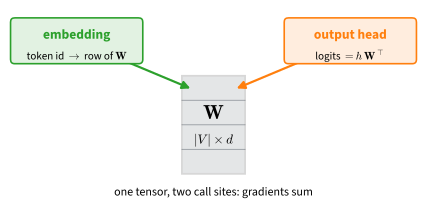

```{.python .input}
%load_ext d2lbook.tab
tab.interact_select('mxnet', 'pytorch', 'tensorflow', 'jax')
```

# Parameters, State, and Memory
:label:`sec_parameters`

In the previous section, we organized models as trees of modules so frameworks
can find every parameter automatically. Until now we could let the framework
manage those tensors behind the scenes without asking what else a model holds or
how much memory training requires. At small scale, those details rarely bite. At
large scale, they dominate every engineering decision. Consider an
8-billion-parameter model such as the Llama 3 model from
:numref:`sec_model_construction`. Storing its weights in 32-bit floating point
takes 32 GB, yet *training* it requires four times as much—128 GB—before
processing a single example: every parameter needs a matching gradient, and the
Adam optimizer (:numref:`sec_adam`) maintains two additional tensors of the same
size for running averages of the gradients and squared gradients. That already
exceeds the memory of an 80 GB GPU.

Computing such budgets accurately requires knowing every tensor a model owns and
the role each one plays. Everyday workflows depend on the exact same inventory:
checkpoints must capture every persistent tensor the forward pass depends on,
GPU transfers must move them all together, and fine-tuning must specify cleanly
which tensors the optimizer may update.

Frameworks unify all of these operations through *registration*
(:numref:`sec_model_construction`): each layer registers its tensors into the
module tree under structured names, allowing optimizers, checkpoint savers, and
device-transfer routines to walk that single tree. This section surveys that
state tree in three parts. First, we distinguish trainable *parameters* from
non-trainable *buffers*. Second, we account for training memory in bytes per
parameter and show how to count parameters without allocating their storage.
Third, we cover two recurring parameter patterns—weight tying and parameter
freezing—used throughout language modeling and transfer learning.

```{.python .input #parameters-state-memory-parameters-state-and-memory}
%%tab mxnet
import math
import os
from mxnet import autograd, gluon, np as mnp, npx
from mxnet.gluon import nn
npx.set_np()
```

```{.python .input #parameters-state-memory-parameters-state-and-memory}
%%tab pytorch
import torch
from torch import nn
```

```{.python .input #parameters-state-memory-parameters-state-and-memory}
%%tab tensorflow
import tensorflow as tf
```

```{.python .input #parameters-state-memory-parameters-state-and-memory}
%%tab jax
import math
import numpy as np
import jax
from jax import numpy as jnp
from flax import nnx
import optax
from d2l import jax as d2l
```

## The State Tree

### Access by Path
:label:`subsec_param-access`

Our running example is a compact residual MLP: an input layer projecting 20
features to 64 hidden units, two 64-wide residual blocks, and a 10-unit output
layer. We redefine `ResidualBlock` from :numref:`sec_model_construction` here so
the notebook stands on its own—each block adds the output of a two-layer *body*
directly to its input.

```{.python .input #parameters-state-memory-accessing-parameters-1}
%%tab mxnet
class ResidualBlock(nn.Block):
    def __init__(self, num_hiddens):
        super().__init__()
        self.body = nn.Sequential()
        self.body.add(nn.Dense(num_hiddens, activation='relu',
                               in_units=num_hiddens),
                      nn.Dense(num_hiddens, in_units=num_hiddens))

    def forward(self, X):
        return X + self.body(X)

net = nn.Sequential()
net.add(nn.Dense(64), ResidualBlock(64), ResidualBlock(64), nn.Dense(10))
net.initialize()
X = mnp.random.normal(size=(2, 20))
net(X).shape
```

```{.python .input #parameters-state-memory-accessing-parameters-1}
%%tab pytorch
class ResidualBlock(nn.Module):
    def __init__(self, num_hiddens):
        super().__init__()
        self.body = nn.Sequential(
            nn.Linear(num_hiddens, num_hiddens), nn.ReLU(),
            nn.Linear(num_hiddens, num_hiddens))

    def forward(self, X):
        return X + self.body(X)

net = nn.Sequential(nn.Linear(20, 64), ResidualBlock(64),
                    ResidualBlock(64), nn.Linear(64, 10))
X = torch.randn(2, 20)
net(X).shape
```

```{.python .input #parameters-state-memory-accessing-parameters-1}
%%tab tensorflow
class ResidualBlock(tf.keras.layers.Layer):
    def __init__(self, num_hiddens, **kwargs):
        super().__init__(**kwargs)
        self.body = tf.keras.Sequential([
            tf.keras.layers.Dense(num_hiddens, activation='relu'),
            tf.keras.layers.Dense(num_hiddens)])

    def call(self, X):
        return X + self.body(X)

net = tf.keras.Sequential([tf.keras.layers.Dense(64), ResidualBlock(64),
                           ResidualBlock(64), tf.keras.layers.Dense(10)])
X = tf.random.normal((2, 20))
net(X).shape
```

```{.python .input #parameters-state-memory-accessing-parameters-1}
%%tab jax
class ResidualBlock(nnx.Module):
    def __init__(self, num_hiddens, *, rngs):
        self.body = nnx.Sequential(
            nnx.Linear(num_hiddens, num_hiddens, rngs=rngs), nnx.relu,
            nnx.Linear(num_hiddens, num_hiddens, rngs=rngs))

    def __call__(self, X):
        return X + self.body(X)

rngs = nnx.Rngs(d2l.get_key())
net = nnx.Sequential(nnx.Linear(20, 64, rngs=rngs),
                     ResidualBlock(64, rngs=rngs),
                     ResidualBlock(64, rngs=rngs),
                     nnx.Linear(64, 10, rngs=rngs))
X = jax.random.normal(rngs(), (2, 20))
net(X).shape
```

Parameters sit at the leaves of the module tree. The dotted path to any leaf
(:numref:`fig_blocks`) mirrors how we index into it in Python, which is handy
for inspecting a single layer during debugging. Optimizers and checkpoint
writers, however, need *every* leaf at once, so each framework provides a
full-tree traversal yielding all parameters alongside their paths.

:begin_tab:`mxnet`
In Gluon it is `collect_params()`, a dictionary keyed by path. Each value
is a `Parameter`, an object that bundles the array, `.data()`, with its
gradient, `.grad()`, which holds zeros until backpropagation writes to it.
:end_tab:

:begin_tab:`pytorch`
In PyTorch it is `named_parameters()`. Each parameter is an `nn.Parameter`,
a tensor that registers itself with the module system as trainable, and
its gradient `.grad` stays `None` until backpropagation fills it.
:end_tab:

:begin_tab:`tensorflow`
In Keras it is `net.weights`, a list of variables that each carry their
path. Variables do not store their gradients: a `tf.GradientTape` returns
them as a second list, parallel to the variables.
:end_tab:

:begin_tab:`jax`
In NNX it is `nnx.state(net, nnx.Param)`, whose flat view yields each array
with its path. Parameters do not store their gradients: `nnx.grad` returns
them as a second state tree with the same paths.
:end_tab:

This residual MLP contains 12 parameter tensors in total. Let's inspect the
total count along with the four tensors belonging to the first residual block:

```{.python .input #parameters-state-memory-accessing-parameters-5}
%%tab mxnet
named = list(net.collect_params().items())
len(named), [(name, p.shape) for name, p in named[2:6]]
```

```{.python .input #parameters-state-memory-accessing-parameters-5}
%%tab pytorch
named = list(net.named_parameters())
len(named), [(name, p.shape) for name, p in named[2:6]]
```

```{.python .input #parameters-state-memory-accessing-parameters-5}
%%tab tensorflow
len(net.weights), [(v.path, v.shape) for v in net.weights[2:6]]
```

```{.python .input #parameters-state-memory-accessing-parameters-5}
%%tab jax
params = nnx.state(net, nnx.Param)
flat = list(params.flat_state())
len(flat), [(path, leaf.shape) for path, leaf in flat[2:6]]
```

:begin_tab:`mxnet, pytorch`
A name like `1.body.0.weight` traces the path from child `1` of `net` (the first residual block) through `body` and its first layer `0` to `weight` (`net[1].body[0].weight`). In Gluon, `grad_req == 'write'` marks trainable parameters; in PyTorch, `state_dict()` keys match `named_parameters()` whenever the model has no buffers:
:end_tab:

:begin_tab:`tensorflow`
A path like `sequential_2/residual_block/sequential/dense_1/kernel` traces layer names down to `kernel` (`net.layers[1].body.layers[0].kernel`). Because default layer names include a creation counter, pass explicit `name=` arguments when paths must match across scripts. With no buffers present, `net.weights` equals `net.trainable_weights`:
:end_tab:

:begin_tab:`jax`
A path tuple like `('layers', 1, 'body', 'layers', 0, 'kernel')` mirrors `net.layers[1].body.layers[0].kernel`. With only trainable parameters present, `nnx.state(net)` matches `nnx.state(net, nnx.Param)`:
:end_tab:
```{.python .input #parameters-state-memory-accessing-parameters-6}
%%tab mxnet
params = net.collect_params()
[name for name, p in params.items() if p.grad_req == 'write'] == list(params)
```

```{.python .input #parameters-state-memory-accessing-parameters-6}
%%tab pytorch
list(net.state_dict()) == [name for name, _ in net.named_parameters()]
```

```{.python .input #parameters-state-memory-accessing-parameters-6}
%%tab tensorflow
[v.path for v in net.weights] == [v.path for v in net.trainable_weights]
```

```{.python .input #parameters-state-memory-accessing-parameters-6}
%%tab jax
([path for path, _ in nnx.state(net).flat_state()]
 == [path for path, _ in params.flat_state()])
```

Every framework utility traverses this same state tree under these paths. The
equality above holds only because every tensor in our residual MLP happens to be
trainable—which is not true of all layers.

### Parameters and Buffers
:label:`subsec_params_buffers`

Suppose a model standardizes its inputs using a feature-wise mean and standard
deviation computed once from the training set. Those statistics must be saved
inside checkpoints (without them, predictions at inference time would be wrong)
and moved onto the GPU alongside the weights—yet the optimizer must *never*
update them via gradient descent, because they are data statistics rather than
learned weights. Storing them as plain Python attributes fails, since module
traversals ignore plain attributes (:numref:`sec_model_construction`). Batch
normalization (:numref:`sec_batch_norm`, :cite:`Ioffe.Szegedy.2015`) relies on
the exact same category of state: running means and variances updated during
training forward passes and applied during inference.

Such persistent, non-trainable tensors are commonly called *buffers*, and every
framework lets us register them so checkpoints and device moves include them
while optimizers skip them. This yields a simple three-way rule for every tensor
inside a layer: register it as a *parameter* if the optimizer should update it,
register it as a *buffer* if checkpoints and device transfers need it without
gradients, and keep it as an ordinary local variable if it lives only for one
forward/backward pass (such as intermediate activations cached by
backpropagation in :numref:`sec_backprop`). Architectural constants like layer
widths remain plain Python attributes.

To illustrate, we build a `Standardizer` module that normalizes its inputs with
a precomputed per-feature mean and standard deviation before applying a linear
layer.

:begin_tab:`mxnet`
`gluon.Constant` registers a `Parameter` with `grad_req='null'`.
:end_tab:

:begin_tab:`pytorch`
`self.register_buffer(name, tensor)` registers a non-trainable buffer.
:end_tab:

:begin_tab:`tensorflow`
`self.add_weight(..., trainable=False)` registers a non-trainable variable.
:end_tab:

:begin_tab:`jax`
Subclassing `nnx.Variable` (here `class Buffer(nnx.Variable)`) distinguishes buffers from `nnx.Param`.
:end_tab:
```{.python .input #parameters-state-memory-parameters-and-buffers-1}
%%tab mxnet
class Standardizer(nn.Block):
    def __init__(self, mean, std):
        super().__init__()
        self.mean = gluon.Constant(mean)
        self.std = gluon.Constant(std)
        self.out = nn.Dense(2)

    def forward(self, X):
        return self.out((X - self.mean.data()) / self.std.data())

sample = mnp.random.normal(0, 1, (100, 4)) * mnp.arange(1., 5.)
standardizer = Standardizer(sample.mean(axis=0), sample.std(axis=0))
standardizer.initialize()
standardizer(sample[:2])   # build the deferred Dense layer
list(standardizer.collect_params())
```

```{.python .input #parameters-state-memory-parameters-and-buffers-1}
%%tab pytorch
class Standardizer(nn.Module):
    def __init__(self, mean, std):
        super().__init__()
        self.register_buffer('mean', mean)
        self.register_buffer('std', std)
        self.out = nn.Linear(4, 2)

    def forward(self, X):
        return self.out((X - self.mean) / self.std)

sample = torch.randn(100, 4) * torch.arange(1., 5.)
standardizer = Standardizer(sample.mean(0), sample.std(0, correction=0))
list(standardizer.state_dict())
```

```{.python .input #parameters-state-memory-parameters-and-buffers-1}
%%tab tensorflow
class Standardizer(tf.keras.layers.Layer):
    def __init__(self, mean, std, **kwargs):
        super().__init__(**kwargs)
        self.mean = self.add_weight(
            shape=mean.shape, trainable=False, name='mean',
            initializer=tf.keras.initializers.Constant(mean))
        self.std = self.add_weight(
            shape=std.shape, trainable=False, name='std',
            initializer=tf.keras.initializers.Constant(std))
        self.out = tf.keras.layers.Dense(2)

    def call(self, X):
        return self.out((X - self.mean) / self.std)

sample = tf.random.normal((100, 4)) * tf.range(1., 5.)
standardizer = Standardizer(tf.reduce_mean(sample, 0),
                            tf.math.reduce_std(sample, 0))
_ = standardizer(sample[:2])   # build the Dense layer
[v.path for v in standardizer.weights]
```

```{.python .input #parameters-state-memory-parameters-and-buffers-1}
%%tab jax
class Buffer(nnx.Variable):
    pass

class Standardizer(nnx.Module):
    def __init__(self, mean, std, *, rngs):
        self.mean = Buffer(mean)
        self.std = Buffer(std)
        self.out = nnx.Linear(4, 2, rngs=rngs)

    def __call__(self, X):
        return self.out((X - self.mean) / self.std)

sample = jax.random.normal(rngs(), (100, 4)) * jnp.arange(1., 5.)
standardizer = Standardizer(sample.mean(0), sample.std(0), rngs=rngs)
[(path, value.shape) for path, value in nnx.state(standardizer).flat_state()]
```

Inspecting the trainable vs. non-trainable state confirms that checkpoints see
all four tensors while optimizers see only the linear layer's weight and bias:
```{.python .input #parameters-state-memory-parameters-and-buffers-2}
%%tab mxnet
{name: p.grad_req for name, p in standardizer.collect_params().items()}
```

```{.python .input #parameters-state-memory-parameters-and-buffers-2}
%%tab pytorch
[name for name, _ in standardizer.named_parameters()]
```

```{.python .input #parameters-state-memory-parameters-and-buffers-2}
%%tab tensorflow
([v.path for v in standardizer.trainable_weights],
 [v.path for v in standardizer.non_trainable_weights])
```

```{.python .input #parameters-state-memory-parameters-and-buffers-2}
%%tab jax
{'params': list(nnx.state(standardizer, nnx.Param)),
 'buffers': list(nnx.state(standardizer, Buffer))}
```


Registration governs more than checkpointing and optimization: whole-model operations such as dtype casting (:numref:`sec_numerics`) and GPU transfers (:numref:`sec_use_gpu`) traverse the exact same state tree, moving parameters and buffers alike while leaving unregistered plain attributes behind.

## Training Memory

### Bytes per Parameter

How much memory does it take to train our residual MLP? Focusing on model and
optimizer state alone, memory scales with three per-parameter components: the
parameter itself, its gradient, and any per-parameter optimizer state. Plain
minibatch SGD keeps no state, so in 32-bit floating point (fp32, 4 bytes per
number) it consumes 8 bytes per parameter. Adam adds two fp32 tensors per
parameter—exponential moving averages of the gradient and of the squared
gradient. Because nearly all large-scale training runs use Adam or a close
variant, that 16-byte figure is the practical baseline:

| Training state                       | Precision | Bytes per parameter |
|--------------------------------------|-----------|---------------------|
| Weights                              | fp32      | 4                   |
| Gradients                            | fp32      | 4                   |
| Adam's average of the gradients      | fp32      | 4                   |
| Adam's average of their squares      | fp32      | 4                   |
| Total                                |           | 16                  |

These 16 bytes per parameter represent a strict lower bound. They exclude
intermediate *activations* saved during the forward pass for backpropagation
(which grow with batch size and sequence length), temporary kernel workspaces,
and allocator fragmentation—all of which we measure directly on a GPU in
:numref:`sec_use_gpu`. For our residual MLP, that baseline comes out to:

```{.python .input #parameters-state-memory-counting-parameters-counting-bytes-1}
%%tab mxnet
params = net.collect_params()
n = sum(p.data().size for p in params.values())
weights = sum(p.data().size * p.data().dtype.itemsize
              for p in params.values())   # fp32: 4 bytes
grads, adam_state = weights, 2 * weights
print(f'{n} parameters: {(weights + grads + adam_state) / 2**20:.2f} MiB '
      'for weights + gradients + Adam state')
```

```{.python .input #parameters-state-memory-counting-parameters-counting-bytes-1}
%%tab pytorch
n = sum(p.numel() for p in net.parameters())
weights, grads, adam_state = 4 * n, 4 * n, 8 * n   # bytes, all fp32
print(f'{n} parameters: {(weights + grads + adam_state) / 2**20:.2f} MiB '
      'for weights + gradients + Adam state')
```

```{.python .input #parameters-state-memory-counting-parameters-counting-bytes-1}
%%tab tensorflow
n = net.count_params()
weights = sum(int(tf.size(v)) * tf.as_dtype(v.dtype).size
              for v in net.weights)   # fp32: 4 bytes
grads, adam_state = weights, 2 * weights
print(f'{n} parameters: {(weights + grads + adam_state) / 2**20:.2f} MiB '
      'for weights + gradients + Adam state')
```

```{.python .input #parameters-state-memory-counting-parameters-counting-bytes-1}
%%tab jax
leaves = jax.tree_util.tree_leaves(nnx.state(net, nnx.Param))
n = sum(x.size for x in leaves)
weights = sum(x.size * x.dtype.itemsize for x in leaves)   # fp32: 4 bytes
grads, adam_state = weights, 2 * weights
print(f'{n} parameters: {(weights + grads + adam_state) / 2**20:.2f} MiB '
      'for weights + gradients + Adam state')
```

We can double-check that count by hand: the input layer contributes
$20 \times 64 + 64 = 1344$ parameters, each residual block contributes
$2 \times (64 \times 64 + 64) = 8320$, and the output layer adds
$64 \times 10 + 10 = 650$, totaling 18,634 parameters. Adam's optimizer state is
not just a theoretical entry in a table—it is real memory allocated tensor by
tensor, adding two full copies of the model:

```{.python .input #parameters-state-memory-counting-parameters-counting-bytes-2}
%%tab mxnet
trainer = gluon.Trainer(net.collect_params(), 'adam')
with autograd.record():
    loss = net(X).sum()
loss.backward()
trainer.step(batch_size=1)   # the updater allocates the moments here
trainer.save_states('adam.states')
state_bytes = os.path.getsize('adam.states')
os.remove('adam.states')
state_bytes, 8 * n
```

```{.python .input #parameters-state-memory-counting-parameters-counting-bytes-2}
%%tab pytorch
adam = torch.optim.Adam(net.parameters())
net(X).sum().backward()
adam.step()
moments = sum(t.numel() for state in adam.state.values()
              for t in state.values() if t.ndim > 0)
moments == 2 * n
```

```{.python .input #parameters-state-memory-counting-parameters-counting-bytes-2}
%%tab tensorflow
adam = tf.keras.optimizers.Adam()
with tf.GradientTape() as tape:
    loss = tf.reduce_sum(net(X))
grads = tape.gradient(loss, net.trainable_weights)
# the first step allocates the moments
adam.apply_gradients(zip(grads, net.trainable_weights))
moments = sum(int(tf.size(v)) for v in adam.variables
              if v.ndim > 0)   # skip step count and learning rate
moments == 2 * n
```

```{.python .input #parameters-state-memory-counting-parameters-counting-bytes-2}
%%tab jax
optimizer = nnx.Optimizer(net, optax.adam(1e-3), wrt=nnx.Param)
grads = nnx.grad(lambda model: model(X).sum())(net)
optimizer.update(net, grads)
moments = sum(x.size for x in jax.tree.leaves(optimizer.opt_state)
              if hasattr(x, 'ndim') and x.ndim > 0)
moments == 2 * n
```

:begin_tab:`mxnet`
Gluon's `Trainer` owns this state and offers no public traversal of it: at
each parameter's first update, its updater creates two zero arrays shaped
like the weight. It does offer `save_states`, which serializes that state,
so apart from a little packaging the file holds Adam's two running
averages: 8 bytes per parameter, two more copies of the model.
:end_tab:

:begin_tab:`pytorch`
`Adam` allocates the two moments of each parameter on its first `step()`.
:end_tab:

:begin_tab:`tensorflow`
Keras's `Adam` allocates the two moments of each weight on its first
`apply_gradients` call.
:end_tab:

:begin_tab:`jax`
`nnx.Optimizer` allocates both moments when it is constructed, before any
update.
:end_tab:

For our tiny MLP, that baseline is a negligible 0.28 MiB, which is why memory
barely crossed our minds in earlier chapters. Scale the exact same arithmetic to
an 8-billion-parameter model, however, and you immediately hit 128 GB regardless
of batch size. You might hope that 16-bit *mixed-precision* training
(:numref:`sec_numerics`) cuts this static floor in half. Surprisingly, it does
not: mixed precision keeps fp32 master copies of the weights and fp32 Adam
moments so tiny updates do not vanish under rounding
:cite:`Micikevicius.Narang.Alben.ea.2018`, with the 16-bit copies sitting on top.

### Counting Without Allocating
:label:`subsec_count_without_alloc`

Every parameter count above inspected tensors that had already been allocated.
For an 8B model, that gets the order backwards: checking whether 32 GB of
weights fit in RAM should not require allocating 32 GB first! Fortunately,
counting parameters requires only shapes and dtypes, both of which are
determined purely by constructor arguments. Consider the output projection of
Llama 3 8B, mapping a 4,096-dimensional hidden state to logits over 128,256
vocabulary *tokens*. Its weight matrix has
$4096 \times 128{,}256 = 525{,}336{,}576$ entries—2.1 GB in fp32. Below, we
instantiate and count this layer without allocating its storage.

:begin_tab:`mxnet`
A `Dense` layer constructed with `in_units` records its parameter shapes immediately but allocates no memory until `initialize()` runs:
:end_tab:

:begin_tab:`pytorch`
Constructing a module inside `with torch.device('meta'):` creates *meta* tensors that carry shapes and dtypes without allocating storage:
:end_tab:

:begin_tab:`tensorflow`
An unbuilt `Dense` layer allocates no variables; its kernel shape `(inputs, units)` follows directly from the input width and `head.units`:
:end_tab:

:begin_tab:`jax`
`nnx.eval_shape` traces the constructor abstractly, returning `jax.ShapeDtypeStruct` leaves with shapes and dtypes but zero allocated arrays:
:end_tab:
```{.python .input #parameters-state-memory-counting-without-allocating-1}
%%tab mxnet
head = nn.Dense(128256, in_units=4096, use_bias=False)   # not initialized
n_head = sum(math.prod(p.shape) for p in head.collect_params().values())
print(head.weight, f'{n_head:,} parameters, '
      f'{4 * n_head / 1e9:.1f} GB in fp32')
```

```{.python .input #parameters-state-memory-counting-without-allocating-1}
%%tab pytorch
with torch.device('meta'):
    head = nn.Linear(4096, 128256, bias=False)   # shapes, no data
n_head = sum(p.numel() for p in head.parameters())
print(head.weight.device, f'{n_head:,} parameters, '
      f'{4 * n_head / 1e9:.1f} GB in fp32')
```

```{.python .input #parameters-state-memory-counting-without-allocating-1}
%%tab tensorflow
head = tf.keras.layers.Dense(128256, use_bias=False)   # not built
n_head = 4096 * head.units   # kernel shape: (inputs, units)
print(head.weights, f'{n_head:,} parameters, '
      f'{4 * n_head / 1e9:.1f} GB in fp32')
```

```{.python .input #parameters-state-memory-counting-without-allocating-1}
%%tab jax
key = d2l.get_key()   # drawn outside the abstract trace
head = nnx.eval_shape(lambda: nnx.Linear(
    4096, 128256, use_bias=False, rngs=nnx.Rngs(key)))
leaves = jax.tree.leaves(nnx.state(head, nnx.Param))
n_head = sum(x.size for x in leaves)
print(leaves, f'{n_head:,} params, {4 * n_head / 1e9:.1f} GB in fp32')
```

:begin_tab:`pytorch`
To materialize a meta-device model without wasting time on random initialization before loading a checkpoint, call `to_empty(device=...)` and then `load_state_dict`:
:end_tab:
```{.python .input #parameters-state-memory-counting-without-allocating-2}
%%tab pytorch
with torch.device('meta'):
    clone = nn.Sequential(nn.Linear(20, 64), ResidualBlock(64),
                          ResidualBlock(64), nn.Linear(64, 10))
clone = clone.to_empty(device='cpu')   # memory, no values yet
clone.load_state_dict(net.state_dict())
torch.equal(clone(X), net(X))
```

Running the same abstract inspection across every layer of an 8B model yields
its exact 8-billion parameter count—and the 128 GB training floor—without
allocating a single byte of tensor memory.

## Shared and Frozen Parameters

### Tied Parameters

A single parameter tensor can play multiple roles inside a network. The classic
example comes from language modeling (:numref:`sec_language-model`), where a
model reads tokens from a vocabulary $V$ and predicts the next token. Its input
*embedding* is a $|V| \times d$ lookup table whose $v^\textrm{th}$ row is the
$d$-dimensional representation of token $v$, while its output head projects a
$d$-dimensional hidden state back to $|V|$ token logits—another $|V| \times d$
table with the exact same geometry and semantic meaning. *Tying* both layers to
one shared weight matrix eliminates $|V| \times d$ parameters and often improves
generalization :cite:`Press.Wolf.2017,Inan.Khosravi.Socher.2017`: tokens that
behave interchangeably as inputs naturally deserve similar scores as outputs,
and weight tying enforces a single unified token geometry. The memory savings
can be dramatic—in GPT-2 small :cite:`Radford.Wu.Child.ea.2019`, the tied
$50257 \times 768$ table accounts for roughly 38.6 million of the model's 124
million parameters, nearly a third of the entire network.


:label:`fig_bg_weight-tying`

:numref:`fig_bg_weight-tying` illustrates the two call sites. Let's verify the
mechanics on a miniature language model, `ToyLM`, with a 100-token vocabulary
and hidden width $d = 16$.

:begin_tab:`mxnet`
Because Gluon stores `Dense` weights as `(outputs, inputs)`, `head` and `emb` share the exact shape $(|V|, d)$, and `share_parameters` aliases them to one `Parameter`:
:end_tab:

:begin_tab:`pytorch`
Assigning `self.head.weight = self.emb.weight` aliases both layers to the same `nn.Parameter` tensor:
:end_tab:

:begin_tab:`tensorflow`
A lightweight `TiedHead` layer multiplies hidden states by `tf.transpose(self.emb.embeddings)` without creating a second variable:
:end_tab:

:begin_tab:`jax`
`nnx.Embed.attend(h)` projects hidden states using the transpose of `self.emb`'s embedding table directly:
:end_tab:
```{.python .input #parameters-state-memory-tied-parameters-1}
%%tab mxnet
class ToyLM(nn.Block):
    def __init__(self, vocab_size, d):
        super().__init__()
        self.emb = nn.Embedding(vocab_size, d)
        self.body = nn.Dense(d, flatten=False)
        self.head = nn.Dense(vocab_size, use_bias=False, flatten=False)

    def forward(self, tokens):
        return self.head(npx.relu(self.body(self.emb(tokens))))

lm = ToyLM(vocab_size=100, d=16)
lm.initialize()
lm.head.share_parameters(lm.emb.collect_params())   # one tensor, two roles
tokens = mnp.random.randint(0, 100, (2, 8))
lm(tokens)
lm.head.weight is lm.emb.weight
```

```{.python .input #parameters-state-memory-tied-parameters-1}
%%tab pytorch
class ToyLM(nn.Module):
    def __init__(self, vocab_size, d, tied=True):
        super().__init__()
        self.emb = nn.Embedding(vocab_size, d)
        self.body = nn.Linear(d, d)
        self.head = nn.Linear(d, vocab_size, bias=False)
        if tied:
            self.head.weight = self.emb.weight   # one tensor, two roles

    def forward(self, tokens):
        return self.head(torch.relu(self.body(self.emb(tokens))))

lm = ToyLM(vocab_size=100, d=16)
lm.head.weight is lm.emb.weight
```

```{.python .input #parameters-state-memory-tied-parameters-1}
%%tab tensorflow
class TiedHead(tf.keras.layers.Layer):
    def __init__(self, emb, **kwargs):
        super().__init__(**kwargs)
        self.emb = emb   # reuse the embedding layer; create nothing

    def call(self, h):
        return tf.matmul(h, self.emb.embeddings, transpose_b=True)

class ToyLM(tf.keras.Model):
    def __init__(self, vocab_size, d, tied=True, **kwargs):
        super().__init__(**kwargs)
        self.emb = tf.keras.layers.Embedding(vocab_size, d)
        self.body = tf.keras.layers.Dense(d)
        self.head = (TiedHead(self.emb) if tied else
                     tf.keras.layers.Dense(vocab_size, use_bias=False))

    def call(self, tokens):
        return self.head(tf.nn.relu(self.body(self.emb(tokens))))

lm = ToyLM(vocab_size=100, d=16)
tokens = tf.random.uniform((2, 8), 0, 100, dtype=tf.int32)
_ = lm(tokens)   # build
[(v.path, tuple(v.shape)) for v in lm.weights]
```

```{.python .input #parameters-state-memory-tied-parameters-1}
%%tab jax
class ToyLM(nnx.Module):
    def __init__(self, vocab_size, d, tied=True, *, rngs):
        self.tied = tied
        self.emb = nnx.Embed(vocab_size, d, rngs=rngs)
        self.body = nnx.Linear(d, d, rngs=rngs)
        self.head = None if tied else nnx.Linear(
            d, vocab_size, use_bias=False, rngs=rngs)

    def __call__(self, tokens):
        h = nnx.relu(self.body(self.emb(tokens)))
        if self.tied:
            return self.emb.attend(h)   # the embedding table, used as the head
        return self.head(h)

lm = ToyLM(vocab_size=100, d=16, rngs=rngs)
tokens = jax.random.randint(rngs(), (2, 8), 0, 100)
[(path, value.shape)
 for path, value in nnx.state(lm, nnx.Param).flat_state()]
```

Does the shared matrix get counted once or twice? Let's compare the tied model
against an untied counterpart.

:begin_tab:`mxnet`
`collect_params()` lists both names pointing to the same `Parameter` object, so deduplicating by `id(p)` (as `Trainer` does internally) counts the table once:
:end_tab:
```{.python .input #parameters-state-memory-tied-parameters-2}
%%tab mxnet
untied = ToyLM(vocab_size=100, d=16)   # no share_parameters: its own head
untied.initialize()
untied(tokens)

def n_unique(net):
    unique = {id(p): p for p in net.collect_params().values()}
    return sum(p.data().size for p in unique.values())

(n_unique(lm), n_unique(untied))
```

```{.python .input #parameters-state-memory-tied-parameters-2}
%%tab pytorch
untied = ToyLM(vocab_size=100, d=16, tied=False)
(sum(p.numel() for p in lm.parameters()),
 sum(p.numel() for p in untied.parameters()))
```

```{.python .input #parameters-state-memory-tied-parameters-2}
%%tab tensorflow
untied = ToyLM(vocab_size=100, d=16, tied=False)
_ = untied(tokens)
(lm.count_params(), untied.count_params())
```

```{.python .input #parameters-state-memory-tied-parameters-2}
%%tab jax
untied = ToyLM(vocab_size=100, d=16, tied=False, rngs=rngs)
(sum(x.size for x in jax.tree.leaves(nnx.state(lm, nnx.Param))),
 sum(x.size for x in jax.tree.leaves(nnx.state(untied, nnx.Param))))
```

The tied model contains $1600 + 272 = 1872$ parameters (one embedding table plus
the body layer), whereas the untied version adds a second $100 \times 16$ table
for 3472 parameters in all.

:begin_tab:`mxnet, pytorch`
Both `collect_params()` and `state_dict()` retain both keys (`emb.weight` and `head.weight`) pointing to the shared storage:
:end_tab:
```{.python .input #parameters-state-memory-tied-parameters-3}
%%tab mxnet
cp = lm.collect_params()
(cp['emb.weight'] is cp['head.weight'], list(cp))
```

```{.python .input #parameters-state-memory-tied-parameters-3}
%%tab pytorch
sd = lm.state_dict()
(sd['emb.weight'].data_ptr() == sd['head.weight'].data_ptr(),
 [name for name, _ in lm.named_parameters()])
```

What happens during backpropagation when a tensor is used twice? By the
multivariable chain rule, each call site contributes its own gradient term, and
both contributions sum into the gradient of the shared tensor. Writing
$\mathbf{W}_\textrm{emb}$ and $\mathbf{W}_\textrm{head}$ for the two tables of
the untied model initialized to the same values as the tied matrix $\mathbf{W}$,
the two models compute the exact same function and satisfy

$$\frac{\partial L}{\partial \mathbf{W}} =
\frac{\partial L}{\partial \mathbf{W}_\textrm{emb}} +
\frac{\partial L}{\partial \mathbf{W}_\textrm{head}}.$$

Let's verify this identity numerically by copying the tied weights into the
untied model and comparing gradients on the same batch:

```{.python .input #parameters-state-memory-tied-parameters-4}
%%tab mxnet
up = untied.collect_params()
for name, p in lm.collect_params().items():
    up[name].set_data(p.data())   # same values, separate tensors
with autograd.record():
    lm(tokens).sum().backward()
with autograd.record():
    untied(tokens).sum().backward()
bool(mnp.abs(lm.emb.weight.grad()
             - (untied.emb.weight.grad()
                + untied.head.weight.grad())).max() < 1e-6)
```

```{.python .input #parameters-state-memory-tied-parameters-4}
%%tab pytorch
untied.load_state_dict(lm.state_dict())   # same values, separate tensors
tokens = torch.randint(0, 100, (2, 8))
lm(tokens).sum().backward()
untied(tokens).sum().backward()
torch.allclose(lm.emb.weight.grad,
               untied.emb.weight.grad + untied.head.weight.grad)
```

```{.python .input #parameters-state-memory-tied-parameters-4}
%%tab tensorflow
untied.set_weights(lm.get_weights()   # tied values, head kernel materialized
                   + [tf.transpose(lm.emb.embeddings)])
with tf.GradientTape() as tape:
    loss = tf.reduce_sum(lm(tokens))
g_tied = tape.gradient(loss, lm.emb.embeddings)
with tf.GradientTape() as tape:
    loss = tf.reduce_sum(untied(tokens))
g_emb, g_head = tape.gradient(
    loss, [untied.emb.embeddings, untied.head.kernel])
g_emb = tf.convert_to_tensor(g_emb)   # densify the embedding-lookup gradient
bool(tf.reduce_max(tf.abs(g_tied - (g_emb + tf.transpose(g_head)))) < 1e-5)
```

```{.python .input #parameters-state-memory-tied-parameters-4}
%%tab jax
untied.emb.embedding[...] = lm.emb.embedding
untied.body.kernel[...] = lm.body.kernel
untied.body.bias[...] = lm.body.bias
untied.head.kernel[...] = lm.emb.embedding.T
g_tied = nnx.grad(lambda model: model(tokens).sum())(lm)
g_untied = nnx.grad(lambda model: model(tokens).sum())(untied)
jnp.allclose(g_tied['emb']['embedding'],
             g_untied['emb']['embedding'] + g_untied['head']['kernel'].T)
```

### Frozen Parameters
:label:`subsec_freezing`

When fine-tuning a pretrained network on a new task (:numref:`sec_fine_tuning`),
a common strategy is to keep the pretrained backbone fixed and train only a
fresh output head, dramatically cutting both data requirements and optimizer
memory. Locking parameters against gradient updates is called *freezing*. Let's
freeze every layer except the output head of a fresh residual MLP, leaving just
650 of its 18,634 parameters trainable.

:begin_tab:`mxnet`
`finetune[:-1].setattr('grad_req', 'null')` disables gradient computation across the backbone subtree:
:end_tab:

:begin_tab:`pytorch`
Setting `p.requires_grad = False` on backbone parameters excludes them from gradient accumulation:
:end_tab:

:begin_tab:`tensorflow`
Setting `layer.trainable = False` moves the layer's variables from `trainable_weights` to `non_trainable_weights`:
:end_tab:

:begin_tab:`jax`
In NNX, a `trainable` filter selects the output head (`layers[3]`) and is passed to both `nnx.grad` and `nnx.Optimizer(..., wrt=trainable)`:
:end_tab:
```{.python .input #parameters-state-memory-freezing-parameters-1}
%%tab mxnet
finetune = nn.Sequential()
finetune.add(nn.Dense(64), ResidualBlock(64),
             ResidualBlock(64), nn.Dense(10))
finetune.initialize()
finetune(X)
finetune[:-1].setattr('grad_req', 'null')

(sum(p.data().size for p in finetune.collect_params().values()
     if p.grad_req == 'write'),
 sum(p.data().size for p in finetune.collect_params().values()))
```

```{.python .input #parameters-state-memory-freezing-parameters-1}
%%tab pytorch
finetune = nn.Sequential(nn.Linear(20, 64), ResidualBlock(64),
                         ResidualBlock(64), nn.Linear(64, 10))
for p in finetune[:-1].parameters():
    p.requires_grad = False

(sum(p.numel() for p in finetune.parameters() if p.requires_grad),
 sum(p.numel() for p in finetune.parameters()))
```

```{.python .input #parameters-state-memory-freezing-parameters-1}
%%tab tensorflow
finetune = tf.keras.Sequential([tf.keras.layers.Dense(64), ResidualBlock(64),
                                ResidualBlock(64), tf.keras.layers.Dense(10)])
_ = finetune(X)   # build
for layer in finetune.layers[:-1]:
    layer.trainable = False

(sum(int(tf.size(v)) for v in finetune.trainable_weights),
 finetune.count_params())
```

```{.python .input #parameters-state-memory-freezing-parameters-1}
%%tab jax
finetune = nnx.Sequential(nnx.Linear(20, 64, rngs=rngs),
                          ResidualBlock(64, rngs=rngs),
                          ResidualBlock(64, rngs=rngs),
                          nnx.Linear(64, 10, rngs=rngs))

trainable = nnx.All(nnx.Param, lambda path, _: path[:2] == ('layers', 3))

def count(state):
    return sum(x.size for x in jax.tree.leaves(state))

n_train = count(nnx.state(finetune, trainable))
(n_train, count(nnx.state(finetune, nnx.Param)))
```

Taking one Adam step should now update only the output head while leaving all
earlier layers untouched. Let's check every parameter before and after the step.

```{.python .input #parameters-state-memory-freezing-parameters-2}
%%tab mxnet
head_trainer = gluon.Trainer(finetune.collect_params(), 'adam',
                             {'learning_rate': 0.1})
before = {name: p.data().copy()
          for name, p in finetune.collect_params().items()}
with autograd.record():
    loss = finetune(X).sum()
loss.backward()
head_trainer.step(batch_size=1)
{name: bool((p.data() != before[name]).any())
 for name, p in finetune.collect_params().items()}
```

```{.python .input #parameters-state-memory-freezing-parameters-2}
%%tab pytorch
head_opt = torch.optim.Adam(
    (p for p in finetune.parameters() if p.requires_grad), lr=0.1)
before = [p.clone() for p in finetune.parameters()]
finetune(X).sum().backward()
head_opt.step()
[not torch.equal(b, p) for b, p in zip(before, finetune.parameters())]
```

```{.python .input #parameters-state-memory-freezing-parameters-2}
%%tab tensorflow
head_opt = tf.keras.optimizers.Adam(learning_rate=0.1)
before = [tf.identity(v) for v in finetune.weights]
with tf.GradientTape() as tape:
    loss = tf.reduce_sum(finetune(X))
head_opt.apply_gradients(zip(tape.gradient(loss, finetune.trainable_weights),
                             finetune.trainable_weights))
[not bool(tf.reduce_all(b == v)) for b, v in zip(before, finetune.weights)]
```

```{.python .input #parameters-state-memory-freezing-parameters-2}
%%tab jax
head_opt = nnx.Optimizer(finetune, optax.adam(0.1), wrt=trainable)
before = nnx.to_pure_dict(nnx.state(finetune, nnx.Param))
grads = nnx.grad(lambda model: model(X).sum(),
                 argnums=nnx.DiffState(0, trainable))(finetune)
head_opt.update(finetune, grads)
stepped = nnx.to_pure_dict(nnx.state(finetune, nnx.Param))
jax.tree_util.tree_map(lambda a, b: bool((a != b).any()), before, stepped)
```

Only the output head's weight and bias changed, and the optimizer allocated
Adam moments for just those 650 trainable parameters.
Freezing comes with two subtle pitfalls, neither of which raises an error.
First, freezing a parameter does *not* reclaim optimizer state that has already
been allocated. If an Adam optimizer was constructed over all parameters and has
already stepped, it continues holding 8 bytes per parameter of running moments
even for layers frozen later—harmless for 18,634 parameters, but costly at
8-billion-parameter scale (as explored in the exercises).

The second pitfall is even easier to overlook: freezing blocks gradients, yet
some layer state mutates *without* gradients. In particular, batch normalization
(:numref:`sec_batch_norm`) updates its running mean and variance during the
*forward pass* whenever the layer runs in training mode, completely bypassing
the optimizer. Whether freezing a BatchNorm layer's trainable weights also locks its running
statistics therefore depends on the framework. Let's pass a shifted batch
through a frozen BatchNorm layer in training mode—with no optimizer step at
all—and check whether its running mean drifts.

```{.python .input #parameters-state-memory-freezing-parameters-4}
%%tab mxnet
bn = nn.BatchNorm()
bn.initialize()
bn(mnp.zeros((8, 4)))           # the first call builds the deferred shapes
bn.gamma.grad_req = 'null'
bn.beta.grad_req = 'null'
before = bn.running_mean.data().copy()
x = mnp.random.normal(0, 1, (8, 4)) + 3
x.attach_grad()   # autograd needs a leaf; all Parameters are frozen
with autograd.record():
    bn(x).sum().backward()      # training mode: the statistics update
bool((bn.running_mean.data() == before).all())
```

```{.python .input #parameters-state-memory-freezing-parameters-4}
%%tab pytorch
bn = nn.BatchNorm1d(4)
for p in bn.parameters():
    p.requires_grad = False
before = bn.running_mean.clone()
bn(torch.randn(8, 4) + 3)          # training mode: the statistics update
torch.allclose(bn.running_mean, before)
```

```{.python .input #parameters-state-memory-freezing-parameters-4}
%%tab tensorflow
bn = tf.keras.layers.BatchNormalization(momentum=0.9, epsilon=1e-5)
_ = bn(tf.zeros((8, 4)), training=True)   # build, then freeze
bn.trainable = False
before = tf.identity(bn.moving_mean)
_ = bn(tf.random.normal((8, 4)) + 3, training=True)
bool(tf.reduce_all(bn.moving_mean == before))
```

```{.python .input #parameters-state-memory-freezing-parameters-4}
%%tab jax
bn = nnx.BatchNorm(4, use_running_average=False, momentum=0.9,
                   use_fast_variance=False, rngs=rngs)
before = bn.mean[...]
bn(jax.random.normal(rngs(), (8, 4)) + 3)   # training mode
bool(jnp.allclose(bn.mean, before))
```

:begin_tab:`mxnet`
The running mean moved! Freezing parameter gradients (`grad_req='null'`) is separate from switching the layer to evaluation mode (`use_global_stats=True`). Locking a BatchNorm layer during fine-tuning requires setting both.
:end_tab:

:begin_tab:`pytorch`
The running mean moved! Freezing parameter gradients (`requires_grad=False`) is separate from switching the layer to evaluation mode (`bn.eval()`). Locking a BatchNorm layer during fine-tuning requires setting both.
:end_tab:

:begin_tab:`jax`
The running mean moved! Freezing parameter gradients (an `nnx.Param` filter) is separate from switching the layer to evaluation mode (`use_running_average=True`). Locking a BatchNorm layer during fine-tuning requires setting both.
:end_tab:

:begin_tab:`tensorflow`
Keras treats `BatchNormalization` as a special case where `bn.trainable = False` also forces inference mode on its running statistics, though for other stateful layers (such as dropout) `trainable` and `training=False` remain independent switches.
:end_tab:
Every parameter we inspected in this section—tied, frozen, or averaged—began
from initial values supplied by the framework. In the next section, we examine
how those initial values are chosen and how to control initialization across the
entire module tree.

## Summary

A model's persistent state forms a tree of named tensors, and registration
determines which framework operations see each tensor: optimizers update
*parameters*, whereas checkpoints and device transfers also include *buffers*
(persistent tensors without gradients, such as running statistics), and
unregistered attributes are silently skipped. Training in fp32 with Adam
requires a baseline of 16 bytes per parameter before accounting for activations
(weights, gradients, and two Adam moments—128 GB for an 8B model), and abstract
shape inspection lets us compute such budgets without allocating memory. Weight
tying aliases one tensor across multiple roles so it is counted once and
receives the sum of gradients from all call sites; freezing halts gradient
updates but does not release existing optimizer state, and need not stop
forward-pass updates to BatchNorm running statistics.

## Exercises

1. [code] **Running statistics.** This problem needs only one fact about
   the batch normalization layer of :numref:`sec_batch_norm`, the update
   below. In training mode the layer normalizes with the minibatch mean
   $\hat{\boldsymbol{\mu}}_\mathcal{B}$ and variance, and each training
   step updates the running mean $\bar{\boldsymbol{\mu}}$ by

   $$\bar{\boldsymbol{\mu}} \leftarrow \rho\, \bar{\boldsymbol{\mu}} + (1 - \rho)\, \hat{\boldsymbol{\mu}}_\mathcal{B}.$$

    1. A fresh layer starts from $\bar{\boldsymbol{\mu}} = \mathbf{0}$.
       Predict $\bar{\boldsymbol{\mu}}$ after the layer has processed $k$
       batches in training mode, each with minibatch mean 3 in every
       feature. Check the prediction for $k = 1, 5, 20$ on a fresh layer
       over 4 features, without any optimizer step, and read off the value
       of $\rho$ the layer uses by default.
    1. Suppose you registered $\bar{\boldsymbol{\mu}}$ as a trainable
       parameter and removed the update above. What gradient does the
       training loss send to $\bar{\boldsymbol{\mu}}$? How do the training
       loss and the evaluation accuracy then compare with those of an
       unmodified model?
    1. Find a loss in $\bar{\boldsymbol{\mu}}$ alone whose gradient step
       with learning rate $\eta$ on each minibatch reproduces the removed
       update, and state the $\eta$ that matches $\rho$.

2. [code] **Memory footprint.** Write a helper that reports, for each
   top-level block of `net`, its number of state entries and its bytes
   under fp32 Adam training with every parameter trained.
    1. Which block dominates? At what output width would the output layer
       overtake one residual block?
    1. Insert a batch normalization layer over the 64 hidden features
       between the two residual blocks. Extend the helper so that it costs
       the layer's running statistics correctly, and report each block's
       bytes per entry. For which blocks is the share of the total bytes
       larger than the share of the total entries, and for which is it
       smaller? Explain both directions.

:begin_tab:`mxnet`
3. [code] **Tying and freezing.** Consider the tied `ToyLM` of this
   section.
    1. Set `lm.emb.weight.grad_req = 'null'`. What happened to the head, and
       how many trainable parameters remain? What does this show about the
       interaction between tying and freezing?
    1. Starting from the values of `lm`, build a model whose embedding stays
       fixed while its head adapts, and verify both properties after one
       optimizer step. How many parameters does it store and how many does
       it train, compared with a fully trainable `lm`?
:end_tab:

:begin_tab:`pytorch`
3. [code] **Tying and freezing.** Consider the tied `ToyLM` of this
   section.
    1. Freeze `lm.emb.weight` but leave `lm.head` alone. How many trainable
       parameters remain, and what does this show about the interaction
       between tying and freezing?
    1. Starting from the values of `lm`, build a model whose embedding stays
       fixed while its head adapts, and verify both properties after one
       optimizer step. How many parameters does it store and how many does
       it train, compared with a fully trainable `lm`?
:end_tab:

:begin_tab:`tensorflow`
3. [code] **Tying and freezing.** Consider the tied `ToyLM` of this
   section.
    1. Set `lm.emb.trainable = False` but leave `lm.head` alone. How many
       trainable parameters remain, and can the head still adapt? What does
       this show about the interaction between tying and freezing?
    1. Starting from the values of `lm`, build a model whose embedding stays
       fixed while its head adapts, and verify both properties after one
       optimizer step. How many parameters does it store and how many does
       it train, compared with a fully trainable `lm`?
:end_tab:

:begin_tab:`jax`
3. [code] **Tying and freezing.** Consider the tied `ToyLM` of this
   section.
    1. Leave the embedding table out of the trainable filter, for example
       with `nnx.All(nnx.Param, nnx.Not(nnx.PathContains('emb')))`, and
       pass the filter to `nnx.grad` and `nnx.Optimizer`. How many
       parameters are trained, and can the head still adapt? What does
       this show about the interaction between tying and freezing?
    1. Starting from the values of `lm`, build a model whose embedding stays
       fixed while its head adapts, and verify both properties after one
       update. How many parameters does it store and how many does it
       train, compared with a fully trainable `lm`?
:end_tab:

4. **Fine-tuning memory.** A language model has 8 billion parameters. Its
   output layer is a $4096 \times 128{,}256$ matrix, not tied to the
   embedding. All state is fp32, and the optimizer is Adam.
    1. How many bytes do weights, gradients, and Adam's running averages take when
       every parameter is trained? How many 80 GB GPUs does that state
       alone fill?
    1. Freeze everything except the output layer, and build the optimizer
       over the output layer only. How many bytes does the persistent state
       take now, and does it fit on one 80 GB GPU?
    1. Suppose instead that an optimizer built over all parameters took
       one step before the freeze and is kept afterwards. How many bytes
       remain allocated, and does the state still fit?

[Discussions](https://d2l.discourse.group/t/36753)

<!-- slides -->

::: {.slide}
::: {.cover}
[Dive into Deep Learning · §5.2]{.kicker}

Parameters, State, and Memory<br>**the state tree · trainable parameters vs. buffers · 16 B/param Adam floor · weight tying · freezing**
:::
:::

::: {.slide title="Why an 8B Model Needs 128 GB Before Batch Size 1"}
[The Systems Memory Budget]{.kicker}

::: {.cols .vc}
::: {.col}
- **Four full-precision copies ($16\text{ B/param}$):** `fp32` Adam stores weights $\mathbf{w}$ ($4\text{ B}$), gradients $\mathbf{g}$ ($4\text{ B}$), first moment $\mathbf{m}$ ($4\text{ B}$), and second moment $\mathbf{v}$ ($4\text{ B}$).
- **8B parameter static floor:** $8 \times 10^9 \times 16\text{ B} = 128\text{ GB}$—exceeding an `80 GB` GPU before loading a single input batch!
- **Why state tree literacy matters:** Budgeting memory, saving checkpoints, and freezing layers require tracking every tensor in the state tree.
:::

::: {.col .fig .big}
@fig:ch05-bg-adam-16b-floor
:::
:::
:::

::: {.slide title="Our Running Testbed: A Two-Block Residual MLP"}
[Constructing the State Tree]{.kicker}

::: {.cols .vc}
::: {.col}
- We inspect state traversal on a compact residual MLP ($20 \to 64 \to \text{ two } 64\text{-wide residual blocks } \to 10$) containing 6 linear layers and 12 parameter tensors:

@-parameters-state-memory-accessing-parameters-1
:::

::: {.col .fig}
@fig:ch05-bg-state-tree-paths
:::
:::
:::

::: {.slide title="Accessing Parameters by Their Path in the State Tree"}
[Tree Traversal]{.kicker}

::: {.cols .vc}
::: {.col}
- Full-tree iterators (`named_parameters()`, `collect_params()`, `net.weights`, `nnx.state`) yield every leaf alongside its dotted path (e.g., `1.body.0.weight`):

@parameters-state-memory-accessing-parameters-5

@parameters-state-memory-accessing-parameters-6
:::

::: {.col .fig}
@fig:ch05-bg-state-tree-paths
:::
:::
:::

::: {.slide title="The Three-Way Classification of Tensors in a Layer"}
[Parameters vs. Buffers]{.kicker}

::: {.cols .vc}
::: {.col}
- **Parameters (`nn.Parameter`):** Updated by optimizer, saved in checkpoints, and moved to GPUs ($\mathbf{W}, \mathbf{b}, \mathbf{g}$).
- **Registered buffers (`register_buffer`):** Skipped by optimizer, but saved in checkpoints and moved/cast with the model (feature $\boldsymbol{\mu}, \boldsymbol{\sigma}$, BatchNorm running stats).
- **Plain attributes:** Invisible to checkpoints and `.to(gpu)`—never store persistent tensors as plain Python attributes!
:::

::: {.col .fig .big}
@fig:ch05-bg-four-tensor-kinds
:::
:::
:::

::: {.slide title="Registering Non-Trainable Buffers in a Standardizer"}
[Buffers in Code]{.kicker}

::: {.cols .vc}
::: {.col}
- A `Standardizer` layer registers training-set statistics $\boldsymbol{\mu}$ and $\boldsymbol{\sigma}$ as buffers (`register_buffer`, `gluon.Constant`, `trainable=False`, or `nnx.Variable`):

@parameters-state-memory-parameters-and-buffers-1
:::

::: {.col .fig}
@fig:ch05-bg-standardizer-buffer
:::
:::
:::

::: {.slide title="Checkpoints Include Buffers; Optimizers Skip Them"}
[Filtering the State Tree]{.kicker}

::: {.cols .vc}
::: {.col}
- Comparing the full state tree against trainable parameters confirms that `mean` and `std` travel to disk and GPU while the optimizer updates only `weight` and `bias`:

@parameters-state-memory-parameters-and-buffers-2
:::

::: {.col .fig}
@fig:ch05-bg-standardizer-buffer
:::
:::
:::

::: {.slide title="Accounting for Parameters and Bytes in the Residual MLP"}
[Memory Arithmetic]{.kicker}

We can verify the parameter count of our residual MLP analytically and convert it to bytes under the 16-byte-per-parameter `fp32` Adam rule:

| Layer Group | Parameter Formula ($W + b$) | Parameter Count | `fp32` Adam State ($16\text{ B/param}$) |
|:---|:---|---:|---:|
| **Input layer (`0`)** | $20 \times 64 + 64$ | $1{,}344$ | $21{,}504\text{ B}$ |
| **Residual blocks (`1`, `2`)** | $2 \times [2 \times (64 \times 64 + 64)]$ | $16{,}640$ | $266{,}240\text{ B}$ |
| **Output head (`3`)** | $64 \times 10 + 10$ | $650$ | $10{,}400\text{ B}$ |
| **Total network** | **12 parameter tensors** | **$18{,}634$** | **$298{,}144\text{ B}$ ($0.28\text{ MiB}$)** |

@!parameters-state-memory-counting-parameters-counting-bytes-1
:::

::: {.slide title="Verifying That Adam Allocates Two Full Model Copies"}
[Optimizer State Allocation]{.kicker}

::: {.cols .vc}
::: {.col}
- Adam allocates its running first and second moments ($\mathbf{m}$ and $\mathbf{v}$) lazily on the first optimizer step, adding $2 \times 18{,}634 = 37{,}268$ floats ($8\text{ B/param}$):

@parameters-state-memory-counting-parameters-counting-bytes-2
:::

::: {.col .fig}
@fig:ch05-bg-lazy-adam-moments
:::
:::
:::

::: {.slide title="Counting Parameters Abstractly Without Allocating RAM"}
[Meta Devices & Shape Tracing]{.kicker}

::: {.cols .vc}
::: {.col}
- Frameworks trace constructors abstractly using shapes and dtypes alone—auditing Llama 3 8B's $525.3\text{M}$-parameter (`2.1 GB`) output head with **zero bytes** allocated:

@parameters-state-memory-counting-without-allocating-1
:::

::: {.col .fig}
@fig:ch05-bg-meta-shape-trace
:::
:::
:::

::: {.slide title="Materializing a Meta-Device Model on Target Hardware" only="pytorch"}
[Zero-Waste Checkpoint Loading]{.kicker}

::: {.cols .vc}
::: {.col}
- Constructing on `torch.device('meta')` and calling `to_empty(device=...)` before `load_state_dict` skips wasted CPU random initialization:

@parameters-state-memory-counting-without-allocating-2
:::

::: {.col .fig}
@fig:ch05-bg-meta-shape-trace
:::
:::
:::

::: {.slide title="Weight Tying: One Parameter Tensor in Multiple Roles"}
[Shared Parameters]{.kicker}

Language models map input token IDs to $d$-vectors via a $|V| \times d$ embedding table and project final $d$-vectors back to $|V|$ token logits via a $|V| \times d$ output head:

::: {.cols .vc}
::: {.col}
- **Shared semantic geometry:** Tying both layers to the **exact same** $|V| \times d$ tensor enforces a unified token representation and eliminates $|V| \times d$ parameters.
- **Massive memory savings:** In GPT-2 small ($|V|=50{,}257, d=768$), the tied table is $38.6\text{M}$ of $124\text{M}$ parameters ($31\%$ of the entire network).
:::

::: {.col .fig}
{.nostretch width=100%}
:::
:::
:::

::: {.slide title="Implementing Weight Tying in a Miniature Language Model"}
[Tying in Code]{.kicker}

In `ToyLM` ($|V| = 100, d = 16$), we alias the output projection directly to the input embedding table:

@parameters-state-memory-tied-parameters-1
:::

::: {.slide title="Tied Tensors Are Deduplicated and Counted Once"}
[Parameter Deduplication]{.kicker}

::: {.cols .vc}
::: {.col}
- Tree walkers deduplicate shared storage so the $100 \times 16 = 1{,}600$ embedding table is counted only once ($1{,}872$ tied vs. $3{,}472$ untied):

@parameters-state-memory-tied-parameters-2
:::

::: {.col .fig}
@fig:ch05-bg-tied-dedup-grad
:::
:::
:::

::: {.slide title="Gradients from All Call Sites Sum Into a Tied Tensor"}
[Multivariable Chain Rule]{.kicker}

::: {.cols .vc}
::: {.col}
$$\frac{\partial L}{\partial \mathbf{W}} = \frac{\partial L}{\partial \mathbf{W}_{\text{emb}}} + \frac{\partial L}{\partial \mathbf{W}_{\text{head}}}$$

@parameters-state-memory-tied-parameters-4
:::

::: {.col .fig}
@fig:ch05-bg-tied-dedup-grad
:::
:::
:::

::: {.slide title="Freezing Parameters for Transfer Learning"}
[Selective Optimization]{.kicker}

When fine-tuning a pretrained backbone on a small dataset, we **freeze** the backbone weights and train only the output head ($650$ of $18{,}634$ parameters in our residual MLP):

@parameters-state-memory-freezing-parameters-1

@-parameters-state-memory-freezing-parameters-2

@!parameters-state-memory-freezing-parameters-2
:::

::: {.slide title="Two Silent Pitfalls of Freezing Parameters"}
[Systems Hazards of Freezing]{.kicker}

::: {.cols .vc}
::: {.col}
@parameters-state-memory-freezing-parameters-4

- **Pitfall 1:** Existing Adam moments ($8\text{ B/param}$) stay in RAM unless the optimizer is built strictly over unfrozen parameters.
- **Pitfall 2:** Frozen BatchNorm layers in `.train()` mode still mutate their running mean/variance buffers unless set to `.eval()`.
:::

::: {.col .fig}
@fig:ch05-bg-freezing-pitfalls
:::
:::
:::

::: {.slide title="Concept Check: Memory Budgets & Parameter Sharing"}
[Concept Check]{.kicker}

Test your understanding on the 8-billion-parameter language model (`fp32`, Adam, output head $4096 \times 128{,}256 \approx 525\text{M}$ parameters):

1. Suppose you freeze the entire 8B backbone except the $525\text{M}$-parameter output head and construct Adam over the head alone. How much persistent state memory is required in `fp32`, and does it fit on a single `80 GB` GPU?
2. What if you instead constructed Adam over all 8B parameters, ran 1 warmup step, and *then* froze the backbone without recreating the optimizer?
3. If two layers share a weight matrix $\mathbf{W}$ and you freeze $\mathbf{W}$ via `self.emb.weight.requires_grad = False`, can `self.head` still adapt?

::: {.d2l-note .fragment .fade-up}
**Answers:**

1. **$\approx 38.3\text{ GB}$ (fits on one 80 GB GPU):** All 8B weights require $32\text{ GB}$, while gradients and Adam moments for the $525\text{M}$ head require only $12 \times 0.525\text{B} = 6.3\text{ GB}$.
2. **$\approx 98.1\text{ GB}$ (OOM on 80 GB):** Adam keeps the $64\text{ GB}$ of moments allocated on step 1 ($32\text{ GB weights} + 64\text{ GB moments} + 2.1\text{ GB head grad}$).
3. **No:** Because `self.emb.weight` and `self.head.weight` alias the exact same parameter tensor, freezing one freezes both roles.
:::
:::

::: {.slide title="Summary: Parameters, State, and Memory"}
[Key Takeaways]{.kicker}

::: {.cols .vc}
::: {.col}
- **Parameters vs. buffers:** Both travel to checkpoints and GPUs, while optimizers update only trainable parameters.
- **Static memory & meta counting:** `fp32` Adam costs $16\text{ B/param}$ (`128 GB` for 8B); meta devices audit exact byte budgets with zero physical allocation.
- **Weight tying & freezing:** Shared tensors are counted once and sum gradients across call sites; freezing requires filtering the optimizer and setting BatchNorm to `.eval()`.
:::

::: {.col .fig .big}
@fig:ch05-bg-state-summary
:::
:::
:::
