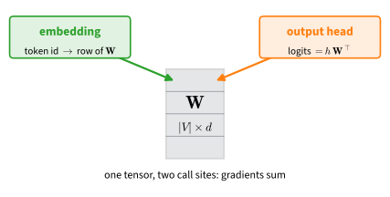

```{.python .input}
%load_ext d2lbook.tab
tab.interact_select('mxnet', 'pytorch', 'tensorflow', 'jax')
```

# Parameters, State, and Memory
:label:`sec_parameters`

A model with 8 billion parameters stores 32 GB of weights in 32-bit floating
point. Training it takes four times as much memory, 128 GB, before it has
seen a single example: every weight needs a gradient of the same size, and
the Adam optimizer, which we meet in :numref:`sec_adam`, keeps two more
tensors of that size, running averages of the gradients and of their
squares. That is more than an 80 GB GPU holds. To estimate such numbers we
need to know every tensor a model holds and what each one is for. Other
routine operations need the same knowledge: a checkpoint must save every
tensor the computation depends on, a move to a GPU must take all of them
along, and fine-tuning must decide which of them the optimizer may change.

Frameworks make this possible by *registration*: each layer announces the
tensors it owns to the module system, which files them by name in the tree
of modules of :numref:`sec_model_construction`. The optimizer, the
checkpoint, and the device move then all walk the same tree. This section
follows the tree to its leaves, separates the tensors the optimizer trains
from those it must leave alone, counts the bytes that training stores per
parameter, and lets two layers share one tensor or excludes part of a model
from training.

```{.python .input #parameters-state-memory-parameters-state-and-memory}
%%tab mxnet
import math
import os
from mxnet import autograd, gluon, np as mnp, npx
from mxnet.gluon import nn
npx.set_np()
```

```{.python .input #parameters-state-memory-parameters-state-and-memory}
%%tab pytorch
import torch
from torch import nn
```

```{.python .input #parameters-state-memory-parameters-state-and-memory}
%%tab tensorflow
import tensorflow as tf
```

```{.python .input #parameters-state-memory-parameters-state-and-memory}
%%tab jax
from d2l import jax as d2l
import jax
from jax import numpy as jnp
from flax import nnx
import optax
```

## The State Tree

### Access by Path
:label:`subsec_param-access`

Our specimen is a residual MLP: an input layer maps 20 features to 64, two
residual blocks of width 64 follow, and an output layer produces 10 outputs.
The blocks are the residual block of :numref:`sec_model_construction`,
defined again here so that this section stands on its own: each adds the
output of a small two-layer network, its *body*, to its input.

```{.python .input #parameters-state-memory-accessing-parameters-1}
%%tab mxnet
class ResidualBlock(nn.Block):
    def __init__(self, num_hiddens):
        super().__init__()
        self.body = nn.Sequential()
        self.body.add(nn.Dense(num_hiddens, activation='relu',
                               in_units=num_hiddens),
                      nn.Dense(num_hiddens, in_units=num_hiddens))

    def forward(self, X):
        return X + self.body(X)

net = nn.Sequential()
net.add(nn.Dense(64), ResidualBlock(64), ResidualBlock(64), nn.Dense(10))
net.initialize()
X = mnp.random.normal(size=(2, 20))
net(X).shape
```

```{.python .input #parameters-state-memory-accessing-parameters-1}
%%tab pytorch
class ResidualBlock(nn.Module):
    def __init__(self, num_hiddens):
        super().__init__()
        self.body = nn.Sequential(
            nn.Linear(num_hiddens, num_hiddens), nn.ReLU(),
            nn.Linear(num_hiddens, num_hiddens))

    def forward(self, X):
        return X + self.body(X)

net = nn.Sequential(nn.Linear(20, 64), ResidualBlock(64),
                    ResidualBlock(64), nn.Linear(64, 10))
X = torch.randn(2, 20)
net(X).shape
```

```{.python .input #parameters-state-memory-accessing-parameters-1}
%%tab tensorflow
class ResidualBlock(tf.keras.layers.Layer):
    def __init__(self, num_hiddens, **kwargs):
        super().__init__(**kwargs)
        self.body = tf.keras.Sequential([
            tf.keras.layers.Dense(num_hiddens, activation='relu'),
            tf.keras.layers.Dense(num_hiddens)])

    def call(self, X):
        return X + self.body(X)

net = tf.keras.Sequential([tf.keras.layers.Dense(64), ResidualBlock(64),
                           ResidualBlock(64), tf.keras.layers.Dense(10)])
X = tf.random.normal((2, 20))
net(X).shape
```

```{.python .input #parameters-state-memory-accessing-parameters-1}
%%tab jax
class ResidualBlock(nnx.Module):
    def __init__(self, num_hiddens, *, rngs):
        self.body = nnx.Sequential(
            nnx.Linear(num_hiddens, num_hiddens, rngs=rngs), nnx.relu,
            nnx.Linear(num_hiddens, num_hiddens, rngs=rngs))

    def __call__(self, X):
        return X + self.body(X)

rngs = nnx.Rngs(d2l.get_key())
net = nnx.Sequential(nnx.Linear(20, 64, rngs=rngs),
                     ResidualBlock(64, rngs=rngs),
                     ResidualBlock(64, rngs=rngs),
                     nnx.Linear(64, 10, rngs=rngs))
X = jax.random.normal(rngs(), (2, 20))
net(X).shape
```

:begin_tab:`mxnet`
A model built from blocks is a tree, and its parameters are the leaves. To
reach one leaf, walk the tree: indexing into a `Sequential` selects a child,
and attribute access selects within it. `net[3]` is the output layer. Its
bias is a `Parameter`, an object that registers itself with the block system
and bundles the array with its gradient buffer; `.data()` returns the array,
and `.shape` reads through to it.
:end_tab:

:begin_tab:`pytorch`
A model built from modules is a tree, and its parameters are the leaves. To
reach one leaf, walk the tree: indexing into a `Sequential` selects a child,
and attribute access selects within it. `net[3]` is the output layer. Its
bias is an `nn.Parameter`, a tensor that registers itself with the module
system as trainable.
:end_tab:

:begin_tab:`tensorflow`
A model built from layers is a tree, and its parameters are the leaves. To
reach one leaf, walk the tree: `net.layers` lists a model's children, and
attribute access selects within a layer. `net.layers[3]` is the output layer.
Its bias is a `Variable` that the layer created through `add_weight`, which
registers it with Keras as trainable.
:end_tab:

:begin_tab:`jax`
A model built from NNX modules is an object graph, and its parameters are
`nnx.Param` variables owned by the layers. To reach one, follow ordinary
attributes and container indices. `net.layers[3]` is the output layer, and
its `bias` variable is marked trainable by its type.
:end_tab:

```{.python .input #parameters-state-memory-accessing-parameters-2}
%%tab mxnet
type(net[3].bias), net[3].bias.shape
```

```{.python .input #parameters-state-memory-accessing-parameters-2}
%%tab pytorch
type(net[3].bias), net[3].bias.shape
```

```{.python .input #parameters-state-memory-accessing-parameters-2}
%%tab tensorflow
type(net.layers[3].bias), net.layers[3].bias.shape
```

```{.python .input #parameters-state-memory-accessing-parameters-2}
%%tab jax
bias = net.layers[3].bias
type(bias), bias.shape
```

The same path syntax reaches arbitrarily deep. The first linear layer inside
the first residual block sits three levels down:

```{.python .input #parameters-state-memory-accessing-parameters-3}
%%tab mxnet
net[1].body[0].weight.shape
```

```{.python .input #parameters-state-memory-accessing-parameters-3}
%%tab pytorch
net[1].body[0].weight.shape
```

```{.python .input #parameters-state-memory-accessing-parameters-3}
%%tab tensorflow
net.layers[1].body.layers[0].kernel.shape
```

```{.python .input #parameters-state-memory-accessing-parameters-3}
%%tab jax
net.layers[1].body.layers[0].kernel.shape
```

:begin_tab:`mxnet`
The gradient is the second array a `Parameter` carries: `.data()` returns
the value and `.grad()` its gradient buffer. Gluon allocates the buffer
together with the data at initialization, so before any backpropagation it
holds zeros:
:end_tab:

:begin_tab:`pytorch`
Each parameter also carries its gradient. We have not run backpropagation on
this model yet, so there is nothing to see:
:end_tab:

:begin_tab:`tensorflow`
Gradients are not stored on variables. A `tf.GradientTape` records the
forward pass, and its `gradient` method returns the gradients as a second
list, parallel to the variables we differentiate with respect to:
:end_tab:

:begin_tab:`jax`
Gradients are not stored on parameters. `nnx.grad` returns a second state
tree with the same paths, one gradient leaf per parameter:
:end_tab:

```{.python .input #parameters-state-memory-accessing-parameters-4}
%%tab mxnet
net[3].bias.grad()
```

```{.python .input #parameters-state-memory-accessing-parameters-4}
%%tab pytorch
net[3].weight.grad is None
```

```{.python .input #parameters-state-memory-accessing-parameters-4}
%%tab tensorflow
with tf.GradientTape() as tape:
    loss = tf.reduce_sum(net(X))
grads = tape.gradient(loss, net.trainable_weights)
len(grads) == len(net.trainable_weights)
```

```{.python .input #parameters-state-memory-accessing-parameters-4}
%%tab jax
params = nnx.state(net, nnx.Param)
grads = nnx.grad(lambda model: model(X).sum())(net)
jax.tree_util.tree_structure(grads) == jax.tree_util.tree_structure(params)
```

:begin_tab:`mxnet`
Reaching parameters one path at a time suits debugging a single layer. The
optimizer and the checkpoint instead need every leaf, and `collect_params()`
provides them: a traversal of the whole tree that returns a dictionary of
every parameter, keyed by its path.
:end_tab:

:begin_tab:`pytorch`
Reaching parameters one path at a time suits debugging a single layer. The
optimizer and the checkpoint instead need every leaf, and
`named_parameters()` provides them: a traversal of the whole tree that yields
each parameter with its path as its name.
:end_tab:

:begin_tab:`tensorflow`
Reaching parameters one path at a time suits debugging a single layer. The
optimizer and the checkpoint instead need every leaf, and `net.weights`
provides them: a traversal of the whole tree, one variable per leaf, each
carrying its path.
:end_tab:

:begin_tab:`jax`
Reaching parameters one path at a time suits debugging a single layer. The
optimizer and the checkpoint instead need every leaf, and
`nnx.state(net, nnx.Param)` selects them. Its flat view yields each array
together with the path that reaches it.
:end_tab:

The model has 12 parameter tensors. We print their number and the four
that belong to the first residual block:

```{.python .input #parameters-state-memory-accessing-parameters-5}
%%tab mxnet
named = list(net.collect_params().items())
len(named), [(name, p.shape) for name, p in named[2:6]]
```

```{.python .input #parameters-state-memory-accessing-parameters-5}
%%tab pytorch
named = list(net.named_parameters())
len(named), [(name, p.shape) for name, p in named[2:6]]
```

```{.python .input #parameters-state-memory-accessing-parameters-5}
%%tab tensorflow
len(net.weights), [(v.path, v.shape) for v in net.weights[2:6]]
```

```{.python .input #parameters-state-memory-accessing-parameters-5}
%%tab jax
flat = list(params.flat_state())
len(flat), [(path, leaf.shape) for path, leaf in flat[2:6]]
```

:begin_tab:`mxnet`
Read one of the names closely. `1.body.0.weight` means: child `1` of `net`
(the first residual block), its submodule `body`, that block's child `0`,
and finally the leaf `weight`. The body's ReLU is part of its first `Dense`
layer, so the second linear layer is child `1`. Names are paths, so they
survive any amount of nesting, and they are the names that
`save_parameters` writes and `load_parameters` expects
(:numref:`sec_read_write`). There is no separate list of trainable
parameters: each `Parameter` carries a `grad_req` attribute that tells
autograd whether to record a gradient for it, and so far every entry says
`'write'`:
:end_tab:

:begin_tab:`pytorch`
Read one of the names closely. `1.body.0.weight` means: child `1` of `net`
(the first residual block), its submodule `body`, that module's child `0`,
and finally the leaf `weight`. Names are paths, so they survive any amount
of nesting, and they are the keys of the model's `state_dict`, the mapping
from names to tensors used for saving and loading (:numref:`sec_read_write`):
:end_tab:

:begin_tab:`tensorflow`
Read one of the paths closely.
`sequential_2/residual_block/sequential/dense_1/kernel` means: inside the
outer `Sequential`, its child `residual_block` (the first residual block),
that block's `body` (a `Sequential` of its own), the first `Dense` layer
inside it, and finally the leaf `kernel`. The segments are layer *names*,
assigned at construction: a default derived from the class, plus a counter
that keeps names unique within the program (this is the third `Sequential`
created, hence `sequential_2`). Default names therefore depend on the order
of construction. A tool that must match paths across separately written
programs should name the layers explicitly; Keras checkpoints restore by the
structure of the saved objects instead (:numref:`sec_read_write`). Keras
splits the same list by trainability, and so far the split is trivial:
:end_tab:

:begin_tab:`jax`
Read one of the paths closely.
`('layers', 1, 'body', 'layers', 0, 'kernel')` means: child 1 of `net` (the
first residual block), its `body`, child 0 of that sequence, and finally its
kernel. Paths survive any amount of nesting. Without a filter, `nnx.state`
returns all of the model's state, the tree that a checkpoint saves
(:numref:`sec_read_write`). For this model it is the parameter tree:
:end_tab:

```{.python .input #parameters-state-memory-accessing-parameters-6}
%%tab mxnet
params = net.collect_params()
[name for name, p in params.items() if p.grad_req == 'write'] == list(params)
```

```{.python .input #parameters-state-memory-accessing-parameters-6}
%%tab pytorch
list(net.state_dict()) == [name for name, _ in net.named_parameters()]
```

```{.python .input #parameters-state-memory-accessing-parameters-6}
%%tab tensorflow
[v.path for v in net.weights] == [v.path for v in net.trainable_weights]
```

```{.python .input #parameters-state-memory-accessing-parameters-6}
%%tab jax
([path for path, _ in nnx.state(net).flat_state()]
 == [path for path, _ in params.flat_state()])
```

Every consumer walks this one tree under these names. The equality above
holds for this model because all of its state is trainable. That is not
always so.

### Parameters and Buffers
:label:`subsec_params_buffers`

Suppose a model standardizes its inputs with a mean and a standard deviation
computed once from training data. These numbers must be saved with the model,
since predictions are wrong without them, and they must move to the GPU with
it. Yet the optimizer must never change them: they are statistics of the
data, not quantities to fit. Batch normalization :cite:`Ioffe.Szegedy.2015`,
a layer that we study in :numref:`sec_batch_norm`, keeps tensors of the same
kind: a running mean and variance of its inputs, updated during training and
used at prediction time. Other tensors live only for one call, such as the
intermediate values that backpropagation stores during a training step
(:numref:`sec_backprop`). They belong to the computation, not to the model,
and are neither saved nor registered.

:begin_tab:`mxnet`
Gluon needs no second mechanism for persistent tensors without gradients: a
`Constant` is a `Parameter` whose `grad_req` is fixed to `'null'`. Assigning
one to an attribute registers it like any other parameter, so it appears in
`collect_params()`, is saved with the model, and moves with it across
devices, but autograd never records a gradient for it and the optimizer
never changes it. The rule: make a tensor a `Parameter` if the optimizer
should update it, a `Constant` if checkpoints need it, and a local variable
if it lives for one call. Plain Python attributes hold architecture
constants such as layer widths. Here is a block that standardizes its inputs
with statistics computed from a reference sample:
:end_tab:

:begin_tab:`pytorch`
PyTorch calls persistent tensors without gradients *buffers* and registers
them with `register_buffer`. The rule: make a tensor a *parameter* if the
optimizer should update it, a *buffer* if checkpoints need it, and a local
variable if it lives for one call. Plain Python attributes hold architecture
constants such as layer widths. Here is a module that standardizes its
inputs with statistics computed from a reference sample:
:end_tab:

:begin_tab:`tensorflow`
Keras calls every registered tensor a *weight* and distinguishes by a flag
on each variable: `add_weight(trainable=False)` creates a variable that is
saved with the model but never handed to the optimizer, which is how
`BatchNormalization` stores its running statistics. The rule: make a tensor
a trainable weight if the optimizer should update it, a non-trainable weight
if checkpoints need it, and a local variable if it lives for one call. Plain
Python attributes hold architecture constants such as layer widths. Here is
a layer that standardizes its inputs with statistics computed from a
reference sample:
:end_tab:

:begin_tab:`jax`
NNX marks the kind of each piece of state by a `Variable` subclass:
`nnx.Param` for trainable state, `nnx.BatchStat` for running statistics, and
a subclass of our own for any other persistent tensor. Filters then select
the kinds that a consumer sees. The rule: make a tensor an `nnx.Param` if
the optimizer should update it, another `Variable` if checkpoints need it,
and a local variable if it lives for one call. Plain Python attributes hold
architecture constants such as layer widths. Here is a module that
standardizes its inputs with statistics computed from a reference sample:
:end_tab:

```{.python .input #parameters-state-memory-parameters-and-buffers-1}
%%tab mxnet
class Whitener(nn.Block):
    def __init__(self, mean, std):
        super().__init__()
        self.mean = gluon.Constant(mean)
        self.std = gluon.Constant(std)
        self.out = nn.Dense(2)

    def forward(self, X):
        return self.out((X - self.mean.data()) / self.std.data())

sample = mnp.random.normal(0, 1, (100, 4)) * mnp.arange(1., 5.)
whiten = Whitener(sample.mean(axis=0), sample.std(axis=0))
whiten.initialize()
whiten(sample[:2])   # build the deferred Dense layer
list(whiten.collect_params())
```

```{.python .input #parameters-state-memory-parameters-and-buffers-1}
%%tab pytorch
class Whitener(nn.Module):
    def __init__(self, mean, std):
        super().__init__()
        self.register_buffer('mean', mean)
        self.register_buffer('std', std)
        self.out = nn.Linear(4, 2)

    def forward(self, X):
        return self.out((X - self.mean) / self.std)

sample = torch.randn(100, 4) * torch.arange(1., 5.)
whiten = Whitener(sample.mean(0), sample.std(0, correction=0))
list(whiten.state_dict())
```

```{.python .input #parameters-state-memory-parameters-and-buffers-1}
%%tab tensorflow
class Whitener(tf.keras.layers.Layer):
    def __init__(self, mean, std, **kwargs):
        super().__init__(**kwargs)
        self.mean = self.add_weight(
            shape=mean.shape, trainable=False, name='mean',
            initializer=tf.keras.initializers.Constant(mean))
        self.std = self.add_weight(
            shape=std.shape, trainable=False, name='std',
            initializer=tf.keras.initializers.Constant(std))
        self.out = tf.keras.layers.Dense(2)

    def call(self, X):
        return self.out((X - self.mean) / self.std)

sample = tf.random.normal((100, 4)) * tf.range(1., 5.)
whiten = Whitener(tf.reduce_mean(sample, 0), tf.math.reduce_std(sample, 0))
_ = whiten(sample[:2])   # build the Dense layer
[v.path for v in whiten.weights]
```

```{.python .input #parameters-state-memory-parameters-and-buffers-1}
%%tab jax
class Buffer(nnx.Variable):
    pass

class Whitener(nnx.Module):
    def __init__(self, mean, std, *, rngs):
        self.mean = Buffer(mean)
        self.std = Buffer(std)
        self.out = nnx.Linear(4, 2, rngs=rngs)

    def __call__(self, X):
        return self.out((X - self.mean) / self.std)

sample = jax.random.normal(rngs(), (100, 4)) * jnp.arange(1., 5.)
whiten = Whitener(sample.mean(0), sample.std(0), rngs=rngs)
[(path, value.shape) for path, value in nnx.state(whiten).flat_state()]
```

:begin_tab:`mxnet`
The constants sit in the same dictionary as the weights, so they are
checkpointed with them. What keeps the optimizer away is the `grad_req` of
each entry:
:end_tab:

:begin_tab:`pytorch`
The buffers appear in the state dict, so they are checkpointed with the
weights. They do not appear among the parameters, so the optimizer never
sees them:
:end_tab:

:begin_tab:`tensorflow`
All four variables are weights, so all four are checkpointed. The flag keeps
the optimizer away from the statistics: a training step differentiates and
updates `trainable_weights`, and the two statistics sit in the other half of
the split:
:end_tab:

:begin_tab:`jax`
Both kinds belong to the object graph and are checkpointed together. An
optimizer built over `nnx.Param` never sees the statistics:
:end_tab:

```{.python .input #parameters-state-memory-parameters-and-buffers-2}
%%tab mxnet
{name: p.grad_req for name, p in whiten.collect_params().items()}
```

```{.python .input #parameters-state-memory-parameters-and-buffers-2}
%%tab pytorch
[name for name, _ in whiten.named_parameters()]
```

```{.python .input #parameters-state-memory-parameters-and-buffers-2}
%%tab tensorflow
([v.path for v in whiten.trainable_weights],
 [v.path for v in whiten.non_trainable_weights])
```

```{.python .input #parameters-state-memory-parameters-and-buffers-2}
%%tab jax
{'params': list(nnx.state(whiten, nnx.Param)),
 'buffers': list(nnx.state(whiten, Buffer))}
```

:begin_tab:`mxnet`
Registration is what makes the block aware of a tensor, and assignment
registers only `Parameter`s (a `Constant` is one) and child blocks. A raw
array stored as a plain attribute is invisible: it is not saved, and it is
not converted when the model moves. We can see this on the CPU by converting
the block to another *dtype*, which uses the same machinery as moving it to
another device. The registered constant converts; the plain attribute stays
behind:
:end_tab:

:begin_tab:`pytorch`
Registration is what makes the module system aware of a tensor. A tensor
stored as a plain attribute is invisible to it: it is not saved, and it is
not converted when the model moves. We can see this on the CPU by converting
the module to another *dtype*, which uses the same machinery as moving it to
another device. The registered buffer converts; the plain attribute stays
behind:
:end_tab:

:begin_tab:`tensorflow`
Registration through `add_weight` is what makes the layer aware of a tensor.
A tensor stored as a plain attribute is invisible to it: it is not counted,
not saved, and absent from every traversal. Attach one, and the list of
weights does not grow:
:end_tab:

:begin_tab:`jax`
Wrapping an array in a `Variable` makes it state, and operations on the
state tree reach it. We can see this on the CPU by splitting the model into
its structure and its state, converting every state leaf to another *dtype*,
and merging the result into a low-precision clone. The buffers convert with
the weights, and the original model is unchanged:
:end_tab:

```{.python .input #parameters-state-memory-parameters-and-buffers-3}
%%tab mxnet
whiten.note = mnp.zeros(4)   # plain attribute, not registered
whiten.cast('float64')
whiten.mean.data().dtype, whiten.note.dtype
```

```{.python .input #parameters-state-memory-parameters-and-buffers-3}
%%tab pytorch
whiten.note = torch.zeros(4)   # plain attribute, not registered
whiten.to(torch.float64)
whiten.mean.dtype, whiten.note.dtype
```

```{.python .input #parameters-state-memory-parameters-and-buffers-3}
%%tab tensorflow
whiten.note = tf.zeros(4)   # plain attribute, not registered
[v.path.split('/')[-1] for v in whiten.weights]
```

```{.python .input #parameters-state-memory-parameters-and-buffers-3}
%%tab jax
graph, state = nnx.split(whiten)
half = jax.tree.map(lambda x: x.astype(jnp.float16), state)
low = nnx.merge(graph, half)
low.mean.dtype, whiten.mean.dtype
```

:begin_tab:`mxnet`
The same failure appears when moving to a GPU: a model works on the CPU,
then crashes after `reset_device(npx.gpu(0))` because an unregistered array
stayed behind. On a machine with a GPU, the following confirms that
constants move with the block:
:end_tab:

:begin_tab:`pytorch`
The same failure appears when moving to a GPU: a model works on the CPU,
then crashes after `.to('cuda')` because an unregistered tensor stayed
behind. On a machine with a GPU, the following confirms that buffers move
with the module:
:end_tab:

:begin_tab:`tensorflow`
Device placement works differently in TensorFlow: a variable's device is
decided when the variable is *created*, not by a later move. With a GPU
visible, Keras creates variables on it by default, non-trainable weights
included, and a `tf.device` scope overrides the choice. There is no `.to()`
that could leave a tensor behind; in exchange, relocating existing state
means creating it again. Each variable reports its placement:
:end_tab:

:begin_tab:`jax`
Device placement follows the same rule: `jax.device_put` moves a whole state
tree, parameters and buffers alike, and updating the model with the moved
tree moves all registered state. The same lines run on any machine; on one
with an accelerator, `jax.devices()[0]` is a GPU:
:end_tab:

```{.python .input #parameters-state-memory-parameters-and-buffers-4}
%%tab mxnet
if npx.num_gpus() > 0:
    whiten.reset_device(npx.gpu(0))
    print('constant lives on', whiten.mean.data().device)
else:
    print('no GPU here; on a CUDA machine, whiten.reset_device(npx.gpu(0)) '
          'moves whiten.mean along with the parameters')
```

```{.python .input #parameters-state-memory-parameters-and-buffers-4}
%%tab pytorch
if torch.cuda.is_available():
    print('buffer lives on', whiten.to('cuda').mean.device)
else:
    print('no GPU here; on a CUDA machine, whiten.to("cuda") '
          'moves whiten.mean along with the parameters')
```

```{.python .input #parameters-state-memory-parameters-and-buffers-4}
%%tab tensorflow
whiten.mean.value.device   # decided when the variable was created
```

```{.python .input #parameters-state-memory-parameters-and-buffers-4}
%%tab jax
moved = jax.device_put(nnx.state(whiten), jax.devices()[0])
nnx.update(whiten, moved)
whiten.mean.device
```

## Training Memory

### Bytes per Parameter

How much memory does training our specimen take? For the parameters and
what the optimizer stores about them, the answer follows from three counts
per parameter: the weight itself, its gradient, and the optimizer's state
for it. Minibatch gradient descent, which we have used so far, keeps no
state. Adam keeps two numbers per parameter, running averages of the
gradient and of its square, called its first and second *moments*. With
every tensor in 32-bit floating point (fp32), 4 bytes per number, training
with Adam stores

| Training state       | Precision | Bytes per parameter |
|----------------------|-----------|---------------------|
| Weights              | fp32      | 4                   |
| Gradients            | fp32      | 4                   |
| Adam first moment    | fp32      | 4                   |
| Adam second moment   | fp32      | 4                   |
| Total                |           | 16                  |

These 16 bytes are a floor. They omit the *activations*, the intermediate
values that backpropagation keeps from the forward pass, whose size grows
with the batch; they also omit temporary workspaces and the memory the
allocator holds in reserve. :numref:`sec_use_gpu` measures all of these on a
GPU. For our specimen, the floor is:

```{.python .input #parameters-state-memory-counting-parameters-counting-bytes-1}
%%tab mxnet
params = net.collect_params()
n = sum(p.data().size for p in params.values())
weights = sum(p.data().size * p.data().dtype.itemsize
              for p in params.values())   # fp32: 4 bytes
grads, adam_state = weights, 2 * weights
print(f'{n} parameters: {(weights + grads + adam_state) / 2**20:.2f} MiB '
      'for weights + gradients + Adam state')
```

```{.python .input #parameters-state-memory-counting-parameters-counting-bytes-1}
%%tab pytorch
n = sum(p.numel() for p in net.parameters())
weights, grads, adam_state = 4 * n, 4 * n, 8 * n   # bytes, all fp32
print(f'{n} parameters: {(weights + grads + adam_state) / 2**20:.2f} MiB '
      'for weights + gradients + Adam state')
```

```{.python .input #parameters-state-memory-counting-parameters-counting-bytes-1}
%%tab tensorflow
n = net.count_params()
weights = sum(int(tf.size(v)) * tf.as_dtype(v.dtype).size
              for v in net.weights)   # fp32: 4 bytes
grads, adam_state = weights, 2 * weights
print(f'{n} parameters: {(weights + grads + adam_state) / 2**20:.2f} MiB '
      'for weights + gradients + Adam state')
```

```{.python .input #parameters-state-memory-counting-parameters-counting-bytes-1}
%%tab jax
leaves = jax.tree_util.tree_leaves(nnx.state(net, nnx.Param))
n = sum(x.size for x in leaves)
weights = sum(x.size * x.dtype.itemsize for x in leaves)   # fp32: 4 bytes
grads, adam_state = weights, 2 * weights
print(f'{n} parameters: {(weights + grads + adam_state) / 2**20:.2f} MiB '
      'for weights + gradients + Adam state')
```

The count checks by hand: the input layer has $20 \times 64 + 64 = 1344$
parameters, each residual block $2 \times (64 \times 64 + 64) = 8320$, and
the output layer $64 \times 10 + 10 = 650$, for a total of 18,634. Adam's
state is real memory, allocated tensor by tensor. After one training step,
its two moments hold two more copies of the model:

```{.python .input #parameters-state-memory-counting-parameters-counting-bytes-2}
%%tab mxnet
trainer = gluon.Trainer(net.collect_params(), 'adam')
with autograd.record():
    loss = net(X).sum()
loss.backward()
trainer.step(batch_size=1)   # the updater allocates the moments here
trainer.save_states('adam.states')
state_bytes = os.path.getsize('adam.states')
state_bytes, 8 * n
```

```{.python .input #parameters-state-memory-counting-parameters-counting-bytes-2}
%%tab pytorch
adam = torch.optim.Adam(net.parameters())
net(X).sum().backward()
adam.step()
moments = sum(t.numel() for state in adam.state.values()
              for t in state.values() if t.ndim > 0)
moments == 2 * n
```

```{.python .input #parameters-state-memory-counting-parameters-counting-bytes-2}
%%tab tensorflow
adam = tf.keras.optimizers.Adam()
with tf.GradientTape() as tape:
    loss = tf.reduce_sum(net(X))
grads = tape.gradient(loss, net.trainable_weights)
# the first step allocates the moments
adam.apply_gradients(zip(grads, net.trainable_weights))
moments = sum(int(tf.size(v)) for v in adam.variables
              if v.ndim > 0)   # skip step count and learning rate
moments == 2 * n
```

```{.python .input #parameters-state-memory-counting-parameters-counting-bytes-2}
%%tab jax
optimizer = nnx.Optimizer(net, optax.adam(1e-3), wrt=nnx.Param)
grads = nnx.grad(lambda model: model(X).sum())(net)
optimizer.update(net, grads)
moments = sum(x.size for x in jax.tree.leaves(optimizer.opt_state)
              if hasattr(x, 'ndim') and x.ndim > 0)
moments == 2 * n
```

:begin_tab:`mxnet`
Gluon's `Trainer` owns this state and offers no public traversal of it: at
each parameter's first update, its updater creates two zero arrays shaped
like the weight. It does offer `save_states`, which serializes that state,
so apart from a little packaging the file holds Adam's two moments: 8 bytes
per parameter, two more copies of the model.
:end_tab:

For our network the floor is 0.28 MiB, which is why memory has not
mattered so far. For the 8-billion-parameter model of the opening, the same
arithmetic gives 32 GB for the weights and 128 GB for weights, gradients,
and Adam's state, whatever the batch size. *Mixed-precision* training, the
subject of :numref:`sec_numerics`, computes with 16-bit numbers but does not
shrink this floor. A common recipe stores the weights and the gradients in
16 bits for the forward and backward passes, and keeps an fp32 master copy
of the weights and fp32 moments, so that small updates are not rounded away
:cite:`Micikevicius.Narang.Alben.ea.2018`: $2 + 2 + 4 + 4 + 4 = 16$ bytes
per parameter, the same floor. Automatic casting in the frameworks keeps the
weights and gradients in fp32 and makes 16-bit copies operation by
operation, which also stores 16 bytes per parameter. A multiplier therefore
means little until we know the dtype of each tensor.

### Counting Without Allocating
:label:`subsec_count_without_alloc`

Every count so far read the shapes of tensors that already existed. For the
8B model this order is backwards: to learn whether its 32 GB of weights fit
in memory, we would first have to allocate them. The count needs only the
shape and the dtype of each parameter, and both follow from the arguments of
the constructors. Take one layer of the 8B model, its output layer, which
maps a hidden state of width 4,096 to scores for the 128,256 tokens of its
vocabulary. Its weight has $4096 \times 128{,}256 = 525{,}336{,}576$
entries, 2.1 GB in fp32. We create the layer without its data and count.

:begin_tab:`mxnet`
Gluon separates constructing a layer from initializing it. A `Dense`
layer that is given `in_units` knows the shape of its weight when it is
constructed, but holds no data until `initialize()` is called, so reading
the shapes allocates nothing:
:end_tab:

:begin_tab:`pytorch`
PyTorch's *meta* device holds tensors that have a shape and a dtype but no
data. Inside `with torch.device('meta'):`, a constructor creates its
parameters on that device, so the module is complete except for its
values:
:end_tab:

:begin_tab:`tensorflow`
Keras creates the variables of a layer when it builds the layer, at its
first call or through an explicit `build`, and each variable holds its data
from the moment it is created. An unbuilt layer holds no variables, so we
compute the count from the shapes: the kernel of a `Dense` layer has the
shape (inputs, units).
:end_tab:

:begin_tab:`jax`
`nnx.eval_shape` runs a constructor abstractly: each array operation in it
computes only the shape and the dtype of its result. The module it returns
holds a `jax.ShapeDtypeStruct` in place of each array:
:end_tab:

```{.python .input #parameters-state-memory-counting-without-allocating-1}
%%tab mxnet
head = nn.Dense(128256, in_units=4096, use_bias=False)   # not initialized
n_head = sum(math.prod(p.shape) for p in head.collect_params().values())
print(head.weight, f'{n_head:,} parameters, '
      f'{4 * n_head / 1e9:.1f} GB in fp32')
```

```{.python .input #parameters-state-memory-counting-without-allocating-1}
%%tab pytorch
with torch.device('meta'):
    head = nn.Linear(4096, 128256, bias=False)   # shapes, no data
n_head = sum(p.numel() for p in head.parameters())
print(head.weight.device, f'{n_head:,} parameters, '
      f'{4 * n_head / 1e9:.1f} GB in fp32')
```

```{.python .input #parameters-state-memory-counting-without-allocating-1}
%%tab tensorflow
head = tf.keras.layers.Dense(128256, use_bias=False)   # not built
n_head = 4096 * head.units   # kernel shape: (inputs, units)
print(head.weights, f'{n_head:,} parameters, '
      f'{4 * n_head / 1e9:.1f} GB in fp32')
```

```{.python .input #parameters-state-memory-counting-without-allocating-1}
%%tab jax
key = d2l.get_key()   # drawn outside the abstract trace
head = nnx.eval_shape(lambda: nnx.Linear(
    4096, 128256, use_bias=False, rngs=nnx.Rngs(key)))
leaves = jax.tree.leaves(nnx.state(head, nnx.Param))
n_head = sum(x.size for x in leaves)
print(leaves, f'{n_head:,} parameters, {4 * n_head / 1e9:.1f} GB in fp32')
```

:begin_tab:`mxnet`
The weight has its shape and no data: reading it with `head.weight.data()`
raises an error that the parameter has not been initialized. `initialize()`
allocates the 2.1 GB once we decide to.
:end_tab:

:begin_tab:`pytorch`
A meta tensor has no storage. To use the model, `to_empty(device=...)`
allocates its parameters on a device without filling them, and an
initializer or a checkpoint fills them. Large pretrained models are loaded
this way, so that each weight is written once, from the file, instead of
first being drawn at random and then overwritten. On our specimen:
:end_tab:

:begin_tab:`tensorflow`
The list of weights is empty. Calling the layer on an input of width 4,096,
or calling `head.build((None, 4096))`, creates the kernel and allocates the
2.1 GB.
:end_tab:

:begin_tab:`jax`
No array was created and no random number drawn. Calling the constructor
itself, outside `nnx.eval_shape`, allocates the arrays and draws their
initial values.
:end_tab:

```{.python .input #parameters-state-memory-counting-without-allocating-2}
%%tab pytorch
with torch.device('meta'):
    clone = nn.Sequential(nn.Linear(20, 64), ResidualBlock(64),
                          ResidualBlock(64), nn.Linear(64, 10))
clone = clone.to_empty(device='cpu')   # memory, no values yet
clone.load_state_dict(net.state_dict())
torch.equal(clone(X), net(X))
```

Applied to every layer of the 8B model, the same count gives its 8 billion
parameters, and with them the 32 GB of weights and the 128 GB of training
state, without allocating a byte.

## Shared, Frozen, and Averaged Parameters

### Tied Parameters

One tensor can serve several roles in a model. The standard example is a
language model, which reads a sequence of *tokens* (words or pieces of words
from a vocabulary $V$) and predicts the next one (:numref:`sec_language-model`).
Its first layer is an *embedding*, a $|V| \times d$ table whose row $v$ is
the $d$-dimensional vector that represents token $v$. Its output layer maps a
$d$-dimensional hidden state to $|V|$ scores, one per token, so its weight
matrix has the same shape and an analogous meaning: one vector per token.
*Tying* the two roles to a single tensor saves $|V| \times d$ parameters, and
the studies that introduced it found that it also improves the predictions
:cite:`Press.Wolf.2017,Inan.Khosravi.Socher.2017`. The savings are large: in
GPT-2 small :cite:`Radford.Wu.Child.ea.2019`, the shared
$50257 \times 768$ table holds about 38.6 million of the model's 124 million
parameters, roughly 31%.


:label:`fig_bg_weight-tying`

:numref:`fig_bg_weight-tying` shows the two call sites. A toy language model,
`ToyLM`, with a vocabulary of 100 tokens and $d = 16$, shows the mechanics.

:begin_tab:`mxnet`
Gluon stores a `Dense` weight as (outputs, inputs), so the head's weight has
shape $(|V|, d)$, the shape of the embedding table, and no transpose is
needed. Tying is `share_parameters`, which points the head's `'weight'` slot
at the embedding's `Parameter`, matched by name. It is aliasing, not
copying:
:end_tab:

:begin_tab:`pytorch`
Tying is one assignment, and it is aliasing, not copying:
:end_tab:

:begin_tab:`tensorflow`
Keras has no tying flag, so we write it in code: a small head layer that
creates no variables of its own and instead multiplies by the transpose of
the embedding table it is handed. One variable, two call sites:
:end_tab:

:begin_tab:`jax`
`nnx.Embed` provides `attend`, which multiplies a hidden state by the
transpose of the embedding table, the output projection of a tied model.
Calling it reuses the module's one table, so the tying is visible in the
state itself: no head matrix exists.
:end_tab:

```{.python .input #parameters-state-memory-tied-parameters-1}
%%tab mxnet
class ToyLM(nn.Block):
    def __init__(self, vocab_size, d):
        super().__init__()
        self.emb = nn.Embedding(vocab_size, d)
        self.body = nn.Dense(d, flatten=False)
        self.head = nn.Dense(vocab_size, use_bias=False, flatten=False)

    def forward(self, tokens):
        return self.head(npx.relu(self.body(self.emb(tokens))))

lm = ToyLM(vocab_size=100, d=16)
lm.initialize()
lm.head.share_parameters(lm.emb.collect_params())   # one tensor, two roles
tokens = mnp.random.randint(0, 100, (2, 8))
lm(tokens)
lm.head.weight is lm.emb.weight
```

```{.python .input #parameters-state-memory-tied-parameters-1}
%%tab pytorch
class ToyLM(nn.Module):
    def __init__(self, vocab_size, d, tied=True):
        super().__init__()
        self.emb = nn.Embedding(vocab_size, d)
        self.body = nn.Linear(d, d)
        self.head = nn.Linear(d, vocab_size, bias=False)
        if tied:
            self.head.weight = self.emb.weight   # one tensor, two roles

    def forward(self, tokens):
        return self.head(torch.relu(self.body(self.emb(tokens))))

lm = ToyLM(vocab_size=100, d=16)
lm.head.weight is lm.emb.weight
```

```{.python .input #parameters-state-memory-tied-parameters-1}
%%tab tensorflow
class TiedHead(tf.keras.layers.Layer):
    def __init__(self, emb, **kwargs):
        super().__init__(**kwargs)
        self.emb = emb   # reuse the embedding layer; create nothing

    def call(self, h):
        return tf.matmul(h, self.emb.embeddings, transpose_b=True)

class ToyLM(tf.keras.Model):
    def __init__(self, vocab_size, d, tied=True, **kwargs):
        super().__init__(**kwargs)
        self.emb = tf.keras.layers.Embedding(vocab_size, d)
        self.body = tf.keras.layers.Dense(d)
        self.head = (TiedHead(self.emb) if tied else
                     tf.keras.layers.Dense(vocab_size, use_bias=False))

    def call(self, tokens):
        return self.head(tf.nn.relu(self.body(self.emb(tokens))))

lm = ToyLM(vocab_size=100, d=16)
tokens = tf.random.uniform((2, 8), 0, 100, dtype=tf.int32)
_ = lm(tokens)   # build
[(v.path, tuple(v.shape)) for v in lm.weights]
```

```{.python .input #parameters-state-memory-tied-parameters-1}
%%tab jax
class ToyLM(nnx.Module):
    def __init__(self, vocab_size, d, tied=True, *, rngs):
        self.tied = tied
        self.emb = nnx.Embed(vocab_size, d, rngs=rngs)
        self.body = nnx.Linear(d, d, rngs=rngs)
        self.head = None if tied else nnx.Linear(
            d, vocab_size, use_bias=False, rngs=rngs)

    def __call__(self, tokens):
        h = nnx.relu(self.body(self.emb(tokens)))
        if self.tied:
            return self.emb.attend(h)   # the embedding table, used as the head
        return self.head(h)

lm = ToyLM(vocab_size=100, d=16, rngs=rngs)
tokens = jax.random.randint(rngs(), (2, 8), 0, 100)
[(path, value.shape)
 for path, value in nnx.state(lm, nnx.Param).flat_state()]
```

:begin_tab:`mxnet`
The two blocks now hold one `Parameter` between them. `collect_params()`
keeps both names pointing at it, so a plain sum over the dictionary would
count the table twice; counting each `Parameter` object once shows the
$|V| \times d$ saving. The `Trainer` removes duplicates in the same way and
updates the table once per step:
:end_tab:

:begin_tab:`pytorch`
The module system understands the aliasing. The traversal of the parameters
reports the shared tensor once, so the count below shows the
$|V| \times d$ saving, and the optimizer updates the tensor once per step:
:end_tab:

:begin_tab:`tensorflow`
Because the head created no variable, there is no aliasing to keep track of:
the traversal reports the table once, and no head matrix exists. The
parameter count shows the $|V| \times d$ saving, and the optimizer updates
the table once per step:
:end_tab:

:begin_tab:`jax`
Because the state contains the table once, there is no aliasing to keep
track of. The parameter count shows the $|V| \times d$ saving, and an
optimizer updates the table once per step:
:end_tab:

```{.python .input #parameters-state-memory-tied-parameters-2}
%%tab mxnet
untied = ToyLM(vocab_size=100, d=16)   # no share_parameters: its own head
untied.initialize()
untied(tokens)

def n_unique(net):
    unique = {id(p): p for p in net.collect_params().values()}
    return sum(p.data().size for p in unique.values())

(n_unique(lm), n_unique(untied))
```

```{.python .input #parameters-state-memory-tied-parameters-2}
%%tab pytorch
untied = ToyLM(vocab_size=100, d=16, tied=False)
(sum(p.numel() for p in lm.parameters()),
 sum(p.numel() for p in untied.parameters()))
```

```{.python .input #parameters-state-memory-tied-parameters-2}
%%tab tensorflow
untied = ToyLM(vocab_size=100, d=16, tied=False)
_ = untied(tokens)
(lm.count_params(), untied.count_params())
```

```{.python .input #parameters-state-memory-tied-parameters-2}
%%tab jax
untied = ToyLM(vocab_size=100, d=16, tied=False, rngs=rngs)
(sum(x.size for x in jax.tree.leaves(nnx.state(lm, nnx.Param))),
 sum(x.size for x in jax.tree.leaves(nnx.state(untied, nnx.Param))))
```

The tied model has $1600 + 272 = 1872$ parameters: the table and the body
layer. The untied one adds a second $100 \times 16$ table, 3472 in all.

:begin_tab:`mxnet`
Keeping both names is deliberate: `save_parameters` writes the tensor under
each name it appears under (pass `deduplicate=True` to store it once), so a
checkpoint saved from a tied model loads into either a tied or an untied
one:
:end_tab:

:begin_tab:`pytorch`
The state dict, by contrast, keeps both names, `emb.weight` and
`head.weight`, pointing at the same storage. This is deliberate: a
checkpoint saved from a tied model then loads into either a tied or an
untied one.
:end_tab:

:begin_tab:`tensorflow`
A checkpoint of the tied model stores the table once, because the head owns
nothing to store. In exchange, tied and untied checkpoints differ in
structure: the untied model carries one more kernel, so loading one into the
other is a mismatch that we must resolve explicitly.
:end_tab:

:begin_tab:`jax`
A checkpoint of the tied model stores the table once, because the checkpoint
saves the model's state. In exchange, tied and untied checkpoints differ in
structure: the tied one has no head kernel, so loading it into an untied
model is a mismatch that we must resolve explicitly.
:end_tab:

```{.python .input #parameters-state-memory-tied-parameters-3}
%%tab mxnet
cp = lm.collect_params()
(cp['emb.weight'] is cp['head.weight'], list(cp))
```

```{.python .input #parameters-state-memory-tied-parameters-3}
%%tab pytorch
sd = lm.state_dict()
(sd['emb.weight'].data_ptr() == sd['head.weight'].data_ptr(),
 [name for name, _ in lm.named_parameters()])
```

What happens to the gradients? During backpropagation each use of the tensor
contributes a gradient, and the contributions add up in the gradient of the
one shared tensor. Let $\mathbf{W}_\textrm{emb}$ and $\mathbf{W}_\textrm{head}$
be the two tables of the untied model. If both hold the values of the tied
table $\mathbf{W}$, the two models compute the same function, and the chain
rule gives

$$\frac{\partial L}{\partial \mathbf{W}} =
\frac{\partial L}{\partial \mathbf{W}_\textrm{emb}} +
\frac{\partial L}{\partial \mathbf{W}_\textrm{head}}.$$

The tied gradient is the sum of the untied gradients. We check this by
loading the tied model's values into the untied one and running the same
backward pass through both:

```{.python .input #parameters-state-memory-tied-parameters-4}
%%tab mxnet
up = untied.collect_params()
for name, p in lm.collect_params().items():
    up[name].set_data(p.data())   # same values, separate tensors
with autograd.record():
    lm(tokens).sum().backward()
with autograd.record():
    untied(tokens).sum().backward()
bool(mnp.abs(lm.emb.weight.grad()
             - (untied.emb.weight.grad()
                + untied.head.weight.grad())).max() < 1e-6)
```

```{.python .input #parameters-state-memory-tied-parameters-4}
%%tab pytorch
untied.load_state_dict(lm.state_dict())   # same values, separate tensors
tokens = torch.randint(0, 100, (2, 8))
lm(tokens).sum().backward()
untied(tokens).sum().backward()
torch.allclose(lm.emb.weight.grad,
               untied.emb.weight.grad + untied.head.weight.grad)
```

```{.python .input #parameters-state-memory-tied-parameters-4}
%%tab tensorflow
untied.set_weights(lm.get_weights()   # tied values, head kernel materialized
                   + [tf.transpose(lm.emb.embeddings)])
with tf.GradientTape() as tape:
    loss = tf.reduce_sum(lm(tokens))
g_tied = tape.gradient(loss, lm.emb.embeddings)
with tf.GradientTape() as tape:
    loss = tf.reduce_sum(untied(tokens))
g_emb, g_head = tape.gradient(
    loss, [untied.emb.embeddings, untied.head.kernel])
g_emb = tf.convert_to_tensor(g_emb)   # densify the embedding-lookup gradient
bool(tf.reduce_max(tf.abs(g_tied - (g_emb + tf.transpose(g_head)))) < 1e-5)
```

```{.python .input #parameters-state-memory-tied-parameters-4}
%%tab jax
untied.emb.embedding[...] = lm.emb.embedding
untied.body.kernel[...] = lm.body.kernel
untied.body.bias[...] = lm.body.bias
untied.head.kernel[...] = lm.emb.embedding.T
g_tied = nnx.grad(lambda model: model(tokens).sum())(lm)
g_untied = nnx.grad(lambda model: model(tokens).sum())(untied)
jnp.allclose(g_tied['emb']['embedding'],
             g_untied['emb']['embedding'] + g_untied['head']['kernel'].T)
```

### Frozen Parameters
:label:`subsec_freezing`

Fine-tuning adapts a model trained on one task to another
(:numref:`sec_fine_tuning`). A common recipe keeps the pretrained layers
fixed and trains only a new output layer, which needs little data and little
memory. Keeping a parameter fixed is called *freezing* it.

:begin_tab:`mxnet`
In Gluon, freezing is the switch we have already met: set a parameter's
`grad_req` to `'null'` and backpropagation skips it, so the `Trainer` has
nothing to apply and the weight stays put (Gluon also frees the gradient
buffer). It is the same mechanism that makes a `Constant` constant, and
`Block.setattr` sets it for a whole subtree. On a fresh copy of our residual
MLP, freezing everything but the output layer leaves 650 of 18,634
parameters trainable:
:end_tab:

:begin_tab:`pytorch`
In PyTorch, setting `requires_grad = False` stops a parameter from
accumulating a `.grad`. Backpropagation still passes through operations that
involve the frozen tensor, to reach trainable parameters in earlier layers.
With no gradient to apply, the weight stays put. On a fresh copy of our
residual MLP, freezing everything but the output layer leaves 650 of 18,634
parameters trainable:
:end_tab:

:begin_tab:`tensorflow`
In Keras, freezing is a flag on the layer: setting `layer.trainable = False`
moves the layer's variables from `trainable_weights` to
`non_trainable_weights`, the split a training step consults. (Models trained
with `compile` and `fit` see the change only at the next `compile`; the
manual steps below read the split directly.) On a fresh copy of our residual
MLP, freezing everything but the output layer leaves 650 of 18,634
parameters trainable:
:end_tab:

:begin_tab:`jax`
NNX parameters carry no flag; a parameter is frozen when it is left out of
differentiation and out of the optimizer. A *filter*, a predicate on the
path and the type of each variable, selects the trainable parameters, and
both consumers take it: `nnx.grad` with `argnums=nnx.DiffState(0,
trainable)` differentiates with respect to the selected parameters only,
and `nnx.Optimizer(..., wrt=trainable)` keeps state for them and updates
only them. On a fresh copy of our residual MLP, the filter that selects the
output layer, `layers[3]`, leaves 650 of 18,634 parameters trainable:
:end_tab:

```{.python .input #parameters-state-memory-freezing-parameters-1}
%%tab mxnet
finetune = nn.Sequential()
finetune.add(nn.Dense(64), ResidualBlock(64),
             ResidualBlock(64), nn.Dense(10))
finetune.initialize()
finetune(X)
finetune[:-1].setattr('grad_req', 'null')

(sum(p.data().size for p in finetune.collect_params().values()
     if p.grad_req == 'write'),
 sum(p.data().size for p in finetune.collect_params().values()))
```

```{.python .input #parameters-state-memory-freezing-parameters-1}
%%tab pytorch
finetune = nn.Sequential(nn.Linear(20, 64), ResidualBlock(64),
                         ResidualBlock(64), nn.Linear(64, 10))
for p in finetune[:-1].parameters():
    p.requires_grad = False

(sum(p.numel() for p in finetune.parameters() if p.requires_grad),
 sum(p.numel() for p in finetune.parameters()))
```

```{.python .input #parameters-state-memory-freezing-parameters-1}
%%tab tensorflow
finetune = tf.keras.Sequential([tf.keras.layers.Dense(64), ResidualBlock(64),
                                ResidualBlock(64), tf.keras.layers.Dense(10)])
_ = finetune(X)   # build
for layer in finetune.layers[:-1]:
    layer.trainable = False

(sum(int(tf.size(v)) for v in finetune.trainable_weights),
 finetune.count_params())
```

```{.python .input #parameters-state-memory-freezing-parameters-1}
%%tab jax
finetune = nnx.Sequential(nnx.Linear(20, 64, rngs=rngs),
                          ResidualBlock(64, rngs=rngs),
                          ResidualBlock(64, rngs=rngs),
                          nnx.Linear(64, 10, rngs=rngs))

trainable = nnx.All(nnx.Param, lambda path, _: path[:2] == ('layers', 3))

def count(state):
    return sum(x.size for x in jax.tree.leaves(state))

n_train = count(nnx.state(finetune, trainable))
(n_train, count(nnx.state(finetune, nnx.Param)))
```

:begin_tab:`mxnet`
The `Trainer` can receive the whole dictionary: it reads each parameter's
`grad_req` and skips the frozen ones, so the freeze lives on the model and
every consumer respects it. One Adam step then moves the head and nothing
else:
:end_tab:

:begin_tab:`pytorch`
The optimizer receives only the trainable parameters. One Adam step then
moves the head and nothing else:
:end_tab:

:begin_tab:`tensorflow`
The tape differentiates with respect to the variables we hand it, and
`trainable_weights` now holds only the head. One Adam step then moves the
head and nothing else:
:end_tab:

:begin_tab:`jax`
The optimizer and `nnx.grad` receive the same filter. One Adam step then
moves the head and nothing else:
:end_tab:

```{.python .input #parameters-state-memory-freezing-parameters-2}
%%tab mxnet
head_trainer = gluon.Trainer(finetune.collect_params(), 'adam',
                             {'learning_rate': 0.1})
before = {name: p.data().copy()
          for name, p in finetune.collect_params().items()}
with autograd.record():
    loss = finetune(X).sum()
loss.backward()
head_trainer.step(batch_size=1)
{name: bool((p.data() != before[name]).any())
 for name, p in finetune.collect_params().items()}
```

```{.python .input #parameters-state-memory-freezing-parameters-2}
%%tab pytorch
head_opt = torch.optim.Adam(
    (p for p in finetune.parameters() if p.requires_grad), lr=0.1)
before = [p.clone() for p in finetune.parameters()]
finetune(X).sum().backward()
head_opt.step()
[not torch.equal(b, p) for b, p in zip(before, finetune.parameters())]
```

```{.python .input #parameters-state-memory-freezing-parameters-2}
%%tab tensorflow
head_opt = tf.keras.optimizers.Adam(learning_rate=0.1)
before = [tf.identity(v) for v in finetune.weights]
with tf.GradientTape() as tape:
    loss = tf.reduce_sum(finetune(X))
head_opt.apply_gradients(zip(tape.gradient(loss, finetune.trainable_weights),
                             finetune.trainable_weights))
[not bool(tf.reduce_all(b == v)) for b, v in zip(before, finetune.weights)]
```

```{.python .input #parameters-state-memory-freezing-parameters-2}
%%tab jax
head_opt = nnx.Optimizer(finetune, optax.adam(0.1), wrt=trainable)
before = nnx.to_pure_dict(nnx.state(finetune, nnx.Param))
grads = nnx.grad(lambda model: model(X).sum(),
                 argnums=nnx.DiffState(0, trainable))(finetune)
head_opt.update(finetune, grads)
stepped = nnx.to_pure_dict(nnx.state(finetune, nnx.Param))
jax.tree_util.tree_map(lambda a, b: bool((a != b).any()), before, stepped)
```

:begin_tab:`mxnet`
Only the two leaves under `3`, the head's weight and bias, changed. The
`Trainer` creates Adam's moments at each parameter's first update, so it
holds moments for the 650 trainable parameters only. Freezing has two more
effects that raise no error. First, it does not reclaim optimizer state that
already exists. The Adam `trainer` took one step on `net` when we counted
its moments above, so freezing `net`'s backbone now leaves its moments, 8
bytes per frozen parameter, allocated. The serialized state does not shrink
by a byte:
:end_tab:

:begin_tab:`pytorch`
Only the last two entries, the head's weight and bias, changed. Because
`head_opt` received only the head, it holds Adam's moments for 650
parameters. Freezing has two more effects that raise no error. First, it
does not reclaim optimizer state that already exists. The optimizer `adam`
took one step on `net` when we counted its moments above, so freezing `net`'s
backbone now leaves its moments, 8 bytes per frozen parameter, allocated:
:end_tab:

:begin_tab:`tensorflow`
Only the last two entries, the head's kernel and bias, changed. A Keras
optimizer allocates its state at the first step for the variables it is
handed, so `head_opt` holds Adam's moments for 650 parameters. Freezing has
two more effects that raise no error. First, it does not reclaim optimizer
state that already exists. The optimizer `adam` with which we counted the
moments above was built over all of `net`'s parameters, so freezing `net`'s
backbone now leaves its moments, 8 bytes per frozen parameter, allocated:
:end_tab:

:begin_tab:`jax`
Only the two leaves under `layers[3]`, the head's kernel and bias, changed.
The frozen layers received no gradient at all: `grads` holds the two leaves
of the head and nothing else. Because `head_opt` was built over the same
filter, it holds Adam's moments for the 650 trainable parameters only.
Freezing has two more effects that raise no error. First, it does not
reclaim optimizer state that already exists. A freeze in NNX is a filter
given to a new optimizer. An optimizer built over all parameters keeps its
moments, 8 bytes per parameter, for as long as it is kept. The optimizer
`optimizer`, which took one step on `net` when we counted its moments above,
still holds all of them:
:end_tab:

```{.python .input #parameters-state-memory-freezing-parameters-3}
%%tab mxnet
net[:-1].setattr('grad_req', 'null')   # frozen, but Adam's moments remain
trainer.save_states('adam.states')
unchanged = os.path.getsize('adam.states') == state_bytes
os.remove('adam.states')
unchanged
```

```{.python .input #parameters-state-memory-freezing-parameters-3}
%%tab pytorch
for p in net[:-1].parameters():
    p.requires_grad = False   # frozen, but Adam's moments remain allocated
moments = sum(t.numel() for state in adam.state.values()
              for t in state.values() if t.ndim > 0)
moments == 2 * n
```

```{.python .input #parameters-state-memory-freezing-parameters-3}
%%tab tensorflow
for layer in net.layers[:-1]:
    layer.trainable = False   # frozen, but Adam's moments remain allocated
moments = sum(int(tf.size(v)) for v in adam.variables if v.ndim > 0)
moments == 2 * n
```

```{.python .input #parameters-state-memory-freezing-parameters-3}
%%tab jax
def moments(opt):
    return sum(x.size for x in jax.tree.leaves(opt.opt_state)
               if hasattr(x, 'ndim') and x.ndim > 0)

moments(head_opt) == 2 * n_train, moments(optimizer) == 2 * n
```

:begin_tab:`mxnet`
Second, freezing governs gradients only, and batch normalization carries
state that no gradient touches. Its running mean and variance are parameters
with `grad_req='null'`, updated by the *forward pass* whenever it runs in
training mode, which in Gluon means inside an `autograd.record()` scope.
Freeze a `BatchNorm` layer's scale and shift, and its running mean still
changes:
:end_tab:

:begin_tab:`pytorch`
Second, freezing governs parameters only, and batch normalization carries
state that is not a parameter. Its running statistics are buffers, updated
by the *forward pass* whenever the layer is in training mode. Freeze a
`BatchNorm1d` layer's weight and bias, and its running mean still changes:
:end_tab:

:begin_tab:`tensorflow`
Second, batch normalization. Its running statistics are non-trainable
weights that the forward pass updates in training mode. Freezing only the
layer's scale and shift would leave these updates running, since they never
pass through the optimizer. Keras treats this case specially: setting
`trainable = False` on a `BatchNormalization` layer also switches its
forward pass to inference mode, so the statistics stay fixed even when the
layer is called with `training=True`:
:end_tab:

:begin_tab:`jax`
Second, freezing governs `nnx.Param` state only. Batch normalization keeps
its running statistics as `nnx.BatchStat` variables and updates them in a
training-mode forward pass. No gradient and no optimizer is involved: the
forward pass alone moves the statistics, so leaving `scale` and `bias` out
of the trainable filter cannot stop it:
:end_tab:

```{.python .input #parameters-state-memory-freezing-parameters-4}
%%tab mxnet
bn = nn.BatchNorm()
bn.initialize()
bn(mnp.zeros((8, 4)))           # the first call builds the deferred shapes
bn.gamma.grad_req = 'null'
bn.beta.grad_req = 'null'
before = bn.running_mean.data().copy()
x = mnp.random.normal(0, 1, (8, 4)) + 3
x.attach_grad()   # autograd needs a leaf; all Parameters are frozen
with autograd.record():
    bn(x).sum().backward()      # training mode: the statistics update
bool((bn.running_mean.data() == before).all())
```

```{.python .input #parameters-state-memory-freezing-parameters-4}
%%tab pytorch
bn = nn.BatchNorm1d(4)
for p in bn.parameters():
    p.requires_grad = False
before = bn.running_mean.clone()
bn(torch.randn(8, 4) + 3)          # training mode: the statistics update
torch.allclose(bn.running_mean, before)
```

```{.python .input #parameters-state-memory-freezing-parameters-4}
%%tab tensorflow
bn = tf.keras.layers.BatchNormalization(momentum=0.9, epsilon=1e-5)
_ = bn(tf.zeros((8, 4)), training=True)   # build, then freeze
bn.trainable = False
before = tf.identity(bn.moving_mean)
_ = bn(tf.random.normal((8, 4)) + 3, training=True)
bool(tf.reduce_all(bn.moving_mean == before))
```

```{.python .input #parameters-state-memory-freezing-parameters-4}
%%tab jax
bn = nnx.BatchNorm(4, use_running_average=False, momentum=0.9,
                   use_fast_variance=False, rngs=rngs)
before = bn.mean[...]
bn(jax.random.normal(rngs(), (8, 4)) + 3)   # training mode
bool(jnp.allclose(bn.mean, before))
```

:begin_tab:`mxnet`
`grad_req` and the recording scope are independent switches: the first stops
gradients, the second decides whether a forward pass runs in training mode,
with batch statistics and dropout alike. To keep a BatchNorm layer fixed
during fine-tuning we need both: freeze its parameters and hold its
statistics still, either by keeping it out of `record()` or by constructing
it with `use_global_stats=True`.
:end_tab:

:begin_tab:`pytorch`
`requires_grad` and `.eval()` are independent switches: the first stops
gradients, the second stops the behaviors of training mode, such as updates
of running statistics and dropout. To keep a BatchNorm layer fixed during
fine-tuning we need both.
:end_tab:

:begin_tab:`tensorflow`
This exception holds for `BatchNormalization` only. Everywhere else,
`trainable` and the `training` call argument are independent switches: the
first governs which variables receive updates, the second the behaviors of
training mode, and a frozen dropout layer still drops units when called with
`training=True`. To keep any other layer with state fixed during
fine-tuning, set both.
:end_tab:

:begin_tab:`jax`
The trainable filter and `use_running_average` are independent switches:
the first stops parameter updates, the second stops the forward pass from
updating running statistics. To keep a BatchNorm layer fixed during
fine-tuning we need both. `nnx.view(model, use_running_average=True)`
switches the mode on a view of the whole model.
:end_tab:

### Weight Averages

A last kind of state is derived from the parameters but not trained: an *exponential moving average* (EMA) of the weights, kept next to
the trained ones and used for evaluation. After every optimizer step, the
average $\bar{\mathbf{w}}$ moves a fraction of the way toward the current
weights $\mathbf{w}$,

$$\bar{\mathbf{w}} \leftarrow 0.9\, \bar{\mathbf{w}} + 0.1\, \mathbf{w},$$

so it lags behind the iterates and smooths out their fluctuations. Whether
it evaluates better than the last iterate depends on the decay and on the
training schedule; :numref:`sec_training_recipes` measures this. Like
BatchNorm statistics, the average is state that changes outside
backpropagation and belongs in the checkpoint. We start the average at the
current weights and continue the fine-tuning above for five steps.

:begin_tab:`mxnet`
Gluon has no built-in weight averaging, but with all state reachable through
one dictionary the average is a short loop over the trainable entries:
:end_tab:

:begin_tab:`pytorch`
PyTorch provides the mechanism in `torch.optim.swa_utils`: `AveragedModel`
keeps a copy of the model and, given the EMA averaging function, blends the
live weights into the copy whenever we call `update_parameters`. Its first
call copies the weights:
:end_tab:

:begin_tab:`tensorflow`
Keras optimizers can keep this average themselves (`use_ema=True`). Written
out, it is one variable per trainable weight and one `assign` after each
step:
:end_tab:

:begin_tab:`jax`
In optax the average is one more pure function of two state trees:
`optax.incremental_update(new, old, step_size)` returns
`step_size * new + (1 - step_size) * old` for every leaf:
:end_tab:

```{.python .input #parameters-state-memory-freezing-parameters-5}
%%tab mxnet
ema = {name: p.data().copy()
       for name, p in finetune.collect_params().items()
       if p.grad_req == 'write'}
for _ in range(5):
    with autograd.record():
        loss = finetune(X).sum()
    loss.backward()
    head_trainer.step(batch_size=1)
    cp = finetune.collect_params()
    for name in ema:   # weights in, average out
        ema[name] = 0.9 * ema[name] + 0.1 * cp[name].data()
float(mnp.abs(ema['3.bias'] - finetune[3].bias.data()).max())
```

```{.python .input #parameters-state-memory-freezing-parameters-5}
%%tab pytorch
ema_model = torch.optim.swa_utils.AveragedModel(
    finetune, multi_avg_fn=torch.optim.swa_utils.get_ema_multi_avg_fn(0.9))
ema_model.update_parameters(finetune)   # the first call copies the weights
for _ in range(5):
    head_opt.zero_grad()
    finetune(X).sum().backward()
    head_opt.step()
    ema_model.update_parameters(finetune)
float((ema_model.module[3].bias - finetune[3].bias).detach().abs().max())
```

```{.python .input #parameters-state-memory-freezing-parameters-5}
%%tab tensorflow
ema = [tf.Variable(v) for v in finetune.trainable_weights]
for _ in range(5):
    with tf.GradientTape() as tape:
        loss = tf.reduce_sum(finetune(X))
    grads = tape.gradient(loss, finetune.trainable_weights)
    head_opt.apply_gradients(zip(grads, finetune.trainable_weights))
    for avg, v in zip(ema, finetune.trainable_weights):
        avg.assign(0.9 * avg + 0.1 * v)
float(tf.reduce_max(tf.abs(ema[-1] - finetune.layers[-1].bias)))
```

```{.python .input #parameters-state-memory-freezing-parameters-5}
%%tab jax
avg = stepped   # start from the current weights
for _ in range(5):
    grads = nnx.grad(lambda model: model(X).sum(),
                     argnums=nnx.DiffState(0, trainable))(finetune)
    head_opt.update(finetune, grads)
    current = nnx.to_pure_dict(nnx.state(finetune, nnx.Param))
    avg = optax.incremental_update(current, avg, step_size=0.1)
float(jnp.abs(avg['layers'][3]['bias']
              - current['layers'][3]['bias']).max())
```

The printed number is the gap between the averaged and the current bias of
the head, and it is 0.3686 on every run. We can predict it. The loss is the
sum of the outputs, so the gradient of each bias entry is the batch size,
2, at every step. Adam divides its first moment by the
square root of its second, so a gradient that never changes moves each entry
by the learning rate, 0.1, per step. If the weights move by 0.1 per step, the
gap $e$ between the average and the weights obeys $e \leftarrow 0.9\,(e +
0.1)$, which starts at 0 and reaches $0.3686$ after five steps. The average
carries a memory of earlier weights that the weights themselves have lost,
so a checkpoint that dropped it could not resume the average where it
stopped.

We can now find every tensor of a model, tell parameters from other state,
count what training stores per parameter, share one tensor between layers,
and exclude parts of a model from training. Every one of these tensors
started from a value that some rule chose. The next section asks which rule
to choose, and how to apply it over the tree.

## Summary

A model's state is a tree of named tensors, and registration decides which
consumers see each one: the optimizer sees the parameters, while checkpoints
and device moves also see buffers, persistent tensors such as running
statistics that receive no gradient. Unregistered tensors are left behind.
Training with Adam in fp32 stores 16 bytes per parameter before any
activation: weight, gradient, and two moments. For an 8-billion-parameter
model that is 128 GB. Tying gives two layers one tensor, which is counted
and updated once and receives the sum of the gradients of its uses.
Freezing keeps parameters from changing, but it does not free optimizer
state that already exists, and it does not stop the updates of running
statistics in training mode.

## Exercises

1. [code] **Running statistics.** In training mode a batch normalization
   layer normalizes with the minibatch mean
   $\hat{\boldsymbol{\mu}}_\mathcal{B}$ and variance, and each training
   step updates the running mean $\bar{\boldsymbol{\mu}}$ by

   $$\bar{\boldsymbol{\mu}} \leftarrow \rho\, \bar{\boldsymbol{\mu}} + (1 - \rho)\, \hat{\boldsymbol{\mu}}_\mathcal{B}.$$

    1. A fresh layer starts from $\bar{\boldsymbol{\mu}} = \mathbf{0}$.
       Predict $\bar{\boldsymbol{\mu}}$ after the layer has processed $k$
       batches in training mode, each with minibatch mean 3 in every
       feature. Check the prediction for $k = 1, 5, 20$ on a fresh layer
       over 4 features, without any optimizer step, and read off the value
       of $\rho$ the layer uses by default.
    1. Suppose you registered $\bar{\boldsymbol{\mu}}$ as a trainable
       parameter and removed the update above. What gradient does the
       training loss send to $\bar{\boldsymbol{\mu}}$? How do the training
       loss and the evaluation accuracy then compare with those of an
       unmodified model?
    1. Find a loss in $\bar{\boldsymbol{\mu}}$ alone whose gradient step
       with learning rate $\eta$ on each minibatch reproduces the removed
       update, and state the $\eta$ that matches $\rho$.

1. **Parameters and buffers.** :numref:`subsec_params_buffers` separates
   trained parameters from persistent state that receives no gradient.
   State a one-line rule that classifies every entry of a model's state as
   one or the other, and check it against the state of `whiten` in
   :numref:`subsec_params_buffers` and against the batch normalization
   layer `bn` of :numref:`subsec_freezing`, including any integer counter
   it keeps.

1. [code] **Memory footprint.** Write a helper that reports, for each
   top-level block of `net`, its number of state entries and its bytes
   under fp32 Adam training with every parameter trained.
    1. Which block dominates? At what output width would the output layer
       overtake one residual block?
    1. Insert a batch normalization layer over the 64 hidden features
       between the two residual blocks. Extend the helper so that it costs
       the layer's running statistics correctly, and report each block's
       bytes per entry. For which blocks is the share of the total bytes
       larger than the share of the total entries, and for which is it
       smaller? Explain both directions.

:begin_tab:`mxnet`
4. [code] **Tied parameters.** Round-trip the tied model through
   `save_parameters` and `load_parameters` (:numref:`sec_read_write`), once
   with `deduplicate=False` and once with `deduplicate=True`. Compare the
   file sizes, and check which of the two files loads into the untied twin.
   Where, if anywhere, is the tying recorded? Then cast the tied model with
   `lm.cast('float64')`: do both names still point at one `Parameter`?

5. [code] **Tying and freezing.** Consider the tied `ToyLM` of this
   section.
    1. Set `lm.emb.weight.grad_req = 'null'`. What happened to the head, and
       how many trainable parameters remain? What does this show about the
       interaction between tying and freezing?
    1. Starting from the values of `lm`, build a model whose embedding stays
       fixed while its head adapts, and verify both properties after one
       optimizer step. How many parameters does it store and how many does
       it train, compared with a fully trainable `lm`?
:end_tab:

:begin_tab:`pytorch`
4. [code] **Tied parameters.** Copy the tied `lm` with `copy.deepcopy`, as
   `AveragedModel` does when it clones a model for weight averaging. Check
   with `is` whether the head and the embedding of the copy share one
   tensor, and whether that tensor is the original's. Explain both results.
   Then cast the original with `lm.to(torch.float64)` and check again
   whether its head and embedding share one tensor.

5. [code] **Tying and freezing.** Consider the tied `ToyLM` of this
   section.
    1. Freeze `lm.emb.weight` but leave `lm.head` alone. How many trainable
       parameters remain, and what does this show about the interaction
       between tying and freezing?
    1. Starting from the values of `lm`, build a model whose embedding stays
       fixed while its head adapts, and verify both properties after one
       optimizer step. How many parameters does it store and how many does
       it train, compared with a fully trainable `lm`?
:end_tab:

:begin_tab:`tensorflow`
4. [code] **Tied parameters.** Perturb `untied.head.kernel` so that the two
   tables of the untied twin no longer agree. Then build a tied `ToyLM`
   and fill it from `untied` with `set_weights`. Which values must the
   conversion discard or combine? Compare the logits of the converted model
   on `tokens` with those of `untied`, and state when the converted model
   reproduces `untied` exactly.

5. [code] **Tying and freezing.** Consider the tied `ToyLM` of this
   section.
    1. Set `lm.emb.trainable = False` but leave `lm.head` alone. How many
       trainable parameters remain, and can the head still adapt? What does
       this show about the interaction between tying and freezing?
    1. Starting from the values of `lm`, build a model whose embedding stays
       fixed while its head adapts, and verify both properties after one
       optimizer step. How many parameters does it store and how many does
       it train, compared with a fully trainable `lm`?
:end_tab:

:begin_tab:`jax`
4. [code] **Tied parameters.** Perturb `untied.head.kernel` so that the two
   tables of the untied twin no longer agree. Then build a tied `ToyLM`
   and fill it with values from `untied`. Which values must the conversion
   discard or combine? Compare the logits of the converted model on
   `tokens` with those of `untied`, and state when the converted model
   reproduces `untied` exactly.

5. [code] **Tying and freezing.** Consider the tied `ToyLM` of this
   section.
    1. Leave the embedding table out of the trainable filter, for example
       with `nnx.All(nnx.Param, nnx.Not(nnx.PathContains('emb')))`, and
       pass the filter to `nnx.grad` and `nnx.Optimizer`. How many
       parameters are trained, and can the head still adapt? What does
       this show about the interaction between tying and freezing?
    1. Starting from the values of `lm`, build a model whose embedding stays
       fixed while its head adapts, and verify both properties after one
       update. How many parameters does it store and how many does it
       train, compared with a fully trainable `lm`?
:end_tab:

6. **Fine-tuning memory.** A language model has 8 billion parameters. Its
   output layer is a $4096 \times 128{,}256$ matrix, not tied to the
   embedding. All state is fp32, and the optimizer is Adam.
    1. How many bytes do weights, gradients, and Adam's moments take when
       every parameter is trained? How many 80 GB GPUs does that state
       alone fill?
    1. Freeze everything except the output layer, and build the optimizer
       over the output layer only. How many bytes does the persistent state
       take now, and does it fit on one 80 GB GPU?
    1. Suppose instead that an optimizer built over all parameters took
       one step before the freeze and is kept afterwards. How many bytes
       remain allocated, and does the state still fit?

<!-- slides -->

::: {.slide}
::: {.cover}
[Dive into Deep Learning · §5.2]{.kicker}

Parameters, State, and Memory<br>**the state tree · parameters and buffers · bytes per parameter · tied and frozen parameters**
:::
:::

::: {.slide title="An 8B-Parameter Model Has 32 GB of Weights and Needs 128 GB to Train"}
[The problem]{.kicker}

Training with Adam in fp32 stores four numbers per parameter:

| tensor | bytes per parameter | 8B model |
|---|---|---|
| weight | 4 | 32 GB |
| gradient | 4 | 32 GB |
| Adam's two moments | 8 | 64 GB |
| **total** | **16** | **128 GB** |

::: {.d2l-note .warn}
More than an 80 GB GPU holds, before a single activation. Budgeting,
saving, moving, and fine-tuning all need every tensor and its role.
:::
:::

::: {.slide title="By the End of This Deck You Can"}
[Goals]{.kicker}

- reach any parameter of a model by its path;
- decide whether a tensor is a parameter, a buffer, or neither;
- count parameters and the bytes that training stores for them;
- tie two layers to one tensor and predict its gradient;
- freeze part of a model and say what freezing does not do.

**Running example:** a residual MLP, $20 \to 64 \to$ two residual blocks
$\to 10$, with 18,634 parameters; and the 8B model.
:::

::: {.slide title="The Leaves of the Module Tree, Between Modules and Initialization"}
[Where this fits]{.kicker}

::: {.cols .vc}
::: {.col}
| section | adds |
|---|---|
| Modules and Model Construction | a model is a tree of modules, built from a config |
| **Parameters, State, and Memory** | **parameters, buffers, bytes per parameter** |
| Initialization | library defaults, custom initializers, residual depth |
| Custom Layers and Functions | new layers, state, and custom gradients |
| Numerical Formats | dtypes, mixed precision, loss scaling |
| Saving, Loading, and Pretrained Weights | safe files, checkpoints, pretrained weights |
| GPUs, Devices, and Memory | placement, asynchrony, training memory |
| Reproducibility and Inspection | seeds, determinism, hooks |
:::

::: {.col .narrow}
- **Uses:** modules and `Sequential`; backpropagation; minibatch gradient
  descent.
- **Skips:** activation memory and mixed precision (later in this chapter);
  how Adam works (Optimization chapter).
:::
:::
:::

::: {.slide}
::: {.divider}
[01]{.dnum}

[The State Tree]{.dtitle}

[paths, parameters, buffers]{.dsub}
:::
:::

::: {.slide title="Parameters Are the Leaves of the Module Tree, Named by Their Paths"}
[Access by path]{.kicker}

@parameters-state-memory-accessing-parameters-5

Twelve leaves; shown are the four of the first residual block. Each name is
a path: block → body → linear layer → weight. Optimizer, checkpoint, and
device move all walk this tree under these names.
:::

::: {.slide title="Registration Decides Which Consumer Sees a Tensor"}
[Parameters and buffers]{.kicker}

| kind | optimizer | checkpoint | device move | example |
|---|---|---|---|---|
| parameter | ✓ | ✓ | ✓ | weights, biases |
| buffer | | ✓ | ✓ | input mean and std; BatchNorm running statistics |
| plain attribute | | | | layer width 64 |
| local variable | | | | activations of one step |

A buffer is persistent state that receives no gradient.
:::

::: {.slide title="A Buffer Is Saved with the Model but Never Trained"}
[Parameters and buffers]{.kicker}

A layer that standardizes its 4 inputs with a mean and standard deviation
computed once from data, then applies a linear layer:

@!parameters-state-memory-parameters-and-buffers-1

Trained by the optimizer:

@!parameters-state-memory-parameters-and-buffers-2
:::

::: {.slide title="An Unregistered Tensor Is Left Behind When the Model Moves"}
[Parameters and buffers]{.kicker}

@parameters-state-memory-parameters-and-buffers-3

::: {.d2l-note .warn}
Converting dtype uses the same machinery as moving to a GPU. A model that
works on the CPU and fails on the GPU often hides an unregistered tensor.
:::
:::

::: {.slide title="Check: Parameter, Buffer, or Neither?"}
[Check]{.kicker}

Classify: (a) the running variance of a BatchNorm layer; (b) the number of
hidden units; (c) the bias of the output layer; (d) the activations kept for
one backward pass.

::: {.fragment .fade-up}
::: {.d2l-note}
**Answer.** (a) buffer: saved and moved, never trained. (b) plain
attribute: part of the architecture. (c) parameter. (d) neither: a local
value of one training step, not part of the model.
:::
:::
:::

::: {.slide}
::: {.divider}
[02]{.dnum}

[Training Memory]{.dtitle}

[16 bytes per parameter, and what they omit]{.dsub}
:::
:::

::: {.slide title="The Specimen Has 18,634 Parameters, 0.28 MiB of Training State"}
[Counting parameters]{.kicker}

| layer | parameters |
|---|---|
| input $20 \to 64$ | $20 \cdot 64 + 64 = 1344$ |
| residual block (two $64 \to 64$) | $2\,(64 \cdot 64 + 64) = 8320$, twice |
| output $64 \to 10$ | $64 \cdot 10 + 10 = 650$ |
| **total** | **18,634** |

@!parameters-state-memory-counting-parameters-counting-bytes-1
:::

::: {.slide title="Adam's Moments Are Two Real Copies of the Model"}
[Counting bytes]{.kicker}

One step allocates the moments, tensor by tensor:

@parameters-state-memory-counting-parameters-counting-bytes-2

::: {.d2l-note}
Plain minibatch gradient descent stores no optimizer state: 8 bytes per
parameter instead of 16.
:::
:::

::: {.slide title="16 Bytes per Parameter Is a Floor"}
[Counting bytes]{.kicker}

- **Not included:** activations, which grow with the batch; temporary
  workspaces; memory the allocator holds in reserve.
- **Mixed precision** computes in 16 bits but keeps an fp32 master copy and
  fp32 moments: $2 + 2 + 4 + 4 + 4 = 16$ bytes, the same floor.
- The floor does not depend on the batch size.

::: {.d2l-note .rule}
Name the dtype of every tensor before quoting a multiplier.
:::
:::

::: {.slide title="The 8B Output Layer, Counted without Allocating Its 2.1 GB"}
[Counting without allocating]{.kicker}

The output layer of the 8B model, $4096 \times 128{,}256$. Build it without
data and read the shapes:

@parameters-state-memory-counting-without-allocating-1

::: {.d2l-note}
Shapes and dtypes follow from the constructor arguments. Memory is
allocated only when the values are needed.
:::
:::

::: {.slide title="Check: How Many 80 GB GPUs Hold the 8B Model's Training State?"}
[Check]{.kicker}

8 billion parameters, fp32, Adam. Count the GPUs needed for weights,
gradients, and moments alone. Then for inference, weights only.

::: {.fragment .fade-up}
::: {.d2l-note}
**Answer.** $16 \times 8 \cdot 10^9 = 128$ GB: at least two GPUs, before
activations. Inference needs the weights only, $4 \times 8 \cdot 10^9 =
32$ GB: one GPU.
:::
:::
:::

::: {.slide}
::: {.divider}
[03]{.dnum}

[Shared, Frozen, and Averaged Parameters]{.dtitle}

[tying · freezing · weight averages]{.dsub}
:::
:::

::: {.slide title="Tying Gives the Embedding and the Output Layer One Table"}
[Tied parameters]{.kicker}

::: {.cols .vc}
::: {.col}
- Embedding: row $v$ of a $|V| \times d$ table represents token $v$.
- Output layer: one $d$-vector per token, the same shape.
- GPT-2 small: the shared $50257 \times 768$ table is 38.6M of 124M
  parameters, 31%.
:::

::: {.col .fig}

:::
:::
:::

::: {.slide title="Tying Gives Two Call Sites One Tensor, Counted Once"}
[Tied parameters]{.kicker}

`ToyLM`: vocabulary 100, $d = 16$, embedding → linear → ReLU → output layer.

The output layer uses the embedding's table: one tensor, no copy.

Parameters, tied and untied:

@!parameters-state-memory-tied-parameters-2

Tied: table $100 \cdot 16 = 1600$ plus body $16 \cdot 16 + 16 = 272$.
Untied: a second table, $+1600$.
:::

::: {.slide title="The Tied Gradient Is the Sum of the Two Untied Gradients"}
[Tied parameters]{.kicker}

With both untied tables set to the tied values, the models compute the same
function, and the chain rule adds the contributions of the two uses:

$$\frac{\partial L}{\partial \mathbf{W}} =
\frac{\partial L}{\partial \mathbf{W}_\textrm{emb}} +
\frac{\partial L}{\partial \mathbf{W}_\textrm{head}}.$$

Checked numerically:

@!parameters-state-memory-tied-parameters-4
:::

::: {.slide title="Freezing Stops Updates, Not Optimizer Memory"}
[Frozen parameters]{.kicker}

- Freeze all but the output layer: 650 of 18,634 parameters train, and one
  step moves only the head.
- An optimizer built over the head alone holds moments for 650 parameters.
- An optimizer that stepped before the freeze keeps all its moments:

@!parameters-state-memory-freezing-parameters-3
:::

::: {.slide title="Freezing Does Not Stop Running Statistics in Training Mode" except="tensorflow"}
[Frozen parameters]{.kicker}

BatchNorm with frozen scale and shift, one training-mode forward pass on
inputs of mean 3. Is the running mean unchanged?

@!parameters-state-memory-freezing-parameters-4

::: {.d2l-note .warn}
Gradients and training mode are separate switches. To keep a BatchNorm layer
fixed during fine-tuning, set both.
:::
:::

::: {.slide title="Keras Freezes BatchNorm Statistics Too, but Only for BatchNorm" only="tensorflow"}
[Frozen parameters]{.kicker}

BatchNorm with `trainable = False`, called with `training=True` on inputs
of mean 3. Is the moving mean unchanged?

@!parameters-state-memory-freezing-parameters-4

::: {.d2l-note .warn}
Elsewhere `trainable` and `training` are separate switches: a frozen dropout
layer still drops units in training mode.
:::
:::

::: {.slide title="A Weight Average Is State Updated outside Backpropagation"}
[Weight averages]{.kicker}

After each step, $\bar{\mathbf{w}} \leftarrow 0.9\, \bar{\mathbf{w}} +
0.1\, \mathbf{w}$. Five Adam steps on the head, then the gap between the
averaged and the current bias:

@!parameters-state-memory-freezing-parameters-5

The bias moves 0.1 per step, so the gap obeys $e \leftarrow 0.9(e + 0.1)$:
$0.09, 0.171, \ldots, 0.3686$. The average belongs in the checkpoint.
:::

::: {.slide title="Check: Freeze Only the Head of the 8B Model"}
[Check]{.kicker}

The 8B model's output layer is $4096 \times 128{,}256$. Freeze everything
else and build Adam over the head only. How much persistent state, in fp32?

::: {.fragment .fade-up}
::: {.d2l-note}
**Answer.** The head has 525M parameters. All weights: 32 GB; head
gradients and moments: $12 \times 525\textrm{M} \approx 6.3$ GB. About
38 GB, which fits on one 80 GB GPU.
:::
:::
:::

::: {.slide title="Recap"}
[Wrap-up]{.kicker}

- **Tree:** parameters are the leaves of the module tree, named by paths;
  every consumer walks the same tree.
- **Registration:** parameters are trained, saved, and moved; buffers are
  saved and moved; unregistered tensors are left behind.
- **Memory:** fp32 Adam stores 16 bytes per parameter before activations:
  0.28 MiB for the specimen, 128 GB for an 8B model.
- **Tying:** one tensor in two roles, counted once, gradients summed.
- **Freezing:** stops updates, but not existing optimizer state or running
  statistics.

**Next:** the values the leaves start from.
:::
