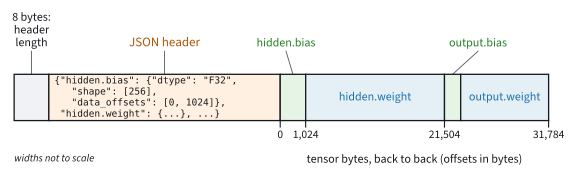
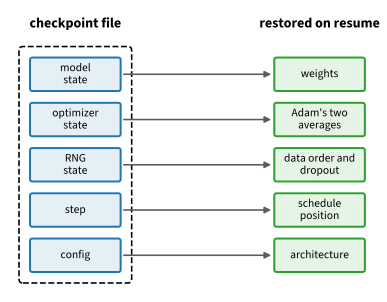

```{.python .input}
%load_ext d2lbook.tab
tab.interact_select('mxnet', 'pytorch', 'tensorflow', 'jax')
```

# Saving, Loading, and Pretrained Weights
:label:`sec_read_write`

A trained network lives in the memory of the process that trained it. When
the process ends, because the script finished, crashed, or ran on a cloud
machine that was reclaimed, the weights are gone unless they were written to
disk. At scale, such failures are routine. In a 54-day snapshot of the
pre-training of Llama 3 405B on up to 16,384 GPUs, Meta recorded 419
unexpected interruptions, about one every three hours :cite:`Grattafiori.Dubey.Jauhri.ea.2024`. A run that
cannot continue from where it stopped would never finish. Saved weights also
let others use a model without training it: in practice, many models start
from weights that someone else trained, as the fine-tuning examples of
:numref:`sec_fine_tuning` do.

What has to be saved follows from :numref:`sec_parameters`. A model is code
plus state. The code defines the layers and the forward computation; the
*state* is the set of named tensors that training produced, parameters and
buffers alike. We save only the state, as a mapping from names to tensors,
and restore a model by building its structure from code and loading the
tensors into it. Resuming training needs more than the weights: it also
needs the optimizer's running averages, the random-number streams, and the
step counter. For a model with 8 billion parameters, the weights alone take
16 GB in bf16, while a resumable checkpoint with fp32 weights and the
optimizer's state takes 96 GB.

This section first saves and loads the state of a small network. It then
asks which file formats are safe to load from a stranger, writes a
checkpoint from which training resumes exactly, and loads pretrained weights
into a network with a new output layer.

```{.python .input #saving-loading-saving-loading-and-pretrained-weights}
%%tab mxnet
import json
import os
import struct
from collections import Counter
from dataclasses import asdict, dataclass
import numpy as np
from mxnet import autograd, gluon, init, np as mnp, npx
from mxnet.gluon import nn
from safetensors.numpy import load_file, save_file
npx.set_np()
```

```{.python .input #saving-loading-saving-loading-and-pretrained-weights}
%%tab pytorch
import json
import os
import struct
from collections import Counter
from dataclasses import asdict, dataclass
import numpy as np
import torch
from torch import nn
from torch.nn import functional as F
from torchvision.models import resnet50, ResNet50_Weights
from safetensors.torch import load_file, save_file
```

```{.python .input #saving-loading-saving-loading-and-pretrained-weights}
%%tab tensorflow
import json
import struct
from collections import Counter
from dataclasses import asdict, dataclass
import numpy as np
import tensorflow as tf
from safetensors.tensorflow import load_file, save_file
```

```{.python .input #saving-loading-saving-loading-and-pretrained-weights}
%%tab jax
import json
import os
import struct
from collections import Counter
from dataclasses import asdict, dataclass
import numpy as np
import jax
from jax import numpy as jnp
from flax import nnx, traverse_util
import optax
import orbax.checkpoint as ocp
from safetensors.flax import load_file, save_file
from d2l import jax as d2l
from d2l.nnx_resnet import ResNet50
```

## Model State

A model holds many tensors, so a file format for its state must store a
collection of named tensors, and the framework provides one.

:begin_tab:`mxnet`
`npx.savez` writes named arrays to one file, and `npx.load` returns them as
a dictionary from names to arrays.
:end_tab:

:begin_tab:`pytorch`
`torch.save` writes a tensor, or a dictionary of tensors, to a file, and
`torch.load` reads it back.
:end_tab:

:begin_tab:`tensorflow`
NumPy's `np.savez` writes named arrays to one `.npz` file, and `np.load`
returns a mapping from the names to the arrays. TensorFlow tensors convert to
NumPy arrays with `.numpy()`.
:end_tab:

:begin_tab:`jax`
`jnp.savez` writes named arrays to one `.npz` file, NumPy's format, and
`jnp.load` returns a mapping from the names to the arrays.
:end_tab:

```{.python .input #saving-loading-state-not-code-1}
%%tab mxnet
x = mnp.arange(4)
npx.savez('tensors', x=x, y=mnp.zeros(4))
npx.load('tensors')
```

```{.python .input #saving-loading-state-not-code-1}
%%tab pytorch
x = torch.arange(4)
torch.save({'x': x, 'y': torch.zeros(4)}, 'tensors.pt')
torch.load('tensors.pt')
```

```{.python .input #saving-loading-state-not-code-1}
%%tab tensorflow
x = tf.range(4)
np.savez('tensors.npz', x=x.numpy(), y=tf.zeros(4).numpy())
dict(np.load('tensors.npz'))
```

```{.python .input #saving-loading-state-not-code-1}
%%tab jax
x = jnp.arange(4)
jnp.savez('tensors.npz', x=x, y=jnp.zeros(4))
dict(jnp.load('tensors.npz'))
```

The state of a model is such a collection, built by the framework. Its
names are the paths through the module tree of
:numref:`sec_model_construction`, and its values are the tensors. Here is the
state of an MLP with one hidden layer of 256 units.

:begin_tab:`mxnet`
`collect_params` maps the dotted paths (`hidden.weight`, `output.bias`) to
the parameters, including the running statistics of any batch normalization
layers.
:end_tab:

:begin_tab:`pytorch`
`state_dict` maps the dotted paths (`hidden.weight`, `output.bias`) to the
tensors, buffers included.
:end_tab:

:begin_tab:`tensorflow`
`net.weights` lists the variables, and each variable's `path` names its place
in the layer tree (`mlp/hidden/kernel`; Keras calls a weight matrix a
*kernel*). Keras invents layer names such as `dense_3` when we do not choose
them, so we name the layers to keep the paths the same in every instance.
:end_tab:

:begin_tab:`jax`
`nnx.state` returns the variables as a tree whose paths follow the module
graph (`hidden.kernel`, `output.bias`; Flax calls a weight matrix a
*kernel*).
:end_tab:

```{.python .input #saving-loading-state-not-code-2}
%%tab mxnet
class MLP(nn.Block):
    def __init__(self):
        super().__init__()
        self.hidden = nn.Dense(256, activation='relu')
        self.output = nn.Dense(10)

    def forward(self, x):
        return self.output(self.hidden(x))

net = MLP()
net.initialize()
X = mnp.random.uniform(size=(2, 20))
Y = net(X)
{name: p.shape for name, p in net.collect_params().items()}
```

```{.python .input #saving-loading-state-not-code-2}
%%tab pytorch
class MLP(nn.Module):
    def __init__(self):
        super().__init__()
        self.hidden = nn.LazyLinear(256)
        self.output = nn.LazyLinear(10)

    def forward(self, x):
        return self.output(F.relu(self.hidden(x)))

net = MLP()
X = torch.randn(2, 20)
Y = net(X)
{name: tuple(t.shape) for name, t in net.state_dict().items()}
```

```{.python .input #saving-loading-state-not-code-2}
%%tab tensorflow
class MLP(tf.keras.Model):
    def __init__(self):
        super().__init__(name='mlp')
        self.hidden = tf.keras.layers.Dense(256, name='hidden')
        self.out = tf.keras.layers.Dense(10, name='output')

    def call(self, x):
        return self.out(tf.nn.relu(self.hidden(x)))

net = MLP()
X = tf.random.normal((2, 20))
Y = net(X)
{v.path: tuple(v.shape) for v in net.weights}
```

```{.python .input #saving-loading-state-not-code-2}
%%tab jax
class MLP(nnx.Module):
    def __init__(self, rngs):
        self.hidden = nnx.Linear(20, 256, rngs=rngs)
        self.output = nnx.Linear(256, 10, rngs=rngs)

    def __call__(self, x):
        return self.output(nnx.relu(self.hidden(x)))

net = MLP(nnx.Rngs(d2l.get_key()))
X = jax.random.normal(d2l.get_key(), (2, 20))
Y = net(X)
params = nnx.state(net, nnx.Param)
[(path, tuple(value.shape)) for path, value in params.flat_state()]
```

The state holds names, shapes, and values. It does not record the `MLP`
class, its `forward` computation, or the activation function. Loading it
therefore needs code that builds a model with the same names and shapes.
Renaming an attribute, say `output` to `head`, changes the names and breaks
the match even though the computation stays the same. The last part of this
section shows how to detect such mismatches when loading.

## Pickle and safetensors

A file that stays on our own disk can be in any format. A file downloaded
from a model hub, or received from a colleague, raises a question that
tensors on our own disk do not: can loading it do anything besides creating
tensors?

### Code Execution on Load

Python's standard serialization, `pickle`, does not store data. It stores a
program that reconstructs the data, and loading the file runs that program.
The program may call any function the loading process can import. An object
tells pickle what to call through its `__reduce__` method, which returns a
function and its arguments. The class below asks for `print`; a malicious
file would ask for something like `os.system`.

```{.python .input #saving-loading-code-execution-on-load-1}
class Tripwire:
    def __reduce__(self):  # pickle calls print(...) to rebuild the object
        return (print, ('*** payload executed while loading ***',))
```

:begin_tab:`mxnet`
MXNet's own array files contain no pickle, but `gluon.Trainer.save_states`,
which we use for checkpoints below, writes pickle, and so does NumPy
whenever it saves an object that is not a plain array. Loading such a NumPy
file with `allow_pickle=True` runs the payload:
:end_tab:

:begin_tab:`pytorch`
`torch.save` writes pickle. Loading the file with `weights_only=False`, the
behavior of `torch.load` before PyTorch 2.6, runs the payload:
:end_tab:

:begin_tab:`tensorflow`
NumPy writes pickle whenever it saves an object that is not a plain array.
Loading such a file with `allow_pickle=True` runs the payload:
:end_tab:

:begin_tab:`jax`
NumPy, whose formats JAX uses, writes pickle whenever it saves an object
that is not a plain array. Loading such a file with `allow_pickle=True` runs
the payload:
:end_tab:

```{.python .input #saving-loading-safetensors-the-interchange-format-1}
%%tab mxnet, tensorflow, jax
np.save('tripwire.npy', np.array(Tripwire(), dtype=object))  # pickled
_ = np.load('tripwire.npy', allow_pickle=True)  # the payload runs here
```

```{.python .input #saving-loading-safetensors-the-interchange-format-1}
%%tab pytorch
torch.save(Tripwire(), 'tripwire.pt')
_ = torch.load('tripwire.pt', weights_only=False)  # the payload runs here
```

:begin_tab:`mxnet`
NumPy's default, `allow_pickle=False`, refuses the file instead:
:end_tab:

:begin_tab:`pytorch`
Since version 2.6, `torch.load` defaults to `weights_only=True`, which
accepts only tensors, numbers, strings, and containers of them, and refuses
the file:
:end_tab:

:begin_tab:`tensorflow`
NumPy's default, `allow_pickle=False`, refuses the file instead:
:end_tab:

:begin_tab:`jax`
NumPy's default, `allow_pickle=False`, refuses the file instead:
:end_tab:

```{.python .input #saving-loading-safetensors-the-interchange-format-2}
%%tab mxnet, tensorflow, jax
try:
    np.load('tripwire.npy')  # allow_pickle=False, the default
except ValueError as e:
    print(type(e).__name__, e)
```

```{.python .input #saving-loading-safetensors-the-interchange-format-2}
%%tab pytorch
try:
    torch.load('tripwire.pt')  # weights_only=True, the default
except Exception as e:
    print(type(e).__name__, str(e).split('.')[0])
```

A refusing loader protects us only as long as its checks are complete, and
such checks have had holes: PyTorch fixed a way around `weights_only=True`
in version 2.6. A format that contains no program at all removes the
question.

:begin_tab:`tensorflow`
TensorFlow's own checkpoint and Keras `.weights.h5` files contain no pickle.
A whole-model `.keras` archive can carry code, the function of a `Lambda`
layer, which Keras refuses to run unless we pass `safe_mode=False`.
:end_tab:

### The safetensors Format

A *safetensors* file has three parts, shown in
:numref:`fig_bg_safetensors_layout`: an 8-byte little-endian integer that
gives the length of a header, the header itself as JSON text, and the raw
bytes of all tensors back to back. The header names each tensor and records
its dtype, its shape, and the range of bytes it occupies after the header.
Nothing in the file is executed when it is loaded; a loader only has to check
that the header is well formed and that the ranges lie inside the file.
Because the ranges are known in advance, a reader can map the file into
memory and read one tensor without reading the others. The format does not
depend on any framework, and it is the default format for weights on the
Hugging Face Hub.


:label:`fig_bg_safetensors_layout`

We save the state of the MLP as a safetensors file, load it into a second
instance, and check that the two networks compute the same outputs.

:begin_tab:`mxnet`
MXNet has no safetensors binding of its own. The NumPy binding serves: we
convert each parameter with `.asnumpy()` on the way out and with `mnp.array`
on the way back.
:end_tab:

:begin_tab:`pytorch`
`save_file` takes the `state_dict` directly, and `load_file` returns one.
:end_tab:

:begin_tab:`tensorflow`
The variable paths provide the names. `load_file` returns constant tensors,
which we `assign` to the variables of the new model. `save_file` converts
the values of the dictionary passed to it to NumPy in place, so we hand it a
fresh dictionary.
:end_tab:

:begin_tab:`jax`
A safetensors file stores a flat mapping from names to tensors, while the
NNX state is a nested tree. `traverse_util.flatten_dict` turns the tree into
a mapping from paths to arrays, and we join each path with dots;
`unflatten_dict` reverses this.
:end_tab:

```{.python .input #saving-loading-safetensors-the-interchange-format-3}
%%tab mxnet
state = {name: p.data().asnumpy() for name, p in net.collect_params().items()}
save_file(state, 'mlp.safetensors')
clone = MLP()
clone.load_dict({name: mnp.array(v)
                 for name, v in load_file('mlp.safetensors').items()})
(clone(X) == Y).all()
```

```{.python .input #saving-loading-safetensors-the-interchange-format-3}
%%tab pytorch
save_file(net.state_dict(), 'mlp.safetensors')
clone = MLP()
clone(X)                                   # materialize the lazy layers first
clone.load_state_dict(load_file('mlp.safetensors'))
torch.equal(clone(X), Y)
```

```{.python .input #saving-loading-safetensors-the-interchange-format-3}
%%tab tensorflow
save_file({v.path: v for v in net.weights}, 'mlp.safetensors')
clone = MLP()
clone(X)                                   # build the variables first
restored = load_file('mlp.safetensors')
for v in clone.weights:
    v.assign(restored[v.path])
bool(tf.reduce_all(clone(X) == Y))
```

```{.python .input #saving-loading-safetensors-the-interchange-format-3}
%%tab jax
def to_flat(tree):
    return {'.'.join(path): value
            for path, value in traverse_util.flatten_dict(tree).items()}

def from_flat(flat):
    return traverse_util.unflatten_dict(
        {tuple(name.split('.')): value for name, value in flat.items()})

save_file(to_flat(nnx.to_pure_dict(params)), 'mlp.safetensors')
clone = MLP(nnx.Rngs(d2l.get_key()))
clone_params = nnx.state(clone, nnx.Param)
nnx.replace_by_pure_dict(clone_params, from_flat(load_file('mlp.safetensors')))
nnx.update(clone, clone_params)
bool(jnp.array_equal(clone(X), Y))
```

The round trip is exact. Because the header is JSON at a known offset, we
can read it with nothing but the Python standard library:

```{.python .input #saving-loading-safetensors-the-interchange-format-4}
with open('mlp.safetensors', 'rb') as f:
    n = struct.unpack('<Q', f.read(8))[0]  # header length, little-endian
    header = json.loads(f.read(n))
print('header length:', n, 'bytes')
for name, entry in sorted(header.items(), key=lambda e: e[1]['data_offsets']):
    print(f"{name:18s} {entry['dtype']} {str(entry['shape']):10s} "
          f"bytes {entry['data_offsets']}")
```

Each byte range is the number of entries times 4 bytes, since the dtype `F32`
is float32. The bias of the hidden layer has 256 entries and occupies the
first 1,024 bytes of the data; the weight matrix of the hidden layer, with
$256 \times 20 = 5{,}120$ entries, takes the next 20,480 bytes. Every range
starts where the previous one ends, so the data contains nothing but the
tensors.

For files that stay on our own machine, the framework's native format serves
well. For files that cross a trust boundary, in either direction, we use a
format that contains no program and publish a checksum with the file so that
the recipient can detect a corrupted or replaced download.

## Training Checkpoints

A file of weights is enough to use a model, but not to continue training it.
Many of the later chapters train with *Adam*, an optimizer that keeps two
running averages for every parameter, of its gradient $\mathbf{g}$ and of
the gradient's elementwise square, and scales each step by them. With decay
rates $\beta_1 = 0.9$ and $\beta_2 = 0.999$, the update at step $t$ reads

$$
\begin{aligned}
\mathbf{m} &\leftarrow \beta_1 \mathbf{m} + (1 - \beta_1)\, \mathbf{g}, &
\mathbf{v} &\leftarrow \beta_2 \mathbf{v} + (1 - \beta_2)\, \mathbf{g} \odot \mathbf{g},\\
\mathbf{w} &\leftarrow \mathbf{w} - \eta\, \frac{\hat{\mathbf{m}}}{\sqrt{\hat{\mathbf{v}}} + \epsilon}, &
\hat{\mathbf{m}} &= \frac{\mathbf{m}}{1 - \beta_1^t}, \quad
\hat{\mathbf{v}} = \frac{\mathbf{v}}{1 - \beta_2^t},
\end{aligned}
$$
:eqlabel:`eq_saving_adam`

where $\eta$ is the learning rate, $\epsilon$ a small constant such as
$10^{-8}$, and the division and square root act elementwise. The averages
$\mathbf{m}$ and $\mathbf{v}$ start at zero, and the factors
$1/(1 - \beta^t)$ correct for that start. In words, each parameter moves
against its averaged gradient, by an amount scaled down where its gradients
have been large. The averages carry the history of the run: drop
them, and the optimizer behaves as if training had just begun.

A checkpoint from which training can resume therefore holds five things
(:numref:`fig_bg_checkpoint_contents`): the model state; the optimizer
state, here $\mathbf{m}$ and $\mathbf{v}$; the state of the random-number
generators, so that data shuffling and dropout continue the same streams;
the step counter $t$, which also sets the position in any learning-rate
schedule; and the configuration that sizes the model when it is rebuilt.
The optimizer state costs more than the weights. In fp32, the weights and
the two averages take 12 bytes per parameter, so the checkpoint of a model
with 8 billion parameters takes 96 GB, six times the 16 GB of its weights
in bf16. Gradients are not saved, since the next step recomputes them.


:label:`fig_bg_checkpoint_contents`

A checkpoint must also survive a crash while it is being written. If the new
file replaces the old one in place, a crash in the middle leaves neither. We
therefore write to a temporary name and rename the finished file; a rename
within one file system is atomic, so a reader sees either the old checkpoint
or the new one.

:begin_tab:`mxnet`
In MXNet a checkpoint is three files: `save_parameters` writes the model,
`gluon.Trainer.save_states` writes the optimizer state, and a JSON file
holds the step and the configuration. The trainer state is pickle, so it
should be loaded only from our own disk. One compartment of
:numref:`fig_bg_checkpoint_contents` stays empty: MXNet cannot save the
state of its random-number generators, only reseed them with
`mnp.random.seed`, so a resumed run starts new streams. The helpers below
rename each file into place. Three renames are not one atomic step; the
exercises build a manifest that publishes the three files together.
:end_tab:

:begin_tab:`pytorch`
The helpers below keep the checkpoint to tensors, numbers, and strings, so
that it loads with `weights_only=True`. The configuration, a dataclass, is
stored as a dictionary through `asdict`. They write the file under a
temporary name and move it into place with `os.replace`.
:end_tab:

:begin_tab:`tensorflow`
TensorFlow bundles the state in `tf.train.Checkpoint`. It takes the objects
to track as keyword arguments, here the model, the optimizer, a step
counter, and a `tf.random.Generator`, and saves and restores their
variables as one unit, Adam's averages included. Each save gets a new
number (`run-tf-1`, `run-tf-2`, ...), so a crash cannot damage the previous
save. The configuration goes into a JSON file with the same number. The
global random generator is not tracked; randomness that must resume exactly
comes from a tracked `tf.random.Generator`.
:end_tab:

:begin_tab:`jax`
In NNX the model and the optimizer, including its step counter, expose their
state as trees. Orbax, the JAX checkpointing library, saves and restores
such trees: `StandardCheckpointer` writes to a temporary directory and
renames it when it is complete. The random-number key and the configuration
are two more branches of the saved tree; in JAX a key is an array like any
other. We overwrite one directory with `force=True` so that the notebook can
run twice; a real run writes numbered steps through `CheckpointManager` and
keeps the last complete one.
:end_tab:

```{.python .input #saving-loading-checkpointing-a-training-run-1}
%%tab mxnet
def save_checkpoint(prefix, model, trainer, step, cfg=None):  #@save
    """Replace each component of a resumable MXNet checkpoint."""
    meta = {'step': step}
    if cfg is not None:
        meta['cfg'] = asdict(cfg)
    model.save_parameters(prefix + '.params.tmp')
    trainer.save_states(prefix + '.states.tmp')
    with open(prefix + '.json.tmp', 'w') as f:
        json.dump(meta, f)
    for ext in ('.params', '.states', '.json'):
        os.replace(prefix + ext + '.tmp', prefix + ext)

def load_checkpoint(prefix, model, trainer=None):  #@save
    """Restore the state written by save_checkpoint; return the metadata."""
    model.load_parameters(prefix + '.params')
    if trainer is not None:
        trainer.load_states(prefix + '.states')
    with open(prefix + '.json') as f:
        return json.load(f)
```

```{.python .input #saving-loading-checkpointing-a-training-run-1}
%%tab pytorch
def save_checkpoint(path, model, optimizer, step, cfg=None):  #@save
    """Atomically write a resumable training checkpoint."""
    ckpt = {'model': model.state_dict(),
            'optimizer': optimizer.state_dict(),
            'step': step,
            'cpu_rng': torch.get_rng_state()}
    if cfg is not None:
        ckpt['cfg'] = asdict(cfg)
    if torch.cuda.is_available():
        ckpt['cuda_rng'] = torch.cuda.get_rng_state_all()
    tmp = path + '.tmp'
    torch.save(ckpt, tmp)
    os.replace(tmp, path)

def load_checkpoint(path, model, optimizer=None):  #@save
    """Restore the state written by save_checkpoint; return the raw dict."""
    ckpt = torch.load(path, weights_only=True)
    model.load_state_dict(ckpt['model'])
    if optimizer is not None:
        optimizer.load_state_dict(ckpt['optimizer'])
    torch.set_rng_state(ckpt['cpu_rng'])
    if torch.cuda.is_available() and 'cuda_rng' in ckpt:
        torch.cuda.set_rng_state_all(ckpt['cuda_rng'])
    return ckpt
```

The experiment trains a small regressor: an MLP with one hidden layer of 64
units, fit by Adam with learning rate 0.05 to 256 examples of a noisy linear
function of 20 inputs. The weights start from Xavier
initialization (:numref:`subsec_xavier`), uniform with variance
$2/(n_\textrm{in} + n_\textrm{out})$ for a layer with $n_\textrm{in}$ inputs
and $n_\textrm{out}$ outputs, and the biases start at zero. The
configuration is a dataclass, the form used in
:numref:`sec_model_construction`; it is what a rebuild reads to size the
model, so it goes into the checkpoint.

```{.python .input #saving-loading-training-checkpoints-1}
@dataclass
class Config:
    num_inputs: int = 20
    num_hiddens: int = 64
    num_outputs: int = 1
    lr: float = 0.05
```

We train for 100 steps on the full batch, save a checkpoint, and print the
training loss.

```{.python .input #saving-loading-checkpointing-a-training-run-2}
%%tab mxnet
def build(cfg):
    net = nn.Sequential()
    net.add(nn.Dense(cfg.num_hiddens, activation='relu'),
            nn.Dense(cfg.num_outputs))
    net.initialize(init.Xavier())           # biases start at zero
    return net

cfg = Config()
data = mnp.random.normal(size=(256, cfg.num_inputs))
target = (data @ mnp.random.normal(size=(cfg.num_inputs, 1))
          + 0.1 * mnp.random.normal(size=(256, 1)))

def loss(model):
    return float(((model(data) - target) ** 2).mean())

def step(model, trainer):
    with autograd.record():
        l = ((model(data) - target) ** 2).mean()
    l.backward()
    trainer.step(batch_size=1)               # the loss is already a mean
    return float(l)

net = build(cfg)
trainer = gluon.Trainer(net.collect_params(), 'adam',
                        {'learning_rate': cfg.lr})
for _ in range(100):
    step(net, trainer)
save_checkpoint('run-mx', net, trainer, step=100, cfg=cfg)
round(loss(net), 4)
```

```{.python .input #saving-loading-checkpointing-a-training-run-2}
%%tab pytorch
def build(cfg):
    net = nn.Sequential(nn.Linear(cfg.num_inputs, cfg.num_hiddens),
                        nn.ReLU(),
                        nn.Linear(cfg.num_hiddens, cfg.num_outputs))
    for layer in (net[0], net[2]):
        nn.init.xavier_uniform_(layer.weight)
        nn.init.zeros_(layer.bias)
    return net

cfg = Config()
data = torch.randn(256, cfg.num_inputs)
target = data @ torch.randn(cfg.num_inputs, 1) + 0.1 * torch.randn(256, 1)
loss = nn.MSELoss()

def step(model, opt):
    opt.zero_grad()
    l = loss(model(data), target)
    l.backward()
    opt.step()
    return l.item()

net = build(cfg)
opt = torch.optim.Adam(net.parameters(), lr=cfg.lr)
for _ in range(100):
    step(net, opt)
save_checkpoint('run.pt', net, opt, step=100, cfg=cfg)
round(loss(net(data), target).item(), 4)
```

```{.python .input #saving-loading-checkpointing-a-training-run-2}
%%tab tensorflow
def build(cfg):
    net = tf.keras.Sequential([             # biases start at zero
        tf.keras.layers.Dense(cfg.num_hiddens, activation='relu',
                              kernel_initializer='glorot_uniform'),
        tf.keras.layers.Dense(cfg.num_outputs,
                              kernel_initializer='glorot_uniform')])
    net(tf.zeros((1, cfg.num_inputs)))          # build the variables
    return net

cfg = Config()
rng = tf.random.Generator.from_non_deterministic_state()  # saved below
data = rng.normal((256, cfg.num_inputs))
target = (data @ rng.normal((cfg.num_inputs, 1))
          + 0.1 * rng.normal((256, 1)))
loss = tf.keras.losses.MeanSquaredError()

def step(model, opt):
    with tf.GradientTape() as tape:
        l = loss(target, model(data))
    opt.apply_gradients(zip(tape.gradient(l, model.trainable_variables),
                            model.trainable_variables))
    return float(l)

net = build(cfg)
opt = tf.keras.optimizers.Adam(cfg.lr)
for _ in range(100):
    step(net, opt)
ckpt = tf.train.Checkpoint(model=net, optimizer=opt, step=tf.Variable(100),
                           rng=rng)
path = ckpt.save('run-tf')                  # a numbered save: 'run-tf-1'
with open(path + '.cfg.json', 'w') as f:
    json.dump(asdict(cfg), f)
path, round(float(loss(target, net(data))), 4)
```

```{.python .input #saving-loading-checkpointing-a-training-run-2}
%%tab jax
def build(cfg, rngs):
    xavier = nnx.initializers.xavier_uniform()  # biases start at zero
    return nnx.Sequential(
        nnx.Linear(cfg.num_inputs, cfg.num_hiddens, kernel_init=xavier,
                   rngs=rngs),
        nnx.relu,
        nnx.Linear(cfg.num_hiddens, cfg.num_outputs, kernel_init=xavier,
                   rngs=rngs))

def fresh_state(cfg):
    model = build(cfg, nnx.Rngs(d2l.get_key()))
    return model, nnx.Optimizer(model, optax.adam(cfg.lr), wrt=nnx.Param)

def checkpoint_tree(model, optimizer, key, cfg):
    return {'model': nnx.to_pure_dict(nnx.state(model)),
            'optimizer': nnx.to_pure_dict(nnx.state(optimizer)),
            'rng': key, 'cfg': asdict(cfg)}

cfg = Config()
data = jax.random.normal(d2l.get_key(), (256, cfg.num_inputs))
target = (data @ jax.random.normal(d2l.get_key(), (cfg.num_inputs, 1))
          + 0.1 * jax.random.normal(d2l.get_key(), (256, 1)))

def loss(model):
    return jnp.mean((model(data) - target) ** 2)

@nnx.jit
def step(model, optimizer):
    l, grads = nnx.value_and_grad(loss)(model)
    optimizer.update(model, grads)
    return l

model, optimizer = fresh_state(cfg)
train_key = d2l.get_key()                   # the key a real run would carry
for _ in range(100):
    step(model, optimizer)
ckptr = ocp.StandardCheckpointer()
ckptr.save(os.path.abspath('run-jax'),       # orbax wants an absolute path
           checkpoint_tree(model, optimizer, train_key, cfg), force=True)
ckptr.wait_until_finished()
int(optimizer.step), round(float(loss(model)), 4)
```

To check that the checkpoint holds everything the model needs, we corrupt
every parameter, load the checkpoint, and compare the losses.

:begin_tab:`mxnet`
`load_parameters` and `load_states` overwrite the model and the trainer in
place, matching parameters by the dotted names that the file stores. Nothing
checks that every name found a partner; the last part of this section writes
that check.
:end_tab:

:begin_tab:`pytorch`
`load_state_dict` overwrites the tensors of the model and the optimizer in
place. It raises an error if a name or a shape in the file does not match
the model.
:end_tab:

:begin_tab:`tensorflow`
`restore` overwrites the tracked objects in place. It matches each variable
by its route through the object graph (`model`, then the layer, then its
`kernel`) rather than by name, and returns a status object.
`assert_consumed()` on that status checks that every saved value found a
variable and every variable found a value, so a partial restore raises an
error instead of passing silently.
:end_tab:

:begin_tab:`jax`
Orbax fills a template tree, here the tree of the current objects, with the
saved arrays, and raises an error if the two trees differ in structure or
shape. We then write the restored values into the model and the optimizer.
:end_tab:

```{.python .input #saving-loading-checkpointing-a-training-run-3}
%%tab mxnet
for p in net.collect_params().values():
    p.set_data(p.data() + 1.0)            # wreck the weights
before = loss(net)
load_checkpoint('run-mx', net, trainer)
after = loss(net)
f'perturbed {before:.2f} -> restored {after:.4f}'
```

```{.python .input #saving-loading-checkpointing-a-training-run-3}
%%tab pytorch
with torch.no_grad():
    for p in net.parameters():
        p.add_(1.0)                       # wreck the weights
before = loss(net(data), target).item()
load_checkpoint('run.pt', net, opt)
after = loss(net(data), target).item()
f'perturbed {before:.2f} -> restored {after:.4f}'
```

```{.python .input #saving-loading-checkpointing-a-training-run-3}
%%tab tensorflow
for v in net.trainable_variables:
    v.assign_add(tf.ones_like(v))         # wreck the weights
before = float(loss(target, net(data)))
ckpt.restore(path).assert_consumed()
after = float(loss(target, net(data)))
f'perturbed {before:.2f} -> restored {after:.4f}'
```

```{.python .input #saving-loading-checkpointing-a-training-run-3}
%%tab jax
def load_into(obj, saved):
    state = nnx.state(obj)
    nnx.replace_by_pure_dict(state, saved)
    nnx.update(obj, state)

nnx.update(model, jax.tree.map(lambda p: p + 1.0, nnx.state(model)))  # wreck
before = float(loss(model))
ckpt = ckptr.restore(os.path.abspath('run-jax'),
                     checkpoint_tree(model, optimizer, train_key, cfg))
load_into(model, ckpt['model'])
load_into(optimizer, ckpt['optimizer'])
after = float(loss(model))
f'perturbed {before:.2f} -> restored {after:.4f}'
```

The loss returns to its value at the checkpoint. Now we resume training from
the checkpoint in two ways: once with the saved optimizer state, and once
with the saved weights but a newly created Adam. Each run takes five steps
and prints the loss before each step.

:begin_tab:`tensorflow`
A newly created Keras Adam has no variables for its averages; it creates
them when it first updates the weights. Restoring into it fails, because the
saved averages find no variables to fill. We therefore call
`opt.build(model.trainable_variables)` before restoring.
:end_tab:

```{.python .input #saving-loading-checkpointing-a-training-run-4}
%%tab mxnet
with open('run-mx.json') as f:
    cfg = Config(**json.load(f)['cfg'])     # the config travels with the run
net_full = build(cfg)
trainer_full = gluon.Trainer(net_full.collect_params(), 'adam',
                             {'learning_rate': cfg.lr})
load_checkpoint('run-mx', net_full, trainer_full)   # weights + optimizer
full = [round(step(net_full, trainer_full), 4) for _ in range(5)]

net_fresh = build(cfg)
load_checkpoint('run-mx', net_fresh, trainer=None)  # weights only
trainer_fresh = gluon.Trainer(net_fresh.collect_params(), 'adam',
                              {'learning_rate': cfg.lr})
fresh = [round(step(net_fresh, trainer_fresh), 4) for _ in range(5)]

print('saved optimizer:', full)
print('fresh optimizer:', fresh)
```

```{.python .input #saving-loading-checkpointing-a-training-run-4}
%%tab pytorch
cfg = Config(**torch.load('run.pt', weights_only=True)['cfg'])  # saved config
net_full = build(cfg)
opt_full = torch.optim.Adam(net_full.parameters(), lr=cfg.lr)
load_checkpoint('run.pt', net_full, opt_full)          # weights + optimizer
full = [round(step(net_full, opt_full), 4) for _ in range(5)]

net_fresh = build(cfg)
load_checkpoint('run.pt', net_fresh, optimizer=None)   # weights only
opt_fresh = torch.optim.Adam(net_fresh.parameters(), lr=cfg.lr)
fresh = [round(step(net_fresh, opt_fresh), 4) for _ in range(5)]

print('saved optimizer:', full)
print('fresh optimizer:', fresh)
```

```{.python .input #saving-loading-checkpointing-a-training-run-4}
%%tab tensorflow
with open(path + '.cfg.json') as f:
    cfg = Config(**json.load(f))
net_full = build(cfg)
opt_full = tf.keras.optimizers.Adam(cfg.lr)
opt_full.build(net_full.trainable_variables)   # create Adam's variables first
tf.train.Checkpoint(model=net_full, optimizer=opt_full, step=tf.Variable(0),
                    rng=tf.random.Generator.from_non_deterministic_state()
                    ).restore(path).assert_consumed()
full = [round(step(net_full, opt_full), 4) for _ in range(5)]

net_fresh = build(cfg)
tf.train.Checkpoint(model=net_fresh).restore(path).expect_partial()
opt_fresh = tf.keras.optimizers.Adam(cfg.lr)            # weights only
fresh = [round(step(net_fresh, opt_fresh), 4) for _ in range(5)]

print('saved optimizer:', full)
print('fresh optimizer:', fresh)
```

```{.python .input #saving-loading-checkpointing-a-training-run-4}
%%tab jax
cfg = Config(**ckpt['cfg'])
full, full_opt = fresh_state(cfg)
load_into(full, ckpt['model'])
load_into(full_opt, ckpt['optimizer'])                 # weights + optimizer
full_losses = [round(float(step(full, full_opt)), 4) for _ in range(5)]

fresh, fresh_opt = fresh_state(cfg)
load_into(fresh, ckpt['model'])                        # weights only
fresh_losses = [round(float(step(fresh, fresh_opt)), 4) for _ in range(5)]

print('saved optimizer:', full_losses)
print('fresh optimizer:', fresh_losses)
```

With the saved optimizer state, training continues where it stopped, and
the loss keeps decreasing slowly. With a fresh Adam, the loss jumps from a
few thousandths or less to between about 1 and 6 after a single step, and after four steps
it is still dozens to hundreds of times higher than at the checkpoint.
:eqref:`eq_saving_adam` explains the jump. At the first step of a fresh
Adam, $\mathbf{m}$ and $\mathbf{v}$ are zero, so the bias-corrected
averages are $\hat{\mathbf{m}} = \mathbf{g}$ and
$\hat{\mathbf{v}} = \mathbf{g} \odot \mathbf{g}$, and the step of each
parameter has size $\eta\, |g_i| / (|g_i| + \epsilon)$, almost exactly
$\eta$. Every parameter with a nonzero gradient moves by the full learning
rate of 0.05, however small that gradient is. The saved $\mathbf{v}$ still
holds the larger squared gradients of earlier steps, so
$\sqrt{\hat{\mathbf{v}}}$ is large compared with the current gradients,
and the steps stay small. Weights alone do not resume a run.

## Pretrained Weights

In practice, many models do not start from random weights. A network trained on a large dataset such as ImageNet, 1.2 million images
in 1,000 classes, computes features that are useful for other image tasks
too. To reuse it for a task with 10 classes, we keep all layers except the
last and replace that one, the *head*, with a new layer of 10 outputs. Our
example is ResNet-50, a convolutional network with about 25 million
parameters, trained on ImageNet. How it computes does not matter
here: for loading weights it is a model state of a few hundred named
tensors.

:begin_tab:`mxnet`
Gluon's model zoo, `gluon.model_zoo.vision`, downloads the weights the first
time we pass `pretrained=True`. The files come from the hosting of the
archived MXNet project, which has no guarantee of staying available.
:end_tab:

:begin_tab:`pytorch`
torchvision downloads the weights the first time we pass a `weights=` value.
:end_tab:

:begin_tab:`tensorflow`
`tf.keras.applications` downloads the weights the first time we pass
`weights='imagenet'`; `include_top=False` leaves out the 1,000-class head,
and `pooling='avg'` averages the last feature map into one vector of 2,048
features per image.
:end_tab:

:begin_tab:`jax`
The book's NNX ResNet-50, `d2l.nnx_resnet.ResNet50`, downloads Microsoft's
ImageNet weights as a safetensors file from the Hugging Face Hub, at a fixed
revision, and maps them into the NNX model.
:end_tab:

```{.python .input #saving-loading-loading-weights-you-did-not-train-1}
%%tab mxnet
net = gluon.model_zoo.vision.resnet50_v1(pretrained=True)  # ~100 MB once
net.output = nn.Dense(10, in_units=2048)          # new 10-class head
net.output.initialize()
net.output
```

```{.python .input #saving-loading-loading-weights-you-did-not-train-1}
%%tab pytorch
net = resnet50(weights=ResNet50_Weights.DEFAULT)  # ~100 MB once
net.fc = nn.Linear(net.fc.in_features, 10)        # new 10-class head
net.fc
```

```{.python .input #saving-loading-loading-weights-you-did-not-train-1}
%%tab tensorflow
backbone = tf.keras.applications.ResNet50(        # ~95 MB once
    weights='imagenet', include_top=False, pooling='avg')
net = tf.keras.Sequential([backbone, tf.keras.layers.Dense(10, name='head')])
net(tf.zeros((1, 224, 224, 3)))                   # create the new head
net.layers[-1].kernel.shape
```

```{.python .input #saving-loading-loading-weights-you-did-not-train-1}
%%tab jax
net = ResNet50.from_pretrained()                  # ~100 MB once
net.fc = nnx.Linear(2048, 10, rngs=nnx.Rngs(d2l.get_key()))  # new head
net.fc.kernel.shape
```

Weights from elsewhere often do not fit our model exactly, and a loader that
fills what it can without saying what it skipped hides the mismatch. To see
what a careful load reports, we build a damaged state dictionary, standing
in for a file with missing entries: the pretrained state without the head,
which a new head replaces anyway, and without the deepest of ResNet-50's
four stages, a loss nobody intended. We load it into a new,
randomly initialized ResNet-50 with a 10-class head, and compute two sets of
names. *Missing* names are parameters of the model that the file did not
fill; they keep their random initialization. *Unexpected* names are entries
of the file that have no place in the model.

:begin_tab:`mxnet`
`load_dict` with `allow_missing=True` skips parameters that the file does not
fill, and with `ignore_extra=True` skips file entries that have no place in
the model; neither reports what it skipped. We compute the two sets from the
names ourselves.
:end_tab:

:begin_tab:`pytorch`
`load_state_dict(..., strict=False)` loads what matches and returns the two
sets as `missing_keys` and `unexpected_keys` instead of raising an error.
:end_tab:

:begin_tab:`tensorflow`
We match variables by their `path` and compute the two sets ourselves. For
whole Keras weight files, `load_weights(path, skip_mismatch=True)` does a
similar job: it fills every layer whose shapes match and lists the others
in a warning.
:end_tab:

:begin_tab:`jax`
We flatten both state trees to mappings from paths to arrays, take from the
file every path that the model has, and compute the two sets ourselves.
:end_tab:

```{.python .input #saving-loading-loading-weights-you-did-not-train-2}
%%tab mxnet
damaged = {name: p.data() for name, p in net.collect_params().items()
           if not name.startswith(('output', 'features.7'))}
target = gluon.model_zoo.vision.resnet50_v1(classes=10)
target.initialize()
target.load_dict(damaged, allow_missing=True, ignore_extra=True)  # silent
names = set(target.collect_params())
print('missing by block:', dict(Counter(
    '.'.join(k.split('.')[:2]) if k.startswith('features') else k.split('.')[0]
    for k in sorted(names - set(damaged)))))
print('unexpected:', sorted(set(damaged) - names))
```

```{.python .input #saving-loading-loading-weights-you-did-not-train-2}
%%tab pytorch
damaged = {k: v for k, v in net.state_dict().items()
           if not k.startswith(('fc.', 'layer4.'))}
target = resnet50(weights=None)
target.fc = nn.Linear(target.fc.in_features, 10)
report = target.load_state_dict(damaged, strict=False)
print('missing by block:', dict(Counter(
    k.split('.')[0] for k in report.missing_keys)))
print('unexpected:', report.unexpected_keys)
```

```{.python .input #saving-loading-loading-weights-you-did-not-train-2}
%%tab tensorflow
damaged = {v.path: v for v in backbone.weights
           if not v.path.startswith('conv5_')}
target = tf.keras.Sequential([
    tf.keras.applications.ResNet50(weights=None, include_top=False,
                                   pooling='avg'),
    tf.keras.layers.Dense(10, name='head')])
target(tf.zeros((1, 224, 224, 3)))
for v in target.weights:
    if v.path in damaged:
        v.assign(damaged[v.path])         # raises if the shapes differ
paths = {v.path for v in target.weights}
print('missing by block:', dict(Counter(
    p.split('/')[-2].split('_')[0] for p in sorted(paths - set(damaged)))))
print('unexpected:', sorted(set(damaged) - paths))
```

```{.python .input #saving-loading-loading-weights-you-did-not-train-2}
%%tab jax
def flat_state(model):
    return traverse_util.flatten_dict(nnx.to_pure_dict(nnx.state(model)))

damaged = {path: v for path, v in flat_state(net).items()
           if path[0] != 'fc' and path[:2] != ('stages', 3)}
target = ResNet50(num_classes=10, rngs=nnx.Rngs(d2l.get_key()))
fresh = flat_state(target)
state = nnx.state(target)
nnx.replace_by_pure_dict(state, traverse_util.unflatten_dict(
    {**fresh, **{p: v for p, v in damaged.items() if p in fresh}}))
nnx.update(target, state)
print('missing by block:', dict(Counter(
    f'stages.{p[1]}' if p[0] == 'stages' else p[0]
    for p in sorted(set(fresh) - set(damaged)))))
print('unexpected:', sorted(set(damaged) - set(fresh)))
```

The two entries of the head, its weight and its bias, are expected: the head
is new and is meant to start random. The entries of the last stage are not:
the file omitted a whole stage, which would now compute features with random
weights.
The set of unexpected names is empty here; a nonempty one usually means
that a layer was renamed, so that its weights found no place in the model.
In practice, we state in advance which names may be missing, the head here,
and treat every other entry of either set as an error.

Finally, we *freeze* the pretrained layers of the complete network `net`, so
that the optimizer changes only the new head. Training the head alone is cheap
and works when the new task resembles the old one; whether and how far to
unfreeze is a question of :numref:`sec_fine_tuning`.

:begin_tab:`mxnet`
Each parameter's `grad_req` controls its gradient. `'null'` tells autograd
not to compute a gradient for the parameter at all, and `'write'` restores
the default for the head. The running statistics of batch normalization have
`grad_req='null'` already, so we leave them out of the count. They are not
frozen by this: in training mode, under `autograd.record()`, batch
normalization still updates them, and `autograd.record(train_mode=False)`
keeps them fixed.
:end_tab:

:begin_tab:`pytorch`
We set `requires_grad = False` on every parameter
(:numref:`sec_parameters`) and turn it back on for the head. The running
statistics of the batch normalization layers are buffers, not parameters:
in training mode they still update, and calling `eval()` on those layers
keeps them fixed.
:end_tab:

:begin_tab:`tensorflow`
Setting `trainable = False` on the backbone removes its variables from
`trainable_variables`. In Keras it also runs the backbone's batch
normalization layers in inference mode, so their stored statistics stay
fixed.
:end_tab:

:begin_tab:`jax`
NNX parameters carry no flag; a parameter is frozen when it is left out of
differentiation and out of the optimizer (:numref:`sec_parameters`). A
filter selects the trainable parameters, here those whose path passes
through the head `fc`. The optimizer receives it as `wrt=trainable` and
keeps Adam's state for those parameters only, and a training step passes
the same filter to `nnx.grad` as `argnums=nnx.DiffState(0, trainable)`, so
that the gradient covers the head alone. The batch normalization
statistics of this ResNet-50 stay fixed as well, because its layers are
built with `use_running_average=True`.
:end_tab:

```{.python .input #saving-loading-loading-weights-you-did-not-train-3}
%%tab mxnet
params = {name: p for name, p in net.collect_params().items()
          if 'running' not in name}
for p in params.values():
    p.grad_req = 'null'
for p in net.output.collect_params().values():
    p.grad_req = 'write'
trainable = sum(p.data().size for p in params.values()
                if p.grad_req == 'write')
total = sum(p.data().size for p in params.values())
f'{trainable} trainable of {total}'
```

```{.python .input #saving-loading-loading-weights-you-did-not-train-3}
%%tab pytorch
for p in net.parameters():
    p.requires_grad = False
for p in net.fc.parameters():
    p.requires_grad = True
trainable = sum(p.numel() for p in net.parameters() if p.requires_grad)
total = sum(p.numel() for p in net.parameters())
f'{trainable} trainable of {total}'
```

```{.python .input #saving-loading-loading-weights-you-did-not-train-3}
%%tab tensorflow
backbone.trainable = False
trainable = sum(int(tf.size(v)) for v in net.trainable_variables)
total = sum(int(tf.size(v)) for v in net.weights
            if 'moving' not in v.path)    # leave out batch-norm statistics
f'{trainable} trainable of {total}'
```

```{.python .input #saving-loading-loading-weights-you-did-not-train-3}
%%tab jax
trainable = nnx.All(nnx.Param, nnx.PathContains('fc'))
optimizer = nnx.Optimizer(net, optax.adam(1e-3), wrt=trainable)

def count(state):
    return sum(x.size for x in jax.tree.leaves(state))

n_train = count(nnx.state(net, trainable))
f'{n_train} trainable of {count(nnx.state(net, nnx.Param))}'
```

Of the more than 23 million parameters of the network, 20,490 remain
trainable: the $2{,}048 \times 10$ weights and 10 biases of the new head.

:begin_tab:`mxnet`
The total, 23,547,402, includes 18,880 biases: Gluon's `resnet50_v1` gives
the two $1 \times 1$ convolutions of each bottleneck block a bias, although
the batch normalization that follows each of them subtracts any constant
shift.
:end_tab:

:begin_tab:`tensorflow`
The total, 23,555,082, includes 26,560 biases: every convolution of the
Keras ResNet-50 has one, although the batch normalization that follows each
of them subtracts any constant shift.
:end_tab:

We can now save the state of a model, check that a file contains no
program, resume a training run where it stopped, and load weights that
someone else trained, with a report of what did not fit. All of this assumed
that the state lives in main memory. The next section moves state
and computation to GPUs.

## Summary

A saved model is state, not code: a mapping from names to tensors that
becomes a model only when code rebuilds a structure with the same names and
shapes. Loading a pickle file runs a program, so files from elsewhere belong
in a format without one, such as safetensors, which stores a JSON header and
raw bytes. A checkpoint that resumes training adds the optimizer state, the
random-number state, the step, and the configuration, and is written to a
temporary name and renamed into place. Without the optimizer state, Adam's
first step moves every parameter by the full learning rate, and the loss of
a model near its minimum jumps by orders of magnitude. Pretrained weights are
loaded by name into a model with a new head; the names that the file did
not fill, and the file entries that found no place, must be read and
checked against what was expected.

## Exercises

1. **Reasons to checkpoint.** Name two reasons to checkpoint a run that
   never leaves the machine it trains on, and state for each which
   compartments of :numref:`fig_bg_checkpoint_contents` it needs.
1. [code] **Safetensors header.** The header length of the MLP's
   safetensors file is the 8-byte little-endian integer at the start of the
   file (:numref:`fig_bg_safetensors_layout`).
    1. Predict, then measure, how that length changes when the hidden width
       is doubled and when a third layer is added. Explain which parts of
       the header depend on tensor sizes at all.
    1. Read the hidden layer's bias from the file using only the header and
       file seeks, without the safetensors library. Decode the bytes with
       the dtype and shape that the header records, and check that the
       result equals the tensor that `load_file` returns.
    1. Explain why a pickle-based checkpoint cannot offer the same
       single-tensor read without deserializing the whole object graph.

:begin_tab:`mxnet`
3. [code] **Partial loading.** Define `MLP2`, a copy of `MLP` that inserts
   a second hidden layer `hidden2` of width 256 before the output layer and
   renames the attribute `output` to `head`.
    1. Load `mlp.safetensors` into `MLP2` with
       `load_dict(..., allow_missing=True, ignore_extra=True)`. Compute the
       missing and unexpected key sets, and explain each entry.
    1. Rename the file's keys to the names that `MLP2` uses before loading.
       Confirm that only `hidden2` keeps its fresh initialization, and make
       the load raise on any unexpected key and on any missing key outside
       `hidden2`.

    *Adapted from Matthew Inkawhich, [Saving and Loading Models](https://docs.pytorch.org/tutorials/beginner/saving_loading_models.html), "Warmstarting Model Using Parameters from a Different Model".*
:end_tab:

:begin_tab:`pytorch`
3. [code] **Partial loading.** Define `MLP2`, a copy of `MLP` that inserts
   a second hidden layer `hidden2` of width 256 before the output layer and
   renames the attribute `output` to `head`.
    1. Load `mlp.safetensors` into `MLP2` with
       `load_state_dict(..., strict=False)`. Read the returned report and
       explain each missing and each unexpected key.
    1. Rename the file's keys to the names that `MLP2` uses before loading.
       Confirm that only `hidden2` keeps its fresh initialization, and make
       the load raise on any unexpected key and on any missing key outside
       `hidden2`.

    *Adapted from Matthew Inkawhich, [Saving and Loading Models](https://docs.pytorch.org/tutorials/beginner/saving_loading_models.html), "Warmstarting Model Using Parameters from a Different Model".*
:end_tab:

:begin_tab:`tensorflow`
3. [code] **Partial loading.** Define `MLP2`, a copy of `MLP` that inserts
   a second hidden layer named `hidden2` of width 256 before the output
   layer and names the output layer `head` instead of `output`.
    1. Load `mlp.safetensors` into `MLP2` by assigning each variable whose
       `path` appears in the file. List the variables that keep their fresh
       initialization and the file entries that find no variable, and
       explain each.
    1. Rename the file's keys to the paths that `MLP2` uses before
       assigning. Confirm that only `hidden2` keeps its fresh
       initialization, and make the load raise on any unexpected key and on
       any missing path outside `hidden2`.

    *Adapted from Matthew Inkawhich, [Saving and Loading Models](https://docs.pytorch.org/tutorials/beginner/saving_loading_models.html), "Warmstarting Model Using Parameters from a Different Model".*
:end_tab:

:begin_tab:`jax`
3. [code] **Partial loading.** Define `MLP2`, a copy of `MLP` that inserts
   a second hidden layer `hidden2` of width 256 before the output layer and
   renames the attribute `output` to `head`.
    1. Load `mlp.safetensors` into `MLP2` with a key-set merge like the one
       that loads the damaged ResNet-50 state. Report the missing and
       unexpected key sets, and explain each entry.
    1. Rename the file's keys to the names that `MLP2` uses before the
       merge. Confirm that only `hidden2` keeps its fresh initialization,
       and make the merge raise on any unexpected key and on any missing
       key outside `hidden2`.

    *Adapted from Matthew Inkawhich, [Saving and Loading Models](https://docs.pytorch.org/tutorials/beginner/saving_loading_models.html), "Warmstarting Model Using Parameters from a Different Model".*
:end_tab:

4. [code] **Dtype round trip.** ● A `float16` number stores 5 exponent bits
   and 10 mantissa bits, against 8 and 23 in
   `float32` (:numref:`sec_numerics`). Cast the parameters of an `MLP` to `float16`,
   save them, and load them back into a `float32` `MLP`.
    1. Predict the largest relative error of a restored parameter from the
       mantissa width. Measure the maximum absolute difference and, over
       the nonzero parameters, the maximum relative difference between the
       restored and the original values. Explain any parameter whose
       relative error exceeds the prediction.
    1. Compare the outputs of the original and the restored `MLP` on `X`,
       and decide whether the round trip is acceptable for inference.
    1. Adam's second moment is a running average of squared gradients.
       Compute what `float16` stores for the square of a gradient entry of
       $10^{-4}$, and explain why a resumable checkpoint keeps the
       optimizer state in `float32`.
1. [code] **Checkpoint averaging.** ● Train the regressor of the
   checkpointing experiment for 1000 steps with `step`, saving a checkpoint
   every 50 steps. For $k = 1, 2, 5, 10, 20$, average the weight tensors of
   the last $k$ checkpoints into a new parameter set.
    1. Evaluate the training loss of each average. Explain the trend from
       how the loss of the individual checkpoints evolves over the run.
    1. Repeat the run with a `step` that computes each gradient on a random
       minibatch of 32 rows drawn from the first 200 rows of `data` and
       `target`, and evaluate each average on the remaining 56 rows.
       Compare this trend with the full-batch one, and explain which
       property of the minibatch iterates stochastic weight averaging
       :cite:`Izmailov.Podoprikhin.Garipov.ea.2018` exploits.
1. [extended] **Crash-safe manifest.** ●
    1. Build a utility that writes model state, optimizer state, and a JSON
       metadata file under a fresh step-numbered prefix, then publishes the
       three by renaming into place one manifest that records each file's
       name, size, and checksum.
    1. Simulate two failures: a crash after the three files are written but
       before the manifest rename, and the truncation of one file of a
       published checkpoint. Show that reloading resumes from the previous
       complete checkpoint in the first case and rejects the corrupt
       checkpoint in the second.
    1. A rename is atomic, so a reader sees either the old manifest or the
       new one. POSIX does not require the data of the renamed files to
       reach the disk before the rename does. `os.fsync` forces the
       buffered writes of a file, or of a directory's entries, to disk.
       State where the utility must call `os.fsync` so that a power loss
       leaves either the previous checkpoint or the new one intact, and
       explain each call.

<!-- slides -->

::: {.slide}
::: {.cover}
[Dive into Deep Learning · §5.6]{.kicker}

Saving, Loading, and Pretrained Weights<br>**model state · safe file formats · resumable checkpoints · pretrained weights**
:::
:::

::: {.slide title="Llama 3's Pre-Training Was Interrupted Every Three Hours"}
[The problem]{.kicker}

- A trained network lives in the memory of one process. When the process
  ends, the weights are gone unless they are on disk.
- Llama 3 pre-training on up to 16,384 GPUs: **419 unexpected
  interruptions in 54 days**, one every three hours (Grattafiori et al.,
  2024).
- A run that cannot resume where it stopped never finishes.

::: {.d2l-note}
And most models in later chapters start from weights that **someone else**
trained: loading them must be safe and must be checked.
:::
:::

::: {.slide title="By the End of This Deck You Can"}
[Goals]{.kicker}

- save the state of a model and rebuild the model from code;
- explain why loading a pickle file can run code, and what a safetensors
  file contains, byte by byte;
- size a checkpoint: what it holds per parameter, and why;
- show that weights alone do not resume training with Adam, and why;
- load pretrained weights under a new head and read the report of what did
  not fit.

**Running example:** an 8-billion-parameter model. Its weights take 16 GB in
bf16; does its checkpoint?
:::

::: {.slide title="Saving Is the Sixth of Eight Sections on How Models Run"}
[Where this fits]{.kicker}

::: {.cols .vc}
::: {.col}
| section | adds |
|---|---|
| Modules and Model Construction | a model is a tree of modules, built from a config |
| Parameters, State, and Memory | parameters, buffers, bytes per parameter |
| Initialization | library defaults, custom initializers, residual depth |
| Custom Layers and Functions | new layers, state, and custom gradients |
| Number Formats and Mixed Precision | dtypes, mixed precision, loss scaling |
| **Saving, Loading, and Pretrained Weights** | **safe files, checkpoints, pretrained weights** |
| GPUs, Devices, and Memory | placement, asynchrony, training memory |
| Reproducibility and Inspection | seeds, determinism, hooks |
:::

::: {.col .narrow}
- **Uses:** the state of a model, Adam's per-parameter state, bf16.
- **Skips:** sharded checkpoints of models too large for one machine;
  deployment formats.
:::
:::
:::

::: {.slide}
::: {.divider}
[01]{.dnum}

[Model State]{.dtitle}

[names, shapes, values]{.dsub}
:::
:::

::: {.slide title="A Model's State Is a Dictionary of Named Tensors"}
[Model state · the dictionary]{.kicker}

An MLP with one hidden layer of 256 units, 20 inputs, 10 outputs:

@!saving-loading-state-not-code-2

- Names are paths through the module tree; values are the tensors.
- The class, `forward`, and the activation function are **not** in it.

::: {.d2l-note}
To load, code rebuilds a model with the same names and shapes, then fills
it by name. Renaming `output` to `head` breaks the match.
:::
:::

::: {.slide}
::: {.divider}
[02]{.dnum}

[Pickle and safetensors]{.dtitle}

[can loading a file run code?]{.dsub}
:::
:::

::: {.slide title="Loading a Pickle File Runs a Program"}
[Formats · pickle]{.kicker}

Pickle stores a program that rebuilds an object. `__reduce__` names the
function it calls:

@saving-loading-code-execution-on-load-1

@saving-loading-safetensors-the-interchange-format-1

::: {.d2l-note .warn}
A malicious file names `os.system` instead of `print`.
:::
:::

::: {.slide title="Safe Loaders Refuse Anything but Plain Data"}
[Formats · refusal]{.kicker}

The default loader refuses the same file:

@!saving-loading-safetensors-the-interchange-format-2

- PyTorch since 2.6: `weights_only=True`. NumPy: `allow_pickle=False`.
- The checks are an allowlist, and allowlists have had holes (one was fixed
  in PyTorch 2.6).

::: {.d2l-note}
Better: a format that contains no program at all.
:::
:::

::: {.slide title="safetensors: an 8-Byte Length, a JSON Header, Raw Bytes"}
[Formats · safetensors]{.kicker}



- Nothing is executed on load; the loader checks the header and the ranges.
- Known byte ranges: map the file and read one tensor alone.
:::

::: {.slide title="The Header Records Every Tensor's Byte Range"}
[Formats · the header]{.kicker}

Read with `struct` and `json` only, no safetensors library:

@!saving-loading-safetensors-the-interchange-format-4

- Hidden bias: 256 float32 numbers × 4 bytes = bytes 0 to 1,024.
- Every range starts where the previous one ends.
:::

::: {.slide title="Check: How Large Is the MLP's File?"}
[Check]{.kicker}

The MLP has a 20 → 256 → 10 layout in float32, and the header above.
How many bytes does the whole file take?

::: {.fragment .fade-up}
::: {.d2l-note}
**Answer.** Parameters: $20 \cdot 256 + 256 + 256 \cdot 10 + 10 = 7{,}946$,
so $31{,}784$ bytes of data, the end of the last range. With the 8-byte
length and the header: $8 + n + 31{,}784$ bytes, about 32 KB.
:::
:::
:::

::: {.slide}
::: {.divider}
[03]{.dnum}

[Training Checkpoints]{.dtitle}

[what resuming needs besides the weights]{.dsub}
:::
:::

::: {.slide title="Adam Keeps Two Running Averages per Parameter"}
[Checkpoints · Adam]{.kicker}

$$\mathbf{m} \leftarrow \beta_1 \mathbf{m} + (1-\beta_1)\,\mathbf{g}, \qquad
\mathbf{v} \leftarrow \beta_2 \mathbf{v} + (1-\beta_2)\,\mathbf{g}\odot\mathbf{g},$$

$$\mathbf{w} \leftarrow \mathbf{w} - \eta\,\frac{\hat{\mathbf{m}}}{\sqrt{\hat{\mathbf{v}}}+\epsilon}.$$

- $\hat{\mathbf{m}} = \mathbf{m}/(1-\beta_1^t)$, $\hat{\mathbf{v}} = \mathbf{v}/(1-\beta_2^t)$
  correct for the start at zero; $\beta_1 = 0.9$, $\beta_2 = 0.999$.

::: {.d2l-note}
$\mathbf{m}$ and $\mathbf{v}$ carry the history of the run. Without them
the optimizer starts over.
:::
:::

::: {.slide title="A Resumable Checkpoint Has Five Compartments"}
[Checkpoints · contents]{.kicker}

::: {.cols .vc}
::: {.col .fig .big}

:::

::: {.col}
- The step also sets the position in a learning-rate schedule.
- Write under a temporary name, then rename: a rename is atomic, so a
  crash leaves the old checkpoint intact.
:::
:::
:::

::: {.slide title="An 8B Model: 16 GB of Weights, 96 GB of Checkpoint"}
[Checkpoints · running example]{.kicker}

| per parameter | bytes | 8 billion parameters |
|---|---:|---:|
| weights in bf16 (to use the model) | 2 | 16 GB |
| weights in fp32 | 4 | 32 GB |
| Adam's $\mathbf{m}$ and $\mathbf{v}$ in fp32 | 8 | 64 GB |
| **resumable checkpoint** | **12** | **96 GB** |
| training also holds gradients | +4 | 128 GB |

::: {.d2l-note}
Gradients are not saved: the next step recomputes them.
:::
:::

::: {.slide title="A Fresh Adam Moves Every Parameter by the Full Learning Rate"}
[Checkpoints · the first step]{.kicker}

At $t = 1$ with $\mathbf{m} = \mathbf{v} = \mathbf{0}$:

$$\hat{\mathbf{m}} = \mathbf{g}, \qquad \hat{\mathbf{v}} = \mathbf{g}\odot\mathbf{g}, \qquad
\Delta w_i = -\eta\,\frac{g_i}{|g_i| + \epsilon} \approx \mp\eta.$$

- The size of the gradient cancels: every parameter with $g_i \neq 0$
  moves by $\eta$.
- Near a minimum the gradients are tiny, and the saved $\mathbf{v}$ keeps
  the steps tiny too; a fresh one does not.
:::

::: {.slide title="Weights Alone Do Not Resume a Run"}
[Checkpoints · resume]{.kicker}

A regressor (20 → 64 → 1, Adam at $\eta = 0.05$) after 100 steps, resumed
from its checkpoint for five steps, loss before each step:

@!saving-loading-checkpointing-a-training-run-4

- Saved optimizer state: the loss keeps falling slowly from a few
  thousandths or less.
- Fresh Adam: about 1 to 6 after one step, still dozens to hundreds of
  times higher after four.
:::

::: {.slide title="Check: How Far Does the First Fresh Step Move the Weights?"}
[Check]{.kicker}

The regressor has $20 \cdot 64 + 64 + 64 + 1 = 1{,}409$ parameters, all with
nonzero gradients, and $\eta = 0.05$. What is the length of the first
update of a fresh Adam?

::: {.fragment .fade-up}
::: {.d2l-note}
**Answer.** Each coordinate moves by $0.05$, so the update has length
$0.05\sqrt{1{,}409} \approx 1.9$, whatever the gradient. Near the
minimum the saved Adam moves far less.
:::
:::
:::

::: {.slide}
::: {.divider}
[04]{.dnum}

[Pretrained Weights]{.dtitle}

[a new head on a trained backbone]{.dsub}
:::
:::

::: {.slide title="Keep the Backbone, Replace the Head"}
[Pretrained · ResNet-50]{.kicker}

ResNet-50, about 25 million parameters trained on ImageNet (1.2 million
images, 1,000 classes). For 10 classes, replace the last layer:

@saving-loading-loading-weights-you-did-not-train-1
:::

::: {.slide title="The Missing Head Is Expected; a Missing Stage Is Not"}
[Pretrained · the report]{.kicker}

The pretrained state without the head **and** the last stage, into a fresh
ResNet-50:

@!saving-loading-loading-weights-you-did-not-train-2

- *Missing*: in the model, not in the file; they stay random.
- *Unexpected*: in the file, not in the model; usually a renamed layer.

::: {.d2l-note}
State in advance which names may be missing, and treat any other entry as
an error.
:::
:::

::: {.slide title="Freezing the Backbone Leaves 20,490 Trainable Parameters"}
[Pretrained · freezing]{.kicker}

@!saving-loading-loading-weights-you-did-not-train-3

- Trainable: the new head, $2{,}048 \times 10$ weights $+ 10$ biases
  $= 20{,}490$.
- Frozen: the rest, more than 23 million.
- Training only the head is cheap; how far to unfreeze is a question for
  fine-tuning.
:::

::: {.slide title="Recap"}
[Wrap-up]{.kicker}

::: {.cols}
::: {.col}
- **State, not code:** names to tensors; code rebuilds the structure.
- **Pickle runs a program on load;** safetensors is length + JSON header +
  raw bytes, nothing to run.
- **Checkpoint** = model + optimizer + RNG + step + config, written under a
  temporary name and renamed.
:::

::: {.col}
- **8B model:** 16 GB of bf16 weights, 96 GB of checkpoint (12 bytes per
  parameter).
- **Fresh Adam:** first step $\pm\eta$ per parameter; the loss jumps from
  a few thousandths or less to about 1 to 6.
- **Pretrained:** new head, read the missing/unexpected report, freeze:
  20,490 trainable.
:::
:::

**Next:** GPUs: placing state and computation on devices, and what fills
their memory.
:::
