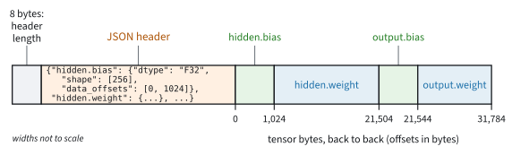
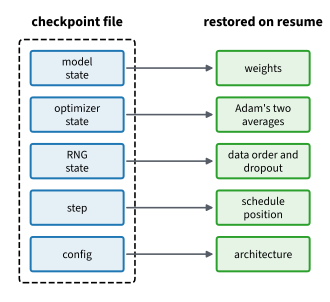

```{.python .input}
%load_ext d2lbook.tab
tab.interact_select('mxnet', 'pytorch', 'tensorflow', 'jax')
```

# Saving, Loading, and Pretrained Weights
:label:`sec_read_write`

A trained neural network is surprisingly fragile: it exists only in the memory
of the process that trained it. The moment that process terminates (whether
because your script finished, hit an error, tripped over a server's power cord,
or ran on a preemptible cloud instance), every learned weight vanishes unless
saved to disk. For the toy models of earlier chapters, losing progress costs
minutes. At modern scale, it can erase weeks of compute, and hardware failures
are not rare exceptions: they are routine. Over a 54-day window of pre-training
Llama 3 405B on up to 16,384 GPUs, Meta recorded 419 unexpected interruptions,
roughly one every three hours :cite:`Grattafiori.Dubey.Jauhri.ea.2024`. Without
reliable checkpointing and resumption, a run of that scale could never complete.

Saving weights serves a second, equally ubiquitous purpose: sharing trained
models so others can run inference or fine-tune them without training from
scratch (:numref:`sec_fine_tuning`). Both workflows raise the same practical
questions: what exactly belongs on disk, which file formats are safe to load,
and how should we verify that weights match our architecture?

The answer to *what* to save follows directly from :numref:`sec_parameters`. A
model consists of code plus state: the code defines the architecture and forward
pass, while the *state* is the collection of named tensors (parameters and
buffers alike) produced by training. We serialize only the state, mapping names
to tensors, and reconstruct the model by instantiating the architecture in code
and loading those tensors back in. Resuming an interrupted training run demands
still more: besides model weights, we must save optimizer state (such as Adam's
running moments), random-number generator states, the step counter, and the
architecture configuration, making a training checkpoint several times larger
than an inference weight file.

In this hands-on section, we first inspect and serialize model state, then
contrast unsafe pickle files with the safe `safetensors` format, build an atomic
training checkpoint capable of bit-for-bit resumption, and finish by loading
pretrained ResNet-50 weights into a modified architecture while verifying
missing and unexpected keys.

```{.python .input #saving-loading-saving-loading-and-pretrained-weights}
%%tab mxnet
import json
import os
import struct
from collections import Counter
from dataclasses import asdict, dataclass
import numpy as np
from mxnet import autograd, gluon, init, np as mnp, npx
from mxnet.gluon import nn
from safetensors.numpy import load_file, save_file
npx.set_np()
```

```{.python .input #saving-loading-saving-loading-and-pretrained-weights}
%%tab pytorch
import json
import os
import struct
from collections import Counter
from dataclasses import asdict, dataclass
import numpy as np
import torch
from torch import nn
from torch.nn import functional as F
from torchvision.models import resnet50, ResNet50_Weights
from safetensors.torch import load_file, save_file
```

```{.python .input #saving-loading-saving-loading-and-pretrained-weights}
%%tab tensorflow
import json
import struct
from collections import Counter
from dataclasses import asdict, dataclass
import numpy as np
import tensorflow as tf
from safetensors.tensorflow import load_file, save_file
```

```{.python .input #saving-loading-saving-loading-and-pretrained-weights}
%%tab jax
import math
import numpy as np
import jax
from jax import numpy as jnp
from flax import nnx
import optax
from d2l import jax as d2l
```

```{.python .input #saving-loading-saving-loading-and-pretrained-weights-1}
%%tab jax
import json
import orbax.checkpoint as ocp
import os
import struct
from collections import Counter
from d2l.nnx_resnet import ResNet50
from dataclasses import asdict, dataclass
from flax import traverse_util
from safetensors.flax import load_file, save_file
```

## Model State

Because a model contains dozens or hundreds of tensors, saving it requires
storing a mapping from names to tensors. Each framework generates this mapping
automatically by traversing the module tree (:numref:`sec_model_construction`),
keying every tensor by its path from the root. Below we inspect the state of a
simple single-hidden-layer MLP with 256 hidden units.

:begin_tab:`mxnet, pytorch`
`collect_params()` and `state_dict()` map dotted paths (`hidden.weight`, `output.bias`) to parameters and buffers:
:end_tab:

:begin_tab:`tensorflow`
`net.weights` lists variables carrying their layer-tree `path` (`mlp/hidden/kernel`), using explicit `name=` arguments to keep paths deterministic:
:end_tab:

:begin_tab:`jax`
`nnx.state` returns a nested state tree keyed by module attribute paths (`hidden.kernel`, `output.bias`):
:end_tab:
```{.python .input #saving-loading-state-not-code-2}
%%tab mxnet
class MLP(nn.Block):
    def __init__(self):
        super().__init__()
        self.hidden = nn.Dense(256, activation='relu', in_units=20)
        self.output = nn.Dense(10, in_units=256)

    def forward(self, x):
        return self.output(self.hidden(x))

net = MLP()
net.initialize()
X = mnp.random.uniform(size=(2, 20))
Y = net(X)
{name: p.shape for name, p in net.collect_params().items()}
```

```{.python .input #saving-loading-state-not-code-2}
%%tab pytorch
class MLP(nn.Module):
    def __init__(self):
        super().__init__()
        self.hidden = nn.Linear(20, 256)
        self.output = nn.Linear(256, 10)

    def forward(self, x):
        return self.output(F.relu(self.hidden(x)))

net = MLP()
X = torch.randn(2, 20)
Y = net(X)
{name: tuple(t.shape) for name, t in net.state_dict().items()}
```

```{.python .input #saving-loading-state-not-code-2}
%%tab tensorflow
class MLP(tf.keras.Model):
    def __init__(self):
        super().__init__(name='mlp')
        self.hidden = tf.keras.layers.Dense(256, name='hidden')
        self.out = tf.keras.layers.Dense(10, name='output')

    def call(self, x):
        return self.out(tf.nn.relu(self.hidden(x)))

net = MLP()
X = tf.random.normal((2, 20))
Y = net(X)
{v.path: tuple(v.shape) for v in net.weights}
```

```{.python .input #saving-loading-state-not-code-2}
%%tab jax
class MLP(nnx.Module):
    def __init__(self, rngs):
        self.hidden = nnx.Linear(20, 256, rngs=rngs)
        self.output = nnx.Linear(256, 10, rngs=rngs)

    def __call__(self, x):
        return self.output(nnx.relu(self.hidden(x)))

net = MLP(nnx.Rngs(d2l.get_key()))
X = jax.random.normal(d2l.get_key(), (2, 20))
Y = net(X)
params = nnx.state(net, nnx.Param)
[(path, tuple(value.shape)) for path, value in params.flat_state()]
```

Notice that this state dictionary records names, shapes, and numerical values, and
nothing else. It contains no trace of the `MLP` class, its forward logic, or its
activation function. Restoring the model therefore requires Python code that
recreates the exact matching names and shapes: even renaming an attribute from
`output` to `head` breaks the mapping despite computing the identical function.
We show how to catch and diagnose such mismatches later in this section.

## Pickle and safetensors

When checkpoint files never leave your own disk, almost any serialization format
suffices. The moment you download pretrained weights from a public hub or accept
a checkpoint from someone else, however, a security question arises:
can loading that file execute arbitrary code on your machine? Unfortunately,
with Python's default serialization format, the answer is yes.

### Code Execution on Load

Python's built-in `pickle` module does not store passive data: it stores a
bytecode program that reconstructs Python objects, and unpickling *executes*
that program, allowing it to call any importable function. Any class can
customize what pickle executes via `__reduce__`, returning a callable and its
arguments. Our `Tripwire` example below benignly invokes `print`; a malicious
checkpoint could just as easily invoke `os.system`.

```{.python .input #saving-loading-code-execution-on-load-1}
class Tripwire:
    def __reduce__(self):  # pickle calls print(...) to rebuild the object
        return (print, ('*** payload executed while loading ***',))
```

:begin_tab:`mxnet, tensorflow, jax`
NumPy uses `pickle` whenever it saves non-primitive Python objects; loading with `allow_pickle=True` executes the payload immediately:
:end_tab:

:begin_tab:`pytorch`
`torch.save` writes a pickle archive; loading with `weights_only=False` (the default prior to PyTorch 2.6) executes the payload immediately:
:end_tab:
```{.python .input #saving-loading-safetensors-the-interchange-format-1}
%%tab mxnet, tensorflow, jax
np.save('tripwire.npy', np.array(Tripwire(), dtype=object))  # pickled
_ = np.load('tripwire.npy', allow_pickle=True)  # the payload runs here
```

```{.python .input #saving-loading-safetensors-the-interchange-format-1}
%%tab pytorch
torch.save(Tripwire(), 'tripwire.pt')
_ = torch.load('tripwire.pt', weights_only=False)  # the payload runs here
```

By default, the loaders reject arbitrary Python objects:

:begin_tab:`mxnet, tensorflow, jax`
`np.load` refuses pickles unless `allow_pickle=True`.
:end_tab:

:begin_tab:`pytorch`
`torch.load` defaults to `weights_only=True` since PyTorch 2.6.
:end_tab:

```{.python .input #saving-loading-safetensors-the-interchange-format-2}
%%tab mxnet, tensorflow, jax
try:
    np.load('tripwire.npy')  # allow_pickle=False, the default
except ValueError as e:
    print(type(e).__name__, e)
```

```{.python .input #saving-loading-safetensors-the-interchange-format-2}
%%tab pytorch
try:
    torch.load('tripwire.pt')  # weights_only=True, the default
except Exception as e:
    print(type(e).__name__, str(e).split('.')[0])
```

Restricted unpicklers only protect you insofar as their allowlists have no
bugs, and historical vulnerabilities have bypassed even hardened restricted loaders.
A file format that simply *cannot* encode
executable instructions eliminates the entire attack surface by design.

:begin_tab:`pytorch`
PyTorch's `weights_only` mode is such a restricted loader.
:end_tab:

:begin_tab:`tensorflow`
TensorFlow's own checkpoint and Keras `.weights.h5` files contain no pickle.
A whole-model `.keras` archive can carry code, the function of a `Lambda`
layer, which Keras refuses to run unless we pass `safe_mode=False`.
:end_tab:

### The safetensors Format

The *safetensors* format stores strictly raw tensor data and metadata—never
code. Its binary layout has just three contiguous segments
(:numref:`fig_bg_safetensors_layout`): an 8-byte little-endian integer giving
the header length, a UTF-8 JSON header mapping each tensor name to its dtype,
shape, and byte offsets, and the raw tensor buffers packed back to back. Loading
executes zero code; the reader merely validates the JSON header and checks that
every byte range stays within the file. As an added systems bonus, knowing exact
byte offsets upfront enables memory-mapping (`mmap`) and random access to
individual tensors without reading the entire file. Framework-agnostic and fast,
safetensors has become the standard weight distribution format on the Hugging
Face Hub.


:label:`fig_bg_safetensors_layout`

We save our MLP's state to `mlp.safetensors`, load it into a fresh clone, and
verify that both instances produce identical outputs.

```{.python .input #saving-loading-safetensors-the-interchange-format-3}
%%tab mxnet
state = {name: p.data().asnumpy() for name, p in net.collect_params().items()}
save_file(state, 'mlp.safetensors')
clone = MLP()
clone.load_dict({name: mnp.array(v)
                 for name, v in load_file('mlp.safetensors').items()})
(clone(X) == Y).all()
```

```{.python .input #saving-loading-safetensors-the-interchange-format-3}
%%tab pytorch
save_file(net.state_dict(), 'mlp.safetensors')
clone = MLP()
clone.load_state_dict(load_file('mlp.safetensors'))
torch.equal(clone(X), Y)
```

```{.python .input #saving-loading-safetensors-the-interchange-format-3}
%%tab tensorflow
save_file({v.path: v for v in net.weights}, 'mlp.safetensors')
clone = MLP()
clone(X)                                   # build the variables first
restored = load_file('mlp.safetensors')
for v in clone.weights:
    v.assign(restored[v.path])
bool(tf.reduce_all(clone(X) == Y))
```

```{.python .input #saving-loading-safetensors-the-interchange-format-3}
%%tab jax
def to_flat(tree):
    return {'.'.join(path): value
            for path, value in traverse_util.flatten_dict(tree).items()}

def from_flat(flat):
    return traverse_util.unflatten_dict(
        {tuple(name.split('.')): value for name, value in flat.items()})

save_file(to_flat(nnx.to_pure_dict(params)), 'mlp.safetensors')
clone = MLP(nnx.Rngs(d2l.get_key()))
clone_params = nnx.state(clone, nnx.Param)
nnx.replace_by_pure_dict(clone_params, from_flat(load_file('mlp.safetensors')))
nnx.update(clone, clone_params)
bool(jnp.array_equal(clone(X), Y))
```

The round trip is bit-for-bit exact. Even better, because the header is plain
JSON at a fixed offset, we can inspect the file's contents using nothing beyond
Python's standard library:

```{.python .input #saving-loading-safetensors-the-interchange-format-4}
with open('mlp.safetensors', 'rb') as f:
    n = struct.unpack('<Q', f.read(8))[0]  # header length, little-endian
    header = json.loads(f.read(n))
print('header length:', n, 'bytes')
for name, entry in sorted(header.items(), key=lambda e: e[1]['data_offsets']):
    print(f"{name:18s} {entry['dtype']} {str(entry['shape']):10s} "
          f"bytes {entry['data_offsets']}")
```

Every byte interval equals the tensor's element count times 4 bytes (`F32` =
float32): the 256-entry hidden bias occupies the first 1,024 bytes, the
$256 \times 20 = 5{,}120$-entry hidden weight occupies the next 20,480 bytes,
and each block begins immediately where the previous one ends—pure tensor data
with zero hidden code.

For private scratch checkpoints on your own machine, native framework formats
are perfectly fine. Whenever weights cross a trust boundary—published to users
or downloaded from the web—use a code-free format like safetensors paired with a
cryptographic checksum so recipients can verify integrity.

## Training Checkpoints

A bare weights file suffices for inference, but *not* for resuming training. The
reason is stateful optimization. Most modern deep learning runs use *Adam*
(:numref:`sec_adam`), which tracks two per-parameter running averages
(:numref:`sec_parameters`): $\mathbf{m}$ for the gradient $\mathbf{g}$ and
$\mathbf{v}$ for its elementwise square $\mathbf{g} \odot \mathbf{g}$, updating
each parameter opposite its smoothed gradient scaled down where recent gradients
have been large:

$$
\mathbf{w} \leftarrow \mathbf{w} - \eta\,
\frac{\hat{\mathbf{m}}}{\sqrt{\hat{\mathbf{v}}} + \epsilon}.
$$
:eqlabel:`eq_saving_adam`

Here $\eta$ is the learning rate, $\epsilon$ is a small constant (typically
$10^{-8}$), division and square root act elementwise, and the hats indicate
bias-correction factors compensating for zero initialization (derived in
:numref:`sec_adam`). Crucially, $\mathbf{m}$ and $\mathbf{v}$ encode the
optimization history: discard them, and Adam behaves as if training had just
started from scratch.

A truly resumable training checkpoint therefore packs five distinct components
(:numref:`fig_bg_checkpoint_contents`): (1) model state (parameters and
buffers), (2) optimizer state ($\mathbf{m}$ and $\mathbf{v}$), (3) random-number
generator states so minibatch shuffling and dropout continue seamlessly, (4) the
step counter governing Adam's bias correction and any learning-rate schedule,
and (5) the model configuration needed to rebuild the architecture. Gradients
are omitted because the next step recomputes them immediately. That leaves 12 of
the 16 bytes per parameter held during fp32 Adam training
(:numref:`sec_parameters`), namely weights plus two moments, so a resumable
checkpoint for an 8-billion-parameter model weighs in at 96 GB: three times its
32 GB fp32 weights and six times its 16 GB bf16 inference file
(:numref:`sec_numerics`).


:label:`fig_bg_checkpoint_contents`

Checkpointing must also be *crash-safe*: overwriting an existing checkpoint in
place risks losing both old and new versions if the job dies mid-write. Instead,
we write to a temporary file and atomically rename it over the destination once
finished, guaranteeing that any reader sees either the complete previous
checkpoint or the complete new one. The rename protects against a crash of the
process. Surviving a power loss also takes an `os.fsync` on the file and on its
directory, which the exercises work out.

:begin_tab:`mxnet`
We write `.params` (model), `.states` (Trainer pickle—load only from trusted disk), and `.json` (step, config, and NumPy RNG state) to `.tmp` files before atomically replacing each with `os.replace`. Each file is replaced atomically, but the set of three is not: a crash between two renames pairs new parameters with old optimizer state. The exercises build a manifest that closes this gap.
:end_tab:

:begin_tab:`pytorch`
We pack model state, optimizer state, step, `asdict(cfg)`, and CPU/CUDA/`torch.Generator` RNG states into a pure-tensor/primitive dict compatible with `weights_only=True`, saving via a `.tmp` file and `os.replace`:
:end_tab:
```{.python .input #saving-loading-checkpointing-a-training-run-1}
%%tab mxnet
def save_checkpoint(prefix, model, trainer, step, cfg=None, rng=None):  #@save
    """Replace each component of a resumable MXNet checkpoint."""
    meta = {'step': step}
    if cfg is not None:
        meta['cfg'] = asdict(cfg)
    if rng is not None:                        # a NumPy random generator
        meta['rng'] = rng.bit_generator.state
    model.save_parameters(prefix + '.params.tmp')
    trainer.save_states(prefix + '.states.tmp')
    with open(prefix + '.json.tmp', 'w') as f:
        json.dump(meta, f)
    for ext in ('.params', '.states', '.json'):
        os.replace(prefix + ext + '.tmp', prefix + ext)

def load_checkpoint(prefix, model, trainer=None, rng=None):  #@save
    """Restore the state written by save_checkpoint; return the metadata."""
    model.load_parameters(prefix + '.params')
    if trainer is not None:
        trainer.load_states(prefix + '.states')
    with open(prefix + '.json') as f:
        meta = json.load(f)
    if rng is not None:
        rng.bit_generator.state = meta['rng']
    return meta
```

```{.python .input #saving-loading-checkpointing-a-training-run-1}
%%tab pytorch
def save_checkpoint(path, model, optimizer, step, cfg=None, rng=None):  #@save
    """Atomically write a resumable training checkpoint."""
    ckpt = {'model': model.state_dict(),
            'optimizer': optimizer.state_dict(),
            'step': step,
            'cpu_rng': torch.get_rng_state()}
    if cfg is not None:
        ckpt['cfg'] = asdict(cfg)
    if rng is not None:                        # a torch.Generator
        ckpt['rng'] = rng.get_state()
    if torch.cuda.is_available():
        ckpt['cuda_rng'] = torch.cuda.get_rng_state_all()
    tmp = path + '.tmp'
    torch.save(ckpt, tmp)
    os.replace(tmp, path)

def load_checkpoint(path, model, optimizer=None, rng=None):  #@save
    """Restore the state written by save_checkpoint; return the raw dict."""
    ckpt = torch.load(path, weights_only=True)
    model.load_state_dict(ckpt['model'])
    if optimizer is not None:
        optimizer.load_state_dict(ckpt['optimizer'])
    if rng is not None:
        rng.set_state(ckpt['rng'])
    torch.set_rng_state(ckpt['cpu_rng'])
    if torch.cuda.is_available() and 'cuda_rng' in ckpt:
        torch.cuda.set_rng_state_all(ckpt['cuda_rng'])
    return ckpt
```

To test checkpoint resumption, we train a small 64-hidden-unit MLP regressor
with Adam ($\eta = 0.05$) on 256 noisy linear examples in 20 dimensions, drawing
minibatches of 64 examples using a dedicated random generator seeded at 0 so
that minibatch ordering becomes part of the checkpointed state. As in
:numref:`sec_model_construction`, a `Config` dataclass captures all
architectural and training hyperparameters so they travel directly inside the
checkpoint.

```{.python .input #saving-loading-training-checkpoints-1}
@dataclass
class Config:
    num_inputs: int = 20
    num_hiddens: int = 64
    num_outputs: int = 1
    batch_size: int = 64
    lr: float = 0.05
```

We train for 200 steps, write a checkpoint, and immediately continue the same
run for 5 more steps to create our uninterrupted 205-step ground truth. Each
call to `train` records the minibatch loss before each update step.

:begin_tab:`tensorflow`
`tf.train.Checkpoint` bundles the model, optimizer, step variable, and `tf.random.Generator` into numbered checkpoint files (`run-tf-1`, ...), paired with a `.cfg.json` config file. TensorFlow runs these operations on a GPU when one is visible, and on a GPU
it does not add up the terms of the gradient of a bias in a fixed order;
two runs can then differ in the last bits, so `train` runs on the CPU:
:end_tab:

:begin_tab:`jax`
We pack the model state tree, optimizer state tree, PRNG key array, step, and config dict into one dictionary and save it atomically via Orbax (`ocp.StandardCheckpointer`):
:end_tab:

```{.python .input #saving-loading-checkpointing-a-training-run-2}
%%tab mxnet
def build(cfg):
    net = nn.Sequential()
    net.add(nn.Dense(cfg.num_hiddens, activation='relu',
                     in_units=cfg.num_inputs),
            nn.Dense(cfg.num_outputs, in_units=cfg.num_hiddens))
    net.initialize(init.Xavier())           # biases start at zero
    return net

cfg = Config()
data = mnp.random.normal(size=(256, cfg.num_inputs))
target = (data @ mnp.random.normal(size=(cfg.num_inputs, 1))
          + 0.1 * mnp.random.normal(size=(256, 1)))

def train(model, trainer, rng, num_steps):
    losses = []
    for _ in range(num_steps):
        idx = mnp.array(rng.integers(len(data), size=cfg.batch_size),
                        dtype='int32')
        with autograd.record():
            l = ((model(data[idx]) - target[idx]) ** 2).mean()
        l.backward()
        trainer.step(batch_size=1)           # the loss is already a mean
        losses.append(l)
    return [float(l) for l in losses]

net = build(cfg)
trainer = gluon.Trainer(net.collect_params(), 'adam',
                        {'learning_rate': cfg.lr})
rng = np.random.default_rng(0)              # draws the minibatches
train(net, trainer, rng, 200)
path = 'run-mx'
save_checkpoint(path, net, trainer, step=200, cfg=cfg, rng=rng)
uninterrupted = train(net, trainer, rng, 5)
```

```{.python .input #saving-loading-checkpointing-a-training-run-2}
%%tab pytorch
def build(cfg):
    net = nn.Sequential(nn.Linear(cfg.num_inputs, cfg.num_hiddens),
                        nn.ReLU(),
                        nn.Linear(cfg.num_hiddens, cfg.num_outputs))
    for layer in (net[0], net[2]):
        nn.init.xavier_uniform_(layer.weight)
        nn.init.zeros_(layer.bias)
    return net

cfg = Config()
data = torch.randn(256, cfg.num_inputs)
target = data @ torch.randn(cfg.num_inputs, 1) + 0.1 * torch.randn(256, 1)
loss = nn.MSELoss()

def train(model, opt, rng, num_steps):
    losses = []
    for _ in range(num_steps):
        idx = torch.randint(len(data), (cfg.batch_size,), generator=rng)
        opt.zero_grad()
        l = loss(model(data[idx]), target[idx])
        l.backward()
        opt.step()
        losses.append(l.detach())
    return [l.item() for l in losses]

net = build(cfg)
opt = torch.optim.Adam(net.parameters(), lr=cfg.lr)
rng = torch.Generator().manual_seed(0)      # draws the minibatches
train(net, opt, rng, 200)
path = 'run.pt'
save_checkpoint(path, net, opt, step=200, cfg=cfg, rng=rng)
uninterrupted = train(net, opt, rng, 5)
```

```{.python .input #saving-loading-checkpointing-a-training-run-2}
%%tab tensorflow
def build(cfg):
    net = tf.keras.Sequential([             # biases start at zero
        tf.keras.layers.Dense(cfg.num_hiddens, activation='relu',
                              kernel_initializer='glorot_uniform'),
        tf.keras.layers.Dense(cfg.num_outputs,
                              kernel_initializer='glorot_uniform')])
    net(tf.zeros((1, cfg.num_inputs)))          # build the variables
    return net

cfg = Config()
data = tf.random.normal((256, cfg.num_inputs))
target = (data @ tf.random.normal((cfg.num_inputs, 1))
          + 0.1 * tf.random.normal((256, 1)))
loss = tf.keras.losses.MeanSquaredError()

def train(model, opt, rng, num_steps):
    losses = []
    with tf.device('/CPU:0'):                   # bitwise repeatable
        for _ in range(num_steps):
            idx = rng.uniform((cfg.batch_size,), maxval=len(data),
                              dtype=tf.int32)
            with tf.GradientTape() as tape:
                l = loss(tf.gather(target, idx), model(tf.gather(data, idx)))
            opt.apply_gradients(zip(tape.gradient(l, model.trainable_variables),
                                    model.trainable_variables))
            losses.append(l)
    return [float(l) for l in losses]

net = build(cfg)
opt = tf.keras.optimizers.Adam(cfg.lr)
rng = tf.random.Generator.from_seed(0)      # draws the minibatches
train(net, opt, rng, 200)
ckpt = tf.train.Checkpoint(model=net, optimizer=opt, step=tf.Variable(200),
                           rng=rng)
path = ckpt.save('run-tf')                  # a numbered save: 'run-tf-1'
with open(path + '.cfg.json', 'w') as f:
    json.dump(asdict(cfg), f)
uninterrupted = train(net, opt, rng, 5)
```

```{.python .input #saving-loading-checkpointing-a-training-run-2}
%%tab jax
def build(cfg, rngs):
    xavier = nnx.initializers.xavier_uniform()  # biases start at zero
    return nnx.Sequential(
        nnx.Linear(cfg.num_inputs, cfg.num_hiddens, kernel_init=xavier,
                   rngs=rngs),
        nnx.relu,
        nnx.Linear(cfg.num_hiddens, cfg.num_outputs, kernel_init=xavier,
                   rngs=rngs))

def fresh_state(cfg):
    model = build(cfg, nnx.Rngs(d2l.get_key()))
    return model, nnx.Optimizer(model, optax.adam(cfg.lr), wrt=nnx.Param)

def checkpoint_tree(model, optimizer, key, step, cfg):
    return {'model': nnx.to_pure_dict(nnx.state(model)),
            'optimizer': nnx.to_pure_dict(nnx.state(optimizer)),
            'rng': key, 'step': step, 'cfg': asdict(cfg)}

cfg = Config()
data = jax.random.normal(d2l.get_key(), (256, cfg.num_inputs))
target = (data @ jax.random.normal(d2l.get_key(), (cfg.num_inputs, 1))
          + 0.1 * jax.random.normal(d2l.get_key(), (256, 1)))

def loss(model, X, y):
    return jnp.mean((model(X) - y) ** 2)

@nnx.jit
def step(model, optimizer, idx):
    l, grads = nnx.value_and_grad(loss)(model, data[idx], target[idx])
    optimizer.update(model, grads)
    return l

def train(model, optimizer, key, num_steps):
    losses = []
    for _ in range(num_steps):
        key, subkey = jax.random.split(key)
        idx = jax.random.randint(subkey, (cfg.batch_size,), 0, len(data))
        losses.append(step(model, optimizer, idx))
    return key, [float(l) for l in losses]

net, opt = fresh_state(cfg)
key = jax.random.key(0)                     # draws the minibatches
key, _ = train(net, opt, key, 200)
path = os.path.abspath('run-jax')           # orbax wants an absolute path
ckptr = ocp.StandardCheckpointer()
ckptr.save(path, checkpoint_tree(net, opt, key, 200, cfg), force=True)
ckptr.wait_until_finished()
key, uninterrupted = train(net, opt, key, 5)
```

Now we simulate restarting in a fresh process: `resume` rebuilds the model and optimizer from the saved config, optionally restores the optimizer and RNG states alongside the weights, and runs the remaining steps up to `num_steps`, while `max_diff` reports the largest elementwise weight discrepancy between two models:

:begin_tab:`tensorflow`
Because Keras's `Adam` creates its moment variables lazily on the first update, `resume` calls `opt.build(model.trainable_variables)` before restoring into the optimizer.
:end_tab:
```{.python .input #saving-loading-checkpointing-a-training-run-3}
%%tab mxnet
def resume(path, num_steps, restore_optimizer=True, restore_rng=True):
    with open(path + '.json') as f:
        cfg = Config(**json.load(f)['cfg'])  # the config travels with the run
    model = build(cfg)
    trainer = gluon.Trainer(model.collect_params(), 'adam',
                            {'learning_rate': cfg.lr})
    rng = np.random.default_rng(0)           # seeded as at the start
    meta = load_checkpoint(path, model,
                           trainer if restore_optimizer else None,
                           rng=rng if restore_rng else None)
    return model, train(model, trainer, rng, num_steps - meta['step'])

def max_diff(a, b):
    return max(float(mnp.abs(p.data() - q.data()).max()) for p, q in
               zip(a.collect_params().values(), b.collect_params().values()))
```

```{.python .input #saving-loading-checkpointing-a-training-run-3}
%%tab pytorch
def resume(path, num_steps, restore_optimizer=True, restore_rng=True):
    cfg = Config(**torch.load(path, weights_only=True)['cfg'])  # saved config
    model = build(cfg)
    opt = torch.optim.Adam(model.parameters(), lr=cfg.lr)
    rng = torch.Generator().manual_seed(0)  # seeded as at the start
    ckpt = load_checkpoint(path, model, opt if restore_optimizer else None,
                           rng=rng if restore_rng else None)
    return model, train(model, opt, rng, num_steps - ckpt['step'])

def max_diff(a, b):
    return max((p - q).abs().max().item()
               for p, q in zip(a.parameters(), b.parameters()))
```

```{.python .input #saving-loading-checkpointing-a-training-run-3}
%%tab tensorflow
def resume(path, num_steps, restore_optimizer=True, restore_rng=True):
    with open(path + '.cfg.json') as f:
        cfg = Config(**json.load(f))
    model, opt = build(cfg), tf.keras.optimizers.Adam(cfg.lr)
    rng = tf.random.Generator.from_seed(0)  # seeded as at the start
    step = tf.Variable(0)
    parts = {'model': model, 'step': step}
    if restore_optimizer:
        opt.build(model.trainable_variables)  # create Adam's variables first
        parts['optimizer'] = opt
    if restore_rng:
        parts['rng'] = rng
    status = tf.train.Checkpoint(**parts).restore(path)
    status.assert_existing_objects_matched().expect_partial()
    return model, train(model, opt, rng, num_steps - int(step))

def max_diff(a, b):
    return max(float(tf.reduce_max(tf.abs(p - q)))
               for p, q in zip(a.weights, b.weights))
```

```{.python .input #saving-loading-checkpointing-a-training-run-3}
%%tab jax
def load_into(obj, saved):
    state = nnx.state(obj)
    nnx.replace_by_pure_dict(state, saved)
    nnx.update(obj, state)

def resume(path, num_steps, restore_optimizer=True, restore_rng=True):
    ckpt = ckptr.restore(path)              # the saved tree, as it is
    model, opt = fresh_state(Config(**ckpt['cfg']))
    load_into(model, ckpt['model'])
    if restore_optimizer:
        load_into(opt, ckpt['optimizer'])
    key = jax.random.key(0)                 # seeded as at the start
    if restore_rng:
        key = ckpt['rng']
    _, losses = train(model, opt, key, num_steps - ckpt['step'])
    return model, losses

def max_diff(a, b):
    return max(float(jnp.abs(p - q).max()) for p, q in
               zip(jax.tree.leaves(nnx.state(a)), jax.tree.leaves(nnx.state(b))))
```

We compare restoring the full checkpoint against omitting only the random generator (`restore_rng=False`, as if a script simply re-seeded from `0`) and measure the maximum weight discrepancy against the uninterrupted 205-step `net`:

```{.python .input #saving-loading-checkpointing-a-training-run-5}
for name, kwargs in (('full checkpoint', {}),
                     ('without the generator', {'restore_rng': False})):
    resumed, _ = resume(path, 205, **kwargs)
    print(f'{name:22s} max |difference| {max_diff(resumed, net):.3g}')
```

Restoring the full checkpoint reproduces the uninterrupted weights with zero
error (bit for bit). Omitting the RNG state causes the resumed loop to replay the
very first minibatches instead of drawing the next ones, introducing weight
differences of roughly 0.004 to 0.02 (note that bit-for-bit equality also
assumes deterministic operations, which we examine in :numref:`sec_repro`).

Dropping the *optimizer* state is far more destructive. Below we resume with the
saved weights and RNG state intact, but with a freshly constructed Adam
optimizer, and compare the five post-resume minibatch losses side by side:

```{.python .input #saving-loading-checkpointing-a-training-run-4}
_, full = resume(path, 205)
_, fresh = resume(path, 205, restore_optimizer=False)
print('saved optimizer:', [round(l, 4) for l in full])
print('fresh optimizer:', [round(l, 4) for l in fresh])
```

With the saved optimizer state, training picks up smoothly with losses hovering
near 0.01 or below. With a fresh Adam optimizer, a *single* step blows the loss
up roughly a thousandfold, and even four steps later it remains over a hundred
times higher than before.

Why does one step of a fresh Adam wreck a nearly converged model? Equation
:eqref:`eq_saving_adam` tells the whole story. Starting from
$\mathbf{m} = \mathbf{0}$ and $\mathbf{v} = \mathbf{0}$, Adam's bias correction
on step 1 divides out the exact initialization factor, leaving
$\hat{\mathbf{m}} = \mathbf{g}$ and
$\hat{\mathbf{v}} = \mathbf{g} \odot \mathbf{g}$. Every parameter with any
nonzero gradient therefore steps by
$\eta\, |g_i| / (|g_i| + \epsilon) \approx \eta = 0.05$: the full learning rate,
no matter how tiny its gradient. By contrast, the saved $\mathbf{v}$ remembers
the much larger squared gradients from earlier in training, keeping
$\sqrt{\hat{\mathbf{v}}}$ large relative to the tiny late-stage gradients so
updates remain gentle. The closer a model is to convergence, the more violent
an uninitialized Adam restart becomes. Weights alone are never enough to resume
training.

## Pretrained Weights

We now turn to the second major use of saved state: initializing from weights
trained by someone else. A backbone trained on ImageNet (1.2 million images
across 1,000 categories) learns rich visual representations that transfer cleanly
to new tasks. Adapting it to a 10-class problem is simple: load every layer
except the final classifier *head*, and swap in a fresh 10-output linear layer.
Below we demonstrate this with ResNet-50 (~25 million parameters, or 23.5
million excluding its 1,000-class head). We will study convolutional networks in
:numref:`chap_cnn` and :numref:`chap_modern_cnn`; for weight loading, ResNet-50
is simply a state dictionary of a few hundred named tensors.

```{.python .input #saving-loading-loading-weights-you-did-not-train-1}
%%tab mxnet
net = gluon.model_zoo.vision.resnet50_v1(pretrained=True)  # ~100 MB once
net.output = nn.Dense(10, in_units=2048)          # new 10-class head
net.output.initialize()
net.output
```

```{.python .input #saving-loading-loading-weights-you-did-not-train-1}
%%tab pytorch
net = resnet50(weights=ResNet50_Weights.DEFAULT)  # ~100 MB once
net.fc = nn.Linear(net.fc.in_features, 10)        # new 10-class head
net.fc
```

```{.python .input #saving-loading-loading-weights-you-did-not-train-1}
%%tab tensorflow
backbone = tf.keras.applications.ResNet50(        # ~95 MB once
    weights='imagenet', include_top=False, pooling='avg')
net = tf.keras.Sequential([backbone, tf.keras.layers.Dense(10, name='head')])
net(tf.zeros((1, 224, 224, 3)))                   # create the new head
net.layers[-1].kernel.shape
```

```{.python .input #saving-loading-loading-weights-you-did-not-train-1}
%%tab jax
net = ResNet50.from_pretrained()                  # ~100 MB once
net.fc = nnx.Linear(2048, 10, rngs=nnx.Rngs(d2l.get_key()))  # new head
net.fc.kernel.shape
```

External weight files rarely match a custom target model one-to-one, and
silently ignoring mismatches is a notorious source of bugs. To see how a careful
loader audits partial transfers, we strip two groups of tensors from our
pretrained ResNet-50 state: the classification head (which we *intend* to
replace) and the entire final stage of the backbone (simulating a corrupted or
mismatched checkpoint). Loading the remaining tensors into a fresh 10-class
ResNet-50 lets us inspect two diagnostic sets: *missing* keys (model parameters
absent from the file, left randomly initialized) and *unexpected* keys (file
entries unused by the model).

:begin_tab:`pytorch`
`load_state_dict(..., strict=False)` loads matching keys and returns `(missing_keys, unexpected_keys)` directly:
:end_tab:

:begin_tab:`mxnet, tensorflow, jax`
We compute the missing and unexpected keys as set differences between the model's parameter paths and the checkpoint's keys:
:end_tab:
```{.python .input #saving-loading-loading-weights-you-did-not-train-2}
%%tab mxnet
damaged = {name: p.data() for name, p in net.collect_params().items()
           if not name.startswith(('output', 'features.7'))}
target = gluon.model_zoo.vision.resnet50_v1(classes=10)
target.initialize()
target.load_dict(damaged, allow_missing=True, ignore_extra=True)  # silent
names = set(target.collect_params())
print('missing by block:', dict(Counter(
    '.'.join(k.split('.')[:2]) if k.startswith('features') else k.split('.')[0]
    for k in sorted(names - set(damaged)))))
print('unexpected:', sorted(set(damaged) - names))
```

```{.python .input #saving-loading-loading-weights-you-did-not-train-2}
%%tab pytorch
damaged = {k: v for k, v in net.state_dict().items()
           if not k.startswith(('fc.', 'layer4.'))}
target = resnet50(weights=None)
target.fc = nn.Linear(target.fc.in_features, 10)
report = target.load_state_dict(damaged, strict=False)
print('missing by block:', dict(Counter(
    k.split('.')[0] for k in report.missing_keys)))
print('unexpected:', report.unexpected_keys)
```

```{.python .input #saving-loading-loading-weights-you-did-not-train-2}
%%tab tensorflow
damaged = {v.path: v for v in backbone.weights
           if not v.path.startswith('conv5_')}
target = tf.keras.Sequential([
    tf.keras.applications.ResNet50(weights=None, include_top=False,
                                   pooling='avg'),
    tf.keras.layers.Dense(10, name='head')])
target(tf.zeros((1, 224, 224, 3)))
for v in target.weights:
    if v.path in damaged:
        v.assign(damaged[v.path])         # raises if the shapes differ
paths = {v.path for v in target.weights}
print('missing by block:', dict(Counter(
    p.split('/')[-2].split('_')[0] for p in sorted(paths - set(damaged)))))
print('unexpected:', sorted(set(damaged) - paths))
```

```{.python .input #saving-loading-loading-weights-you-did-not-train-2}
%%tab jax
def flat_state(model):
    return traverse_util.flatten_dict(nnx.to_pure_dict(nnx.state(model)))

damaged = {path: v for path, v in flat_state(net).items()
           if path[0] != 'fc' and path[:2] != ('stages', 3)}
target = ResNet50(num_classes=10, rngs=nnx.Rngs(d2l.get_key()))
fresh = flat_state(target)
state = nnx.state(target)
nnx.replace_by_pure_dict(state, traverse_util.unflatten_dict(
    {**fresh, **{p: v for p, v in damaged.items() if p in fresh}}))
nnx.update(target, state)
print('missing by block:', dict(Counter(
    f'stages.{p[1]}' if p[0] == 'stages' else p[0]
    for p in sorted(set(fresh) - set(damaged)))))
print('unexpected:', sorted(set(damaged) - set(fresh)))
```

Missing keys for the new 10-class head's weight and bias are expected, since
that head starts from random initialization. The missing keys from the final
backbone stage are a red flag: had we loaded blindly with partial matching, a
huge chunk of our "pretrained" ResNet-50 would silently remain random noise.
Here the unexpected set is empty; a nonempty unexpected set typically signals a
renamed module whose weights were never loaded. In production code, always
assert explicitly that the missing and unexpected sets match *only* the layers
you intended to replace or drop, raising an error on anything else.

Once verified, transfer learning typically begins by *freezing* the pretrained
backbone (:numref:`subsec_freezing`) so initial updates train only the new head,
before selectively unfreezing deeper layers (:numref:`sec_fine_tuning`).

Everything in this chapter so far has lived in host CPU memory. In
:numref:`sec_use_gpu`, we move both state and computation onto GPUs.

## Summary

Persisting a model saves its *state* (a dictionary mapping module-tree paths to
parameter and buffer tensors), while the architecture itself lives in code.
Because Python's `pickle` executes arbitrary code on load, weights shared across
trust boundaries should use a code-free format such as `safetensors` (an 8-byte
length prefix, a JSON header, and packed tensor bytes). Crash-safe training
checkpoints write atomically via temporary files and capture five components:
model state, optimizer state, RNG state, step counter, and config. Restoring all
five resumes training bit for bit; dropping RNG state drifts the data stream,
and dropping Adam's moments causes the first resumed step to move every
parameter by the full learning rate, spiking the loss by orders of magnitude.
When loading pretrained weights into a modified architecture, always audit the
missing and unexpected key sets against your expectations rather than ignoring
mismatches silently.

## Exercises

1. [code] **Safetensors header.** The header length of the MLP's
   safetensors file is the 8-byte little-endian integer at the start of the
   file (:numref:`fig_bg_safetensors_layout`).
    1. Predict, then measure, how that length changes when the hidden width
       is doubled and when a third layer is added. Explain which parts of
       the header depend on tensor sizes at all.
    1. Read the hidden layer's bias from the file using only the header and
       file seeks, without the safetensors library. Decode the bytes with
       the dtype and shape that the header records, and check that the
       result equals the tensor that `load_file` returns.
    1. Explain why a pickle-based checkpoint cannot offer the same
       single-tensor read without deserializing the whole object graph.

:begin_tab:`mxnet`
2. [code] **Partial loading.** Define `MLP2`, a copy of `MLP` that inserts
   a second hidden layer `hidden2` of width 256 before the output layer and
   renames the attribute `output` to `head`.
    1. Load `mlp.safetensors` into `MLP2` with
       `load_dict(..., allow_missing=True, ignore_extra=True)`. Compute the
       missing and unexpected key sets, and explain each entry.
    1. Rename the file's keys to the names that `MLP2` uses before loading.
       Confirm that only `hidden2` keeps its fresh initialization, and make
       the load raise on any unexpected key and on any missing key outside
       `hidden2`.

    *Adapted from Matthew Inkawhich, [Saving and Loading Models](https://docs.pytorch.org/tutorials/beginner/saving_loading_models.html), "Warmstarting Model Using Parameters from a Different Model".*
:end_tab:

:begin_tab:`pytorch`
2. [code] **Partial loading.** Define `MLP2`, a copy of `MLP` that inserts
   a second hidden layer `hidden2` of width 256 before the output layer and
   renames the attribute `output` to `head`.
    1. Load `mlp.safetensors` into `MLP2` with
       `load_state_dict(..., strict=False)`. Read the returned report and
       explain each missing and each unexpected key.
    1. Rename the file's keys to the names that `MLP2` uses before loading.
       Confirm that only `hidden2` keeps its fresh initialization, and make
       the load raise on any unexpected key and on any missing key outside
       `hidden2`.

    *Adapted from Matthew Inkawhich, [Saving and Loading Models](https://docs.pytorch.org/tutorials/beginner/saving_loading_models.html), "Warmstarting Model Using Parameters from a Different Model".*
:end_tab:

:begin_tab:`tensorflow`
2. [code] **Partial loading.** Define `MLP2`, a copy of `MLP` that inserts
   a second hidden layer named `hidden2` of width 256 before the output
   layer and names the output layer `head` instead of `output`.
    1. Load `mlp.safetensors` into `MLP2` by assigning each variable whose
       `path` appears in the file. List the variables that keep their fresh
       initialization and the file entries that find no variable, and
       explain each.
    1. Rename the file's keys to the paths that `MLP2` uses before
       assigning. Confirm that only `hidden2` keeps its fresh
       initialization, and make the load raise on any unexpected key and on
       any missing path outside `hidden2`.

    *Adapted from Matthew Inkawhich, [Saving and Loading Models](https://docs.pytorch.org/tutorials/beginner/saving_loading_models.html), "Warmstarting Model Using Parameters from a Different Model".*
:end_tab:

:begin_tab:`jax`
2. [code] **Partial loading.** Define `MLP2`, a copy of `MLP` that inserts
   a second hidden layer `hidden2` of width 256 before the output layer and
   renames the attribute `output` to `head`.
    1. Load `mlp.safetensors` into `MLP2` with a key-set merge like the one
       that loads the damaged ResNet-50 state. Report the missing and
       unexpected key sets, and explain each entry.
    1. Rename the file's keys to the names that `MLP2` uses before the
       merge. Confirm that only `hidden2` keeps its fresh initialization,
       and make the merge raise on any unexpected key and on any missing
       key outside `hidden2`.

    *Adapted from Matthew Inkawhich, [Saving and Loading Models](https://docs.pytorch.org/tutorials/beginner/saving_loading_models.html), "Warmstarting Model Using Parameters from a Different Model".*
:end_tab:

3. [code] **Dtype round trip.** ● A `float16` number stores 5 exponent bits
   and 10 mantissa bits, against 8 and 23 in `float32`
   (:numref:`sec_numerics`). Cast the parameters of an `MLP` to `float16`,
   save them, and load them back into a `float32` `MLP`.
    1. Predict the largest relative error of a restored parameter from the
       mantissa width. Measure the maximum absolute difference and, over
       the nonzero parameters, the maximum relative difference between the
       restored and the original values. Explain any parameter whose
       relative error exceeds the prediction.
    1. Compare the outputs of the original and the restored `MLP` on `X`,
       and decide whether the round trip is acceptable for inference.
    1. Adam keeps a running average of squared gradients.
       Compute what `float16` stores for the square of a gradient entry of
       $10^{-4}$, and explain why a resumable checkpoint keeps the
       optimizer state in `float32`.
4. [extended] **Crash-safe manifest.** ●
    1. Build a utility that writes model state, optimizer state, and a JSON
       metadata file under a fresh step-numbered prefix, then publishes the
       three by renaming into place one manifest that records each file's
       name, size, and checksum.
    1. Simulate two failures: a crash after the three files are written but
       before the manifest rename, and the truncation of one file of a
       published checkpoint. Show that reloading resumes from the previous
       complete checkpoint in the first case and rejects the corrupt
       checkpoint in the second.
    1. A rename is atomic, so a reader sees either the old manifest or the
       new one. POSIX does not require the data of the renamed files to
       reach the disk before the rename does. `os.fsync` forces the
       buffered writes of a file, or of a directory's entries, to disk.
       State where the utility must call `os.fsync` so that a power loss
       leaves either the previous checkpoint or the new one intact, and
       explain each call.

[Discussions](https://d2l.discourse.group/t/36757)

<!-- slides -->

::: {.slide}
::: {.cover}
[Dive into Deep Learning · §5.6]{.kicker}

File I/O, Checkpoints, and Serialization<br>**state dictionaries · pickle RCE vs. safetensors · 5-part atomic checkpoints · pretrained key auditing**
:::
:::

::: {.slide title="Why Checkpointing and Safe Files Are Mission-Critical"}
[Fault Tolerance & Security]{.kicker}

::: {.cols .vc}
::: {.col}
- **Hardware failures are routine:** During 54 days of pre-training Llama 3 405B on $16{,}384$ GPUs, Meta recorded **419 unexpected interruptions** (~1 crash every 3 hours).
- **Resuming requires more than weights:** Restarting Adam from saved weights alone causes the very first update step to blow up the loss by $>100\times$.
- **Arbitrary code execution on load:** Downloading a third-party `pickle` checkpoint can execute malicious shell commands the moment `load` is called.
:::

::: {.col .fig .big}
@fig:ch05-bg-io-three-stakes
:::
:::
:::

::: {.slide title="We Serialize the State Tree, Never the Python Class Code"}
[State vs. Architecture]{.kicker}

::: {.cols .vc}
::: {.col}
- The state dictionary stores only `(path, shape, dtype, raw_bytes)`, with no trace of the `MLP` class:

@saving-loading-state-not-code-2
:::

::: {.col .fig}
@fig:ch05-bg-state-not-code
:::
:::
:::

::: {.slide title="Security Hazard: Python Pickle Executes Code on Load"}
[Why Pickle Is Unsafe for Sharing]{.kicker}

::: {.cols .vc}
::: {.col}
- Python's `pickle` format is a stack-based virtual machine that executes arbitrary callables returned by `__reduce__`:

@saving-loading-code-execution-on-load-1

@saving-loading-safetensors-the-interchange-format-1
:::

::: {.col .fig}
@fig:ch05-bg-pickle-rce-vs-safe
:::
:::
:::

::: {.slide title="Hardened Loaders Refuse Arbitrary Objects by Default"}
[Allowlist Unpicklers]{.kicker}

::: {.cols .vc}
::: {.col}
- Hardened loaders refuse arbitrary pickled objects, while `safetensors` eliminates the opcode parser attack surface completely:

@saving-loading-safetensors-the-interchange-format-2
:::

::: {.col .fig}
@fig:ch05-bg-pickle-rce-vs-safe
:::
:::
:::

::: {.slide title="The safetensors Format: Zero Code, Zero-Copy mmap"}
[Safe Weight Interchange]{.kicker}

A `safetensors` file holds passive metadata and raw tensor bytes in three flat segments:

{.nostretch width=85%}

1. **8-byte unsigned little-endian integer (`<Q`):** Exact byte length $n$ of the JSON header.
2. **UTF-8 JSON header ($n$ bytes):** Maps each tensor's path name to its `dtype`, `shape`, and `[begin, end]` byte offsets relative to the data segment.
3. **Packed raw tensor bytes:** Contiguous array buffers aligned back to back, enabling instant **zero-copy memory mapping (`mmap`)** and single-tensor random access without reading the whole file.
:::

::: {.slide title="Saving and Auditing a safetensors File Byte by Byte"}
[safetensors Round-Trip & Header Inspection]{.kicker}

::: {.cols .vc}
::: {.col}
- We save our MLP to `mlp.safetensors`, verify bit-for-bit restoration, and parse its header using standard `struct` and `json`.
:::

::: {.col .fig}
@fig:ch05-bg-safetensors-audit
:::
:::
:::

::: {.slide title="Saving and Restoring a safetensors File"}
[safetensors Round-Trip & Header Inspection]{.kicker}

@-saving-loading-safetensors-the-interchange-format-3
:::

::: {.slide title="Parsing the safetensors Header by Hand"}
[safetensors Round-Trip & Header Inspection]{.kicker}

@saving-loading-safetensors-the-interchange-format-4
:::

::: {.slide title="Why Resuming Training Requires Optimizer State"}
[Stateful Optimization with Adam]{.kicker}

::: {.cols .vc}
::: {.col}
$$\mathbf{w} \leftarrow \mathbf{w} - \eta \, \frac{\hat{\mathbf{m}}}{\sqrt{\hat{\mathbf{v}}} + \epsilon}$$

- **Why a fresh Adam spikes the loss:** Discarding $\mathbf{m}$ and $\mathbf{v}$ on resume ($\mathbf{m}_0 = \mathbf{v}_0 = \mathbf{0}$) forces step-1 bias correction to set $\hat{\mathbf{m}}_1 = \mathbf{g}$ and $\hat{\mathbf{v}}_1 = \mathbf{g} \odot \mathbf{g}$.
- **Full-step shock:** Every parameter steps by $\Delta w_i = -\eta \, \frac{g_i}{|g_i| + \epsilon} \approx \pm \eta$, jumping out of the converged basin.
:::

::: {.col .fig}
@fig:ch05-bg-fresh-adam-shock
:::
:::
:::

::: {.slide title="The Five Compartments of a Resumable Training Checkpoint"}
[Complete Checkpoint Anatomy]{.kicker}

::: {.cols .vc}
::: {.col}
- **Five required states:** Model state (parameters + buffers), optimizer state ($\mathbf{m}, \mathbf{v}$), PRNG states (CPU, GPU, data loader), step counter $t$, and architecture config.
- **Crash-safe atomic writes:** Always write to a temporary file (`path + '.tmp'`) and call `os.replace(tmp, path)` so a crash mid-write never corrupts the previous checkpoint.
:::

::: {.col .fig .big}
{.nostretch width=90%}
:::
:::
:::

::: {.slide title="Sizing an 8B-Parameter Checkpoint: 96 GB on Disk"}
[Checkpoint Storage Arithmetic]{.kicker}

::: {.cols .vc}
::: {.col}
- **Inference file (`16 GB` in `bf16`):** Stores only the $2\text{ B/param}$ model weights $\mathbf{w}$.
- **Resumable training checkpoint (`96 GB` in `fp32`):** Stores weights $\mathbf{w}$ (`32 GB`) $+$ Adam $\mathbf{m}$ (`32 GB`) $+$ Adam $\mathbf{v}$ (`32 GB`) $= 12\text{ B/param}$ ($6\times$ larger than inference; gradients $\mathbf{g}$ are not saved to disk).
:::

::: {.col .fig .big}
@fig:ch05-bg-checkpoint-96gb-budget
:::
:::
:::

::: {.slide title="Implementing Atomic Save and Load Helpers" only="pytorch,mxnet"}
[Crash-Safe Checkpointing in Code]{.kicker}

::: {.cols .vc}
::: {.col}
- Our `save_checkpoint` helper bundles all five compartments and commits them atomically via `os.replace`.
:::

::: {.col .fig}
@fig:ch05-bg-atomic-write-replace
:::
:::
:::

::: {.slide title="Atomic Save and Load Helpers in Code" only="pytorch,mxnet"}
[Crash-Safe Checkpointing in Code]{.kicker}

@-saving-loading-checkpointing-a-training-run-1
:::

::: {.slide title="Testing Bit-for-Bit Resumption After 200 Steps"}
[Experimental Verification]{.kicker}

::: {.cols .vc}
::: {.col}
- Restoring all five compartments reproduces steps 201–205 down to the last bit (`0.0` difference), whereas omitting RNG state replays early minibatches:

@saving-loading-checkpointing-a-training-run-5
:::

::: {.col .fig}
@fig:ch05-bg-bitwise-resume-test
:::
:::
:::

::: {.slide title="Dropping Optimizer State Wrecks Near-Converged Models"}
[The Fresh-Adam Loss Spike]{.kicker}

::: {.cols .vc}
::: {.col}
- Resuming from step 200 with saved weights and RNG state—but a **freshly initialized Adam optimizer**—makes the loss jump by roughly three orders of magnitude right after its first update:

@saving-loading-checkpointing-a-training-run-4
:::

::: {.col .fig}
@fig:ch05-bg-fresh-adam-shock
:::
:::
:::

::: {.slide title="Loading Pretrained Backbone Weights Under a New Head"}
[Transfer Learning Setup]{.kicker}

When adapting an ImageNet-pretrained ResNet-50 ($\sim 25\text{M}$ parameters, $1{,}000$ classes) to a 10-class dataset, we keep the pretrained backbone and replace the final linear head (`2048 -> 10`):

@saving-loading-loading-weights-you-did-not-train-1
:::

::: {.slide title="Auditing Missing and Unexpected Keys on Partial Loads"}
[Catching Silent Checkpoint Mismatches]{.kicker}

::: {.cols .vc}
::: {.col}
- When loading external weights into a modified architecture non-strictly, always inspect the missing and unexpected keys.
:::

::: {.col .fig}
@fig:ch05-bg-transfer-key-audit
:::
:::
:::

::: {.slide title="Reading the Key Audit of a Partial Load"}
[Catching Silent Checkpoint Mismatches]{.kicker}

@saving-loading-loading-weights-you-did-not-train-2
:::

::: {.slide title="Concept Check: Serialization & Checkpoint Resumption"}
[Concept Check]{.kicker}

Work out these three checkpointing questions:

1. Suppose an MLP ($20 \to 256 \to 10$, `float32`) saved to `mlp.safetensors` has a JSON header of $n = 296$ bytes (the exact length depends on the tensor names the framework writes). What is the exact total file size in bytes?
2. Our $20 \to 64 \to 1$ regressor has $20 \times 64 + 64 + 64 \times 1 + 1 = 1{,}409$ parameters. If we resume at $\eta = 0.05$ with a fresh Adam optimizer ($\mathbf{m}=\mathbf{v}=\mathbf{0}$) and every gradient entry is nonzero, what is the Euclidean norm $\|\Delta \mathbf{w}\|_2$ of the very first parameter update?
3. You rename `self.fc` to `self.classifier` in ResNet-50 and load an original pretrained checkpoint with `strict=False`. What appears in `missing_keys` and `unexpected_keys`?

::: {.d2l-note .fragment .fade-up}
**Answers:**

1. **$8 + 296 + 4 \times 7{,}946 = 32{,}088$ bytes:** 8-byte length prefix $+$ 296-byte JSON header $+$ $31{,}784$ bytes for the $7{,}946$ `float32` parameters.
2. **$\|\Delta \mathbf{w}\|_2 \approx 0.05 \sqrt{1{,}409} \approx 1.88$:** Every coordinate steps by $\pm \eta = \pm 0.05$ regardless of how small $\|\mathbf{g}\|_2$ is.
3. **`missing_keys` lists `classifier.weight, classifier.bias` (left random); `unexpected_keys` lists `fc.weight, fc.bias` (ignored from file).**
:::
:::

::: {.slide title="Summary: Saving, Loading, and Pretrained Weights"}
[Key Takeaways]{.kicker}

::: {.cols .vc}
::: {.col}
- **State dicts & `safetensors`:** Save tensor data keyed by tree path; use `safetensors` (8-byte length + JSON + raw bytes) for zero-RCE, zero-copy `mmap` sharing.
- **5-part atomic checkpoints:** Save model state, optimizer $\mathbf{m}, \mathbf{v}$, PRNG states, step $t$, and config ($12\text{ B/param} = 96\text{ GB}$ for 8B) via `.tmp` + `os.replace`.
- **Pretrained key auditing:** Assert `missing_keys` and `unexpected_keys` match *only* intentionally replaced layers.
:::

::: {.col .fig .big}
@fig:ch05-bg-io-summary
:::
:::
:::
