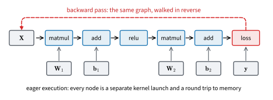
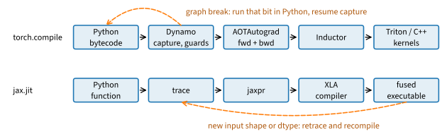
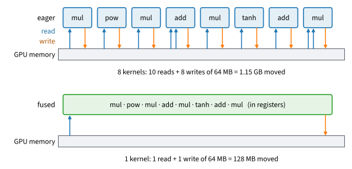

# Compute Graphs and Compilation
:label:`sec_compilation`

The activation function `gelu_ish` of :numref:`sec_perf_model`,
$0.5\, x \left(1 + \tanh\left(0.8\, (x + 0.04\, x^3)\right)\right)$,
consists of eight elementwise operations. Applied to a $4000 \times 4000$
matrix in fp32, which takes 64 MB, each operation runs as a GPU kernel of
its own that reads its inputs from GPU memory and writes its result back.
Together the eight kernels move 1.15 GB to produce 64 MB of output.
Reading the input once and writing the result once would move 128 MB, nine
times less. At the RTX 4090's memory bandwidth of about 1 TB/s, the eight
kernels need at least 1.15 ms where 0.13 ms would do. The arithmetic hardly matters, since
:numref:`sec_perf_model` found the chain to be limited by bandwidth.

Activation functions, normalization layers, residual additions, and
optimizer updates are all chains of this kind, and a deep network contains
hundreds of them. Small tensors add a second cost: launching a kernel from
Python takes longer than running it, and the GPU waits. Both costs come
from *eager execution*, which runs a program one operation at a time, as
Python reaches it. The remedy is to give the whole program to a compiler
before it runs. A compiler that sees all eight operations can merge them
into one kernel that reads $x$ once and writes the result once. A sequence
of kernels, once recorded, can be replayed without Python.

This section asks how a framework captures a program as a graph, what a
compiler does with that graph, and which programs escape capture.
Compilation addresses two of the three regimes of :numref:`sec_perf_model`,
the bandwidth-bound and the overhead-bound regime. Memory capacity is a
separate limit, the subject of :numref:`sec_memory_precision`.

```{.python .input #compilation-compute-graphs-and-compilation}
%%tab pytorch
from d2l import torch as d2l
import torch
from torch import nn

torch.set_float32_matmul_precision('high')  # fp32 matmuls may use tf32
```

```{.python .input #compilation-compute-graphs-and-compilation}
%%tab jax
from d2l import jax as d2l
import jax
from jax import numpy as jnp
import random
import time
```

## Graph Capture
:label:`subsec_comp-capture`

A compiler must see a program whole before it can rewrite it, but Python
executes a program one line at a time. A framework therefore has to obtain
the program as a graph first, and some Python constructs do not fit into a
graph.

### Computation Graphs
:label:`subsec_comp-graph`

The computation of a neural network forms a *computation graph*: its nodes
are operations, and its edges carry tensors from one operation to the next.
Autograd records this graph during the forward pass so that it can walk it
backward to compute gradients (:numref:`sec_autograd`).
:numref:`fig_compute_graph` shows the graph of a two-layer network
$\textrm{relu}(\mathbf{X}\mathbf{W}_1 + \mathbf{b}_1)\mathbf{W}_2 +
\mathbf{b}_2$ followed by a loss.


:label:`fig_compute_graph`

Autograd's record cannot speed up the forward pass. It is written while the
operations execute, so by the time it exists every operation has already run
as its own kernel. Each kernel needs a launch, which takes 1–5 µs in the
CUDA driver and about 5–15 µs of host time when Python dispatches the
operation (:numref:`sec_hardware`), and each elementwise kernel makes a
round trip through GPU memory. To merge the `add` with the `relu` that follows it, a
compiler needs the graph before the forward pass runs. Obtaining the graph
in advance is called *graph capture*.

### Tracing

The usual way to capture a graph is to run the function once on
*placeholders*, objects that carry the shape and dtype of a tensor but no
values. Every tensor operation applied to a placeholder is recorded instead
of computed, and the record is the graph. Python code that does not depend
on tensor values runs as usual and leaves only its effect: a loop over four
layers leaves four copies of the layer's operations, and arithmetic on
shapes leaves constants. Running a function to record its operations is
called *tracing*. A compiler then translates the graph into kernels, fusing
operations where it can, and caches them. Later calls with arguments of the
same shapes and dtypes reuse the cached kernels
(:numref:`fig_compile_pipelines`).


:label:`fig_compile_pipelines`

:begin_tab:`pytorch`
In PyTorch, `torch.compile` wraps a function or a module. At the first call,
its front end, TorchDynamo, executes the function's Python bytecode with
*fake tensors* as placeholders and records the tensor operations in a graph
:cite:`Ansel.Yang.He.ea.2024`. AOTAutograd derives the backward graph from
the forward graph, and the Inductor compiler turns both into fused kernels,
written in Triton for GPUs and in C++ for CPUs. Dynamo also installs
*guards*, cheap checks of the assumptions the graph depends on, such as the
shapes and dtypes of the inputs. Every later call evaluates the guards and
runs the compiled code if they pass.
:end_tab:

:begin_tab:`jax`
In JAX, `jax.jit` wraps a function. At the first call it traces the
function with abstract *tracer* values as placeholders and records the
operations in a typed intermediate representation, the *jaxpr*
:cite:`Frostig.Johnson.Leary.2018`. The XLA compiler turns the jaxpr into
fused kernels. The compiled code is cached under the shapes and dtypes of
the arguments, and `jax.make_jaxpr` prints the jaxpr of a function.
:end_tab:

### Branches on Values

Tracing cannot follow a branch that depends on a value. A placeholder has a
shape but no value, so when the function asks `if x.sum() > 0:`, tracing
has no answer, and the answer may differ from call to call. A graph cannot
hold Python control flow, which leaves two options. The framework can
return the decision to Python at run time, between two graphs. Or the
program can express the branch as a tensor operation that the graph can
hold: a *select* computes both alternatives and keeps one, and a
*conditional* operation computes only the one it needs. A branch on a shape,
such as `if x.shape[0] > 4:`, causes no difficulty, since shapes are known
during tracing. We capture a function that branches on the sign of a sum:

```{.python .input #compilation-capture-two-philosophies-1}
%%tab pytorch
def f(x):
    x = x * 2
    if x.sum() > 0:        # Python needs the value of this comparison
        return x + 1
    return x - 1

explanation = torch._dynamo.explain(f)(torch.randn(8, device=d2l.try_gpu()))
print(f'graphs: {explanation.graph_count}, '
      f'breaks: {explanation.graph_break_count}')
for graph in explanation.graphs:
    print(graph.code.strip())
```

```{.python .input #compilation-capture-two-philosophies-1}
%%tab jax
def f(x):
    x = x * 2
    if x.sum() > 0:        # Python needs the value of this comparison
        return x + 1
    return x - 1

try:
    jax.jit(f)(jnp.ones(8))
except jax.errors.TracerBoolConversionError as e:
    print(type(e).__name__)

def f_select(x):  # Both alternatives in the graph; select keeps one
    x = x * 2
    return jax.lax.select(x.sum() > 0, x + 1, x - 1)

print(jax.make_jaxpr(f_select)(jnp.ones(8)))
```

:begin_tab:`pytorch`
Dynamo returns the decision to Python with a *graph break*. The output shows
two graphs. The first ends at the comparison and returns its result
together with the doubled `x`. Python reads the comparison and takes the
branch, and the second graph holds the branch that this random input took,
`x + 1` or `x - 1`. A graph break returns control to Python on every call
and splits the program into pieces that the compiler optimizes separately.
By default Dynamo does not stop at code it cannot capture: it breaks the
graph, runs that code in Python, and prints no warning.
`torch.compile(..., fullgraph=True)` turns every break into an error, and
`torch._dynamo.explain` counts them. Writing the branch as a select,
`torch.where(x.sum() > 0, x + 1, x - 1)`, removes this break.
:end_tab:

:begin_tab:`jax`
`jax.jit` does not return decisions to Python. Converting a tracer to a
Python `bool` raises an error, and the branch must be written as a tensor
operation. `jax.lax.select` computes both alternatives and keeps one, so the
whole function becomes a single graph: the jaxpr shows the comparison `gt`
feeding `select_n`. `jax.lax.cond` executes only one alternative, which
matters when they are expensive.
:end_tab:

### Shapes and Recompilation

A compiler specializes the kernels to the shapes in the graph: it chooses
tile sizes, loop bounds, and memory layouts for them. A call with tensors
of a new shape or dtype therefore needs a new compilation. A training loop
whose last minibatch is smaller than the others, as with the Fashion-MNIST
loaders of :numref:`sec_fashion_mnist`, compiles once more for that
minibatch. A loop over sequences of varying length may compile at almost
every step. There are two remedies: keep the set of shapes small, for
instance by padding sequences to a few fixed lengths, or compile code that
works for a range of sizes. We call a compiled function on vectors of
lengths 8, 8, 16, and 32 and count its compilations:

```{.python .input #compilation-capture-two-philosophies-2}
%%tab pytorch
compilations = []
def recording_backend(gm, example_inputs):  # Called once per compilation
    compilations.append(gm)
    return gm.forward                       # Run the captured graph as is

g = torch.compile(lambda x: torch.sin(x) + 1, backend=recording_backend)
for n in (8, 8, 16, 32):
    g(torch.ones(n, device=d2l.try_gpu()))
print(f'compilations: {len(compilations)}')
print(compilations[-1].code.strip())
```

```{.python .input #compilation-capture-two-philosophies-2}
%%tab jax
@jax.jit
def g(x):
    print(f'tracing g for shape {x.shape}')  # Python runs only while tracing
    return jnp.sin(x) + 1

for n in (8, 8, 16, 32):
    g(jnp.ones(n))
```

:begin_tab:`pytorch`
`torch.compile` passes each captured graph to a *backend*, normally
Inductor. Ours records the graph and runs it without compiling it further,
so the list counts compilations. The first call compiles for length 8 and
guards on that length, and the second call passes the guard. At length 16
the guard fails and Dynamo compiles again, this time with the length as a
symbol: the printed graph takes a `torch.SymInt` argument for it, and the
call at length 32 reuses this graph. Handling dynamic shapes this way
takes one extra compilation. `torch.compile(..., dynamic=False)`
keeps every graph static, and once a function has been compiled eight times
(`torch._dynamo.config.recompile_limit`), Dynamo stops compiling it and runs
it eagerly.
:end_tab:

:begin_tab:`jax`
The `print` runs only while the function is traced, so it reports each
trace: one for length 8, none for the second call at length 8, and one each
for 16 and 32. Every new shape means a new trace and a new XLA compilation.
Other Python side effects, such as appending to a list or drawing from
NumPy's random generator, also happen at trace time only, and the compiled
function repeats none of them. An argument that is a Python value rather
than an array, such as a flag or a number of layers, can be marked static
with `static_argnums`; the function is then traced once for each distinct
value.
:end_tab:

## Operation Fusion
:label:`subsec_comp-fusion`

Merging several operations into one kernel is called *fusion*. Its gain
can be predicted before anything runs, by counting the bytes that each
version moves through memory.

### Counting Memory Traffic

Python evaluates `gelu_ish(x)` as eight operations, each of which produces
a temporary array: $t_1 = 0.5x$, $t_2 = x^3$, $t_3 = 0.04\, t_2$,
$t_4 = x + t_3$, $t_5 = 0.8\, t_4$, $t_6 = \tanh t_5$, $t_7 = 1 + t_6$,
and the result $t_1 t_7$. In eager execution each operation is a kernel that
reads its array arguments from GPU memory and writes its result back. Six
operations read one array and two read two, so the chain reads ten arrays
and writes eight. A fused kernel reads $x$ once, keeps every temporary in
registers, and writes the result once (:numref:`fig_fusion`). For arrays of
$n$ elements of $b$ bytes each, the ratio of the bytes moved is

$$\frac{\textrm{bytes moved, eager}}{\textrm{bytes moved, fused}} =
\frac{(10 + 8)\, n b}{(1 + 1)\, n b} = 9.$$

Both versions perform the same arithmetic, about a dozen FLOPs per element,
which is far less than the GPU can do while it moves the element's bytes.
Both are therefore limited by bandwidth, and fusion should shorten the
chain by the ratio of the bytes moved, a factor of nine.


:label:`fig_fusion`

We compile `gelu_ish`, check that the compiled version computes the same
values, and time both versions. Each time is then converted into a
bandwidth: the bytes that version moves, divided by its time.

```{.python .input #compilation-what-the-compiler-does-fusion}
%%tab pytorch
x = torch.randn(4000, 4000, device=d2l.try_gpu())

def gelu_ish(x):  # The elementwise chain of the performance model
    return 0.5 * x * (1 + torch.tanh(0.8 * (x + 0.04 * x**3)))

compiled = torch.compile(gelu_ish)
assert torch.allclose(gelu_ish(x), compiled(x), atol=1e-6)  # Same answer
arrays_moved = {'eager': 18, 'compiled': 2}  # In units of x.nbytes
for desc, fn in (('eager', gelu_ish), ('compiled', compiled)):
    b = d2l.Benchmark(lambda: fn(x), desc=desc)
    print(f'{b}, {arrays_moved[desc] * x.nbytes / b.time / 1e9:.0f} GB/s')
```

```{.python .input #compilation-what-the-compiler-does-fusion}
%%tab jax
x = jax.random.normal(jax.random.key(random.getrandbits(32)), (4000, 4000))

def gelu_ish(x):  # The elementwise chain of the performance model
    return 0.5 * x * (1 + jnp.tanh(0.8 * (x + 0.04 * x**3)))

compiled = jax.jit(gelu_ish)
assert jnp.allclose(gelu_ish(x), compiled(x), atol=1e-6)  # Same answer
arrays_moved = {'eager': 18, 'compiled': 2}  # In units of x.nbytes
for desc, fn in (('eager', gelu_ish), ('compiled', compiled)):
    b = d2l.Benchmark(lambda: fn(x), desc=desc)
    print(f'{b}, {arrays_moved[desc] * x.nbytes / b.time / 1e9:.0f} GB/s')
```

The compiled chain is eight to nine times faster, as predicted, and both
versions move data at a similar rate, most of the card's
1 TB/s. The compiler made memory no faster and arithmetic no cheaper. It
removed 16 of the 18 array transfers. The cell checks the result before
timing it, because a faster kernel is of no use if it computes different
values. It uses `allclose`, since the compiler may reorder floating-point
operations: the results agree to rounding error, not bit for bit.

The same count applies at the scale of a language model. The chapter's
running example is a GPT with a billion parameters and width $d = 2048$,
trained on minibatches of 8 sequences of 1,024 tokens
(:numref:`sec_perf_model`). Give it a GELU MLP of hidden width
$4d = 8192$ (`act='gelu'` in `d2l.GPT`). The activation then receives
$8192 \cdot 8192 \approx 6.7 \times 10^7$ elements per layer, 134 MB per
array in bf16. Written as `gelu_ish`, the eager chain moves 18 such arrays,
2.4 GB, which takes about 2.4 ms at 1 TB/s; the fused chain takes 0.27 ms.
The two matrix multiplications around the activation perform $2 \cdot 2 \cdot 8192 \cdot 2048 \cdot 8192 \approx
5.5 \times 10^{11}$ FLOPs, about 3.3 ms at the card's bf16 peak of
165 TFLOP/s. Unfused, the activation adds about three quarters to the time
of the MLP; fused, it adds under a tenth. Both times are lower bounds, since
real kernels reach neither peak.

The ratio of the two times does not depend on the number of tokens $M$.
The eager chain moves $18 \cdot 4dM$ elements of 2 bytes, and the two
matrix multiplications perform $2 \cdot 2 \cdot M \cdot d \cdot 4d$
FLOPs, so

$$\frac{t_\textrm{activation}}{t_\textrm{matmul}} =
\frac{144\, dM/\beta}{16\, d^2 M/P} = \frac{9 P}{\beta d}
\approx 0.72$$

for $P = 165$ TFLOP/s, $\beta = 1$ TB/s, and $d = 2048$. The unfused
activation matters less in wider models, since the arithmetic grows with
$d^2$ and the memory traffic only with $d$.

Real models seldom write GELU as a chain of eight operations. Libraries
ship hand-fused kernels for common activations, and `act='gelu'` calls one.
A compiler, however, fuses any chain, including ones that no library
anticipated: a SwiGLU gate, a custom activation, an optimizer update.

### Fusion Patterns

Compilers fuse three kinds of patterns. The simplest is the *elementwise
chain*, such as `gelu_ish`: a sequence of operations each of which computes
element $i$ of its output from element $i$ of its inputs. The whole chain
runs in one kernel in which each thread applies every operation to its own
elements.

A *reduction*, such as a softmax or a layer normalization, combines
elementwise operations with a maximum or a sum over each row. A fused kernel
loads a row into on-chip memory once, computes the reduction and the
normalized outputs there, and writes the row once.

An *epilogue* is a run of elementwise operations that follows a matrix
multiplication, such as adding a bias and applying an activation. The
compiler applies them to each tile of the product while the tile is still in
registers, before it is written to memory.

Compilers do not change the algorithm. A large matrix multiplication is
limited by arithmetic and already runs as a single tuned library kernel;
compiling the code around it leaves it as it is. Nor can fusion remove an
intermediate result that the algorithm needs in full. Attention computes a
$T \times T$ matrix of scores, normalizes each row with a softmax, and
multiplies the result by the values. A compiler fuses the softmax but still
writes the score matrix to memory. FlashAttention
(:numref:`sec_attention-at-scale`) never writes it: it splits the
computation into tiles and updates the softmax incrementally as it goes
:cite:`Dao.Fu.Ermon.ea.2022`, a change of algorithm that general-purpose
compilers do not find. Such kernels are written by hand, often in Triton
:cite:`Tillet.Kung.Cox.2019`, a language for GPU kernels embedded in
Python.

## Compiling a Training Step
:label:`subsec_comp-wholestep`

A training step contains three kinds of work: matrix multiplications in
the forward and backward passes, elementwise chains for the activations and
their derivatives, and an elementwise update of every parameter. Compiling
the whole step lets the compiler fuse the elementwise work of all three,
while the matrix multiplications stay library kernels. Compilation itself
takes time, from seconds for a small step to minutes for a large model,
and that time is spent at the first call. If compilation takes
$t_\textrm{compile}$ and the compiled step saves
$t_\textrm{eager} - t_\textrm{compiled}$ per call, the compiled run
overtakes the eager one after

$$n^* = \frac{t_\textrm{compile}}{t_\textrm{eager} - t_\textrm{compiled}}$$
:eqlabel:`eq_compile_break_even`

steps. A run much longer than $n^*$ steps gains from compilation, and a
shorter one loses. With a compilation time of 30 s and a saving of 10 ms
per step, for instance, the break-even point is 3,000 steps, a fraction of
a typical training run but more than most quick experiments.

Our step trains a multilayer perceptron with four linear layers of width
1,024 and `gelu_ish` between them. It computes the squared loss of the
network's outputs against targets, then the gradients, and updates the
parameters by gradient descent.

```{.python .input #compilation-compiling-a-training-step-1}
%%tab pytorch
class MLP(nn.Module):
    """Linear layers with the gelu_ish chain between them."""
    def __init__(self, width=1024, depth=4):
        super().__init__()
        self.layers = nn.ModuleList(nn.Linear(width, width)
                                    for _ in range(depth))

    def forward(self, X):
        for layer in self.layers[:-1]:
            X = gelu_ish(layer(X))
        return self.layers[-1](X)

def train_step(net, X, Y, lr=0.1):  # Forward, backward, SGD update
    loss = ((net(X) - Y) ** 2).mean()
    grads = torch.autograd.grad(loss, list(net.parameters()))
    with torch.no_grad():
        for p, g in zip(net.parameters(), grads):
            p -= lr * g
    return loss
```

```{.python .input #compilation-compiling-a-training-step-1}
%%tab jax
def init_mlp(key, width=1024, depth=4):
    """Weights and biases drawn uniformly from +-1/sqrt(width)."""
    bound = 1 / width**0.5
    keys = jax.random.split(key, (depth, 2))
    return [(jax.random.uniform(kW, (width, width), minval=-bound,
                                maxval=bound),
             jax.random.uniform(kb, (width,), minval=-bound, maxval=bound))
            for kW, kb in keys]

def mlp(params, X):  # Linear layers with the gelu_ish chain between them
    for W, b in params[:-1]:
        X = gelu_ish(X @ W + b)
    W, b = params[-1]
    return X @ W + b

def train_step(params, X, Y, lr=0.1):  # Forward, backward, SGD update
    loss_fn = lambda p: ((mlp(p, X) - Y) ** 2).mean()
    loss, grads = jax.value_and_grad(loss_fn)(params)
    return loss, jax.tree.map(lambda p, g: p - lr * g, params, grads)
```

:begin_tab:`pytorch`
`torch.autograd.grad` returns the gradients instead of accumulating them
in each parameter's `.grad`, so the step reads the parameters and the data
and changes nothing but the parameters. The usual sequence of `zero_grad`,
`backward`, and an optimizer's `step` compiles as well.
:end_tab:

:begin_tab:`jax`
The step is a pure function: it takes the parameters and the data and
returns the loss and the updated parameters. The weights and biases are
drawn uniformly from $[-1/\sqrt{1024}, 1/\sqrt{1024}]$.
:end_tab:

We compile the step and time its first call, which includes the
compilation. Then we time the eager and the compiled step and compute $n^*$
from :eqref:`eq_compile_break_even`:

```{.python .input #compilation-whole-step-compilation-measured}
%%tab pytorch
net = MLP().to(d2l.try_gpu())
X, Y = (torch.randn(512, 1024, device=d2l.try_gpu()) for _ in range(2))
compiled_step = torch.compile(train_step)
t_first = d2l.Benchmark(lambda: compiled_step(net, X, Y),
                        warmup=0, repeats=1).time  # Includes compilation
t_eager = d2l.Benchmark(lambda: train_step(net, X, Y)).time
t_compiled = d2l.Benchmark(lambda: compiled_step(net, X, Y)).time
print(f'first call: {t_first:.1f} s\n'
      f'eager: {1000 * t_eager:.2f} ms, compiled: {1000 * t_compiled:.2f} ms\n'
      f'break-even: {t_first / (t_eager - t_compiled):.0f} steps')
```

```{.python .input #compilation-whole-step-compilation-measured}
%%tab jax
keys = jax.random.split(jax.random.key(random.getrandbits(32)), 3)
params = init_mlp(keys[0])
X, Y = (jax.random.normal(k, (512, 1024)) for k in keys[1:])
compiled_step = jax.jit(train_step)
t0 = time.perf_counter()
jax.block_until_ready(compiled_step(params, X, Y))  # Includes compilation
t_first = time.perf_counter() - t0
t_eager = d2l.Benchmark(lambda: train_step(params, X, Y)).time
t_compiled = d2l.Benchmark(lambda: compiled_step(params, X, Y)).time
print(f'first call: {t_first:.1f} s\n'
      f'eager: {1000 * t_eager:.2f} ms, compiled: {1000 * t_compiled:.2f} ms\n'
      f'break-even: {t_first / (t_eager - t_compiled):.0f} steps')
```

The first call takes far longer than a step, up to several seconds, and
the printed $n^*$ is a small fraction of the steps of a real training run.

:begin_tab:`pytorch`
`torch.compile(train_step)` captures the step in two graphs. Dynamo does
not trace into the gradient computation, so `torch.autograd.grad` ends the
first graph, which holds the forward pass and the loss. AOTAutograd has
already derived the backward graph from it, and Inductor compiled both. After
the break, a second graph captures the update. Inductor caches the kernels
it compiles on disk, so a second run of this notebook compiles faster than
the first.
:end_tab:

:begin_tab:`jax`
`jax.jit(train_step)` compiles the loss, the gradients, and the update into
one XLA program at its first call. The compiler can also run *ahead of
time*, before any call: `jax.jit(train_step).lower(params, X, Y).compile()`
returns the compiled executable, whose `memory_analysis()` reports the
memory the compiler plans to use (:numref:`sec_memory_precision` reads
it). The un-jitted step is about two orders of magnitude slower than the
compiled one, because each operation of the forward pass, the backward
pass, and the update is then dispatched from Python on its own, at tens of
microseconds per dispatch. Un-jitted JAX is for debugging; training steps
are jitted.
:end_tab:

## Kernel Replay
:label:`subsec_comp-overhead`

Fusion reduces memory traffic, but it cannot merge matrix multiplications,
and each one still needs a launch. Consider a stack of 60 linear layers of
width 256 without biases, each followed by a tanh, applied to a minibatch
of 64. Each layer performs a matrix multiplication of
$2 \cdot 64 \cdot 256 \cdot 256 \approx 8.4 \times 10^6$ FLOPs, which the
4090 completes in a few microseconds, and a tanh over 16,384 elements,
which takes about as long. Eager execution launches 120 kernels per call.
Python spends 5–15 µs of host time issuing a bare operation
(:numref:`sec_hardware`), longer than the GPU needs to run it. The GPU
therefore finishes each kernel before Python has issued the next one, and
waits. The program is overhead-bound. Fusing the tanh into the preceding matrix
multiplication would halve the number of launches, but the remaining 60
would still keep the GPU waiting.

The remedy is to take Python out of the loop: record the sequence of kernel
launches once, and replay the whole sequence with a single command. NVIDIA
GPUs support this through *CUDA graphs*. A CUDA graph stores each kernel
together with its launch configuration and the memory addresses of its
arguments. Replaying it takes one launch from the host, after which the GPU
runs the kernels back to back. The recording is rigid: its shapes and
memory addresses are fixed. New inputs must therefore be copied into the
recorded input buffers before a replay, and the outputs of one replay are
overwritten by the next. Nothing inside the sequence may wait for a value
read by the CPU.

```{.python .input #compilation-the-overhead-regime-capture-and-replay}
%%tab pytorch
deep = nn.Sequential(*[m for _ in range(60)  # 120 small kernels per call
                       for m in (nn.Linear(256, 256, bias=False), nn.Tanh())])
deep = deep.to(d2l.try_gpu())
x = torch.randn(64, 256, device=d2l.try_gpu())

replayed = torch.compile(deep, mode='reduce-overhead')
with torch.no_grad():  # Inference: every call is a complete step
    replayed(x)        # Compiles and warms up; the next call records
    print(d2l.Benchmark(lambda: deep(x), desc='eager'))
    print(d2l.Benchmark(lambda: replayed(x), desc='reduce-overhead'))
```

```{.python .input #compilation-the-overhead-regime-capture-and-replay}
%%tab jax
def init_deep(key, depth=60, width=256):  # 120 small kernels per call
    return list(jax.random.uniform(key, (depth, width, width),
                                   minval=-width**-0.5, maxval=width**-0.5))

def deep(params, x):
    for W in params:
        x = jnp.tanh(x @ W)
    return x

key_params, key_x = jax.random.split(jax.random.key(random.getrandbits(32)))
params, x = init_deep(key_params), jax.random.normal(key_x, (64, 256))
jitted = jax.jit(deep)
jitted(params, x)  # First call compiles
print(d2l.Benchmark(lambda: deep(params, x), desc='eager'))
print(d2l.Benchmark(lambda: jitted(params, x), desc='jit'))
```

Without Python in the loop, the stack runs several times faster, at
roughly the time the GPU needs for its 120 small kernels. Dividing each time
by 120 reads off the two costs per kernel: the eager time gives the host
time of one launch, and the compiled time gives the GPU time of one kernel,
a few microseconds.

:begin_tab:`pytorch`
`mode='reduce-overhead'` makes `torch.compile` record the compiled kernels
as CUDA graphs and replay them. The first call compiles and runs a warm-up,
the second records the CUDA graph, and later calls with the same shapes copy
the input into the recorded buffer and replay. `Benchmark` warms up with
three calls, so the timed calls are replays. The host time per launch of the
eager version exceeds that of a bare operation, since every layer is also a
call of an `nn.Module`.

We time inference under `torch.no_grad()`, where every call is a complete
step and can be replayed as a whole. In training, the forward and the
backward pass are recorded as separate graphs and replayed as a pair. Since a replay overwrites the outputs of the previous
one, a result that must survive the next call has to be cloned.
:end_tab:

:begin_tab:`jax`
`jax.jit` already removes Python from the loop: the compiled function
starts with one call from Python. The eager version dispatches its 120
operations one at a time, at tens of microseconds each, and is more than
ten times slower. On a GPU, XLA also records runs of consecutive kernels as
CUDA graphs by default (XLA calls them command buffers). A jitted function
is therefore recorded and replayed without a separate mode.
:end_tab:

## Limits of Compilation
:label:`subsec_comp-hurts`

Compilation speeds up code that runs many times with the same shapes and is
limited by bandwidth or overhead. Outside these conditions it can take more
time than it saves.

* **Short runs.** A function called fewer than the $n^*$ times of
  :eqref:`eq_compile_break_even` loses time. Quick experiments, evaluation
  over small datasets, and functions called once are usually faster eager.
* **Branches on values.** A hot loop full of branches on tensor values is
  captured, if at all, in fragments separated by returns to Python. It
  gains from compilation only after its branches are rewritten as selects
  or conditional operations.
* **Changing shapes.** Each new shape compiles again. Pad to a few fixed
  sizes, compile for symbolic sizes, or leave the function eager.
* **Compute-bound code.** If a profile shows one large matrix
  multiplication taking most of the time, there is nothing to fuse and no
  launch overhead to remove. Compiling rarely hurts such code, but it cannot
  speed it up much.
* **Debugging.** Compiled code does not run line by line. Breakpoints and
  print statements inside it behave differently, and errors point into
  generated code. Debug eagerly, then compile.

Compilation removes memory traffic and launches from a program that fits on
one GPU. It leaves the largest consumers of memory where they are: the
parameters, the optimizer state, and the activations saved for the backward
pass. :numref:`sec_memory_precision` measures them and shows how lower
precision and recomputation reduce them.

## Summary

Eager execution runs a program one operation at a time, so every elementwise
operation makes a round trip through GPU memory and every operation needs a
launch from Python. Graph capture traces the program on placeholders and
records its tensor operations as a graph specialized to the shapes it saw; a
branch on a tensor value cannot be recorded, and a new shape requires a new
compilation. A compiler fuses elementwise chains, reductions, and the
epilogues of matrix multiplications into single kernels, which for
`gelu_ish` divides the memory traffic, and with it the time, by about nine.
Recording a sequence of kernels as a CUDA graph and replaying it removes the
launch overhead of stacks of small kernels. Compilation takes time at the
first call, so it saves time only for code that runs often, with fixed
shapes, in the bandwidth or overhead regime; it cannot speed up a
compute-bound matrix multiplication.

## Exercises

:begin_tab:`pytorch`
1. [code] **Value-dependent branches.** The function `f` of
   :numref:`subsec_comp-capture` breaks the graph at its `if`.
    1. Compile `f` with `fullgraph=True` and read the error. Rewrite the
       branch with `torch.cond`, check with `torch._dynamo.explain` that it
       captures one graph, and check that both versions return the same
       values. How does `torch.cond` differ from `torch.where`?
    1. Time the compiled original and the compiled `torch.where` version
       with `d2l.Benchmark`, once on the 8-element input of
       :numref:`subsec_comp-capture` and once on a $4000 \times 4000$
       input. Explain the time difference at each size.
    1. `torch.where` evaluates both branches. Describe a pair of branches
       for which this costs more than the graph break saves.

2. [code] **Shape changes.** `torch.compile` guards on the shapes of its
   inputs and recompiles when a guard fails (:numref:`subsec_comp-capture`).
    1. Compile a function that computes `torch.tanh(x) * 2 + 1` with the
       recording backend of :numref:`subsec_comp-capture`, and call it on
       vectors of lengths 8, 16, 32, and so on up to 8192. Predict the
       number of compilations, count them, and read the reason for each
       recompilation with `torch._logging.set_logs(recompiles=True)`.
    1. Repeat with `torch.compile(..., dynamic=False)`. How many
       compilations happen now, and what do the calls after the last
       compilation run?
    1. Instead, call `torch._dynamo.mark_dynamic(x, 0)` on the first input
       before the first call. How many compilations happen, and when would
       you prefer this over the default?
:end_tab:

:begin_tab:`jax`
1. [code] **Value-dependent branches.** Tracing replaces the values of the
   arguments by placeholders (:numref:`subsec_comp-capture`).
    1. Rewrite the branch of `f` once with `jnp.where` and once with
       `jax.lax.cond`, and print both jaxprs with `jax.make_jaxpr`. Which
       operations does each version execute at run time?
    1. Apply `jax.vmap` to the `jax.lax.cond` version over a batch of
       vectors and print its jaxpr. Explain what became of the conditional,
       and why.
    1. Jit a function that returns `x + 1` when `x.shape[0] > 4` and
       `x - 1` otherwise, and call it on vectors of lengths 3, 5, and 6.
       Explain why it does not raise the error that `f` raises, and count
       its traces.

2. [code] **Shape changes.** A jitted function is specialized to the shapes
   of its arguments (:numref:`subsec_comp-capture`).
    1. Jit a function that returns the mean of `jnp.tanh(x)` over a vector
       `x`, and let its Python body increment a global counter. Call it in
       a loop on vectors of lengths 100, 200, and 300, three times each.
       Count the traces, and time the first and the later calls at each
       length.
    1. Pad every input to length 512 and pass the function what it needs
       to exclude the padding from the mean, so that one trace serves all
       three lengths. Check the results against the unpadded version.
    1. Instead, pass the padded vector together with its length, mark the
       length with `static_argnums`, and slice inside the function. Count
       the traces and explain the count. Name an argument of a training
       step for which `static_argnums` is the right tool.
:end_tab:

3. **Padding buckets.** A compiled step that is specialized to static
   shapes (:numref:`subsec_comp-capture`) compiles once for every distinct
   input shape it sees. Consider a training run of $10^5$ steps in which
   every batch holds sequences of one length $\ell$, drawn uniformly from
   $\{1, \ldots, 512\}$, and is padded to a length $\ell' \geq \ell$. One
   compilation costs 20 s, and a step at padded length $\ell'$ costs
   $50\,\textrm{ms} \cdot \ell'/512$.
    1. Pad every batch to the next multiple of $w$, for $w$ dividing 512.
       Find the number of compilations and the expected padded length as
       functions of $w$, and write the total run time $T(w)$.
    1. Minimize $T(w)$ over $w$ treated as a continuous variable, and state
       how the optimal $w$ scales with the compilation cost and with the
       number of steps. Compare $T$ at $w = 1$, at the two powers of two
       nearest the optimum, and at $w = 512$.
    1. Padding to the next power of two compiles ten shapes. Compute its
       expected padded length and total run time, and compare them with
       those of $w = 64$. For which distribution of lengths would powers
       of two be the better choice?

1. [code] **Fusion behind a matmul.** ● Compilation leaves a large matrix
   product unchanged but fuses the elementwise chain that follows it.
   Consider `gelu_ish(a @ a)` for an $n \times n$ matrix `a` in bf16 on a
   GPU with peak compute $P$, bandwidth $\beta$, and ridge point
   $I^* = P/\beta$, the arithmetic intensity at which the time to compute
   equals the time to move the data. Model the product as compute-bound,
   taking $2n^3/P$ seconds. Model the chain as bandwidth-bound: eager
   execution moves $m$ arrays of $n^2$ elements of $b$ bytes each through
   memory, and the fused kernel moves two such arrays.
    1. Derive the speedup bound $S(n)$ of the compiled over the eager
       computation in terms of $n$, $m$, $b$, and $I^*$, and show that it
       tends to 1 as $n$ grows. With $m = 18$ as counted for `gelu_ish`,
       evaluate $S(n)$ for bf16 on an RTX 4090 ($I^* \approx 165$
       FLOP/byte) at $n = 1024$, $4096$, and $16384$, and find the $n$ at
       which $S(n)$ falls to $1.1$.
    1. Measure the eager and the compiled time of `gelu_ish(a @ a)` with
       `d2l.Benchmark` for $n = 256, 512, \ldots, 8192$. Plot the measured
       speedup together with $S(n)$, and explain where and why the two
       differ.

1. **Fusing a reduction.** ● A numerically safe softmax over each row of an
   $R \times d$ fp32 matrix can be written as five eager operations: the
   row maximum, the subtraction of that maximum, the exponential, the row
   sum, and the division by that sum.
    1. Count the elements that the five eager kernels read from and write
       to memory, keeping only terms proportional to $Rd$. Count the same
       for a single fused kernel that holds each row in on-chip memory, and
       state the speedup bound for a bandwidth-bound softmax.
    1. A row longer than the on-chip memory must be read from memory more
       than once. Find the smallest number of passes over a row, and the
       resulting traffic, for a fused kernel that computes the maximum and
       the sum in separate passes. Then do the same for a kernel that
       maintains both in one pass over the entries $x_1, \ldots, x_d$ of a
       row, with $m_0 = -\infty$, $s_0 = 0$, and
       $m_j = \max(m_{j-1}, x_j)$,
       $s_j = s_{j-1}\, e^{m_{j-1} - m_j} + e^{x_j - m_j}$. Check that
       $s_d = \sum_j e^{x_j - m_d}$.

:begin_tab:`pytorch`
6. [code] **Compiling the optimizer.** ● The step of
    :numref:`subsec_comp-wholestep` writes plain gradient descent by hand.
    1. Rewrite the step with `torch.optim.Adam` and the usual sequence of
       `zero_grad`, `backward`, and `step`. Apply `torch._dynamo.explain`
       to it. How many graphs does it capture, where does it break, and
       which parts of the step fall into which graph?
    1. Count the parameter-sized arrays that one update must read and
       write at minimum, for plain SGD and for Adam (:numref:`sec_adam`).
       Then time the eager and the compiled step, once with
       `torch.optim.SGD` and once with `torch.optim.Adam`. For which
       optimizer does compiling the update gain more, and why?

    *Adapted from Michael Lazos,
    [Compiling the optimizer with torch.compile](https://docs.pytorch.org/tutorials/recipes/compiling_optimizer.html),
    PyTorch recipe.*
:end_tab:

:begin_tab:`jax`
6. [code] **Trace-time constants.** The Python body of a jitted function
    runs only while it is traced (:numref:`subsec_comp-capture`).
    1. Jit a function that returns `x + np.random.randn()`, call it twice,
       and print its jaxpr. Explain the two outputs.
    1. A dropout function draws its mask with `jax.random.bernoulli` from
       a key held in a global variable. Jit it, call it, assign a new key
       to the global variable, and call it again. Explain the result, and
       rewrite the function so that every step draws a fresh mask.
:end_tab:

7. [code] **Overhead crossover.** ● Use the stack of 60 layers of width
   256 at batch size 64 from :numref:`subsec_comp-overhead`, with its eager
   and its compiled version. Compilation removes the host time of each
   launch, about 5–15 µs, from the critical path, but not the time each
   kernel takes to execute.
    1. Time both versions for depths $L$ from 10 to 200 at width 256, and
       fit each time as $t(L) = c + sL$. Compare the eager slope per kernel
       with the launch cost, and explain the compiled slope.
    1. A kernel that performs $F$ FLOPs and moves $B$ bytes takes at least
       $\max(F/P, B/\beta)$ seconds on a GPU with peak compute $P$ and
       bandwidth $\beta$. Predict from this bound the width at which the
       matrix product of one layer takes as long to execute as to launch.
       Then time both versions at depth 60 for widths from 64 to 4096,
       plot the ratio of eager to compiled time against the width, and
       compare the width at which the ratio approaches 1 with your
       prediction.

1. [extended] **A tracer of your own.** ●● Build a miniature tracing
   compiler in plain Python, with NumPy arrays as the values on which the
   captured program finally runs.
    1. Write a class `Tracer` whose instances carry a `shape` but no
       values, and functions `tanh`, `exp`, and `relu` that take a
       `Tracer`. Each operation on a `Tracer` appends a node to a shared
       graph and returns a new `Tracer`. A node holds the operation, its
       inputs, and the shape of its result. Support the arithmetic
       operators, the matrix product `@`, the comparison `>`, the methods
       `sum` and `max` with `axis` and `keepdims` arguments, and the three
       functions. Trace a copy of `gelu_ish` that calls your `tanh` on a
       placeholder of a given shape, and print the graph one node per line.
    1. Make `Tracer.__bool__` raise an error. Trace a function that
       returns `x + 1` when `x.shape[0] > 4` and `x - 1` otherwise, and a
       second function that branches the same way on `x.sum() > 0`.
       Explain which of the two your tracer can record, and what the
       recorded graph keeps of the branch.
    1. Write an interpreter that executes a graph node by node on NumPy
       arrays, and check its result against a direct NumPy evaluation of
       `gelu_ish`.
    1. Write a pass that partitions the graph into fused kernels under the
       rule that an elementwise node may join the kernel of its inputs, a
       matrix product forms a kernel of its own, and a reduction ends the
       kernel it belongs to. State how your pass treats a node whose inputs
       come from different kernels. For `gelu_ish`, for the five-operation
       softmax, and for the two-layer network
       `relu(x @ W1 + b1) @ W2 + b2`, count the kernel launches and the
       array elements moved through memory under one kernel per node and
       under your partition.

[Discussions](https://d2l.discourse.group/t/36789)

<!-- slides -->

::: {.slide}
::: {.cover}
[Dive into Deep Learning · §13.3]{.kicker}

Compute Graphs and Compilation<br>
**graph capture · operation fusion · kernel replay · limits of compilation**
:::
:::

::: {.slide title="An Eight-Operation Activation Moves 1.15 GB to Produce 64 MB"}
[The problem]{.kicker}

`gelu_ish`: $0.5\,x\,(1 + \tanh(0.8\,(x + 0.04\,x^3)))$ on a
$4000 \times 4000$ fp32 matrix, 64 MB:

- eager: 8 kernels, each reads its inputs from GPU memory and writes back,
  18 arrays moved: **1.15 GB, 1.15 ms** at 1 TB/s;
- needed: read $x$ once, write once: **128 MB, 0.13 ms**.

::: {.d2l-note}
Executing one operation at a time costs memory traffic and launches, not
arithmetic. A compiler that sees the whole program removes both.
:::
:::

::: {.slide title="By the End of This Deck You Can"}
[Goals]{.kicker}

- explain how tracing captures a program, and which code it cannot capture;
- count the bytes an elementwise chain moves, eager and fused;
- predict the speedup of fusion from that count;
- compute after how many steps compilation saves time;
- tell when replaying a CUDA graph helps, and when not to compile at all.

**Running example:** one RTX 4090 (1 TB/s, 165 TFLOP/s bf16) and the MLP of
the chapter's 1B GPT, with a GELU of hidden width 8192.
:::

::: {.slide title="Compilation Fixes Two of the Three Regimes"}
[Where this fits]{.kicker}

::: {.cols .vc}
::: {.col}
| section | adds |
|---|---|
| The Performance Model | roofline, three regimes, timing, profiling |
| Hardware | where peak arithmetic and bandwidth come from |
| **Compute Graphs and Compilation** | **fusion and kernel replay** |
| Memory and Precision | what fits: bytes per parameter and per token |
| Multi-GPU from First Principles | data parallelism by hand, its cost model |
| Multi-GPU in Practice | production data parallelism, sharding |
| Case Study: Optimizing a Transformer | the whole method on one GPT |
:::

::: {.col .narrow}
- **Uses:** bandwidth- and overhead-bound regimes, synchronized timing.
- **Skips:** writing kernels by hand, exporting models for deployment.
:::
:::
:::

::: {.slide title="Autograd Records the Graph Only After Running It"}
{width=82%}

- Eager: each node is a kernel launch (5–15 µs of host time from Python)
  and, if elementwise, a round trip through memory.
- To merge `add` and `relu`, a compiler needs the graph *before* running.
:::

::: {.slide title="Tracing Records Tensor Operations on Placeholders" only="pytorch"}
{width=92%}

- Placeholders: shape and dtype, no values. Tensor operations are
  recorded; Python loops unroll.
- `torch.compile`: Dynamo captures the graph from bytecode, AOTAutograd
  derives the backward, Inductor compiles.
:::

::: {.slide title="Tracing Records Tensor Operations on Placeholders" only="jax"}
{width=92%}

- Placeholders: shape and dtype, no values. Tensor operations are
  recorded; Python loops unroll.
- `jax.jit`: traces to a jaxpr; XLA compiles it.
:::

::: {.slide title="A Branch on a Value Splits the Graph in Two" only="pytorch"}
```{.python #compilation-exercises-1}
def f(x):
    x = x * 2
    if x.sum() > 0:        # needs a value
        return x + 1
    return x - 1
```

- `torch._dynamo.explain(f)`: 2 graphs, 1 break.
- Graph 1: `x * 2`, `sum`, `> 0`; Python reads the result. Graph 2: the
  branch taken.
- `torch.where(x.sum() > 0, x + 1, x - 1)`: one graph.
:::

::: {.slide title="A Branch on a Value Cannot Be Traced" only="jax"}
```{.python #compilation-exercises-2}
def f(x):
    x = x * 2
    if x.sum() > 0:        # needs a value
        return x + 1
    return x - 1
```

- `jax.jit(f)` raises `TracerBoolConversionError`.
- `jax.lax.select(x.sum() > 0, x + 1, x - 1)` computes both and keeps
  one: a single graph.
- `jax.lax.cond` computes only one alternative.
:::

::: {.slide title="A New Shape Compiles Again, Then Dynamo Generalizes" only="pytorch"}
@!compilation-capture-two-philosophies-2

- Calls at lengths 8, 8, 16, 32: two compilations.
- The second graph takes the length as a symbol (`SymInt`) and serves all
  later lengths.
:::

::: {.slide title="Every New Shape Means a New Trace" only="jax"}
@compilation-capture-two-philosophies-2

- The `print` runs only while tracing: three traces for four calls.
- Remedies: pad to a few fixed shapes; `static_argnums` for Python values.
:::

::: {.slide title="Check: Compilations for Ragged Sequences"}
[Check]{.kicker}

A step compiled for fixed shapes sees minibatches of sequence lengths
100, 128, 100, 75, 128, 100. How many compilations without padding, and
with padding to the next multiple of 64?

::: {.fragment .fade-up}
- Without padding: one per distinct length, 3 (100, 128, 75).
- Padded: 100 and 75 become 128, so 1; the length-75 batch then does
  about 70% more work.
:::
:::

::: {.slide title="Fusion Moves 2 Arrays Instead of 18"}
{width=80%}

Both versions are bandwidth-bound, so the predicted speedup is the ratio
of bytes: $18/2 = 9$.
:::

::: {.slide title="Same Bandwidth, Nine Times Fewer Bytes"}
@!compilation-what-the-compiler-does-fusion

- Check `allclose` first: compilers reorder floating-point arithmetic.
- 8–9× faster, as predicted. Memory is no faster; 16 of 18 transfers are
  gone.
:::

::: {.slide title="Check: The Activation of the 1B GPT"}
[Check]{.kicker}

GELU MLP of width $d = 2048$, hidden $4d = 8192$; 8 sequences of 1,024
tokens; bf16. How long does eager `gelu_ish` take per layer at 1 TB/s,
compared with the MLP's two matmuls at 165 TFLOP/s?

::: {.fragment .fade-up}
- $8192 \cdot 8192 = 6.7 \times 10^7$ elements, 134 MB per array.
- Eager: $18 \times 134$ MB $= 2.4$ GB, about 2.4 ms; fused: 0.27 ms.
- Matmuls: $2 \cdot 2 \cdot 8192 \cdot 2048 \cdot 8192 = 5.5 \times
  10^{11}$ FLOPs, about 3.3 ms. Unfused: about three quarters more.
- Ratio $9P/(\beta d) \approx 0.72$, whatever the number of tokens.
:::
:::

::: {.slide title="Compilers Fuse Patterns, Not Algorithms"}
| fused | example |
|---|---|
| elementwise chains | activations, residual adds, optimizer updates |
| reductions | softmax, layer norm: one read, one write per row |
| epilogues | bias + activation applied to a matmul's tiles |

- Unchanged: the large matmul, already one compute-bound kernel.
- Out of reach: the $T \times T$ attention scores. FlashAttention avoids
  them by a new algorithm (tiles, incremental softmax), written by hand.
:::

::: {.slide title="The Whole Step Compiles: Forward, Backward, Update" only="pytorch"}
```{.python #compilation-exercises-3}
def train_step(net, X, Y, lr=0.1):
    loss = ((net(X) - Y) ** 2).mean()
    grads = torch.autograd.grad(loss, list(net.parameters()))
    with torch.no_grad():
        for p, g in zip(net.parameters(), grads):
            p -= lr * g
    return loss

compiled_step = torch.compile(train_step)
```

- Graph 1: forward and loss (+ its backward, from AOTAutograd).
- Break at `autograd.grad`; graph 2: the update.
:::

::: {.slide title="The Whole Step Compiles: Forward, Backward, Update" only="jax"}
```{.python #compilation-exercises-4}
def train_step(params, X, Y, lr=0.1):
    loss_fn = lambda p: ((mlp(p, X) - Y) ** 2).mean()
    loss, grads = jax.value_and_grad(loss_fn)(params)
    return loss, jax.tree.map(lambda p, g: p - lr * g,
                              params, grads)

compiled_step = jax.jit(train_step)
```

- One XLA program: loss, gradients, update.
- `.lower(...).compile()` compiles ahead of time; `memory_analysis()` then
  shows the planned memory.
:::

::: {.slide title="Compilation Saves Time After a Break-Even Number of Steps"}
$$n^* = \frac{t_\textrm{compile}}{t_\textrm{eager} - t_\textrm{compiled}}$$

@!compilation-whole-step-compilation-measured

Four layers of width 1,024, batch 512: the first call takes seconds, and
$n^*$ is a small fraction of a real training run.
:::

::: {.slide title="Thin Layers Leave the GPU Waiting for Python"}
60 layers, width 256, batch 64: 120 kernels per call.

- GPU: a few µs per kernel ($8.4 \times 10^6$ FLOPs per matmul).
- Host: 5–15 µs to launch each from Python.
- The GPU finishes each kernel before the next arrives: overhead-bound.
- Fusion halves the launches at best; the matmuls stay separate.
:::

::: {.slide title="A CUDA Graph Replays a Recorded Kernel Sequence"}
- Records kernels, launch configurations, and argument addresses.
- Replay: one launch from the host; the GPU runs the kernels back to back.
- Rigid: fixed shapes and addresses; inputs copied into recorded buffers;
  outputs overwritten by the next replay; no CPU reads inside.

::: {.d2l-note}
Record once, replay many times: the host cost per step becomes one launch.
:::
:::

::: {.slide title="Replay Brings the Stack Close to GPU Time" only="pytorch"}
@!compilation-the-overhead-regime-capture-and-replay

- `torch.compile(deep, mode='reduce-overhead')`: CUDA graphs. Call 1
  compiles and warms up, call 2 records, later calls replay.
- Time / 120: eager gives the host time per launch, compiled the GPU time
  per kernel.
- In training, forward and backward are separate graphs replayed as a pair.
:::

::: {.slide title="Replay Brings the Stack Close to GPU Time" only="jax"}
@!compilation-the-overhead-regime-capture-and-replay

- `jax.jit`: one call from Python for all 120 kernels.
- Time / 120: eager gives the host time per operation, jitted the GPU time
  per kernel.
- On GPUs, XLA records kernel runs as CUDA graphs (command buffers) by
  default.
:::

::: {.slide title="Check: Which Regime, and How Much Can Replay Gain?"}
[Check]{.kicker}

A step launches 400 kernels at 8 µs of host time each. The GPU needs
1.5 ms of work. Which regime? What is the best speedup from replay?

::: {.fragment .fade-up}
- Host: $400 \times 8$ µs $= 3.2$ ms $> 1.5$ ms: overhead-bound.
- With replay the step takes about the GPU's 1.5 ms: at most about
  $3.2 / 1.5 \approx 2.1\times$.
:::
:::

::: {.slide title="Compile Code That Is Hot, Fixed-Shape, and Not Compute-Bound"}
| situation | why compilation does not help |
|---|---|
| short runs | fewer than $n^*$ calls |
| branches on values | fragments, or a rewrite needed |
| changing shapes | one compilation per shape |
| one large matmul | nothing to fuse, no overhead to remove |
| debugging | no line-by-line execution |
:::

::: {.slide title="Wrap-up"}
[Wrap-up]{.kicker}

- Tracing records tensor operations on placeholders; branches on values
  and new shapes are its limits.
- `gelu_ish` on 64 MB: eager moves 1.15 GB, fused 128 MB; 8–9× faster.
- In the 1B GPT's GELU MLP, the unfused activation takes about 2.4 ms per
  layer next to 3.3 ms of matmuls; fused, 0.27 ms.
- Break-even: $n^* = t_\textrm{compile} / (t_\textrm{eager} -
  t_\textrm{compiled})$.
- CUDA graphs replay 120 small kernels with one launch.

**Next:** memory and precision.
:::
