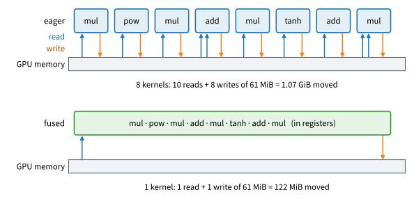

# Computation Graphs and Compilation
:label:`sec_compilation`

In :numref:`sec_perf_model`, the eight-operation activation chain `gelu_ish`
took eight to nine times as long as a single addition on the same tensor: each
operation ran as a separate GPU kernel that read its inputs from DRAM and
wrote its output back (18 array transfers instead of 2). On a small tensor,
the same chain is slow for a second reason: every operation is dispatched from
Python, and the host takes longer to launch each kernel than the GPU takes to
run it.

Both costs stem from *eager execution*, which runs operations one at a time as
Python reaches them. Handing the whole program to a compiler before execution
addresses both: *operation fusion* merges elementwise chains into a single
kernel that reads the input once and writes the output once (curing the
bandwidth-bound cost), and *kernel replay* records a sequence of kernel
launches and replays them with a single host call (curing the overhead-bound
cost). A large compute-bound matrix product gains from neither on its own,
though compiling the elementwise operations around it still pays off.

```{.python .input #compilation-compute-graphs-and-compilation}
%%tab pytorch
import math
import numpy as np
import torch
from torch import nn
from torch.nn import functional as F
from d2l import torch as d2l
```

```{.python .input #compilation-compute-graphs-and-compilation}
%%tab jax
import math
import numpy as np
import jax
from jax import numpy as jnp
from flax import nnx
import optax
from d2l import jax as d2l
```

```{.python .input #compilation-compute-graphs-and-compilation-1}
%%tab pytorch
import os
torch.set_float32_matmul_precision('high')  # fp32 matmuls may use tf32
# Detach PyTorch's profiler from the GPU when a profile ends; without this,
# every kernel launch after the first profile stays about 30% slower
os.environ['TEARDOWN_CUPTI'] = '1'
```

## Graph Capture
:label:`subsec_comp-capture`

### Computation Graphs
:label:`subsec_comp-graph`

The operations of a neural network form a directed *computation graph* whose
nodes are primitive operations and whose edges carry tensors
(:numref:`fig_compute_graph`). While eager autograd (:numref:`sec_autograd`)
records a backward tape during the forward pass, that record arrives too late
to optimize the forward pass itself: by the time the tape exists, every
operation has already paid host dispatch time $h$ and made its own round trip
through GPU memory. Optimizing the program requires *graph capture*—obtaining
the computation graph before the operations execute.


:label:`fig_compute_graph`

### Tracing

Modern frameworks capture graphs by *tracing*: running the Python function
once on symbolic *placeholders* that carry shape and dtype but no concrete
numerical values (:numref:`fig_compile_pipelines`). Every tensor operation on
a placeholder is recorded as a node in the graph, while ordinary Python control
flow that depends only on static shapes or loop bounds unrolls during tracing.
A compiler then lowers the captured graph into fused GPU kernels and caches
them for future calls with matching input shapes and dtypes.


:label:`fig_compile_pipelines`

:begin_tab:`pytorch`
In PyTorch, `torch.compile` intercepts Python bytecode via TorchDynamo
:cite:`Ansel.Yang.He.ea.2024`, traces tensor operations into a graph, uses
AOTAutograd to capture the backward graph ahead of time, and compiles both
into fused Triton and C++ kernels via Inductor. Dynamo attaches *guards* on
input shapes and dtypes so subsequent calls jump straight to the compiled
kernels when guards pass.
:end_tab:

:begin_tab:`jax`
In JAX, `jax.jit` traces the function using abstract tracer objects into a
typed intermediate representation (*jaxpr*, inspectable via `jax.make_jaxpr`)
:cite:`Frostig.Johnson.Leary.2018`, which the XLA compiler lowers into fused
GPU kernels cached by input shape and dtype.
:end_tab:

### Branches on Values

Because placeholders carry no numerical values, a tracer cannot evaluate a
data-dependent Python branch such as `if x.sum() > 0:`. A capture system has
three possible responses:

1. **Freeze** the branch taken by a concrete example input (as `torch.jit.trace`
   does)—fast, and silently wrong when future inputs should take the other
   branch.
2. **Refuse** with an error, requiring the programmer to express the branch as
   a graph primitive: either a *select* (`torch.where` / `jax.lax.select`,
   which evaluates both branches and picks one) or a *conditional op*
   (`torch.cond` / `jax.lax.cond`).
3. **Fall back** to Python by inserting a *graph break*: end the first graph
   at the condition, let Python evaluate the branch on the materialized value,
   and resume in a second compiled graph.

Branches on static tensor shapes (`if x.shape[0] > 4:`) are known at trace
time and require no special handling. Let us see how our framework handles a
data-dependent branch.

```{.python .input #compilation-capture-two-philosophies-1}
%%tab pytorch
def f(x):
    x = x * 2
    if x.sum() > 0:        # Python needs the value of this comparison
        return x + 1
    return x - 1

explanation = torch._dynamo.explain(f)(torch.randn(8, device=d2l.try_gpu()))
print(f'graphs: {explanation.graph_count}, '
      f'breaks: {explanation.graph_break_count}')
for graph in explanation.graphs:
    print(graph.code.strip())
```

```{.python .input #compilation-capture-two-philosophies-1}
%%tab jax
def f(x):
    x = x * 2
    if x.sum() > 0:        # Python needs the value of this comparison
        return x + 1
    return x - 1

try:
    jax.jit(f)(jnp.ones(8))
except jax.errors.TracerBoolConversionError as e:
    print(type(e).__name__)

def f_select(x):  # Both alternatives in the graph; select keeps one
    x = x * 2
    return jax.lax.select(x.sum() > 0, x + 1, x - 1)

print(jax.make_jaxpr(f_select)(jnp.ones(8)))
```

:begin_tab:`pytorch`
By default, `torch.compile` inserts a graph break: Graph 1 computes `x * 2`
and `x.sum() > 0`, returns control to Python to evaluate the `if`, and
dispatches Graph 2 for the chosen branch. Passing `fullgraph=True` (or using
`torch.export`) refuses graph breaks instead, while rewriting the branch with
`torch.where(x.sum() > 0, x + 1, x - 1)` captures a single graph.
:end_tab:

:begin_tab:`jax`
`jax.jit` refuses by raising `TracerBoolConversionError`. Replacing the Python
`if` with `jax.lax.select` (or `jax.lax.cond` when only one branch should be
evaluated) yields a single jaxpr.
:end_tab:

### Shapes and Recompilation

Because compilers specialize kernels to tensor shapes (tile sizes, loop
bounds, memory layouts), changing input shapes—such as a short final minibatch
of an epoch or variable sequence lengths—triggers recompilation unless the
compiler generalizes to symbolic dimensions. In practice, we either pad inputs
to a small set of bucketed shapes or mark varying axes as dynamic.

```{.python .input #compilation-capture-two-philosophies-2}
%%tab pytorch
compilations = []
def recording_backend(gm, example_inputs):  # Called once per compilation
    compilations.append(gm)
    return gm.forward                       # Run the captured graph as is

g = torch.compile(lambda x: torch.sin(x) + 1, backend=recording_backend)
for n in (8, 8, 16, 32):
    g(torch.ones(n, device=d2l.try_gpu()))
print(f'compilations: {len(compilations)}')
print(compilations[-1].code.strip())
```

```{.python .input #compilation-capture-two-philosophies-2}
%%tab jax
@jax.jit
def g(x):
    print(f'tracing g for shape {x.shape}')  # Python runs only while tracing
    return jnp.sin(x) + 1

for n in (8, 8, 16, 32):
    g(jnp.ones(n))
```

:begin_tab:`pytorch`
Dynamo compiles on the first call ($n = 8$), reuses that graph on the second
call ($n = 8$), and upon seeing $n = 16$ recompiles with a symbolic dimension
(`SymInt` `s77`), which then handles $n = 32$ without further compilation.
:end_tab:

:begin_tab:`jax`
`jax.jit` specializes strictly to static shapes: the Python `print` executes
during tracing for lengths 8, 16, and 32 (three traces for four calls), while
the second call at length 8 hits the cache.
:end_tab:

## Operation Fusion
:label:`subsec_comp-fusion`

### Counting Memory Traffic

In eager execution, `gelu_ish(x)` runs eight elementwise kernels (six unary
ops that each read one array and write one, plus two binary ops that each read
two arrays and write one), moving $10 + 8 = 18$ arrays of size $nb$ bytes. A
fused kernel reads `x` once, holds all seven intermediate values in registers,
and writes the output once (:numref:`fig_fusion`), cutting memory traffic by

$$
\frac{\textrm{bytes moved, eager}}{\textrm{bytes moved, fused}} =
\frac{(10 + 8)\, n b}{(1 + 1)\, n b} = 9.
$$

Because even the fused kernel performs only ~12 FLOPs per 8 bytes in fp32
($I \approx 1.5 \ll 82$ FLOP/byte), both versions are bandwidth-bound and
fusion should speed up `gelu_ish` by roughly $9\times$.


:label:`fig_fusion`

```{.python .input #compilation-what-the-compiler-does-fusion}
%%tab pytorch
x = torch.randn(4000, 4000, device=d2l.try_gpu())
compiled = torch.compile(d2l.gelu_ish)
assert torch.allclose(d2l.gelu_ish(x), compiled(x), atol=1e-6)  # Same answer
arrays_moved = {'eager': 18, 'compiled': 2}  # In units of x.nbytes
for desc, fn in (('eager', d2l.gelu_ish), ('compiled', compiled)):
    b = d2l.Benchmark(lambda: fn(x), desc=desc)
    print(f'{b}, {arrays_moved[desc] * x.nbytes / b.time / 1e9:.0f} GB/s')
```

```{.python .input #compilation-what-the-compiler-does-fusion}
%%tab jax
x = jax.random.normal(d2l.get_key(), (4000, 4000))
compiled = jax.jit(d2l.gelu_ish)
assert jnp.allclose(d2l.gelu_ish(x), compiled(x), atol=1e-6)  # Same answer
arrays_moved = {'eager': 18, 'compiled': 2}  # In units of x.nbytes
for desc, fn in (('eager', d2l.gelu_ish), ('compiled', compiled)):
    b = d2l.Benchmark(lambda: fn(x), desc=desc)
    print(f'{b}, {arrays_moved[desc] * x.nbytes / b.time / 1e9:.0f} GB/s')
```

Both versions stream through memory at 0.6–0.9 TB/s, and the compiled version
runs $8\times$ to $11\times$ faster—right around the $9\times$ byte-count
prediction—simply by eliminating 16 of the 18 DRAM transfers.

How much does activation fusion matter inside a Transformer block? In a
1B-parameter GPT of width $d = 2048$ and FFN hidden width $4d = 8192$ in bf16,
an unfused 8-op activation on $M$ tokens moves $18 \cdot 4dM \cdot 2 = 144\,dM$
bytes, while the two surrounding FFN matrix products perform
$2 \cdot 2 \cdot M \cdot d \cdot 4d = 16\,d^2M$ FLOPs. Their time ratio is
independent of the token count $M$:

$$
\frac{t_\textrm{activation}}{t_\textrm{products}} =
\frac{144\, dM/\beta}{16\, d^2 M/P} = \frac{9 I^*}{d} \approx 0.72
$$

for $I^* = 164$ FLOP/byte and $d = 2048$. Unfused, the activation takes nearly
three quarters as long as the two matrix products; fused, under a tenth.

### Fusion Patterns

Compilers routinely fuse two patterns:

* **Elementwise chains** (activations, residual adds, dropout masks, optimizer
  updates), where each thread computes element $i$ of the output in registers.
* **Row reductions** (softmax, LayerNorm, RMSNorm), where each row fits in
  on-chip SRAM so the kernel reads the row once, computes the reduction and
  normalization on chip, and writes the output once.

Compilers do not invent new algorithms: they cannot speed up a compute-bound
matrix product, nor can they discover tiled algorithms like FlashAttention
(:numref:`sec_attention-at-scale`, :cite:`Dao.Fu.Ermon.ea.2022`), which avoids
materializing the $T \times T$ attention matrix via online softmax rescaling
(written by hand in CUDA or Triton :cite:`Tillet.Kung.Cox.2019`).

## Compiling a Training Step
:label:`subsec_comp-wholestep`

Now let us compile a complete training step—forward pass, squared loss,
backward pass, and SGD update—for a 4-layer MLP of width 1,024 with `gelu_ish`
activations on a batch of 512 examples.

```{.python .input #compilation-compiling-a-training-step-1}
%%tab pytorch
class MLP(nn.Module):
    """Linear layers with the gelu_ish chain between them."""
    def __init__(self, width=1024, depth=4):
        super().__init__()
        self.layers = nn.ModuleList(nn.Linear(width, width)
                                    for _ in range(depth))

    def forward(self, X):
        for layer in self.layers[:-1]:
            X = d2l.gelu_ish(layer(X))
        return self.layers[-1](X)

def train_step(net, X, Y, lr=0.1):  # Forward, backward, SGD update
    loss = ((net(X) - Y) ** 2).mean()
    grads = torch.autograd.grad(loss, list(net.parameters()))
    with torch.no_grad():
        for p, g in zip(net.parameters(), grads):
            p -= lr * g
    return loss
```

```{.python .input #compilation-compiling-a-training-step-1}
%%tab jax
def init_mlp(key, width=1024, depth=4):
    """Weights and biases drawn uniformly from +-1/sqrt(width)."""
    bound = 1 / width**0.5
    keys = jax.random.split(key, (depth, 2))
    return [(jax.random.uniform(kW, (width, width), minval=-bound,
                                maxval=bound),
             jax.random.uniform(kb, (width,), minval=-bound, maxval=bound))
            for kW, kb in keys]

def mlp(params, X):  # Linear layers with the gelu_ish chain between them
    for W, b in params[:-1]:
        X = d2l.gelu_ish(X @ W + b)
    W, b = params[-1]
    return X @ W + b

def train_step(params, X, Y, lr=0.1):  # Forward, backward, SGD update
    loss_fn = lambda p: ((mlp(p, X) - Y) ** 2).mean()
    loss, grads = jax.value_and_grad(loss_fn)(params)
    return loss, jax.tree.map(lambda p, g: p - lr * g, params, grads)
```

Let us predict the step time. The four forward products and eight backward
products perform ~$3 \times 4 \times 2 \cdot 512 \cdot 1024^2 \approx 1.3
\times 10^{10}$ FLOPs (0.16 ms at 82.6 TFLOP/s in tf32), while reading and
updating the 16 MiB of parameters moves ~96 MiB (0.10 ms at 1 TB/s), for
**~0.25 ms** of actual device work. Eager execution, however, issues over 100
individual operations at $h \ge 10$ µs each (> 1 ms of host launch overhead),
making the eager step overhead-bound.

Because compilation costs $t_\textrm{compile}$ on the first call and saves
$t_\textrm{eager} - t_\textrm{compiled}$ per step, it breaks even after

$$
n^* = \frac{t_\textrm{compile}}{t_\textrm{eager} - t_\textrm{compiled}}
$$
:eqlabel:`eq_compile_break_even`

steps.

```{.python .input #compilation-whole-step-compilation-measured}
%%tab pytorch
net = MLP().to(d2l.try_gpu())
X, Y = (torch.randn(512, 1024, device=d2l.try_gpu()) for _ in range(2))
compiled_step = torch.compile(train_step)
t_first = d2l.Benchmark(lambda: compiled_step(net, X, Y),
                        warmup=0, repeats=1).time  # Includes compilation
t_eager = d2l.Benchmark(lambda: train_step(net, X, Y)).time
t_compiled = d2l.Benchmark(lambda: compiled_step(net, X, Y)).time
saved = t_eager - t_compiled  # Per step; a difference of two short times
print(f'first call: {t_first:.1f} s\n'
      f'eager: {1000 * t_eager:.2f} ms, compiled: {1000 * t_compiled:.2f} ms\n'
      'break-even: ' + (f'about {float(f"{t_first / saved:.1g}"):,.0f} steps'
                        if saved > 0 else 'never, compiled is not faster'))
# explain is internal to torch; it clears the compile cache and recompiles
print('graphs:', torch._dynamo.explain(train_step)(net, X, Y).graph_count)
```

```{.python .input #compilation-whole-step-compilation-measured}
%%tab jax
params = init_mlp(d2l.get_key())
X, Y = (jax.random.normal(d2l.get_key(), (512, 1024)) for _ in range(2))
compiled_step = jax.jit(train_step)
t_first = d2l.Benchmark(lambda: compiled_step(params, X, Y),
                        warmup=0, repeats=1).time  # Includes compilation
t_eager = d2l.Benchmark(lambda: train_step(params, X, Y)).time
t_compiled = d2l.Benchmark(lambda: compiled_step(params, X, Y)).time
saved = t_eager - t_compiled  # Per step; a difference of two short times
print(f'first call: {t_first:.1f} s\n'
      f'eager: {1000 * t_eager:.2f} ms, compiled: {1000 * t_compiled:.2f} ms\n'
      'break-even: ' + (f'about {float(f"{t_first / saved:.1g}"):,.0f} steps'
                        if saved > 0 else 'never, compiled is not faster'))
```

:begin_tab:`pytorch`
Default `torch.compile` speeds up the step by less than $2\times$, remaining
5–10× above the 0.25 ms of device work: `torch.autograd.grad` causes a graph
break between the forward/backward pass and the parameter update, and
Inductor's generated wrapper still launches each kernel individually from
Python.
:end_tab:

:begin_tab:`jax`
`jax.jit` compiles the forward pass, backward pass, and update into a single
XLA program launched in one call, running in ~0.25 ms—matching our paper
estimate and running ~$100\times$ faster than un-jitted JAX.
:end_tab:

## Kernel Replay
:label:`subsec_comp-overhead`

Fusion cannot merge matrix multiplications, and when the remaining kernels are
short, per-kernel host launches dominate step time. Consider a stack of 60
bias-free linear layers of width 256 with $\tanh$ activations on a batch of 64
examples (120 operations per call). Each layer performs only $8.4 \times 10^6$
FLOPs and moves 384 KiB (< 0.5 µs on the roofline, and ~1–3 µs of actual
device execution above the hardware kernel-start floor), whereas eager
execution pays $h$ per operation ($120\,h$ in total).

To eliminate per-kernel host dispatch, NVIDIA GPUs support *CUDA graphs*: the
runtime records the sequence of kernel launches and their fixed buffer
addresses once, then replays the entire sequence with a single host launch.
Because buffer addresses and shapes are baked into the recording, inputs are
copied into fixed buffers before replay and outputs are overwritten on the
next replay.

```{.python .input #compilation-the-overhead-regime-capture-and-replay}
%%tab pytorch
deep = nn.Sequential(*[m for _ in range(60)  # 120 operations per call
                       for m in (nn.Linear(256, 256, bias=False), nn.Tanh())])
deep = deep.to(d2l.try_gpu())
x = torch.randn(64, 256, device=d2l.try_gpu())

fused = torch.compile(deep)  # Inductor kernels, launched one at a time
replayed = torch.compile(deep, mode='reduce-overhead')  # As a CUDA graph
with torch.no_grad():  # Inference: every call is a complete step
    fused(x)
    replayed(x)  # Compiles and warms up; the next call records
    times = {}
    for desc, f in (('eager', deep), ('compiled', fused),
                    ('reduce-overhead', replayed)):
        t = times[desc] = d2l.Benchmark(lambda: f(x), repeats=100).time
        print(f'{desc}: {1000 * t:.2f} ms/call, '
              f'{1e6 * t / 120:.1f} µs per operation')
    # The kernels of the compiled stack, against the time of a call
    d2l.show_profile(d2l.kernel_times(lambda: fused(x)),
                     1000 * times['compiled'], rows=3)
```

```{.python .input #compilation-the-overhead-regime-capture-and-replay}
%%tab jax
def init_deep(key, depth=60, width=256):  # 120 operations per call
    return list(jax.random.uniform(key, (depth, width, width),
                                   minval=-width**-0.5, maxval=width**-0.5))

def deep(params, x):
    for W in params:
        x = jnp.tanh(x @ W)
    return x

params = init_deep(d2l.get_key())
x = jax.random.normal(d2l.get_key(), (64, 256))
jitted = jax.jit(deep)
jitted(params, x)  # First call compiles
times = {}
for desc, f in (('eager', deep), ('jit', jitted)):
    t = times[desc] = d2l.Benchmark(lambda: f(params, x), repeats=100).time
    print(f'{desc}: {1000 * t:.2f} ms/call, '
          f'{1e6 * t / 120:.1f} µs per operation')
# The kernels of the jitted stack, against the time of a call
d2l.show_profile(d2l.kernel_times(lambda: jitted(params, x)),
                 1000 * times['jit'], rows=3)
```

:begin_tab:`pytorch`
Default `torch.compile` (`fused`) is barely faster than eager execution:
because Inductor delegates the matrix products to cuBLAS, it cannot fuse the
$\tanh$ into them, and it still launches all kernels one by one from Python
(leaving the GPU busy for only ~15% of the call). Enabling CUDA graphs via
`mode='reduce-overhead'` replays the entire sequence in one launch, cutting
the call time by ~$7\times$ down to the ~0.3 ms of actual GPU execution.

Applying `mode='reduce-overhead'` to the MLP training step of
:numref:`subsec_comp-wholestep` similarly cuts the step time to under a
millisecond, with the GPU busy for the predicted 0.25 ms and the remainder
spent in Python at the `autograd.grad` graph break.
:end_tab:

:begin_tab:`jax`
`jax.jit` fuses each $\tanh$ directly into the following matrix product and
replays the compiled sequence as an XLA command buffer (CUDA graph), running
~$30\times$ faster than eager dispatch and keeping the GPU busy for nearly the
entire ~0.27 ms call.
:end_tab:

```{.python .input #compilation-replaying-the-training-step}
%%tab pytorch
replayed_step = torch.compile(train_step, mode='reduce-overhead')
t = d2l.Benchmark(lambda: replayed_step(net, X, Y)).time
busy = sum(d2l.kernel_times(lambda: replayed_step(net, X, Y)).values())
print(f'training step, reduce-overhead: {1000 * t:.2f} ms/call, '
      f'GPU busy {busy:.2f} ms')
```

## Limits of Compilation
:label:`subsec_comp-hurts`

Compilation pays off only when a program runs for more than $n^*$ steps and
spends significant time in bandwidth-bound chains or host-launch overhead.
Keep three practical caveats in mind:

* **Branches on tensor values:** Logging a scalar loss, testing
  `if loss < 0.1:`, or data-dependent indexing (`x[x > 0]`) forces graph
  breaks or errors. Keep host reads outside compiled functions and express
  in-graph branches with `where` / `select` or `cond`.
* **Changing shapes:** Variable sequence lengths or a short final minibatch in
  an epoch can trigger repeated recompilations. Drop or pad the final
  minibatch, and bucket variable-length sequences.
* **Debugging:** Compiled kernels do not execute line-by-line in Python.
  Verify and debug in eager mode first, then compile.

## Summary

Eager execution runs one operation at a time, paying host dispatch latency $h$
per kernel and a DRAM round trip per elementwise operation. Tracing captures a
computation graph on symbolic placeholders ahead of execution; data-dependent
branches must be rewritten with select/conditional primitives or incur graph
breaks, and shape changes trigger recompilation unless dimensions are
symbolic. Operation fusion merges elementwise chains and on-chip row
reductions into single kernels—cutting `gelu_ish` memory traffic and run time
ninefold—while CUDA graph replay eliminates per-kernel host launch overhead
for small models and batches.

## Exercises

:begin_tab:`pytorch`
1. [code] **Value-dependent branches.** The function `f` of
   :numref:`subsec_comp-capture` breaks the graph at its `if`.
    1. Compile `f` with `fullgraph=True` and read the error. Rewrite the
       branch with `torch.cond`, verify with `torch._dynamo.explain` that it
       captures one graph, and compare `torch.cond` with `torch.where`.
    1. Time the compiled original and the compiled `torch.where` version with
       `d2l.Benchmark` on an 8-element input and on a $4000 \times 4000$
       input, and explain the difference at each size.
    1. Describe a pair of branches where `torch.where` (which evaluates both
       branches) costs more than a graph break.

2. [code] **Shape changes.** `torch.compile` guards on input shapes and
   recompiles when a guard fails (:numref:`subsec_comp-capture`).
    1. Compile `torch.tanh(x) * 2 + 1` with `recording_backend` and call it on
       vectors of lengths $8, 16, 32, \ldots, 8192$. Count the compilations and
       inspect the reasons with `torch._logging.set_logs(recompiles=True)`.
    1. Repeat with `dynamic=False` and with
       `torch._dynamo.mark_dynamic(x, 0)` before the first call. How many
       compilations occur in each case, and when is `mark_dynamic` preferable?
:end_tab:

:begin_tab:`jax`
1. [code] **Value-dependent branches.** Tracing replaces argument values with
   symbolic placeholders (:numref:`subsec_comp-capture`).
    1. Rewrite the branch of `f` with `jnp.where` and with `jax.lax.cond`, and
       inspect both jaxprs with `jax.make_jaxpr`. Which operations does each
       execute at run time?
    1. Apply `jax.vmap` to the `jax.lax.cond` version over a batch of vectors
       and inspect its jaxpr. What became of the conditional, and why?
    1. Jit a function that branches on `x.shape[0] > 4` and call it on vectors
       of lengths 3, 5, and 6. Why does it succeed, and how many times does it
       trace?

2. [code] **Shape changes.** A jitted function specializes to its argument
   shapes (:numref:`subsec_comp-capture`).
    1. Jit a function returning `jnp.tanh(x).mean()` that increments a Python
       counter during tracing. Call it on vectors of lengths 100, 200, and
       300 (three times each), and compare the first-call and cached-call
       times.
    1. Pad every input to length 512 and pass a mask or length so that a
       single trace computes the exact unpadded mean for all three lengths.
    1. Compare passing the length as a traced array versus marking it with
       `static_argnums`.
:end_tab:

3. [code] **Fusion behind a matrix product.** ● Compilation leaves a large
   matrix product unchanged but fuses the elementwise chain following it.
   Consider `gelu_ish(a @ a)` for an $n \times n$ bf16 matrix `a` on a GPU
   with peak $P$, bandwidth $\beta$, and ridge point $I^* = P/\beta$. Model
   the product as compute-bound ($2n^3/P$ seconds) and the chain as
   bandwidth-bound ($m = 18$ arrays of $n^2$ elements of $b = 2$ bytes in
   eager mode versus 2 arrays when fused).
    1. Derive the speedup bound $S(n)$ of compiled over eager execution in
       terms of $n, m, b, I^*$, evaluate it on the RTX 4090 ($I^* \approx 164$)
       at $n = 1024, 4096, 16384$, and find the $n$ at which $S(n) = 1.1$.
    1. Measure the eager and compiled times of `gelu_ish(a @ a)` for
       $n = 256, 512, \ldots, 8192$, plot the measured speedup against $S(n)$,
       and explain where they differ.

4. **Fusing a reduction.** ● A numerically stable row-wise softmax over an
   $R \times d$ fp32 matrix can be written as five eager operations: row max,
   subtraction, exponential, row sum, and division.
    1. Count the DRAM reads and writes (keeping terms proportional to $Rd$)
       for five eager kernels versus a single fused kernel that holds each row
       in SRAM, and state the bandwidth-bound speedup factor.
    1. When a row exceeds SRAM capacity, find the minimum number of passes for
       a fused kernel that computes the max and sum in separate passes versus
       an online single-pass reduction maintaining $m_j = \max(m_{j-1}, x_j)$
       and $s_j = s_{j-1} e^{m_{j-1} - m_j} + e^{x_j - m_j}$. Verify that
       $s_d = \sum_{j=1}^d e^{x_j - m_d}$.

:begin_tab:`pytorch`
5. [code] **Compiling the optimizer.** ● Rewrite the step of
    :numref:`subsec_comp-wholestep` using `torch.optim.Adam` (`zero_grad`,
    `backward`, `step`).
    1. Inspect the step with `torch._dynamo.explain`: how many graphs does it
       capture, and where does it break?
    1. Count the minimum parameter-sized arrays read and written by one SGD
       update versus one Adam update (:numref:`sec_adam`), time eager and
       compiled steps for both optimizers, and explain why compiling the
       update gains more for one than the other.
:end_tab:

:begin_tab:`jax`
5. [code] **Trace-time constants.** The Python body of a jitted function runs
    only during tracing (:numref:`subsec_comp-capture`).
    1. Jit a function that returns `x + np.random.randn()`, call it twice,
       inspect its jaxpr, and explain the two outputs.
    1. Suppose a jitted dropout function reads a PRNG key from a Python global
       variable. Explain what happens across steps when the global variable is
       reassigned, and rewrite the function so every call draws a fresh mask.
:end_tab:

6. [code] **Overhead crossover.** ● Using the 60-layer stack of
   :numref:`subsec_comp-overhead`, investigate where kernel replay ceases to
   matter:
    1. Time eager and replayed execution for depths $L \in [10, 200]$ at width
       256, fit $t(L) = c + sL$, and compare the slopes.
    1. Predict from $\max(\textrm{FLOPs}/P, \textrm{bytes}/\beta) = h$ the
       width at which one layer's matrix product takes as long to execute as
       to launch. Then measure eager and replayed times at depth 60 for widths
       from 64 to 4,096 and compare the crossover width with your prediction.
    1. Profile the eager stack with `d2l.kernel_times` and `d2l.show_profile`,
       and compare its busy device share and per-launch wall time against the
       compiled profile.

[Discussions](https://d2l.discourse.group/t/36789)

<!-- slides -->

::: {.slide}
::: {.cover}
[Dive into Deep Learning · §13.3]{.kicker}

Computation Graphs and Compilation<br>
**graph capture · operation fusion · a training step · kernel replay**
:::
:::

::: {.slide title="An Eight-Operation Activation Moves 1.07 GiB to Produce 61 MiB"}
[The problem]{.kicker}

`gelu_ish`: $0.5\,x\,(1 + \tanh(0.8\,(x + 0.04\,x^3)))$ on a
$4000 \times 4000$ fp32 matrix, 61 MiB:

- eager: 8 kernels, each reads its inputs from GPU memory and writes back;
  18 arrays moved, **1.07 GiB, at least 1.1 ms** at 1 TB/s;
- needed: read $x$ once, write once: **122 MiB, 0.13 ms**.

::: {.d2l-note}
Running one operation at a time costs memory traffic and launches, not
arithmetic. A compiler that sees the whole program can remove both.
:::
:::

::: {.slide title="By the End of This Deck You Can"}
[Goals]{.kicker}

- explain how tracing captures a program, and what it does with a branch on
  a value;
- predict the speedup of fusion from a count of bytes;
- predict a training step's time from FLOPs, bytes, and its number of
  operations, and name its regime;
- compute after how many steps compilation saves time;
- tell when replaying a CUDA graph helps, and when not to compile.

**Running example:** one RTX 4090 ($\beta$ = 1 TB/s; 165 TFLOP/s bf16,
82.6 TFLOP/s tf32) and the 1B GPT of width 2048.
:::

::: {.slide title="Compilation Fixes Two of the Three Regimes"}
[Where this fits]{.kicker}

::: {.cols .vc}
::: {.col}
| section | adds |
|---|---|
| The Performance Model | roofline, three regimes, timing, profiling |
| Hardware | where peak arithmetic and bandwidth come from |
| **Computation Graphs and Compilation** | **fusion and kernel replay** |
| Memory and Precision | what fits: bytes per parameter and per token |
| Multi-GPU from First Principles | data parallelism by hand, its cost model |
| Data Parallelism in Practice | one process per GPU, overlap |
| Sharding the Training State | 16 bytes per parameter, split across GPUs |
| Case Study: Optimizing a Transformer | the whole method on one GPT |
:::

::: {.col .narrow}
- **Uses:** bandwidth- and overhead-bound regimes; the host time $h$ per
  call.
- **Skips:** writing kernels by hand, exporting models for deployment.
:::
:::
:::

::: {.slide title="A Record Made During the Forward Pass Comes Too Late"}
{width=82%}

- Eager: each node is a kernel launch costing the host time $h$
  (10 µs or more per call on our machine) and, if elementwise, a round
  trip through memory.
- To merge `add` and `relu`, a compiler needs the graph *before* running:
  *graph capture*.
:::

::: {.slide title="Tracing Records Tensor Operations on Placeholders" only="pytorch"}
{width=92%}

- Placeholders: shape and dtype, no values. Tensor operations are
  recorded; Python loops unroll.
- `torch.compile`: Dynamo captures the graph from bytecode, AOTAutograd
  derives the backward, Inductor compiles; guards check the shapes.
:::

::: {.slide title="Tracing Records Tensor Operations on Placeholders" only="jax"}
{width=92%}

- Placeholders: shape and dtype, no values. Tensor operations are
  recorded; Python loops unroll.
- `jax.jit`: traces to a jaxpr; XLA compiles it, cached per shape and dtype.
:::

::: {.slide title="A Branch on a Value Can Be Frozen, Refused, or Left to Python"}
`if x.sum() > 0:` cannot be answered while tracing: a placeholder has no
value.

| response | what happens |
|---|---|
| freeze | the example's branch, on every call: fast and wrong |
| refuse | an error; rewrite as a *select* or a *conditional* |
| fall back | a graph break; Python decides between two graphs |

- *Select*: compute both alternatives, keep one. *Conditional*: compute
  only the one taken.
- Branches on *shapes* are fine.
:::

::: {.slide title="torch.compile Falls Back: Two Graphs, One Break" only="pytorch"}
```{.python #compilation-exercises-1}
def f(x):
    x = x * 2
    if x.sum() > 0:        # needs a value
        return x + 1
    return x - 1
```

- Graph 1: `x * 2`, `sum`, `> 0`; Python reads the result. Graph 2: the
  branch taken.
- `fullgraph=True` and `torch.export` refuse; `torch.jit.trace` freezes
  (with a warning).
- `torch.where(x.sum() > 0, x + 1, x - 1)`: one graph.
:::

::: {.slide title="jax.jit Refuses a Branch on a Value" only="jax"}
```{.python #compilation-exercises-2}
def f(x):
    x = x * 2
    if x.sum() > 0:        # needs a value
        return x + 1
    return x - 1
```

- `jax.jit(f)` raises `TracerBoolConversionError`.
- `jax.lax.select(x.sum() > 0, x + 1, x - 1)` computes both and keeps
  one: a single graph.
- `jax.lax.cond` computes only one alternative.
:::

::: {.slide title="A New Shape Compiles Again, Then Dynamo Generalizes" only="pytorch"}
@!compilation-capture-two-philosophies-2

- Calls at lengths 8, 8, 16, 32: two compilations.
- The second graph takes the length as a symbol (`SymInt`) and serves
  length 32 as well.
:::

::: {.slide title="Every New Shape Means a New Trace" only="jax"}
@compilation-capture-two-philosophies-2

- The `print` runs only while tracing: three traces for four calls.
- Remedies: pad to a few fixed shapes; `static_argnums` for Python values.
:::

::: {.slide title="Check: Compilations for Ragged Sequences"}
[Check]{.kicker}

A step compiled for fixed shapes sees minibatches of sequence lengths
100, 128, 100, 75, 128, 100. How many compilations without padding, and
with padding to the next multiple of 64?

::: {.fragment .fade-up}
- Without padding: one per distinct length, 3 (100, 128, 75).
- Padded: 100 and 75 become 128, so 1; the length-75 batch then does
  about 70% more work.
:::
:::

::: {.slide title="Fusion Moves 2 Arrays Instead of 18"}
{width=80%}

- Both versions are bandwidth-bound: about 12 FLOPs per 8 bytes, far
  below the ridge point (82 FLOP/byte for fp32 arithmetic).
- Predicted speedup: the ratio of bytes, $18/2 = 9$.
:::

::: {.slide title="Fused gelu_ish Runs About 9× Faster, as the Byte Count Predicts"}
@!compilation-what-the-compiler-does-fusion

- Check `allclose` first: compilers reorder floating-point arithmetic.
- Both versions move data at 0.6–0.9 TB/s; re-runs put the ratio
  between 8 and 11, around the predicted 9.

::: {.d2l-note}
Memory is no faster and arithmetic no cheaper: 16 of the 18 transfers are
gone.
:::
:::

::: {.slide title="Check: The Activation of the 1B GPT"}
[Check]{.kicker}

GELU variant of the GPT: width $d = 2048$, hidden $4d = 8192$; 8
sequences of 1,024 tokens; bf16. Eager `gelu_ish` per layer at 1 TB/s,
against the two matrix products at 165 TFLOP/s?

::: {.fragment .fade-up}
- 8,192 tokens $\times$ 8,192 hidden units $= 6.7 \times 10^7$ elements,
  128 MiB per array.
- Eager: $18 \times 128$ MiB $= 2.25$ GiB, about 2.4 ms; fused: 0.27 ms.
- Products: $5.5 \times 10^{11}$ FLOPs, about 3.3 ms.
- Ratio $9P/(\beta d) = 9I^*/d \approx 0.72$ for any number of tokens,
  with the ridge point $I^* = P/\beta \approx 164$ FLOP/byte; it reaches 1
  at $d \approx 1{,}500$.
:::
:::

::: {.slide title="Compilers Fuse Chains and Row Reductions, Not Algorithms"}
| fused | example |
|---|---|
| elementwise chains | activations, residual adds, optimizer updates |
| reductions, when a row fits on the chip | softmax, layer norm: one read, one write per row |

- The product itself gets no faster; a compiler that generates the
  product kernel can fuse the code next to it into it.
- Out of reach: the $T \times T$ attention scores. FlashAttention avoids
  them by a new algorithm (tiles, incremental softmax), written by hand.
:::

::: {.slide title="Predict the Step: 0.25 ms of Work, Milliseconds of Launches"}
MLP, 4 layers of width 1,024, minibatch 512, fp32 with tf32 products.

- FLOPs: about $3 \times 4 \times 2 \cdot 512 \cdot 1024^2 \approx 1.3
  \times 10^{10}$: 0.16 ms at 82.6 TFLOP/s.
- Bytes: 16 MiB of parameters, about 6 passes, about 96 MiB: 0.1 ms.
- Eager: well over 100 operations at $h \geq 10$ µs: more than 1 ms, at
  least 5× the work.

::: {.d2l-note}
The eager step is overhead-bound; its 2 MiB arrays leave little for
fusion.
:::
:::

::: {.slide title="The Compiled Step Still Launches Its Kernels One by One" only="pytorch"}
@!compilation-whole-step-compilation-measured

- Compiled: less than 2× faster, still 5–10× the 0.25 ms of work.
- Two graphs: break at `torch.autograd.grad`; Inductor's code launches
  each kernel from Python.
- First call: warm on-disk cache; cold, several seconds.
:::

::: {.slide title="One XLA Program Runs the Step at the Estimate" only="jax"}
@!compilation-whole-step-compilation-measured

- Jitted: about 0.25 ms, the estimate; about 100× faster than the
  un-jitted step.
- One program, one call: loss, gradients, update.
- Un-jitted JAX is for debugging; training steps are jitted.
:::

::: {.slide title="Compilation Saves Time After a Break-Even Number of Steps"}
$$n^* = \frac{t_\textrm{compile}}{t_\textrm{eager} - t_\textrm{compiled}}$$

- 30 s of compilation, 10 ms saved per step: $n^* = 3{,}000$ steps.
- Our step: a few hundred to a few thousand steps (warm or cold compile
  cache), a small fraction of a real training run.
:::

::: {.slide title="Thin Layers Leave the GPU Waiting for Python"}
60 layers, width 256, batch 64: 120 operations per call.

- Roofline: under 1 µs per layer. Measured floor: about 1 µs per kernel
  (`x + 1`).
- Eager: $120\,h$. Without Python: at least $120 \times$ floor.
- Predicted gain: at most $h$ / floor, ten or more here; set by the host
  CPU more than by the GPU.
:::

::: {.slide title="A CUDA Graph Replays a Recorded Kernel Sequence"}
- Records kernels, launch configurations, and argument addresses.
- Replay: one launch from the host; the GPU runs the kernels back to back.
- Rigid: fixed shapes and addresses; inputs copied into recorded buffers;
  outputs overwritten by the next replay; no CPU reads inside.

::: {.d2l-note}
Record once, replay many times: the host cost per step becomes one launch.
:::
:::

::: {.slide title="Check: Which Regime, and How Much Can Replay Gain?"}
[Check]{.kicker}

A step launches 400 kernels at 8 µs of host time each. The GPU needs
1.5 ms of work. Which regime? What is the best speedup from replay?

::: {.fragment .fade-up}
- Host: $400 \times 8$ µs $= 3.2$ ms $> 1.5$ ms: overhead-bound.
- With replay the step takes about the GPU's 1.5 ms: at most about
  $3.2 / 1.5 \approx 2.1\times$.
:::
:::

::: {.slide title="Replay, Not Fusion, Makes the Stack Seven Times Faster" only="pytorch"}
@!compilation-the-overhead-regime-capture-and-replay

- `compiled`: 3 kernels per layer (product, split-K reduction, Triton
  tanh), issued one by one from Python; the device is busy a seventh of
  the call.
- `reduce-overhead`: CUDA graphs; the call shrinks to the device's busy time.
- Gain about 7, below the bound $h$ / floor $\approx 18$: a replayed
  kernel also reads and computes.
:::

::: {.slide title="jit Runs the Stack About 30× Faster Than Eager Dispatch" only="jax"}
@!compilation-the-overhead-regime-capture-and-replay

- One call from Python; about 2 µs per operation, twice the floor of
  `x + 1` (a kernel also reads and computes): below $h$ / floor $\approx 60$.
- No tanh kernel: XLA fuses each tanh into the next product's kernel.
- Still 120 kernels: each product splits into 4 partial products plus a
  sum; replayed as a command buffer (CUDA graph), they keep the device busy.
:::

::: {.slide title="Replay Brings the Training Step to About a Millisecond" only="pytorch"}
@!compilation-replaying-the-training-step

- Device work about 0.25 ms: the estimate holds.
- Busy a fifth to a third of the step: Python still runs between the
  replayed graphs.

::: {.d2l-note}
The device's work was predicted correctly; what is left is host time.
:::
:::

::: {.slide title="Check: Compile It or Not?"}
[Check]{.kicker}

- An evaluation of 200 minibatches; compiling takes 30 s and saves 5 ms
  per step.
- A model called on a sequence that grows by one token per call.
- A step that is one $8192 \times 8192$ bf16 matrix product.

::: {.fragment .fade-up}
- $n^* = 6{,}000 > 200$: stay eager.
- A new shape per call: pad to a few lengths, or leave it eager.
- Compute-bound: nothing to fuse, no launches to hide.
:::
:::

::: {.slide title="Wrap-up"}
[Wrap-up]{.kicker}

- Tracing records tensor operations on placeholders; a branch on a value is
  frozen, refused, or left to Python.
- `gelu_ish` on 61 MiB: eager moves 1.07 GiB, fused 122 MiB; 8 to 11× faster.
- GELU variant of the 1B GPT: unfused activation $9I^*/d \approx 0.72$ of
  the products' time; fused, under a tenth.
- MLP step: 0.25 ms of work under milliseconds of launches; compiling
  gains only as far as it takes launches off the host.
- CUDA graphs replay the kernels of 120 small operations with one launch.

**Next:** memory and precision.
:::
