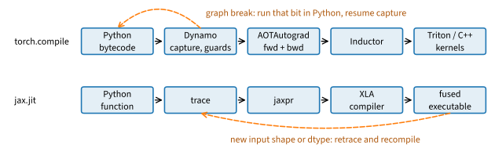

# Computation Graphs and Compilation
:label:`sec_compilation`

In :numref:`sec_perf_model`, the eight-operation activation chain `gelu_ish`
took eight to nine times as long as a single addition on the same tensor: each
operation ran as a separate GPU kernel that read its inputs from DRAM and
wrote its output back (18 array transfers instead of 2). On a small tensor,
the same chain is slow for a second reason: every operation is dispatched from
Python, and the host takes longer to launch each kernel than the GPU takes to
run it.

Both costs stem from *eager execution*, which runs operations one at a time as
Python reaches them. Handing the whole program to a compiler before execution
addresses both: *operation fusion* merges elementwise chains into a single
kernel that reads the input once and writes the output once (curing the
bandwidth-bound cost), and *kernel replay* records a sequence of kernel
launches and replays them with a single host call (curing the overhead-bound
cost). A large compute-bound matrix product gains from neither on its own,
though compiling the elementwise operations around it still pays off.

```{.python .input #compilation-compute-graphs-and-compilation}
%%tab pytorch
import math
import numpy as np
import torch
from torch import nn
from torch.nn import functional as F
from d2l import torch as d2l
```

```{.python .input #compilation-compute-graphs-and-compilation}
%%tab jax
import math
import numpy as np
import jax
from jax import numpy as jnp
from flax import nnx
import optax
from d2l import jax as d2l
```

```{.python .input #compilation-compute-graphs-and-compilation-1}
%%tab pytorch
import os
torch.set_float32_matmul_precision('high')  # fp32 matmuls may use tf32
# Detach PyTorch's profiler from the GPU when a profile ends; without this,
# every kernel launch after the first profile stays about 30% slower
os.environ['TEARDOWN_CUPTI'] = '1'
```

## Graph Capture
:label:`subsec_comp-capture`

### Computation Graphs
:label:`subsec_comp-graph`

The operations of a neural network form a directed *computation graph* whose
nodes are primitive operations and whose edges carry tensors
(:numref:`fig_compute_graph`). While eager autograd (:numref:`sec_autograd`)
records a backward tape during the forward pass, that record arrives too late
to optimize the forward pass itself: by the time the tape exists, every
operation has already paid host dispatch time $h$ and made its own round trip
through GPU memory. Optimizing the program requires *graph capture*—obtaining
the computation graph before the operations execute.


:label:`fig_compute_graph`

### Tracing

Modern frameworks capture graphs by *tracing*: running the Python function
once on symbolic *placeholders* that carry shape and dtype but no concrete
numerical values (:numref:`fig_compile_pipelines`). Every tensor operation on
a placeholder is recorded as a node in the graph, while ordinary Python control
flow that depends only on static shapes or loop bounds unrolls during tracing.
A compiler then lowers the captured graph into fused GPU kernels and caches
them for future calls with matching input shapes and dtypes.


:label:`fig_compile_pipelines`

:begin_tab:`pytorch`
In PyTorch, `torch.compile` intercepts Python bytecode via TorchDynamo
:cite:`Ansel.Yang.He.ea.2024`, traces tensor operations into a graph, uses
AOTAutograd to capture the backward graph ahead of time, and compiles both
into fused Triton and C++ kernels via Inductor. Dynamo attaches *guards* on
input shapes and dtypes so subsequent calls jump straight to the compiled
kernels when guards pass.
:end_tab:

:begin_tab:`jax`
In JAX, `jax.jit` traces the function using abstract tracer objects into a
typed intermediate representation (*jaxpr*, inspectable via `jax.make_jaxpr`)
:cite:`Frostig.Johnson.Leary.2018`, which the XLA compiler lowers into fused
GPU kernels cached by input shape and dtype.
:end_tab:

### Branches on Values

Because placeholders carry no numerical values, a tracer cannot evaluate a
data-dependent Python branch such as `if x.sum() > 0:`. A capture system has
three possible responses:

1. **Freeze** the branch taken by a concrete example input—fast, and silently wrong when future inputs should take the other
   branch.
2. **Refuse** with an error, requiring the programmer to express the branch as
   a graph primitive: either a *select* (which evaluates both branches and
   picks one) or a *conditional op*.
3. **Fall back** to Python by inserting a *graph break*: end the first graph
   at the condition, let Python evaluate the branch on the materialized value,
   and resume in a second compiled graph.

Branches on static tensor shapes (`if x.shape[0] > 4:`) are known at trace
time and require no special handling. Let us see how our framework handles a
data-dependent branch.

```{.python .input #compilation-capture-two-philosophies-1}
%%tab pytorch
def f(x):
    x = x * 2
    if x.sum() > 0:        # Python needs the value of this comparison
        return x + 1
    return x - 1

explanation = torch._dynamo.explain(f)(torch.randn(8, device=d2l.try_gpu()))
print(f'graphs: {explanation.graph_count}, '
      f'breaks: {explanation.graph_break_count}')
for graph in explanation.graphs:
    print(graph.code.strip())
```

```{.python .input #compilation-capture-two-philosophies-1}
%%tab jax
def f(x):
    x = x * 2
    if x.sum() > 0:        # Python needs the value of this comparison
        return x + 1
    return x - 1

try:
    jax.jit(f)(jnp.ones(8))
except jax.errors.TracerBoolConversionError as e:
    print(type(e).__name__)

def f_select(x):  # Both alternatives in the graph; select keeps one
    x = x * 2
    return jax.lax.select(x.sum() > 0, x + 1, x - 1)

print(jax.make_jaxpr(f_select)(jnp.ones(8)))
```

:begin_tab:`pytorch`
By default, `torch.compile` inserts a graph break: Graph 1 computes `x * 2`
and `x.sum() > 0`, returns control to Python to evaluate the `if`, and
dispatches Graph 2 for the chosen branch. Passing `fullgraph=True` (or using
`torch.export`) refuses graph breaks instead, while rewriting the branch with
`torch.where(x.sum() > 0, x + 1, x - 1)` captures a single graph.
The older `torch.jit.trace` freezes the branch of its example input.
:end_tab:

:begin_tab:`jax`
`jax.jit` refuses by raising `TracerBoolConversionError`. Replacing the Python
`if` with `jax.lax.select` (or `jax.lax.cond` when only one branch should be
evaluated) yields a single jaxpr.
:end_tab:

### Shapes and Recompilation

Because compilers specialize kernels to tensor shapes (tile sizes, loop
bounds, memory layouts), changing input shapes—such as a short final minibatch
of an epoch or variable sequence lengths—triggers recompilation unless the
compiler generalizes to symbolic dimensions. In practice, we either pad inputs
to a small set of bucketed shapes or mark varying axes as dynamic.

```{.python .input #compilation-capture-two-philosophies-2}
%%tab pytorch
compilations = []
def recording_backend(gm, example_inputs):  # Called once per compilation
    compilations.append(gm)
    return gm.forward                       # Run the captured graph as is

g = torch.compile(lambda x: torch.sin(x) + 1, backend=recording_backend)
for n in (8, 8, 16, 32):
    g(torch.ones(n, device=d2l.try_gpu()))
print(f'compilations: {len(compilations)}')
print(compilations[-1].code.strip())
```

```{.python .input #compilation-capture-two-philosophies-2}
%%tab jax
@jax.jit
def g(x):
    print(f'tracing g for shape {x.shape}')  # Python runs only while tracing
    return jnp.sin(x) + 1

for n in (8, 8, 16, 32):
    g(jnp.ones(n))
```

:begin_tab:`pytorch`
Dynamo compiles on the first call ($n = 8$), reuses that graph on the second
call ($n = 8$), and upon seeing $n = 16$ recompiles with a symbolic dimension
(`SymInt` `s77`), which then handles $n = 32$ without further compilation.
:end_tab:

:begin_tab:`jax`
`jax.jit` specializes strictly to static shapes: the Python `print` executes
during tracing for lengths 8, 16, and 32 (three traces for four calls), while
the second call at length 8 hits the cache.
:end_tab:

## Operation Fusion
:label:`subsec_comp-fusion`

### Counting Memory Traffic

In eager execution, `gelu_ish(x)` runs eight elementwise kernels (six unary
ops that each read one array and write one, plus two binary ops that each read
two arrays and write one), moving $10 + 8 = 18$ arrays of size $nb$ bytes. A
fused kernel reads `x` once, holds all seven intermediate values in registers,
and writes the output once (:numref:`fig_fusion`), cutting memory traffic by

$$
\frac{\textrm{bytes moved, eager}}{\textrm{bytes moved, fused}} =
\frac{(10 + 8)\, n b}{(1 + 1)\, n b} = 9.
$$

Because even the fused kernel performs only ~12 FLOPs per 8 bytes in fp32
($I \approx 1.5 \ll 82$ FLOP/byte), both versions are bandwidth-bound and
fusion should speed up `gelu_ish` by roughly $9\times$.


:label:`fig_fusion`

```{.python .input #compilation-what-the-compiler-does-fusion}
%%tab pytorch
x = torch.randn(4000, 4000, device=d2l.try_gpu())
compiled = torch.compile(d2l.gelu_ish)
assert torch.allclose(d2l.gelu_ish(x), compiled(x), atol=1e-6)  # Same answer
arrays_moved = {'eager': 18, 'compiled': 2}  # In units of x.nbytes
for desc, fn in (('eager', d2l.gelu_ish), ('compiled', compiled)):
    b = d2l.Benchmark(lambda: fn(x), desc=desc)
    print(f'{b}, {arrays_moved[desc] * x.nbytes / b.time / 1e9:.0f} GB/s')
```

```{.python .input #compilation-what-the-compiler-does-fusion}
%%tab jax
x = jax.random.normal(d2l.get_key(), (4000, 4000))
compiled = jax.jit(d2l.gelu_ish)
assert jnp.allclose(d2l.gelu_ish(x), compiled(x), atol=1e-6)  # Same answer
arrays_moved = {'eager': 18, 'compiled': 2}  # In units of x.nbytes
for desc, fn in (('eager', d2l.gelu_ish), ('compiled', compiled)):
    b = d2l.Benchmark(lambda: fn(x), desc=desc)
    print(f'{b}, {arrays_moved[desc] * x.nbytes / b.time / 1e9:.0f} GB/s')
```

Both versions stream through memory at 0.6–0.9 TB/s, and the compiled version
runs $8\times$ to $11\times$ faster—right around the $9\times$ byte-count
prediction—simply by eliminating 16 of the 18 DRAM transfers.

How much does activation fusion matter inside a Transformer block? In a
1B-parameter GPT of width $d = 2048$ and FFN hidden width $4d = 8192$ in bf16,
an unfused 8-op activation on $M$ tokens moves $18 \cdot 4dM \cdot 2 = 144\,dM$
bytes, while the two surrounding FFN matrix products perform
$2 \cdot 2 \cdot M \cdot d \cdot 4d = 16\,d^2M$ FLOPs. Their time ratio is
independent of the token count $M$:

$$
\frac{t_\textrm{activation}}{t_\textrm{products}} =
\frac{144\, dM/\beta}{16\, d^2 M/P} = \frac{9 I^*}{d} \approx 0.72
$$

for $I^* = 164$ FLOP/byte and $d = 2048$. Unfused, the activation takes nearly
three quarters as long as the two matrix products; fused, under a tenth.

### Fusion Patterns

Compilers routinely fuse two patterns:

* **Elementwise chains** (activations, residual adds, dropout masks, optimizer
  updates), where each thread computes element $i$ of the output in registers.
* **Row reductions** (softmax, LayerNorm, RMSNorm), where each row fits in
  on-chip SRAM so the kernel reads the row once, computes the reduction and
  normalization on chip, and writes the output once.

Compilers do not invent new algorithms: they cannot speed up a compute-bound
matrix product, nor can they discover tiled algorithms like FlashAttention
(:numref:`sec_attention-at-scale`, :cite:`Dao.Fu.Ermon.ea.2022`), which avoids
materializing the $T \times T$ attention matrix via online softmax rescaling
(written by hand in CUDA or Triton :cite:`Tillet.Kung.Cox.2019`).

## Compiling a Training Step
:label:`subsec_comp-wholestep`

Now let us compile a complete training step—forward pass, squared loss,
backward pass, and SGD update—for a 4-layer MLP of width 1,024 with `gelu_ish`
activations on a batch of 512 examples.

```{.python .input #compilation-compiling-a-training-step-1}
%%tab pytorch
class MLP(nn.Module):
    """Linear layers with the gelu_ish chain between them."""
    def __init__(self, width=1024, depth=4):
        super().__init__()
        self.layers = nn.ModuleList(nn.Linear(width, width)
                                    for _ in range(depth))

    def forward(self, X):
        for layer in self.layers[:-1]:
            X = d2l.gelu_ish(layer(X))
        return self.layers[-1](X)

def train_step(net, X, Y, lr=0.1):  # Forward, backward, SGD update
    loss = ((net(X) - Y) ** 2).mean()
    grads = torch.autograd.grad(loss, list(net.parameters()))
    with torch.no_grad():
        for p, g in zip(net.parameters(), grads):
            p -= lr * g
    return loss
```

```{.python .input #compilation-compiling-a-training-step-1}
%%tab jax
def init_mlp(key, width=1024, depth=4):
    """Weights and biases drawn uniformly from +-1/sqrt(width)."""
    bound = 1 / width**0.5
    keys = jax.random.split(key, (depth, 2))
    return [(jax.random.uniform(kW, (width, width), minval=-bound,
                                maxval=bound),
             jax.random.uniform(kb, (width,), minval=-bound, maxval=bound))
            for kW, kb in keys]

def mlp(params, X):  # Linear layers with the gelu_ish chain between them
    for W, b in params[:-1]:
        X = d2l.gelu_ish(X @ W + b)
    W, b = params[-1]
    return X @ W + b

def train_step(params, X, Y, lr=0.1):  # Forward, backward, SGD update
    loss_fn = lambda p: ((mlp(p, X) - Y) ** 2).mean()
    loss, grads = jax.value_and_grad(loss_fn)(params)
    return loss, jax.tree.map(lambda p, g: p - lr * g, params, grads)
```

Let us predict the step time. The four forward products and seven backward
products (the first layer needs no input gradient) perform ~$11 \times 2
\cdot 512 \cdot 1024^2 \approx 1.2 \times 10^{10}$ FLOPs (0.14 ms at 82.6
TFLOP/s in tf32), while reading and
updating the 16 MiB of parameters moves ~96 MiB (0.10 ms at 1 TB/s), for
**~0.25 ms** of actual device work. Eager execution, however, issues over 100
individual operations at $h \ge 10$ µs each (> 1 ms of host launch overhead),
making the eager step overhead-bound.

Because compilation costs $t_\textrm{compile}$ on the first call and saves
$t_\textrm{eager} - t_\textrm{compiled}$ per step, it breaks even after

$$
n^* = \frac{t_\textrm{compile}}{t_\textrm{eager} - t_\textrm{compiled}}
$$
:eqlabel:`eq_compile_break_even`

steps.

```{.python .input #compilation-whole-step-compilation-measured}
%%tab pytorch
net = MLP().to(d2l.try_gpu())
X, Y = (torch.randn(512, 1024, device=d2l.try_gpu()) for _ in range(2))
compiled_step = torch.compile(train_step)
t_first = d2l.Benchmark(lambda: compiled_step(net, X, Y),
                        warmup=0, repeats=1).time  # Includes compilation
t_eager = d2l.Benchmark(lambda: train_step(net, X, Y)).time
t_compiled = d2l.Benchmark(lambda: compiled_step(net, X, Y)).time
saved = t_eager - t_compiled  # Per step; a difference of two short times
print(f'first call: {t_first:.1f} s\n'
      f'eager: {1000 * t_eager:.2f} ms, compiled: {1000 * t_compiled:.2f} ms\n'
      'break-even: ' + (f'about {float(f"{t_first / saved:.1g}"):,.0f} steps'
                        if saved > 0 else 'never, compiled is not faster'))
# explain is internal to torch; it clears the compile cache and recompiles
print('graphs:', torch._dynamo.explain(train_step)(net, X, Y).graph_count)
```

```{.python .input #compilation-whole-step-compilation-measured}
%%tab jax
params = init_mlp(d2l.get_key())
X, Y = (jax.random.normal(d2l.get_key(), (512, 1024)) for _ in range(2))
compiled_step = jax.jit(train_step)
t_first = d2l.Benchmark(lambda: compiled_step(params, X, Y),
                        warmup=0, repeats=1).time  # Includes compilation
t_eager = d2l.Benchmark(lambda: train_step(params, X, Y)).time
t_compiled = d2l.Benchmark(lambda: compiled_step(params, X, Y)).time
saved = t_eager - t_compiled  # Per step; a difference of two short times
print(f'first call: {t_first:.1f} s\n'
      f'eager: {1000 * t_eager:.2f} ms, compiled: {1000 * t_compiled:.2f} ms\n'
      'break-even: ' + (f'about {float(f"{t_first / saved:.1g}"):,.0f} steps'
                        if saved > 0 else 'never, compiled is not faster'))
```

:begin_tab:`pytorch`
Default `torch.compile` speeds up the step by less than $2\times$, remaining
5–10× above the 0.25 ms of device work: `torch.autograd.grad` causes a graph
break between the forward/backward pass and the parameter update, and
Inductor's generated wrapper still launches each kernel individually from
Python.
:end_tab:

:begin_tab:`jax`
`jax.jit` compiles the forward pass, backward pass, and update into a single
XLA program launched in one call, running in ~0.25 ms—matching our paper
estimate and running ~$100\times$ faster than un-jitted JAX.
:end_tab:

## Kernel Replay
:label:`subsec_comp-overhead`

Fusion cannot merge matrix multiplications, and when the remaining kernels are
short, per-kernel host launches dominate step time. Consider a stack of 60
bias-free linear layers of width 256 with $\tanh$ activations on a batch of 64
examples (120 operations per call). Each layer performs only $8.4 \times 10^6$
FLOPs and moves 384 KiB (< 0.5 µs on the roofline, and ~4–5 µs of actual
device execution, at ~1–3 µs per kernel above the hardware kernel-start floor), whereas eager
execution pays $h$ per operation ($120\,h$ in total).

To eliminate per-kernel host dispatch, NVIDIA GPUs support *CUDA graphs*: the
runtime records the sequence of kernel launches and their fixed buffer
addresses once, then replays the entire sequence with a single host launch.
Because buffer addresses and shapes are baked into the recording, inputs are
copied into fixed buffers before replay and outputs are overwritten on the
next replay.


:label:`fig_kernel_replay`

:numref:`fig_kernel_replay` compares the two timelines. The kernels
themselves take the same time in both; what the replay removes is the idle
time between them.

```{.python .input #compilation-the-overhead-regime-capture-and-replay}
%%tab pytorch
deep = nn.Sequential(*[m for _ in range(60)  # 120 operations per call
                       for m in (nn.Linear(256, 256, bias=False), nn.Tanh())])
deep = deep.to(d2l.try_gpu())
x = torch.randn(64, 256, device=d2l.try_gpu())

fused = torch.compile(deep)  # Inductor kernels, launched one at a time
replayed = torch.compile(deep, mode='reduce-overhead')  # As a CUDA graph
with torch.no_grad():  # Inference: every call is a complete step
    fused(x)
    replayed(x)  # Compiles and warms up; the next call records
    times = {}
    for desc, f in (('eager', deep), ('compiled', fused),
                    ('reduce-overhead', replayed)):
        t = times[desc] = d2l.Benchmark(lambda: f(x), repeats=100).time
        print(f'{desc}: {1000 * t:.2f} ms/call, '
              f'{1e6 * t / 120:.1f} µs per operation')
    # The kernels of the compiled stack, against the time of a call
    d2l.show_profile(d2l.kernel_times(lambda: fused(x)),
                     1000 * times['compiled'], rows=3)
```

```{.python .input #compilation-the-overhead-regime-capture-and-replay}
%%tab jax
def init_deep(key, depth=60, width=256):  # 120 operations per call
    return list(jax.random.uniform(key, (depth, width, width),
                                   minval=-width**-0.5, maxval=width**-0.5))

def deep(params, x):
    for W in params:
        x = jnp.tanh(x @ W)
    return x

params = init_deep(d2l.get_key())
x = jax.random.normal(d2l.get_key(), (64, 256))
jitted = jax.jit(deep)
jitted(params, x)  # First call compiles
times = {}
for desc, f in (('eager', deep), ('jit', jitted)):
    t = times[desc] = d2l.Benchmark(lambda: f(params, x), repeats=100).time
    print(f'{desc}: {1000 * t:.2f} ms/call, '
          f'{1e6 * t / 120:.1f} µs per operation')
# The kernels of the jitted stack, against the time of a call
d2l.show_profile(d2l.kernel_times(lambda: jitted(params, x)),
                 1000 * times['jit'], rows=3)
```

:begin_tab:`pytorch`
Default `torch.compile` (`fused`) is barely faster than eager execution:
because Inductor delegates the matrix products to cuBLAS, it cannot fuse the
$\tanh$ into them, and it still launches all kernels one by one from Python
(leaving the GPU busy for only ~15% of the call). Enabling CUDA graphs via
`mode='reduce-overhead'` replays the entire sequence in one launch, cutting
the call time by ~$7\times$ down to the ~0.3 ms of actual GPU execution.

Applying `mode='reduce-overhead'` to the MLP training step of
:numref:`subsec_comp-wholestep` similarly cuts the step time to under a
millisecond, with the GPU busy for the predicted 0.25 ms and the remainder
spent in Python at the `autograd.grad` graph break.
:end_tab:

:begin_tab:`jax`
`jax.jit` fuses each $\tanh$ directly into the following matrix product and
replays the compiled sequence as an XLA command buffer (CUDA graph), running
~$30\times$ faster than eager dispatch and keeping the GPU busy for nearly the
entire ~0.25 ms call.
:end_tab:

```{.python .input #compilation-replaying-the-training-step}
%%tab pytorch
replayed_step = torch.compile(train_step, mode='reduce-overhead')
t = d2l.Benchmark(lambda: replayed_step(net, X, Y)).time
busy = sum(d2l.kernel_times(lambda: replayed_step(net, X, Y)).values())
print(f'training step, reduce-overhead: {1000 * t:.2f} ms/call, '
      f'GPU busy {busy:.2f} ms')
```

## Limits of Compilation
:label:`subsec_comp-hurts`

Compilation pays off only when a program runs for more than $n^*$ steps and
spends significant time in bandwidth-bound chains or host-launch overhead.
Keep three practical caveats in mind:

* **Branches on tensor values:** Logging a scalar loss, testing
  `if loss < 0.1:`, or data-dependent indexing (`x[x > 0]`) forces graph
  breaks or errors. Keep host reads outside compiled functions and express
  in-graph branches with `where` / `select` or `cond`.
* **Changing shapes:** Variable sequence lengths or a short final minibatch in
  an epoch can trigger repeated recompilations. Drop or pad the final
  minibatch, and bucket variable-length sequences.
* **Debugging:** Compiled kernels do not execute line-by-line in Python.
  Verify and debug in eager mode first, then compile.

## Summary

Eager execution runs one operation at a time, paying host dispatch latency $h$
per kernel and a DRAM round trip per elementwise operation. Tracing captures a
computation graph on symbolic placeholders ahead of execution; data-dependent
branches must be rewritten with select/conditional primitives or incur graph
breaks, and shape changes trigger recompilation unless dimensions are
symbolic. Operation fusion merges elementwise chains and on-chip row
reductions into single kernels—cutting `gelu_ish` memory traffic and run time
ninefold—while CUDA graph replay eliminates per-kernel host launch overhead
for small models and batches.

## Exercises

:begin_tab:`pytorch`
1. [code] **Value-dependent branches.** The function `f` of
   :numref:`subsec_comp-capture` breaks the graph at its `if`.
    1. Compile `f` with `fullgraph=True` and read the error. Rewrite the
       branch with `torch.cond`, verify with `torch._dynamo.explain` that it
       captures one graph, and compare `torch.cond` with `torch.where`.
    1. Time the compiled original and the compiled `torch.where` version with
       `d2l.Benchmark` on an 8-element input and on a $4000 \times 4000$
       input, and explain the difference at each size.
    1. Describe a pair of branches where `torch.where` (which evaluates both
       branches) costs more than a graph break.

2. [code] **Shape changes.** `torch.compile` guards on input shapes and
   recompiles when a guard fails (:numref:`subsec_comp-capture`).
    1. Compile `torch.tanh(x) * 2 + 1` with `recording_backend` and call it on
       vectors of lengths $8, 16, 32, \ldots, 8192$. Count the compilations and
       inspect the reasons with `torch._logging.set_logs(recompiles=True)`.
    1. Repeat with `dynamic=False` and with
       `torch._dynamo.mark_dynamic(x, 0)` before the first call. How many
       compilations occur in each case, and when is `mark_dynamic` preferable?
:end_tab:

:begin_tab:`jax`
1. [code] **Value-dependent branches.** Tracing replaces argument values with
   symbolic placeholders (:numref:`subsec_comp-capture`).
    1. Rewrite the branch of `f` with `jnp.where` and with `jax.lax.cond`, and
       inspect both jaxprs with `jax.make_jaxpr`. Which operations does each
       execute at run time?
    1. Apply `jax.vmap` to the `jax.lax.cond` version over a batch of vectors
       and inspect its jaxpr. What became of the conditional, and why?
    1. Jit a function that branches on `x.shape[0] > 4` and call it on vectors
       of lengths 3, 5, and 6. Why does it succeed, and how many times does it
       trace?

2. [code] **Shape changes.** A jitted function specializes to its argument
   shapes (:numref:`subsec_comp-capture`).
    1. Jit a function returning `jnp.tanh(x).mean()` that increments a Python
       counter during tracing. Call it on vectors of lengths 100, 200, and
       300 (three times each), and compare the first-call and cached-call
       times.
    1. Pad every input to length 512 and pass a mask or length so that a
       single trace computes the exact unpadded mean for all three lengths.
    1. Compare passing the length as a traced array versus marking it with
       `static_argnums`.
:end_tab:

3. [code] **Fusion behind a matrix product.** ● Compilation leaves a large
   matrix product unchanged but fuses the elementwise chain following it.
   Consider `gelu_ish(a @ a)` for an $n \times n$ bf16 matrix `a` on a GPU
   with peak $P$, bandwidth $\beta$, and ridge point $I^* = P/\beta$. Model
   the product as compute-bound ($2n^3/P$ seconds) and the chain as
   bandwidth-bound ($m = 18$ arrays of $n^2$ elements of $b = 2$ bytes in
   eager mode versus 2 arrays when fused).
    1. Derive the speedup bound $S(n)$ of compiled over eager execution in
       terms of $n, m, b, I^*$, evaluate it on the RTX 4090 ($I^* \approx 164$)
       at $n = 1024, 4096, 16384$, and find the $n$ at which $S(n) = 1.1$.
    1. Measure the eager and compiled times of `gelu_ish(a @ a)` for
       $n = 256, 512, \ldots, 8192$, plot the measured speedup against $S(n)$,
       and explain where they differ.

4. **Fusing a reduction.** ● A numerically stable row-wise softmax over an
   $R \times d$ fp32 matrix can be written as five eager operations: row max,
   subtraction, exponential, row sum, and division.
    1. Count the DRAM reads and writes (keeping terms proportional to $Rd$)
       for five eager kernels versus a single fused kernel that holds each row
       in SRAM, and state the bandwidth-bound speedup factor.
    1. When a row exceeds SRAM capacity, find the minimum number of passes for
       a fused kernel that computes the max and sum in separate passes versus
       an online single-pass reduction maintaining $m_j = \max(m_{j-1}, x_j)$
       and $s_j = s_{j-1} e^{m_{j-1} - m_j} + e^{x_j - m_j}$. Verify that
       $s_d = \sum_{j=1}^d e^{x_j - m_d}$.

:begin_tab:`pytorch`
5. [code] **Compiling the optimizer.** ● Rewrite the step of
    :numref:`subsec_comp-wholestep` using `torch.optim.Adam` (`zero_grad`,
    `backward`, `step`).
    1. Inspect the step with `torch._dynamo.explain`: how many graphs does it
       capture, and where does it break?
    1. Count the minimum parameter-sized arrays read and written by one SGD
       update versus one Adam update (:numref:`sec_adam`), time eager and
       compiled steps for both optimizers, and explain why compiling the
       update gains more for one than the other.
:end_tab:

:begin_tab:`jax`
5. [code] **Trace-time constants.** The Python body of a jitted function runs
    only during tracing (:numref:`subsec_comp-capture`).
    1. Jit a function that returns `x + np.random.randn()`, call it twice,
       inspect its jaxpr, and explain the two outputs.
    1. Suppose a jitted dropout function reads a PRNG key from a Python global
       variable. Explain what happens across steps when the global variable is
       reassigned, and rewrite the function so every call draws a fresh mask.
:end_tab:

6. [code] **Overhead crossover.** ● Using the 60-layer stack of
   :numref:`subsec_comp-overhead`, investigate where kernel replay ceases to
   matter:
    1. Time eager and replayed execution for depths $L \in [10, 200]$ at width
       256, fit $t(L) = c + sL$, and compare the slopes.
    1. Predict from $\max(\textrm{FLOPs}/P, \textrm{bytes}/\beta) = h$ the
       width at which one layer's matrix product takes as long to execute as
       to launch. Then measure eager and replayed times at depth 60 for widths
       from 64 to 4,096 and compare the crossover width with your prediction.
    1. Profile the eager stack with `d2l.kernel_times` and `d2l.show_profile`,
       and compare its busy device share and per-launch wall time against the
       compiled profile.

[Discussions](https://d2l.discourse.group/t/36789)

<!-- slides -->

::: {.slide}
::: {.cover}
[Dive into Deep Learning · §13.3]{.kicker}

Compilers, Operator Fusion, and Graph Capture<br>**graph capture & tracing · value branches & dynamic shapes · operator fusion · whole-step compilation · CUDA graphs**
:::
:::

::: {.slide title="Why an Eight-Op Activation Moves 9× the Needed Bytes"}
[Motivation]{.kicker}

::: {.cols .vc}
::: {.col}
- **Redundant DRAM round trips:** In eager mode, the 8-op `gelu_ish(x)` launches 8 separate kernels that read 10 arrays and write 8 arrays ($18 \times 61\text{ MiB} = 1.07\text{ GiB}$ vs. $122\text{ MiB}$ minimum).
- **Per-kernel host dispatch:** On small tensors, Python pays launch latency $h$ ($10\text{--}100\,\mu\text{s}$) for each of the 8 kernels.
- **Compiler cure:** Operator fusion keeps intermediates in registers ($9\times$ less DRAM traffic) and CUDA graph replay collapses host dispatch to 1 call.
:::

::: {.col .fig .big}
@fig:ch13-perf-eager-penalties
:::
:::
:::

::: {.slide title="Eager Autograd vs. Ahead-of-Time Graph Capture"}
[Computation Graphs]{.kicker}

{width=78%}

- **Why eager autograd arrives too late:** Eager mode builds a backward tape dynamically *during* the forward pass—by the time the tape exists, every forward operation has already paid host launch latency $h$ and flushed its output to GPU DRAM.
- **Ahead-of-time graph capture:** To fuse `add` into `relu` or schedule memory reuse, a compiler must capture the forward and backward computation graphs *before* executing the kernels.
:::

::: {.slide title="Symbolic Tracing and Compilation Pipelines" only="pytorch"}
[Tracing Placeholders]{.kicker}

{width=88%}

- **How tracing works:** On the first call, the framework executes the Python function using symbolic **placeholders** (tracers) carrying `shape` and `dtype` but no numerical values, recording every tensor primitive into a graph while unrolling static Python loops.
- **Lowering & caching (`torch.compile`):** TorchDynamo intercepts bytecode, AOTAutograd traces the backward pass, and Inductor emits fused Triton/C++ kernels guarded by shape/dtype checks.
:::

::: {.slide title="Symbolic Tracing and Compilation Pipelines" only="jax"}
[Tracing Placeholders]{.kicker}

{width=88%}

- **How tracing works:** On the first call, the framework executes the Python function using symbolic **placeholders** (tracers) carrying `shape` and `dtype` but no numerical values, recording every tensor primitive into a graph while unrolling static Python loops.
- **Lowering & caching (`jax.jit`):** `jax.jit` traces a typed `jaxpr`, which XLA lowers into fused GPU kernels cached by input shape and dtype.
:::

::: {.slide title="Three Ways a Tracer Handles Data-Dependent Branches" only="pytorch"}
[Control Flow]{.kicker}

::: {.cols .vc}
::: {.col}
- **1. Freeze (`torch.jit.trace`):** Records only the branch taken by one example input—fast, but **silently wrong** when new inputs take the other branch.
- **2. Refuse (`fullgraph=True`):** Raises a trace-time error and requires graph primitives (`torch.where` or `torch.cond`) inside a single fused program.
- **3. Fall back (`torch.compile` default):** Inserts a **graph break**, synchronizing the GPU with Python to evaluate `if` before launching Graph 2.
:::

::: {.col .fig .big}
@fig:ch13-perf-branch-strategies@pytorch
:::
:::
:::

::: {.slide title="Three Ways a Tracer Handles Data-Dependent Branches" only="jax"}
[Control Flow]{.kicker}

::: {.cols .vc}
::: {.col}
- **1. Freeze:** Records only the branch taken by one example input—fast, but **silently wrong** when new inputs take the other branch.
- **2. Refuse (`jax.jit`):** Raises a trace-time error and requires graph primitives (`jnp.where`/`lax.select` or `lax.cond`) inside a single fused program.
- **3. Fall back:** Inserts a **graph break**, synchronizing the GPU with Python to evaluate `if` before launching Graph 2.
:::

::: {.col .fig .big}
@fig:ch13-perf-branch-strategies@jax
:::
:::
:::

::: {.slide title="Graph Breaks vs. torch.where in torch.compile" only="pytorch" layout="tall-output"}
[Value Branches in PyTorch]{.kicker}

Inspecting a function with a data-dependent `if x.sum() > 0:` via `torch._dynamo.explain` reveals how TorchDynamo splits the program across the branch:

@!compilation-capture-two-philosophies-1

- **Two graphs, one break:** Graph 1 computes `x * 2` and the boolean scalar `x.sum() > 0`; Python blocks on the device to read that boolean and dispatches Graph 2 (`x + 1` or `x - 1`).
- **Single-graph rewrite:** Replacing `if` with `torch.where(x.sum() > 0, x + 1, x - 1)` (or `torch.cond`) eliminates the host sync barrier and captures a single graph (`fullgraph=True`).
:::

::: {.slide title="TracerBoolConversionError vs. lax.select in jax.jit" only="jax"}
[Value Branches in JAX]{.kicker}

In JAX, attempting to convert a traced boolean array `x.sum() > 0` into a Python `bool` inside `jax.jit` immediately raises `TracerBoolConversionError`:

@!compilation-capture-two-philosophies-1

- **`jax.lax.select` (or `jnp.where`):** Evaluates both lightweight elementwise branches inside a single `jaxpr` and selects the output on device without any host synchronization.
- **`jax.lax.cond`:** Compiles a true conditional primitive when only the taken branch should execute (e.g., skipping an expensive computation).
:::

::: {.slide title="Shape Guards and Symbolic Dimensions in Dynamo" only="pytorch"}
[Dynamic Shapes]{.kicker}

Because compiled kernels specialize tile sizes and loop bounds to tensor shapes, changing input lengths triggers guard failures and recompilation:

@!compilation-capture-two-philosophies-2

- **Automatic symbolic generalization:** Dynamo compiles once for $n = 8$, reuses the cached kernel on the second $n = 8$ call, and on seeing $n = 16$ recompiles with a symbolic integer dimension (`SymInt` `s77`) that handles $n = 32$ without further compilation.
:::

::: {.slide title="Static Shape Specialization and Caching in jax.jit" only="jax"}
[Static Shapes]{.kicker}

`jax.jit` caches compiled XLA executables keyed by the exact static `shape` and `dtype` of every argument:

@compilation-capture-two-philosophies-2

- **Side effects run only while tracing:** The Python `print` executes on the first call for each distinct length ($8, 16, 32$), while the second call at length $8$ hits the compiled cache directly without re-running Python.
:::

::: {.slide title="Handling Ragged Sequences Without Recompilation"}
[Bucketing & Padding]{.kicker}

::: {.cols .vc}
::: {.col}
- **Unpadded ragged lengths ($100, 128, 75$):** Every new sequence length triggers a multi-second compilation pause, thrashing the training loop.
- **Power-of-two / multiple-of-64 bucketing:** Padding lengths $100$ and $75$ with masked tokens to bucket $128$ compiles and caches **only 1 kernel**.
- **Epoch tail batches:** Always pass `drop_last=True` (or pad the final batch) when compiling for static shapes or replaying CUDA graphs.
:::

::: {.col .fig .big}
@fig:ch13-perf-shape-bucketing
:::
:::
:::

::: {.slide title="Operator Fusion Eliminates Off-Chip DRAM Round Trips"}
[Operator Fusion]{.kicker}

{width=78%}

- **Register-resident intermediates:** A fused kernel loads each element $x_i$ from DRAM once, evaluates all $8$ operations of `gelu_ish` inside on-chip registers, and writes the final result to DRAM once:
  $$\textrm{Traffic Reduction} \;=\; \frac{\textrm{bytes moved (eager)}}{\textrm{bytes moved (fused)}} \;=\; \frac{(10\textrm{ reads} + 8\textrm{ writes})\, n b}{(1\textrm{ read} + 1\textrm{ write})\, n b} \;=\; 9\times$$
:::

::: {.slide title="Fused gelu_ish Runs 9× Faster as Predicted by Bytes"}
[Measuring Fusion]{.kicker}

Even after fusion, `gelu_ish` performs only $\sim 12\text{ FLOPs}$ per $8\text{ B}$ in `float32` ($I \approx 1.5 \ll 82\text{ FLOP/byte}$), so both eager and compiled versions remain bandwidth-bound:

@!compilation-what-the-compiler-does-fusion

::: {.d2l-note}
Always verify `allclose` first because compiler fusion can reorder floating-point additions. Both versions stream at $0.6\text{--}0.9\text{ TB/s}$, and the compiled kernel runs **$8\text{--}11\times$ faster**, matching our $9\times$ byte-count ratio.
:::
:::

::: {.slide title="Impact of Activation Fusion Inside a 1B GPT Block"}
[Transformer FFN Fusion]{.kicker}

::: {.cols .vc}
::: {.col}
$$\frac{t_{\textrm{act (eager)}}}{t_{\textrm{FFN matmuls}}} \;=\; \frac{9 I^*}{d} \;\approx\; 0.72$$

- **Independent of token count $M$:** On $M = 8{,}192$ tokens ($d = 2048$, hidden $4d = 8192$), the two `bf16` FFN GEMMs take $\sim 3.3\text{ ms}$ at $165\text{ TFLOP/s}$.
- **Eager vs. fused activation:** Unfused 8-op `gelu_ish` moves $2.25\text{ GiB}$ ($\sim 2.4\text{ ms}$, or **$72\%$ of GEMM time**); fusion cuts traffic $9\times$ to $256\text{ MiB}$ ($\sim 0.27\text{ ms}$, $< 8\%$ of GEMM time).
:::

::: {.col .fig}
@fig:ch13-perf-ffn-fusion-ratio
:::
:::
:::

::: {.slide title="What Compilers Fuse vs. Hand-Tiled Kernel Algorithms"}
[Scope of Fusion]{.kicker}

::: {.cols .vc}
::: {.col}
- **Automatically fused:** Elementwise chains (activations, residual adds, AdamW) and SRAM-resident row reductions (RMSNorm, row softmax) collapse into 1 read + 1 write.
- **Delegated to library GEMMs:** Dense matrix products ($\mathbf{X}\mathbf{W}$) already run near $P$ via cuBLAS/CUTLASS tiles, optionally fusing bias/activation epilogues.
- **Requires custom tiled algorithms:** Avoiding the $T \times T$ attention matrix in DRAM requires FlashAttention's online softmax rescaling across K/V tiles.
:::

::: {.col .fig .big}
@fig:ch13-perf-fusion-scope
:::
:::
:::

::: {.slide title="Accounting for a Complete 4-Layer MLP Training Step"}
[Whole-Step Prediction]{.kicker}

Consider one full training step (forward, MSE loss, backward, and SGD update) for a 4-layer MLP of width $1024$ with `gelu_ish` activations on batch $B = 512$ in `float32` (`tf32` Tensor Cores, $P = 82.6\text{ TFLOP/s}$):

- **Compute floor ($0.14\text{ ms}$):** Four forward and seven backward matmuls (the first layer needs no input gradient) perform $11 \times 2 \cdot 512 \cdot 1024^2 \approx 1.18 \times 10^{10}\text{ FLOPs}$, taking $0.14\text{ ms}$ at $82.6\text{ TFLOP/s}$.
- **Bandwidth floor ($0.10\text{ ms}$):** Streaming the $16\text{ MiB}$ of parameters and $2\text{ MiB}$ activations across $\sim 6$ passes moves $\sim 96\text{ MiB}$, taking $0.10\text{ ms}$ at $1\text{ TB/s}$ ($\sim \mathbf{0.25\text{ ms}}$ total device work).
- **Eager launch floor ($> 1.0\text{ ms}$):** Eager execution dispatches $> 100$ small operations at $h \ge 10\,\mu\text{s}$ each, making the eager step **overhead-bound** by a factor of $5\text{--}10\times$.
:::

::: {.slide title="Compiling the Training Step: Graph Breaks and Launches" only="pytorch"}
[Whole-Step Compilation]{.kicker}

Applying default `torch.compile(train_step)` to our 4-layer MLP step yields less than a $2\times$ speedup over eager execution, remaining $5\text{--}10\times$ slower than the $0.25\text{ ms}$ device floor:

@!compilation-whole-step-compilation-measured

- **Why default `torch.compile` stays overhead-bound here:** Calling `torch.autograd.grad` inside `train_step` causes a graph break (`graphs: 2`), and Inductor's Python wrapper still issues each compiled kernel individually from the CPU.
:::

::: {.slide title="Compiling the Training Step into One XLA Program" only="jax"}
[Whole-Step Compilation]{.kicker}

Applying `jax.jit(train_step)` captures the forward pass, `jax.value_and_grad`, and the `jax.tree.map` SGD update into a single XLA executable dispatched in one call:

@!compilation-whole-step-compilation-measured

- **Matches our $0.25\text{ ms}$ paper estimate:** The compiled step runs in $\sim 0.25\text{ ms}$—roughly **$100\times$ faster** than un-jitted eager JAX dispatch, breaking even after only a few hundred steps.
:::

::: {.slide title="Compilation Break-Even Step Count n*"}
[Amortizing Compile Time]{.kicker}

Because graph capture, optimization, and kernel code generation take an upfront wall-clock time $t_{\textrm{compile}}$ on the first step, compilation pays off only after $n^*$ steps:

$$n^* \;=\; \frac{t_{\textrm{compile}}}{t_{\textrm{eager}} - t_{\textrm{compiled}}}$$

- **Worked example:** If compilation takes $t_{\textrm{compile}} = 30\text{ s}$ and saves $t_{\textrm{eager}} - t_{\textrm{compiled}} = 10\text{ ms/step}$, the run breaks even at $n^* = 3{,}000\text{ steps}$—tiny next to a $100{,}000$-step training run, but a net loss for a $200$-step quick evaluation.
- **Persistent compilation caches:** Compilers can cache compiled binaries on disk, reducing $t_{\textrm{compile}}$ on subsequent process runs from tens of seconds to a fraction of a second.
:::

::: {.slide title="When Fusion Is Not Enough: Thin-Layer Launch Overhead"}
[Overhead Regime]{.kicker}

Operator fusion cannot merge consecutive matrix multiplications. Consider a 60-layer network of $256 \times 256$ linear layers and $\tanh$ activations on batch $B = 64$ ($120$ operations per forward call):

- **Device work per layer ($\sim 4\text{--}5\,\mu\text{s}$):** Each layer performs $2 \cdot 64 \cdot 256^2 = 8.4 \times 10^6\text{ FLOPs}$ and moves $384\text{ KiB}$ ($< 0.5\,\mu\text{s}$ on the roofline, but $\sim 1\text{--}3\,\mu\text{s}$ per kernel above the hardware kernel-start floor, with $2\text{--}3$ kernels per layer).
- **Host launch cost ($120\,h$):** Launching its $120\text{--}180$ kernels one by one from Python costs $\gtrsim 2\text{ ms}$ of host time vs. $\sim 0.3\text{ ms}$ of GPU work, leaving the GPU idle $\sim 85\%$ of the time.
:::

::: {.slide title="CUDA Graphs: Record Once, Replay in One Host Launch"}
[Kernel Replay]{.kicker}

::: {.cols .vc}
::: {.col}
- **Capture phase:** A warm-up run on a dedicated stream records every kernel descriptor, grid shape, and exact GPU memory pointer into a static graph.
- **Replay phase (`cudaGraphLaunch`):** One CPU call hands the entire 60+ kernel graph to the GPU hardware scheduler, eliminating per-kernel Python/driver overhead $h$.
- **Static contract:** Shapes and buffer addresses are baked in—no dynamic shapes or host sync barriers (`item()`, `print`) are allowed inside the graph.
:::

::: {.col .fig .big}
@fig:ch13-perf-cuda-graph-replay
:::
:::
:::

::: {.slide title="CUDA Graph Replay Speeds Up the 60-Layer Stack 7×" only="pytorch"}
[Measuring Replay]{.kicker}

Comparing `eager`, default `torch.compile` (`fused`), and `torch.compile(..., mode='reduce-overhead')` (`replayed`) on our 60-layer stack separates fusion from launch replay:

@!compilation-the-overhead-regime-capture-and-replay

::: {.d2l-note}
Default `torch.compile` leaves the GPU busy for only $\sim 15\%$ of the call because Python still launches each layer's cuBLAS and Triton kernels one by one; `mode='reduce-overhead'` replays all kernels in one launch, cutting call time **$7\times$** down to the $\sim 0.3\text{ ms}$ device busy time.
:::
:::

::: {.slide title="XLA Command Buffers Speed Up the 60-Layer Stack 30×" only="jax"}
[Measuring Replay]{.kicker}

In JAX, `jax.jit` fuses each $\tanh$ directly into the following matrix-product kernel and replays the compiled sequence via an XLA command buffer (CUDA graph):

@!compilation-the-overhead-regime-capture-and-replay

::: {.d2l-note}
A single Python call dispatches all 60 layers in $0.25\text{ ms}$ ($\sim 2\,\mu\text{s}$ per operation, keeping the GPU busy for $95\%$ of the call), roughly **$30\times$ faster** than eager per-layer dispatch.
:::
:::

::: {.slide title="Replaying the MLP Training Step Under 1 Millisecond" only="pytorch"}
[Step Replay]{.kicker}

Applying `mode='reduce-overhead'` to our 4-layer MLP training step records CUDA graphs for the forward/backward and update graphs, cutting step time to under a millisecond:

@!compilation-replaying-the-training-step

- **Remaining gap:** The GPU is busy for our predicted $0.25\text{ ms}$, while the remaining $\sim 0.5\text{ ms}$ is spent in Python at the `autograd.grad` graph break between the two replayed graphs.
:::

::: {.slide title="When Not to Compile: Practical Failure Modes"}
[Practical Pitfalls]{.kicker}

Before compiling a model or training step, check four practical failure modes:

- **Short runs ($N_{\textrm{steps}} < n^*$):** If a script runs only a few dozen evaluation batches, compilation time $t_{\textrm{compile}}$ will exceed the total execution time saved.
- **Ragged shapes per step:** Calling a compiled function on a sequence that grows by $1$ token every step triggers continuous recompilation unless padded into fixed buckets.
- **In-graph host reads & logging:** Calling `print(loss)` or `if loss.item() < 0.1:` inside the compiled step forces graph breaks or trace errors; keep logging outside the compiled step function.
- **Line-by-line debugging:** Stack traces and breakpoints inside fused kernels do not map line-by-line to Python; always debug numerical correctness in eager mode first.
:::

::: {.slide title="Concept Check: Fusion Speedups, Replay, and Padding"}
[Check Your Understanding]{.kicker}

Test your understanding with three compiler design scenarios:

1. A row-wise softmax over an $R \times d$ `float32` matrix runs in eager mode as $5$ kernels: `m = max(x)` (1 read), `y = x - m` (1 read, 1 write), `e = exp(y)` (1 read, 1 write), `s = sum(e)` (1 read), `p = e / s` (1 read, 1 write). Assuming each row fits in on-chip SRAM, what is the memory-traffic speedup of fusing softmax into 1 kernel?
2. A step launches $400$ small kernels at $h = 8\,\mu\text{s}$ of host dispatch time each, while total GPU kernel execution time is $1.5\text{ ms}$. Which regime binds, and what is the maximum speedup from CUDA graph replay?
3. A single step consists of one $8192 \times 8192$ `bfloat16` matrix product. How much will compiling it speed it up?

::: {.d2l-note .fragment .fade-up}
**Answers:**

1. **$\mathbf{4\times}$ speedup:** The 5 eager kernels perform $5\text{ reads} + 3\text{ writes} = 8 Rd$ transfers (ignoring $O(R)$ row scalars); a single fused SRAM reduction performs $1\text{ read} + 1\text{ write} = 2 Rd$ transfers ($8/2 = 4\times$).
2. **Overhead-bound:** Host dispatch takes $400 \times 8\,\mu\text{s} = 3.2\text{ ms} > 1.5\text{ ms}$. CUDA graph replay collapses host dispatch to one launch, shrinking step time from $3.2\text{ ms} \to 1.5\text{ ms}$ (**$\approx 2.1\times$ speedup**).
3. **$1.0\times$ (no speedup):** The $8192^2$ GEMM is already compute-bound near $165\text{ TFLOP/s}$ inside a single cuBLAS kernel; there are no elementwise transfers to fuse and no launch gaps to hide.
:::
:::

::: {.slide title="Summary: Graph Capture, Operator Fusion, and Replay" only="pytorch"}
[Key Takeaways]{.kicker}

| Compiler Mechanism | Target Regime | How It Works | Concrete Chapter Benchmark |
| :--- | :--- | :--- | :--- |
| **Symbolic Tracing** | Prerequisite | Runs Python once on shape/dtype placeholders (`TorchDynamo`) | Captures static loops; value branches need `torch.where` or `torch.cond` |
| **Shape Specialization** | Prerequisite | Specializes tile sizes to input shapes (`SymInt` guards) | Ragged sequences must be padded/bucketed to avoid recompilation |
| **Operator Fusion** | **Bandwidth-bound** | Merges elementwise chains & SRAM row reductions into 1 DRAM read + 1 write | 8-op `gelu_ish` traffic cut from $18 \to 2$ arrays (**$9\times$ speedup**) |
| **CUDA Graph Replay** | **Overhead-bound** | Records kernel launch descriptors & pointers; replays all in 1 host call | 60-layer width-256 stack sped up **$7\times$** |
| **Break-Even Step $n^*$** | Cost check | $n^* = t_{\textrm{compile}} / (t_{\textrm{eager}} - t_{\textrm{compiled}})$ | Amortizes multi-second compile cost over $> 10^3$ training steps |
:::

::: {.slide title="Summary: Graph Capture, Operator Fusion, and Replay" only="jax"}
[Key Takeaways]{.kicker}

| Compiler Mechanism | Target Regime | How It Works | Concrete Chapter Benchmark |
| :--- | :--- | :--- | :--- |
| **Symbolic Tracing** | Prerequisite | Runs Python once on shape/dtype placeholders (`jaxpr`) | Captures static loops; value branches need `lax.select` or `lax.cond` |
| **Shape Specialization** | Prerequisite | Specializes tile sizes to input shapes (static shape cache) | Ragged sequences must be padded/bucketed to avoid recompilation |
| **Operator Fusion** | **Bandwidth-bound** | Merges elementwise chains & SRAM row reductions into 1 DRAM read + 1 write | 8-op `gelu_ish` traffic cut from $18 \to 2$ arrays (**$9\times$ speedup**) |
| **CUDA Graph Replay** | **Overhead-bound** | Records kernel launch descriptors & pointers; replays all in 1 host call | 60-layer width-256 stack sped up **$30\times$** |
| **Break-Even Step $n^*$** | Cost check | $n^* = t_{\textrm{compile}} / (t_{\textrm{eager}} - t_{\textrm{compiled}})$ | Amortizes multi-second compile cost over $> 10^3$ training steps |
:::
